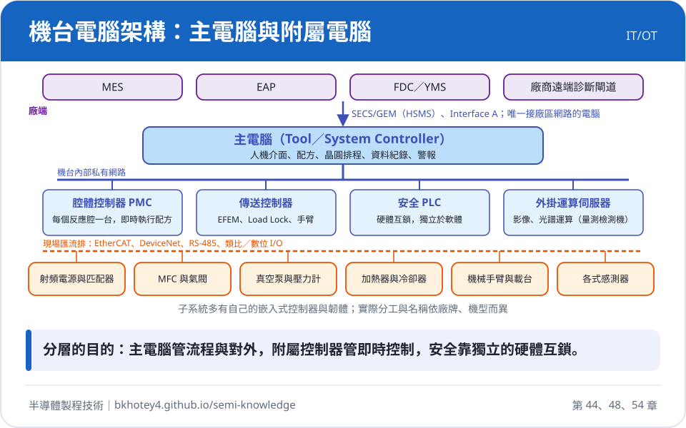

# 設備機型圖鑑

整理各設備廠目前的代表產品系列：用在哪一站、核心技術、代表型號，以及機台裡的主電腦與附屬電腦如何分工。每個機型都附一張機台示意圖，左邊是機台硬體，右邊是主電腦與附屬電腦，虛線表示由哪台電腦控制哪個部位。

!!! note "說明"
    示意圖為通用結構，並非任何廠牌的實際外觀；型號依公開資料整理，各廠持續推出新機型。電腦架構為同類機台的通用分層，實際的電腦數量、名稱與作業系統依廠牌與機型而異。

<figure markdown>

<figcaption>先看懂這張：機台電腦的分層架構</figcaption>
</figure>

