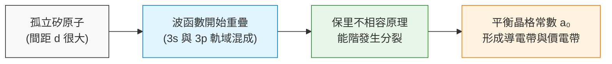
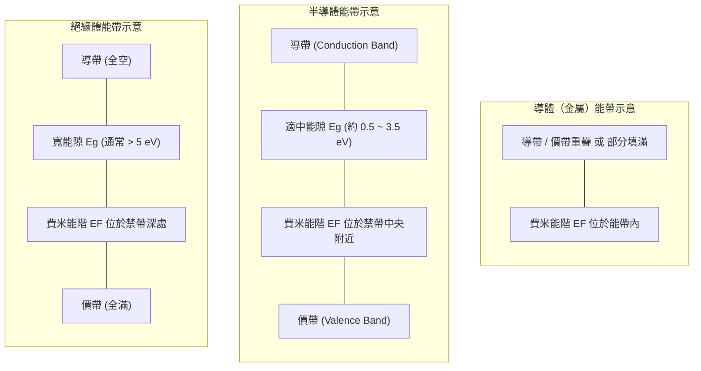
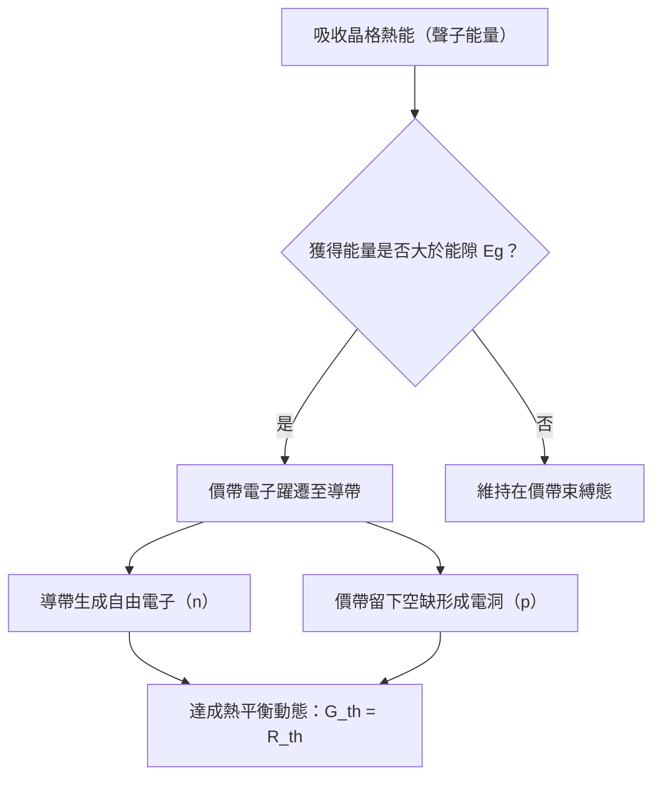
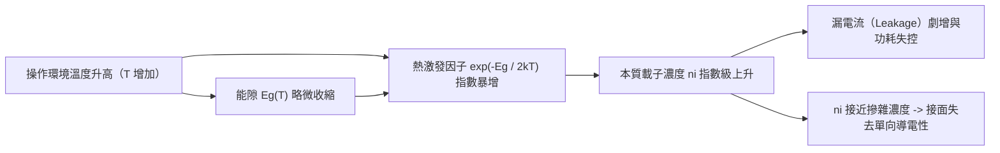
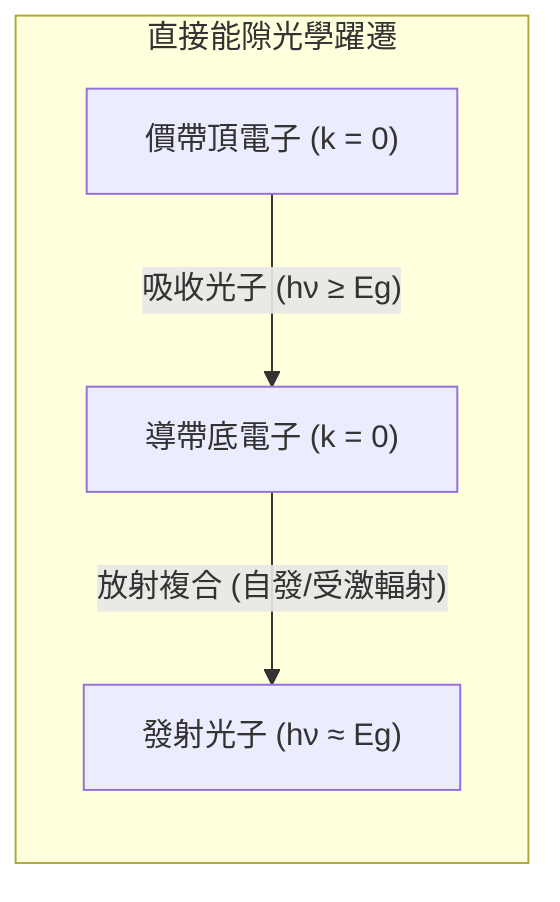
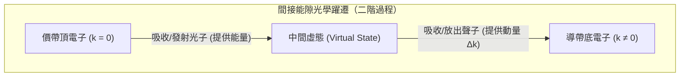

# 第 1 章　半導體材料與能帶理論

!!! abstract "學習目標"
    - 理解週期性晶格勢場如何誘發電子能階分裂並形成能帶結構
    - 掌握導體、絕緣體與半導體在能帶結構與費米能階位置上的根本差異
    - 推導本質載子濃度與能隙寬度、熱力學溫度之間的指數關係
    - 區分直接能隙與間接能隙半導體的電子躍遷機制及其在光電元件之應用差異

## 1.1 晶格週期性與能帶形成機制

### 晶體結構與週期性勢場

半導體材料的電學特性主要由其內部的電子運動狀態所決定。在固體物理學中，固體依據其內部原子的排列規律性，可分為非晶質（Amorphous）、多晶（Polycrystalline）與單晶（Single Crystal）。用於製造高積體電路元件的核心區域，大多採用高度定向且具備完美週期性排列的單晶結構，例如具有鑽石結構（Diamond Structure）的單晶矽（Single-crystal Silicon）。

在孤立原子中，電子僅受單一原子核的庫侖位能（Coulomb Potential）作用。然而，在單晶結構中，原子以固定間距規則排列，形成週期性晶格（Periodic Lattice）。此時，任何一個電子在晶體內部移動時，除了受到所在原子核吸引外，亦同時受到鄰近所有原子核與其他電子的共同作用，因而處於一個具有晶格週期性的位能勢場 $V(\mathbf{r})$ 中：

$$V(\mathbf{r} + \mathbf{R}) = V(\mathbf{r})$$

式中，$\mathbf{r}$ 為電子的空間位置向量，$\mathbf{R}$ 為晶格平移向量（Lattice Translation Vector），代表晶格週期性排列的平移長度。

為描述電子在此週期性勢場中的量子行為，需採用不含時薛丁格方程式（Time-independent Schrödinger Equation）。一維簡化模型可寫為：

$$\left[ -\frac{\hbar^2}{2m_0} \frac{d^2}{dx^2} + V(x) \right] \psi(x) = E \psi(x)$$

式中：
*   $\hbar = \frac{h}{2\pi}$ 為約化普朗克常數（Reduced Planck Constant，約為 $1.054 \times 10^{-34} \text{ J}\cdot\text{s}$）
*   $m_0$ 為自由電子靜止質量（Free Electron Rest Mass，約為 $9.11 \times 10^{-31} \text{ kg}$）
*   $V(x)$ 為具有晶格週期 $a$ 的位能勢場，滿排 $V(x + a) = V(x)$，其中 $a$ 為晶格常數（Lattice Constant）
*   $\psi(x)$ 為電子的波函數（Wavefunction）
*   $E$ 為電子的總能量（Total Energy）

根據布洛赫定理（Bloch's Theorem），在週期性勢場 $V(x) = V(x+a)$ 中運動的電子，其解出的波函數 $\psi_k(x)$ 必須具有以下形式：

$$\psi_k(x) = u_k(x) e^{ikx}$$

式中，$u_k(x)$ 為具備與晶格相同週期性的函數（即 $u_k(x + a) = u_k(x)$），$e^{ikx}$ 則為平面波因子，$k$ 為晶格波向量（Wave Vector）。此結果稱為布洛赫波（Bloch Wave），說明在完美的週期性晶格中，電子並不會像巨觀粒子般不斷與晶格原子發生碰撞，而是以調變平面波的形式在晶體中傳播。

物理學家哥尼與克雷尼（Kronig-Penney Model）提出一維週期性矩形勢井模型求解薛丁格方程式，證實電子在週期性勢場中運動時，其能量 $E$ 與波向量 $k$ 之間的關係（即 $E\text{-}k$ 關係）並非連續的自由粒子拋物線，而是會出現允許電子存在的「允許帶（Allowed Band）」以及不允許電子存在的「禁帶（Forbidden Band）」。這是晶體中能帶（Energy Band）形成的量子力學基礎。

---

### 孤立原子能階與能帶分裂機制

若從微觀的原子靠近過程來觀察能帶的形成，可以更直觀地理解其物理機制。

當兩個相同的原子相距極遠（距離 $d \to \infty$）時，各自的電子受限於各自的原子核位能井中，呈現完全相同的離散能階（Discrete Energy Levels），如 $1s, 2s, 2p, 3s, 3p$ 等。

當 $N$ 個相同原子彼此靠近並凝聚成固體晶體時，原子的外層電子（價電子，Valence Electrons）波函數開始發生重疊（Overlap）。依據量子力學中的保里不相容原理（Pauli Exclusion Principle），在同一個量子系統中，絕不能有兩個相同的費米子（如電子）處於完全相同的量子態。

因此，當 $N$ 個原子相互接近至晶格常數數量級時，原先孤立原子的每一個單一離散能階，都會分裂（Split）成 $N$ 個能量極為接近但互不相同的微小能階。因為晶體中的原子數量 $N$ 非常龐大（阿伏伽德羅數數量級，固體中典型原子密度約為 $10^{22} \sim 10^{23} \text{ cm}^{-3}$），這 $N$ 個分裂出來的能階之間的能量間隔極小（約為 $10^{-23} \text{ eV}$），在巨觀上無法解析其離散性，因而形成連續的「能帶」。

以矽（Si）原子為例，其基態電子組態為 $1s^2 2s^2 2p^6 3s^2 3p^2$。內層電子（$1s, 2s, 2p$）受原子核強烈束縛，波函數重疊極小，能階分裂不明顯；而外層的 $3s$ 與 $3p$ 軌域則發生劇烈重疊。在原子互相靠近過程中，$3s$ 與 $3p$ 能階首先相互混合形成混成軌域（$sp^3$ Hybridization），隨後進一步分裂為兩個獨立的能帶：

當原子間距縮小至平衡晶格常數 $a_0$ 時，下方的能帶剛好包含 $4N$ 個量子態，並在絕對零度（$0 \text{ K}$）時被矽原子的 4 個價電子完全填滿；上方的能帶亦包含 $4N$ 個量子態，但在 $0 \text{ K}$ 時完全為空。兩能帶之間則存在一段無量子態可供電子占據的能量區域。

---

### 價電帶、導電帶與禁帶之定義

透過上述能階分裂過程，可精確定義半導體與絕緣體中最核心的三個能帶區域：

1.  **價電帶（Valence Band, VB）**：在絕對零度（$0 \text{ K}$）且無外加激發能量下，由價電子所填滿的最高能量帶。價電帶最高點的能量值通常表示為 $E_v$。在 $0 \text{ K}$ 時，由於價電帶內所有量子態均被填滿，電子無法在能帶內取得額外能量進行淨定向移動，因此完全不具備導電能力。
2.  **導電帶（Conduction Band, CB）**：位於價電帶上方的第一個未被電子填滿（或完全空白）的能帶。導電帶最低點的能量值表示為 $E_c$。當電子獲得足夠能量從價電帶躍遷至導電帶後，該電子可在此帶內的未占據量子態之間自由移動，並在施加外加電場時形成導電電流。
3.  **禁帶 / 能隙（Forbidden Band / Energy Bandgap, $E_g$）**：位於價電帶頂端（$E_v$）與導電帶底端（$E_c$）之間的能量區域。在此能量範圍內，理想晶體中不存在任何可供電子占據的量子態。

能隙的大小（Bandgap Energy，以 $E_g$ 表示）定義為導電帶底與價電帶頂之能量差：

$$E_g = E_c - E_v$$

能隙的單位通常採用電子伏特（Electron-Volt, $\text{eV}$）。$1 \text{ eV}$ 定義為一個電子經過 $1 \text{ V}$ 電位差加速後所獲得的動能，換算為焦耳（Joule）為：

$$1 \text{ eV} = 1.602 \times 10^{-19} \text{ J}$$

下表總結價電帶、導電帶與禁帶的基本特徵與定義：

| 能帶名稱 | 符號與關鍵邊界 | $0 \text{ K}$ 下的電子填充狀態 | 電荷傳輸能力 |
| :--- | :--- | :--- | :--- |
| **導電帶** (Conduction Band) | 底端能量為 $E_c$ | 完全空白（未填滿） | 高（若有熱激發或注入電子） |
| **禁帶 / 能隙** (Forbidden Band) | 寬度 $E_g = E_c - E_v$ | 無容許量子態 | 無電子存在（理想晶體） |
| **價電帶** (Valence Band) | 頂端能量為 $E_v$ | 完全填滿 | 僅在有電洞存在時可導電 |

!!! warning "常見誤解：能隙不是空間距離"
    在閱讀能帶圖（$E\text{-}x$ 圖）時，縱軸代表電子的**能量（Energy）**，橫軸代表**空間位置（Position）**。禁帶 $E_g$ 指的是**能量間隔**，而非實體空間中的實體距離或孔洞。電子從價電帶跨越能隙進入導電帶，是指電子獲得了至少 $E_g$ 的能量，而非在空間上移動了某段物理距離。

!!! note "說明：載子觀點的初探"
    當電子吸收足夠能量（如熱能或光能）跨越能隙 $E_g$ 進入導電帶時，導電帶增加了一個自由電子；同時，價電帶中原先被填滿的狀態會留出一個未填滿的空位。這個在價電帶中缺少的電子狀態，可等效視為一個帶正電的準粒子，稱為**電洞（Hole）**。電子與電洞統稱為半導體中的**載子（Carrier）**，其定量傳輸特性將於第 2 章詳細討論。

## 1.2 導體、絕緣體與半導體之能帶結構比較

固體材料的電氣傳導特性在室溫下呈現極為巨大的跨度，其電導率（electrical conductivity, $\sigma$）從極佳導體如銀、銅的約 $10^6 \text{ S/cm}$，到優良絕緣體如二氧化矽（$\text{SiO}_2$）的 $10^{-16} \text{ S/cm}$ 以下，涵蓋超過二十個數量級。如此顯著的物理性質差異，本質上取決於材料內部電子的能帶結構（energy band structure）、能帶的電子填充程度，以及費米能階（Fermi level, $E_F$）相對於能帶邊界的相對位置。

本節將固體材料分為導體、絕緣體與半導體三大類，深入剖析其能帶拓撲特徵與載子統計分佈機制。

---

### 導體：未填滿能帶與無能隙特徵

導體（conductor）最顯著的微觀特徵為其價電子所處的最外層能帶並未填滿，或是存在相互重疊的導帶（conduction band, CB）與價帶（valence band, VB），因而在可供電子佔據的態密度（density of states, DOS）分佈中，不存在阻礙躍遷的能量禁帶（forbidden band）。

導體的能帶結構主要呈現兩種形式：

1. **單一能帶部分填滿（Partially Filled Band）**：
   以第一族鹼金屬（如鈉 $\text{Na}$）或第十一族金屬（如銅 $\text{Cu}$、金 $\text{Au}$）為代表。此類原子的最外層 $s$ 軌域僅填入一個電子，當無數原子凝聚成晶體時，原先簡併的價電子軌域分裂成能帶。由於泡利不相容原理（Pauli exclusion principle），每個空間量子態可容納兩個自旋相反的電子，因此該能帶僅被填滿一半。費米能階 $E_F$ 直接穿過此能帶內部。
2. **能帶重疊（Band Overlap）**：
   以第二族鹼土金屬（如鎂 $\text{Mg}$）為代表。儘管其孤立原子的外層 $s$ 軌域已被兩個電子填滿，但在晶體週期性位能場的作用下，分裂開展的 $s$ 能帶頂端與能量較高的 $p$ 能帶底端發生重疊，導致能隙為零（$E_g = 0$）。電子得以無障礙地在重疊的能量空間中流動。

在量子力學描述中，電子的宏觀電流傳輸需要電子由原先的量子態躍遷至動量方向與外加電場相反的空態（empty states）。在導體中，由於費米能階周圍存在極高密度的未佔據量子態，即便僅施加微小的外加電場 $\mathcal{E}$，電子只需吸收無限小的能量 $dE$，即可越過能量階躍並加速，產生宏觀漂移電流。因此，金屬在絕對零度（$0\text{ K}$）下依然維持良好的導電能力，其電阻率在有限溫度下的升高主要來自聲子（晶格振動）散射，而非載子數量的匱乏。

---

### 絕緣體：寬能隙與載子熱激發屏障

絕緣體（insulator）的電子基態呈現另一種極端。在絕對零度下，絕緣體的價帶（低能量能帶）被電子完全填滿，而導帶（高能量能帶）則完全處於空態。價帶頂（valence band maximum, $E_v$）與導帶底（conduction band minimum, $E_c$）之間被一個極寬的能隙（bandgap, $E_g$）隔開：

$$E_g = E_c - E_v$$

絕緣體的典型能隙通常大於 $5\text{ eV}$。例如，微電子製程中廣泛使用的絕緣介電材料二氧化矽（$\text{SiO}_2$）的 $E_g$ 約為 $9.0\text{ eV}$，氮化矽（$\text{Si}_3\text{N}_4$）約為 $5.0\text{ eV}$，金剛石（diamond）則約為 $5.5\text{ eV}$。

電子的熱激發機率由費米—狄拉克分佈函數（Fermi-Dirac distribution function）決定：

$$f(E) = \frac{1}{1 + \exp\left(\frac{E - E_F}{k_B T}\right)}$$

其中：
- $k_B$ 為波茲曼常數（Boltzmann constant，約 $8.617 \times 10^{-5}\text{ eV/K}$）
- $T$ 為絕對溫度（單位：$\text{K}$）
- $E_F$ 為費米能階

在室溫環境下（$T = 300\text{ K}$），熱能的特徵尺度 $k_B T$ 僅約為 $0.0259\text{ eV}$。對於 $E_g > 5\text{ eV}$ 的絕緣體，價帶頂部的電子若要越過禁帶躍遷至導帶底，所需的激發能量遠大於室溫熱能尺度：

$$\frac{E_g}{k_B T} \approx \frac{5}{0.0259} \approx 193$$

由此算得熱激發因子 $\exp\left(-\frac{E_g}{2 k_B T}\right) \approx 10^{-42}$。此數值顯示，在熱平衡狀態下，絕緣體導帶內部的自由電子濃度以及價帶內的電洞濃度在巨觀尺度下趨近於零。

根據能帶理論，一個被完全填滿的能帶（如價帶）因其所有可能的布洛赫態（Bloch states）均被佔據，布里淵區內所有電子動量向量之和嚴格為零，外加電場無法在此封閉系統中改變電子的動量統計分佈，故不產生淨電流；而導帶因缺乏載子，亦無法導電。這正是絕緣體呈現極高電阻率的根本原因。唯有施加超越材料極限的強電場，引發衝擊游離（impact ionization）或齊納穿隧（Zener tunneling），才會發生介電崩潰（dielectric breakdown）。

---

### 半導體：適中能隙與費米能階的調控樞紐

半導體（semiconductor）的能帶拓撲結構在定性上與絕緣體相同——在絕對零度下，價帶全滿，導帶全空，中間存在禁帶。兩者的本質差異在於半導體的能隙寬度適中，典型範圍約在 $0.5\text{ eV}$ 至 $3.5\text{ eV}$ 之間。

常見純半導體材料在室溫（$300\text{ K}$）下的能隙典型值如下：
- 鍺（$\text{Ge}$）：$E_g \approx 0.66\text{ eV}$
- 矽（$\text{Si}$）：$E_g \approx 1.12\text{ eV}$
- 砷化鎵（$\text{GaAs}$）：$E_g \approx 1.42\text{ eV}$
- 碳化矽（$4\text{H-SiC}$）：$E_g \approx 3.26\text{ eV}$
- 氮化鎵（$\text{GaN}$）：$E_g \approx 3.44\text{ eV}$

| 材料類別 | 代表性材料 | 室溫能隙 $E_g$（典型值） | 費米能階 $E_F$ 相對位置 | 室溫電導率 $\sigma\ (\text{S/cm})$（典型範圍） | 傳導機制特徵 |
| :--- | :--- | :--- | :--- | :--- | :--- |
| **導體** | $\text{Cu}, \text{Al}, \text{Au}$ | $0\text{ eV}$（重疊或未滿） | 位於導帶或重疊帶內部 | $10^5 \sim 10^6$ | 大量自由電子，電阻隨溫度升高而上升 |
| **半導體** | $\text{Si}, \text{Ge}, \text{GaAs}$ | $0.5 \sim 1.5\text{ eV}$ | 禁帶內部（受摻雜與溫度強烈調控） | $10^{-6} \sim 10^2$（隨摻雜變動） | 熱激發產生電子-電洞對，電阻隨溫度升高而下降 |
| **寬能隙半導體** | $\text{SiC}, \text{GaN}$ | $3.0 \sim 3.5\text{ eV}$ | 禁帶內部（深能階需工程調控） | $10^{-10} \sim 10^1$（未摻雜至重摻雜） | 具極高擊穿電場與耐高溫特性 |
| **絕緣體** | $\text{SiO}_2, \text{Si}_3\text{N}_4$ | $> 5.0\text{ eV}$ | 位於深禁帶中央區域 | $< 10^{-14}$ | 載子濃度極低，正常工作電場下不導電 |

#### 費米能階在半導體中的物理意涵

費米能階 $E_F$ 在熱力學上等價於電子系統的化學勢（chemical potential, $\mu$），代表系統增加一個電子時自由能的變化量。在未受摻雜的本質半導體（intrinsic semiconductor）中，導帶電子濃度 $n$ 必須嚴格等於價帶電洞濃度 $p$。透過馬克士威—波茲曼近似（Maxwell-Boltzmann approximation），載子濃度可表述為：

$$n = N_c \exp\left(-\frac{E_c - E_F}{k_B T}\right)$$

$$p = N_v \exp\left(-\frac{E_F - E_v}{k_B T}\right)$$

其中：
- $N_c$ 為導帶的有效態密度（effective density of states for conduction band）
- $N_v$ 為價帶的有效態密度（effective density of states for valence band）

由本質電荷中性條件 $n = p = n_i$（$n_i$ 為本質載子濃度），可解析求得本質費米能階 $E_i$：

$$E_i = \frac{E_c + E_v}{2} + \frac{1}{2} k_B T \ln\left(\frac{N_v}{N_c}\right)$$

由於第二項 $\frac{1}{2} k_B T \ln(N_v/N_c)$ 涉及電子與電洞的有效質量比值，其修正幅度在室溫下通常僅有數個毫電子伏特（$\text{meV}$），因此本質半導體的費米能階幾乎精準座落於禁帶正中央。

由於能隙僅約 $1\text{ eV}$，室溫熱能激發雖然微弱，但已足以使本質矽產生約 $n_i \approx 1.0 \times 10^{10}\text{ cm}^{-3}$ 的載子濃度。更重要的是，由於費米能階位於禁帶中，半導體對雜質原子異常敏感：透過引入極微量的三價或五價雜質元素（摻雜工程，詳見第 2 章），即可大幅移動 $E_F$ 的相對位置，使其靠近導帶底（N 型半導體）或價帶頂（P 型半導體），從而將電導率調控多達八個數量級以上。這種能帶結構賦予了半導體作為固態電子開關元件的物理基礎。

!!! note "說明：費米能階於禁帶中的熱力學意義"
    初學者常疑惑：既然禁帶內「不允許存在電子的量子態」，為何費米能階 $E_F$ 可以座落在禁帶之中？
    費米能階本質上是一個**統計參數**與**熱力學化學勢**，代表「若該能量處存在量子態，其被電子佔據的機率恰為 $50\%$ 的虛擬參考基準」。它並非實體存在的電子能量，因此其座落於禁帶中央與量子力學禁止帶中存在連續態密度的特徵並無矛盾。

!!! warning "常見誤解：半導體與絕緣體的絕對邊界"
    在物理本質上，半導體與絕緣體之間並無絕對的拓撲相變或對稱性差異。兩者在結晶學與量子態架構上皆屬於「滿價帶、空導帶」系統，本質區別純粹在於能隙大小相對於操作環境熱能（$k_B T$）的比例。
    若將典型半導體降溫至接近絕對零度（$0\text{ K}$），其熱激發載子完全「凍結」（carrier freeze-out），表現將與理想絕緣體無異；反之，若將金剛石或寬能隙氧化物加熱至數千度高溫，熱激發電子顯著增加，絕緣體亦會展現半導體的導電行為。

!!! example "產業實例：寬能隙半導體的能帶優勢"
    氮化鎵（$\text{GaN}$）與碳化矽（$\text{SiC}$）通常被稱為第三代半導體或寬能隙半導體（wide bandgap semiconductors）。相較於傳統矽材料（$E_g \approx 1.12\text{ eV}$），$\text{GaN}$ 擁有高達約 $3.4\text{ eV}$ 的適中寬能隙。
    此結構特性帶來了雙重物理優勢：一方面，過渡至導帶所需的游離能量大幅提高，使得材料具備極高的臨界擊穿電場（critical breakdown field，典型值達 $3.3\text{ MV/cm}$，約為矽的十倍），可承受極高電壓而不發生突崩潰；另一方面，其兼具較高之電子飽和漂移速率（saturation drift velocity）。這使 $\text{GaN}$ 高電子遷移率電晶體（HEMT）成為消費性電子高功率快充轉換器、以及高頻 5G 基地台射頻（RF）功率放大器的核心材料。能隙與載子傳輸特性的詳細數學模型將於第 10 章深入探討。

## 1.3 能隙與本質載子濃度的溫度依存性

### 熱激發與電子-電洞對生成機制

在絕對零度（$T = 0\text{ K}$）下，純淨半導體內部所有的價電子皆受共價鍵束縛，價帶（Valence Band, VB）處於完全填滿狀態，導帶（Conduction Band, CB）則完全為空。此時體系內不存在可自由移動的載子，材料在微觀上表現為理想絕緣體。

當環境溫度上升至 $T > 0\text{ K}$ 時，晶格原子獲得熱能產生熱振動，這些晶格振動的能量量子稱為聲子（Phonon）。價帶頂部的電子吸收足夠的熱能後，有一定機率克服能隙（Energy Bandgap, $E_g$）的能障，躍遷至導帶底部成為可自由傳導的自由電子（Free Electron）。與此同時，價電子躍遷後在共價鍵結構中所留下的空缺，表現出等效的正電荷性質，稱為電洞（Hole）。

此一生成成對自由載子的過程稱為熱激發生成（Thermal Generation），所產生的電子與電洞統稱為電子-電洞對（Electron-Hole Pair, EHP）。在熱平衡狀態下，熱激發生成速率 $G_{th}$ 與載子複合速率（Recombination Rate）$R_{th}$ 達到動態平衡（$G_{th} = R_{th}$），使得半導體內的電子濃度與電洞濃度維持恆定。

未經人工雜質摻雜的純淨半導體稱為本質半導體（Intrinsic Semiconductor）。由於本質半導體中的載子完全由共價鍵斷裂的熱激發所產生，因此導帶中的自由電子濃度 $n$ 必然恆等於價帶中的電洞濃度 $p$。此時的載子濃度定義為本質載子濃度（Intrinsic Carrier Concentration），以 $n_i$ 表示：

$$n = p = n_i$$

---

### 載子統計與有效狀態密度

要定量推導 $n_i$，必須結合量子力學中的狀態密度（Density of States, DOS）與統計力學中的費米-狄拉克分佈函數（Fermi-Dirac Distribution Function）。導帶中的電子濃度 $n$ 與價帶中的電洞濃度 $p$ 可分別表示為能階積分：

$$n = \int_{E_c}^{\infty} g_c(E) f(E) \, dE$$

$$p = \int_{-\infty}^{E_v} g_v(E) [1 - f(E)] \, dE$$

其中 $E_c$ 為導帶底能階，$E_v$ 為價帶頂能階；$g_c(E)$ 與 $g_v(E)$ 分別為導帶與價帶的狀態密度；$f(E)$ 為費米-狄拉克分佈函數：

$$f(E) = \frac{1}{1 + \exp\left(\frac{E - E_F}{kT}\right)}$$

式中 $E_F$ 為費米能階（Fermi Level），$k$ 為波茲曼常數（Boltzmann Constant，$k \approx 8.617 \times 10^{-5}\text{ eV/K}$），$T$ 為絕對溫度。

在非簡併半導體（Non-degenerate Semiconductor）條件下，費米能階距離導帶底與價帶頂均大於數個 $kT$（通常要求 $|E_c - E_F| \ge 3kT$ 且 $|E_F - E_v| \ge 3kT$）。此時指數項遠大於 1，費米-狄拉克分佈可簡化為馬克士威-波茲曼分佈（Maxwell-Boltzmann Approximation）：

$$f(E) \approx \exp\left(-\frac{E - E_F}{kT}\right) \quad (\text{適用於 } E - E_F \ge 3kT)$$

$$1 - f(E) \approx \exp\left(-\frac{E_F - E}{kT}\right) \quad (\text{適用於 } E_F - E \ge 3kT)$$

引入三維晶格的狀態密度進行積分後，可將連續分佈的能帶簡化為單一能量參考點上的「有效狀態密度」（Effective Density of States）：

$$n = N_c \exp\left(-\frac{E_c - E_F}{kT}\right)$$

$$p = N_v \exp\left(-\frac{E_F - E_v}{kT}\right)$$

其中 $N_c$ 與 $N_v$ 分別為導帶與價帶的有效狀態密度，定義為：

$$N_c = 2 \left( \frac{2\pi m_n^* kT}{h^2} \right)^{3/2}$$

$$N_v = 2 \left( \frac{2\pi m_p^* kT}{h^2} \right)^{3/2}$$

式中 $m_n^*$ 與 $m_p^*$ 分別為電子與電洞的狀態密度有效質量（Density-of-States Effective Mass），$h$ 為普朗克常數（Planck Constant）。由此可見，$N_c$ 與 $N_v$ 隨溫度呈現 $T^{3/2}$ 的比例關係。

---

### 本質載子濃度之定量數學模型

根據質量作用定律（Law of Mass Action），在熱平衡狀態下，電子濃度與電洞濃度的乘積與費米能階 $E_F$ 的具體位置無關：

$$np = N_c N_v \exp\left(-\frac{E_c - E_v}{kT}\right) = N_c N_v \exp\left(-\frac{E_g}{kT}\right)$$

由於能隙定義為導帶底與價帶頂之能量差，即 $E_g = E_c - E_v$。對於本質半導體而言，$n = p = n_i$，因此：

$$n_i^2 = np = N_c N_v \exp\left(-\frac{E_g}{kT}\right)$$

兩邊開平方根，即可得到本質載子濃度 $n_i$ 的嚴密表達式：

$$n_i(T) = \sqrt{N_c N_v} \exp\left(-\frac{E_g}{2kT}\right)$$

將有效狀態密度的溫度依存性代入，可明確寫出 $n_i$ 對溫度的函數關係：

$$n_i(T) = 2 \left( \frac{2\pi kT}{h^2} \right)^{3/2} (m_n^* m_p^*)^{3/4} \exp\left(-\frac{E_g(T)}{2kT}\right) = B \cdot T^{3/2} \exp\left(-\frac{E_g(T)}{2kT}\right)$$

其中 $B$ 為與材料有效質量相關的材料常數。

!!! note "本質費米能階之位置"
    令 $n = p = n_i$，可推導出本質費米能階（Intrinsic Fermi Level, $E_i$）在能隙中的相對位置：
    $$E_i = \frac{E_c + E_v}{2} + \frac{3}{4} kT \ln\left(\frac{m_p^*}{m_n^*}\right)$$
    在 $T = 0\text{ K}$ 時，$E_i$ 恰好位於能隙正中央；而在常溫下，由於矽的電洞有效質量與電子有效質量相近，第二項修正量極小（通常在數個 $\text{meV}$ 以內），故在工程分析中，常將本質費米能階近似為能帶中央（Mid-gap）。

---

### 能隙的溫度依存性：Varshni 經驗公式

能隙 $E_g$ 並非恆定不變的常數，而是會隨溫度升高而收縮。造成此現象的主因為兩項微觀量子效應：
1. **熱膨脹引起晶格常數改變**：溫度升高使晶格原子間距擴大，原子核對外層電子的束縛位能重組，導致能帶重疊度改變。
2. **電子與聲子相互作用（Electron-Phonon Interaction）**：晶格熱震盪增強了散射機率，促使電子自能（Self-energy）修正，進而壓縮能隙。

能隙隨溫度的非線性遞減規律，可採用 Varshni 經驗方程式定量描述：

$$E_g(T) = E_g(0) - \frac{\alpha T^2}{T + \beta}$$

其中 $E_g(0)$ 為絕對零度下的能隙寬度，$\alpha$ 與 $\beta$ 為特定半導體材料的經驗參數。

下表列出半導體製程常用材料之能隙參數與室溫典型物理數值（$T = 300\text{ K}$）：

| 材料分類 | 材料名稱 | $E_g(0)\text{ (eV)}$ | $\alpha\text{ (eV/K)}$ | $\beta\text{ (K)}$ | $E_g(300\text{ K})\text{ (eV)}$ | $n_i(300\text{ K})\text{ (cm}^{-3}\text{)}$ 典型值 |
| :--- | :--- | :--- | :--- | :--- | :--- | :--- |
| 第 IV 族半導體 | 矽（Si） | $1.170$ | $4.73 \times 10^{-4}$ | $636$ | $1.12$ | $\sim 1.0 \times 10^{10}$ |
| 第 IV 族半導體 | 鍺（Ge） | $0.744$ | $4.77 \times 10^{-4}$ | $235$ | $0.66$ | $\sim 2.4 \times 10^{13}$ |
| III-V 族化合物 | 砷化鎵（GaAs） | $1.519$ | $5.41 \times 10^{-4}$ | $204$ | $1.42$ | $\sim 2.1 \times 10^{6}$ |
| 寬能隙半導體 | 碳化矽（4H-SiC）| $3.265$ | $6.50 \times 10^{-4}$ | $1200$ | $3.23$ | $\sim 5.0 \times 10^{-9}$ |
| 寬能隙半導體 | 氮化鎵（GaN） | $3.470$ | $9.09 \times 10^{-4}$ | $830$ | $3.40$ | $\sim 1.0 \times 10^{-10}$ |

---

### 矽晶體的溫度效應與高溫操作限制

由 $n_i(T) \propto T^{3/2} \exp\left(-\frac{E_g}{2kT}\right)$ 可知，溫度對 $n_i$ 的影響極度強烈。前項 $T^{3/2}$ 表現為代數增長，而後項指數項則隨溫度提升而暴增。在工程實務中，指數項的主導性遠高於前項。

以矽晶體為例，在室溫 $300\text{ K}$ 時，$n_i \approx 1.0 \times 10^{10}\text{ cm}^{-3}$。當溫度上升至 $400\text{ K}$（約 $127^\circ\text{C}$）時，$n_i$ 會攀升至約 $1.5 \times 10^{12}\text{ cm}^{-3}$，增加超過兩個數量級；而在 $500\text{ K}$（約 $227^\circ\text{C}$）時，$n_i$ 更進一步突破 $10^{14}\text{ cm}^{-3}$。

本質載子濃度對溫度的急遽上升，對半導體元件帶來嚴峻的物理限制：

1. **元件失去摻雜控制能力（本質化轉變）**：
   在第 2 章將會探討摻雜半導體。若摻雜半導體的施體濃度為 $N_D = 10^{15}\text{ cm}^{-3}$，在室溫下，自由電子濃度主要由摻雜物主導（$n \approx N_D$）。然而，一旦工作溫度過高導致 $n_i$ 升高至可與 $N_D$ 比擬或超越 $N_D$ 時，熱激發載子將掩蓋人工摻雜的效果，半導體轉變回本質狀態，使原本設計的 PN 接面（見第 3 章）整流特性喪失，導致元件全面失效。
2. **反向漏電流（Reverse Leakage Current）呈指數增加**：
   PN 接面二極體或金氧半場效電晶體（MOSFET，見第 4 章）的接面漏電流通常正比於 $n_i$ 或 $n_i^2$。高溫導致的漏電流劇增會造成待機功耗嚴重惡化，甚至引發熱失控（Thermal Runaway）。

!!! warning "高溫外推時忽略 $E_g(T)$ 造成的誤差"
    在粗略估算中，部分工程分析常將 $E_g$ 視為常數。然而在計算 $450\text{ K}$ 以上的高溫 $n_i$ 時，若未計入 Varshni 方程式所帶來的能隙收縮效應，會低估指數項分子，導致計算所得的 $n_i$ 誤差可達數倍以上。高精度元件模擬軟體（TCAD）皆必須同步解算晶格溫度、收縮後能隙與載子分佈。

!!! example "產業實例：寬能隙半導體之高溫與功率優勢"
    矽基功率元件（如 Si MOSFET 與 IGBT）的理論最高接面溫度（Junction Temperature, $T_j$）受限於 $n_i$ 上升引起的漏電與本質化現象，實務極限通常落在 $150^\circ\text{C} \sim 175^\circ\text{C}$。
    
    相對地，碳化矽（4H-SiC, $E_g \approx 3.23\text{ eV}$）與氮化鎵（GaN, $E_g \approx 3.40\text{ eV}$）等寬能隙材料，其 $E_g$ 約為矽的 3 倍。在指數抑制效應下，GaN 在室溫下的 $n_i$ 僅約 $10^{-10}\text{ cm}^{-3}$，甚至在 $500^\circ\text{C}$ 的極端高溫下，$n_i$ 依然遠低於一般矽元件在室溫下的數值。這使得 GaN 元件具備極低的接面漏電流與卓越的抗熱崩潰能力，成為高功率密度的消費型快速充電器、車用電力轉換器及高頻射頻（RF）功率放大器的核心材料。

## 1.4 動量守恆與直接/間接能隙半導體

### 能量-波矢色散關係與第一布里淵區

在週期性晶格中，電子的量子行為由布洛赫定理（Bloch's Theorem）描述。電子波函數可表述為平面波與週期性調變函數的乘積：

$$\psi_{\mathbf{k}}(\mathbf{r}) = u_{\mathbf{k}}(\mathbf{r}) e^{i \mathbf{k} \cdot \mathbf{r}}$$

其中 $\mathbf{r}$ 為空間座標向量，$u_{\mathbf{k}}(\mathbf{r})$ 具備與晶格完全相同的空間週期性（即對任意晶格向量 $\mathbf{R}$，滿足 $u_{\mathbf{k}}(\mathbf{r} + \mathbf{R}) = u_{\mathbf{k}}(\mathbf{r})$），而 $\mathbf{k}$ 為波向量（Wavevector）。

在晶體物理中，波向量 $\mathbf{k}$ 存在於倒易空間（Reciprocal Space，又稱動量空間）。由於晶格具有週期性，所有的能量狀態均可在倒易晶格的最小重複單元內完整描述，該最小單元即為「第一布里淵區」（First Brillouin Zone）。電子的能量 $E$ 與波向量 $\mathbf{k}$ 之間的函數關係 $E(\mathbf{k})$ 稱為能量-波矢色散關係（$E\text{-}\mathbf{k}$ Dispersion Relation），此關係直觀地描繪了電子在各晶向上的能帶結構。

純量子力學中，電子的真實動量為動量算符之期望值，但在晶體內部，電子受到週期性位能場的作用，其動量並非守恆量。取而代之的是由外力定義的「晶體動量」（Crystal Momentum）$\mathbf{p}_{\text{crystal}}$：

$$\mathbf{p}_{\text{crystal}} = \hbar \mathbf{k}$$

其中 $\hbar = \frac{h}{2\pi}$ 為約化普朗克常數（Reduced Planck Constant）。在涉及電子、光子與晶格振動的交互作用中，晶體動量在第一布里淵區內遵守守恆定律。

導帶最低處稱為「導帶底」（Conduction Band Minimum, CBM），價帶最高處稱為「價帶頂」（Valence Band Maximum, VBM）。半導體材料的發光與光吸收行為，主要取決於 CBM 與 VBM 在第一布里淵區中的相對動量位置。

---

### 直接能隙材料之光學躍遷機制

當半導體材料的導帶底與價帶頂在第一布里淵區中對齊於相同的波向量 $\mathbf{k}$（通常位於布里淵區中心，即 $\mathbf{k} = 0$ 的 $\Gamma$ 點）時，該材料稱為「直接能隙」（Direct Bandgap）半導體。典型範例包括砷化鎵（GaAs）與氮化鎵（GaN）。

在直接能隙材料中，電子在導帶底與價帶頂之間的躍遷涉及電子的能量改變以及與電磁輻射（光子）的交互作用。能量守恆定律要求：

$$E_f - E_i = h\nu$$

其中 $E_i$ 與 $E_f$ 分別為躍遷起始態與最終態的電子能量，$h$ 為普朗克常數，$\nu$ 為光子頻率。同時，整個系統必須滿足動量守恆：

$$\mathbf{k}_f - \mathbf{k}_i = \mathbf{k}_{\text{photon}}$$

波長為 $\lambda$ 的光子，其波矢大小為：

$$|\mathbf{k}_{\text{photon}}| = \frac{2\pi}{\lambda} = \frac{h\nu}{\hbar c}$$

以能隙約 $1.42\text{ eV}$ 的 GaAs 為例，對應的光子波長約為 $873\text{ nm}$，其波矢大小為：

$$|\mathbf{k}_{\text{photon}}| \approx \frac{2\pi}{873 \times 10^{-9}\text{ m}} \approx 7.2 \times 10^6\text{ m}^{-1}$$

相對而言，晶體第一布里淵區的邊界波矢尺度約為 $\frac{\pi}{a}$（其中 $a$ 為晶格常數，典型值約為 $0.5\text{ nm}$）：

$$k_{\text{zone boundary}} \approx \frac{\pi}{0.5 \times 10^{-9}\text{ m}} \approx 6.3 \times 10^9\text{ m}^{-1}$$

兩者相比，光子的動量 $|\mathbf{k}_{\text{photon}}|$ 僅約為布里淵區尺度的千分之一，在 $E\text{-}\mathbf{k}$ 圖上微小到近乎為零。因此，直接能隙材料中的光子吸收或發射過程，其電子的初始波向量與最終波向量實質相同：

$$\mathbf{k}_f \approx \mathbf{k}_i$$

此現象稱為「垂直躍遷」（Vertical Transition）。由於無需第三體（如晶格振動）交換動量即可滿足守恆，躍遷過程屬於一階量子微擾過程（First-order Perturbation Process），躍遷機率極高。載子的放射複合壽命（Radiative Lifetime）通常在奈秒（$\text{ns}$）量級，具備極高的光電轉換效率。

---

### 間接能隙材料與聲子輔助動量守恆

當導帶底與價帶頂落在不同的波向量位置時（即 $\mathbf{k}_{\text{CBM}} \neq \mathbf{k}_{\text{VBM}}$），該材料稱為「間接能隙」（Indirect Bandgap）半導體。最常見的間接能隙材料為矽（Si）與鍺（Ge）。矽的價帶頂位於 $\Gamma$ 點（$\mathbf{k} = 0$），但導帶底落在沿著 $[100]$ 等效晶向的六個等效能谷（$\Delta$ 軸）上，其位置約在布里淵區邊界的 $85\%$ 處；鍺的導帶底則落在 $[111]$ 晶向邊界的 $L$ 點上。

在間接能隙半導體中，若電子欲從導帶底躍遷回價帶頂並釋放光子，其波矢改變量為：

$$\Delta \mathbf{k} = \mathbf{k}_{\text{CBM}} - \mathbf{k}_{\text{VBM}} \approx 10^9\text{ m}^{-1}$$

如前所述，光子能提供的動量量級僅約 $10^6\text{ m}^{-1}$，遠不足以彌補此動量差距。因此，電子躍遷必須借助晶格熱振動的能量量子——「聲子」（Phonon）來提供或吸收顯著的動量。此時的動量與能量守恆方程式分別為：

$$\mathbf{k}_f - \mathbf{k}_i \pm \mathbf{q} = \mathbf{k}_{\text{photon}} \approx 0 \implies \mathbf{k}_f - \mathbf{k}_i \approx \mp \mathbf{q}$$

$$E_f - E_i = h\nu \mp E_{\text{phonon}}(\mathbf{q})$$

其中 $\mathbf{q}$ 為聲子波向量，$E_{\text{phonon}}(\mathbf{q}) = \hbar \omega_{\mathbf{q}}$ 為聲子能量。上式中，負號代表放出聲子（Phonon Emission），正號代表吸收聲子（Phonon Absorption）。

聲子雖然波矢 $\mathbf{q}$ 可遍布整個第一布里淵區，但其能量通常極小，在典型半導體中僅約 $10\sim60\text{ meV}$，相較於 $1\text{ eV}$ 以上的電子能隙而言微不足道。

間接躍遷必須仰賴電子、光子與聲子三者同時在極微小的時空範圍內產生交互作用，物理上屬於二階微擾過程（Second-order Perturbation Process）。電子必須先躍遷至一個壽命極短的「虛態」（Virtual Intermediate State），再透過聲子散射到達最終態。因此，間接能隙材料的放射躍遷機率比直接能隙材料低約三至四個數量級，載子放射複合壽命長達微秒（$\mu\text{s}$）乃至毫秒（$\text{ms}$）量級。

在這段漫長的壽命期間，激發態電子更容易透過缺陷態複合（Shockley-Read-Hall 複合，見第 2 章）或奧杰複合（Auger Recombination）等非輻射機制釋放能量，將激發能轉化為晶格熱能，導致其內部量子效率（Internal Quantum Efficiency, IQE）極度低下。

!!! warning "常見誤解"
    「間接能隙半導體完全不能發光」是常見的錯誤觀念。在嚴格滿足能量與動量守恆條件下，間接能隙材料仍可產生自發輻射，只是其二階躍遷機率遠低於非輻射複合速率，絕大部分激發能皆耗散為熱能，導致宏觀上的外量子效率（External Quantum Efficiency, EQE）低至無法作為高亮度發光元件（如 LED 或雷射二極體）。

---

### 產業實例：材料光電特性比較與應用分工

直接能隙與間接能隙的物理差異，決定了半導體材料在現代微電子與光電子產業鏈中的基本分工。

| 材料名稱 | 能隙類型 | 室溫能隙 $E_g$（典型值） | 導帶底位置 | 放射躍遷機率 | 主要半導體應用範疇 |
| :--- | :--- | :--- | :--- | :--- | :--- |
| **矽（Si）** | 間接能隙 | $1.12\text{ eV}$ | $\Delta$ 軸（靠近 $X$ 點） | 極低 | 數位/類比積體電路、CMOS 影像感測器、太陽能電池 |
| **鍺（Ge）** | 間接能隙 | $0.66\text{ eV}$ | $L$ 點（$[111]$ 晶向） | 極低 | 矽光子積體受光器（光電探測器）、高遷移率通道 |
| **砷化鎵（GaAs）** | 直接能隙 | $1.42\text{ eV}$ | $\Gamma$ 點（$\mathbf{k} = 0$） | 極高 | 紅外線 LED、垂直共振腔面射型雷射（VCSEL）、射頻元件 |
| **氮化鎵（GaN）** | 直接寬能隙 | $3.40\text{ eV}$ | $\Gamma$ 點（$\mathbf{k} = 0$） | 極高 | 藍綠光 LED、雷射二極體、高功率快充轉換器、RF 射頻模組 |

#### 1. 矽（Si）與鍺（Ge）的電子學優勢與光電極限
矽是現代超大型積體電路（VLSI）的絕對核心。雖然矽因間接能隙特性無法製造成高效率的發光光源，但長載子複合壽命使得矽在雙極性電晶體與太陽能元件中能維持較長的載子擴散長度。此外，矽表面能夠熱生長出高品質、低界面態密度的二氧化矽（$\text{SiO}_2$），成就了 MOSFET 的微縮架構（見第 4 章至第 6 章）。

鍺同樣為間接能隙，但其直接躍遷能量（$\Gamma$ 點能階差約 $0.80\text{ eV}$）與間接能隙（$0.66\text{ eV}$）十分接近，且在近紅外光通訊波段（$1310\text{ nm}$ 與 $1550\text{ nm}$）具備極高的光吸收係數。因此，現代矽光子（Silicon Photonics）技術常在矽晶圓上以磊晶方式生長純鍺層（見第 9 章），用作高速光接收器（Photodetector）。

#### 2. 砷化鎵（GaAs）與光通訊核心
GaAs 擁有典型直接能隙與極高的電子遷移率（室溫下約 $8500\text{ cm}^2/\text{V}\cdot\text{s}$）。由於電子從導帶直接躍遷至價帶發光時不需要聲子參與，能量耗散小、量子效率極高。由 GaAs 及其三元化合物（如 AlGaAs、InGaAs）構成的異質結構，是光纖通訊光源、臉部辨識紅外線發射器（VCSEL，常見於 Apple iPhone 等感測模組）以及國防射頻放大晶片的主流材料。

#### 3. 氮化鎵（GaN）之光電突破與功率革命
GaN 兼具「直接能隙」與「寬能隙（Wide Bandgap, WBG）」兩大物理特性：
* **短波長光電元件**：GaN 的 $3.40\text{ eV}$ 直接能隙直接對應紫外光至藍光光子。透過摻入銦（In）形成氮化銦鎵（InGaN）多量子井結構，能隙可在 $0.7\text{ eV}$ 至 $3.4\text{ eV}$ 間連續調整，實現了全彩 LED 與藍光雷射。此突破直接催生了高能源效率白光照明與高密度光學儲存技術。
* **高壓高頻功率元件**：寬能隙賦予材料極高的臨界擊穿電場（約 $3.3\text{ MV/cm}$，為 Si 的十倍以上）與高電子飽和漂移速度（約 $2.5 \times 10^7\text{ cm/s}$）。以 GaN/AlGaN 異質介面產生之二維電子氣（2DEG）為基礎的高電子遷移率電晶體（HEMT），已廣泛應用於數十瓦至數百瓦的消費型高功率快速充電器、資料中心伺服器電源供應單元（PSU），以及 5G 基地台的射頻功率放大器（Power Amplifier）。

!!! example "產業實例"
    在矽基微處理器內部整合光互連（Optical Interconnect）是解決晶片金屬導線延遲與功耗瓶頸的重要途徑。然而，由於矽本質上為間接能隙，業界無法直接透過摻雜或微影製程在矽基底上做出高效的雷射光源。現行工業解決方案主要依賴異質整合技術（Heterogeneous Integration）：透過晶圓接合（Wafer Bonding）或微轉印（Micro-transfer Printing），將磷化銦（InP）或砷化鎵（GaAs）等直接能隙材料製造的雷射二極體黏著整合在矽光子電路上，由化合物半導體負責發光，再將光訊號耦合進入矽波導中進行調變與傳輸。

## 本章重點

1. **晶格週期性與能帶形成**：單晶內部規則排列的原子核與電子共同構成週期性勢場 $V(\mathbf{r} + \mathbf{R}) = V(\mathbf{r})$。根據布洛赫定理，電子波函數呈現調變平面波型態。當大量原子相互靠近時，外層價電子波函數發生重疊，受保里不相容原理限制，離散原子能階分裂為由微觀密集量子態構成的宏觀連續「能帶」以及無量子態存在的「禁帶」。
2. **材料導電分類的能帶物理本質**：固體之導電能力取決於能隙寬度與電子填充狀態。導體之價帶未填滿或導帶與價帶重疊（$E_g = 0$）；絕緣體具有寬能隙（通常 $E_g > 5\text{ eV}$），室溫熱能無法激發載子；半導體則具備適中能隙（約 $0.5 \sim 3.5\text{ eV}$），電導率可透過熱激發、光激發或雜質摻雜進行巨幅調控。
3. **費米能階之熱力學定位**：費米能階 $E_F$ 等價於電子系統的化學勢，代表特定能階被電子佔據機率為 $50\%$ 的基準能量。在本質半導體中，本質費米能階 $E_i$ 大致座落於能隙中央，其微小偏移量取決於導帶與價帶有效狀態密度的對數比值。
4. **本質載子濃度之溫度敏感性**：在非簡併條件下，本質載子濃度滿足質量作用定律 $n_i = \sqrt{N_c N_v} \exp\left(-\frac{E_g}{2kT}\right) \propto T^{3/2} \exp\left(-\frac{E_g}{2kT}\right)$。溫度升高會使熱激發因子呈指數級暴增，高溫下急遽上升的 $n_i$ 將使元件面臨摻雜效應失效（本質化轉變）與接面漏電流倍增的物理極限。
5. **能隙隨溫度的收縮效應**：受晶格熱膨脹與電子-聲子交互作用影響，半導體能隙寬度隨溫度升高而遞減，該非線性收縮規律可由 Varshni 經驗方程式精準描述。
6. **動量守恆對光學躍遷的限制**：光子的波向量相較於第一布里淵區尺度極小（$|\mathbf{k}_{\text{photon}}| \ll \frac{\pi}{a}$），光吸收與放射在動量空間中實質為垂直躍遷。直接能隙材料之導帶底與價帶頂波向量相同，躍遷為一階過程，光電轉換效率極高；間接能隙材料之導帶底與價帶頂動量不匹配，躍遷必須吸收或釋放聲子以滿足動量守恆，二階微擾過程導致輻射複合機率低微，絕大部分能量耗散為晶格熱能。

---

## 習題

**1.** 試從量子統計與能帶理論的觀點，論證以下兩項陳述之物理正確性：  
(1) 為何純淨半導體在絕對零度（$0\text{ K}$）下表現為理想絕緣體，而金屬在 $0\text{ K}$ 下依然保有極高的電導率？  
(2) 能隙 $E_g$ 的物理定義是否等同於實體空間中的原子間隔？試說明能帶圖中能量座標軸與空間座標軸之物理本質。

??? success "參考解答"
    (1) 在絕對零度（$0\text{ K}$）下：
    - **半導體**：費米-狄拉克分佈表現為階躍函數，價帶內的所有量子態被電子完全填滿，導帶完全空白。滿帶的電子動量總和在第一布里淵區內對稱抵消，淨電流為零；且由於導帶全空無載子，加上受限於有限能隙 $E_g$，在此溫度下電子熱能為零，無法跨越禁帶，故宏觀電導率為零，呈現理想絕緣體。
    - **金屬**：其價電子所在的最高能帶僅部分填滿，或導帶與價帶互相重疊（$E_g = 0$）。費米能階 $E_F$ 直接穿過能帶內部，在 $E_F$ 周圍存在極高密度的未佔據量子態。即便外加電場極其微弱，電子僅需吸收極小能量 $dE \to 0$ 即可躍遷至相鄰的空態進行淨定向漂移，因此金屬在 $0\text{ K}$ 下依然具備優異導電性。
    
    (2) 能隙 $E_g$ **並非**實體空間中的原子間隔或幾何距離：
    - 在能帶圖（$E\text{-}x$ 圖）中，縱軸代表電子的**總能量（Energy）**，橫軸代表**實體空間位置（Position）**。
    - 能隙 $E_g = E_c - E_v$ 代表的是導帶底與價帶頂之間的**能量差（Energy Difference）**，其物理意義是在該能量區間內，理想週期性晶格中不存在任何可被電子佔據的量子態。電子越過能隙是指電子獲得了至少 $E_g$ 的能量（如吸收光子或聲子），而不是在空間中位移了某段物理長度。

**2.** 某矽晶體在熱平衡狀態下，溫度為 $T = 300\text{ K}$。已知導帶有效狀態密度 $N_c = 2.8 \times 10^{19}\text{ cm}^{-3}$，價帶有效狀態密度 $N_v = 1.04 \times 10^{19}\text{ cm}^{-3}$，室溫能隙 $E_g = 1.12\text{ eV}$，波茲曼常數取 $k_B = 8.617 \times 10^{-5}\text{ eV/K}$。試計算：  
(1) 該矽晶體在此溫度下的本質載子濃度 $n_i$。  
(2) 本質費米能階 $E_i$ 相較於能隙正中央（Mid-gap, $E_{\text{mid}} = \frac{E_c + E_v}{2}$）的能量偏移量 $\Delta E = E_i - E_{\text{mid}}$（以 $\text{meV}$ 表示），並指出 $E_i$ 是偏向導帶底還是偏向價帶頂。

??? success "參考解答"
    (1) 計算室溫熱能尺度 $k_B T$：
    $$k_B T = (8.617 \times 10^{-5}\text{ eV/K}) \times 300\text{ K} \approx 0.02585\text{ eV}$$
    
    根據質量作用定律，本質載子濃度為：
    $$n_i = \sqrt{N_c N_v} \exp\left(-\frac{E_g}{2 k_B T}\right)$$
    
    計算前項：
    $$\sqrt{N_c N_v} = \sqrt{(2.8 \times 10^{19}) \times (1.04 \times 10^{19})} = \sqrt{2.912 \times 10^{38}} \approx 1.706 \times 10^{19}\text{ cm}^{-3}$$
    
    計算指數項：
    $$\frac{E_g}{2 k_B T} = \frac{1.12}{2 \times 0.02585} \approx \frac{1.12}{0.0517} \approx 21.663$$
    $$\exp(-21.663) \approx 3.908 \times 10^{-10}$$
    
    求得本質載子濃度：
    $$n_i \approx (1.706 \times 10^{19}) \times (3.908 \times 10^{-10}) \approx 6.67 \times 10^9\text{ cm}^{-3}$$
    （註：在工程典型值中，常以 $n_i \approx 1.0 \times 10^{10}\text{ cm}^{-3}$ 作為矽之室溫近似基準）。
    
    (2) 根據本質費米能階公式：
    $$E_i = \frac{E_c + E_v}{2} + \frac{1}{2} k_B T \ln\left(\frac{N_v}{N_c}\right)$$
    
    能量偏移量 $\Delta E = E_i - E_{\text{mid}}$ 為：
    $$\Delta E = \frac{1}{2} k_B T \ln\left(\frac{N_v}{N_c}\right) = \frac{1}{2} (0.02585\text{ eV}) \times \ln\left(\frac{1.04 \times 10^{19}}{2.8 \times 10^{19}}\right)$$
    $$\ln\left(\frac{1.04}{2.8}\right) = \ln(0.3714) \approx -0.9904$$
    $$\Delta E \approx \frac{1}{2} \times 0.02585\text{ eV} \times (-0.9904) \approx -0.0128\text{ eV} = -12.8\text{ meV}$$
    
    計算結果顯示偏移量為負值，表示本質費米能階 $E_i$ 略微偏向**價帶頂**（位於能隙中線下方約 $12.8\text{ meV}$ 處）。

**3.** 矽晶體的能隙隨溫度變化遵循 Varshni 經驗公式：
$$E_g(T) = E_g(0) - \frac{\alpha T^2}{T + \beta}$$
已知參數為：$E_g(0) = 1.170\text{ eV}$，$\alpha = 4.73 \times 10^{-4}\text{ eV/K}$，$\beta = 636\text{ K}$。  
(1) 試計算矽在溫度 $T = 500\text{ K}$（約 $227^\circ\text{C}$）下的能隙值 $E_g(500\text{ K})$。  
(2) 若某 N 型摻雜矽基板的施體濃度為 $N_D = 1.0 \times 10^{14}\text{ cm}^{-3}$，當操作溫度上升至 $500\text{ K}$ 時，文獻顯示矽之本質載子濃度已暴增至 $n_i \approx 1.5 \times 10^{14}\text{ cm}^{-3}$。請從能帶與載子濃度觀點，分析該半導體元件為何會喪失其原設計的開關或整流功能（即本質化效應）。

??? success "參考解答"
    (1) 代入 Varshni 公式計算 $T = 500\text{ K}$ 之能隙：
    $$E_g(500\text{ K}) = 1.170 - \frac{(4.73 \times 10^{-4}) \times (500)^2}{500 + 636}$$
    $$E_g(500\text{ K}) = 1.170 - \frac{118.25}{1136} \approx 1.170 - 0.1041 = 1.066\text{ eV}$$
    在此高溫下，矽能隙從絕對零度的 $1.170\text{ eV}$ 收縮至約 $1.066\text{ eV}$。
    
    (2) 本質化效應分析：
    - **載子主導權轉移**：在室溫下，由於 $n_i \approx 10^{10}\text{ cm}^{-3} \ll N_D = 10^{14}\text{ cm}^{-3}$，多數載子電子濃度完全由施體雜質游離主導（$n \approx N_D = 10^{14}\text{ cm}^{-3}$），少數載子電洞濃度則受到壓制（$p = n_i^2 / N_D \approx 10^6\text{ cm}^{-3}$），元件具備明確的 N 型特徵。
    - **高溫失效機制**：當升溫至 $500\text{ K}$ 時，熱激發跨越收縮後能隙的動態加劇，使得 $n_i \approx 1.5 \times 10^{14}\text{ cm}^{-3}$，此時熱激發生成的電子-電洞對濃度已經超越人工摻雜濃度 $N_D$（$n_i > N_D$）。材料內部的電子與電洞濃度趨於相等（$n \approx p \approx n_i$），費米能階被迫回退至能隙中央附近。
    - **元件功能喪失**：由 P 型與 N 型接合形成的 PN 接面內建電位（Built-in Potential）會趨近於零，空間電荷區消失，原有的整流行為、阻絕電壓能力及電晶體的關斷開關特性全部失效，元件發生熱本質化崩潰。

**4.** 波長為 $\lambda = 850\text{ nm}$ 的近紅外光照射於半導體材料上：  
(1) 試計算該入射光子的能量 $E_{\text{photon}}$（以 $\text{eV}$ 表示）及其動量大小 $p_{\text{photon}}$（以 $\text{kg}\cdot\text{m/s}$ 表示）。  
(2) 計算該光子的波向量大小 $|\mathbf{k}_{\text{photon}}|$，並與晶格常數 $a = 0.543\text{ nm}$ 之單晶矽第一布里淵區邊界動量波向量 $k_{\text{edge}} = \frac{\pi}{a}$ 進行比值計算。  
(3) 依據上述計算結果，說明為何直接能隙半導體（如 GaAs）中電子與光子的交互作用在動量空間中可精確視為「垂直躍遷」，並論述間接能隙半導體（如 Si）必須藉助聲子輔助方能完成光學躍遷的物理機制。  
（物理常數：普朗克常數 $h \approx 6.626 \times 10^{-34}\text{ J}\cdot\text{s}$，光速 $c \approx 3.0 \times 10^8\text{ m/s}$，電子電荷 $q \approx 1.602 \times 10^{-19}\text{ C}$）

??? success "參考解答"
    (1) 計算光子能量：
    $$E_{\text{photon}} = \frac{hc}{\lambda} = \frac{(6.626 \times 10^{-34}\text{ J}\cdot\text{s}) \times (3.0 \times 10^8\text{ m/s})}{850 \times 10^{-9}\text{ m}} \approx 2.3386 \times 10^{-19}\text{ J}$$
    轉換為電子伏特：
    $$E_{\text{photon}} = \frac{2.3386 \times 10^{-19}\text{ J}}{1.602 \times 10^{-19}\text{ J/eV}} \approx 1.46\text{ eV}$$
    
    計算光子動量：
    $$p_{\text{photon}} = \frac{h}{\lambda} = \frac{6.626 \times 10^{-34}\text{ J}\cdot\text{s}}{850 \times 10^{-9}\text{ m}} \approx 7.795 \times 10^{-28}\text{ kg}\cdot\text{m/s}$$
    
    (2) 計算光子波向量大小：
    $$|\mathbf{k}_{\text{photon}}| = \frac{2\pi}{\lambda} = \frac{2\pi}{850 \times 10^{-9}\text{ m}} \approx 7.39 \times 10^6\text{ m}^{-1}$$
    
    計算矽之第一布里淵區邊界波向量：
    $$k_{\text{edge}} = \frac{\pi}{a} = \frac{\pi}{0.543 \times 10^{-9}\text{ m}} \approx 5.79 \times 10^9\text{ m}^{-1}$$
    
    兩者比值為：
    $$\frac{|\mathbf{k}_{\text{photon}}|}{k_{\text{edge}}} = \frac{7.39 \times 10^6}{5.79 \times 10^9} \approx 1.28 \times 10^{-3}$$
    
    (3) 物理機制論述：
    - **垂直躍遷之成立依據**：計算表明，光子的波向量僅為固體布里淵區尺度的千分之一左右。在 $E\text{-}\mathbf{k}$ 色散圖上，光子帶入或帶走的晶體動量 $\hbar \mathbf{k}_{\text{photon}}$ 微小到可忽略不計（$\mathbf{k}_{\text{photon}} \approx 0$）。因此，在直接能隙半導體（導帶底與價帶頂同處於 $\mathbf{k} = 0$）中，躍遷初始與最終狀態之電子波向量實質相等（$\mathbf{k}_f \approx \mathbf{k}_i$），在能帶圖中表現為一條純粹垂直的直線，屬於一階量子微擾過程，無須其他粒子協助即自然滿足動量守恆，躍遷速率極快。
    - **間接能隙聲子輔助機制**：間接能隙材料（如 Si）之導帶底偏離布里淵區中心，與價帶頂的動量差距高達 $\Delta \mathbf{k} \approx 10^9\text{ m}^{-1}$ 數量級。由於光子動量極小，無法彌補此動量空缺，躍遷過程中必須由晶格熱振動量子——聲子（Phonon，其動量 $\hbar \mathbf{q}$ 可遍佈全布里淵區）進行動量交換（$\mathbf{k}_f - \mathbf{k}_i \pm \mathbf{q} \approx 0$）。此過程屬於電子、光子與聲子三者同時參與的二階量子微擾過程，躍遷機率較直接能隙低三至四個數量級，因而難以作為高效率發光光源。

---

## 本章術語

- **Bloch's Theorem**（布洛赫定理）：描述在週期性晶格勢場中運動的電子波函數，可表述為自由平面波與具晶格週期性函數之乘積的量子力學定理。
- **Diamond Structure**（鑽石結構）：由兩個面心立方（FCC）晶格沿對角線位移四分之一晶胞長度相互套構而成的晶體結構，為矽與鍺的標準晶體型態。
- **Valence Band, VB**（價電帶 / 價帶）：在絕對零度且無外加激發能量下，由價電子所填滿的最高能量容許帶。
- **Conduction Band, CB**（導電帶 / 導帶）：位於價電帶上方之第一個未填滿（或完全為空）的能帶，其內部電子可自由移動形成電流。
- **Forbidden Band / Energy Bandgap, $E_g$**（禁帶 / 能隙）：導電帶底與價電帶頂之間的能量間隔，在此能量範圍內理想晶體不存在任何容許電子佔據的量子態。
- **Fermi Level, $E_F$**（費米能階）：電子系統在熱力學平衡時的化學勢，代表特定能階被電子佔據之機率恰為 $50\%$ 的參考能量基準。
- **Density of States, DOS**（狀態密度）：單位能量區間與單位晶體體積內，允許電子佔據的微觀量子態數量。
- **Effective Density of States, $N_c, N_v$**（有效狀態密度）：將連續分佈的能帶態密度等效積分至導帶底或價帶頂的特徵常數，隨溫度呈 $T^{3/2}$ 關係增長。
- **Intrinsic Semiconductor**（本質半導體）：未經人工雜質原子摻雜、載子完全由共價鍵斷裂熱激發生成的超高純度半導體。
- **Intrinsic Carrier Concentration, $n_i$**（本質載子濃度）：本質半導體在熱平衡狀態下的自由電子濃度或電洞濃度，兩者在數值上嚴格相等。
- **Varshni Empirical Equation**（Varshni 經驗方程式）：定量描述半導體能隙寬度隨溫度升高而呈現非線性收縮規律的經驗模型。
- **Thermal Runaway**（熱失控）：半導體元件因溫度升高促使本質載子與漏電流呈指數暴增，耗散功率轉化為熱能進一步推升溫度，最終導致元件燒毀的惡性正回授機制。
- **First Brillouin Zone**（第一布里淵區）：動量空間（倒易空間）中以倒易點陣原點為中心所劃分的魏格納-賽茲原胞，包含晶體電子的所有非簡併量子態。
- **Crystal Momentum**（晶體動量）：由約化普朗克常數與波向量乘積（$\mathbf{p}_{\text{crystal}} = \hbar \mathbf{k}$）定義之有效動量，在週期性勢場交互作用下遵循守恆律。
- **Direct Bandgap**（直接能隙）：導電帶能量最低點與價電帶能量最高點座落於第一布里淵區相同波向量（通常在 $\Gamma$ 點）的能帶結構。
- **Indirect Bandgap**（間接能隙）：導電帶能量最低點與價電帶能量最高點在動量空間中波向量不一致的能帶結構。
- **Phonon**（聲子）：固體物理中晶格熱振動集體激發的能量量子，具備微小能量與可在布里淵區中提供廣泛動量的準粒子。
- **Wide Bandgap Semiconductor, WBG**（寬能隙半導體）：能隙顯著大於傳統矽材料（通常 $E_g > 3.0\text{ eV}$）的半導體材料，代表性材料包括碳化矽（SiC）與氮化鎵（GaN）。

## 產業最新進展

本節由每日產業新聞自動補充，說明本章技術在產業上的最新發展。

<!-- updates -->
（目前尚無補充。）
