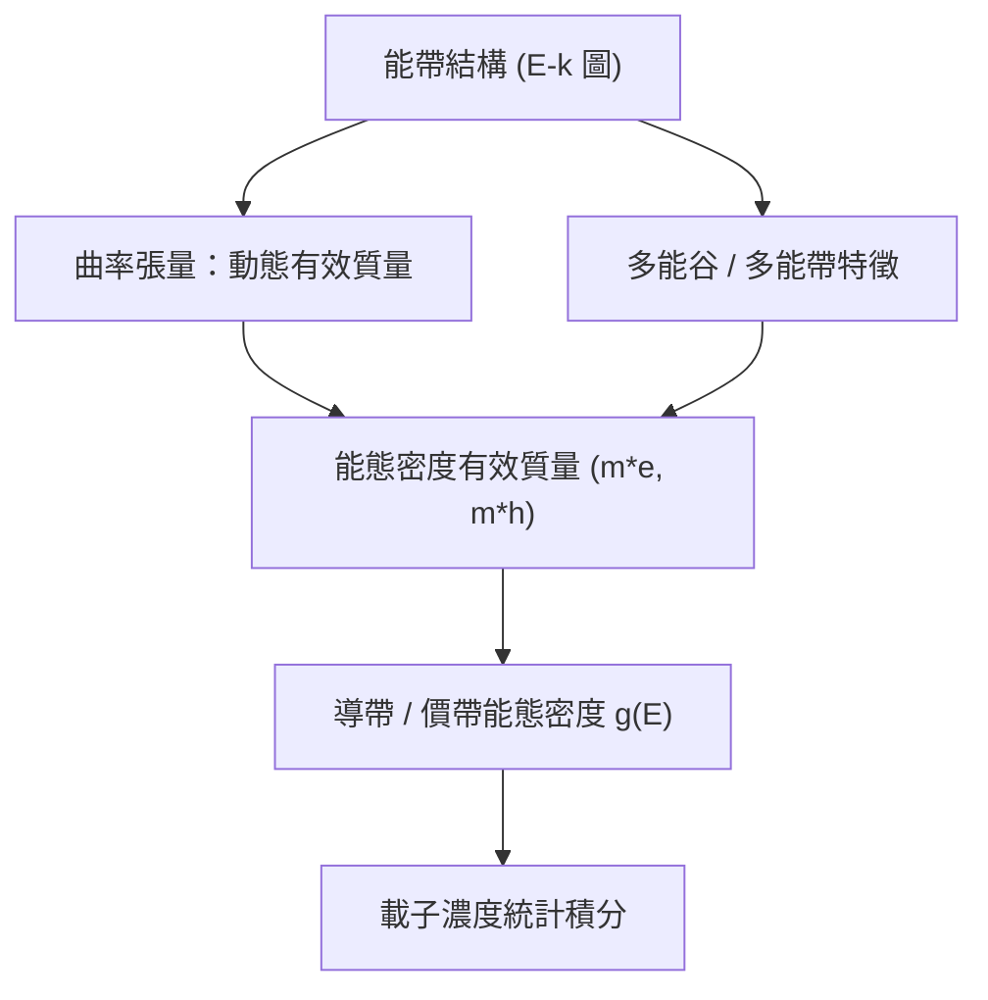
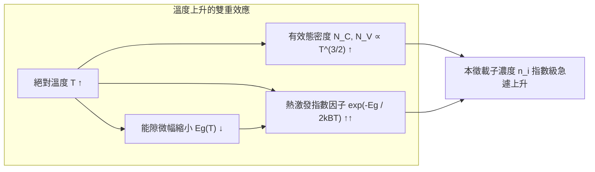
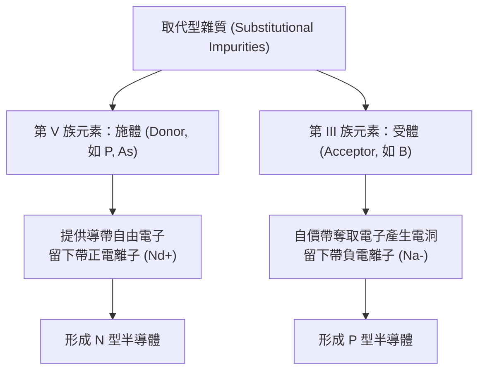
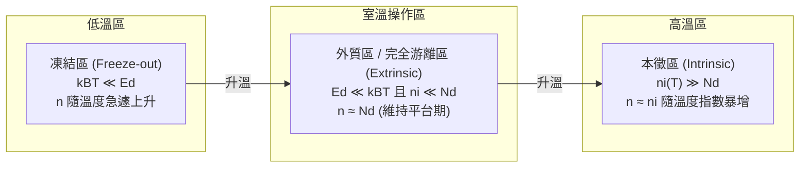
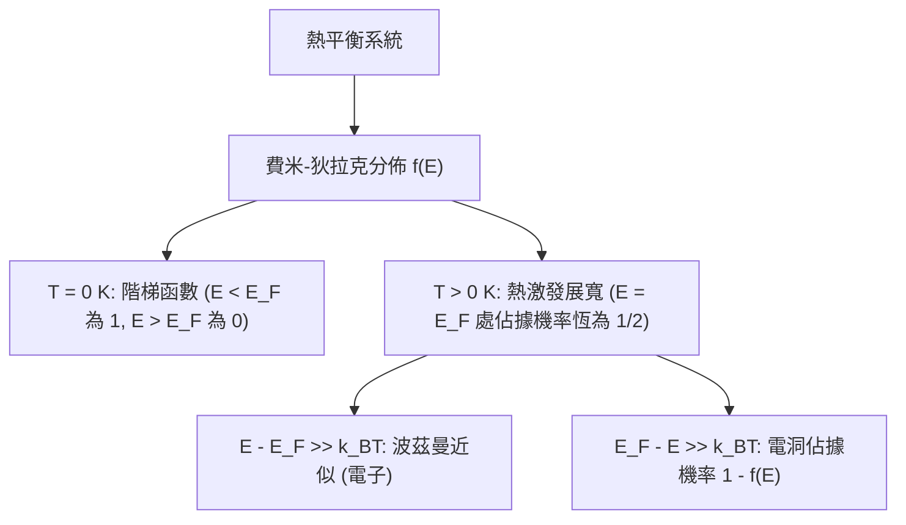
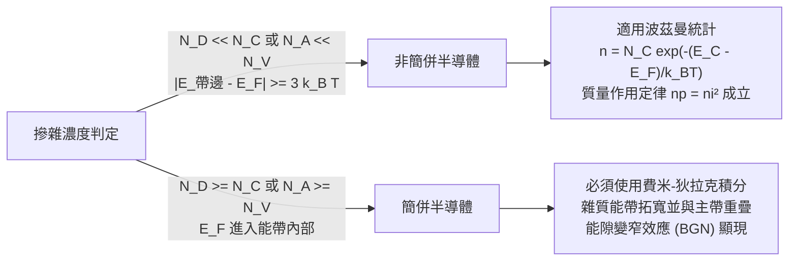
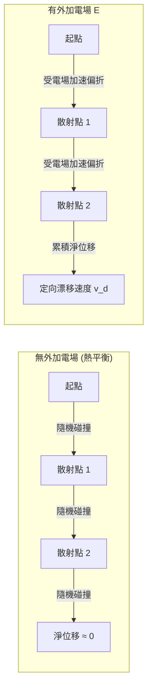
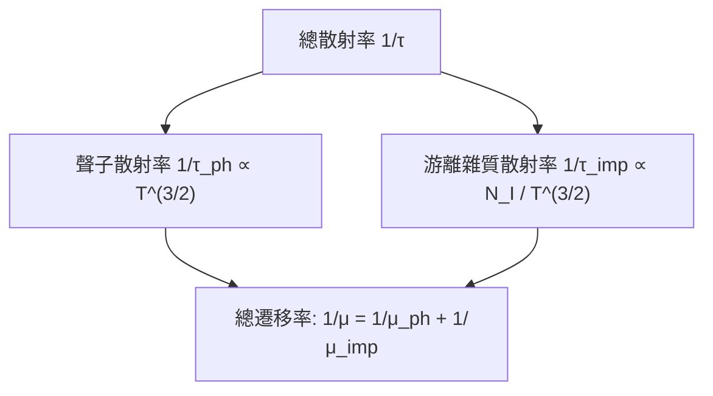
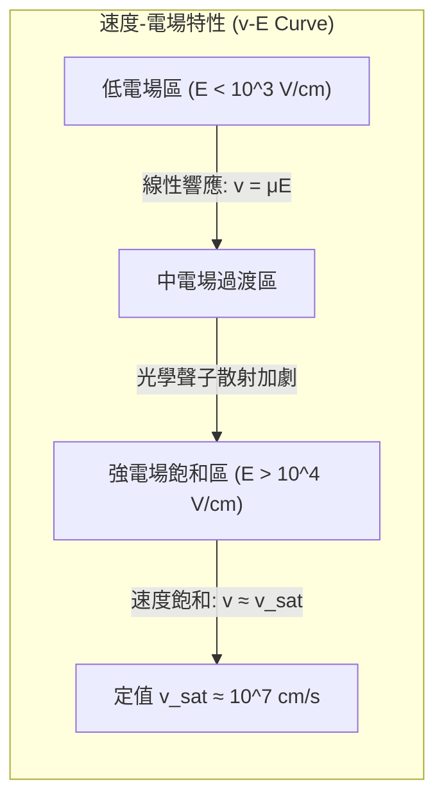
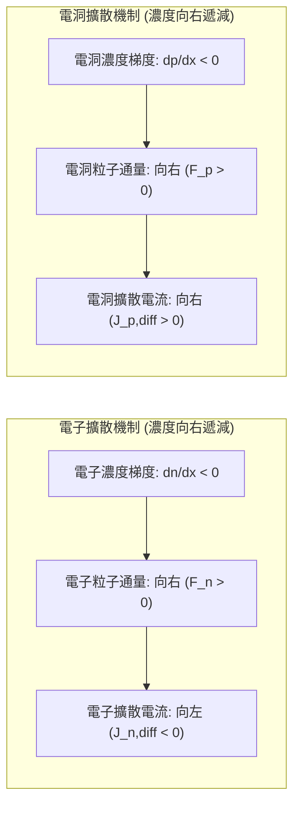

# 第 2 章　載子、摻雜與傳輸

!!! abstract "學習目標"
    - 掌握熱平衡狀態下本徵與外質半導體的電子與電洞濃度計算，並理解質量作用定律。
    - 理解施體與受體雜質之能階特性，以及費米能階隨摻雜型態、濃度與溫度之變化規律。
    - 分析晶格振動散射與游離雜質散射之微觀機制，並掌握載子遷移率與溫度、摻雜濃度之關係。
    - 推導漂移與擴散電流方程式，並應用愛因斯坦關係式連結載子傳輸參數。

## 2.1 熱平衡載子與質量作用定律

### 能態密度與有效質量回顧

在分析半導體內部的電氣傳輸前，必須先決定在特定能量區間內，材料能提供多少量子態供載子佔據。如第 1 章所述，晶體週期性位能使得電子的能量與波向量呈現能帶結構（energy band structure）。在導帶底（conduction band minimum, $E_C$）與價帶頂（valence band maximum, $E_V$）附近，三維自由電子近似下的能態密度（density of states, DOS）可分別表示為：

$$g_C(E) = \frac{1}{2\pi^2} \left( \frac{2m_e^*}{\hbar^2} \right)^{3/2} \sqrt{E - E_C}, \quad (E \ge E_C)$$

$$g_V(E) = \frac{1}{2\pi^2} \left( \frac{2m_h^*}{\hbar^2} \right)^{3/2} \sqrt{E_V - E}, \quad (E \le E_V)$$

式中 $\hbar = h / (2\pi)$ 為約化普朗克常數（reduced Planck constant），$E$ 為電子能量。在此，$m_e^*$ 與 $m_h^*$ 分別代表電子與電洞的能態密度有效質量（density-of-states effective mass）。

以矽（Si）為例，其導帶具有六個對稱的等能橢球谷（ellipsoidal valleys），單一能谷的橫向有效質量為 $m_t^* \approx 0.19\,m_0$，縱向有效質量為 $m_l^* \approx 0.98\,m_0$（$m_0$ 為自由電子靜止質量）。經過多能谷簡併度（degeneracy factor $M_C = 6$）的統計加權後，電子的能態密度有效質量為：

$$m_e^* = \left( M_C^{2} \cdot m_l^* \cdot (m_t^*)^2 \right)^{1/3} \approx 1.08\,m_0$$

價帶頂則由重電洞帶（heavy-hole band, $m_{hh}^* \approx 0.49\,m_0$）與輕電洞帶（light-hole band, $m_{lh}^* \approx 0.16\,m_0$）重疊組成，其能態密度有效質量定義為：

$$m_h^* = \left( (m_{hh}^*)^{3/2} + (m_{lh}^*)^{3/2} \right)^{2/3} \approx 0.57\,m_0$$

有效質量將複雜的晶格週期位能效應吸收為等效的力學參數，使我們能夠在準自由粒子的框架下計算載子分佈。



---

### 熱平衡載子濃度積分與波茲曼近似

在熱平衡狀態下，電子佔據特定能量量子態的機率由費米–狄拉克分佈函數（Fermi-Dirac distribution function）決定：

$$f(E) = \frac{1}{1 + \exp\left(\frac{E - E_F}{k_B T}\right)}$$

其中 $k_B$ 為波茲曼常數，$T$ 為絕對溫度，$E_F$ 為費米能階（Fermi level）。相應地，電洞為價帶中未被電子佔據的空態，其分佈機率為：

$$f_h(E) = 1 - f(E) = \frac{1}{1 + \exp\left(\frac{E_F - E}{k_B T}\right)}$$

導帶電子濃度 $n$ 與價帶電洞濃度 $p$ 分別為能態密度與佔據機率之乘積在能帶範圍內的積分：

$$n = \int_{E_C}^{\infty} g_C(E) f(E)\, dE$$

$$p = \int_{-\infty}^{E_V} g_V(E) [1 - f(E)]\, dE$$

當半導體處於「非簡併」（non-degenerate）條件時，費米能階遠離能帶邊緣，即滿足 $E_C - E_F \ge 3k_B T$ 以及 $E_F - E_V \ge 3k_B T$。此時指數項遠大於 1，費米–狄拉克統計可簡化為馬克士威–波茲曼近似（Maxwell-Boltzmann approximation）：

$$f(E) \approx \exp\left(-\frac{E - E_F}{k_B T}\right)$$

$$1 - f(E) \approx \exp\left(-\frac{E_F - E}{k_B T}\right)$$

將近似式帶入積分中，令無因次變數 $x = (E - E_C) / (k_B T)$：

$$n = \frac{1}{2\pi^2} \left( \frac{2m_e^*}{\hbar^2} \right)^{3/2} \exp\left(-\frac{E_C - E_F}{k_B T}\right) \int_{E_C}^{\infty} \sqrt{E - E_C} \exp\left(-\frac{E - E_C}{k_B T}\right) dE$$

利用高斯積分公式 $\int_0^{\infty} x^{1/2} e^{-x} dx = \frac{\sqrt{\pi}}{2}$，推導出導帶電子濃度為：

$$n = N_C \exp\left(-\frac{E_C - E_F}{k_B T}\right)$$

同理可得價帶電洞濃度：

$$p = N_V \exp\left(-\frac{E_F - E_V}{k_B T}\right)$$

此處引入了導帶與價帶的「有效態密度」（effective density of states）$N_C$ 與 $N_V$：

$$N_C = 2 \left( \frac{2\pi m_e^* k_B T}{h^2} \right)^{3/2}$$

$$N_V = 2 \left( \frac{2\pi m_h^* k_B T}{h^2} \right)^{3/2}$$

物理上，$N_C$ 與 $N_V$ 代表將連續能帶的量子態等效壓縮至邊界 $E_C$ 與 $E_V$ 處的虛擬態密度。在室溫（$T = 300\text{ K}$）下，矽的典型值為 $N_C \approx 2.8 \times 10^{19}\text{ cm}^{-3}$，$N_V \approx 1.04 \times 10^{19}\text{ cm}^{-3}$。

!!! note "說明"
    波茲曼近似將複雜的費米積分轉化為閉式解析解（closed-form analytical solution），大幅簡化了後續漂移–擴散傳輸與元件建模的數學運算。但在高濃度摻雜（例如源極/汲極區）中，此假設將失效。

---

### 本徵載子濃度及其溫度依賴性

在完全無雜質且無晶格缺陷的「本徵半導體」（intrinsic semiconductor）中，導帶中的所有電子均來自價帶電子的熱激發（thermal generation）。因此，電子與電洞必成對產生，兩者濃度相等：

$$n = p = n_i$$

此時的載子濃度稱為本徵載子濃度（intrinsic carrier concentration, $n_i$）。相應的費米能階稱為本徵費米能階（intrinsic Fermi level, $E_i$）。由 $n = p$ 的等式可推得：

$$N_C \exp\left(-\frac{E_C - E_i}{k_B T}\right) = N_V \exp\left(-\frac{E_i - E_V}{k_B T}\right)$$

解出本徵費米能階：

$$E_i = \frac{E_C + E_V}{2} + \frac{1}{2} k_B T \ln\left(\frac{N_V}{N_C}\right) = E_{\text{midgap}} + \frac{3}{4} k_B T \ln\left(\frac{m_h^*}{m_e^*}\right)$$

其中 $E_{\text{midgap}} = (E_C + E_V)/2$ 為能隙中心。由於矽的 $m_e^* > m_h^*$，$N_C > N_V$，在有限溫度下，其本徵費米能階會略微偏向價帶頂（低於能隙中心數十個 $\text{meV}$）。

將 $n$ 與 $p$ 相乘消去費米能階，即可得到 $n_i$ 的數學表達式：

$$n_i = \sqrt{np} = \sqrt{N_C N_V} \exp\left(-\frac{E_g}{2k_B T}\right)$$

式中 $E_g = E_C - E_V$ 為半導體材料的能隙（bandgap）。



將 $N_C$ 與 $N_V$ 的溫度相依性代入，本徵載子濃度對溫度的函數可完整寫為：

$$n_i(T) = 2 \left(\frac{2\pi k_B T}{h^2}\right)^{3/2} (m_e^* m_h^*)^{3/4} \exp\left(-\frac{E_g(T)}{2k_B T}\right)$$

此關係表明，$n_i$ 隨溫度的變化主要由指數項控制。此外，半導體能隙本身亦隨溫度升高而收縮，文獻中常以瓦許尼經驗公式（Varshni empirical formula）描述：

$$E_g(T) = E_g(0) - \frac{\alpha T^2}{T + \beta}$$

對矽而言，$E_g(0) \approx 1.17\text{ eV}$，$\alpha \approx 4.73 \times 10^{-4}\text{ eV/K}$，$\beta \approx 636\text{ K}$，室溫 $300\text{ K}$ 時的能隙典型值約為 $1.12\text{ eV}$。

| 材料 | 300 K 能隙 $E_g$ ($\text{eV}$) | $N_C$ ($\text{cm}^{-3}$) | $N_V$ ($\text{cm}^{-3}$) | $n_i$ 典型值 ($\text{cm}^{-3}$) |
| :--- | :--- | :--- | :--- | :--- |
| **矽 (Si)** | 1.12 | $2.8 \times 10^{19}$ | $1.04 \times 10^{19}$ | $\approx 1.0 \times 10^{10}$ |
| **鍺 (Ge)** | 0.66 | $1.04 \times 10^{19}$ | $6.0 \times 10^{18}$ | $\approx 2.4 \times 10^{13}$ |
| **砷化鎵 (GaAs)** | 1.42 | $4.45 \times 10^{17}$ | $7.72 \times 10^{18}$ | $\approx 2.1 \times 10^{6}$ |

!!! warning "常見誤解"
    早期教科書常引用矽的室溫本徵載子濃度為 $1.5 \times 10^{10}\text{ cm}^{-3}$。現代經精確測量之公認典型值在 $300\text{ K}$ 下約為 $9.65 \times 10^9$ 至 $1.0 \times 10^{10}\text{ cm}^{-3}$。在嚴謹數值模擬中若沿用舊值，會造成元件漏電流預測之偏差。

---

### 質量作用定律與適用邊界

將平衡下載子濃度相乘，可消除費米能階參數，得到重要的「質量作用定律」（mass-action law）：

$$n \cdot p = n_i^2$$

#### 1. 熱力學平衡基礎
該定律源自化學平衡理論。在熱平衡狀態下，電子–電洞對的熱激發（$G_{th}$）與復合（$R$）達到動態平衡：

$$\text{電子} + \text{電洞} \rightleftharpoons \text{能量（聲子/光子）}$$

平衡狀態下熱激發率等於復合率：

$$R = r \cdot n \cdot p = G_{th}$$

其中 $r$ 為復合係數。由於熱激發率主要僅取決於晶格溫度（聲子分佈與晶格震動），在固定溫度下 $G_{th}$ 為常數，故乘積 $n \cdot p = G_{th} / r$ 亦為定值。不論材料是本徵的，或是藉由摻雜引入施體（donor）與受體（acceptor），只要系統處於熱力學平衡，$n$ 與 $p$ 的乘積在波茲曼統計成立下恆等於 $n_i^2$。

#### 2. 適用邊界與限制
工程人員在應用 $np = n_i^2$ 時，必須特別注意以下邊界條件：

1. **熱平衡假設破壞（Non-equilibrium conditions）**：
   當外加偏壓、光照或注入電流時，系統脫離平衡態。此時不能使用單一費米能階，而需引入準費米能階（quasi-Fermi levels）$E_{Fn}$ 與 $E_{Fp}$，乘積修正為：
   $$np = n_i^2 \exp\left(\frac{E_{Fn} - E_{Fp}}{k_B T}\right)$$
   此情況將在第 3 章 PN 接面與雙載子元件中詳細討論。

2. **簡併半導體（Degenerate semiconductors）**：
   當摻雜濃度極高（通常大於 $10^{19}\text{ cm}^{-3}$），使費米能階進入導帶（$E_F > E_C$）或價帶（$E_F < E_V$）內部，波茲曼近似失效。積分必須採用完整的費米–狄拉克積分：
   $$\mathcal{F}_{1/2}(\eta) = \frac{2}{\sqrt{\pi}} \int_0^{\infty} \frac{x^{1/2}}{1 + \exp(x - \eta)} dx$$
   載子乘積將小於非簡併情況的預測值。

3. **能隙變窄效應（Bandgap Narrowing, BGN）**：
   重摻雜下，載子間的庫侖交互作用與雜質能帶合併效應會導致有效能隙縮小（$\Delta E_g$），使得有效本徵載子濃度修正為 $n_{ie}^2 = n_i^2 \exp(\Delta E_g / k_B T) > n_i^2$，質量作用定律的形式必須以 $n_{ie}^2$ 取代 $n_i^2$。

!!! example "產業實例"
    在先進互補式金屬氧化物半導體（CMOS）製程中，電晶體的源極/汲極區實施極高濃度的離子佈植（如磷或砷濃度高達 $10^{20}\text{ cm}^{-3}$ 以上）以降低寄生電阻。在該區域中，傳統的質量作用定律完全失效，製程技術電腦輔助設計（TCAD）工具必須強制啟用簡併統計（Fermi-Dirac statistics）與能隙縮小模型，方能精確計算接面電容與接觸電阻。

## 2.2 外質半導體與摻雜機制

### 2.2.1 取代型摻雜機制與雜質分類

純淨的單晶矽在熱平衡狀態下，其導電載子完全由熱激發產生（見第 2.1 節），室溫下的本徵載子濃度 $n_i$ 僅約為 $1.0 \times 10^{10} \text{ cm}^{-3}$。相較於單晶矽每立方公分約 $5.0 \times 10^{22}$ 個原子密度，此載子濃度極低，難以滿足積體電路對不同導電特性的要求。藉由在晶格中精確引入特定雜質原子以改變材料電性，此程序稱為摻雜（Doping）；摻入雜質後的半導體則稱為外質半導體（Extrinsic Semiconductor）。

在矽晶格（金剛石結構）中，電性活性的摻雜必須透過「取代型摻雜」（Substitutional Doping）實現，亦即雜質原子必須置換晶格節點上的矽原子，並與周遭四個相鄰矽原子形成共價鍵。雜質依其在元素週期表中的價電子數可分為兩大類：

1. **施體雜質（Donor Impurities）：** 
   週期表第 V 族元素，如磷（P）、砷（As）與銻（Sb）。這些原子擁有 5 個價電子，當其取代矽晶格節點時，其中 4 個價電子與鄰近矽原子形成共價鍵，剩餘的第 5 個電子因缺乏成鍵軌域，僅受到雜質原子核較弱的庫侖靜電引力束縛。只要獲得微小的熱能，該電子即可脫離束縛躍遷至導帶（Conduction Band），成為自由導電電子，而雜質原子本身則轉變成固定在晶格上的正游離離子（$N_d^+$）。由於此類雜質「提供」導電電子，故稱為施體，產生的半導體稱為 N 型半導體（N-type Semiconductor）。

2. **受體雜質（Acceptor Impurities）：** 
   週期表第 III 族元素，如硼（B）、鎵（Ga）與銦（In）。這些原子僅有 3 個價電子，當其取代矽原子後，與周圍四個共價鍵結合時將缺少 1 個電子，留下一個空的量子態。鄰近價帶（Valence Band）中的電子只需吸收極小能量便可填補此空缺，並在價帶中留下一個可自由移動的電洞（Hole），雜質原子本身則成為帶負電的固定游離離子（$N_a^-$）。由於此類雜質「接受」價帶電子以產生電洞，故稱為受體，產生的半導體稱為 P 型半導體（P-type Semiconductor）。



---

### 2.2.2 氫原子模型與游離能估算

施體電子的游離過程可使用類氫原子模型（Bohr-like Hydrogenic Model）進行一階近似估算。施體雜質中心帶有單位的正電荷 $+q$，第五個電子繞其運行，此系統與真空中的氫原子極為類似，但需考慮兩項晶體環境修正：
1. 電子並非在真空中運動，而是在相對介電常數為 $\epsilon_r$ 的介電介質中，因此庫侖吸引力減弱為原來的 $1/\epsilon_r$。
2. 電子在晶格週期性位能中運動，其慣性質量必須以導帶電子的有效質量 $m_n^*$ 取代真空中靜止質量 $m_0$。

波耳模型中，氫原子的基態結合能為：
$$E_H = \frac{m_0 q^4}{8 \epsilon_0^2 h^2} \approx 13.6 \text{ eV}$$

其中 $\epsilon_0$ 為真空介電率，$h$ 為普朗克常數。修正後的施體電子束縛能（即施體游離能 $E_d$）為：
$$E_d = E_c - E_D = \left( \frac{m_n^*}{m_0} \right) \left( \frac{1}{\epsilon_r^2} \right) E_H$$

其中：
- $E_c$ 為導帶底端能量。
- $E_D$ 為施體雜質能階。
- $m_n^*$ 為電子的電導有效質量（Conductivity Effective Mass）。
- $\epsilon_r$ 為矽晶體的相對介電常數（室溫下典型值約為 $11.7$）。

若取矽中電子的平均有效質量 $m_n^* \approx 0.26 \, m_0$，可計算施體游離能：
$$E_d \approx 13.6 \times \frac{0.26}{(11.7)^2} \approx 0.0258 \text{ eV} = 25.8 \text{ meV}$$

同理，對於受體雜質，電洞圍繞帶負電雜質中心旋轉的結合能（受體游離能 $E_a = E_A - E_v$，其中 $E_A$ 為受體能階，$E_v$ 為價帶頂端能量）亦約在幾十個毫電子伏特（$\text{meV}$）的數量級。

由於室溫（$T = 300\text{ K}$）下的熱能量 $k_B T \approx 0.0259 \text{ eV} \approx 26 \text{ meV}$（$k_B$ 為波茲曼常數）與這些游離能處於相同量級，因此在常溫下，這些雜質大多已能完全游離。這類在禁帶（Bandgap）中產生的能階緊鄰導帶底或價帶頂的雜質，統稱為「淺能階雜質」（Shallow Impurities）。若雜質或缺陷在禁帶中央深處形成能階（如金、鐵等重金屬原子），則稱為「深能階雜質」（Deep-level Impurities），深能階雜質室溫下不易游離，通常作為載子的復合中心（Recombination Centers）。

下表列出矽單晶中常用淺能階摻雜物之實驗量測游離能典型值：

| 雜質元素 | 族別 | 雜質類型 | 游離能典型值（$\text{meV}$） | 能階位置參考基準 |
| :--- | :--- | :--- | :--- | :--- |
| 磷（P） | V | 施體 | $45$ | 距導帶底端：$E_c - E_D$ |
| 砷（As） | V | 施體 | $54$ | 距導帶底端：$E_c - E_D$ |
| 銻（Sb） | V | 施體 | $39$ | 距導帶底端：$E_c - E_D$ |
| 硼（B） | III | 受體 | $45$ | 距價帶頂端：$E_A - E_v$ |

---

### 2.2.3 電荷中性條件方程式

在未施加外加電壓的熱平衡半導體內部，整體巨觀上必須保持電中性。材料內帶正電的實體為自由電洞（濃度為 $p$）以及游離的正施體離子（濃度為 $N_d^+$）；帶負電的實體為自由電子（濃度為 $n$）以及游離的負受體離子（濃度為 $N_a^-$）。空間電荷中性條件（Charge Neutrality Condition）方程式表述為：

$$p + N_d^+ = n + N_a^-$$

其中：
- $n$：導帶自由電子濃度（$\text{cm}^{-3}$）。
- $p$：價帶自由電洞濃度（$\text{cm}^{-3}$）。
- $N_d^+$：已游離的施體雜質濃度（$\text{cm}^{-3}$）。
- $N_a^-$：已游離的受體雜質濃度（$\text{cm}^{-3}$）。

在非簡併半導體中，游離雜質濃度由費米-狄拉克分佈（見第 2.3 節）決定：
$$N_d^+ = \frac{N_d}{1 + g_D \exp\left(\frac{E_F - E_D}{k_B T}\right)}$$
$$N_a^- = \frac{N_a}{1 + g_A \exp\left(\frac{E_A - E_F}{k_B T}\right)}$$

其中 $g_D = 2$ 為施體基態自旋簡併度（Spin Degeneracy Factor），$g_A = 4$ 為矽中受體基態的價帶簡併度，$E_F$ 為費米能階。

在室溫操作條件下，淺能階雜質處於完全游離狀態，即 $N_d^+ \approx N_d$ 且 $N_a^- \approx N_a$。

#### 1. 單一摻雜之 N 型半導體
若材料僅摻入施體雜質（$N_a = 0$ 且 $N_d \gg n_i$），電荷中性條件簡化為：
$$n = p + N_d$$

根據質量作用定律（Mass Action Law，推導見第 2.1 節），在熱平衡狀態下 $np = n_i^2$，故可將 $p$ 表示為 $n_i^2 / n$，代入得二次方程式：
$$n^2 - N_d n - n_i^2 = 0$$

解此一元二次方程式，取具物理意義的正根解：
$$n = \frac{N_d + \sqrt{N_d^2 + 4n_i^2}}{2}$$

當摻雜濃度遠大於本徵載子濃度時（$N_d \gg 2n_i$），根式中的 $4n_i^2$ 可忽略，方程式近似為：
$$n \approx N_d$$
$$p = \frac{n_i^2}{n} \approx \frac{n_i^2}{N_d}$$

此時，電子為多數載子（Majority Carrier），其濃度幾乎完全由施體摻雜濃度決定；電洞為少數載子（Minority Carrier），其濃度受到顯著抑制。

#### 2. 補償半導體（Compensated Semiconductor）
當晶體中同時存在施體與受體雜質時，稱為補償半導體。若 $N_d > N_a$，電子優先落入較低能量的受體能階，完全游離後淨有效施體濃度為 $(N_d - N_a)$，材料呈現 N 型：
$$n \approx N_d - N_a \quad (\text{條件：} N_d - N_a \gg n_i)$$
反之，若 $N_a > N_d$，則淨有效受體濃度為 $(N_a - N_d)$，材料呈現 P 型：
$$p \approx N_a - N_d \quad (\text{條件：} N_a - N_d \gg n_i)$$

!!! warning "常見誤解"
    「電荷中性」常被誤解為「半導體內部沒有帶電粒子」。實際上，完全游離的外質半導體內部充滿了高密度的固定帶電離子（如 $N_d^+$）與等量的可動自由載子（如 $n$）。電荷中性是指在超越微觀晶格長度的體積尺度下，正負電荷代數和為零。當半導體受到外加電壓或存在濃度梯度而打破平衡時，局部區域可能產生淨空間電荷區（Space Charge Region），例如 PN 接面的空乏區（見第 3 章）。

---

### 2.2.4 載子濃度之溫度依賴性與分區行為

外質半導體的自由載子濃度強烈依賴絕對溫度 $T$。以施體摻雜濃度為 $N_d$ 的 N 型半導體為例，將多數載子濃度取對數 $\ln n$ 對溫度的倒數 $1/T$ 作圖，載子濃度隨溫度的變化可明確劃分為三個溫區：



1. **凍結區（Freeze-out Region，低溫區）：**
   當溫度極低時（通常低於 $100\text{ K}$），熱激發能量不足以游離施體電子（$k_B T \ll E_d$），絕大多數電子被束縛在施體能階 $E_D$ 上，此現象稱為載子凍結（Carrier Freeze-out）。此時電子濃度隨溫度下降呈指數衰減，關係式近似為：
   $$n \propto \exp\left(-\frac{E_d}{2 k_B T}\right) \quad (\text{未補償材料})$$
   在此區域，材料電阻率急遽升高。

2. **外質區 / 完全游離區（Extrinsic / Complete Ionization Region，中溫至室溫區）：**
   當溫度上升至滿足 $k_B T \ge E_d$ 但熱激發跨越能隙的載子量仍遠小於摻雜濃度（$n_i \ll N_d$）時，幾乎所有淺能階施體雜質皆已游離。此時導帶中的電子濃度達到飽和平台期：
   $$n \approx N_d = \text{常數}$$
   矽元件的正常工作溫度區間（工業級規格為 $-40^\circ\text{C} \sim 125^\circ\text{C}$，即約 $233\text{ K} \sim 398\text{ K}$）即落在此平坦外質區內，確保元件電性不隨環境溫度產生過度劇烈的波動。

3. **本徵區（Intrinsic Region，高溫區）：**
   當晶片工作溫度持續攀升（對於中度摻雜矽約高於 $500\text{ K} \sim 600\text{ K}$），跨越共價鍵能隙 $E_g$ 的價帶電子熱激發急遽增強。當 $n_i(T) \gg N_d$ 時，本徵激發產生的電子-電洞對主導了載子濃度：
   $$n \approx n_i \propto T^{3/2} \exp\left(-\frac{E_g}{2 k_B T}\right)$$
   此時半導體失去原本由雜質控制的 N 型或 P 型特徵，退化為本徵半導體，電晶體架構中的 PN 接面整流效應與閥值電壓控制將完全失效。

!!! example "產業實例"
    在先進積體電路製程中，摻雜主要透過「離子植入」（Ion Implantation）將高能離子打入晶圓。然而，高能離子撞擊會使單晶矽晶格產生位移損傷，甚至形成非晶化區域（Amorphous Layer），且打入的雜質大多落於間隙位置（Interstitial Sites）而非晶格取代位置，不具備電性活性。
    
    因此，離子植入後必須接續「超快速高溫退火」（Rapid Thermal Annealing, RTA）或「毫秒級雷射退火」（Laser Spike Annealing, LSA）。退火製程提供能量使矽原子重新排列修復晶格缺陷，並促使硼（B）、磷（P）或砷（As）原子擴散移位至取代型晶格點以實現「雜質活化」（Dopant Activation），方能滿足電荷中性方程式中所定義的電活性濃度 $N_a$ 與 $N_d$。

## 2.3 費米能階與載子統計分佈

### 費米-狄拉克分佈與費米能階之物理意義

半導體中的電子屬於自旋為半整數（$s = 1/2$）的費米子（Fermion），必須遵守包立不相容原理（Pauli exclusion principle），即同一個量子態不能同時容納兩個狀態完全相同的費米子。在熱平衡狀態下，能量為 $E$ 的量子態被電子佔據的機率，由費米-狄拉克分佈函數（Fermi-Dirac distribution function）決定：

$$f(E) = \frac{1}{1 + \exp\left(\frac{E - E_F}{k_B T}\right)}$$

其中：
- $E$ 為目標量子態之能量（單位：$\text{eV}$ 或 $\text{J}$）。
- $E_F$ 為費米能階（Fermi level，單位：$\text{eV}$ 或 $\text{J}$）。
- $k_B$ 為波茲曼常數（Boltzmann constant，約為 $8.617 \times 10^{-5}\text{ eV/K}$ 或 $1.381 \times 10^{-23}\text{ J/K}$）。
- $T$ 為絕對溫度（單位：$\text{K}$）。



費米能階在熱力學上等同於電子的化學勢（chemical potential），代表系統增加一個電子時自由能的變化量。從統計機率的角度觀察，$E_F$ 具有以下關鍵物理特性：

1. **絕對零度極限（$T = 0\text{ K}$）**：
   當 $E < E_F$ 時，指數項 $\exp\left(-\infty\right) = 0$，故 $f(E) = 1$；當 $E > E_F$ 時，指數項 $\exp\left(+\infty\right) = \infty$，故 $f(E) = 0$。分佈函數呈現嚴格的階梯狀（step function），表示所有低於 $E_F$ 的能階皆被電子完全填滿，而高於 $E_F$ 的能階完全處於空態。

2. **有限溫度條件（$T > 0\text{ K}$）**：
   在任何非絕對零度之熱平衡系統中，若能階恰好等於費米能階（$E = E_F$），則指數項為 $\exp(0) = 1$，該能態被電子佔據的機率恆為：
   $$f(E_F) = \frac{1}{1 + 1} = 0.5$$
   熱能（約 $k_B T$，室溫 $300\text{ K}$ 下約 $0.0259\text{ eV}$）會使 $E_F$ 附近的電子獲得激發，導致分佈函數在 $E_F$ 附近產生對稱性的平滑化展寬。能量偏離 $E_F$ 約 $\pm 3 k_B T$ 的範圍內，佔據機率迅速從接續飽和降至趨近於零。

對於價帶中的電洞（未被電子佔據之量子態），其分佈函數 $f_h(E)$ 則為電子未佔據的機率：

$$f_h(E) = 1 - f(E) = \frac{1}{1 + \exp\left(\frac{E_F - E}{k_B T}\right)}$$

!!! note "說明：多材料系統熱平衡下的費米能階一致性"
    當兩個或多個不同材料（例如金屬與半導體、或 P 型與 N 型半導體）相互接觸並達到熱平衡時，系統內部不能有淨載子流或淨能量流。依據熱力學平衡條件，整個系統內各處的費米能階必須維持平直且恆定（即 $\frac{dE_F}{dx} = 0$）。此一準則為後續章節分析 PN 接面與金氧半結構能帶彎曲之理論基礎。

---

### 本徵費米能階與帶隙基準點

在未受摻雜污染的純淨半導體（本徵半導體，intrinsic semiconductor）中，導帶電子濃度 $n$ 與價帶電洞濃度 $p$ 恆等，且均等於本徵載子濃度 $n_i$。此狀態下的費米能階特稱為**本徵費米能階**（intrinsic Fermi level），記為 $E_i$。

在非簡併條件下，導帶電子濃度與價帶電洞濃度可分別以有效態密度（effective density of states）$N_C$ 與 $N_V$ 表示（參見第 1 章能帶架構）：

$$n = N_C \exp\left(-\frac{E_C - E_F}{k_B T}\right)$$

$$p = N_V \exp\left(-\frac{E_F - E_V}{k_B T}\right)$$

其中 $E_C$ 為導帶底（conduction band minimum），$E_V$ 為價帶頂（valence band maximum）。令 $n = p = n_i$，並將 $E_F$ 替換為 $E_i$：

$$N_C \exp\left(-\frac{E_C - E_i}{k_B T}\right) = N_V \exp\left(-\frac{E_i - E_V}{k_B T}\right)$$

兩邊取自然對數後重新整理，可推導出本徵費米能階的解析解：

$$E_i = \frac{E_C + E_V}{2} + \frac{1}{2} k_B T \ln\left(\frac{N_V}{N_C}\right)$$

由於有效態密度與載子的態密度有效質量（density-of-states effective mass, $m^*$）具備 $N \propto (m^*)^{3/2}$ 之關係，上述公式可改寫為：

$$E_i = \frac{E_C + E_V}{2} + \frac{3}{4} k_B T \ln\left(\frac{m_h^*}{m_e^*}\right)$$

式中 $\frac{E_C + E_V}{2}$ 為禁帶（bandgap, $E_g$）的幾何中央線（midgap energy, $E_{midgap}$）。

以矽（$\text{Si}$）在 $T = 300\text{ K}$ 下為例，電洞之有效質量 $m_h^* \approx 0.56\,m_0$ 微小於電子之有效質量 $m_e^* \approx 1.08\,m_0$（$m_0$ 為自由電子質量），導致第二項修正值約為 $-0.013\text{ eV}$。相較於矽在室溫下的能隙寬度 $E_g \approx 1.12\text{ eV}$，此偏移量極微小。因此在多數工程近似中，$E_i$ 常被視為座落於能隙正中央，並作為衡量外質半導體能階偏移的基準參考點。

藉由引導 $E_i$ 作為基準，非簡併半導體中的載子濃度公式可被簡潔地改寫為：

$$n = n_i \exp\left(\frac{E_F - E_i}{k_B T}\right)$$

$$p = n_i \exp\left(\frac{E_i - E_F}{k_B T}\right)$$

此二式顯示，只要獲知 $E_F$ 相對 $E_i$ 的偏移量，即可直接定量材料內的電子與電洞分佈。

---

### 摻雜型態與摻雜濃度對 $E_F$ 相對位置之調控

外質半導體的摻雜直接打破了電子與電洞的對稱性，進而改變體系化學勢，使費米能階偏離帶隙中央。

```
              導帶 (Conduction Band) Ec
   - - - - - - - - - - - - - - - - - - - - - - - - - EF (重度 N 型摻雜, 簡併態)
   ------------------------------------------------- EF (中度 N 型摻雜)
   - - - - - - - - - - - - - - - - - - - - - - - - -
              本徵費米能階 Ei ≈ Midgap
   - - - - - - - - - - - - - - - - - - - - - - - - -
   ------------------------------------------------- EF (中度 P 型摻雜)
   - - - - - - - - - - - - - - - - - - - - - - - - - EF (重度 P 型摻雜, 簡併態)
              價帶 (Valence Band) Ev
```

#### 1. N 型摻雜半導體
當材料中植入濃度為 $N_D$ 的施體雜質（如磷、砷），且處於雜質完全游離區（extrinsic ionization region，室溫條件）時，多數載子濃度 $n \approx N_D$。由載子濃度公式可解出費米能階的位置：

$$E_F - E_i = k_B T \ln\left(\frac{N_D}{n_i}\right)$$

或以導帶底為基準：

$$E_C - E_F = k_B T \ln\left(\frac{N_C}{N_D}\right)$$

當施體摻雜濃度 $N_D$ 提高時，$E_F - E_i > 0$ 且數值持續擴大，費米能階由中央朝導帶底 $E_C$ 逼近。

#### 2. P 型摻雜半導體
當材料植入濃度為 $N_A$ 的受體雜質（如硼），在室溫完全游離條件下，$p \approx N_A$。費米能階對應為：

$$E_i - E_F = k_B T \ln\left(\frac{N_A}{n_i}\right)$$

或以價帶頂為基準：

$$E_F - E_V = k_B T \ln\left(\frac{N_V}{N_A}\right)$$

受體濃度 $N_A$ 越高，$E_i - E_F > 0$ 越大，費米能階朝價帶頂 $E_V$ 逼近。

下表列出室溫（$300\text{ K}$）下矽單晶中不同摻雜濃度對應之能階偏移典型值（取 $n_i \approx 1.0 \times 10^{10}\text{ cm}^{-3}$）：

| 摻雜型態 | 摻雜濃度（$\text{cm}^{-3}$） | 載子型態與主要載子 | 費米能階相對位置 $|E_F - E_i|$ | 距帶邊能量（$E_C - E_F$ 或 $E_F - E_V$） |
| :--- | :--- | :--- | :--- | :--- |
| 本徵矽 | 0 | $n = p = 1.0 \times 10^{10}$ | $0\text{ eV}$ | 約 $0.56\text{ eV}$ |
| N 型（輕摻雜） | $1.0 \times 10^{14}$ | 電子：$n \approx 1.0 \times 10^{14}$ | $+0.238\text{ eV}$（偏向導帶） | $0.322\text{ eV}$ |
| N 型（中度摻雜） | $1.0 \times 10^{16}$ | 電子：$n \approx 1.0 \times 10^{16}$ | $+0.357\text{ eV}$（偏向導帶） | $0.203\text{ eV}$ |
| P 型（中度摻雜） | $1.0 \times 10^{16}$ | 電洞：$p \approx 1.0 \times 10^{16}$ | $-0.357\text{ eV}$（偏向價帶） | $0.203\text{ eV}$ |
| P 型（重摻雜） | $1.0 \times 10^{18}$ | 電洞：$p \approx 1.0 \times 10^{18}$ | $-0.476\text{ eV}$（偏向價帶） | $0.084\text{ eV}$ |

---

### 非簡併與簡併半導體

上述討論均奠基於**非簡併半導體**（non-degenerate semiconductor）之假設，即波茲曼分佈近似（Maxwell-Boltzmann approximation）成立的前提。

#### 1. 波茲曼近似的物理判別標準
費米-狄拉克分佈函數的分母項在能量差遠大於熱動能時：

$$\frac{E - E_F}{k_B T} \gg 1 \implies \exp\left(\frac{E - E_F}{k_B T}\right) \gg 1$$

此時可將分母中的常數項 $1$ 忽略，函數簡化為波茲曼統計：

$$f(E) \approx \exp\left(-\frac{E - E_F}{k_B T}\right)$$

在工程計算上，公認的非簡併準則是費米能階必須與帶邊（$E_C$ 或 $E_V$）保持至少 $3 k_B T$ 的能量差：

$$E_C - E_F \ge 3 k_B T \quad (\text{N 型})$$

$$E_F - E_V \ge 3 k_B T \quad (\text{P 型})$$

在室溫下，$3 k_B T \approx 0.078\text{ eV}$。若滿足此條件，波茲曼近似所引入的數值誤差小於 $5\%$。



#### 2. 簡併半導體之物理現象
當摻雜濃度持續升高，以致接近或超過有效態密度（室溫矽中 $N_C \approx 2.8 \times 10^{19}\text{ cm}^{-3}$，$N_V \approx 1.04 \times 10^{19}\text{ cm}^{-3}$）時，半導體轉變為**簡併半導體**（degenerate semiconductor），通常以 $\text{N}^+$ 或 $\text{P}^+$ 表示。此時系統展現出以下物理效應：

- **費米能階進入能帶**：對於極重摻雜 N 型材料，$E_F$ 向上穿過導帶底進入導帶內部（$E_F > E_C$）；對極重摻雜 P 型材料，$E_F$ 向下穿透價帶頂進入價帶內部（$E_F < E_V$）。
- **載子統計修正**：波茲曼近似徹底失效，導帶電子濃度必須以階數為 $1/2$ 的費米-狄拉克積分（Fermi-Dirac integral, $F_{1/2}$）嚴格計算：
  $$n = N_C \cdot \frac{2}{\sqrt{\pi}} F_{1/2}\left(\frac{E_F - E_C}{k_B T}\right)$$
  其中 $F_{1/2}(\eta) = \int_{0}^{\infty} \frac{x^{1/2}}{1 + \exp(x - \eta)} dx$。
- **波函數重疊與雜質帶形成**：由於雜質原子間的平均距離極短（當濃度達 $10^{20}\text{ cm}^{-3}$ 時，雜質原子間距縮減至約 $2\text{ nm}$，已接近波耳半徑），相鄰雜質原子的電子波函數彼此強烈重疊。個別離散的雜質能階展寬成為「雜質帶」（impurity band），並最終與主能帶（導帶或價帶）合併。
- **能隙變窄效應（Bandgap Narrowing, BGN）**：極高濃度的自由載子之間產生顯著的庫侖排斥屏蔽效應，以及載子與游離雜質離子之間的交換交互作用，導致半導體之有效禁帶寬度縮小：
  $$\Delta E_g = E_{g0} - E_g(N)$$
  在摻雜濃度超過 $10^{19}\text{ cm}^{-3}$ 的矽晶中，能隙縮減量 $\Delta E_g$ 可達數十甚至上百毫電子伏特（$\text{meV}$），使得本徵載子濃度實質增加（因 $n_i \propto \exp(-\frac{E_g}{2 k_B T})$），進而影響元件的漏電流與載子注入行為。

!!! warning "常見誤解：簡併半導體與金屬導電特性的差異"
    簡併半導體的費米能階雖然與金屬類似、皆落於能帶內部，且其電阻率在極低溫下不會因為「雜質凍結效應」（carrier freeze-out）而發散至無窮大，表現出類金屬（metallic）的導電特徵；但其基本晶體結構與母體化學鍵鍵結性質並未改變，其載子濃度上限（約 $10^{20} \sim 10^{21}\text{ cm}^{-3}$）仍顯著低於典型金屬（約 $10^{22} \sim 10^{23}\text{ cm}^{-3}$）。工程上不可將簡併半導體直接等同於純金屬處理。

!!! example "產業實例：CMOS 元件中的多晶矽閘極與歐姆接觸"
    在積體電路製程中，簡併半導體的特性被廣泛應用於降低接觸阻抗。例如在源極/汲極區的接觸窗開孔處，會透過離子佈植（如植入高劑量之砷或二氟化硼 $\text{BF}_2$）進行極高濃度摻雜（$> 10^{20}\text{ cm}^{-3}$），使矽表面進入深度簡併態。這不僅使接觸區具備極高的自由載子濃度，更大幅縮減了接面空乏區寬度，使得載子能以量子穿隧效應（tunneling effect）輕易穿透蕭基能障（Schottky barrier），形成低接觸阻抗的歐姆接觸（Ohmic contact）。同樣地，在傳統多晶矽閘極技術中，多晶矽需進行簡併摻雜以消除閘極耗盡效應（poly-depletion effect）。

## 2.4 漂移傳輸、載子遷移率與散射機制

### 漂移運動與漂移電流密度

在熱平衡狀態下，半導體內部的傳導電子與電洞受熱能激發，呈現無規則的熱運動（thermal motion）。載子的平均熱速度（thermal velocity, $v_{\text{th}}$）在室溫（$300\text{ K}$）下約為 $10^7\text{ cm/s}$。由於散射方向完全隨機，在未施加外加電場時，微觀載子的淨位移向量和為零，巨觀上不形成宏觀電流。

當半導體兩端施加電位差時，半導體內部建立外加電場 $\mathcal{E}$。帶電載子受到靜電力加速，在隨機熱運動的基礎上疊加定向流動，此定向運動稱為**漂移運動**（drift motion）。



在低電場條件下，載子的平均漂移速度 $v_d$ 與外加電場強度 $\mathcal{E}$ 成正比：

$$v_{d,n} = -\mu_n \mathcal{E}$$

$$v_{d,p} = \mu_p \mathcal{E}$$

式中：
- $v_{d,n}$ 與 $v_{d,p}$ 分別為電子與電洞的漂移速度（單位為 $\text{cm/s}$）
- $\mu_n$ 與 $\mu_p$ 分別為電子與電洞的**載子遷移率**（carrier mobility，單位為 $\text{cm}^2/\text{V}\cdot\text{s}$），定義上恆為正值
- 負號表示帶負電的電子漂移方向與電場方向相反，帶正電的電洞則與電場方向相同

由漂移運動引起的電荷流動即為**漂移電流密度**（drift current density, $J_{\text{drift}}$）。單位截面積內流經的電流可由電子與電洞的貢獻疊加：

$$J_{n,\text{drift}} = -q n v_{d,n} = q n \mu_n \mathcal{E}$$

$$J_{p,\text{drift}} = q p v_{d,p} = q p \mu_p \mathcal{E}$$

$$J_{\text{drift}} = J_{n,\text{drift}} + J_{p,\text{drift}} = (q n \mu_n + q p \mu_p)\mathcal{E}$$

式中 $q$ 為基本電荷（$1.602 \times 10^{-19}\text{ C}$），$n$ 與 $p$ 分別為傳導帶電子濃度與價帶電洞濃度（單位為 $\text{cm}^{-3}$）。

上式與巨觀歐姆定律（Ohm's Law）的微分形式 $J = \sigma \mathcal{E}$ 對應，由此可定義半導體的**電導率**（conductivity, $\sigma$）與**電阻率**（resistivity, $\rho$）：

$$\sigma = \frac{1}{\rho} = q(n\mu_n + p\mu_p)$$

在多數外質半導體中，多數載子濃度遠高於少數載子濃度。例如在 N 型半導體中，$n \approx N_d \gg p$，電導率可簡化為 $\sigma \approx q N_d \mu_n$。

---

### 微觀散射機制與平均自由時間

載子在晶格中漂移時，並非不受阻礙地持續加速，而是不斷與晶格缺陷碰撞並改變運動方向與動量，此微觀碰撞過程稱為**散射**（scattering）。

令載子兩次連續散射之間的平均時間間隔為**平均自由時間**（mean free time）或動量鬆弛時間（momentum relaxation time），以 $\tau_c$ 表示。在施加電場 $\mathcal{E}$ 後，由動量守恆與牛頓第二定律可描述單一載子受加速的平均動量變化：

$$m^* \frac{d v_d}{dt} = \mp q \mathcal{E} - \frac{m^* v_d}{\tau_c}$$

式中 $m^*$ 為載子的**導電有效質量**（conductivity effective mass，見第 1 章）。當達到穩態時（$d v_d / dt = 0$），外加電場所施加的力與散射引起的阻尼力平衡：

$$v_d = \mp \left( \frac{q \tau_c}{m^*} \right) \mathcal{E}$$

將此結果與漂移速度定義 $v_d = \mp \mu \mathcal{E}$ 比對，即可導出遷移率的微觀物理表達式：

$$\mu = \frac{q \tau_c}{m^*}$$

遷移率的大小完全由材料的有效質量 $m^*$ 以及決定平均自由時間 $\tau_c$ 的微觀散射機制所主導。在單晶半導體內部，最關鍵的兩種散射機制為**聲學聲子散射**與**游離雜質散射**。

#### 1. 聲學聲子散射（Acoustic Phonon Scattering）
晶格原子在絕對零度以上均因熱能而在平衡位置附近振動，這種晶格熱振動的量子化形式即為聲子（phonon）。晶格原子偏離平衡位置會破壞週期性位能分佈，導致導帶與價帶能階產生局部擾動，形成微觀位能起伏，使行進中的布洛赫電子波發生散射。

隨溫度 $T$ 升高，晶格振動振幅增大，聲子密度上升，使得載子遭遇散射的機率升高，平均自由時間縮短。理論推導顯示，熱運動平均速度 $v_{\text{th}} \propto T^{1/2}$，而散射截面積隨溫度呈線性增加，導致聲子散射的平均自由時間滿足 $\tau_{\text{ph}} \propto T^{-3/2}$。因此，由晶格聲子散射決定的遷移率 $\mu_{\text{ph}}$ 與溫度的關係為：

$$\mu_{\text{ph}} \propto T^{-3/2}$$

#### 2. 游離雜質散射（Ionized Impurity Scattering）
在外質半導體中，施體或受體雜質原子在常溫下幾乎完全游離，形成帶正電的施體中心（$N_d^+$）或帶負電的受體中心（$N_a^-$）。這些定域的帶電中心會在晶格中建立長程庫侖位能場（Coulomb potential）。當載子穿經游離雜質附近時，其軌跡受庫侖引力或斥力偏折而發生動量散射。

載子的熱速度隨溫度升高而增加（$v_{\text{th}} \propto T^{1/2}$）。溫度越高，載子掠過帶電雜質的速度越快，停留在庫侖場作用範圍內的時間越短，偏折程度越不明顯；反之，在低溫環境下載子動能低，極易受庫侖場劇烈偏折。根據盧瑟福散射模型（Rutherford scattering）推導，游離雜質散射遷移率 $\mu_{\text{imp}}$ 隨溫度及游離雜質總濃度 $N_I = N_d^+ + N_a^-$ 的依賴關係為：

$$\mu_{\text{imp}} \propto \frac{T^{3/2}}{N_I}$$

| 散射機制 | 微觀起源 | 溫度依存性 ($\mu$) | 雜質濃度依存性 ($\mu$) | 主導溫度區間 |
| :--- | :--- | :--- | :--- | :--- |
| **聲學聲子散射** | 晶格熱振動破壞週期位能 | $\mu \propto T^{-3/2}$ | 無直接相關 | 高溫區（典型室溫以上） |
| **游離雜質散射** | 帶電雜質中心 ($N_d^+, N_a^-$) 庫侖場 | $\mu \propto T^{3/2}$ | $\mu \propto N_I^{-1}$ | 低溫區或高摻雜區 |

---

### 馬西森定則與遷移率演變趨勢

當晶格中同時存在多種微觀散射機制時，若各散射機制彼此統計獨立，則總散射機率等於各別散射機率之和。因為散射率反比於平均自由時間（$1/\tau_c$），總平均自由時間可表示為：

$$\frac{1}{\tau_c} = \frac{1}{\tau_{\text{ph}}} + \frac{1}{\tau_{\text{imp}}}$$

代入遷移率公式 $\mu = q\tau_c/m^*$，即得到**馬西森定則**（Matthiessen's rule）：

$$\frac{1}{\mu} = \frac{1}{\mu_{\text{ph}}} + \frac{1}{\mu_{\text{imp}}}$$


*(註：若存在中性雜質散射或介面粗糙度散射，亦可依同理在分母加入對應項)*



#### 遷移率隨溫度的變化規律
在定值摻雜濃度下：
1. **低溫區（$T < 100\text{ K}$）**：晶格熱振動極弱，游離雜質散射為主要阻礙機制。此時 $\mu \approx \mu_{\text{imp}} \propto T^{3/2}$，遷移率隨溫度上升而單調增加。
2. **高溫區（$T > 250\text{ K}$，含室溫）**：載子動能充足，庫侖散射減弱；但晶格聲子密度激增，聲子散射佔據支配地位。此時 $\mu \approx \mu_{\text{ph}} \propto T^{-3/2}$，遷移率隨溫度上升而顯著下降。
3. **中溫區**：兩種機制競爭，遷移率在某一特定溫度達到極大值。

#### 遷移率隨摻雜濃度的變化規律
在室溫（$300\text{ K}$）下，隨摻雜濃度增加，游離雜質散射的權重逐步提高。當摻雜濃度較低（$< 10^{15}\text{ cm}^{-3}$）時，雜質間距遠大於載子平均自由程，遷移率由晶格聲子散射決定，維持在常數水準。當摻雜濃度超過 $10^{16}\text{ cm}^{-3}$ 後，游離雜質散射顯著增強，遷移率隨濃度上升而大幅退化。

在元件數值模擬中，常採用 Caughey-Thomas 經驗模型描述此退化趨勢：

$$\mu(N) = \mu_{\min} + \frac{\mu_{\max} - \mu_{\min}}{1 + \left( \frac{N}{N_{\text{ref}}} \right)^\alpha}$$

式中 $N$ 為總摻雜濃度（$N_d + N_a$），$\mu_{\max}$ 代表低摻雜純淨半導體的極限遷移率，$\mu_{\min}$ 為超重摻雜下的殘餘遷移率，$N_{\text{ref}}$ 與 $\alpha$ 為經驗擬合常數。

以高純度單晶矽在室溫（$300\text{ K}$）下的典型值為例：
- 電子遷移率極限值 $\mu_{n,\max} \approx 1400\text{ cm}^2/\text{V}\cdot\text{s}$
- 電洞遷移率極限值 $\mu_{p,\max} \approx 450\text{ cm}^2/\text{V}\cdot\text{s}$

電子遷移率顯著高於電洞，主因是矽傳導帶底的電子導電有效質量（$m_{ce}^* \approx 0.26 m_0$）明顯小於價帶頂的電洞有效質量（$m_{ch}^* \approx 0.37 m_0$）。

!!! warning "常見誤解：電阻率與摻雜濃度並非嚴格反比"
    初學者常根據 $\sigma \approx q N_d \mu_n$ 推論「摻雜濃度增加 10 倍，電阻率 $\rho$ 必定縮小為 1/10」。事實上，隨著 $N_d$ 增加，游離雜質散射加劇會使 $\mu_n$ 同時下降。因此，高摻雜區間內電阻率的下降幅度小於摻雜濃度的上升幅度。在重摻雜下（如源極/汲極接觸區），電阻率的調控會遭遇邊際效益遞減。

---

### 強電場效應與載子速度飽和

在低電場條件下，載子自電場獲取的能量可迅速透過低能量的聲學聲子散射轉移給晶格，載子的平均能量維持在熱平衡動能（$\sim \frac{3}{2} k_B T$），漂移速度維持與電場成正比的線性歐姆區。

然而，當外加電場持續升高至臨界電場 $\mathcal{E}_c$（矽中約為 $10^4\text{ V/cm}$）以上時，載子在兩次散射間被強電場顯著加速，獲取極高的動能，成為「熱載子」（hot carrier），其有效溫度 $T_e$ 遠高於晶格溫度 $T$。

此時，載子能量足以激發高能量的**光學聲子**（optical phonon emission，在矽中光學聲子能量約為 $63\text{ meV}$）。光學聲子發射的散射機率極高，能以極快頻率劇烈耗散載子的定向動量與多餘動能。結果導致漂移速度隨電場增加的斜率逐漸減緩，最終趨於一個不再隨電場增長而改變的極限值，稱為**飽和速度**（saturation velocity, $v_{\text{sat}}$）。



載子漂移速度隨電場的非線性過渡特徵可透過經驗公式（Trofimenkoff 模型）定量描述：

$$v_d(\mathcal{E}) = \frac{\mu_0 \mathcal{E}}{\left[ 1 + \left( \frac{\mu_0 \mathcal{E}}{v_{\text{sat}}} \right)^\beta \right]^{1/\beta}}$$

式中 $\mu_0$ 為低電場遷移率，$\beta$ 為擬合參數（矽中電子通常取 $\beta = 2$，電洞通常取 $\beta = 1$）。

在室溫（$300\text{ K}$）下，單晶矽中電子與電洞的飽和速度極為接近，典型值約為：

$$v_{\text{sat}} \approx 1.0 \times 10^7\text{ cm/s}$$

速度飽和現象對現代微縮元件的設計產生決定性影響。

!!! example "產業實例：先進節點電晶體的驅動電流極限"
    在通道長度為數微米（$\mu\text{m}$）的傳統長通道平面 MOSFET 中，通道電場多落於低電場線性區，汲極飽和電流正比於電場的平方（與 $(V_{GS}-V_{th})^2$ 相關，詳見第 4 章）。
    然而，在現代先進製程（如 $3\text{ nm}$ 節點 FinFET 或 GAAFET，見第 6 章）中，供應電壓雖降至約 $0.7\text{ V}$，但通道實體長度已微縮至 $15\text{ nm}$ 以下。此時通道內部平均橫向電場超過：
    $$\mathcal{E} \approx \frac{0.7\text{ V}}{15 \times 10^{-7}\text{ cm}} \approx 4.7 \times 10^5\text{ V/cm} \gg \mathcal{E}_c$$
    整個導電通道均處於嚴重的速度飽和狀態。載子以極限速度 $v_{\text{sat}}$ 傳輸，使得飽和汲極電流退化為與閘極過驅電壓成線性正比（$I_{D,\text{sat}} \propto C_{\text{ox}} W v_{\text{sat}} (V_{GS}-V_{th})$），元件的跨導（transconductance, $g_m$）受到實體上限壓制。因此，在現代短通道微縮技術中，透過晶格應變工程（strain engineering）改變能帶結構以提高低場遷移率並推遲速度飽和，已成為延續元件驅動效能的關鍵技術手段。

## 2.5 擴散傳輸與總電流方程式

### 擴散現象與費克第一定律

半導體中的載子除了受到外加電場驅動而產生漂移運動（Drift motion，見 2.4 節）之外，在非均勻分佈的情況下，微觀的隨機熱運動（Random thermal motion）亦會驅動宏觀的淨電荷流動，此機制稱為擴散（Diffusion）。

在熱平衡且溫度大於絕對零度（$T > 0\text{ K}$）的環境下，載子具備平均熱動能 $\frac{3}{2} k_B T$（其中 $k_B$ 為波茲曼常數，$T$ 為絕對溫度），並以熱速度（Thermal velocity, $v_{\text{th}} \approx 10^7\text{ cm/s}$，300 K 的矽晶圓典型值）在晶格中進行無規則碰撞與散射。當半導體內存在載子濃度梯度（Concentration gradient）時，高濃度區域的粒子數量多於低濃度區域。即使個別電子的運動方向完全隨機且各向同性，純統計機率使得單位時間內由高濃度區跨越虛擬界面運動至低濃度區的粒子數，必然多於反向運動的粒子數，從而形成宏觀的淨粒子通量（Particle flux）。

此現象由費克第一定律（Fick's first law）描述。以一維空間為例，單位時間通過單位面積的電子通量 $F_n$ 與電子濃度梯度 $\frac{dn}{dx}$ 成正比，且方向朝向濃度降低之方向：

$$F_n = -D_n \frac{dn}{dx}$$

同理，電洞的粒子通量 $F_p$ 為：

$$F_p = -D_p \frac{dp}{dx}$$

其中：
- $F_n, F_p$ 為電子與電洞的粒子通量密度（單位為 $\text{cm}^{-2}\cdot\text{s}^{-1}$）。
- $n, p$ 為電子與電洞濃度（單位為 $\text{cm}^{-3}$）。
- $D_n, D_p$ 分別為電子與電洞的擴散係數（Diffusion coefficient，單位為 $\text{cm}^2/\text{s}$），表徵載子在特定半導體晶格與散射環境下的擴散能力。負號表示淨粒子流恆由高濃度流向低濃度。

---

### 電子與電洞之擴散電流密度

粒子通量帶有電荷即形成電流。電流密度定義為單位時間內流經單位截面積之淨電荷量。由於單一電子的帶電量為 $-q$（$q \approx 1.602 \times 10^{-19}\text{ C}$ 為基本電荷），而電洞帶電量為 $+q$，擴散電流密度由粒子通量乘以所帶電荷決定：

$$J_{n,\text{diff}} = (-q) \cdot F_n = (-q) \left( -D_n \frac{dn}{dx} \right) = q D_n \frac{dn}{dx}$$

$$J_{p,\text{diff}} = (+q) \cdot F_p = (+q) \left( -D_p \frac{dp}{dx} \right) = -q D_p \frac{dp}{dx}$$

其中 $J_{n,\text{diff}}$ 與 $J_{p,\text{diff}}$ 分別為電子與電洞之擴散電流密度（單位為 $\text{A/cm}^2$）。



| 載子類型 | 濃度梯度 $\frac{dn}{dx}$ 或 $\frac{dp}{dx}$ | 粒子擴散方向 ($F$) | 電荷符號 | 擴散電流方向 ($J_{\text{diff}}$) | 電流方程式 |
| :--- | :--- | :--- | :--- | :--- | :--- |
| **電子 ($n$)** | 負值（向右遞減） | 向右 ($+x$) | 負電 ($-q$) | 向左 ($-x$) | $J_{n,\text{diff}} = q D_n \frac{dn}{dx}$ |
| **電洞 ($p$)** | 負值（向右遞減） | 向右 ($+x$) | 正電 ($+q$) | 向右 ($+x$) | $J_{p,\text{diff}} = -q D_p \frac{dp}{dx}$ |

!!! warning "常見誤解：擴散電流的符號與載子電荷"
    初學者常混淆電子擴散電流方程式中的正號。當 $\frac{dn}{dx} < 0$ 時，電子往 $+x$ 方向擴散；然而電子帶負電，負電荷向 $+x$ 運動代表產生向 $-x$ 方向的電流，故 $J_{n,\text{diff}} = q D_n \left(\frac{dn}{dx}\right)$ 本身即為負值，物理意義完全一致。公式中的正負號已完全納入電荷極性與流動方向之嚴密幾何定義。

---

### 愛因斯坦關係式之推導

微觀上，漂移運動是由於電場施力於載子，而擴散運動則源自濃度差引發的統計熱運動。兩者皆受到晶格散射與雜質散射（見 2.4 節）的阻礙，因此載子遷移率 $\mu$ 與擴散係數 $D$ 之間存在必然的內在熱力學關聯，此關係稱為愛因斯坦關係式（Einstein relation）。

考慮一處於熱平衡狀態（Thermal equilibrium）、無外加電壓、無光照的不均勻摻雜（如 N 型）半導體棒。因施體雜質濃度 $N_D(x)$ 隨位置變化，電子濃度 $n(x)$ 亦隨位置改變，引發向低濃度區域擴散的趨勢。擴散導致空間電荷分離，進而建立內建電場（Built-in electric field）$\mathcal{E}(x)$。在完全熱平衡狀態下，系統內不可能有淨電流流動，意即電子漂移電流與擴散電流必須在空間中處處嚴格抵消：

$$J_n = J_{n,\text{drift}} + J_{n,\text{diff}} = q n(x) \mu_n \mathcal{E}(x) + q D_n \frac{dn(x)}{dx} = 0$$

根據非退化半導體的波茲曼統計分佈，平衡態電子濃度可表示為：

$$n(x) = N_C \exp\left( -\frac{E_C(x) - E_F}{k_B T} \right)$$

其中 $N_C$ 為導帶有效狀態密度，$E_C(x)$ 為導帶底端能量，$E_F$ 為費米能階。在熱平衡狀態下，全系統的費米能階保持為一水平常數（$\frac{dE_F}{dx} = 0$）。

對位置 $x$ 微分：

$$\frac{dn(x)}{dx} = N_C \exp\left( -\frac{E_C(x) - E_F}{k_B T} \right) \cdot \left( -\frac{1}{k_B T} \frac{dE_C(x)}{dx} \right) = -\frac{n(x)}{k_B T} \frac{dE_C(x)}{dx}$$

由能帶理論（見第 1 章），電子位能 $E_C(x)$ 與靜電位 $V(x)$ 之關係為 $E_C(x) = -qV(x) + \text{常數}$，且電場定義為電位的負梯度 $\mathcal{E}(x) = -\frac{dV(x)}{dx}$。因此：

$$\frac{dE_C(x)}{dx} = -q \frac{dV(x)}{dx} = q \mathcal{E}(x)$$

將其代回濃度梯度方程式：

$$\frac{dn(x)}{dx} = -\frac{q n(x) \mathcal{E}(x)}{k_B T} \quad \Longrightarrow \quad q \mathcal{E}(x) = -\frac{k_B T}{n(x)} \frac{dn(x)}{dx}$$

將此電場代入電子淨電流平衡方程式 $q n(x) \mu_n \mathcal{E}(x) + q D_n \frac{dn(x)}{dx} = 0$：

$$n(x) \mu_n \left( -\frac{k_B T}{q n(x)} \frac{dn(x)}{dx} \right) + D_n \frac{dn(x)}{dx} = 0$$

消去共同項 $\frac{dn(x)}{dx}$ 後，即推導出電子之愛因斯坦關係式：

$$\frac{D_n}{\mu_n} = \frac{k_B T}{q}$$

以完全相同的步驟分析非均勻摻雜之 P 型半導體，亦可得電洞之對應式：

$$\frac{D_p}{\mu_p} = \frac{k_B T}{q}$$

常數項 $V_t \equiv \frac{k_B T}{q}$ 稱為熱電壓（Thermal voltage）。在絕對溫度 $T = 300\text{ K}$ 的典型室溫下：

$$V_t = \frac{k_B T}{q} \approx \frac{(1.3806 \times 10^{-23}\text{ J/K}) \times 300\text{ K}}{1.6022 \times 10^{-19}\text{ C}} \approx 0.02586\text{ V} \approx 25.9\text{ mV}$$

!!! note "愛因斯坦關係式之物理意義"
    愛因斯坦關係式揭示了傳輸理論的核心本質：擴散係數 $D$（熱擾動擴散強度）與遷移率 $\mu$（電場響應能力）之比值，完全取決於環境熱動能 $k_B T$ 與基本電荷 $q$，與半導體材料的能帶結構或散射型態無直接關聯（在非退化半導體前提下）。若材料因晶格振動導致遷移率下降，其擴散係數亦必然同比例降低。

---

### 半導體全電流方程式

在一般偏壓與外部激發條件下，半導體內同時存在電場與濃度梯度，載子的傳輸為漂移與擴散之線性疊加。電子與電洞的總電流密度方程式如下：

$$J_n = J_{n,\text{drift}} + J_{n,\text{diff}} = q n \mu_n \mathcal{E} + q D_n \nabla n$$

$$J_p = J_{p,\text{drift}} + J_{p,\text{diff}} = q p \mu_p \mathcal{E} - q D_p \nabla p$$

其中 $\nabla$ 為空間梯度算符（在一維情況下為 $\frac{\partial}{\partial x}$）。通過半導體截面的全傳導電流密度（Total conduction current density）$J_{\text{cond}}$ 即為兩者之代數和：

$$J_{\text{cond}} = J_n + J_p = q (n \mu_n + p \mu_p)\mathcal{E} + q \left( D_n \nabla n - D_p \nabla p \right)$$

若在時變電場（Time-varying electric field）條件下，介質極化效應需引入由馬克士威位移電流（Displacement current）：

$$J_{\text{disp}} = \epsilon_s \frac{\partial \mathcal{E}}{\partial t}$$

其中 $\epsilon_s$ 為半導體材料之介電常數（矽的 $\epsilon_s \approx 11.7 \times 8.854 \times 10^{-14}\text{ F/cm}$）。因此，通過元件的總電流密度包含傳導與位移兩部分：

$$J_{\text{total}} = J_n + J_p + \epsilon_s \frac{\partial \mathcal{E}}{\partial t}$$

---

### 載子連續方程式概論

全電流方程式描述了特定時間點空間各處的電荷流動，然而在非平衡態下（如光照注入或接面注入），載子濃度會隨時間與空間動態演變。為完整解算半導體內之載子分佈，必須結合電荷守恆原理建立連續方程式（Continuity equation）。

考慮一截面積為 $A$、長度為 $\Delta x$ 的微元體積。在時間區間 $\Delta t$ 內，微元內電子數量的變化率取決於三項物理機制：
1. **電流進出淨值**：單位時間由 $x$ 處流入與由 $x + \Delta x$ 處流出之電子通量差。
2. **產生率（Generation rate, $G_n$）**：因熱激發或外加光源在微元內每秒每立方公分產生之電子數（單位為 $\text{cm}^{-3}\cdot\text{s}^{-1}$）。
3. **復合率（Recombination rate, $R_n$）**：因落入價電帶或缺陷中心而湮滅之電子數（單位為 $\text{cm}^{-3}\cdot\text{s}^{-1}$）。

微元內電子數變化率寫為：

$$\frac{\partial n}{\partial t} A \Delta x = \left[ \frac{J_n(x)}{-q} - \frac{J_n(x+\Delta x)}{-q} \right] A + (G_n - R_n) A \Delta x$$

兩邊同除以 $A \Delta x$，並取極限 $\Delta x \to 0$：

$$\frac{\partial n}{\partial t} = \frac{1}{q} \frac{\partial J_n}{\partial x} + (G_n - R_n)$$

同理，對於電洞（帶電量為 $+q$），其連續方程式為：

$$\frac{\partial p}{\partial t} = -\frac{1}{q} \frac{\partial J_p}{\partial x} + (G_p - R_p)$$

若推廣至三維空間，並將一維之 $\frac{\partial J}{\partial x}$ 置換為散度算符 $\nabla \cdot \mathbf{J}$，連續方程式通式為：

$$\frac{\partial n}{\partial t} = \frac{1}{q} \nabla \cdot \mathbf{J}_n + (G_n - R_n)$$

$$\frac{\partial p}{\partial t} = -\frac{1}{q} \nabla \cdot \mathbf{J}_p + (G_p - R_p)$$

將本節的全電流方程式代入連續方程式，可展開為漂移-擴散微分方程。例如在均勻電場 $\mathcal{E}$ 且材料均質（$D_n, \mu_n$ 為常數）的一維條件下：

$$\frac{\partial n}{\partial t} = \mu_n \mathcal{E} \frac{\partial n}{\partial x} + D_n \frac{\partial^2 n}{\partial x^2} + (G_n - R_n)$$

此方程式為半導體元件物理中最重要的核心傳輸方程，後續章節在分析 PN 接面少數載子分佈（見第 3 章）及 MOSFET 通道反轉層之電流行為（見第 4 章）時，均以此微分方程組作為邊界值問題之求解起點。

!!! example "產業實例：超淺接面製程之擴散係數微縮考量"
    在先進互補式金屬氧化物半導體（CMOS）製程中，電晶體的源極/汲極延伸區（S/D extension）需要極高濃度且接面深度（Junction depth, $X_j$）小於 10 nm 的超淺接面（Ultra-shallow junction, USJ）。利用愛因斯坦關係式可知，當摻雜濃度達到退化（Degenerate）程度時，費米能階進入能帶內部，載子統計改由費米-狄拉克分佈主導，傳統愛因斯坦關係式需修正為 $\frac{D}{\mu} = \frac{k_B T}{q} \frac{\mathcal{F}_{1/2}(\eta)}{\mathcal{F}_{-1/2}(\eta)}$（其中 $\mathcal{F}$ 為費米積分，$\eta \equiv \frac{E_F - E_C}{k_B T}$）。這導致重摻雜區域之擴散係數非線性驟升，不僅影響元件傳導電流預測，亦直接決定了高溫毫秒級雷射退火（Laser spike annealing）時雜質活化與擴散深度的製程極限。

## 本章重點

1. **熱平衡載子統計與質量作用定律**：在非簡併半導體中（費米能階距能帶邊緣大於 $3k_B T$），費米–狄拉克統計可簡化為波茲曼近似，導帶電子濃度與價帶電洞濃度分別表述為 $n = N_C \exp\left(-\frac{E_C - E_F}{k_B T}\right)$ 與 $p = N_V \exp\left(-\frac{E_F - E_V}{k_B T}\right)$。在熱平衡狀態下，載子乘積恆滿足質量作用定律 $np = n_i^2$。
2. **取代型摻雜與空間電荷中性**：第 V 族施體雜質（如磷、砷）與第 III 族受體雜質（如硼）透過取代晶格節點提供自由載子。半導體內部巨觀上遵循電荷中性條件 $p + N_d^+ = n + N_a^-$；在室溫完全游離條件下，多數載子濃度實質上等於淨摻雜濃度。
3. **載子濃度之溫度分區**：外質半導體載子濃度隨溫度的變化可劃分為低溫「凍結區」（熱動能不足以游離雜質）、常溫「外質區」（淺能階雜質完全游離，多數載子濃度維持常數平台），以及高溫「本徵區」（熱激發穿越能隙之電子–電洞對遠超摻雜濃度，元件喪失半導體調控功能）。
4. **費米能階調控與簡併極限**：費米能階 $E_F$ 的位置由摻雜型態與濃度決定。當摻雜濃度接近或超越有效態密度（$N_C$ 或 $N_V$）時，半導體轉變為簡併態，費米能階穿入能帶內部，此時波茲曼近似失效，並伴隨雜質能帶合併與能隙變窄效應（BGN）。
5. **漂移傳輸與散射機制**：低電場下，載子定向漂移速度與電場成線性關係（$v = \mu \mathcal{E}$）。載子遷移率 $\mu = q\tau_c/m^*$ 主要受限於高溫主導的聲學聲子散射（$\mu_{\text{ph}} \propto T^{-3/2}$）與低溫/高摻雜主導的游離雜質散射（$\mu_{\text{imp}} \propto T^{3/2}/N_I$），總遷移率遵循馬西森定則；強電場下因光學聲子發射導致載子速度飽和（矽中 $v_{\text{sat}} \approx 1.0 \times 10^7\text{ cm/s}$）。
6. **擴散傳輸與愛因斯坦關係式**：載子濃度梯度引發微觀隨機熱運動的巨觀淨流動，遵循費克第一定律。在熱平衡與非簡併條件下，熱運動引起的擴散與電場引起的漂移具備熱力學關聯，滿足愛因斯坦關係式 $D/\mu = k_B T / q$。
7. **全電流與連續方程式**：半導體總電流為電子與電洞的漂移電流、擴散電流及介質位移電流之代數和。結合電荷守恆定律，載子連續方程式定量描述了載子濃度在漂移、擴散、熱產生與復合作用下的時空演變。

---

## 習題

**1.** 某單晶矽樣品在 $T = 300\text{ K}$ 平衡態下，同時摻入濃度為 $N_D = 1.0 \times 10^{16}\text{ cm}^{-3}$ 的磷（P）以及 $N_A = 2.0 \times 10^{15}\text{ cm}^{-3}$ 的硼（B）。已知室溫下矽的本徵載子濃度 $n_i = 1.0 \times 10^{10}\text{ cm}^{-3}$，熱電壓 $V_t = k_B T / q \approx 0.0259\text{ V}$，假設淺能階雜質完全游離。
(a) 試判斷該半導體之導電型態，並計算多數載子與少數載子濃度。
(b) 計算樣品的費米能階相對於本徵費米能階的偏移量（$E_F - E_i$）。

??? success "參考解答"
    (a) 
    此樣品為補償半導體，淨有效施體濃度為：
    $$N_D - N_A = 1.0 \times 10^{16} - 2.0 \times 10^{15} = 8.0 \times 10^{15}\text{ cm}^{-3}$$
    因 $N_D - N_A \gg n_i$，材料呈現 **N 型**半導體。
    在完全游離條件下，多數載子（電子）濃度為：
    $$n \approx N_D - N_A = 8.0 \times 10^{15}\text{ cm}^{-3}$$
    由質量作用定律，少數載子（電洞）濃度為：
    $$p = \frac{n_i^2}{n} = \frac{(1.0 \times 10^{10})^2}{8.0 \times 10^{15}} = 1.25 \times 10^4\text{ cm}^{-3}$$
    
    (b)
    由非簡併載子濃度與本徵費米能階之關係式：
    $$n = n_i \exp\left(\frac{E_F - E_i}{k_B T}\right) \implies E_F - E_i = k_B T \ln\left(\frac{n}{n_i}\right)$$
    代入數值：
    $$E_F - E_i = (0.0259\text{ eV}) \times \ln\left(\frac{8.0 \times 10^{15}}{1.0 \times 10^{10}}\right) = 0.0259 \times \ln(8.0 \times 10^5) \approx 0.0259 \times 13.592 \approx +0.352\text{ eV}$$
    費米能階位於本徵費米能階上方 $0.352\text{ eV}$（朝導帶底偏移）。

**2.** 某均勻摻雜之 N 型矽半導體棒，長度 $L = 10\,\mu\text{m}$，橫截面積 $A = 1.0\,\mu\text{m}^2$。室溫（$300\text{ K}$）下測得其整體電阻值為 $12.5\text{ k}\Omega$。已知該樣品中電子的低電場遷移率 $\mu_n = 1000\text{ cm}^2/\text{V}\cdot\text{s}$，電洞貢獻可忽略，基本電荷 $q = 1.6 \times 10^{-19}\text{ C}$。
(a) 試求該電子的擴散係數 $D_n$。
(b) 計算該半導體的電導率 $\sigma$ 以及電子濃度 $n$。
(c) 若在半導體棒兩端施加 $1.0\text{ V}$ 的定電壓，試求樣品內的漂移電流密度 $J_{\text{drift}}$。

??? success "參考解答"
    (a)
    根據愛因斯坦關係式，在 $T = 300\text{ K}$ 下（$k_B T / q \approx 0.0259\text{ V}$）：
    $$D_n = \mu_n \left(\frac{k_B T}{q}\right) = 1000\text{ cm}^2/\text{V}\cdot\text{s} \times 0.0259\text{ V} = 25.9\text{ cm}^2/\text{s}$$

    (b)
    電阻 $R = \rho \frac{L}{A} = \frac{1}{\sigma} \frac{L}{A}$，其中 $L = 10\,\mu\text{m} = 10 \times 10^{-4}\text{ cm} = 10^{-3}\text{ cm}$，$A = 1.0\,\mu\text{m}^2 = 1.0 \times 10^{-8}\text{ cm}^2$。
    電導率為：
    $$\sigma = \frac{L}{R \cdot A} = \frac{10^{-3}\text{ cm}}{(12.5 \times 10^3\,\Omega) \times (1.0 \times 10^{-8}\text{ cm}^2)} = \frac{10^{-3}}{1.25 \times 10^{-4}} = 8.0\,\Omega^{-1}\cdot\text{cm}^{-1}\text{ (S/cm)}$$
    由電導率公式 $\sigma \approx q n \mu_n$：
    $$n = \frac{\sigma}{q \mu_n} = \frac{8.0}{(1.6 \times 10^{-19}\text{ C}) \times (1000\text{ cm}^2/\text{V}\cdot\text{s})} = 5.0 \times 10^{16}\text{ cm}^{-3}$$

    (c)
    半導體棒內的電場強度為：
    $$\mathcal{E} = \frac{V}{L} = \frac{1.0\text{ V}}{10 \times 10^{-4}\text{ cm}} = 1000\text{ V/cm}$$
    漂移電流密度為：
    $$J_{\text{drift}} = \sigma \mathcal{E} = 8.0\,\Omega^{-1}\cdot\text{cm}^{-1} \times 1000\text{ V/cm} = 8000\text{ A/cm}^2$$
    *(另解：$J = \frac{I}{A} = \frac{V/R}{A} = \frac{1.0 / 12500}{10^{-8}} = 8000\text{ A/cm}^2$)*

**3.** 請從載子微觀動力學的角度，解釋下列兩種現象：
(a) 為何低度摻雜之單晶矽在溫度自 $300\text{ K}$ 升高至 $500\text{ K}$ 時，載子遷移率呈現下降趨勢？
(b) 為何在相同摻雜濃度下，單晶矽中電子的遷移率顯著高於電洞的遷移率？

??? success "參考解答"
    (a)
    在低度摻雜半導體中，游離雜質中心濃度極低，晶格熱振動引起的**聲學聲子散射**（acoustic phonon scattering）成為主導散射機制。當溫度自 $300\text{ K}$ 升高至 $500\text{ K}$ 時，晶格熱振動振幅增大，晶格中的聲子數量激增，使得載子在運動中與晶格碰撞的機率大幅提升，平均自由時間 $\tau_c$ 縮短。理論上聲學聲子散射遷移率滿足 $\mu_{\text{ph}} \propto T^{-3/2}$，因此遷移率隨溫度升高而顯著下降。

    (b)
    由載子遷移率微觀方程式 $\mu = \frac{q \tau_c}{m^*}$ 可知，遷移率與載子的導電有效質量 $m^*$ 成反比。在單晶矽的能帶結構中，導帶底的電子導電有效質量典型值為 $m_{ce}^* \approx 0.26\,m_0$；而價帶頂由重電洞帶與輕電洞帶複合而成，其平均電導有效質量典型值為 $m_{ch}^* \approx 0.37\,m_0$。電子的有效質量明顯小於電洞，在相近的晶格散射弛豫時間下，較小的慣性質量賦予電子更高的加速度與運動響應，故電子的遷移率顯著高於電洞。

**4.** 處於熱平衡狀態的一維非均勻摻雜 N 型半導體，其在 $0 \le x \le L$ 區間內的導帶電子濃度分佈呈現指數衰減：$n(x) = n_0 \exp\left(-\frac{x}{\lambda}\right)$，其中 $n_0$ 與 $\lambda$ 為正定常數。
(a) 試證明該半導體內部必存在一均勻恆定的內建電場 $\mathcal{E}$，並導出其大小與方向之解析式。
(b) 既然半導體內部存在電場與非零之漂移電流密度，請說明為何此半導體兩端無法對外電路量測到靜電壓降或輸出電流。

??? success "參考解答"
    (a)
    在熱平衡條件下，半導體內部處處無淨電流流動，即電子漂移電流與擴散電流必須完全抵消：
    $$J_n = q n(x) \mu_n \mathcal{E}(x) + q D_n \frac{dn(x)}{dx} = 0$$
    解出內建電場：
    $$\mathcal{E}(x) = -\frac{D_n}{\mu_n} \frac{1}{n(x)} \frac{dn(x)}{dx}$$
    利用愛因斯坦關係式 $\frac{D_n}{\mu_n} = \frac{k_B T}{q}$，並對 $n(x) = n_0 \exp(-x/\lambda)$ 微分：
    $$\frac{dn(x)}{dx} = -\frac{1}{\lambda} n_0 \exp\left(-\frac{x}{\lambda}\right) = -\frac{n(x)}{\lambda}$$
    代入電場表達式：
    $$\mathcal{E}(x) = -\frac{k_B T}{q} \frac{1}{n(x)} \left( -\frac{n(x)}{\lambda} \right) = +\frac{k_B T}{q\lambda}$$
    由於 $k_B T, q, \lambda$ 均為定值，故該半導體內部存在一強度均勻恆定的內建電場 $\mathcal{E} = \frac{k_B T}{q\lambda}$，方向指向 $+x$ 方向（朝向濃度遞減之方向）。

    (b)
    此系統處於熱力學平衡狀態。濃度梯度促使電子由高濃度朝低濃度（$+x$ 方向）擴散，導致局部空間電荷分離，進而建立指向 $+x$ 方向的內建電場；該電場對帶負電的電子施加向左（$-x$ 方向）的靜電力，產生大小相等、方向相反的漂移電流。因為在空間任意點處 $J_{\text{drift}} + J_{\text{diff}} \equiv 0$，內部淨電流恆等於零。
    此外，在熱平衡狀態下，全系統的費米能階 $E_F$ 處處平直（$\frac{dE_F}{dx} = 0$）。當以外部電壓計測量兩端時，探針金屬與半導體之接觸面亦會形成接觸電位差，整體迴路的接觸電位差與內部靜電位差嚴格抵消，故無法對外提供功或輸出淨電流，完全符合熱力學第二定律。

**5.** 在現代微縮 N 型金氧半電晶體（MOSFET）中，通道實體長度已微縮至 $L = 20\text{ nm}$。當汲極端施加工作電壓 $V_{DS} = 0.8\text{ V}$ 時：
(a) 假設通道內橫向電場近似為均勻分佈，計算通道內部之平均橫向電場強度 $\mathcal{E}$。
(b) 已知矽中電子的低電場遷移率 $\mu_0 = 400\text{ cm}^2/\text{V}\cdot\text{s}$，飽和速度典型值 $v_{\text{sat}} = 1.0 \times 10^7\text{ cm/s}$。若漂移速度採用經驗公式 $v_d = \frac{\mu_0 \mathcal{E}}{\sqrt{1 + (\mu_0 \mathcal{E} / v_{\text{sat}})^2}}$（Trofimenkoff 模型，$\beta = 2$），計算電子的實際漂移速度 $v_d$，並求其與飽和速度的比值 $v_d / v_{\text{sat}}$。

??? success "參考解答"
    (a)
    通道長度 $L = 20\text{ nm} = 20 \times 10^{-7}\text{ cm} = 2.0 \times 10^{-6}\text{ cm}$。
    通道內部平均電場強度為：
    $$\mathcal{E} = \frac{V_{DS}}{L} = \frac{0.8\text{ V}}{2.0 \times 10^{-6}\text{ cm}} = 4.0 \times 10^5\text{ V/cm}$$

    (b)
    首先計算若無速度飽和時的線性速度項：
    $$v_{\text{lin}} = \mu_0 \mathcal{E} = 400\text{ cm}^2/\text{V}\cdot\text{s} \times 4.0 \times 10^5\text{ V/cm} = 1.6 \times 10^8\text{ cm/s}$$
    將此值代入含速度飽和效應的方程式：
    $$\frac{\mu_0 \mathcal{E}}{v_{\text{sat}}} = \frac{1.6 \times 10^8\text{ cm/s}}{1.0 \times 10^7\text{ cm/s}} = 16$$
    代入公式計算實際漂移速度：
    $$v_d = \frac{1.6 \times 10^8}{\sqrt{1 + (16)^2}} = \frac{1.6 \times 10^8}{\sqrt{1 + 256}} = \frac{1.6 \times 10^8}{\sqrt{257}} \approx \frac{1.6 \times 10^8}{16.031} \approx 9.98 \times 10^6\text{ cm/s}$$
    計算其與飽和速度之百分比：
    $$\frac{v_d}{v_{\text{sat}}} = \frac{9.98 \times 10^6}{1.0 \times 10^7} \approx 99.8\%$$
    計算結果顯示，在現代先進微縮節點之橫向強電場下，載子漂移速度已高度飽和，元件電流完全受限於飽和速度極限。

---

## 本章術語

- **DOS**（能態密度，Density of States）：單位體積內、單位能量區間所允許存在的電子或量子態數目。
- **Effective Mass**（有效質量）：將晶體週期性位能對電子的量子力學交互作用等效簡化為自由粒子的慣性質量參數。
- **Maxwell-Boltzmann Approximation**（馬克士威–波茲曼近似）：當費米能階遠離能帶邊緣至少 $3k_B T$ 時，費米–狄拉克分佈所簡化成的純指數衰減統計形式。
- **$N_C, N_V$**（導帶與價帶有效態密度，Effective Density of States）：在波茲曼近似下，將連續能帶的量子態總合等效壓縮至能帶邊界的虛擬態密度。
- **Intrinsic Carrier Concentration**（本徵載子濃度，$n_i$）：在無雜質且無晶格缺陷之純淨半導體中，純因價帶熱激發產生的平衡電子或電洞濃度。
- **Mass-Action Law**（質量作用定律）：在熱力學平衡條件下，非簡併半導體中電子與電洞濃度乘積恆等於本徵載子濃度平方（$np = n_i^2$）的物理規律。
- **Substitutional Doping**（取代型摻雜）：雜質原子置換單晶矽晶格節點並形成共價鍵，從而提供電性自由載子的摻雜機制。
- **Donor**（施體）：具有 5 個價電子之週期表第 V 族元素雜質，游離後提供自由導電電子並在晶格中留下帶正電的固定離子。
- **Acceptor**（受體）：具有 3 個價電子之週期表第 III 族元素雜質，游離時接受價帶電子以產生自由電洞，並留下帶負電的固定離子。
- **Charge Neutrality Condition**（電荷中性條件）：在宏觀體積尺度下，半導體內部自由載子與游離帶電離子的代數和為零之物理平衡狀態。
- **Carrier Freeze-out**（載子凍結）：在極低溫環境下載子動能低於游離能，絕大部分載子被束縛於雜質原子能階而使自由載子濃度急遽衰減的現象。
- **Degenerate Semiconductor**（簡併半導體）：摻雜濃度極高以致費米能階進入導帶或價帶內部，導致波茲曼近似失效且展現類金屬特徵的半導體。
- **BGN**（能隙變窄效應，Bandgap Narrowing）：重度摻雜下載子間庫侖屏蔽及交換交互作用促使材料有效禁帶寬度縮小的現象。
- **Carrier Mobility**（載子遷移率，$\mu$）：表徵微觀載子在單位外加電場加速作用下所能獲得的定向漂移速度比例常數。
- **Matthiessen's Rule**（馬西森定則）：當存在多種相互獨立的散射機制時，材料之總散射率等於各微觀散射率之和，總遷移率倒數等於各分支遷移率倒數之和。
- **Velocity Saturation**（速度飽和）：在強電場作用下，載子因劇烈激發高能光學聲子散射而使漂移速度趨於極限常數（$v_{\text{sat}}$）的非線性現象。
- **Diffusion Current**（擴散電流）：載子純因濃度空間分佈不均，透過微觀隨機熱運動產生巨觀淨定向流動所形成的電流。
- **Einstein Relation**（愛因斯坦關係式）：揭示熱平衡態下，載子擴散係數與遷移率之比值恆等於熱電壓（$D/\mu = k_B T / q$）的熱力學關係。
- **Continuity Equation**（連續方程式）：基於電荷守恆定律，完整描述半導體內部載子濃度因傳輸梯度、產生率與復合率動態演變的微分方程。

## 產業最新進展

本節由每日產業新聞自動補充，說明本章技術在產業上的最新發展。

<!-- updates -->
（目前尚無補充。）
