# 第 3 章　PN 接面與二極體

!!! abstract "學習目標"
    - 掌握熱平衡狀態下 PN 接面的能帶結構、內建電位之形成機制及其物理數學推導。
    - 理解空乏區電荷分佈、電場強度與空乏層厚度隨外加電壓之變化關係，並掌握空乏電容與擴散電容之物理意義。
    - 推導並分析順向與逆向偏壓下之蕭克利理想二極體電流-電壓（I-V）方程式及其實際偏離現象。
    - 深入辨析突崩崩潰與齊納崩潰之微觀物理機制、電場條件與溫度係數特性。

## 3.1 熱平衡下的 PN 接面與內建電位

### 載子擴散、漂移與費米能階對齊

當 P 型半導體與 N 型半導體在微觀尺度下緊密結合形成冶金接面（Metallurgical Junction）時，接面兩側存在極大的載子濃度梯度。如第 2 章所述，P 型區含有高濃度的多數載子電洞（$p_p \approx N_A$）與極少量的少數載子電子（$n_p \approx n_i^2 / N_A$）；N 型區則相反，具有高濃度的多數載子電子（$n_n \approx N_D$）與極少量的少數載子電洞（$p_n \approx n_i^2 / N_D$）。

在濃度梯度的驅使下，接觸瞬間即引發劇烈的載子擴散運動：
1. N 型區的自由電子跨越接面擴散至 P 型區，並迅速與 P 型區的多數載子電洞復合而消失。
2. P 型區的電洞跨越接面擴散至 N 型區，並與 N 型區的自由電子復合。

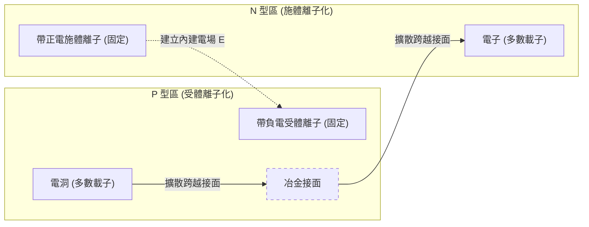

載子復合的結果，導致接面附近的晶格中失去了原本提供中和電荷的自由載子，留下無法移動的游離雜質離子：N 型區一側暴露出帶正電的施體離子（$N_D^+$），P 型區一側暴露出帶負電的受體離子（$N_A^-$）。此由固定離子構成的區域稱為**空間電荷區**（Space Charge Region, SCR），又稱**空乏區**（Depletion Region）。

空間電荷區內未被屏蔽的固定正負電荷，建立起一個由 N 型區指向 P 型區的內建電場（Built-in Electric Field, $\mathcal{E}$）。此電場對載子施加庫倫力，促使電子往 N 型區漂移、電洞往 P 型區漂移。此漂移運動的方向與先前的擴散運動方向正好相反。

隨著擴散進行，空間電荷累積增加，內建電場持續增強，漂移電流隨之上升。當漂移電流大小恰好等於擴散電流大小時，系統達到熱平衡（Thermal Equilibrium）。此時，接面上的淨電子電流密度 $J_n$ 與淨電洞電流密度 $J_p$ 各自恆等於零：

$$J_n = J_{n,\text{drift}} + J_{n,\text{diff}} = q n \mu_n \mathcal{E} + q D_n \frac{dn}{dx} = 0$$

$$J_p = J_{p,\text{drift}} + J_{p,\text{diff}} = q p \mu_p \mathcal{E} - q D_p \frac{dp}{dx} = 0$$

其中 $q$ 為基本電荷（$1.602 \times 10^{-19}\text{ C}$），$\mu_n$ 與 $\mu_p$ 分別為電子與電洞之遷移率（Mobility），$D_n$ 與 $D_p$ 分別為電子與電洞之擴散係數（Diffusion Coefficient）。

由第 1 章的固態物理熱力學原理可知，孤立系統在熱平衡狀態下，全系統的化學勢（Chemical Potential）必須處處相等。在半導體能帶架構中，化學勢即對應**費米能階**（Fermi Level, $E_F$）。因此，熱平衡下的 PN 接面能帶圖中，費米能階為一條水平直線（$dE_F / dx = 0$）。為了維持此一恆定費米能階，P 型區相對較高的傳導帶底 $E_c$ 與價鍵帶頂 $E_v$ 必須向下彎曲，與 N 型區較低的 $E_c$ 與 $E_v$ 連接，此現象稱為**能帶彎曲**（Band Bending）。能帶彎曲的總能量差即為載子跨越接面所需克服的靜電位能障壁。

---

### 內建電位的熱力學與統計推導

由能帶彎曲所對應的靜電位差稱為**內建電位**（Built-in Potential），符號以 $V_{bi}$ 表示。可由熱平衡下電洞電流為零之條件進行定量推導：

$$q p \mu_p \mathcal{E} = q D_p \frac{dp}{dx}$$

靜電場與電位 $V$ 之關係為 $\mathcal{E} = - \frac{dV}{dx}$。將此關係代入上式，並利用愛因斯坦關係式（Einstein Relation, 見第 2 章）$\frac{D_p}{\mu_p} = \frac{k_B T}{q}$（其中 $k_B$ 為玻茲曼常數，$T$ 為絕對溫度），可得：

$$- \frac{dV}{dx} = \frac{D_p}{\mu_p} \frac{1}{p} \frac{dp}{dx} = \frac{k_B T}{q} \frac{1}{p} \frac{dp}{dx}$$

將上式從 P 型區中性邊界（電位定為 $V_p = 0$，電洞濃度為 $p_p$）積分至 N 型區中性邊界（電位為 $V_n = V_{bi}$，電洞濃度為 $p_n$）：

$$-\int_0^{V_{bi}} dV = \frac{k_B T}{q} \int_{p_p}^{p_n} \frac{1}{p} dp$$

$$V_{bi} = \frac{k_B T}{q} \ln\left( \frac{p_p}{p_n} \right)$$

在完全游離假設下，P 型區的多數載子濃度 $p_p \approx N_A$，而 N 型區的少數載子電洞濃度為 $p_n \approx n_i^2 / N_D$。代入上式，即得到非退化半導體突變接面（Step Junction）之內建電位公式：

$$V_{bi} = \frac{k_B T}{q} \ln\left( \frac{N_A N_D}{n_i^2} \right) = V_t \ln\left( \frac{N_A N_D}{n_i^2} \right)$$

其中 $V_t = k_B T / q$ 定義為熱電壓（Thermal Voltage），在常溫 $T = 300\text{ K}$ 時，其典型值約為 $0.0259\text{ V}$（常取 $26\text{ mV}$）。

| 參數 | 符號 | 矽（Si, 300 K）典型值 | 單位 |
| :--- | :--- | :--- | :--- |
| 本質載子濃度 | $n_i$ | $1.0 \times 10^{10}$（舊文獻常記 $1.5 \times 10^{10}$） | $\text{cm}^{-3}$ |
| 熱電壓 | $V_t = k_B T / q$ | $0.0259$ | $\text{V}$ |
| 輕摻雜接面內建電位 ($N_A=10^{15}, N_D=10^{15}$) | $V_{bi}$ | $\approx 0.597$ | $\text{V}$ |
| 中度摻雜接面內建電位 ($N_A=10^{17}, N_D=10^{16}$) | $V_{bi}$ | $\approx 0.754$ | $\text{V}$ |
| 重度摻雜接面內建電位 ($N_A=10^{19}, N_D=10^{18}$) | $V_{bi}$ | $\approx 0.993$ | $\text{V}$ |

!!! note "說明：內建電位無法直接由外接電壓表測得"
    若以一般三用電表直接接觸未偏壓的 PN 二極體兩端，讀數必為 $0\text{ V}$，無法測得 $V_{bi}$。這是因為將金屬探針與 P 型矽及 N 型矽接觸時，金屬-半導體接觸面（Metal-Semiconductor Contacts）會分別產生接觸電位差（Contact Potential）。根據熱力學第二定律，在無外加能量的閉合迴路中，整個迴路的各接觸電位差代數和必然為零，否則將產生自發電流而違反熱力學平衡。

---

### 空間電荷區與空乏近似

為了在數學上求解接面處的電場與電位空間分佈，古典微小元件分析普遍採用**空乏近似**（Depletion Approximation）。該近似建立在以下兩項基本物理假設上：

1. **完全空乏假設**：在空間電荷區（$-x_p \le x \le x_n$）內部，自由電子與電洞濃度因強電場掃蕩而遠小於游離雜質濃度（即 $n \ll N_D$ 且 $p \ll N_A$）。因此，空間電荷完全由固定的離子化雜質決定，淨電荷密度為一階躍常數分佈。
2. **電中性假設**：在空間電荷區外圍的半導體主體區域（$x < -x_p$ 與 $x > x_n$），電場強度嚴格為零，維持局部電中性（Quasi-neutral regions）。

```
電荷密度 ρ(x)
      ▲
+q·Nd |          +----------------+
      |          |                |
------|----------+----------------+-----> 空間座標 x
      | -xp      0                xn
-q·Na | +--------+
      | |        |
      ▼ +--------+
```

依此近似，一維空間電荷密度 $\rho(x)$ 可表示為分段常數函數：

$$\rho(x) = 
\begin{cases} 
0, & x < -x_p \\ 
-q N_A, & -x_p \le x < 0 \\ 
+q N_D, & 0 \le x \le x_n \\ 
0, & x > x_n 
\end{cases}$$

其中 $x = 0$ 定義為冶金接面位置，$x_p$ 為空乏區向 P 型區延伸的寬度，$x_n$ 為空乏區向 N 型區延伸的寬度。

---

### 一維卜松方程式求解：電場分佈、電位分佈與空乏區寬度

根據靜電學，介質中的靜電位 $V(x)$ 與空間電荷密度 $\rho(x)$ 服從一維卜松方程式（Poisson's Equation）：

$$\frac{d^2 V(x)}{dx^2} = -\frac{d\mathcal{E}(x)}{dx} = -\frac{\rho(x)}{\varepsilon_s}$$

其中 $\varepsilon_s = \varepsilon_r \varepsilon_0$ 為半導體材料的介電常數（Permittivity），矽的相對介電常數 $\varepsilon_r \approx 11.7$，真空介電常數 $\varepsilon_0 \approx 8.854 \times 10^{-14}\text{ F/cm}$。

#### 1. 內建電場分佈 $\mathcal{E}(x)$

利用邊界條件：在空乏區外緣處電場為零，即 $\mathcal{E}(-x_p) = 0$ 且 $\mathcal{E}(x_n) = 0$。對卜松方程式進行一次積分：

在 P 型空乏區（$-x_p \le x \le 0$）：
$$\frac{d\mathcal{E}}{dx} = \frac{\rho(x)}{\varepsilon_s} = -\frac{q N_A}{\varepsilon_s}$$
$$\mathcal{E}(x) = -\frac{q N_A}{\varepsilon_s} (x + x_p)$$

在 N 型空乏區（$0 \le x \le x_n$）：
$$\frac{d\mathcal{E}}{dx} = \frac{q N_D}{\varepsilon_s}$$
$$\mathcal{E}(x) = \frac{q N_D}{\varepsilon_s} (x - x_n) = -\frac{q N_D}{\varepsilon_s} (x_n - x)$$

由電場在冶金接面處（$x = 0$）必須連續的邊界條件：

$$\mathcal{E}(0) = -\frac{q N_A x_p}{\varepsilon_s} = -\frac{q N_D x_n}{\varepsilon_s} = -\mathcal{E}_{max}$$

由此直接導出**全域電中性條件**（Global Charge Neutrality Condition）：

$$q N_A x_p = q N_D x_n$$

此式指出，接面兩側空乏區所暴露出的正負離子總電荷量在數值上必然相等。因此，摻雜濃度較低的一側，空乏區必須延伸得更深以包覆足夠的離子。最大電場強度 $\mathcal{E}_{max}$ 發生在冶金接面 $x = 0$ 處，其大小為：

$$\mathcal{E}_{max} = \frac{q N_A x_p}{\varepsilon_s} = \frac{q N_D x_n}{\varepsilon_s}$$

#### 2. 電位分佈 $V(x)$

設定電位參考點為 P 型中性區邊界，即 $V(-x_p) = 0$。由於 $\mathcal{E}(x) = -dV(x)/dx$，對電場進行積分：

在 P 型空乏區（$-x_p \le x \le 0$）：
$$V(x) = -\int_{-x_p}^x \mathcal{E}(x') dx' = \int_{-x_p}^x \frac{q N_A}{\varepsilon_s} (x' + x_p) dx' = \frac{q N_A}{2\varepsilon_s} (x + x_p)^2$$

在 N 型空乏區（$0 \le x \le x_n$），利用 $V(x_n) = V_{bi}$：
$$V(x) = V_{bi} - \int_x^{x_n} (-\mathcal{E}(x')) dx' = V_{bi} - \frac{q N_D}{2\varepsilon_s} (x_n - x)^2$$

在冶金接面 $x = 0$ 處，電位分佈保持連續（$V(0^-) = V(0^+)$），因此：

$$V(0) = \frac{q N_A x_p^2}{2\varepsilon_s} = V_{bi} - \frac{q N_D x_n^2}{2\varepsilon_s}$$

由此可得內建電位與空乏區寬度的關聯：

$$V_{bi} = \frac{q}{2\varepsilon_s} \left( N_A x_p^2 + N_D x_n^2 \right)$$

#### 3. 空乏區總寬度 $W$

定義空乏區總寬度為 $W = x_n + x_p$。結合全域電荷中性條件 $x_p = x_n (N_D / N_A)$，可分別求得兩側的空乏厚度：

$$x_n = W \left( \frac{N_A}{N_A + N_D} \right), \quad x_p = W \left( \frac{N_D}{N_A + N_D} \right)$$

將 $x_n$ 與 $x_p$ 代入電位公式：

$$V_{bi} = \frac{q}{2\varepsilon_s} \left[ N_A \left( \frac{W N_D}{N_A + N_D} \right)^2 + N_D \left( \frac{W N_A}{N_A + N_D} \right)^2 \right] = \frac{q}{2\varepsilon_s} \left( \frac{N_A N_D}{N_A + N_D} \right) W^2$$

整理後即求得熱平衡狀態下的空乏區總寬度 $W$：

$$W = \sqrt{\frac{2\varepsilon_s}{q} \left( \frac{N_A + N_D}{N_A N_D} \right) V_{bi}} = \sqrt{\frac{2\varepsilon_s}{q} \left( \frac{1}{N_A} + \frac{1}{N_D} \right) V_{bi}}$$

最大電場強度 $\mathcal{E}_{max}$ 亦可改寫為與總寬度 $W$ 及內建電位 $V_{bi}$ 的幾何關係式：

$$\mathcal{E}_{max} = \frac{2 V_{bi}}{W}$$

此式反映出電場在空乏區內呈現三角形分佈，三角形的底為 $W$，高為 $\mathcal{E}_{max}$，其積分面積即等於總電位差 $V_{bi}$。

!!! example "產業實例：單邊突變接面（One-sided Abrupt Junction）"
    在積體電路製程中，極常見到一側摻雜濃度遠高於另一側的結構，例如源極/汲極植入（Source/Drain Implantation）形成的 $P^+N$ 接面或高壓井區中的 $N^+P$ 接面。
    
    以 $P^+N$ 接面為例，受體濃度遠大於施體濃度（$N_A \gg N_D$），此時 $\frac{1}{N_A} \ll \frac{1}{N_D}$。由上述公式可迅速簡化為：
    
    $$W \approx x_n \approx \sqrt{\frac{2\varepsilon_s V_{bi}}{q N_D}}, \quad x_p \approx 0$$
    
    這意味著空乏區幾乎全數落在摻雜濃度較低的一側（輕摻雜側）。在先進 CMOS 與功率元件設計中，工程師僅需調整輕摻雜側的雜質濃度，即可精準掌控空乏區的延展寬度、接面電容以及擊穿耐壓極限。

<!-- fig:1 -->
<figure markdown>
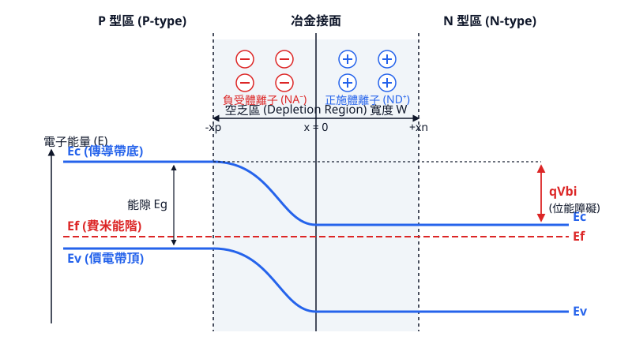
<figcaption>圖 3-1　熱平衡能帶圖（AI 繪製的示意圖）</figcaption>
</figure>

## 3.2 接面電容與動態響應特性

### 3.2.1 空乏電容與 C-V 特性分析

在 PN 接面兩側，由於載子擴散所形成的空間電荷區（Space Charge Region, SCR，即空乏區），內部存在未被中和的游離施體與受體離子。當外加偏壓 $V_A$ 發生微小變化 $dV_A$ 時，空乏區邊界寬度隨之伸縮，伴隨空間電荷量 $dQ$ 的進出。這種由空乏區邊界電荷變動所產生的電容效應，稱為空乏電容（Depletion Capacitance, $C_j$）。

微觀上，當外加電壓改變時，多數載子在空乏區邊界迅速進出以改變耗盡寬度，其行為等效於平板電容：

$$C_j = \left| \frac{dQ}{dV_A} \right| = \frac{\epsilon_s A}{W}$$

式中，$\epsilon_s$ 為半導體的介電常數（矽為 $\epsilon_{si} \approx 11.7 \times 8.854 \times 10^{-14} \text{ F/cm}$），$A$ 為接面截面積，$W$ 為空乏區總寬度。

若為階梯狀突變接面（Step Junction），空乏區寬度與有效電位差的關係為：

$$W = \sqrt{\frac{2\epsilon_s (V_{bi} - V_A)}{q}\left(\frac{1}{N_A} + \frac{1}{N_D}\right)}$$

其中 $V_{bi}$ 為內建電位（見第 3.1 節），$q$ 為基本電荷（$1.602 \times 10^{-19} \text{ C}$），$N_A$ 與 $N_D$ 分別為 P 型與 N 型側的摻雜濃度。將 $W$ 代入電容公式，單位面積接面電容可表示為：

$$C_j' = \frac{C_j}{A} = \sqrt{\frac{q \epsilon_s N_A N_D}{2(N_A + N_D)(V_{bi} - V_A)}}$$

由上式可知，逆向偏壓增加時（$V_A$ 為負值），$(V_{bi} - V_A)$ 增大，使空乏區寬度 $W$ 擴展，接面電容 $C_j$ 隨之下降。此電壓相依性是壓控變容二極體（Varactor Diode）的核心工作原理。

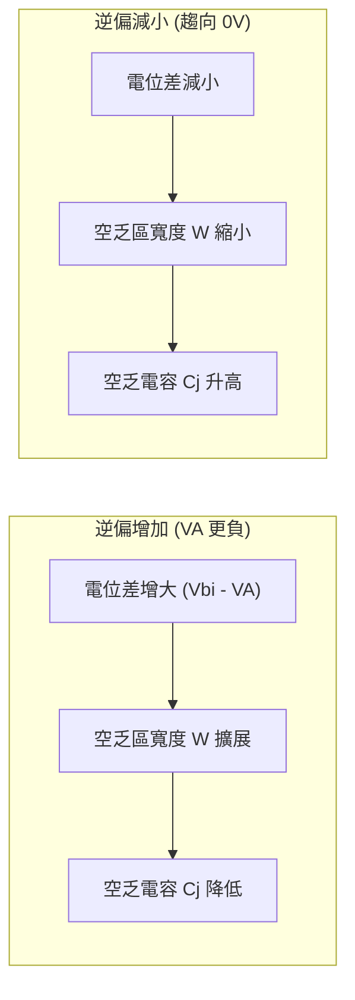

在半導體製程監控中，常採用單邊突變接面（例如高摻雜 P 搭配低摻雜 N 的 $p^+n$ 接面，此時 $N_A \gg N_D$）。電容公式可簡化為：

$$\frac{1}{(C_j')^2} = \frac{2(V_{bi} - V_A)}{q \epsilon_s N_D}$$

將量測所得的 $1/C^2$ 對外加電壓 $V_A$ 作圖（即電容-電壓分析法，C-V Profiling）：
1. **曲線斜率**：斜率大小為 $-2 / (q \epsilon_s A^2 N_D)$，可精確反推輕摻雜側的雜質濃度 $N_D$。
2. **橫軸截距**：將直線外推至 $1/C^2 = 0$ 處，截距即為內建電位 $V_{bi}$。

若摻雜分佈非均勻（$N_D$ 為深度 $x$ 的函數），空乏區邊界隨偏壓掃描而移動，局部摻雜濃度 $N(W)$ 可透過微分導出：

$$N(W) = \frac{2}{q \epsilon_s A^2 \left[ \frac{d(1/C^2)}{dV_A} \right]}$$

此方法廣泛用於量測離子植入（Ion Implantation）後的載子分佈輪廓。

---

### 3.2.2 順向偏壓少數載子儲存與擴散電容

當 PN 接面處於順向偏壓（$V_A > 0$）時，除了空乏區變窄導致空乏電容上升外，另一種由少數載子傳輸主導的電容效應開始佔據主導地位，稱為擴散電容（Diffusion Capacitance, $C_d$）。

順向偏壓降低了接面位能障，多數載子大量注入對側的中性區。以長二極體（Base 寬度遠大於擴散長度）為例，注入中性 N 區的少數載子電洞濃度 $p_n(x)$ 隨離接面距離呈現指數衰減：

$$p_n(x) - p_{n0} = p_{n0} \left( e^{\frac{qV_A}{k_B T}} - 1 \right) e^{-\frac{x - x_n}{L_p}}$$

其中 $p_{n0}$ 為熱平衡少數載子濃度，$k_B$ 為波茲曼常數，$T$ 為絕對溫度，$L_p = \sqrt{D_p \tau_p}$ 為電洞擴散長度，$x_n$ 為 N 側空乏區邊界。為了維持中性區的電中性，多數載子電子會自金屬接觸端湧入，與注入的少數載子電洞在空間上匹配，形成儲存電荷（Stored Charge, $Q_p$）：

$$Q_p = q A \int_{x_n}^{\infty} [p_n(x) - p_{n0}] \, dx = q A L_p p_{n0} \left( e^{\frac{qV_A}{k_B T}} - 1 \right)$$

根據少數載子複合與連續方程式，順向電洞電流 $I_p$ 與儲存電荷 $Q_p$ 成正比，比例常數即為少數載子生命週期（Carrier Lifetime）$\tau_p$：

$$I_p = \frac{Q_p}{\tau_p}$$

擴散電容定義為儲存電荷對外加偏壓的變化率：

$$C_{dp} = \frac{dQ_p}{dV_A} = \tau_p \frac{dI_p}{dV_A} = \tau_p g_{dp} = \frac{q \tau_p I_p}{k_B T}$$

式中 $g_{dp}$ 為二極體的小訊號小偏壓電導。將電子注入中性 P 區的貢獻一併計入，總擴散電容為：

$$C_d = \frac{q (\tau_p I_p + \tau_n I_n)}{k_B T} \approx \frac{q \tau_T I_D}{k_B T}$$

其中 $\tau_T$ 為有效少數載子傳輸或複合時間，$I_D$ 為總順向電流。

| 特性比較項 | 空乏電容 ($C_j$) | 擴散電容 ($C_d$) |
| :--- | :--- | :--- |
| **物理機制** | 空乏區邊界游離離子電荷的伸縮 | 中性區少數載子儲存電荷的充放電 |
| **主導偏壓區間** | 逆向偏壓與微小順向偏壓 | 中度至高度順向偏壓 |
| **偏壓相依性** | 隨順偏增加微幅上升：$\propto (V_{bi} - V_A)^{-1/2}$ | 隨順偏呈指數激增：$\propto e^{qV_A / k_B T}$ |
| **電流相依性** | 與通過元件之導通電流無直接關聯 | 直接正比於順向電流：$C_d \propto I_D$ |
| **限制參數** | 介電常數、摻雜濃度、接面面積 | 少數載子生命週期 ($\tau_p, \tau_n$)、順向電流 |

---

### 3.2.3 暫態切換特性與逆向恢復時間

在數位邏輯切換與功率轉換電路中，PN 接面二極體常需由順向導通狀態（ON）快速切換至逆向截止狀態（OFF）。然而，二極體無法瞬間關閉，該延遲過程稱為暫態切換響應（Switching Transient）。

當外加電壓在 $t = 0$ 由順向 $V_F$ 突切為逆向 $V_R$ 時，中性區內已儲存大量少數載子。在這些少數載子被完全移除前，接面維持極低的阻抗，導致電路中出現巨大的逆向電流 $I_R \approx V_R / R_L$（$R_L$ 為外部負載電阻）。

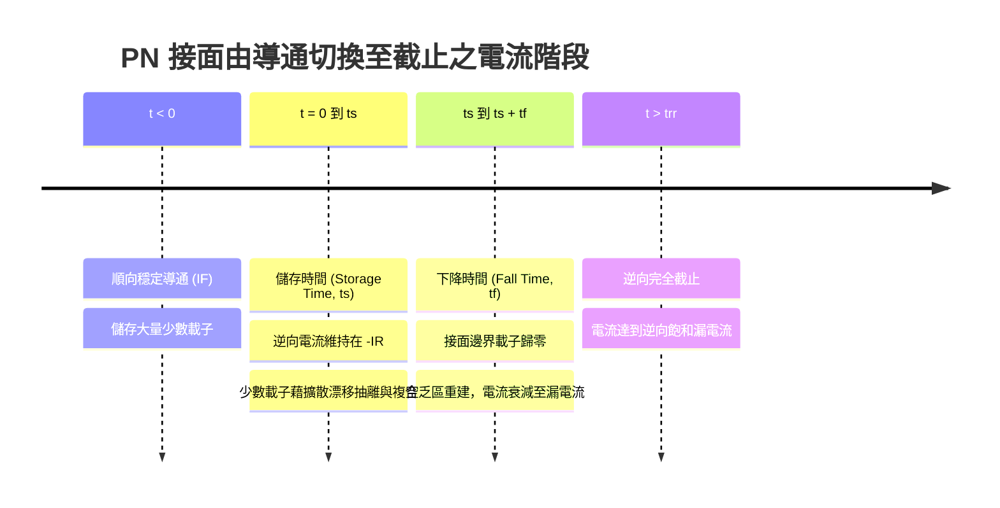

暫態過程可細分為兩個主要時間區間：

1. **儲存時間（Storage Time, $t_s$）**：
   接面邊緣的少數載子濃度尚未降至熱平衡值 $p_{n0}$ 之前，接面電位差仍維持約數百毫伏特的微弱正偏。此期間逆向電流被外部電路限制在常數 $I_R$。儲存少數載子透過兩條路徑消失：外部迴路的逆向抽取電流，以及半導體內部的載子再複合。利用電荷控制模型，儲存時間可解析為：
   $$t_s = \tau_p \left[ \ln\left(1 + \frac{I_F}{I_R}\right) - \ln\left(1 + \frac{p_n(x_n, t_s)}{p_n(x_n, 0)}\right) \right] \approx \tau_p \ln\left(1 + \frac{I_F}{I_R}\right)$$

2. **下降時間（Fall/Transition Time, $t_f$）**：
   當接面邊界的過剩少數載子濃度降為零時，接面開始承受逆向偏壓，空乏區向兩側展開，逆向電流從 $-I_R$ 迅速衰減至極微小的逆向飽和漏電流 $I_s$。在此階段，主導機制轉變為空乏電容 $C_j$ 的充電過程。

總逆向恢復時間（Reverse Recovery Time, $t_{rr}$）定義為電流從負峰值開始回升至 $0.1 I_R$（或 $0.25 I_R$）的時間：

$$t_{rr} = t_s + t_f$$

在 $t_{rr}$ 期間流出接面的總電荷量稱為逆向恢復電荷（Recovered Charge, $Q_{rr}$）：

$$Q_{rr} = \int_{0}^{t_{rr}} i_R(t) \, dt \approx \frac{1}{2} I_R t_{rr}$$

!!! warning "常見誤解"
    切換速度受限並非僅因空乏電容充放電的 $RC$ 延遲，在順偏轉逆偏過程中，**少數載子儲存效應（擴散電容）所造成的儲存時間 $t_s$ 往往佔據 $t_{rr}$ 的主要部分**，通常比空乏電容充放電時間長數個數量級。

---

### 3.2.4 高頻開關與功率整流之效能限制

接面電容與逆向恢復特性對高頻通訊與電力電子系統構成嚴格的物理限制：

1. **高頻小訊號響應與截止頻率**：
   二極體的交流截止頻率 $f_c$ 受限於接面電阻與電容構成的極點：
   $$f_c = \frac{1}{2\pi R_s (C_j + C_d)}$$
   其中 $R_s$ 為半導體中性區與接觸電極之寄生串聯電阻。在超高頻（RF/微波）整流與混頻應用中，擴散電容 $C_d$ 會徹底消除接面的非線性整流特性，因此一般 PN 二極體難以在數吉赫茲（GHz）以上運作。

2. **開關損耗（Switching Losses）**：
   在電力電子切換拓撲（如降壓轉換器 Buck Converter）中，開關頻率為 $f_{sw}$。二極體每次由導通轉截止時，電源必須提供能量抽出 $Q_{rr}$，同時伴隨高電壓與大電流的交疊，造成平均逆向恢復開關損耗 $P_{rr}$：
   $$P_{rr} = V_R \cdot Q_{rr} \cdot f_{sw} \approx \frac{1}{2} V_R I_R t_{rr} f_{sw}$$
   當系統切換頻率自幾十千赫茲提升至兆赫茲等級時，$P_{rr}$ 會急遽上升，導致晶片發熱與整體轉換效率低落。

3. **電壓突波與電磁干擾（EMI）**：
   在下降時間 $t_f$ 內，逆向電流變化率 $di/dt$ 極大。電路封裝與佈線中不可避免地存在寄生電感 $L_{\sigma}$，將誘發感應過電壓：
   $$V_{spike} = L_{\sigma} \left| \frac{di}{dt} \right|$$
   此突波電壓會疊加在逆向阻斷電壓上，若超過二極體的崩潰電壓（見第 3.4 節）便會導致元件永久損毀；同時，高頻振盪亦會向外輻射電磁雜訊。

!!! example "產業實例"
    為縮短矽基高壓快恢復二極體（Fast Recovery Diode, FRD）的 $t_{rr}$，製程通常採用少數載子壽命控制技術（Lifetime Killing），例如導入**重金屬雜質擴散（如金 Au 或鉑 Pt）**，或以**高能電子束／質子射線照射（Electron/Proton Irradiation）**在能隙中央產生深能階重組中心（Deep-level Recombination Centers），將少數載子生命週期 $\tau$ 從微秒級（$\mu\text{s}$）壓低至奈秒級（$\text{ns}$）。然而，這類缺陷會同時增加熱產生電流，使逆向飽和漏電流上升並惡化導通電壓降 $V_F$。因此，在現代高效能電源中，高耐壓需求已大量轉向無少數載子儲存效應的碳化矽肖特基二極體（SiC SBD，見第 3.5 節與第 10 章）。

## 3.3 外加偏壓與電流-電壓（I-V）特性

### 外加偏壓下的能帶結構與少數載子注入

在熱平衡狀態下（見第 3.1 節），PN 接面內沒有淨電流流過，費米能階（Fermi Level, $E_F$）在整個半導體元件內部保持水平一致。當在 PN 接面兩端施加外加偏壓 $V_A$ 時，系統偏離熱平衡，能帶結構隨之發生扭曲。由於中性 P 型區與中性 N 型區的電導率遠高於空乏區（Depletion Region），在小信號與低注入條件下，外加電壓降幾乎完全落在高電阻的空乏區兩端。

當 P 端接正極、N 端接負極時，稱為**順向偏壓**（Forward Bias, $V_A > 0$）。此時外加電場方向與內建電場（Built-in Field）方向相反，空乏區兩端的總靜電位能障降低為：

$$q(V_{bi} - V_A)$$

其中 $q$ 為基本電荷，$V_{bi}$ 為內建電位。能障降低減弱了阻止多數載子擴散的靜電阻力，使得 P 區的多數載子電洞與 N 區的多數載子電子得以藉由熱激發越過交界面，分別注入對側的中性區，成為過剩的**少數載子**（Minority Carriers），此過程稱為少數載子注入（Minority Carrier Injection）。

反之，當 P 端接負極、N 端接正極時，稱為**逆向偏壓**（Reverse Bias, $V_A < 0$）。外加電場與內建電場同向，總電位能障提升至 $q(V_{bi} + |V_A|)$，空乏區進一步拓寬。多數載子擴散被完全抑制，僅剩極少數由熱產生在空乏區邊緣附近的少數載子，受強大電場掃過接面，形成微弱的漂移電流。

在非平衡狀態下，單一費米能階不再適用，必須引入電子準費米能階（Quasi-Fermi Level for Electrons, $E_{Fn}$）與電洞準費米能階（Quasi-Fermi Level for Holes, $E_{Fp}$）來描述非平衡載子分佈。在空乏區內，兩者的能量分離量直接對應外加偏壓：

$$E_{Fn} - E_{Fp} = qV_A$$

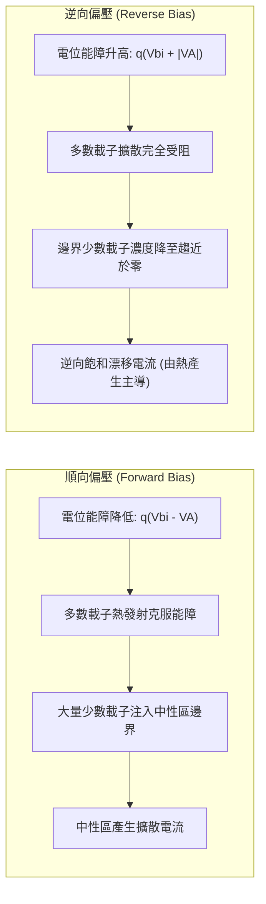

---

### 雙極性傳輸與少數載子擴散分佈輪廓

分析電流傳輸時，通常採用**低注入假設**（Low-level Injection），即注入的過剩少數載子濃度遠低於該區域的多數載子平衡濃度（例如在 P 區中，$\Delta n_p \ll p_{p0}$）。在此條件下，中性區維持電中性，電場極弱（$E \approx 0$），過剩少數載子的運動完全由擴散（Diffusion）與複合（Recombination）主導。

以長二極體（Long-base Diode，中性區寬度遠大於少數載子擴散長度）為例，將座標原點分別設於空乏區兩側邊緣：
- N 區邊緣設為 $x_n = 0$，向右延伸至中性 N 區；
- P 區邊緣設為 $x_p = 0$，向左延伸至中性 P 區。

空乏區邊界的少數載子濃度滿足**蕭克利邊界條件**（Shockley Boundary Conditions）：

$$n_p(x_p = 0) = n_{p0} \exp\left(\frac{qV_A}{k_B T}\right)$$

$$p_n(x_n = 0) = p_{n0} \exp\left(\frac{qV_A}{k_B T}\right)$$

其中 $n_{p0}$ 與 $p_{n0}$ 分別為 P 區與 N 區在熱平衡下的少數載子濃度，$k_B$ 為波茲曼常數，$T$ 為絕對溫度。過剩載子濃度定義為 $\Delta n_p = n_p - n_{p0}$ 與 $\Delta p_n = p_n - p_{n0}$，在交界面邊界處為：

$$\Delta n_p(0) = n_{p0} \left[\exp\left(\frac{qV_A}{k_B T}\right) - 1\right]$$

$$\Delta p_n(0) = p_{n0} \left[\exp\left(\frac{qV_A}{k_B T}\right) - 1\right]$$

在中性 N 區中，一維穩態連續方程式（Continuity Equation，見第 2 章）簡化為：

$$D_p \frac{d^2 \Delta p_n(x_n)}{dx_n^2} - \frac{\Delta p_n(x_n)}{\tau_p} = 0$$

其中 $D_p$ 為電洞擴散係數，$\tau_p$ 為電洞生命期（Carrier Lifetime）。定義電洞擴散長度（Hole Diffusion Length）為 $L_p = \sqrt{D_p \tau_p}$，方程式可改寫為：

$$\frac{d^2 \Delta p_n(x_n)}{dx_n^2} = \frac{\Delta p_n(x_n)}{L_p^2}$$

配合邊界條件：
1. 在 $x_n = 0$ 處，$\Delta p_n(0) = p_{n0} [\exp(qV_A/k_B T) - 1]$
2. 在深處 $x_n \to \infty$ 處，過剩載子完全複合，$\Delta p_n(\infty) = 0$

解此常微分方程式可得中性 N 區內的少數載子電洞分佈輪廓：

$$\Delta p_n(x_n) = \Delta p_n(0) \exp\left(-\frac{x_n}{L_p}\right) = p_{n0} \left[\exp\left(\frac{qV_A}{k_B T}\right) - 1\right] \exp\left(-\frac{x_n}{L_p}\right)$$

同理，在中性 P 區中，少數載子電子擴散長度為 $L_n = \sqrt{D_n \tau_n}$，其分佈輪廓為：

$$\Delta n_p(x_p) = n_{p0} \left[\exp\left(\frac{qV_A}{k_B T}\right) - 1\right] \exp\left(-\frac{x_p}{L_n}\right)$$

此指數衰減形式顯示，注入的少數載子在向深處擴散的過程中，不斷與多數載子複合而消失。

---

### 蕭克利理想二極體方程式推導

在空乏區內無產生與複合的假設下，跨越空乏區的載子電流守恆。因此，流經接面的總電流密度等於空乏區邊界處少數載子擴散電流密度的總和：

$$J = J_p(x_n = 0) + J_n(x_p = 0)$$

依據菲克第一定律（Fick's First Law），少數載子擴散電流密度為：

$$J_p(x_n = 0) = -q D_p \left.\frac{d \Delta p_n(x_n)}{dx_n}\right|_{x_n=0} = \frac{q D_p p_{n0}}{L_p} \left[\exp\left(\frac{qV_A}{k_B T}\right) - 1\right]$$

$$J_n(x_p = 0) = q D_n \left.\frac{d \Delta n_p(x_p)}{dx_p}\right|_{x_p=0} = \frac{q D_n n_{p0}}{L_n} \left[\exp\left(\frac{qV_A}{k_B T}\right) - 1\right]$$

將兩式相加，即得到著名的**蕭克利理想二極體方程式**（Shockley Diode Equation）：

$$J = J_0 \left[\exp\left(\frac{qV_A}{k_B T}\right) - 1\right]$$

若元件截面積為 $A$，則總電流為 $I = I_0 [\exp(qV_A/k_B T) - 1]$。其中 $J_0$ 為**逆向飽和電流密度**（Reverse Saturation Current Density）：

$$J_0 = q \left(\frac{D_p p_{n0}}{L_p} + \frac{D_n n_{p0}}{L_n}\right)$$

利用質量作用定律（Law of Mass Action）$p_{n0} = n_i^2 / N_D$ 與 $n_{p0} = n_i^2 / N_A$（$n_i$ 為本質載子濃度，$N_A$ 與 $N_D$ 分別為受質與施質摻雜濃度），$J_0$ 可表示為：

$$J_0 = q n_i^2 \left(\frac{D_p}{L_p N_D} + \frac{D_n}{L_n N_A}\right)$$

由於 $n_i^2 \propto T^3 \exp(-E_g / k_B T)$（$E_g$ 為能隙），$J_0$ 對溫度極為敏感，在室溫下矽接面的 $J_0$ 典型值介於 $10^{-12} \sim 10^{-10}\text{ A/cm}^2$。

!!! note "逆向偏壓下的飽和現象"
    當外加逆向偏壓且 $|V_A| \gg k_B T / q$（在室溫 $300\text{ K}$ 下，熱電壓 $V_t = k_B T / q \approx 0.0259\text{ V}$，約 $|V_A| > 0.1\text{ V}$）時，指數項 $\exp(qV_A / k_B T) \to 0$。此時電流趨於一與電壓無關的定值：
    $$J \approx -J_0$$
    這是因為此時邊界的少數載子濃度被強制拉降至零，擴散流向空乏區的少數載子完全由擴散長度範圍內的熱激發產生率決定。

---

### 非理想效應與真實 I-V 特性

在真實矽 PN 接面中，測量所得的 I-V 特性曲線在低順偏、高順偏以及逆向偏壓下均會偏離蕭克利理想模型。為了精確描述元件行為，必須納入以下物理機制：

#### 1. 空乏區產生與複合電流（Generation-Recombination Current）

在禁帶中存在深層缺陷能階時，載子透過肖克利-讀-霍爾（Shockley-Read-Hall, SRH）機制在空乏區內複合或產生：

- **順偏小電流區（複合主導）**：當施加低順向電壓時，空乏區內的載子濃度高於熱平衡值，大量載子在空乏區內部複合，產生複合電流 $I_{rec}$。其對電壓的相依性為：
  $$I_{rec} \propto \exp\left(\frac{qV_A}{2 k_B T}\right)$$
- **逆偏電流區（產生主導）**：在逆向偏壓下，空乏區內的載子濃度極低（$n, p \ll n_i$），SRH 中心持續熱激發電子-電洞對，並隨即被強電場分離，形成產生電流 $I_{gen}$：
  $$I_{gen} = \frac{q n_i W}{2 \tau_0}$$
  其中 $W$ 為空乏區寬度，$\tau_0$ 為有效載子生命期。由於 $W \propto \sqrt{V_{bi} - V_A}$（突變接面），逆向電流不會完美飽和於 $I_0$，而是隨逆向偏壓的增加呈現次線性的微幅上升（$\propto \sqrt{|V_A|}$）。

#### 2. 理想因子（Ideality Factor, $n$）

為了在經驗公式中統一描述擴散電流與複合電流，二極體方程式修正為：

$$I = I_0 \left[\exp\left(\frac{qV_A}{n k_B T}\right) - 1\right]$$

其中 $n$ 稱為**理想因子**（Ideality Factor）：
- 當擴散電流占主導地位時（中等順偏電壓），$n \approx 1$；
- 當空乏區 SRH 複合電流占主導地位時（低順偏電壓），$n \approx 2$；
- 實際矽二極體在一般工作偏壓下的 $n$ 介於 $1.05 \sim 1.3$ 之間。

#### 3. 高注入效應（High-Level Injection）

當順偏電壓足夠大，使得注入的過剩少數載子濃度接近或超越了背景多數載子濃度（例如 $\Delta n_p \ge N_A$）時，中性區必須引入等量的多數載子以維持電中性。此時，邊界條件不再滿足簡單的指數關係，接面正向電流的增長率放緩，電壓相依性轉變為：

$$I \propto \exp\left(\frac{qV_A}{2 k_B T}\right)$$

在此區域，理想因子等效躍升至 $n = 2$。

#### 4. 直列寄生電阻（Series Resistance, $R_s$）

二極體結構包含 P 區與 N 區的中性區塊電阻（Bulk Resistance），以及金屬電極與半導體交界的接觸電阻（Contact Resistance）。這些電阻構成直列寄生電阻 $R_s$。此時真正落在 PN 接面內部的有效電壓為：

$$V_{j} = V_A - I R_s$$

在大電流操作下，$I R_s$ 的壓降不可忽略，使得外加電壓的大部分被寄生電阻瓜分，導致 $\ln(I)-V_A$ 特性曲線偏離直線並發生嚴重彎曲（向下飽和）。

| 偏壓工作區域 | 主要物理機制 | 理想因子 $n$ 典型值 | 電流特徵關係式 |
| :--- | :--- | :--- | :--- |
| **逆向偏壓** ($V_A < -3V_t$) | 空乏區熱產生（SRH 機制） | — | $I \approx I_{gen} \propto \sqrt{V_{bi} - V_A}$ |
| **低順向偏壓** ($0 < V_A < 0.3\text{ V}$) | 空乏區 SRH 複合電流主導 | $n \approx 2$ | $I \propto \exp(qV_A / 2k_B T)$ |
| **中等順向偏壓** ($0.3\text{ V} < V_A < 0.7\text{ V}$) | 中性區少數載子擴散主導 | $n \approx 1$ | $I \propto \exp(qV_A / k_B T)$ |
| **高順向偏壓** ($V_A > 0.7\text{ V}$) | 高注入效應與直列電阻 $R_s$ 限制 | $n \ge 2$ / 線性降 | $I \approx (V_A - V_{on}) / R_s$ |

!!! warning "常見誤解：逆向漏電流在室溫下主要由擴散 $I_0$ 決定"
    在教科書推導中，逆向電流常簡化為蕭克利飽和電流 $I_0 \propto n_i^2$。然而對於矽等寬能隙（$E_g = 1.12\text{ eV}$）材料，在室溫下本質濃度極低（$n_i \approx 1.5 \times 10^{10}\text{ cm}^{-3}$），計算出的擴散 $I_0$ 往往在皮安培（$\text{pA}$）甚至飛安培（$\text{fA}$）等級；實際量測到的室溫逆向電流通常在奈安培（$\text{nA}$）等級，且隨電壓微幅增加。此時逆向電流是由空乏區內的產生電流 $I_{gen} \propto n_i$ 所主導，而非擴散電流 $I_0$。只有在溫度顯著升高時（$T > 100^\circ\text{C}$），$n_i^2$ 的增速超過 $n_i$，擴散電流才會重回主導地位。

!!! example "產業實例：先進邏輯節點中的接面漏電指標"
    在先進 CMOS 製程中（如第 6 章所述的 FinFET 與 GAAFET 架構），源極/汲極（Source/Drain）與基極/基板形成的 PN 接面漏電（Junction Leakage）是待機靜態功耗（Standby Power）的主要來源。製程工程師透過離子佈植退火優化，嚴格控制晶格差排（Dislocations）與金屬雜質，以壓低空乏區內的深能階陷阱濃度，使低偏壓下的理想因子 $n$ 盡可能逼近 1，抑制接面處的 SRH 產生-複合漏電流。

## 3.4 逆向崩潰機制

### 逆向崩潰之物理定義與臨界電場

當 PN 接面施加逆向偏壓時，在理想狀況下僅有極微小的逆向飽和電流（Reverse Saturation Current）流通（見第 3.3 節）。然而，當外加逆向電壓超過特定門檻時，逆向電流會急遽攀升數個數量級，此現象稱為**逆向崩潰**（Reverse Breakdown），該臨界電壓定義為**崩潰電壓**（Breakdown Voltage，記為 $V_{\text{BR}}$）。

若外接電路未加入限流電阻，急遽放大的電流伴隨高電壓將產生巨大的焦耳熱（Joule Heating），導致接面局部熔融毀損；反之，若外電路具備足夠的限流機制，將工作電流限制於安全工作區（Safe Operating Area, SOA）內，崩潰過程本質上是可逆的非破壞性物理現象。

逆向崩潰的發生取決於空乏區內的**最大電場**（Maximum Electric Field, $\mathcal{E}_{\max}$）是否達到材料的**臨界電場**（Critical Electric Field，記為 $\mathcal{E}_{\text{crit}}$）。以單邊突變接面（One-sided Abrupt Junction，如 $p^+n$ 接面，即 $N_A \gg N_D$）為例，由帕松方程式推導，空乏區內的電場呈線性分布，最大電場出現在冶金接面（Metallurgical Junction, $x=0$）處：

$$\mathcal{E}_{\max} = \frac{q N_D W}{\varepsilon_s} = \sqrt{\frac{2 q N_D (V_{\text{bi}} + V_R)}{\varepsilon_s}}$$

其中：
- $q$ 為基本電荷（$1.602 \times 10^{-19} \text{ C}$）
- $N_D$ 為輕摻雜側（$n$ 型側）的施體濃度（$\text{cm}^{-3}$）
- $\varepsilon_s$ 為半導體介電常數（對矽而言，$\varepsilon_s = \varepsilon_r \varepsilon_0 \approx 11.7 \times 8.854 \times 10^{-14} \text{ F/cm}$）
- $W$ 為空乏區寬度（$\text{cm}$）
- $V_{\text{bi}}$ 為內建電位（Built-in Potential，$\text{V}$，見第 3.1 節）
- $V_R$ 為外加逆向偏壓（$\text{V}$）

當 $V_R$ 上升至 $V_{\text{BR}}$ 時，$\mathcal{E}_{\max} \to \mathcal{E}_{\text{crit}}$。由於 $V_{\text{BR}} \gg V_{\text{bi}}$，平行平面接面之一維理想崩潰電壓可近似表示為：

$$V_{\text{BR}} \approx \frac{\varepsilon_s \mathcal{E}_{\text{crit}}^2}{2 q N_B}$$

其中 $N_B$ 為輕摻雜側的基底摻雜濃度（Background Doping Concentration）。在常溫矽（$\text{Si}$）中，$\mathcal{E}_{\text{crit}}$ 的典型值約為 $3 \times 10^5 \sim 1 \times 10^6 \text{ V/cm}$，且數值會隨著摻雜濃度升高而略微上升。依據材料物理機制，逆向崩潰主要由兩種截然不同的微觀過程主導：**突崩崩潰**（Avalanche Breakdown）與**齊納崩潰**（Zener Breakdown）。

---

### 突崩崩潰與碰撞游離

當接面摻雜濃度相對較低（如矽中摻雜濃度低於 $10^{17} \text{ cm}^{-3}$），空乏區寬度較寬且崩潰電壓較高（通常 $> 6 \text{ V}$）時，崩潰由突崩機制所主導。


#### 碰撞游離機制
熱激發產生的少數載子漂移進入高電場空乏區後，被極高的電場劇烈加速。當載子在兩次晶格碰撞之間的平均自由路徑（Mean Free Path）內累積的動能大於材料的游離臨界能（Ionization Energy Threshold $E_i$，通常約為能隙 $E_g$ 的 $1.5$ 倍）時，該載子與晶格原子發生非彈性碰撞，將價帶中的電子撞擊至導帶，形成一對新的電子-電洞對（Electron-Hole Pair, EHP）。這項物理過程稱為**碰撞游離**（Impact Ionization）。

新產生的電子與電洞旋即被反向電場朝相反方向加速，各自在行進路徑上再度引發後續的碰撞游離。此種幾何級數倍增的雪崩式連鎖反應，使得接面逆向電流在極窄的電壓增量下急遽放大。

碰撞游離強度由**游離係數**（Ionization Rate）描述：電子游離係數 $\alpha_n$（或電洞游離係數 $\alpha_p$）定義為單一電子（或電洞）在電場方向上移動單位距離所產生的電子-電洞對數，單位為 $\text{cm}^{-1}$。游離係數隨局部電場 $\mathcal{E}$ 強烈指數增加，常以經驗公式（Chynoweth 定律）表示：

$$\alpha(\mathcal{E}) = A \exp\left( - \frac{B}{|\mathcal{E}|} \right)$$

其中 $A$ 與 $B$ 為材料常數。

#### 倍增因子與崩潰條件
定義接面電流倍增因子（Multiplication Factor）$M$ 為輸出總電流與入射初始電流之比值。若僅考慮電子單一載子注入長度為 $W$ 的空乏區，崩潰條件（即 $M \to \infty$）可表示為游離積分滿足：

$$\int_{0}^{W} \alpha_n \exp\left[ -\int_{0}^{x} (\alpha_n - \alpha_p) dx' \right] dx = 1$$

若假設 $\alpha_n \approx \alpha_p = \alpha$，則崩潰條件簡化為：

$$\int_{0}^{W} \alpha \, dx = 1$$

在工程分析中，倍增因子常採用米勒經驗公式（Miller's Empirical Formula）：

$$M = \frac{1}{1 - \left( \frac{V_R}{V_{\text{BR}}} \right)^n}$$

指數 $n$ 的典型值在矽中約為 $3 \sim 6$，取決於半導體導電型態與摻雜濃度。當外加電壓 $V_R$ 逼近 $V_{\text{BR}}$ 時，分母趨近於零，$M \to \infty$，電流達到突崩崩潰。

#### 正溫度係數特性
突崩崩潰具有**正溫度係數**（Positive Temperature Coefficient），即：

$$\frac{d V_{\text{BR}}}{d T} > 0$$

其物理機制源於晶格散射（Lattice Scattering）。當環境溫度 $T$ 升高時，晶格振動（聲子散射，Phonon Scattering）加劇，載子因頻繁碰撞而縮短了平均自由路徑 $\lambda$。載子在兩次碰撞之間自電場汲取的動能減少，游離係數 $\alpha$ 隨之降低。因此，必須施加更高的外加電壓以建立更強的電場，方能補償晶格散射損失並達成崩潰條件 $\int \alpha dx = 1$。

---

### 齊納崩潰與帶對帶穿隧

當接面兩側皆為極重摻雜（Degenerately Doped，如 $p^+n^+$ 接面，$N_A, N_D > 10^{18} \text{ cm}^{-3}$）時，空乏區寬度極窄（典型值 $W < 10 \text{ nm}$），崩潰電壓通常低於 $4 \text{ V}$。此時，在載子達到碰撞游離能量之前，空乏區電場已超越穿隧門檻（矽中約 $> 10^6 \text{ V/cm}$），引發量子穿隧效應。

#### 帶對帶穿隧物理機制
在重摻雜條件下，費米能階分別進入導帶與價帶深處。施加逆向偏壓時，能帶顯著傾斜，使得 $p$ 側價帶的最高能量態與 $n$ 側導帶的未填滿量子態在空間上產生重疊。

此時，$p$ 側價帶頂端的電子只需跨越一個極窄的位能障壁（寬度等於空間上的能隙過渡距離 $d$），即可直接穿透禁帶進入 $n$ 側導帶的空態，此量子力學過程稱為**帶對帶穿隧**（Band-to-Band Tunneling, BTBT）。根據 WKB 近似（Wentzel-Kramers-Brillouin Approximation），電子穿隧機率 $T_t$ 與障壁形狀強烈相關：

$$T_t \approx \exp\left( - \frac{4 \sqrt{2 m^*} E_g^{3/2}}{3 q \hbar \mathcal{E}} \right)$$

其中：
- $m^*$ 為電子的穿隧有效質量（$\text{kg}$）
- $E_g$ 為半導體能隙（$\text{J}$）
- $\hbar$ 為約化普朗克常數（$\approx 1.055 \times 10^{-34} \text{ J}\cdot\text{s}$）
- $\mathcal{E}$ 為接面電場強度（$\text{V/m}$）

由上式可知，穿隧電流隨著電場 $\mathcal{E}$ 呈急遽指數上升，外加電壓稍有增加即形成龐大逆向電流，構成齊納崩潰。

#### 負溫度係數特性
齊納崩潰具有**負溫度係數**（Negative Temperature Coefficient），即：

$$\frac{d V_{\text{BR}}}{d T} < 0$$

此特性的物理本質來自半導體能隙隨溫度的收縮（Varshni 效應，見第 1 章）。當溫度升高時，半導體能隙 $E_g$ 變窄，穿隧能量障壁隨之降低；由穿隧機率公式可知，$E_g^{3/2}$ 減小使得電子穿隧機率顯著提升。因此，在較低的逆向電場與偏壓下即可產生足額的穿隧電流，導致崩潰電壓隨溫度上升而下降。

!!! note "崩潰機制的電壓交界與基準元件設計"
    在矽 PN 接面中，崩潰機制的劃分主要由崩潰電壓值決定：
    - $V_{\text{BR}} < 4 \text{ V}$：齊納穿隧機制佔絕對主導（負溫度係數）。
    - $V_{\text{BR}} > 6 \text{ V}$：突崩碰撞游離機制佔絕對主導（正溫度係數）。
    - $4 \text{ V} \le V_{\text{BR}} \le 6 \text{ V}$：兩種機制共存之過渡區。
    
    在類比電路中廣泛使用的「齊納二極體」（Zener Diode），市售規格若標稱約 $5.6 \text{ V}$，即是刻意設計摻雜濃度使兩機制的正負溫度係數精準抵消，獲得接近零溫度係數（Zero Temperature Drift）的高穩定性電壓基準源。

| 特性比較指標 | 齊納崩潰（Zener Breakdown） | 突崩崩潰（Avalanche Breakdown） |
| :--- | :--- | :--- |
| **主導物理機制** | 帶對帶量子穿隧（BTBT） | 碰撞游離（Impact Ionization）連鎖倍增 |
| **典型摻雜濃度** | 重摻雜（$> 10^{18} \text{ cm}^{-3}$） | 中低摻雜（$< 10^{17} \text{ cm}^{-3}$） |
| **空乏區寬度** | 極窄（$< 10 \text{ nm}$） | 較寬（數微米至數十微米） |
| **臨界電場強度** | 極高（$> 10^6 \text{ V/cm}$） | 中等（$3 \times 10^5 \sim 5 \times 10^5 \text{ V/cm}$） |
| **崩潰電壓範圍（Si）** | 典型值 $< 4 \text{ V}$ | 典型值 $> 6 \text{ V}$ 至數千伏特 |
| **溫度係數** | **負**（$\frac{dV_{\text{BR}}}{dT} < 0$） | **正**（$\frac{dV_{\text{BR}}}{dT} > 0$） |

---

### 接面曲率效應與邊緣電場集中

前述崩潰電壓的推導均基於一維無限大平面接面假設。然而，在積體電路與離散元件製造中，PN 接面係經由光阻微影開孔後，利用離子佈植（Ion Implantation）或熱擴散將摻雜雜質導入基底形成。

雜質在遮罩窗口垂直沉積的同時，會沿著遮罩邊緣進行橫向擴散（Lateral Diffusion），導致接面邊界形成**柱面曲率**（Cylindrical Curvature）邊緣；在矩形視窗的四個角落，則會形成**球面曲率**（Spherical Curvature）邊緣。

```
       微影遮罩 (Mask)           微影遮罩 (Mask)
      [=============]           [=============]
             |                         |
  p+ 擴散區   v                         v
  ~~~~~~~~~~~~~~~~~~~~~~~~~~~~~~~~~~~~~~~~~~~~~
  |                 平面區                    |
  |                (一維電場)                 |
  (  柱面邊緣區 )              (  柱面邊緣區 )
   \ (曲率半徑 rj)              / (曲率半徑 rj)
    \__________________________/
          n- 基底 (高電阻率)
```

#### 曲率對電場的畸變效應
在曲面幾何下求解帕松方程式，由於電場線自凸面朝發散方向發散，使得電力線在接面邊界處緊密聚集，引發嚴重的**邊緣電場集中效應**（Edge Field Crowding）。

設冶金接面之接面深度（Junction Depth）為 $r_j$（即為橫向擴散之曲率半徑）。在相同逆向偏壓下，柱面或球面邊界處的最大電場強度遠高於中心平坦區：

$$\mathcal{E}_{\text{cylindrical}} > \mathcal{E}_{\text{plane}} \quad \text{且} \quad \mathcal{E}_{\text{spherical}} > \mathcal{E}_{\text{cylindrical}}$$

因此，邊界處的最大電場會搶先達到 $\mathcal{E}_{\text{crit}}$，致使實際接面在遠低於理想一維設計值的逆偏電壓下提前在周邊邊界崩潰。接面深度 $r_j$ 越淺（微縮製程常見特徵），曲率半徑越小，電場集中越劇烈，崩潰電壓退化越嚴重。

!!! warning "淺接面微縮帶來的崩潰電壓折損"
    先進製程為抑制短通道效應（見第 5 章）需大幅縮減源/汲極接面深度 $r_j$ 至數十奈米以下。若未採取適當的邊緣終端工程，極小的曲率半徑將使接面邊界電場急遽增強，造成元件逆向耐壓非預期地劇烈下降，甚至在正常電源電壓下即產生漏電流超標或周邊熱崩潰。

#### 物理防範措施與邊緣終端技術
為使元件耐壓逼近一維平行平面的理論極限，半導體製程發展出多項**接面終端技術**（Junction Edge Termination Techniques），以平滑化邊緣電力線分布：

1. **保護環（Guard Ring）**：
   在主接面（如 $p^+n$ 接面）邊緣周圍，利用額外光罩製作深擴散且低摻雜的 $p^-$ 環狀結構。其具有較大的曲率半徑 $r_j$，能將主接面銳利的邊角電場轉移並分散至外圍的低摻雜過渡環，顯著消除局部電場峰值。

2. **場板（Field Plate）**：
   將表面金屬電極延伸跨越接面邊緣，覆蓋於熱氧化層（$\text{SiO}_2$）之上。金屬場板施加的電位在絕緣層下方半導體表面感應出耗盡電荷，將接面處原本密集的電力線向橫向「拉伸」，降低冶金接面邊緣的表面電場梯度。

3. **接面終端擴展（Junction Termination Extension, JTE）**：
   藉由離子佈植在主接面外圍摻入精確計量的反向雜質，形成漸進過渡的低摻雜區域。JTE 區在元件承受高逆壓時會完全空乏，等效於人為將高電場區拉寬，使表面電位均勻線性跌落，完全消除邊緣集中效應。

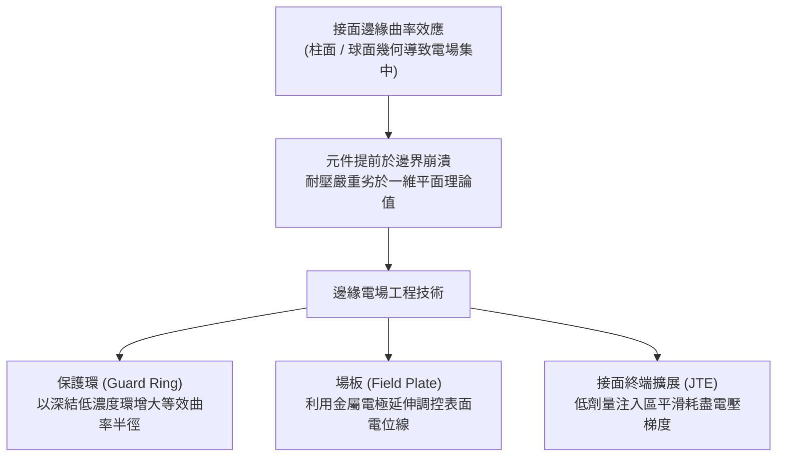

!!! example "產業實例：超接面（Superjunction）功率 MOSFET 的耐壓優化"
    在工業電源與電動車逆變器廣泛使用的高壓功率元件（如英飛凌 Infineon 之 CoolMOS™ 產品系列）中，元件需承受超過 $600 \text{ V}$ 的逆向偏壓。設計團隊在晶圓表面四周周邊終端區採用多重浮動保護環（Multiple Floating Guard Rings）搭配階梯式多層氧化層場板，徹底平整化橫向電場。此舉使晶片邊界崩潰電壓達到內部主動區平行平面崩潰理論值的 $95\%$ 以上，避免晶片因邊緣電場聚集而過早發生突崩擊穿。

<!-- fig:2 -->
<figure markdown>
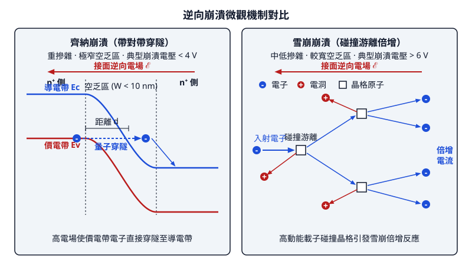
<figcaption>圖 3-2　逆向崩潰機制圖（AI 繪製的示意圖）</figcaption>
</figure>

## 3.5 金屬-半導體接面與二極體元件實例

### 金屬-半導體接面物理與能帶排列

在積體電路中，金屬與半導體的接觸無所不在。金屬導線（如銅、鎢、鋁）必須透過金屬-半導體接面（Metal-Semiconductor Junction，簡稱 M-S 接面）與主動元件相連。依據介面能帶結構與載子傳輸機制的差異，M-S 接面可分為具單向導電特性的「蕭基接面（Schottky Junction）」以及電阻極小、無整流特性的「歐姆接觸（Ohmic Contact）」。

#### 理想蕭基-莫特模型（Schottky-Mott Rule）

考慮真空能階（Vacuum Level, $E_\text{vac}$）作為參考基準，金屬的電子功函數（Work Function）定義為 $\Phi_m = E_\text{vac} - E_F$；半導體的功函數為 $\Phi_s = E_\text{vac} - E_{Fs}$，電子親和力（Electron Affinity）定義為 $\chi_s = E_\text{vac} - E_C$。

當金屬與 N 型半導體接觸並達到熱平衡時，兩側的費米能階必須對齊（$E_F = E_{Fs}$）。若 $\Phi_m > \Phi_s$，半導體側的電子能量高於金屬側，電子向金屬擴散，使半導體介面處殘留帶正電的游離施體雜質，形成空乏區。能帶在介面處向上彎曲，形成蕭基能障（Schottky Barrier）：

*   **電子由金屬進入半導體所需克服的阻障（蕭基能障高度 $\Phi_{Bn}$）**：
    $$
    \Phi_{Bn} = \Phi_m - \chi_s
    $$
*   **電子由半導體傳導帶進入金屬所需克服的內建電位（Built-in Potential $V_{bi}$）**：
    $$
    qV_{bi} = \Phi_m - \Phi_s = q\Phi_{Bn} - (E_C - E_F)
    $$

其中 $q$ 為基本電荷。

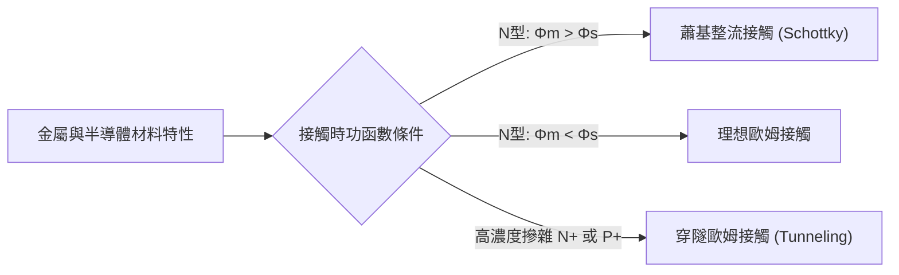

#### 表面態與費米能階釘選（Fermi-level Pinning）

理想蕭基-莫特模型預測 $\Phi_{Bn}$ 完全由金屬材料的 $\Phi_m$ 決定。然而，在實際製程中（例如矽基板），實驗測得的 $\Phi_{Bn}$ 對金屬功函數的依賴性遠低於理論值。此現象可由巴丁模型（Bardeen Model）解釋。

晶圓表面因晶格週期性中斷、懸鍵（Dangling Bonds）及介面氧化層缺陷，產生高密度的表面態（Surface States）。這些表面態在禁能帶內引入局部能階，並存在一個中性能階（Charge Neutrality Level, $E_\text{CNL}$）。若金屬接觸使費米能階偏離 $E_\text{CNL}$，表面態將捕獲或釋放大量電荷，在介面處形成偶極層（Dipole Layer），強烈抵消外加功函數差的影響。

此現象稱為「費米能階釘選（Fermi-level Pinning）」。當介面態密度極高（典型值 $> 10^{13}\ \text{cm}^{-2}\text{eV}^{-1}$）時，半導體表面的費米能階幾乎被固定在 $E_\text{CNL}$，蕭基能障高度將主要由半導體表面特性決定，而與選用的金屬種類關係微弱。

---

### 蕭基二極體之載子傳輸與元件特性

蕭基二極體（Schottky Barrier Diode, SBD）由蕭基接面構成。與由少數載子擴散主導的 PN 接面（見第 3.3 節）不同，蕭基二極體屬於「多數載子元件（Majority Carrier Device）」。

#### 熱離子發射理論（Thermionic Emission Theory）

在順向偏壓 $V$ 下，N 型半導體的傳導帶底向上移動，使得半導體側的電子更容易跨越能障流入金屬。其電流密度 $J$ 由貝特（Bethe）的熱離子發射理論主導：

$$
J = J_s \left[ \exp\left( \frac{qV}{n k_B T} \right) - 1 \right]
$$

其中飽和電流密度 $J_s$ 定義為：

$$
J_s = A^{**} T^2 \exp\left( -\frac{q\Phi_{Bn}}{k_B T} \right)
$$

*   $A^{**}$ 為有效理查森常數（Effective Richardson Constant），其大小取決於半導體電子的有效質量（在 N 型矽中典型值約為 $112\ \text{A}\cdot\text{cm}^{-2}\text{K}^{-2}$）。
*   $k_B$ 為波茲曼常數。
*   $T$ 為絕對溫度。
*   $n$ 為理想因子（Ideality Factor），在高品質蕭基介面下接近 $1.02 \sim 1.05$。

#### 蕭基二極體與 PN 接面二極體之性能比較

| 特性項目 | 蕭基二極體（SBD） | PN 接面二極體 |
| :--- | :--- | :--- |
| **導電載子機制** | 多數載子（熱離子發射） | 少數載子（擴散與復合） |
| **順向導通電壓 ($V_\text{on}$)** | 低（典型值 $0.2 \sim 0.4\ \text{V}$） | 高（典型值 $0.6 \sim 0.8\ \text{V}$，矽） |
| **逆向飽和電流密度 ($J_s$)** | 較大（受限於 $\Phi_B$） | 極小（受限於少數載子產生） |
| **逆向恢復時間 ($t_{rr}$)** | 極短（無少數載子儲存效應，$< 100\ \text{ps}$） | 受少數載子生命週期限制（數十 $\text{ns} \sim \mu\text{s}$） |
| **切換頻率極限** | 極高（可達數十 GHz 以上） | 受少數載子儲存電荷限制 |

!!! note "切換損耗的物理本質"
    在交換式電源供應器（SMPS）中，PN 二極體在從順偏切換到逆偏時，必須先抽出儲存在空乏區邊緣的中性區少數載子（見第 3.2 節擴散電容），產生顯著的逆向恢復峰值電流與功率消耗。蕭基二極體傳輸僅依賴多數載子，無擴散電荷儲存效應，其動態響應僅受限於接面空乏電容（Junction Capacitance）的充放電，因此切換損耗極低。

---

### 歐姆接觸機制與比接觸阻抗

在積體電路中，源極/汲極（Source/Drain）及井區接觸皆需實現電壓降近乎為零的「歐姆接觸」，以避免寄生串聯電阻惡化元件速度。

#### 接觸機制分類

依半導體的摻雜濃度 $N_D$，電子穿過 M-S 介面的機制可分為三類：

1.  **熱離子發射（Thermionic Emission, TE）**：低摻雜濃度（$N_D < 10^{17}\ \text{cm}^{-3}$）。電子必須具備足夠熱動能跨越能障，介面表現為整流特性。
2.  **熱離子-場發射（Thermionic-Field Emission, TFE）**：中等摻雜濃度（$10^{17}\ \text{cm}^{-3} \le N_D < 10^{19}\ \text{cm}^{-3}$）。能障在較高能量處變薄，熱激發電子以量子穿隧方式穿過能障頂端。
3.  **場發射（Field Emission, FE，即量子穿隧）**：重摻雜（$N_D > 10^{19} \sim 10^{20}\ \text{cm}^{-3}$）。

當半導體重摻雜至簡併態（Degenerate）時，空乏區寬度 $W$ 大幅縮小：

$$
W = \sqrt{\frac{2\varepsilon_s V_{bi}}{q N_D}}
$$

其中 $\varepsilon_s$ 為半導體介電常數。當 $W \le 2 \sim 3\ \text{nm}$ 時，電子的穿隧機率（Tunneling Probability）大幅上升，能障對載子而言變得近乎透明，形成優良的穿隧歐姆接觸。

#### 比接觸阻抗（Specific Contact Resistance）

評估歐姆接觸品質的核心物理量為「比接觸阻抗 $\rho_c$」（單位：$\Omega\cdot\text{cm}^2$），其定義為：

$$
\rho_c \equiv \left. \left( \frac{\partial J}{\partial V} \right)^{-1} \right|_{V=0}
$$

在場發射（穿隧）主導的重摻雜接觸中，$\rho_c$ 的理論關係式為：

$$
\rho_c \propto \exp\left[ \frac{4\pi\sqrt{m^* \varepsilon_s}}{h} \left( \frac{\Phi_B}{\sqrt{N_D}} \right) \right]
$$

其中 $m^*$ 為有效質量，$h$ 為普朗克常數。由上式可知，降低接觸阻抗有兩條核心途徑：
1.  **極大化摻雜濃度 $N_D$**：藉由離子佈植與退火活化，使介面活化濃度達到固溶極限（典型值 $> 1 \times 10^{20}\ \text{cm}^{-3}$）。
2.  **極小化有效能障高度 $\Phi_B$**：選用具備低阻抗之金屬矽化物（如鎳鉑矽化物 NiPtSi、鈷矽化物 $\text{CoSi}_2$），或在先進節點於介面插入極薄雙極偶極層（Dipole Interlayer）以解除費米能階釘選。

現代先進邏輯製程對歐姆接觸的技術要求極高，$\rho_c$ 必須低於 $10^{-8} \sim 10^{-9}\ \Omega\cdot\text{cm}^2$，否則源極/汲極接觸電阻將占電晶體導通電阻的一半以上。

---

### 產業實例：靜電防護與高壓端接技術

#### 1. 次微米製程之 ESD 靜電防護二極體

靜電放電（Electrostatic Discharge, ESD）是造成晶片可靠度失效的主因之一。次微米製程因閘極氧化層極薄（$< 2\ \text{nm}$），極易被數十伏特的靜電脈衝擊穿。

在 I/O 襯墊（Pad）旁通常整合大面積的保護二極體網絡：
*   **低電容 ESD 蕭基二極體**：用於高速訊號傳輸介面（如 PCIe、USB 4）。因蕭基接面電容小且響應迅速，能提供鉗位（Clamping）功能而不使高頻訊號衰減。
*   **閘極接地 NMOS（ggNMOS）與突崩二極體串**：利用受控的反向崩潰機制（雪崩崩潰，見第 3.4 節）將高電壓快速導向地端。為防止靜電放電電流集中於微小區域產生局部熱點（Hot Spot）而熔毀矽化接觸層，晶圓廠通常採用「矽化物阻擋層（Silicide Block, SAB）」製程，刻意在汲極擴散區邊緣保留一段未矽化的鎮流電阻（Ballast Resistor），以促使多指狀（Multi-finger）佈局均勻導通。

#### 2. 功率二極體之接面端接技術（Junction Termination）

在碳化矽（SiC）、氮化鎵（GaN）以及矽基高壓功率二極體中，元件耐壓常高達數百至數千伏特。理論平坦接面的崩潰電壓受材料臨界電場 $E_\text{crit}$ 限制。然而，二極體邊緣因光罩圖形微影切割，存在具有一定曲率半徑 $r_j$ 的圓柱狀或球狀接面邊緣。

由馬克士威方程式推導可知，在彎曲幾何形狀下，邊緣電場強度高於平坦區：

$$
E_\text{edge} \approx E_\text{plane} \cdot \sqrt{\frac{W}{r_j}}
$$

此「曲率效應（Curvature Effect）」會導致接面邊緣提前發生雪崩崩潰，使元件的實際耐壓僅達到理論值的 $20\% \sim 50\%$。

為平緩電場分佈、抑制峰值電場，半導體產業廣泛導入接面端接技術：

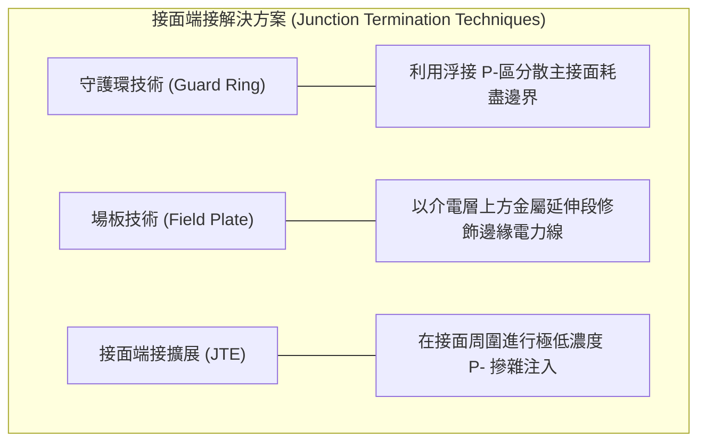

!!! example "接面端接擴展（JTE）實作"
    接面端接擴展（Junction Termination Extension, JTE）技術是高壓功率元件（如 1200V SiC 蕭基二極體）的標準製程。工程師在主主動區周圍以離子佈植引入一圈具有精確劑量控制的低濃度摻雜區。當元件承受逆向高壓時，JTE 區域會完全空乏，等效將單一陡峭的介面曲率邊界拉長為平滑過渡區，將主接面角落的局部高電場轉移並均勻分散於晶片表面，使元件耐壓達到平行板理想崩潰值的 $90\%$ 以上。

## 本章重點

1. **熱平衡接面電場與內建電位**：PN 接面在熱平衡狀態下，載子擴散運動與漂移運動達到動態平衡，費米能階全域對齊。空乏區內游離施體與受體離子形成內建電場，其空間積分對應內建電位 $V_{bi}$，其數值主要由兩側摻雜濃度及半導體本質載子濃度決定。
2. **接面電容的雙重機制**：PN 接面存在兩種電容效應。空乏電容由空間電荷區邊界固定離子電荷的伸縮所致，在逆向偏壓下佔主導地位；擴散電容則源於順向偏壓下注入中性區的過剩少數載子電荷儲存，其大小正比於順向導通電流，為決定開關暫態逆向恢復時間的主因。
3. **載子傳輸與 I-V 特性**：蕭克利理想二極體方程式基於少數載子在準電中性區的擴散與複合行為推導而成。在實際元件中，低順偏下的空乏區複合與逆偏下的空乏區熱產生導致理想因子偏離 1，而在高電流密度下則受到高注入效應與直列寄生電阻的限制。
4. **逆向崩潰物理機制**：逆向崩潰分為兩種微觀過程。輕中度摻雜接面由碰撞游離連鎖反應引發突崩崩潰，具正溫度係數；重度摻雜接面在強電場下載子直接穿隧禁帶引發齊納崩潰，具負溫度係數。
5. **曲率效應與邊緣終端工程**：微影擴散形成的二維或三維曲率幾何會引發邊緣電場集中，使接面提前於周邊崩潰。製程上採用保護環、場板及接面終端擴展等技術平滑化表面電位梯度，以提升耐壓至一維平行平面理論值。
6. **金屬-半導體接觸特性**：M-S 接面受介面表面態與費米能階釘選影響，其蕭基能障高度常偏離理想蕭基-莫特模型。蕭基二極體為多數載子元件，具備低導通壓降與無少數載子儲存效應之極速切換特性；歐姆接觸則透過重度摻雜縮窄能障寬度，仰賴場發射穿隧機制降低比接觸阻抗。

---


## 重點圖卡

複習時看這幾張就能抓住本章重點；[圖卡庫](../cards.md)可以下載成圖片。

<div class="ix-cards" markdown>

<figure markdown>
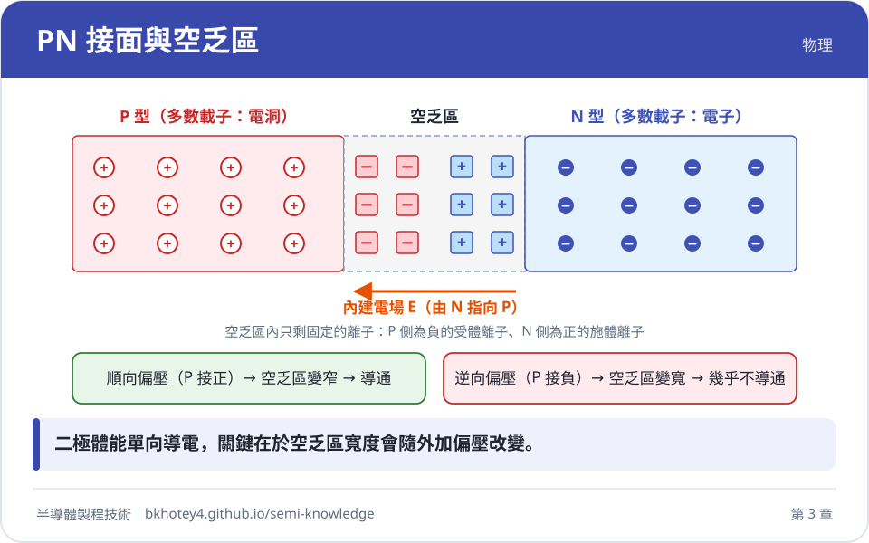
<figcaption>核心概念圖卡：PN 接面與空乏區</figcaption>
</figure>

<figure markdown>
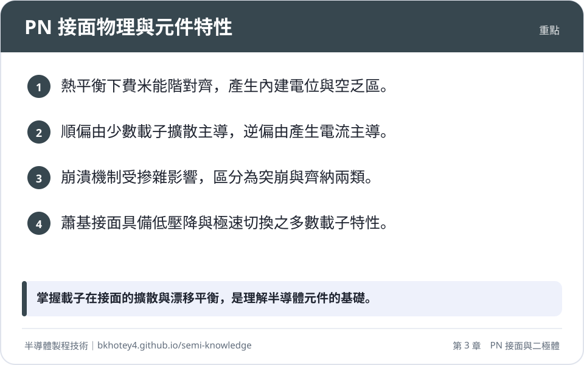
<figcaption>重點圖卡：PN 接面物理與元件特性</figcaption>
</figure>

<figure markdown>
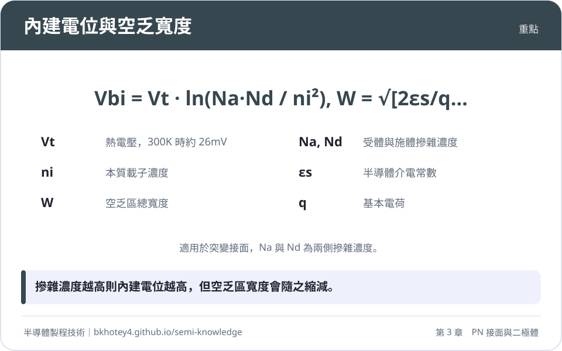
<figcaption>重點圖卡：內建電位與空乏寬度</figcaption>
</figure>

<figure markdown>
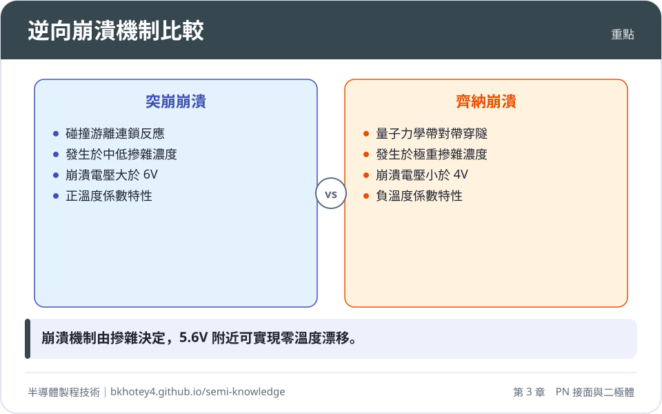
<figcaption>重點圖卡：逆向崩潰機制比較</figcaption>
</figure>

<figure markdown>
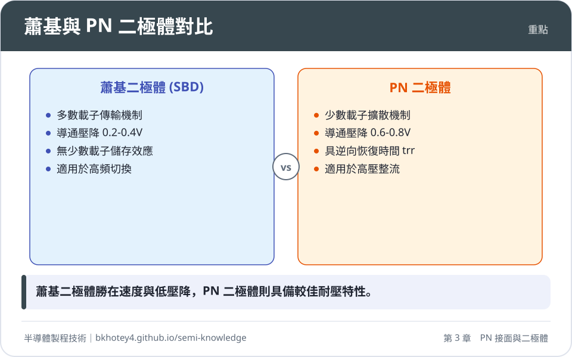
<figcaption>重點圖卡：蕭基與 PN 二極體對比</figcaption>
</figure>

</div>

## 習題

**1.** 考慮一個矽（$\text{Si}$）單邊突變接面（$p^+n$ 接面），在溫度 $T = 300\text{ K}$ 下，輕摻雜側施體濃度 $N_D = 2 \times 10^{16}\text{ cm}^{-3}$，重摻雜側受體濃度 $N_A = 10^{19}\text{ cm}^{-3}$。已知矽的本質載子濃度 $n_i = 1.0 \times 10^{10}\text{ cm}^{-3}$，相對介電常數 $\varepsilon_r = 11.7$，真空介電常數 $\varepsilon_0 = 8.854 \times 10^{-14}\text{ F/cm}$，熱電壓 $V_t = 0.0259\text{ V}$。
(1) 計算該接面之內建電位 $V_{bi}$。
(2) 在零偏壓熱平衡狀態下，計算空乏區總寬度 $W$ 與接面最大電場 $\mathcal{E}_{max}$。

??? success "參考解答"
    (1) 計算內建電位 $V_{bi}$：
    $$V_{bi} = V_t \ln\left(\frac{N_A N_D}{n_i^2}\right) = 0.0259 \times \ln\left(\frac{10^{19} \times (2 \times 10^{16})}{(1.0 \times 10^{10})^2}\right) = 0.0259 \times \ln(2 \times 10^{15})$$
    $$\ln(2 \times 10^{15}) = \ln(2) + 15\ln(10) \approx 0.6931 + 34.5388 = 35.2319$$
    $$V_{bi} = 0.0259 \times 35.2319 \approx 0.9125\text{ V}$$

    (2) 計算空乏區總寬度 $W$ 與最大電場 $\mathcal{E}_{max}$：
    半導體介電常數 $\varepsilon_s = \varepsilon_r \varepsilon_0 = 11.7 \times 8.854 \times 10^{-14} \approx 1.036 \times 10^{-12}\text{ F/cm}$。
    因 $N_A \gg N_D$，採用單邊突變接面近似（$1/N_A + 1/N_D \approx 1/N_D$）：
    $$W \approx \sqrt{\frac{2\varepsilon_s V_{bi}}{q N_D}} = \sqrt{\frac{2 \times (1.036 \times 10^{-12}) \times 0.9125}{(1.602 \times 10^{-19}) \times (2 \times 10^{16})}}$$
    $$W = \sqrt{\frac{1.8907 \times 10^{-12}}{3.204 \times 10^{-3}}} = \sqrt{5.901 \times 10^{-10}}\text{ cm} \approx 2.43 \times 10^{-5}\text{ cm} = 0.243\ \mu\text{m}$$
    空乏區電場呈三角形分佈，最大電場出現在冶金接面處：
    $$\mathcal{E}_{max} = \frac{2 V_{bi}}{W} = \frac{2 \times 0.9125}{2.43 \times 10^{-5}} \approx 7.51 \times 10^4\text{ V/cm}$$

**2.** 試比較 PN 接面中「突崩崩潰」與「齊納崩潰」在微觀物理機制、發生條件（摻雜濃度與空乏區厚度）以及溫度係數（$dV_{\text{BR}}/dT$ 正負符號）之差異。並請說明為何在穩壓二極體電路中，標稱崩潰電壓約為 $5.6\text{ V}$ 的元件具有接近零的溫度漂移係數。

??? success "參考解答"
    (1) 機制與條件比較：
    - **突崩崩潰**：發生於中低摻雜濃度（$< 10^{17}\text{ cm}^{-3}$）與較寬之空乏區。少數載子在強電場加速下獲得動能，與晶格原子碰撞使價鍵電子激發至傳導帶，產生新的電子-電洞對（碰撞游離）。新載子再度被加速碰撞，引發雪崩式倍增。其溫度係數為**正**（$dV_{\text{BR}}/dT > 0$），因為溫度升高使晶格聲子散射增強，載子平均自由路徑縮短，兩次碰撞間累積動能減少，需施加更高電場方能崩潰。
    - **齊納崩潰**：發生於接面兩側皆為極重摻雜（$> 10^{18}\text{ cm}^{-3}$）之結構，空乏區極窄（$< 10\text{ nm}$）。在逆向偏壓下，能帶嚴重傾斜使 P 側價帶頂端與 N 側傳導帶底端在空間上重疊，價帶電子藉由量子力學穿隧效應直接穿透禁帶（帶對帶穿隧）。其溫度係數為**負**（$dV_{\text{BR}}/dT < 0$），因為溫度升高使能隙 $E_g$ 變窄，電子穿隧能障降低，穿隧機率提高，在較低電壓即可崩潰。
    
    (2) $5.6\text{ V}$ 二極體的零溫度漂移原理：
    矽接面的崩潰電壓若低於 $4\text{ V}$，以負溫度係數的齊納機制為主；高於 $6\text{ V}$ 則以正溫度係數的突崩機制為主。當崩潰電壓設計於 $5.6\text{ V}$ 附近時，兩者機制同時存在且強度相當，正負溫度係數相互抵消，因而能在特定偏壓點實現趨近於零的溫度漂移率。

**3.** 利用高頻電容-電壓（C-V）法量測截面積 $A = 1.0 \times 10^{-3}\text{ cm}^2$ 的矽單邊突變 $p^+n$ 二極體。實驗繪製 $1/C^2$ 對外加電壓 $V_A$ 的關係圖，結果呈現一良好直線。
已知該直線的斜率為 $-1.75 \times 10^{14}\text{ F}^{-2}\text{V}^{-1}$，且直線外推至 $1/C^2 = 0$ 處的電壓截距為 $+0.85\text{ V}$。
(1) 試由斜率計算輕摻雜側之施體濃度 $N_D$。
(2) 說明橫軸截距所代表的物理意義。

??? success "參考解答"
    (1) 計算施體濃度 $N_D$：
    對於單邊突變 $p^+n$ 接面（$N_A \gg N_D$），單位面積電容 $C' = C / A$，其與偏壓的關係為：
    $$\frac{1}{C^2} = \frac{2(V_{bi} - V_A)}{q \varepsilon_s A^2 N_D} = \frac{2 V_{bi}}{q \varepsilon_s A^2 N_D} - \left(\frac{2}{q \varepsilon_s A^2 N_D}\right) V_A$$
    因此，$1/C^2$ 對 $V_A$ 作圖之斜率為：
    $$\text{Slope} = -\frac{2}{q \varepsilon_s A^2 N_D}$$
    代入已知數值（矽介電常數 $\varepsilon_s = 1.036 \times 10^{-12}\text{ F/cm}$）：
    $$-1.75 \times 10^{14} = -\frac{2}{(1.602 \times 10^{-19}) \times (1.036 \times 10^{-12}) \times (1.0 \times 10^{-3})^2 \times N_D}$$
    $$-1.75 \times 10^{14} = -\frac{2}{1.660 \times 10^{-37} \times N_D}$$
    $$N_D = \frac{2}{1.660 \times 10^{-37} \times 1.75 \times 10^{14}} = \frac{2}{2.905 \times 10^{-23}} \approx 6.88 \times 10^{16}\text{ cm}^{-3}$$

    (2) 橫軸截距之物理意義：
    令 $1/C^2 = 0$ 時，方程式變為 $V_{bi} - V_A = 0$，即 $V_A = V_{bi}$。因此，外推所得的橫軸電壓截距即代表接面之**內建電位**（Built-in Potential），此接面的 $V_{bi} = 0.85\text{ V}$。

**4.** 一個順向導通電流為 $I_F = 10\text{ mA}$ 的長矽 PN 接面二極體，在中性區的少數載子電洞生命期 $\tau_p = 50\text{ ns}$。在 $t = 0$ 瞬間，外加電路迅速反轉施加逆向偏壓，產生大小為 $I_R = 10\text{ mA}$ 的反向抽取電流。
(1) 請根據電荷控制模型，計算二極體之儲存時間（Storage Time, $t_s$）。
(2) 為什麼蕭基二極體（SBD）在相同的切換條件下，幾乎觀測不到此儲存時間？

??? success "參考解答"
    (1) 計算儲存時間 $t_s$：
    根據少數載子電荷控制模型，當接面自順向穩態切換至逆向抽取時，儲存時間可由下式解析求得：
    $$t_s = \tau_p \ln\left(1 + \frac{I_F}{I_R}\right)$$
    代入題給數值 $I_F = 10\text{ mA}$，$I_R = 10\text{ mA}$：
    $$t_s = 50\text{ ns} \times \ln\left(1 + \frac{10}{10}\right) = 50 \times \ln(2) \approx 50 \times 0.6931 \approx 34.66\text{ ns}$$

    (2) 蕭基二極體無儲存時間之物理原因：
    PN 二極體在順向導通時屬於「雙極性少數載子注入」，大量少數載子注入中性區擴散並儲存，關斷時必須等待少數載子透過外部電流抽取與複合消散完畢（受 $\tau_p$ 限制），方能重建空乏區。
    蕭基二極體屬於「多數載子元件」，導電機制為熱離子發射，順向導通時不牽涉少數載子的注入與累積，不存在中性區儲存電荷。因此切換暫態僅由金屬-半導體接面空乏電容的極快速充放電決定，其恢復時間通常小於 $100\text{ ps}$，幾乎觀測不到儲存時間 $t_s$。

**5.** 在積體電路平面製程中，雜質側向擴散會導致接面邊緣形成曲率半徑為 $r_j$ 的圓柱形接面。
(1) 繪圖或文字說明為何曲率幾何會使邊界處之崩潰電壓顯著低於內部平面之一維崩潰電壓。
(2) 列舉兩項能有效改善邊緣電場集中現象的接面端接工程技術，並分別闡述其物理機制。

??? success "參考解答"
    (1) 接面曲率降低崩潰電壓之原因：
    在具有凸曲率（如柱面或球面）的冶金接面邊緣，空間電力線由半徑較小之曲面朝向外部空間發散展開。根據帕松方程式在曲座標下的邊界求解，電力線通量密度在曲面頂點處高度聚集，導致邊緣處的最大電場強度遠大於相同逆偏電壓下一維平行平面接面的平坦電場（$\mathcal{E}_{\text{cylindrical}} > \mathcal{E}_{\text{plane}}$）。因此，當外加逆偏電壓尚未達到一維理論崩潰值時，接面邊緣的局部電場已搶先達到臨界電場 $\mathcal{E}_{crit}$，引發局部提前崩潰。

    (2) 改善技術與物理機制（任選兩項）：
    - **保護環（Guard Ring）**：在主接面周圍製作深擴散且低摻雜的同導電型環狀結構。保護環具有較大的曲率半徑 $r_j$，能將主接面銳角處的密集電場轉移並分散至外圍的平緩過渡區，消除局部電場峰值。
    - **場板（Field Plate）**：將表面接觸金屬電極向外延伸跨越冶金接面邊界，覆蓋於厚絕緣氧化層上方。場板施加的電位在下方半導體表面感應出空間電荷，在橫向方向「拉伸」電力線，使原本垂直聚集在冶金邊界處的電力線轉為水平延展，平緩表面電位梯度。
    - **接面終端擴展（JTE）**：利用低劑量離子佈植在主動區外圍形成精確摻雜的淺過渡區。在高逆向偏壓下，JTE 區域會完全空乏，等效將陡峭的空間電荷階躍轉化為平滑過渡，使邊界電壓呈線性跌落。

---

## 本章術語

- **冶金接面（Metallurgical Junction）**：半導體材料內部由 P 型導電雜質主導過渡至由 N 型雜質主導的化學交界面。
- **空間電荷區（Space Charge Region, SCR）**：接面兩側因自由載子擴散抽離後，留下無法移動的游離施體與受體離子所構成的高阻抗強電場區域，又稱空乏區。
- **內建電位（Built-in Potential, $V_{bi}$）**：熱平衡狀態下，空間電荷區內部未中和離子所建立、用於抵消載子擴散運動的自建靜電位能差。
- **空乏近似（Depletion Approximation）**：假設空間電荷區內自由載子完全空乏，且其外部中性區電場為零之簡化靜電學模型。
- **空乏電容（Depletion Capacitance, $C_j$）**：由外加逆偏電壓改變所引起之空間電荷區邊界固定離子電荷伸縮之等效平板電容。
- **擴散電容（Diffusion Capacitance, $C_d$）**：順向偏壓下注入中性區之過剩少數載子電荷隨偏壓變化所產生之充放電電容效應。
- **逆向恢復時間（Reverse Recovery Time, $t_{rr}$）**：PN 二極體由順向導通狀態突切為逆向截止狀態時，清除儲存少數載子並重建空乏區阻斷能力所需的暫態時間。
- **少數載子注入（Minority Carrier Injection）**：順向偏壓降低接面能障，使多數載子跨越空間電荷區擴散進入對側中性區形成過剩少數載子的傳輸過程。
- **蕭克利理想二極體方程式（Shockley Diode Equation）**：描述少數載子擴散傳輸主導下，理想接面電流隨外加電壓呈指數成長之經典解析式。
- **理想因子（Ideality Factor, $n$）**：二極體經驗公式中用於表徵電流傳輸機制偏離理想少數載子擴散模型（複合或高注入效應）之修正係數。
- **臨界電場（Critical Electric Field, $\mathcal{E}_{crit}$）**：半導體材料抵抗介質擊穿之最大極限電場，達到此值將引發大規模逆向崩潰。
- **碰撞游離（Impact Ionization）**：載子於強電場中獲取足額動能，撞擊晶格使價帶電子躍遷至傳導帶並產生新電子-電洞對之非彈性散射過程。
- **突崩崩潰（Avalanche Breakdown）**：高電場空乏區內載子藉由連鎖碰撞游離反應導致逆向電流急遽倍增之物理現象，具備正溫度係數。
- **帶對帶穿隧（Band-to-Band Tunneling, BTBT）**：重度摻雜接面在強電場下，價帶電子直接穿透微觀禁帶位能障進入傳導帶未填滿能階之量子穿隧過程。
- **齊納崩潰（Zener Breakdown）**：重摻雜極窄接面受逆向偏壓時，由帶對帶量子穿隧機制主導之非破壞性崩潰現象，具備負溫度係數。
- **曲率效應（Curvature Effect）**：微影擴散形成之柱狀或球狀接面邊界，造成電力線空間聚集而局部增強電場之幾何畸變效應。
- **保護環（Guard Ring）**：製作於主接面外圍具有較大曲率半徑之低摻雜深井環狀結構，旨在分散周邊電場集中。
- **場板（Field Plate）**：延伸於介電層上方之金屬電極結構，利用靜電感應橫向拉伸半導體表面電力線以降低局部電場梯度。
- **接面終端擴展（Junction Termination Extension, JTE）**：環繞於主接面外圍之精確微劑量注入過渡區，高逆壓下完全空乏以實現表面電位平滑化。
- **蕭基能障（Schottky Barrier, $\Phi_{B}$）**：金屬與半導體接觸達到熱平衡時，介面處因功函數差異阻礙載子傳輸之位能障壁。
- **費米能階釘選（Fermi-level Pinning）**：金屬-半導體交界面處高密度表面態電離形成偶極層，使介面費米能階錨定於中性能階而降低對金屬功函數相依性之現象。
- **熱離子發射（Thermionic Emission）**：載子透過熱激發獲得足夠動能越過介面能障進入相鄰導電層之多數載子傳輸機制。
- **歐姆接觸（Ohmic Contact）**：具備極低接觸阻抗且其電流-電壓特性呈線性對稱、無顯著整流能障的金屬-半導體介面。
- **比接觸阻抗（Specific Contact Resistance, $\rho_c$）**：表徵金屬-半導體接觸介面在零偏壓下單位面積微分電阻之品質評估指標。


## 互動學習

<div class="quiz" data-quiz="01-03"></div>


## 產業最新進展

本節由每日產業新聞自動補充，說明本章技術在產業上的最新發展。

<!-- updates -->
（目前尚無補充。）
