# 第 4 章　MOSFET 原理

<figure markdown>
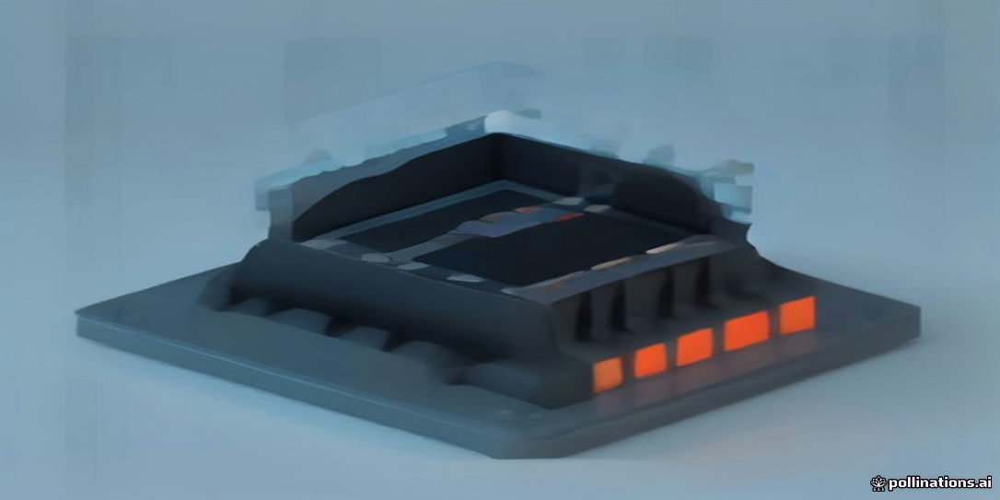
<figcaption>示意插畫：由 AI 生成，用來幫助記憶本章主題，細節請以內文與結構圖為準。</figcaption>
</figure>

!!! abstract "學習目標"
    - 掌握金屬-氧化物-半導體（MOS）電容在不同閘極偏壓下的能帶彎曲，以及累積、空乏與強反轉的物理條件。
    - 理解臨界電壓（Threshold Voltage, Vth）的物理意義、組成項推導與基板偏壓效應（Body Effect）。
    - 推導長通道 MOSFET 在線性區與飽和區的電流-電壓（I-V）特性方程式，並理解夾止（Pinch-off）現象。
    - 分析互補式金屬氧化物半導體（CMOS）反相器的電壓轉移特性曲線（VTC）、雜訊邊界（Noise Margin）與功率消耗機制。

## 4.1 MOS 電容物理基礎與反轉層形成

### MOS 結構與理想平帶條件

金屬-氧化物-半導體（Metal-Oxide-Semiconductor, MOS）電容是構成場效電晶體的核心單元。其結構由最上層的金屬閘極（Gate）、中間的絕緣介電層（如二氧化矽，$\text{SiO}_2$）以及底部的半導體基板（Substrate）垂直堆疊而成。本節以 p 型矽（p-type Silicon）基板為基準進行物理推導。

在分析能帶結構前，須先界定「理想 MOS 結構」（Ideal MOS Structure）的物理假設：
1. 金屬與半導體的功函數差（Work Function Difference）為零，即 $\Phi_{ms} = \Phi_m - \Phi_s = 0$。其中 $\Phi_m$ 為金屬功函數，$\Phi_s$ 為半導體功函數。
2. 氧化層內部及其與半導體之交界面完全不含任何固定電荷（Fixed Oxide Charges）、陷阱電荷（Trapped Charges）或界面態（Interface States）。
3. 絕緣層在直流電壓下的電阻為無限大，無任何載子穿隧或漏電流通過。

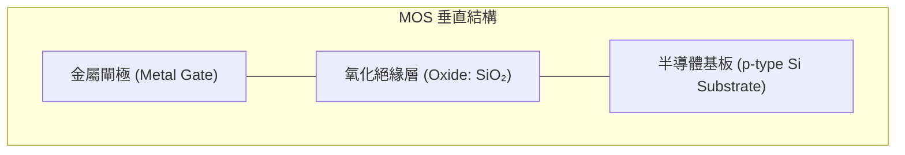

如第 1 章能帶理論所述，半導體能帶由傳導帶底 $E_c$、價帶頂 $E_v$ 以及本質費米能階（Intrinsic Fermi Level）$E_i$ 定義。在熱平衡狀態且無外加電壓（閘極電壓 $V_G = 0$）的理想情況下，半導體內部的費米能階 $E_F$ 為一定值，金屬與半導體費米能階對齊。此時半導體內部的能帶由表面至深處皆呈水平，此狀態稱為平帶條件（Flat-band Condition），對應之閘極電壓稱為平帶電壓（Flat-band Voltage, $V_{FB}$）。在理想系統中，$V_{FB} = 0\text{ V}$。

若考量實際系統，功函數差 $\Phi_{ms} \neq 0$ 且氧化層內存在等效界面電荷密度 $Q_{ox}$（單位為 $\text{C/cm}^2$），則平帶電壓修正為：

$$V_{FB} = \Phi_{ms} - \frac{Q_{ox}}{C_{ox}}$$

其中 $C_{ox} = \frac{\varepsilon_{ox}}{t_{ox}}$ 為單位面積氧化層電容，$\varepsilon_{ox}$ 為氧化層介電常數，典型 $\text{SiO}_2$ 的相對介電常數 $\varepsilon_r \approx 3.9$，$t_{ox}$ 為氧化層物理厚度。

---

### 表面電位與能帶彎曲

當在閘極施加外加偏壓 $V_G$ 時，金屬費米能階 $E_{Fm}$ 相對半導體費米能階 $E_{Fs}$ 移動：$E_{Fm} - E_{Fs} = -q V_G$（$q$ 為基本電荷）。由於電場穿透氧化層進入半導體表層，在半導體表面引發靜電位降，使得能帶發生彎曲。

半導體局部位能相對於深層基板（Bulk）的偏移量定義為靜電位 $\psi(x)$。以半導體深處中性區為電位參考零點（$\psi(\infty) = 0$），半導體與氧化層交界面（$x = 0$）處的電位稱為表面電位（Surface Potential），記作 $\psi_s$。電子的位能為 $-q\psi(x)$，因此：
- 當 $\psi_s > 0$ 時，電子位能向下彎曲；
- 當 $\psi_s < 0$ 時，電子位能向上彎曲。

在半導體內部，載子濃度與電位的關係依據馬克士威-波茲曼統計（見第 2 章）表示為：

$$p(x) = N_A e^{-\frac{q\psi(x)}{k_B T}}$$

$$n(x) = n_{po} e^{\frac{q\psi(x)}{k_B T}} = \frac{n_i^2}{N_A} e^{\frac{q\psi(x)}{k_B T}}$$

其中 $N_A$ 為受體摻雜濃度，$n_i$ 為本質載子濃度，$k_B$ 為波茲曼常數，$T$ 為絕對溫度。基板費米能階與本質費米能階的差值定義為基板電位（Bulk Potential）$\phi_B$：

$$\phi_B = \frac{k_B T}{q} \ln\left(\frac{N_A}{n_i}\right)$$

在室溫（$T = 300\text{ K}$）下，矽的熱電壓 $V_t = \frac{k_B T}{q} \approx 0.0259\text{ V}$。

---

### 三種操作狀態之載子行為

依據施加之閘極電壓極性及大小，p 型基板 MOS 電容會依序經歷三種工作狀態：累積、空乏與反轉。

| 操作狀態 | 表面電位條件 ($\psi_s$) | 能帶彎曲方向 | 半導體表面主導電荷 | 實體現象 |
| :--- | :--- | :--- | :--- | :--- |
| **累積 (Accumulation)** | $\psi_s < 0$ | 向上彎曲 | 多數載子（電洞，Holes） | 電洞受負電壓吸引堆積於介面 |
| **空乏 (Depletion)** | $0 < \psi_s < \phi_B$ | 向下彎曲 | 游離受體離子（$N_A^-$） | 電洞被驅離，暴露出不可移動之空間電荷區 |
| **弱反轉 (Weak Inversion)** | $\phi_B \le \psi_s < 2\phi_B$ | 向下彎曲 | 空間電荷與微量電子 | 介面處少數載子濃度超過本質濃度但未達多數載子濃度 |
| **強反轉 (Strong Inversion)**| $\psi_s \ge 2\phi_B$ | 強烈向下彎曲 | 少數載子（電子，Electrons） | 介面處電子濃度超過基板電洞濃度，形成 n 型傳導層 |

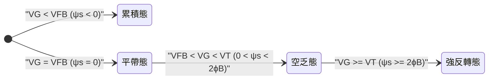

#### 1. 累積態（Accumulation）
當施加負閘極偏壓（$V_G < V_{FB}$），金屬側堆積負電荷，電場方向由半導體指向金屬。半導體表面能帶向上彎曲（$\psi_s < 0$），價帶頂 $E_v$ 朝費米能階 $E_F$ 靠近。依據載子分布公式，表面電洞濃度 $p_s = N_A e^{-q\psi_s / k_B T} > N_A$。多數載子（電洞）在介面形成高密度的極薄累積層。

#### 2. 空乏態（Depletion）
當施加正閘極偏壓（$V_G > V_{FB}$，且電壓尚低），表面電位微幅上升（$0 < \psi_s < \phi_B$）。電場將正電洞推離表面，留下帶負電但無法移動的游離受體離子（$N_A^-$）。此時自由載子濃度極低，形成空乏區（Depletion Region，又稱空間電荷區），能帶向下彎曲。

#### 3. 反轉態（Inversion）
隨著 $V_G$ 進一步升高，$\psi_s$ 持續增大。當表面處本質費米能階 $E_i$ 降至費米能階 $E_F$ 之下時（$\psi_s > \phi_B$），表面處少數載子（電子）濃度開始超過電洞濃度（$n_s > p_s$）。半導體表面的導電型態自原本的 p 型轉變為 n 型，此薄層即稱為反轉層（Inversion Layer）。

---

### 強反轉條件與最大空乏區寬度

#### 強反轉定義
隨著反轉層電子濃度增加，當表面電子濃度達到基板多數載子電洞濃度時，系統進入「強反轉」（Strong Inversion）狀態。依據物理條件：

$$n_s = N_A$$

代入電子濃度與電位之關係式：

$$n_s = n_{po} e^{\frac{q\psi_s}{k_B T}} = \frac{n_i^2}{N_A} e^{\frac{q\psi_s}{k_B T}} = N_A$$

$$e^{\frac{q\psi_s}{k_B T}} = \left(\frac{N_A}{n_i}\right)^2 \implies \psi_s = 2 \frac{k_B T}{q} \ln\left(\frac{N_A}{n_i}\right) = 2\phi_B$$

此即強反轉起始臨界條件：表面電位必須達到基板電位的兩倍，即 $\psi_s = 2\phi_B$。

#### 最大空乏區寬度計算
在強反轉之前（空乏區內），空間電荷主要由游離受體組成。應用空乏近似法（Depletion Approximation），假設在深度 $x \le W_d$ 內，電荷密度 $\rho = -qN_A$，而在 $x > W_d$ 外為電中性區。由一維帕松方程式（Poisson's Equation）：

$$\frac{d^2\psi(x)}{dx^2} = -\frac{\rho(x)}{\varepsilon_s} = \frac{qN_A}{\varepsilon_s}$$

其中 $\varepsilon_s$ 為半導體介電常數（矽的 $\varepsilon_s \approx 11.7 \times 8.854 \times 10^{-14}\text{ F/cm} \approx 1.04 \times 10^{-12}\text{ F/cm}$）。

透過邊界條件 $\psi(W_d) = 0$ 與 $\left.\frac{d\psi}{dx}\right|_{x=W_d} = 0$ 進行二次積分，可得表面電位與空乏區寬度 $W_d$ 的關係：

$$\psi_s = \frac{q N_A W_d^2}{2\varepsilon_s}$$

解出空乏區寬度：

$$W_d = \sqrt{\frac{2\varepsilon_s \psi_s}{qN_A}}$$

當半導體進入強反轉時，$\psi_s$ 達到 $2\phi_B$。一旦越過強反轉門檻，閘極電壓的增量將幾乎全數轉化為反轉層中自由電子的增加，介面電子濃度呈現指數級暴增，使得表面電位被強烈箝制（Pinned）在 $2\phi_B$ 附近（$\psi_s \approx 2\phi_B$），電場難以進一步深入半導體體積內部。因此，空乏區寬度達到物理上限，稱為最大空乏區寬度（Maximum Depletion Width, $W_{d,\max}$）：

$$W_{d,\max} = \sqrt{\frac{4\varepsilon_s \phi_B}{qN_A}} = \sqrt{\frac{4\varepsilon_s k_B T \ln(N_A/n_i)}{q^2 N_A}}$$

對典型摻雜濃度 $N_A = 10^{17}\text{ cm}^{-3}$ 的矽晶圓而言，$W_{d,\max}$ 的典型值約在數十至數百奈米範圍。

#### 總電荷分配
半導體內部的總空間電荷 $Q_s$（單位面積電荷）為空乏層離子電荷 $Q_d$ 與反轉層電子電荷 $Q_n$ 之合：

$$Q_s = Q_d + Q_n$$

在強反轉前，$Q_n \approx 0$，$Q_s \approx Q_d = -q N_A W_d$；進入強反轉後，固定電荷箝定在 $Q_{d,\max} = -q N_A W_{d,\max}$，任何額外的閘極感應電荷皆由 $Q_n$ 提供：

$$Q_n = -C_{ox}(V_G - V_T)$$

其中 $V_T$ 為本章 4.2 節將嚴格推導之臨界電壓（Threshold Voltage）。

---

### MOS 電容之高頻與低頻 C-V 特性分析

MOS 電容的微小訊號電容定義為單位閘極電壓變化所引起的總電荷變化率：

$$C = \frac{dQ_G}{dV_G} = -\frac{dQ_s}{dV_G}$$

MOS 結構可視為氧化層電容 $C_{ox}$ 與半導體表面電容 $C_s$ 的串聯組合：

$$\frac{1}{C} = \frac{1}{C_{ox}} + \frac{1}{C_s} \implies C = \frac{C_{ox} C_s}{C_{ox} + C_s}$$

其中 $C_s = -\frac{dQ_s}{d\psi_s}$。量測 MOS 電容隨直流偏壓變化的曲線（Capacitance-Voltage, C-V 曲線）是分析半導體介面特性的關鍵工具。在測量時，需在直流偏壓疊加一個微小交流訊號（小訊號頻率通常區分為低頻 $1\text{–}100\text{ Hz}$ 與高頻 $100\text{ kHz–}1\text{ MHz}$）。

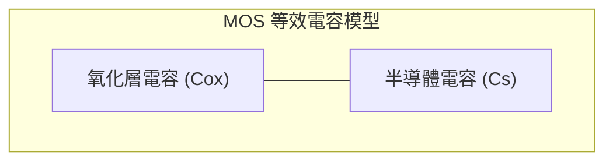

#### 1. 累積區電容
當處於累積態（$V_G \ll V_{FB}$），大量多數載子（電洞）聚集在氧化層界面，使表面電容極大（$C_s \to \infty$）。此時總量測電容等於氧化層電容：

$$C_{acc} \approx C_{ox} = \frac{\varepsilon_{ox}}{t_{ox}}$$

此特性與量測頻率無關，高頻與低頻響應一致。

#### 2. 空乏區電容
當進入空乏態（$V_{FB} < V_G < V_T$），空乏區表現為一介電厚度為 $W_d$ 的絕緣層，其電容為 $C_d = \frac{\varepsilon_s}{W_d}$。總電容為兩者串聯：

$$C_{dep} = \frac{C_{ox} C_d}{C_{ox} + C_d} = \frac{C_{ox}}{1 + \frac{\varepsilon_{ox} W_d}{\varepsilon_s t_{ox}}}$$

隨閘極電壓升高，$W_d$ 隨 $\sqrt{\psi_s}$ 擴展，$C_d$ 單調遞減，導致總電容 $C$ 逐漸下降。多數載子的回應極快，在空乏區內高頻與低頻特徵亦完全重疊。

#### 3. 反轉區電容之頻率響應差異
當 $V_G \ge V_T$ 進入反轉態時，高頻（High-Frequency, HF）與低頻（Low-Frequency, LF）響應產生顯著分歧：

- **低頻特性（Low-Frequency C-V）：**
  反轉層少數載子（電子）主要透過半導體熱產生-復合（Generation-Recombination）機構生成，其物理反應時間常數約在毫秒至秒的數量級（典型弛豫時間約 $10^{-3}\text{–}10^{-1}\text{ s}$）。若微小訊號頻率夠低（如 $5\text{–}10\text{ Hz}$），電子生成的速率跟得上小訊號交流電場的交變步伐。此時反轉層電荷直接隨交流電場充放電，導致表面電位固定，半導體表面微分電容 $C_s \to \infty$。因此，總電容回升至氧化層電容：
  
  $$C_{inv, LF} \approx C_{ox}$$

- **高頻特性（High-Frequency C-V）：**
  在常規高頻測試下（典型頻率為 $1\text{ MHz}$），交流訊號週期遠短於少數載子的熱產生時間常數。反轉層電子無法隨高頻電場及時產生或消滅，只能響應慢速變化的直流偏壓。高頻小訊號引起的電荷變動只能由空乏區外緣的多數載子（電洞）進行充放電補償。因此，半導體小訊號電容由最大空乏區寬度決定，$C_s = C_{d,\min} = \frac{\varepsilon_s}{W_{d,\max}}$，總電容維持在最低飽和值 $C_{\min}$ 不變：
  
  $$C_{inv, HF} = C_{\min} = \frac{C_{ox} C_{d,\min}}{C_{ox} + C_{d,\min}} = \frac{C_{ox}}{1 + \frac{\varepsilon_{ox} W_{d,\max}}{\varepsilon_s t_{ox}}}$$

- **深空乏現象（Deep Depletion）：**
  若對 MOS 電容以極快的掃描速率（Fast Ramp Rate）施加正閘極電壓，且環境無光照，少數載子甚至來不及因應直流偏壓熱產生反轉層。為了平衡閘極正電荷，半導體被迫將多數載子推至更深處，使空乏區寬度突破 $W_{d,\max}$ 持續擴大。此非平衡態稱為「深空乏」，其高頻電容會持續下降至低於 $C_{\min}$，直至發生雪崩崩潰（Avalanche Breakdown）或經過足夠弛豫時間累積出反轉層為止。

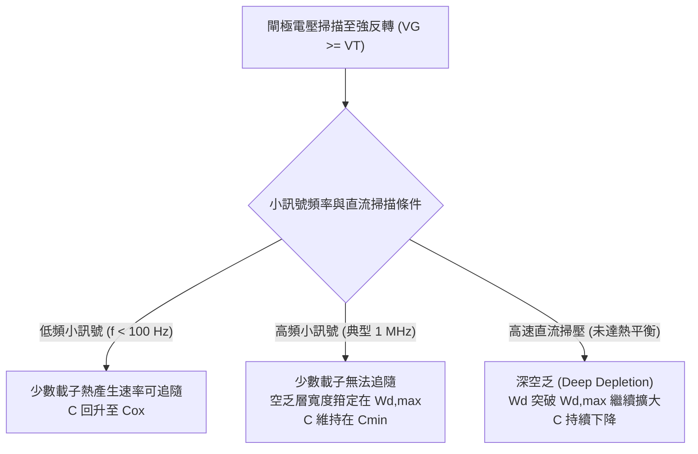

!!! note "說明：MOSFET 與 MOS 電容在反轉區的高頻特性差異"
    在三端點或四端點的實際 MOSFET 元件中，反轉層（導電通道）與兩側高摻雜的汲極/源極（Source/Drain）區域直接相連。汲極與源極扮演極為豐沛的少數載子庫存槽（Carrier Reservoir）。當對 MOSFET 閘極施加高頻微小訊號時，反轉層電子可直接透過源極與汲極於次奈秒（Sub-nanosecond）尺度內橫向流入或流出，而無須依賴緩慢的基板熱產生機構。因此，**具備源極/汲極相連的 MOSFET，其高頻反轉區電容特性曲線將與純 MOS 電容的低頻曲線一致，在反轉態下電容回升至 $C_{ox}$**。

!!! warning "常見誤解：平帶電壓等於零"
    許多初學者常直覺認為當外加偏壓為零時即為平帶狀態（$V_{FB} = 0$）。在現實工程中，即便不施加偏壓，金屬閘極材料與摻雜半導體之間的功函數差（$\Phi_{ms}$）必然存在，且氧化層在生長與沉積製程中不可避免地會殘留微量帶電缺陷（如三價矽懸鍵形成的氧化層固定電荷）。因此，平帶電壓 $V_{FB}$ 幾乎恆不為零。現代先進製程必須透過調整功函數金屬層（Work Function Metal, WFM）材料配比，將平帶電壓與臨界電壓工程微調至目標規格。

<!-- fig:1 -->
<figure markdown>
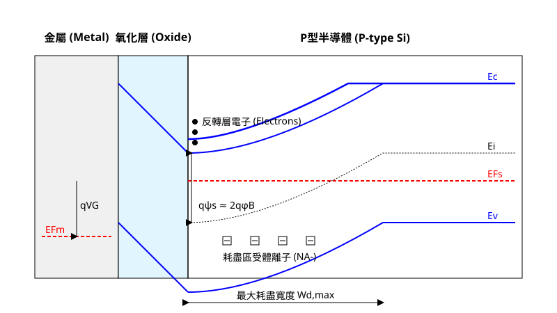
<figcaption>圖 4-1　MOS 電容能帶圖（AI 繪製的示意圖）</figcaption>
</figure>

## 4.2 臨界電壓物理模型與影響因素

### 臨界電壓的物理定義與能帶條件

臨界電壓（Threshold Voltage, $V_{th}$）是金氧半場效電晶體（MOSFET）操作中最核心的電性參數。在巨觀電路分析中，$V_{th}$ 常被視為通道由「截止」轉為「導通」的啟動電壓；然而在半導體微觀物理中，臨界電壓代表半導體表面達到**強反轉（Strong Inversion）**起始點所需的閘極偏壓。

以 p 型基板（Substrate/Body）的 n 通道 MOSFET（nMOS）為例，當閘極施加正電壓時，電場穿透閘極介電層排斥半導體表面的多數載子（電洞），暴露出帶負電的游離受光雜質原子（見第 2 章），形成空間電荷區（空乏區，Depletion Region，見第 3 章）。隨著閘極電壓持續增加，能帶向下彎折，表面電子濃度指數型上升。

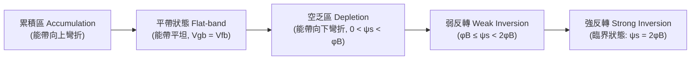

物理上定義強反轉的起始判據為：**半導體介面處的少數載子濃度（電子）等於主體（Bulk）內的多數載子濃度（電洞）**。設半導體內部的本徵費米能階為 $E_i$，費米能階為 $E_F$。主體內費米電位（Fermi Potential）$\phi_B$（亦常記為 $\phi_F$）定義為：

$$\phi_B = \frac{k_B T}{q} \ln\left(\frac{N_a}{n_i}\right)$$

其中：
- $k_B$ 為波茲曼常數（$1.38 \times 10^{-23}\ \text{J/K}$）
- $T$ 為絕對溫度（單位：$\text{K}$）
- $q$ 為基本電荷量（$1.602 \times 10^{-19}\ \text{C}$）
- $N_a$ 為 p 型基板摻雜濃度（單位：$\text{cm}^{-3}$）
- $n_i$ 為矽的本徵載子濃度（室溫 300 K 下典型值約為 $1.0 \times 10^{10}\ \text{cm}^{-3}$）

當表面位能（Surface Potential）$\psi_s$ 滿足以下邊界條件時，即判定元件進入強反轉：

$$\psi_s = 2\phi_B$$

此時，介面處的傳導帶底 $E_c$ 接近費米能階 $E_F$ 的距離，恰等於主體中價鍵帶頂 $E_v$ 接近 $E_F$ 的距離，介面處的電子濃度 $n_s = n_i \exp\left(\frac{q(\psi_s - \phi_B)}{k_B T}\right) = N_a$。

---

### 平帶電壓與功函數差

在實際 MOS 結構中，即便未施加外部偏壓（$V_{GB} = 0\ \text{V}$），由於閘極導電材料與半導體基板之間的材料性質差異以及介電層內部電荷的存在，能帶並非平坦狀態。若欲使半導體能帶自介面至主體完全維持平坦（即 $\psi_s = 0$），閘極所必須施加的補償電壓稱為**平帶電壓（Flat-band Voltage, $V_{fb}$）**。

平帶電壓由兩大物理要素構成：
1. **功函數差（Work Function Difference, $\Phi_{ms}$）**
2. **介電層及其介面處的有效電荷效應**

$$\Phi_{ms} = \Phi_m - \Phi_s = \Phi_m - \left(\chi + \frac{E_g}{2q} + \phi_B\right)$$

其中：
- $\Phi_m$ 為閘極電極的功函數（單位：$\text{V}$）
- $\Phi_s$ 為半導體基板的功函數（單位：$\text{V}$）
- $\chi$ 為半導體之電子親和力（矽典型值約為 $4.05\ \text{eV}$，換算電位為 $4.05\ \text{V}$）
- $E_g$ 為半導體能隙（室溫下矽約為 $1.12\ \text{eV}$）

此外，熱氧化層（$\text{SiO}_2$）成長與沉積過程中，不可避免會在氧化層與半導體介面處引入電荷。依其物理分佈主要分為：
- 氧化層固定電荷（Fixed Oxide Charge, $Q_f$）：位於介面數奈米範圍內，無法被外加電場中和，通常為正電荷。
- 介面陷阱電荷（Interface Trapped Charge, $Q_{it}$）：源於不飽和鍵（Dangling Bonds），其能階位於能隙內。
- 移動離子電荷（Mobile Ionic Charge, $Q_m$）：如鹼金屬離子 $\text{Na}^+$ 污染。
- 氧化層捕獲電荷（Oxide Trapped Charge, $Q_{ot}$）：受輻射或熱載子注入引發之高能陷阱。

將上述電荷簡化並投影至 $\text{Si-SiO}_2$ 介面，統稱為介面固定有效電荷面密度 $Q_{ox}$（單位：$\text{C/cm}^2$）。平帶電壓方程式推導如下：

$$V_{fb} = \Phi_{ms} - \frac{Q_{ox}}{C_{ox}}$$

式中 $C_{ox}$ 為單位面積閘極介電層電容，定義為 $C_{ox} = \frac{\epsilon_{ox}}{t_{ox}}$，$\epsilon_{ox}$ 為介電層之介電常數（對 $\text{SiO}_2$ 而言，$\epsilon_{ox} \approx 3.9 \times 8.854 \times 10^{-14}\ \text{F/cm}$），$t_{ox}$ 為介電層物理厚度。

---

### 臨界電壓之四元件物理模型推導

在閘極至基板施加電壓 $V_{GB}$ 的靜態平衡條件下，根據電位降分佈，閘極偏壓由平帶電壓、半導體表面位能以及介電層跨壓（$V_{ox}$）共同承擔：

$$V_{GB} = V_{fb} + \psi_s + V_{ox}$$

介電層跨壓由介電層與半導體介面的電位移向量連續性決定。根據高斯定律，介電層施加於半導體介面的電場引發空間電荷層，滿足系統電荷電中性條件：$Q_{gate} + Q_{ox} + Q_s = 0$。在此，$Q_s$ 為半導體內部之總單位面積電荷，包含反轉層自由載子電荷 $Q_{inv}$ 與耗盡區游離受光雜質電荷 $Q_d$。

在強反轉臨界點（Onset of Strong Inversion），自由電子反轉層剛好形成，其電荷密度 $Q_{inv}$ 相較於空間電荷區仍極小（$Q_{inv} \approx 0$），半導體電荷幾乎完全由空乏區固定游離離子承載：

$$Q_s \approx Q_d$$

根據布爾代數與單側突波接面近似（見第 3 章），在表面位能 $\psi_s = 2\phi_B$ 時，空間電荷區達到最大空乏寬度 $W_{dm}$：

$$W_{dm} = \sqrt{\frac{2\epsilon_{si} (2\phi_B)}{q N_a}}$$

其中 $\epsilon_{si}$ 為矽之介電常數（$\approx 11.7 \times 8.854 \times 10^{-14}\ \text{F/cm}$）。此時單位面積的最大空乏電荷量 $Q_d$ 為帶負電的受光雜質總和：

$$Q_d = - q N_a W_{dm} = -\sqrt{2 q \epsilon_{si} N_a (2\phi_B)}$$

介電層上的電壓降 $V_{ox}$ 即為感應此空乏電荷所需的跨壓：

$$V_{ox} = -\frac{Q_d}{C_{ox}} = \frac{\sqrt{2 q \epsilon_{si} N_a (2\phi_B)}}{C_{ox}}$$

將 $\psi_s = 2\phi_B$ 與 $V_{ox}$ 代回閘極電位分配式，即推導出零基板偏壓下的標準 nMOS 臨界電壓公式：

$$V_{th0} = V_{fb} + 2\phi_B + \frac{\sqrt{2 q \epsilon_{si} N_a (2\phi_B)}}{C_{ox}}$$

$$V_{th0} = \underbrace{\Phi_{ms}}_{(1)} - \underbrace{\frac{Q_{ox}}{C_{ox}}}_{(2)} + \underbrace{2\phi_B}_{(3)} + \underbrace{\frac{\sqrt{2 q \epsilon_{si} N_a (2\phi_B)}}{C_{ox}}}_{(4)}$$

| 組成要素 | 物理意義 | 典型極性（nMOS） |
| :--- | :--- | :--- |
| **(1) $\Phi_{ms}$** | 功函數差：反映金屬閘極與矽晶體能帶對齊基準 | 負值（如 $\text{n}^+$ 多晶矽閘極） |
| **(2) $-Q_{ox}/C_{ox}$** | 氧化層固定電荷降：正電荷在基板感應負電荷，使能帶下彎 | 負值（降低開通所需正向電壓） |
| **(3) $2\phi_B$** | 表面能帶彎折能階：達到強反轉必備的表面位能 | 正值（對 p 型矽約 $0.6\sim 0.8\ \text{V}$） |
| **(4) $-Q_d/C_{ox}$** | 空乏區電荷支撐電壓：閘極必須提供以平衡最大空乏電場 | 正值（隨摻雜濃度增加而遞增） |

---

### 基板摻雜濃度與介電層之工程調控

由四元件模型可得知，MOSFET 的初始臨界電壓主要受製程結構中兩大物理因子掌控：

1. **閘極介電層電容 $C_{ox}$ 的影響**：
   減薄 $t_{ox}$ 使得 $C_{ox}$ 上升。當 $C_{ox}$ 提高時，式中第二項（固定電荷電位降）與第四項（空乏層電荷電位降）均會縮小，使閘極對通道電位的直接靜電調控能力增強。

2. **基板摻雜濃度 $N_a$ 的影響**：
   $N_a$ 的提升直接擴大能帶彎折難度 $\phi_B \propto \ln(N_a)$，且大幅增加空間電荷面密度 $Q_d \propto \sqrt{N_a}$。這使得項 (3) 與項 (4) 明顯增加，導致 nMOS 臨界電壓顯著向正向偏移。

在積體電路製造中，晶圓原生的基板摻雜濃度通常無法直接滿足電路規範對 $V_{th}$ 的需求（例如典型邏輯電路要求 $V_{th} \approx 0.3\sim 0.5\ \text{V}$）。半導體製程利用**臨界電壓調整離子植入（Threshold Voltage Adjust Implant）**，在介電層成長前後對通道表面區域植入淺層受光雜質（如硼、二氟化硼 $\text{BF}_2^+$）或施體雜質（如砷、磷），在通道表面建立陡峭的局部摻雜輪廓，精確調控 $Q_d$ 與 $V_{th}$。

---

### 基板偏壓效應（Body Effect）與參數推導

在實際積體電路（如多輸入傳輸閘、NAND 堆疊結構或差動放大器）中，MOSFET 的源極（Source）與基板（Body/Substrate）往往處於不同電位。當源極電位 $V_S$ 高於基板電位 $V_B$ 時，源極與基板接面處於逆向偏壓狀態，此電位差稱為基板逆向偏壓 $V_{SB} = V_S - V_B > 0$（對 nMOS 而言）。

```
        Gate (Vg)
        ───┬───
     ┌─────┴─────┐
     │ Dielectric│
┌────┴───────────┴────┐
│ n+ (Source)   n+ (Drain) │
│   Vs             Vd │
│                     │
│    p-Substrate      │
└──────────┬──────────┘
           │
       Body (Vb)
  (逆偏壓: Vsb = Vs - Vb > 0)
```

當存在 $V_{SB} > 0$ 時，反轉層電子的準費米能階相對於基板主體費米能階降低了 $q V_{SB}$。因此，半導體表面欲維持強反轉條件，其表面位能必須進一步向下彎折至：

$$\psi_s = 2\phi_B + V_{SB}$$

此額外位能降全部落在基板空間電荷區，導致最大空乏層寬度擴展為：

$$W_{d}(V_{SB}) = \sqrt{\frac{2\epsilon_{si}(2\phi_B + V_{SB})}{q N_a}}$$

空間電荷層電量亦隨之增大：

$$Q_d'(V_{SB}) = -\sqrt{2 q \epsilon_{si} N_a (2\phi_B + V_{SB})}$$

將新的空乏電荷代入臨界電壓模型，閘極至源極之臨界電壓 $V_{th}(V_{SB})$ 變更為：

$$V_{th}(V_{SB}) = V_{fb} + 2\phi_B + \frac{\sqrt{2 q \epsilon_{si} N_a (2\phi_B + V_{SB})}}{C_{ox}}$$

此時，臨界電壓的位移量 $\Delta V_{th} = V_{th}(V_{SB}) - V_{th0}$ 可表示為：

$$\Delta V_{th} = \gamma \left( \sqrt{2\phi_B + V_{SB}} - \sqrt{2\phi_B} \right)$$

其中比例常數 $\gamma$ 定義為**體效應參數（Body Effect Parameter）**：

$$\gamma \equiv \frac{\sqrt{2 q \epsilon_{si} N_a}}{C_{ox}} = \frac{t_{ox}}{\epsilon_{ox}} \sqrt{2 q \epsilon_{si} N_a}$$

體效應參數 $\gamma$ 的單位為 $\text{V}^{1/2}$。

從微觀物理機制作分析：當源極相對於基板被抬升時，基板空乏區被動擴大，汲取了更多未被中和的游離離子。閘極在尚未吸引足夠自由載子建立反轉層之前，必須先承擔這些額外增加的負離子空間電荷，導致閘極必須施加更高的電壓才能開啟通道。

!!! note "體效應對數位與類比電路的衝擊"
    體效應是多晶體堆疊電路的主要性能限制。在由多顆 nMOS 串聯的邏輯閘（如 CMOS NAND）中，上層電晶體的源極電位隨著導通電流流經下層電晶體的電阻而浮動升高（$V_{SB} > 0$），導致其 $V_{th}$ 上升。這將大幅降低上層元件的過驅動電壓（$V_{GS} - V_{th}$），使得電晶體導通電阻上升，電路傳遞延遲（Propagation Delay）急劇惡化。

!!! warning "常見誤解：臨界電壓並非切斷電流的絕對斷點"
    初學者常認為當閘極電壓低於 $V_{th}$ 時通道電流完全為零。由能帶圖可知，在 $\phi_B \le \psi_s < 2\phi_B$ 時，半導體表面已進入弱反轉區（Weak Inversion）。在該區段內，載子傳輸由擴散（Diffusion）主導，通道電流與閘極電壓呈指數相依（而非截止），形成**次臨界傳導（Subthreshold Conduction）**。$V_{th}$ 僅是漂移電流開始主導傳導機制的過渡標界點。

!!! example "產業實例：多重臨界電壓（Multi-$V_{th}$）製程庫"
    現代先進邏輯製程（如 HPC 高效能運算與行動運算晶片）普遍採用同節點的多重臨界電壓庫技術（包含 Low-$V_{th}$, Standard-$V_{th}$, High-$V_{th}$, 以及 Extreme-High-$V_{th}$）。晶圓代工廠透過微影光罩界定不同邏輯路徑：在決定時脈頻率的關鍵路徑（Critical Path）採用極低臨界電壓以追求最高切換速度；在非關鍵路徑或待機單元則採用高臨界電壓元件，利用較大的 $V_{th}$ 將靜態漏電流（Static Leakage Current）壓制數個數量級，達到效能與功耗的最佳平衡。在平面製程時代，此調控主要仰賴多次不同劑量的離子植入以改變 $N_a$；進入三維 FinFET 及 GAAFET 世代後，則全面轉向金屬閘極功函數工程（Work Function Engineering）搭配調整 $\Phi_{ms}$ 達成。

## 4.3 MOSFET 電流-電壓特性與操作區間

金屬氧化物半導體場效電晶體（Metal-Oxide-Semiconductor Field-Effect Transistor, MOSFET）是現代積體電路中最核心的元件。其基本操作原理是利用閘極電壓產生的垂直電場，來調變半導體表面的載子濃度，進而控制源極與汲極之間的水平電流。本節將從元件結構出發，推導長通道 MOSFET 的電流-電壓關係式。

### 4.3.1 MOSFET 元件構造與四端點架構

典型的 MOSFET 是一個四端點（Four-terminal）元件，其構造包含：

1.  **源極（Source, S）**：提供載子的端點。
2.  **汲極（Drain, D）**：收集載子的端點。
3.  **閘極（Gate, G）**：控制通道開啟與關閉的控制端。
4.  **基板（Substrate/Body, B）**：元件所在的半導體主體。

以 n 通道 MOSFET（NMOS）為例，其建構於 p 型矽基板上，源極與汲極為高濃度摻雜的 n+ 區。閘極與半導體表面之間隔著一層極薄的絕緣層（通常為二氧化矽 $\text{SiO}_2$ 或高介電常數材料）。

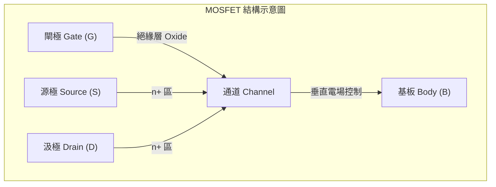

在電路分析中，若源極與基板接在一起（$V_{SB} = 0$），則可簡化為三端點元件。當閘極電壓 $V_{GS}$ 超過臨界電壓 $V_{th}$ 時，半導體表面會形成反轉層（Inversion Layer），建立起連接源極與汲極的導電通道。

### 4.3.2 漸變通道近似（Gradual Channel Approximation）

為了推導 MOSFET 的電流公式，必須建立物理模型。最經典的模型是基於「漸變通道近似」（Gradual Channel Approximation, GCA）。此近似包含以下兩個核心假設：

1.  **電場分離假設**：假設通道中沿著電流方向（$y$ 方向）的水平電場分量 $\mathcal{E}_y$，遠小於垂直於通道表面（$x$ 方向）的垂直電場分量 $\mathcal{E}_x$。這意味著閘極電壓對電荷濃度的控制，在每一處截面上都可以視為一維的靜電平衡問題。
2.  **準靜態假設**：通道內的電位 $V(y)$ 從源極（$y=0, V(0)=0$）到汲極（$y=L, V(L)=V_{DS}$）是平滑且連續變化的。

在 GCA 條件下，通道中任一點 $y$ 處的反轉層電荷密度 $Q_{inv}(y)$（單位面積電荷量，單位為 $\text{C/cm}^2$）可表示為：
$$Q_{inv}(y) = -C_{ox} [V_{GS} - V_{th} - V(y)]$$
其中，$C_{ox}$ 為單位面積氧化層電容（$\epsilon_{ox}/t_{ox}$），$V(y)$ 為通道在 $y$ 位置相對於源極的電位。

### 4.3.3 線性區電流推導與通道電阻

當 $V_{GS} > V_{th}$ 且汲極電壓 $V_{DS}$ 極小時，通道在各處均處於反轉狀態。根據漂移電流（Drift Current）公式（見第 2 章），通道中任一點的汲極電流 $I_D$ 為：
$$I_D = W \cdot Q_{inv}(y) \cdot v_d(y)$$
其中 $W$ 為通道寬度，$v_d(y)$ 為載子漂移速度。根據低電場下的遷移率模型，$v_d(y) = \mu_n \mathcal{E}_y = \mu_n \frac{dV(y)}{dy}$。將電荷密度公式代入：
$$I_D = W \mu_n C_{ox} [V_{GS} - V_{th} - V(y)] \frac{dV(y)}{dy}$$

由於穩定狀態下，沿著通道的電流 $I_D$ 處處相等，我們可以對上式進行積分。積分範圍從源極（$y=0, V=0$）到汲極（$y=L, V=V_{DS}$）：
$$\int_{0}^{L} I_D dy = \int_{0}^{V_{DS}} W \mu_n C_{ox} [V_{GS} - V_{th} - V(y)] dV$$
$$I_D \cdot L = W \mu_n C_{ox} \left[ (V_{GS} - V_{th})V_{DS} - \frac{1}{2}V_{DS}^2 \right]$$
整理後得到**線性區（Linear Region）**電流公式：
$$I_D = \mu_n C_{ox} \frac{W}{L} \left[ (V_{GS} - V_{th})V_{DS} - \frac{1}{2}V_{DS}^2 \right]$$

當 $V_{DS} \ll (V_{GS} - V_{th})$ 時，平方項可忽略，電流與 $V_{DS}$ 成線性關係：
$$I_D \approx \mu_n C_{ox} \frac{W}{L} (V_{GS} - V_{th}) V_{DS}$$
此時 MOSFET 可視為一個受閘極電壓控制的可變電阻，其通道電阻 $R_{ch}$ 為：
$$R_{ch} = \frac{V_{DS}}{I_D} = \frac{1}{\mu_n C_{ox} \frac{W}{L} (V_{GS} - V_{th})}$$

### 4.3.4 夾止機制與飽和區

隨著 $V_{DS}$ 增加，靠近汲極端的通道電位 $V(y)$ 升高，使得該處的有效電場差 $(V_{GS} - V_{th} - V(y))$ 減小，導致電荷密度 $Q_{inv}$ 下降。當 $V_{DS}$ 增加到臨界值 $V_{DS,sat} = V_{GS} - V_{th}$ 時，汲極端（$y=L$）的電荷密度趨近於零，此現象稱為**夾止（Pinch-off）**。

!!! warning "常見誤解"
    「夾止」並不代表電流中斷。當汲極端通道夾止時，該處會形成一個極高電場的空乏區。載子由源極出發，在通道中漂移，到達夾止點後，會被強大的水平電場瞬間掃向汲極。因此，電流不會消失，而是達到最大飽和值。

在飽和點之後，若進一步增加 $V_{DS}$，額外的電壓降主要落在汲極端的空乏區，而通道兩端的電位差仍維持在約 $V_{GS} - V_{th}$。將 $V_{DS} = V_{GS} - V_{th}$ 代入線性區公式，可得到**飽和區（Saturation Region）**電流公式，即著名的「平方律」（Square Law）：
$$I_{D,sat} = \frac{1}{2} \mu_n C_{ox} \frac{W}{L} (V_{GS} - V_{th})^2$$

在理想模型中，飽和區電流與 $V_{DS}$ 無關。但在實際元件中，由於通道長度調變（Channel Length Modulation）效應，電流會隨著 $V_{DS}$ 增加而略微上升（此現象將在第 5 章詳述）。

### 4.3.5 次臨界區與次臨界擺幅

當 $V_{GS} < V_{th}$ 時，理想模型假設電流為零。然而，在物理上，半導體表面雖未達到強反轉（Strong Inversion），但仍存在微弱的載子濃度，稱為弱反轉（Weak Inversion）。此時的電流主要由**擴散（Diffusion）**機制主導，而非漂移機制。

此區域稱為**次臨界區（Subthreshold Region）**，其電流 $I_D$ 與 $V_{GS}$ 呈指數關係：
$$I_D \propto \exp \left( \frac{q(V_{GS} - V_{th})}{nkT} \right)$$
其中 $n$ 為理想因子（Ideality Factor），$k$ 為波茲曼常數，$T$ 為絕對溫度。

為了衡量電晶體作為開關的效率，定義**次臨界擺幅（Subthreshold Swing, SS）**為：汲極電流改變一個數量級（10 倍）所需增加的閘極電壓。
$$SS = \ln(10) \cdot \frac{dV_{GS}}{d(\ln I_D)} \approx 2.3 \frac{nkT}{q}$$

*   **典型值**：在室溫（300K）下，理想 MOSFET 的最小 SS 理論極限約為 $60 \text{ mV/dec}$。
*   **物理意義**：SS 越小，代表電晶體從「關閉」到「開啟」的切換速度越快，漏電流控制能力越強。

| 操作區間 | 條件 | 電流機制 | 電流公式特徵 |
| :--- | :--- | :--- | :--- |
| **截止區** | $V_{GS} < V_{th}$ | 擴散 (微弱) | 指數依賴 $V_{GS}$ |
| **線性區** | $V_{GS} > V_{th}, V_{DS} < V_{GS}-V_{th}$ | 漂移 | 與 $V_{DS}$ 近似線性相關 |
| **飽和區** | $V_{GS} > V_{th}, V_{DS} \ge V_{GS}-V_{th}$ | 漂移 | 與 $(V_{GS}-V_{th})^2$ 相關 |

!!! example "產業實例"
    在先進製程（如 7nm 以下）中，傳統平面 MOSFET 的 SS 會因為短通道效應而大幅惡化。為了維持優異的次臨界特性，產業轉向 FinFET 甚至 GAAFET（Gate-All-Around FET）架構。透過閘極對通道的全方位包覆，增強靜電控制能力，使 SS 能更接近理論極限，從而降低待機功耗。

<!-- fig:2 -->
<figure markdown>
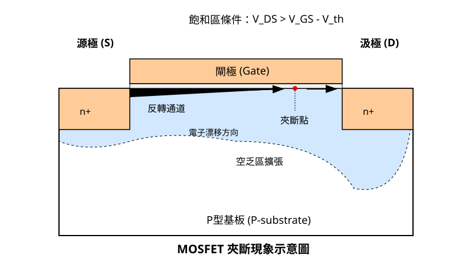
<figcaption>圖 4-2　MOSFET 夾斷現象圖（AI 繪製的示意圖）</figcaption>
</figure>

## 4.4 CMOS 反相器靜態特性

互補式金氧半導體（Complementary Metal-Oxide-Semiconductor, CMOS）是現代超大型積體電路（VLSI）的核心。其基本邏輯單元為 CMOS 反相器（CMOS Inverter），由一對互補的 NMOS 與 PMOS 電晶體組成。相較於早期的 NMOS 邏輯或雙極性接面電晶體（BJT）邏輯，CMOS 最顯著的優勢在於其極低的靜態功耗，這使得數十億個電晶體得以整合在單一晶片上而不會因過熱而毀壞。

### 4.4.1 CMOS 反相器結構與工作原理

CMOS 反相器的電路結構如下：上方的 PMOS 稱為「上拉元件」（Pull-up Device），其源極（Source）接至電源電壓 $V_{DD}$；下方的 NMOS 稱為「下拉元件」（Pull-down Device），其源極接至接地端（GND）。兩者的閘極（Gate）相連作為輸入端 $V_{in}$，汲極（Drain）相連作為輸出端 $V_{out}$。

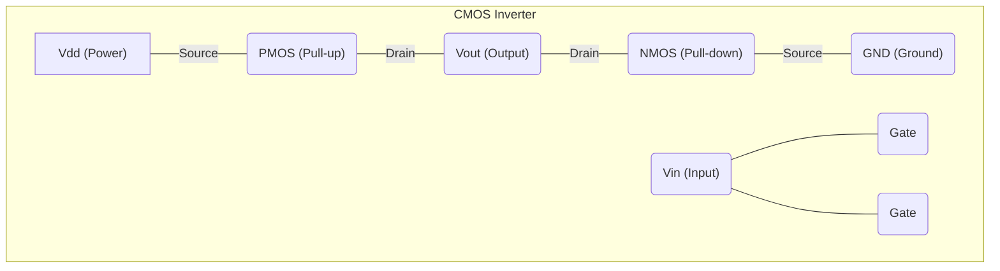

當輸入 $V_{in}$ 為邏輯高電位（$V_{DD}$）時：
1. NMOS 的 $V_{GS,n} = V_{DD} > V_{tn}$，NMOS 導通。
2. PMOS 的 $V_{GS,p} = V_{DD} - V_{DD} = 0$，其絕對值小於 $|V_{tp}|$，PMOS 截止（Cut-off）。
3. 輸出端透過導通的 NMOS 連接至 GND，因此 $V_{out}$ 為低電位（$0$）。

當輸入 $V_{in}$ 為邏輯低電位（$0$）時：
1. NMOS 的 $V_{GS,n} = 0 < V_{tn}$，NMOS 截止。
2. PMOS 的 $V_{GS,p} = 0 - V_{DD} = -V_{DD}$，其絕對值大於 $|V_{tp}|$，PMOS 導通。
3. 輸出端透過導通的 PMOS 連接至 $V_{DD}$，因此 $V_{out}$ 為高電位（$V_{DD}$）。

在穩態（Steady State）下，由於始終有一個電晶體處於截止狀態，從 $V_{DD}$ 到 GND 之間沒有直流電流路徑，這正是 CMOS 低靜態功耗的物理基礎。

### 4.4.2 負載線分析法與操作點定位

為了精確分析反相器在切換過程中的電壓變化，需使用負載線分析法（Load Line Analysis）。在任何時刻，流經 NMOS 的汲極電流 $I_{Dn}$ 必須等於流經 PMOS 的汲極電流 $I_{Dp}$（忽略閘極漏電與次臨界電流）：

$$I_{Dn}(V_{in}, V_{out}) = |I_{Dp}(V_{in}, V_{out})|$$

對於 NMOS，其特性曲線為 $I_{Dn}$ 對 $V_{DS,n}$（即 $V_{out}$）；對於 PMOS，其特性曲線需轉換至相同的坐標系，其中 $V_{DS,p} = V_{out} - V_{DD}$。

當 $V_{in}$ 由 $0$ 逐漸增加至 $V_{DD}$ 時，NMOS 與 PMOS 的操作點（Operating Point）會在各自的輸出特性曲線上移動。這兩個元件會經歷不同的操作區間（見第 4.3 節）：

1.  **區域 A ($V_{in} < V_{tn}$)**：NMOS 截止，PMOS 處於線性區。$V_{out} = V_{DD}$。
2.  **區域 B ($V_{tn} < V_{in} < V_M$)**：NMOS 進入飽和區，PMOS 仍處於線性區。$V_{out}$ 開始緩慢下降。
3.  **區域 C ($V_{in} \approx V_M$)**：NMOS 與 PMOS 同時處於飽和區。此時輸出電壓對輸入電壓極為敏感，曲線斜率（增益）達到最大。
4.  **區域 D ($V_M < V_{in} < V_{DD} - |V_{tp}|$)**：NMOS 處於線性區，PMOS 進入飽和區。$V_{out}$ 快速下降至接近 $0$。
5.  **區域 E ($V_{in} > V_{DD} - |V_{tp}|$)**：NMOS 處於線性區，PMOS 截止。$V_{out} = 0$。

### 4.4.3 電壓轉移特性曲線（VTC）

電壓轉移特性曲線（Voltage Transfer Characteristics, VTC）是描述 $V_{out}$ 隨 $V_{in}$ 變化的函數圖形。一個理想的反相器應具有極陡峭的轉移邊界，以確保數位訊號的辨識度。在 VTC 曲線中，有五個關鍵的電壓臨界點：

1.  **$V_{OH}$ (Output High Voltage)**：當輸入為低電位時，輸出的最大穩定電壓。在 CMOS 中，典型值為 $V_{DD}$。
2.  **$V_{OL}$ (Output Low Voltage)**：當輸入為高電位時，輸出的最小穩定電壓。在 CMOS 中，典型值為 $0$。
3.  **$V_{IL}$ (Input Low Voltage)**：輸入被視為「低電位」的最大界限。定義為 VTC 曲線上斜率 $\frac{dV_{out}}{dV_{in}} = -1$ 的第一個點。
4.  **$V_{IH}$ (Input High Voltage)**：輸入被視為「高電位」的最小界限。定義為 VTC 曲線上斜率 $\frac{dV_{out}}{dV_{in}} = -1$ 的第二個點。
5.  **$V_M$ (Switching Threshold)**：邏輯切換閾值，定義為 $V_{in} = V_{out}$ 的點。

!!! note "說明"
    在 $V_{IL}$ 與 $V_{IH}$ 之間，電路具有大於 1 的小訊號增益，這意味著雜訊會被放大；而在這兩個點之外，增益小於 1，雜訊會被抑制。因此，$V_{IL}$ 與 $V_{IH}$ 是區分數位訊號「有效性」的重要物理指標。

### 4.4.4 雜訊邊界（Noise Margins）

雜訊邊界（Noise Margin）衡量電路對輸入干擾的容忍能力。若環境雜訊使輸入電壓偏離預期值，只要該偏離仍在雜訊邊界內，邏輯判斷就不會出錯。

*   **低電位雜訊邊界 ($NM_L$)**：
    $$NM_L = V_{IL} - V_{OL}$$
*   **高電位雜訊邊界 ($NM_H$)**：
    $$NM_H = V_{OH} - V_{IH}$$

為了獲得最佳的抗雜訊能力，設計上通常追求對稱的 VTC 曲線，即使得 $NM_L \approx NM_H$。這要求切換閾值 $V_M$ 盡可能接近 $V_{DD}/2$。

### 4.4.5 元件尺寸匹配與對稱性設計

在 CMOS 反相器中，$V_M$ 的位置取決於 NMOS 與 PMOS 的驅動能力對比。驅動能力由轉導參數（Transconductance Parameter）$\beta$ 決定：

$$\beta_n = \mu_n C_{ox} \frac{W_n}{L_n}, \quad \beta_p = \mu_p C_{ox} \frac{W_p}{L_p}$$

其中 $\mu$ 為載子遷移率，$C_{ox}$ 為單位面積氧化層電容，$W$ 與 $L$ 分別為通道寬度與長度。當 $V_{in} = V_{out} = V_M$ 時，兩元件皆處於飽和區，電流相等：

$$\frac{1}{2} \beta_n (V_M - V_{tn})^2 = \frac{1}{2} \beta_p (V_{DD} - V_M - |V_{tp}|)^2$$

若假設 $V_{tn} = |V_{tp}|$，則要使 $V_M = V_{DD}/2$，必須滿足 $\beta_n = \beta_p$。

然而，在矽基元件中，電子的遷移率 $\mu_n$ 典型值約為電洞遷移率 $\mu_p$ 的 2 至 3 倍（見第 2 章關於散射與有效質量的討論）。為了補償這種物理性質上的差異，實現對稱的切換特性，PMOS 的寬度 $W_p$ 通常必須設計得比 NMOS 的寬度 $W_n$ 更大。

若設定 $L_n = L_p$（通常取製程極限之最小通道長度），則對稱匹配條件為：

$$\frac{W_p}{W_n} \approx \frac{\mu_n}{\mu_p}$$

!!! example "產業實例"
    在 7 奈米或 5 奈米 FinFET 製程中，由於通道是垂直的「鰭片」結構，寬度 $W$ 不再是連續可調的數值，而是由鰭片的數量（Fin Number）決定。例如，若 $\mu_n / \mu_p \approx 2$，工程師可能會設計一個反相器，其中 NMOS 使用 2 條鰭片，而 PMOS 使用 3 或 4 條鰭片，以達成接近對稱的轉移特性與時序表現。

### 4.4.6 寬長比對 VTC 的影響

若 $W_p/W_n$ 的比例偏離對稱點，VTC 曲線將發生平移：
*   **上拉能力過強**（$W_p$ 過大）：$V_M$ 會向右移（靠近 $V_{DD}$），這會增加 $NM_L$ 但減少 $NM_H$。
*   **下拉能力過強**（$W_n$ 過大）：$V_M$ 會向左移（靠近 GND），這會增加 $NM_H$ 但減少 $NM_L$。

在高速電路設計中，有時會故意設計不對稱的反相器（例如偏向 PMOS 的「High-Skew」或偏向 NMOS 的「Low-Skew」），以優化特定訊號邊緣（上升沿或下降沿）的傳遞延遲，但這必須以犧牲雜訊邊界為代價。

## 4.5 CMOS 動態響應與功率消耗

在完成 CMOS 反相器（Inverter）的靜態特性分析後，本節將探討其在高速切換狀態下的動態行為。CMOS 電路的速度與功耗是衡量半導體製程優劣的核心指標。在積體電路中，邏輯閘的切換並非瞬時完成，而是受到電路中各種寄生電容（Parasitic Capacitance）充放電過程的限制。

### 4.5.1 寄生電容來源解析

在高速數位電路中，CMOS 反相器的負載電容 $C_L$ 並非單一元件，而是由多個物理結構產生的寄生電容加總而成。這些電容主要可分為三大類：

#### 1. 閘極電容（Gate Capacitance）
閘極電容包含內稟的通道電容以及由製程產生的重疊電容（Overlap Capacitance）。當下一級邏輯閘的輸入端連接至本級輸出時，下一級 MOSFET 的閘極電容即成為本級的負載。
*   **重疊電容 ($C_{ov}$)**：源極（Source）與汲極（Drain）在離子佈植與後續熱退火製程中，雜質會發生橫向擴散，導致閘極結構與源/汲極區在物理空間上產生重疊。這部分電容與通道電壓無關，屬於常數寄生電容。
*   **通道電容**：如 4.1 節所述，隨操作區間不同（截止、線性、飽和），閘極對通道的電容貢獻亦會隨之改變。

#### 2. 接面電容（Junction Capacitance）
接面電容源於汲極擴散區與基板（Bulk）之間的 PN 接面。
*   **耗盡層電容 ($C_{j}$)**：根據第 3 章所述，PN 接面在反向偏壓下會形成耗盡層，其行為類似平行板電容器。
*   **側牆電容 ($C_{jsw}$)**：擴散區的側面與較高摻雜的通道終止層（Channel Stopper）或淺溝槽隔離（STI）邊界接觸，形成的額外電容成分。

#### 3. 互連線電容（Interconnect Capacitance）
隨著製程微縮，金屬互連線（Interconnect）的寬度縮小且間距變窄，導線與導線之間（Crosstalk capacitance）以及導線對地（基板）的電容變得不可忽視。在先進製程中，互連線延遲往往超過電晶體本身的開關延遲。

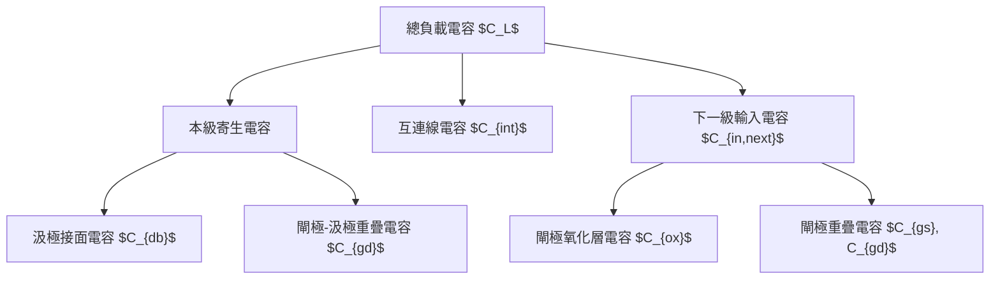

### 4.5.2 傳遞延遲時間模型

傳遞延遲（Propagation Delay, $t_{pd}$）定義為輸入信號達到 $V_{DD}/2$ 至輸出信號達到 $V_{DD}/2$ 之間的時間差。對於一個反相器，包含由低電位升至高電位的延遲 $t_{pLH}$ 以及由高電位降至低電位的延遲 $t_{pHL}$。

#### 1. 平均傳遞延遲
通常取兩者的平均值以代表該邏輯閘的速度：
$$t_{pd} = \frac{t_{pLH} + t_{pHL}}{2}$$

#### 2. RC 延遲模型
在簡化的級聯模型中，我們可以將 MOSFET 視為一個受控電阻 $R_{on}$。當輸出端電容 $C_L$ 進行充放電時，其電壓隨時間變化的關係遵循一階 RC 電路響應。對於 $t_{pHL}$（NMOS 導通，放電過程）：
$$V_{out}(t) = V_{DD} \cdot e^{-t / (R_n C_L)}$$
定義 $V_{out}(t_{pHL}) = 0.5 V_{DD}$，可推導出：
$$t_{pHL} = \ln(2) \cdot R_n C_L \approx 0.69 \cdot R_n C_L$$

其中 $R_n$ 為 NMOS 的等效導通電阻。由 4.3 節的電流公式可知，電流與通道寬度 $W$ 成正比，因此電阻與 $W$ 成反比。為了達到對稱的切換速度（$t_{pLH} = t_{pHL}$），由於電洞遷移率（Mobility, $\mu_p$）通常僅為電子遷移率（$\mu_n$）的 1/2 至 1/3，PMOS 的寬度通常需設計為 NMOS 的 2 至 3 倍。

!!! note "設計權衡"
    增加電晶體寬度 $W$ 雖然能降低導通電阻 $R$ 並縮短延遲，但同時會增加下一級電路的輸入電容 $C_{in}$。這種物理特性限制了單純透過加大元件尺寸來提升速度的效果。

### 4.5.3 動態功率消耗

CMOS 電路最顯著的優點在於靜態下（輸入維持高或低電位）理論功耗極低。功耗主要發生在信號切換的動態過程中。

#### 1. 容性負載功耗公式推導
當輸入由高變低，PMOS 導通，電源 $V_{DD}$ 對負載電容 $C_L$ 充電。在此過程中，電源提供的能量為：
$$E_{source} = \int_{0}^{\infty} V_{DD} \cdot i(t) dt = V_{DD} \cdot Q = V_{DD} \cdot (C_L V_{DD}) = C_L V_{DD}^2$$
儲存在電容中的能量為：
$$E_{cap} = \frac{1}{2} C_L V_{DD}^2$$
這意味著另外 $1/2 C_L V_{DD}^2$ 的能量在充電過程中以熱能形式耗散在 PMOS 的電阻上。當輸入由低變高，NMOS 導通，電容 $C_L$ 儲存的能量經由 NMOS 放電至地，同樣轉化為熱能。

因此，一個完整的開關週期（一充一放）總共耗散 $C_L V_{DD}^2$ 的能量。若電路的操作頻率為 $f$，且考慮到並非每個時脈週期信號都會切換，引入切換機率（Activity Factor, $\alpha$），則動態功耗 $P_{dyn}$ 為：
$$P_{dyn} = \alpha \cdot C_L \cdot V_{DD}^2 \cdot f$$

#### 2. 功耗與電壓的平方關係
由公式可知，降低工作電壓 $V_{DD}$ 是降低功耗最有效的方法，因為功耗與電壓呈平方比例關係。然而，降低 $V_{DD}$ 會導致驅動電流下降，進而增加延遲時間，這構成了效能與功耗之間的關鍵取捨（Trade-off）。

### 4.5.4 短路電流功耗

在輸入信號切換的瞬間，當輸入電壓 $V_{in}$ 處於以下區間時：
$$V_{th,n} < V_{in} < V_{DD} - |V_{th,p}|$$
此時 NMOS 與 PMOS 會同時處於導通狀態，形成一條從 $V_{DD}$ 直接通往地（GND）的電流路徑，稱為短路電流（Short-Circuit Current）。

*   **產生機制**：若輸入信號的上升或下降時間（Rise/Fall time）過長，電晶體停留在同時導通區間的時間增加，短路功耗隨之上升。
*   **典型值**：在設計良好的 CMOS 電路中，短路功耗通常佔總動態功耗的 5% 至 15% 以下。

### 4.5.5 靜態漏電功率與微縮挑戰

雖然理論上 CMOS 在靜態時不導通，但隨著製程微縮至奈米尺度，靜態漏電功耗（Static Leakage Power）已成為不可忽視的挑戰。

#### 1. 主要漏電來源
*   **次臨界漏電（Subthreshold Leakage）**：當 $V_{gs} < V_{th}$ 時，通道並非完全關閉，仍有微弱電流流過。隨著 $V_{th}$ 隨微縮降低，此電流呈指數級增長。
*   **閘極氧化層穿隧電流（Gate Oxide Tunneling）**：當氧化層厚度薄至數個原子層時，量子穿隧效應會導致電流直接穿過絕緣層。
*   **接面反向漏電**：汲極與基板間 PN 接面的熱產生電流與穿隧電流。

#### 2. 靜態功耗公式
$$P_{stat} = I_{leakage} \cdot V_{DD}$$

!!! warning "常見誤解"
    許多初學者認為只有在運算時晶片才會耗電。事實上，在先進製程（如 7nm 以下）中，由於漏電流巨大，即便晶片處於待機狀態（Idle），靜態功耗可能仍佔總功耗的 30% 以上。

#### 3. 走向第 5 章的伏筆
為了抑制這些漏電並維持電晶體的控制力，傳統的平面 MOSFET 結構已遭遇物理極限。業界被迫引入高介電常數金屬閘極（High-k Metal Gate, HKMG）技術，並從平面結構轉向 3D 立體架構（如 FinFET 與 GAAFET）。這些技術演進的物理動機，將在第 5 章「微縮定律與短通道效應」中深入探討。

### 4.5.6 產業實例：低功耗設計策略

在實際半導體設計中，工程師常採用以下策略平衡動態與靜態特性：
*   **多重臨界電壓（Multi-Vt Library）**：在關鍵路徑（Critical Path）使用低 $V_{th}$ 元件以追求速度，在非關鍵路徑使用高 $V_{th}$ 元件以抑制漏電。
*   **動態電壓頻率調整（DVFS）**：根據運算負載動態調整 $V_{DD}$ 與 $f$，以在滿足效能需求的前提下極小化 $P_{dyn}$。
*   **電源閘控（Power Gating）**：在電路不使用時，利用高臨界電壓的電晶體作為開關，徹底切斷該模組的電源供應，消除靜態漏電。

## 本章重點

1.  **MOS 電容操作狀態**：MOS 結構隨閘極偏壓變化經歷累積（Accumulation）、空乏（Depletion）與反轉（Inversion）三種狀態。強反轉的物理判據為表面電位 $\psi_s$ 達到基板電位 $\phi_B$ 的兩倍。
2.  **臨界電壓組成**：臨界電壓 $V_{th}$ 由功函數差、氧化層固定電荷、表面能帶彎折能階以及空乏區電荷支撐電壓四個物理項組成。
3.  **基板偏壓效應**：當源極與基板間存在逆向偏壓 $V_{SB}$ 時，會導致空乏區擴大並增加空間電荷量，進而使臨界電壓隨之上升，此現象由體效應參數 $\gamma$ 描述。
4.  **電流-電壓特性模型**：基於漸變通道近似（GCA），MOSFET 依據 $V_{GS}$ 與 $V_{DS}$ 的關係分為線性區、飽和區與次臨界區。當 $V_{DS} \ge V_{GS} - V_{th}$ 時，汲極端通道發生夾止（Pinch-off），電流進入飽和狀態。
5.  **次臨界擺幅**：次臨界擺幅（SS）衡量電晶體關斷特性，室溫下體矽元件的理論極限為 $60\text{ mV/dec}$，SS 越小代表開關切換效率越高。
6.  **CMOS 反相器對稱性**：由於電子遷移率 $\mu_n$ 高於電洞遷移率 $\mu_p$，為達成對稱的電壓轉移特性（VTC）與相等的雜訊邊界，PMOS 的通道寬度通常需設計為 NMOS 的 2 至 3 倍。
7.  **動態功耗與延遲**：CMOS 的傳遞延遲取決於等效導通電阻與負載電容的 RC 乘積；動態功耗則與操作頻率、負載電容及電源電壓的平方（$V_{DD}^2$）成正比。
8.  **靜態漏電挑戰**：隨製程微縮，次臨界漏電與閘極穿隧電流成為靜態功耗的主要來源，必須透過高介電常數金屬閘極（HKMG）與 3D 結構（如 FinFET）進行抑制。


## 重點圖卡

複習時看這幾張就能抓住本章重點；[圖卡庫](../cards.md)可以下載成圖片。

<div class="ix-cards" markdown>

<figure markdown>

<figcaption>核心概念圖卡：從平面電晶體到 FinFET、GAAFET</figcaption>
</figure>

<figure markdown>
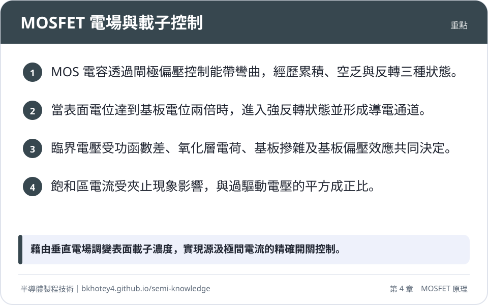
<figcaption>重點圖卡：MOSFET 電場與載子控制</figcaption>
</figure>

<figure markdown>
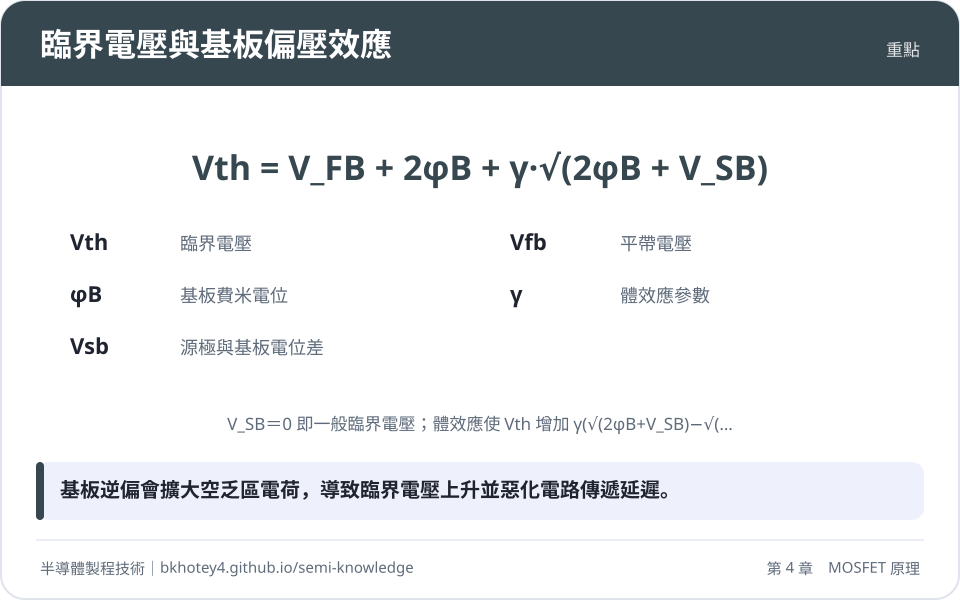
<figcaption>重點圖卡：臨界電壓與基板偏壓效應</figcaption>
</figure>

<figure markdown>
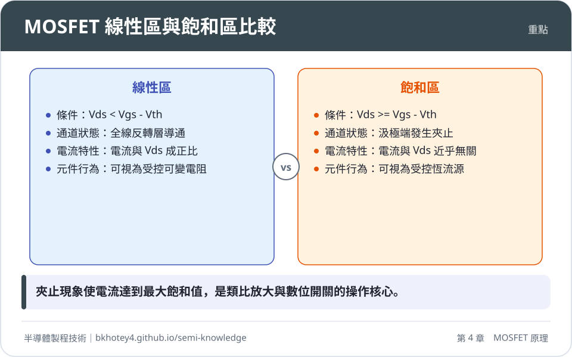
<figcaption>重點圖卡：MOSFET 線性區與飽和區比較</figcaption>
</figure>

<figure markdown>
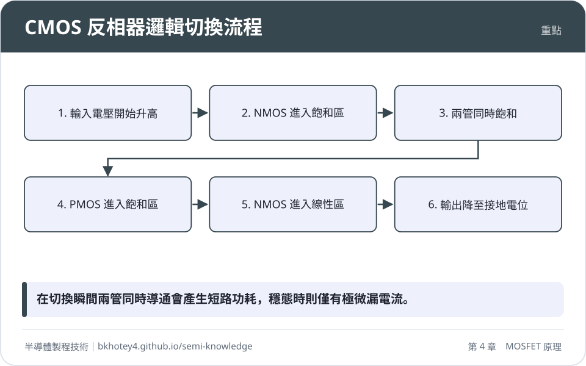
<figcaption>重點圖卡：CMOS 反相器邏輯切換流程</figcaption>
</figure>

</div>

## 習題

**1.** 試說明為何在 MOS 電容的高頻 C-V 量測中，反轉區的電容值無法回升至 $C_{ox}$，而具備源極/汲極結構的 MOSFET 在高頻量測下，其反轉區電容卻能回升至 $C_{ox}$？

??? success "參考解答"
    在純 MOS 電容中，反轉層所需的少數載子（電子）必須透過基板的熱產生-復合機構生成，其反應時間常數約在毫秒至秒等級，無法跟上高頻（如 $1\text{ MHz}$）小訊號的變化，因此電荷變動由空乏區邊緣的多數載子補償，電容維持在 $C_{\min}$。而在 MOSFET 中，源極與汲極作為少數載子的豐沛庫存槽，電子可透過橫向漂移迅速流入或流出通道，其反應時間極短，足以追隨高頻訊號，故電容能回升至 $C_{ox}$。

**2.** 已知一 nMOS 採用 $\text{p}$ 型矽基板，摻雜濃度 $N_A = 10^{17}\text{ cm}^{-3}$，氧化層厚度 $t_{ox} = 5\text{ nm}$。若不考慮固定電荷與功函數差（假設 $V_{FB} = 0$），計算其在室溫（$300\text{ K}$）下的臨界電壓 $V_{th0}$。（已知 $n_i = 10^{10}\text{ cm}^{-3}$，$\varepsilon_s = 1.04 \times 10^{-12}\text{ F/cm}$，$\varepsilon_{ox} = 3.45 \times 10^{-13}\text{ F/cm}$）

??? success "參考解答"
    1. 計算基板電位：$\phi_B = (0.0259)\ln(10^{17}/10^{10}) \approx 0.417\text{ V}$。
    2. 計算單位面積氧化層電容：$C_{ox} = \varepsilon_{ox}/t_{ox} = 3.45 \times 10^{-13} / 5 \times 10^{-7} = 6.9 \times 10^{-7}\text{ F/cm}^2$。
    3. 計算強反轉表面位能：$\psi_s = 2\phi_B = 0.834\text{ V}$。
    4. 計算空乏電荷：$Q_d = -\sqrt{2q\varepsilon_s N_A (2\phi_B)} = -\sqrt{2(1.6 \times 10^{-19})(1.04 \times 10^{-12})(10^{17})(0.834)} \approx -1.66 \times 10^{-7}\text{ C/cm}^2$。
    5. 計算臨界電壓：$V_{th0} = V_{FB} + 2\phi_B - Q_d/C_{ox} = 0 + 0.834 - (-1.66 \times 10^{-7} / 6.9 \times 10^{-7}) = 0.834 + 0.241 = 1.075\text{ V}$。

**3.** 考慮一個 CMOS 反相器，若 $V_{DD} = 1.2\text{ V}$，負載電容 $C_L = 10\text{ fF}$，操作頻率 $f = 2\text{ GHz}$，切換機率 $\alpha = 0.1$。試計算其動態功耗。若將 $V_{DD}$ 降低至 $0.9\text{ V}$，功耗將下降多少百分比？

??? success "參考解答"
    1. 計算初始動態功耗：$P_{dyn} = \alpha C_L V_{DD}^2 f = 0.1 \times (10 \times 10^{-15}) \times (1.2)^2 \times (2 \times 10^9) = 2.88 \times 10^{-6}\text{ W} = 2.88\ \mu\text{W}$。
    2. 功耗與電壓平方成正比，比例關係為 $(0.9^2) / (1.2^2) = 0.81 / 1.44 = 0.5625$。
    3. 功耗下降百分比：$(1 - 0.5625) \times 100\% = 43.75\%$。

**4.** 何謂「漸變通道近似」（Gradual Channel Approximation, GCA）？在何種物理條件下此近似會失效？

??? success "參考解答"
    GCA 假設通道內沿電流方向的水平電場變化遠小於垂直於表面的電場變化，使得每一截面的電荷分佈可視為一維靜電問題。當元件進入「短通道」尺度時，汲極電場對通道的影響增加，水平電場與垂直電場量級相當，二維電場效應顯著，此時 GCA 近似失效。

## 本章術語

- **Flat-band Voltage**（平帶電壓）：使半導體能帶由表面至深處皆呈水平狀態所需施加的閘極電壓。
- **Surface Potential**（表面電位）：半導體表面相對於深層基板中性區的靜電位偏移量。
- **Inversion Layer**（反轉層）：當表面電位足夠高，使少數載子濃度超過多數載子濃度時，在介面形成的極薄導電層。
- **Threshold Voltage**（臨界電壓）：使半導體表面達到強反轉起始條件（$\psi_s = 2\phi_B$）所需的最低閘極偏壓。
- **Body Effect**（基板偏壓效應）：源極與基板間的電位差導致空乏區電荷增加，進而改變臨界電壓的現象。
- **Pinch-off**（夾止）：當汲極電壓增加至使汲極端反轉層電荷密度趨近於零的物理狀態。
- **Subthreshold Swing**（次臨界擺幅）：汲極電流改變一個數量級所需增加的閘極電壓，反映開關切換的陡峭度。
- **Noise Margin**（雜訊邊界）：邏輯電路能正確辨識輸入訊號而不受雜訊干擾的最大電壓容忍範圍。
- **Propagation Delay**（傳遞延遲）：訊號通過邏輯閘時，輸出響應相對於輸入變化的時間延遲。


## 互動學習

<div class="quiz" data-quiz="01-04"></div>


## 產業最新進展

本節由每日產業新聞自動補充，說明本章技術在產業上的最新發展。

<!-- updates -->
（目前尚無補充。）
