# 第 5 章　微縮定律與短通道效應

<figure markdown>

<figcaption>示意插畫：由 AI 生成，用來幫助記憶本章主題，細節請以內文與結構圖為準。</figcaption>
</figure>

!!! abstract "學習目標"
    - 理解摩爾定律（Moore's Law）與 Dennard 微縮定律（Dennard Scaling）的物理假設與推導關係
    - 掌握短通道效應（Short-Channel Effects, SCE）與汲極引致能障降低（Drain-Induced Barrier Lowering, DIBL）的靜電學機制
    - 分析閘極介電層厚度微縮引發的量子穿隧機制（Quantum Tunneling）與閘極漏電行為
    - 闡明次臨界擺幅（Subthreshold Swing）的熱力學極限，並理解靜態漏電導致功耗牆（Power Wall）與 Dennard 微縮終結的根本原因

## 5.1 電晶體微縮理論：摩爾定律與 Dennard 微縮法則

### 摩爾定律與微縮之驅動力

積體電路（Integrated Circuit, IC）的發展歷史，本質上是一部幾何尺寸微縮（Geometric Scaling）與整合度提升的演進史。1965 年，快捷半導體（Fairchild Semiconductor）與英特爾（Intel）的共同創辦人高登·摩爾（Gordon Moore）提出了一項經驗觀察：在最經濟的製造成本下，積體電路上所容納的電晶體數量大約每年增加一倍；到了 1975 年，他將這項預測修正為大約每 24 個月翻倍。這項經驗法則被後世稱為「摩爾定律」（Moore's Law）。

摩爾定律並非自然界的物理定律，而是半導體產業推動技術藍圖（Technology Roadmap）的經濟與工程指針。若定義幾何微縮因子為 $\kappa$（Scaling Factor，其中 $\kappa > 1$，典型世代微縮步階為 $\kappa \approx \sqrt{2} \approx 1.414$），當電晶體的特徵尺寸（例如閘極長度與接觸孔距）微縮至原本的 $1/\kappa$（即約 $0.7$ 倍）時，單一元件的佔用面積將縮減為：

$$A' = \frac{W}{\kappa} \times \frac{L}{\kappa} = \frac{A}{\kappa^2} \approx 0.5 A$$

其中 $W$ 為通道寬度，$L$ 為通道長度。這意味著在相同的晶片面積內，可容納的電晶體數量增加至 $\kappa^2 \approx 2$ 倍，直接促成了運算能力、記憶體容量的倍增，以及單一電晶體製造成本的下降。

---

### Dennard 等電場微縮定律

微縮若僅單純縮小幾何尺寸而不調整操作電壓與摻雜分佈，元件將迅速面臨接面崩潰與漏電流急遽上升的問題。1974 年，IBM 研究員羅伯特·登納德（Robert H. Dennard）提出了著名的「等電場微縮定律」（Constant-Electric-Field Scaling, CEF）。其核心物理思維在於：**使微縮後電晶體內部的二維電場強度分佈維持定值**，從而避免雪崩崩潰（Avalanche Breakdown）與強電場誘發的非線性傳輸效應。

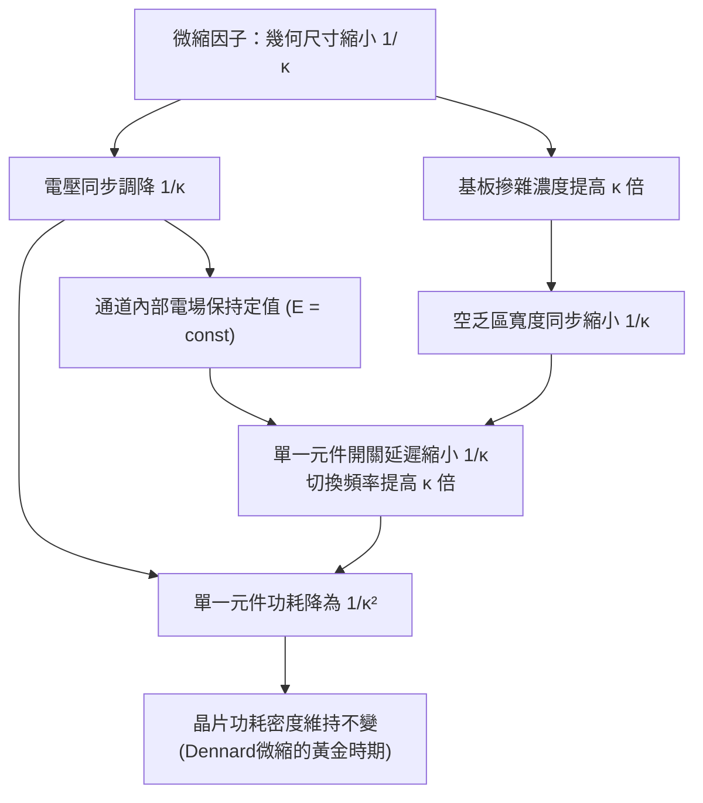

#### 物理量推導

1. **幾何尺寸與電壓**  
   為使元件幾何形狀成比例微縮，定義通道長度 $L$、通道寬度 $W$ 以及閘極介電層厚度 $t_{ox}$ 均縮減為原本的 $1/\kappa$：
   $$L' = \frac{L}{\kappa}, \quad W' = \frac{W}{\kappa}, \quad t_{ox}' = \frac{t_{ox}}{\kappa}$$
   若要維持通道與閘極介電層中的電場 $E = V/x$ 為常數，工作電壓（電源供應電壓 $V_{DD}$ 與臨界電壓 $V_{th}$）必須同步依 $1/\kappa$ 調降：
   $$V_{DD}' = \frac{V_{DD}}{\kappa}, \quad V_{th}' = \frac{V_{th}}{\kappa}$$

2. **基板摻雜濃度與空乏區寬度**  
   根據第 4 章所述，步階 PN 接面的空乏區寬度 $W_d$ 與表面電位 $\phi_s$ 的關係為：
   $$W_d = \sqrt{\frac{2 \epsilon_{si} \phi_s}{q N_A}}$$
   其中 $\epsilon_{si}$ 為矽介電常數，$q$ 為基本電荷，$N_A$ 為基板受體摻雜濃度。微縮時，空乏區寬度必須隨幾何尺寸縮小至 $W_d' = W_d / \kappa$ 以防止源極與汲極空乏區貫穿。由於表面電位與操作電壓成比例微縮（$\phi_s' = \phi_s / \kappa$），代入上式可得：
   $$\frac{W_d}{\kappa} = \sqrt{\frac{2 \epsilon_{si} (\phi_s / \kappa)}{q N_A'}}$$
   解得基板摻雜濃度必須提高為：
   $$N_A' = \kappa N_A$$

3. **電容、驅動電流與閘極延遲**  
   閘極氧化層之單位面積電容為 $C_{ox} = \epsilon_{ox} / t_{ox}$，故 $C_{ox}' = \kappa C_{ox}$。單一電晶體的總閘極電容 $C_g = W L C_{ox}$ 微縮為：
   $$C_g' = \left(\frac{W}{\kappa}\right) \left(\frac{L}{\kappa}\right) (\kappa C_{ox}) = \frac{C_g}{\kappa}$$
   根據 MOSFET 長通道飽和電流公式：
   $$I_{on} = \frac{1}{2} \mu C_{ox} \frac{W}{L} (V_{DD} - V_{th})^2$$
   在載子遷移率 $\mu$ 視為定值的理想假設下：
   $$I_{on}' = \frac{1}{2} \mu (\kappa C_{ox}) \left(\frac{W/\kappa}{L/\kappa}\right) \left(\frac{V_{DD} - V_{th}}{\kappa}\right)^2 = \frac{I_{on}}{\kappa}$$
   因此，內在開關延遲時間（Intrinsic Gate Delay）$\tau$ 為：
   $$\tau = \frac{C_g V_{DD}}{I_{on}} \implies \tau' = \frac{(C_g / \kappa) (V_{DD} / \kappa)}{I_{on} / \kappa} = \frac{\tau}{\kappa}$$
   這代表電晶體的最高切換頻率 $f \propto 1/\tau$ 提升了 $\kappa$ 倍。

4. **功耗與功耗密度**  
   單一電晶體的動態功耗（Dynamic Power Dissipation）計算如下：
   $$P = C_g V_{DD}^2 f$$
   微縮之後的新功耗為：
   $$P' = \left(\frac{C_g}{\kappa}\right) \left(\frac{V_{DD}}{\kappa}\right)^2 (\kappa f) = \frac{P}{\kappa^2}$$
   由於單位面積內的電晶體密度 $D$ 提升為 $\kappa^2$ 倍（$D' = \kappa^2 D$），總體功耗密度（Power Density）即為：
   $$P_{density}' = P' \times D' = \left(\frac{P}{\kappa^2}\right) \times (\kappa^2 D) = P_{density}$$
   **功耗密度在等電場微縮下保持不變**。這項結論是 1970 至 1990 年代半導體產業能持續縮小元件、倍增電晶體數量並提升時脈頻率，而無須面臨嚴重散熱危機的理論基石。

---

### 等電壓微縮定律與內部電場強化

在實際工程演進中，Dennard 的等電場微縮並未被完全貫徹。1980 年代初期至 1990 年代中期，全球電子系統廣泛採用電晶體-電晶體邏輯（Transistor-Transistor Logic, TTL）的 $5\text{ V}$ 介面標準，為維持系統周邊相容性，半導體產業在數個製程世代中維持了電源供應電壓不變（$V_{DD} = 5\text{ V}$），這種微縮模式稱為「等電壓微縮」（Constant-Voltage Scaling, CV）。

在等電壓微縮下，幾何尺寸同樣縮小至 $1/\kappa$，但電壓微縮因子為 $1$：

$$L' = \frac{L}{\kappa}, \quad t_{ox}' = \frac{t_{ox}}{\kappa}, \quad V_{DD}' = V_{DD}$$

這導致以下物理量出現劇烈偏離：

1. **內部電場急遽強化**：通道內部電場與閘極介電層電場為 $E' = V_{DD} / L' = \kappa E$。電場強度隨微縮世代以 $\kappa$ 倍率上升。
2. **飽和電流增加**：長通道飽和電流 $I_{on}' = \kappa I_{on}$（若考慮速度飽和效應則電流增幅趨緩，見第 5.3 節）。
3. **單一電晶體功耗上升**：$P' = C_g' V_{DD}^2 f' = (C_g / \kappa) \cdot V_{DD}^2 \cdot (\kappa^2 f) = \kappa P$。
4. **功耗密度呈三次方形勢爆炸**：
   $$P_{density}' = P' \times D' = (\kappa P) \times (\kappa^2 D) = \kappa^3 P_{density}$$

等電壓微縮帶來了災難性的物理後果：通道強電場引發嚴重的熱載子注入（Hot Carrier Injection, HCI），導致閘極介電層損傷與臨界電壓漂移；氧化層垂直電場過高促發了經時介電質崩潰（Time-Dependent Dielectric Breakdown, TDDB）；急遽暴增的功耗密度亦造成散熱失控。這迫使產業在微米節點（約 $0.5\ \mu\text{m}$ 世代）之後，全面放棄維持固定電壓的作法，轉向操作電壓隨微縮階梯式下降的「廣義微縮」（Generalized Scaling）。

---

### 微縮法則物理量變化對比

下表彙整了等電場微縮、等電壓微縮，以及在非理想電壓調降下的物理參數變化趨勢（以微縮因子 $\kappa > 1$ 表示）：

| 物理參數 | 符號 / 公式 | 等電場微縮 (CEF) | 等電壓微縮 (CV) |
| :--- | :--- | :---: | :---: |
| 通道長度、寬度 | $L, W$ | $1/\kappa$ | $1/\kappa$ |
| 閘極氧化層厚度 | $t_{ox}$ | $1/\kappa$ | $1/\kappa$ |
| 閘極電容 | $C_g = \epsilon_{ox} W L / t_{ox}$ | $1/\kappa$ | $1/\kappa$ |
| 基板摻雜濃度 | $N_A$ | $\kappa$ | $\kappa^2$ |
| 電源供應電壓 | $V_{DD}$ | $1/\kappa$ | $1$ |
| 內部電場強度 | $E = V/L$ | $1$ | $\kappa$ |
| 飽和驅動電流 | $I_{on}$ | $1/\kappa$ | $\kappa$ |
| 內在開關延遲 | $\tau = C_g V / I$ | $1/\kappa$ | $1/\kappa^2$ |
| 時脈操作頻率 | $f \propto 1/\tau$ | $\kappa$ | $\kappa^2$ |
| 單一元件動態功耗 | $P = C_g V_{DD}^2 f$ | $1/\kappa^2$ | $\kappa$ |
| 電晶體整合密度 | $D = 1 / (W L)$ | $\kappa^2$ | $\kappa^2$ |
| **晶片總功耗密度** | $P_{density} = P \times D$ | **$1$** | **$\kappa^3$** |

---

### Dennard 微縮的物理限制與失效

雖然 Dennard 等電場微縮在理論上提供了完美的功耗密度控制架構，但在進入次微米（Sub-micron）領域後，一組關鍵的基礎物理常數宣告了該定律的失效：**波茲曼常數 $k_B$ 與絕對溫度 $T$ 無法隨幾何尺寸微縮**。


在 MOSFET 的次臨界區（Subthreshold Region，詳見第 4 章），載子傳輸依循擴散機制，汲極電流隨閘極電壓呈指數衰減。其關閉特性由次臨界擺幅（Subthreshold Swing, $S$）決定：

$$S = \left( \frac{\partial \log_{10} I_D}{\partial V_{GS}} \right)^{-1} = \left(\frac{k_B T}{q}\right) \ln(10) \left(1 + \frac{C_d}{C_{ox}}\right)$$

在室溫（$T = 300\text{ K}$）下，熱電壓 $k_B T / q \approx 25.9\text{ mV}$，故 $S$ 的理論極限為：

$$S \ge \ln(10) \frac{k_B T}{q} \approx 59.5\text{ mV/decade} \approx 60\text{ mV/decade}$$

這意味著，無論製程技術如何精進，在室溫下的平面矽基板元件中，每將關閉漏電流降低一個數量級，閘極電壓 $V_{GS}$ 至少需要降低 $60\text{ mV}$。

由於 $S$ 的下限由統計力學決定而無法微縮，臨界電壓 $V_{th}$ 的調降空間遭受嚴格限制。若將 $V_{th}$ 依 $1/\kappa$ 比例縮小，在 $V_{GS} = 0\text{ V}$ 時的靜態次臨界漏電流（Subthreshold Leakage Current）將以指數形式劇烈暴增。為了控制待機漏電，工程上被迫放慢甚至停止調降 $V_{th}$；而為維持足夠的電流驅動能力（過驅動電壓 $V_{ov} = V_{DD} - V_{th}$），工作電壓 $V_{DD}$ 的微縮幅度亦在約 $1\text{ V}$ 附近發生停滯。

當幾何尺寸持續縮小而操作電壓無法依比例降低時，內部電場破壞了等電場條件，單一電晶體的功耗無法再以 $1/\kappa^2$ 下降，導致晶片的總功耗密度以幾何級數急增。此一熱耗散限制在 2005 年（約 $90\text{ nm}$ 至 $65\text{ nm}$ 節點）全面爆發，象徵著古典 Dennard 微縮定律的終結，並將半導體產業推入由短通道效應與量子漏電主導的全新物理瓶頸中。

!!! note "說明：微縮世代命名與實體物理特徵尺寸的脫鉤"
    在 Dennard 微縮早期（約 $130\text{ nm}$ 節點之前），技術節點名稱通常精確對應電晶體的實際微影半間距（Half-pitch）或實體閘極長度（$L_{gate}$）。但在 Dennard 微縮失效後，為了維持等效整合度進展的技術標竿，業界節點標稱（如 $7\text{ nm}$、$5\text{ nm}$、$3\text{ nm}$）已轉變為代表「等效微縮世代」（Equivalent Scaling Node）的商業度量，其數值已遠小於元件的實際接觸孔距（Contacted Poly Pitch, CPP）或實體閘極線寬。

!!! warning "常見誤解：摩爾定律失效即代表 Dennard 微縮失效"
    工程上常將摩爾定律與 Dennard 微縮混為一談。事實上，**Dennard 微縮已於約 2005 年宣告終結**（此後單核心時脈頻率無法再依微縮線性提升，處理器全面轉向多核心架構）；然而**摩爾定律（單位晶片面積的電晶體數量翻倍）則藉由多重圖案化微影、應變矽、高介電常數金屬閘極（HKMG）以及三維立體通道結構的導入，持續延續其生命力**。

!!! example "產業實例：中央處理器時脈頻率的飽和瓶頸"
    在 1990 年代至 2000 年代初期，受益於 Dennard 微縮，單晶片微處理器（如 Intel Pentium 系列）的時脈頻率自數十 $\text{MHz}$ 一路攀升至接近 $4\text{ GHz}$。但在 2004 年前後（$90\text{ nm}$ 世代的 Pentium 4 Prescott 核心），由於等電壓微縮殘留的高電壓與次臨界漏電疊加，導致處理器功耗突破 $100\text{ W}$、功耗密度逼近核反應爐等級的熱通量極限（超過 $100\text{ W/cm}^2$）。這迫使產業界正式放棄追求高時脈的微縮策略，轉向多核心（Multi-core）平行運算架構。

## 5.2 短通道效應與二維靜電場控制

### 二維靜電場主導與漸變通道近似的失效

在長通道 MOSFET（見第 4 章）的推導中，元件分析建立在「漸變通道近似」（Gradual Channel Approximation, GCA）的假設之上。GCA 假設沿通道傳輸方向的橫向電場梯度 $\partial \mathcal{E}_x / \partial x$ 遠小於垂直於閘極介電層方向的垂直電場梯度 $\partial \mathcal{E}_y / \partial y$。在此條件下，通道中的電荷分佈純粹由閘極電壓施加的一維高斯定律主導，源極（Source）與汲極（Drain）接面處的橫向電場僅被視為推動載子漂移的微擾，不影響反轉層電荷密度與臨界電壓（Threshold Voltage, $V_{\text{th}}$）的邊界條件。

當通道長度 $L$ 隨著微縮製程縮減至與接面深度（Junction Depth, $x_j$）或表面最大空乏區寬度（Maximum Depletion Width, $W_{\text{dep}}$）相仿時，GCA 徹底失效。通道內任一點的靜電位分佈 $\phi(x, y)$ 必須由完整的二維泊松方程式（2D Poisson's Equation）描述：

$$\frac{\partial^2 \phi(x, y)}{\partial x^2} + \frac{\partial^2 \phi(x, y)}{\partial y^2} = -\frac{\rho(x, y)}{\varepsilon_{\text{Si}}}$$

其中 $\rho(x, y)$ 為局部空間電荷密度，$\varepsilon_{\text{Si}}$ 為矽的介電常數（Permittivity）。橫向二階項 $\partial^2 \phi / \partial x^2$ 的存在，代表源極與汲極不再僅是載子的供應端與收集端，而是轉變為與閘極相互競爭通道靜電控制權的額外電極。當汲極端電場能夠直接貫穿並影響通道中央乃至源極端的電位分佈時，元件即進入「短通道效應」（Short-Channel Effects, SCE）的主導區間。

靜電控制完整性的物理邊界，常以微縮長度（Scaling Length 或 Natural Length）$\lambda$ 來量化。在傳統單閘極平面 bulk MOSFET 架構中，$\lambda$ 的典型簡化形式為：

$$\lambda \approx \sqrt{\frac{\varepsilon_{\text{Si}}}{\varepsilon_{\text{ox}}} t_{\text{ox}} W_{\text{dep}}}$$

其中 $\varepsilon_{\text{ox}}$ 為閘極介電層介電常數，$t_{\text{ox}}$ 為介電層物理厚度。為避免短通道效應引發的靜電失控，元件通道長度一般要求滿足 $L \ge (3 \sim 4)\lambda$。

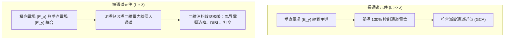

---

### 電荷共享模型與臨界電壓滾降

在短通道元件中，最直接觀察到的現象是臨界電壓隨閘極長度縮短而單調遞減，此現象稱為「臨界電壓滾降」（$V_{\text{th}}$ Roll-off）。針對此現象，Yau 於 1970 年代提出了直觀的幾何「電荷共享模型」（Charge-Sharing Model）。

```
        閘極 (Gate, 長度 L)
  =================================   <-- 閘極氧化層 (t_ox)
  ---------------------------------
  源極 (n+)   |  梯形空乏區   |  汲極 (n+)
  接面深 x_j  | (閘極負責)   |  接面深 x_j
  ---------   \              /   ---------
   \       \   \            /   /       /
    \  A_S  \   \          /   /  A_D  /  <-- 源/汲極內建電位
     \_______\   \________/   /_______/       產生的內建空乏區
                  p型基板 (N_A)
```

在長通道元件達到強反轉（Strong Inversion）時，通道下方寬度為 $W_{\text{dep}}$、長度為 $L$ 的矩形區域內所有的離子化受體電荷 $Q_{\text{dep}}$，皆必須由閘極金屬板上的相反極性電荷提供電束線來終止。但在短通道中，源極與汲極的冶金接面（Metallurgical Junction）本身與 p 型基板存在內建電位差（Built-in Potential, $V_{\text{bi}}$），在未施加外部偏壓時就已於接面四周建立空乏區。

因此，通道下方空間電荷區內有一部分已由源極與汲極接面的內建電場滿足（圖中幾何分界中的兩側區域 $A_S$ 與 $A_D$）。閘極僅需負擔中間截角梯形區域內的離子化受體電荷。閘極所需供應的有效單位面積空乏電荷 $Q_{\text{bulk}}'$ 因而降低：

$$Q_{\text{bulk}}' = Q_{\text{bulk}} \cdot \left( 1 - \frac{\Delta L_S + \Delta L_D}{2L} \right)$$

其中 $Q_{\text{bulk}} = -q N_A W_{\text{dep}}$ 為長通道情況下的空乏總電荷密度，$N_A$ 為基板摻雜濃度，$\Delta L_S$ 與 $\Delta L_D$ 分別代表源極與汲極空乏區向通道內部水平延伸並分擔電荷的有效長度。藉由幾何推導，長度縮減項可表示為接面深度 $x_j$ 與空乏寬度 $W_{\text{dep}}$ 的函數：

$$\Delta L_{S, D} = \frac{x_j}{L} \left( \sqrt{1 + \frac{2 W_{\text{dep}}}{x_j}} - 1 \right)$$

將修正後的有效電荷代入臨界電壓公式，短通道下的臨界電壓 $V_{\text{th, short}}$ 變為：

$$V_{\text{th, short}} = V_{\text{FB}} + 2\phi_B + \frac{\sqrt{2 q \varepsilon_{\text{Si}} N_A (2\phi_B)}}{C_{\text{ox}}} \cdot \left[ 1 - \frac{x_j}{2L} \left( \sqrt{1 + \frac{2 W_{\text{dep}}}{x_j}} - 1 \right) \right]$$

其中 $V_{\text{FB}}$ 為平帶電壓（Flat-band Voltage），$\phi_B = (k_B T / q) \ln(N_A / n_i)$ 為基板費米電位，$C_{\text{ox}} = \varepsilon_{\text{ox}} / t_{\text{ox}}$ 為單位面積閘極電容。

由該式可知，當 $L$ 減小至與 $x_j$ 相當的維度時，括號內的扣除項顯著放大，造成 $V_{\text{th}}$ 隨 $L$ 下降而急劇下跌。此效應對積體電路製程極具破壞性：在先進微影技術中，奈米級的臨界尺寸（Critical Dimension, CD）線寬變異，將透過陡峭的 $V_{\text{th}}$ 滾降曲線被放大為劇烈的元件門檻電壓分佈離散，造成電路時序不匹配與靜態漏電大幅發散。

!!! note "電荷共享模型的適用範疇"
    Yau 的電荷共享模型屬於一階解析幾何模型，成功以物理直觀解釋了臨界電壓滾降的幾何成因。然而在更嚴格的次微米與奈米節點中，空乏區邊界不再是清晰的階角幾何，且通道電位分佈高度非線性，現代元件設計主要依賴數值求解二維或三維漂移-擴散（Drift-Diffusion）與泊松耦合方程（TCAD）進行精確預測。

---

### 汲極引致能障降低（DIBL）

臨界電壓滾降主要描述零汲極偏壓（或極小測試電壓，如 $V_{\text{DS}} = 50\text{ mV}$）下的結構微縮效應；當汲極施加工作電壓（$V_{\text{DS}} = V_{\text{DD}}$）時，二維靜電場的耦合作用將更為劇烈，產生「汲極引致能障降低」（Drain-Induced Barrier Lowering, DIBL）。

```
傳導帶能階 E_c (電子能量)
       ^
       |       能障頂點 (源極注入能障)
       |          /\
       |         /  \  <-- 長通道 (能障不受 V_DS 影響)
       |        /    \
       |       /  --  \
       |      /  /  \  \  <-- 短通道, 低 V_DS
       |     /  /    \  \
       |    /  /      \  \________ 短通道, 高 V_DS (能障被拉低 Δφ_B)
       |   /  /        \__________
       |  /  /
       | /  /
源極 (S)|/  /                    汲極 (D)
       +----------------------------------> 通道位置 x
```

從能帶結構檢視，在 n 型 MOSFET 關閉或次臨界狀態下，源極（n+）與 p 型通道基板之間存在一個內建靜電能障（源極注入能障，$\phi_B$），其頂點阻擋了源極端高濃度的電子擴散進入通道。在長通道元件中，汲極偏壓僅擴展汲極接面附近的電位降落區，源極處的能障頂點高度完全受閘極電位調控。

但在短通道中，汲極高電壓引發的電力線可穿透整個通道長度，直抵源極接面邊緣。汲極正電位產生的靜電誘導效應壓低了源極端的能帶，使得源極注入能障的有效高度降低了 $\Delta \phi_B$。源極電子以熱離子發射（Thermionic Emission）形式越過此能障的機率呈指數激增：

$$I_{\text{sub}} \propto \exp\left( \frac{-q(\phi_B - \Delta \phi_B)}{k_B T} \right)$$

因此，高汲極電壓會導致次臨界電流在更低的閘極電壓下即達到反轉門檻，相當於元件的臨界電壓隨 $V_{\text{DS}}$ 的增加而進一步下移。DIBL 的標準工程量化定義為：在固定次臨界電流判定值下，低汲極電壓與高汲極電壓所量得的臨界電壓差，除以汲極電壓變化量：

$$\text{DIBL} = -\frac{V_{\text{th}}(V_{\text{DS}}^{\text{high}}) - V_{\text{th}}(V_{\text{DS}}^{\text{low}})}{V_{\text{DS}}^{\text{high}} - V_{\text{DS}}^{\text{low}}} \quad (\text{單位為 mV/V})$$

在優良的長通道元件中，$\text{DIBL} \to 0\text{ mV/V}$；而在受短通道效應嚴重干擾的平面元件中，DIBL 常超過 $100\text{ mV/V}$，造成元件在待機高汲極電壓下次臨界漏電流劇增數個數量級，使邏輯開關的關閉態（Off-state）徹底崩潰。

---

### 打穿效應與次表面空乏區合併

當元件通道進一步縮短，或汲極偏壓 $V_{\text{DS}}$ 升高至某一臨界值時，短通道將面臨極端的空間電荷限制電流現象，即「打穿」（Punch-Through）。

在元件結構中，半導體表面因緊鄰閘極金屬與高介電常數薄膜，表面電位受到閘極電容強力的箝制（Gate Pinning）。然而，在遠離閘極氧化層界面的次表面深層區域（Subsurface 或 Bulk 區域，深度 $y > x_j$），閘極電場的影響力隨著距離以指數衰減。

```
              閘極 (Gate)
  =====================================
  ------[ 表面通道 (受閘極高度箝制) ]------
  源極 (n+)                         汲極 (n+)
     |                                |
     |                                |  V_DS 升高
     v                                v
  (源極空乏區) ~~~~~~~~> <~~~~~~~~ (汲極空乏區)
            \                  /
             \  空乏區邊界重疊  /
              \   (打穿發生)   /
               \______________/
               次表面深層區域
```

當汲極偏壓上升，汲極逆向偏壓接面空乏區在次表面深處橫向朝源極大幅延伸；若通道過短，汲極深層空乏區將直接與源極接面的深層空乏區相銜接合併。此時，次表面區域的半導體能障完全消失，源極與汲極之間形成一條避開閘極靜電控制的深層導電路徑。

打穿效應具備以下特徵：
1. **飽和特性喪失**：汲極電流 $I_D$ 不再隨 $V_{\text{DS}}$ 飽和，而是呈現如同空間電荷限制固態二極體的劇烈發散傳輸（$I_D \propto V_{\text{DS}}^n$，$n \ge 2$）。
2. **閘極調控完全失效**：由於打穿通道位於次表面深層，表面閘極電壓 $V_{\text{GS}}$ 無法再調控甚至關閉該電流，元件失去了開關放大功能。

| 參數 / 特徵 | 汲極引致能障降低 (DIBL) | 打穿效應 (Punch-Through) |
| :--- | :--- | :--- |
| **主導空間路徑** | 元件表面通道反轉層區域 | 次表面深層基板（避開閘極電容） |
| **物理機制** | 二維靜電場拉低源極熱發射能障 | 源極與汲極的空乏空間電荷區直接物理重疊 |
| **對 $I_D-V_{\text{GS}}$ 特性之影響** | 次臨界特性曲線平行向左平移 | 次臨界擺幅嚴重退化，關態漏電底線大幅抬升且失去平移性 |
| **閘極電壓調控力** | 仍保有調控力，但關閉態電流基底上升 | 幾乎完全喪失對次表面電流的調控能力 |

---

### 短通道二維靜電場的工程防制措施

為了在微縮通道長度 $L$ 的同時抑制 $V_{\text{th}}$ 滾降、DIBL 以及次表面打穿，傳統平面製程主要透過雜質工程（Doping Engineering）對元件內部靜電場進行三維立體重構：

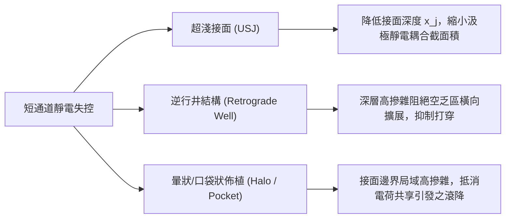

#### 超淺接面（Ultra-Shallow Junction, USJ）
由 Yau 模型可見，$\Delta V_{\text{th}}$ 隨接面深度 $x_j$ 的縮小而顯著收斂。將源極與汲極向通道內部延伸的「延伸區」（Extension Region）深度壓低至 $10 \sim 20\text{ nm}$ 以下，能有效限制源汲極電力線向通道核心區域的幾何擴散，收縮邊界共享體積。

#### 逆行井結構（Retrograde Well）
為避免均勻提高通道基板摻雜濃度導致表面載子移動率嚴重退化（見第 2 章雜質散射效應），逆行井利用離子佈植在離界面數十奈米的次表面深處形成一個高濃度雜質峰值區（Peak Doping），而在表面維持相對較低的摻雜度。深層的高摻雜極大化地壓縮了次表面空乏區寬度，防止深層源汲空乏區合併，從而杜絕打穿效應。

#### 暈狀佈植（Halo Implantation / Pocket Implantation）
暈狀佈植是在源極與汲極延伸區邊緣，以特定角度佈植與井區同型態的雜質（以 nMOS 而言為 p 型硼離子）。此舉在接面末端建構了一道局部高摻雜的電位阻擋層。當通道微縮至兩端 Halo 區域重疊時，通道中央的等效摻雜濃度隨長度縮減而「被動上升」，在特定長度區間甚至會出現 $V_{\text{th}}$ 隨通道長度縮短而上升的反常現象（稱為逆短通道效應，Reverse Short-Channel Effect, RSCE），恰好抵消了局部的幾何電荷共享滾降。

!!! example "產業實例：平面微縮的物理極限與架構轉折"
    在 65 奈米至 45 奈米節點的平面電晶體開發中，為了控制 DIBL 與抑制打穿，Halo 佈植的受體摻雜濃度被推升至 $10^{18} \sim 10^{19}\text{ cm}^{-3}$ 的極限。這帶來了災難性的副作用：極高的雜質引發嚴重的帶間穿隧（Band-to-Band Tunneling, BTBT）漏電，並顯著退化通道電子移動率。此靜電控制的二維困境，確立了平面 bulk MOSFET 的物理壽命終點，迫使業界在後續節點轉向絕緣層覆矽（SOI，見第 9 章）與鰭式場效電晶體（FinFET，見第 6 章）等立體多閘極架構，以全包覆的實體邊界條件重新收斂自然長度 $\lambda$。

<!-- fig:1 -->
<figure markdown>
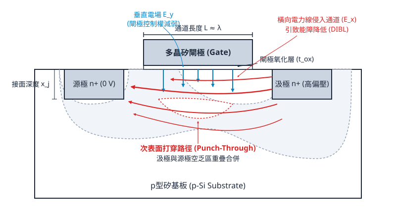
<figcaption>圖 5-1　短通道二維電場分佈圖（AI 繪製的示意圖）</figcaption>
</figure>

## 5.3 強電場傳輸特性：速度飽和與熱載子效應

### 載子漂移速度飽和與汲極電流限制

在長通道金氧半場效電晶體（MOSFET，見第 4 章）中，載子在反轉層內的傳輸遵循低電場漂移理論。當通道方向的橫向電場（Lateral Electric Field, $\mathcal{E}_\parallel$）較低時，載子的漂移速度（Drift Velocity, $v_d$）與電場呈線性正比關係：

$$v_d = \mu_{eff} \mathcal{E}_\parallel$$

其中 $\mu_{eff}$ 為反轉層載子的有效遷移率（Effective Mobility）。

然而，當通道長度 $L$ 隨著製程節點微縮至次微米及奈米尺度，而汲極工作電壓（$V_{DS}$）未能依 Dennard 等比例縮小（見第 5.1 節）時，通道內的橫向電場急遽攀升，典型值往往超越 $10^5\text{ V/cm}$。在強橫向電場作用下，載子自電場中加速汲取的動能，開始超過其透過發射聲學聲子（Acoustic Phonon）散逸能量的速率。當載子平均動能達到光學聲子能量（Optical Phonon Energy，在矽單晶中約為 $63\text{ meV}$）時，載子會藉由頻繁發射高能量的光學聲子釋放動能，這種強烈的非彈性散射機制稱為光學聲子散射（Optical Phonon Scattering）。

光學聲子散射的發生頻率極高，使得載子無法在電場中持續線性加速，最終其漂移速度趨於一個上限值，此現象稱為速度飽和（Velocity Saturation）。在室溫（$T = 300\text{ K}$）下，未受應變的矽材料中電子的飽和漂移速度典型值約為 $v_{sat} \approx 1.0 \times 10^7\text{ cm/s}$，電洞則約為 $v_{sat} \approx 0.8 \times 10^7\text{ cm/s}$。

漂移速度與電場的經驗經驗關係式（Caughey-Thomas 模型）可表述為：

$$v_d(\mathcal{E}_\parallel) = \frac{\mu_{eff} \mathcal{E}_\parallel}{\left[ 1 + \left( \frac{\mu_{eff} \mathcal{E}_\parallel}{v_{sat}} \right)^\gamma \right]^{1/\gamma}}$$

其中，$\gamma$ 為擬合參數，在電子傳輸中通常取 $\gamma \approx 2$，在電洞傳輸中則取 $\gamma \approx 1$。定義臨界電場（Critical Electric Field）為 $\mathcal{E}_c = v_{sat} / \mu_{eff}$，當 $\mathcal{E}_\parallel \ll \mathcal{E}_c$ 時，$v_d \approx \mu_{eff} \mathcal{E}_\parallel$；當 $\mathcal{E}_\parallel \gg \mathcal{E}_c$ 時，$v_d \approx v_{sat}$。


在長通道元件中，夾斷（Pinch-off）點的出現標誌著元件進入飽和區，汲極飽和電流 $I_{D,sat}$ 遵循二次方定律：

$$I_{D,sat,long} = \frac{1}{2} \mu_{eff} C_{ox} \frac{W}{L} (V_{GS} - V_{th})^2$$

其中 $W$ 為通道寬度，$C_{ox}$ 為單位面積閘極氧化層電容，$V_{GS}$ 為閘極-源極電壓，$V_{th}$ 為臨界電壓。

然而在短通道元件中，載子在通道靠近汲極端、甚至全通道範圍內即已達到臨界電場 $\mathcal{E}_c$，速度飽和先於通道夾斷發生。在此極限條件下，通道末端的飽和汲極電流改由飽和速度主導：

$$I_{D,sat,short} \approx W C_{ox} v_{sat} (V_{GS} - V_{th})$$

速度飽和引致兩項重要的元件電氣特徵改變：
1. **電流相依性轉變**：$I_{D,sat}$ 與過驅電壓（Overdrive Voltage, $V_{GS} - V_{th}$）的關係由二次方降至一次方線性相依，導致元件的驅動能力無法隨閘極電壓增加而大幅提升。
2. **跨導（Transconductance, $g_m$）飽和**：
   $$g_m = \frac{\partial I_D}{\partial V_{GS}} \approx W C_{ox} v_{sat}$$
   跨導不再隨偏壓升高而增加，限制了射頻與類比電路的高頻放大效能。

---

### 垂直有效電場與遷移率退化機制

除了橫向高電場之外，當閘極介電層厚度（$t_{ox}$）微縮至數奈米以下，反轉層通道同時承受強烈的垂直電場（Vertical Electric Field, $\mathcal{E}_\perp$）。反轉層內的電場分布並不均勻，工程上通常使用有效垂直電場（Effective Vertical Electric Field, $\mathcal{E}_{eff}$）進行定量描述：

$$\mathcal{E}_{eff} = \frac{1}{\varepsilon_{Si}} \left( |Q_{dep}| + \eta |Q_{inv}| \right)$$

其中 $\varepsilon_{Si}$ 為矽的介電常數，$Q_{dep}$ 為空乏層電荷密度，$Q_{inv}$ 為反轉層載子電荷密度。經驗加權因子 $\eta$ 在電子（NMOS）中典型值取 $1/2$，在電洞（PMOS）中典型值取 $1/3$。

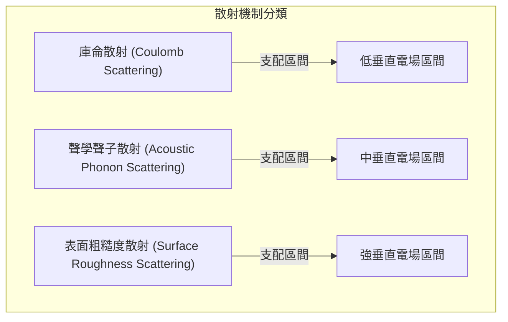

載子的有效遷移率 $\mu_{eff}$ 隨 $\mathcal{E}_{eff}$ 的增強而出現顯著衰退，此現象統稱為遷移率退化（Mobility Degradation）。根據馬西森定則（Matthiessen's Rule），有效遷移率由三種主要散射機制共同決定：

$$\frac{1}{\mu_{eff}} = \frac{1}{\mu_{Coulomb}} + \frac{1}{\mu_{Phonon}} + \frac{1}{\mu_{Roughness}}$$

各散射機制於不同電場區間之作用特性如下表所示：

| 散射機制 | 主導電場區間 | 物理成因 | 遷移率與電場關係 |
| :--- | :--- | :--- | :--- |
| **庫侖散射**（$\mu_{Coulomb}$） | 低 $\mathcal{E}_{eff}$ | 反轉層載子與介電層/半導體介面固定電荷（Fixed Oxide Charges）、游離雜質離子之靜電作用 | 隨反轉層載子濃度增加，屏蔽效應（Screening Effect）增強，$\mu_{Coulomb}$ 隨電場升高而遞增 |
| **表面聲學聲子散射**（$\mu_{Phonon}$） | 中 $\mathcal{E}_{eff}$ | 載子受半導體表面晶格熱振動產生的聲學聲子擾動 | 載子被緊密限制於表面位能阱中，$\mu_{Phonon} \propto \mathcal{E}_{eff}^{-1/3}$ |
| **表面粗糙度散射**（$\mu_{Roughness}$） | 高 $\mathcal{E}_{eff}$ | $\text{Si-SiO}_2$（或高介電常數介面）在原子尺度之幾何凹凸起伏引起之量子局限擾動 | 反轉層越薄，幾何波動對波函數影響越劇烈，$\mu_{Roughness} \propto \mathcal{E}_{eff}^{-2}$ |

在先進元件操作的高電壓與強反轉條件下，表面粗糙度散射成為限制遷移率的主要瓶頸。這使得實際量測到的短通道驅動電流遠低於以整體矽（Bulk Silicon）低電場遷移率預測的數值。

---

### 熱載子效應與碰撞游離

當載子在通道強橫向電場（接近汲極接面處達到最高峰值 $\mathcal{E}_{max}$）中行進時，若其從電場獲得能量的速率顯著高於透過晶格散射散逸能量的速率，載子族群將偏離原本與晶格熱平衡（Lattice Temperature, $T_L$）的費米-狄拉克分佈，其平均能量所對應之有效溫度（$T_e$ 或 $T_h$）遠高於晶格溫度（典型值可達數千度開爾文）。這些處於非熱平衡高能狀態的電子或電洞稱為「熱載子」（Hot Carriers）。

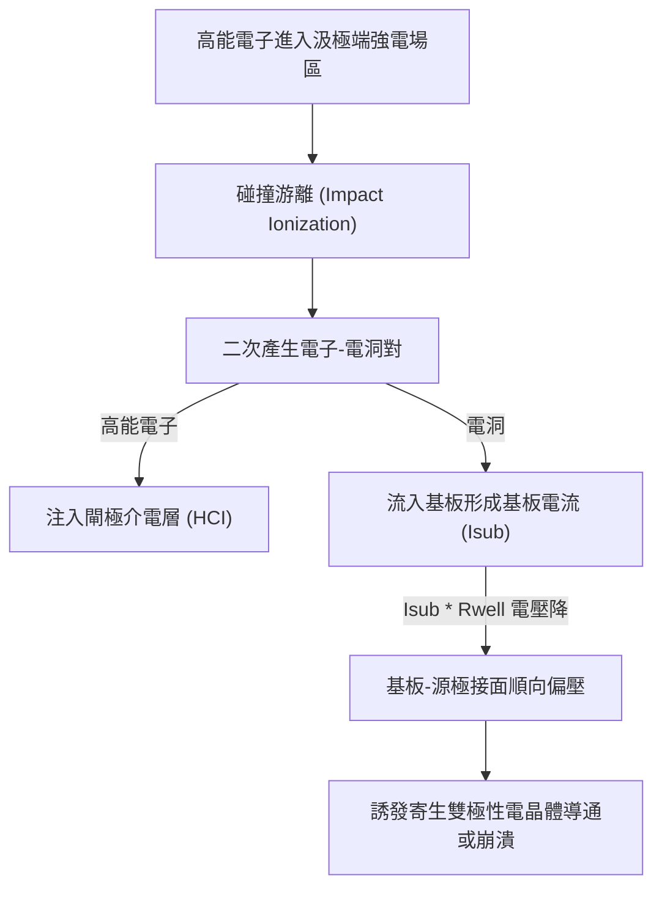

#### 碰撞游離機制與基板電流
當高能熱載子的動能大於矽的游離能閾值（Threshold Energy for Impact Ionization，$E_i \approx 1.5\text{ eV}$，大於矽能隙 $1.12\text{ eV}$，因需滿足動量守恆定律）時，高能載子會與價帶上的電子發生非彈性碰撞，將價帶電子擊發至導帶，產生一組二次「電子-電洞對」（Electron-Hole Pair），此物理過程稱為碰撞游離（Impact Ionization）。

在 NMOSFET 中，碰撞游離產生的二次電子被汲極正偏壓吸收成為汲極電流的一部分；二次產生的電洞則受電場排斥，穿透通道底部的空乏區流入基板（Substrate/Well），匯集形成基板電流（Substrate Current, $I_{sub}$）。基板電流大小可由幸運電子模型（Lucky-Electron Model）近似推導：

$$I_{sub} = C_1 I_D \exp\left(-\frac{\phi_{i}}{q \lambda \mathcal{E}_{max}}\right)$$

其中 $C_1$ 為比例常數，$\phi_i$ 為游離所需的有效位能障，$q$ 為基元電荷，$\lambda$ 為載子的光學聲子散射平均自由程（Mean Free Path），$\mathcal{E}_{max}$ 為汲極端通道的最大橫向電場。

!!! warning "常見誤解"
    基板電流 $I_{sub}$ 本身並非熱載子注入閘極的直接電流，但由於 $I_{sub}$ 的生成機率高度依賴通道內高能載子的數量與最大橫向電場 $\mathcal{E}_{max}$，因此半導體可靠度物理中普遍將基板電流的峰值（$I_{sub,peak}$）作為評估元件遭受熱載子劣化嚴重程度的關鍵間接電氣指標。

#### 基板電流對元件可靠度的衝擊
基板電流若過大，將對元件與電路帶來嚴重的可靠度隱患：
1. **基板電位抬升與本體效應變化**：$I_{sub}$ 流經具有內阻的矽基板或井區電阻（$R_{sub}$）時，會產生局部歐姆壓降（$V_{sub} = I_{sub} \times R_{sub}$），導致通道局部臨界電壓隨偏壓動態改變。
2. **寄生雙載子電晶體（Parasitic BJT）導通**：當 $I_{sub} \times R_{sub} \ge 0.7\text{ V}$ 時，基板與源極形成的 PN 接面會轉為順偏，觸發由「源極（射極）- 基板（基極）- 汲極（集極）」構成的寄生 NPN 雙載子電晶體（見第 3 章與第 4 章）。一旦寄生 BJT 開啟，會引發正回授崩潰（Avalanche Breakdown），導致元件失去閘極控制能力，嚴重時將因局部過熱而燒毀。

---

### 熱載子注入（HCI）與介面態生成

在碰撞游離之外，熱載子效應對元件長期可靠度最致命的破壞是熱載子注入（Hot Carrier Injection, HCI）。

當導帶中的熱電子動能超越 $\text{Si-SiO}_2$ 介面處的傳導帶能障差（Conduction Band Offset，約 $3.15\text{ eV}$，見第 1 章），且電子的動量方向朝向介面時，該電子具有非零機率直接跨越或穿隧進入閘極介電層內部。在 PMOSFET 中，熱電洞亦可越過價帶能障（約 $4.5\text{ eV}$）注入介電層，但因電洞的有效質量較大、遷移率較低，且價帶能障更高，故傳統平面元件中 NMOS 的 HCI 劣化往往較 PMOS 顯著。

注入介電層的高能載子會引發以下兩類微觀缺陷機制：
1. **介面陷阱態生成（Interface Trap Generation, $\Delta N_{it}$）**：高能載子衝擊 $\text{Si-SiO}_2$ 介面，打斷原本由氫鈍化（Hydrogen Passivation）形成的矽-氫鍵（$\text{Si-H}$），釋出氫原子並在介面留下帶懸鍵的矽原子（$\text{Si}^\bullet$），形成介面能態（$D_{it}$）。
2. **氧化層捕捉電荷（Oxide Trapped Charge, $\Delta N_{ot}$）**：進入介電層的載子可能被介電層內部的原生深層缺陷捕捉，成為固定空間電荷。

介面態與氧化層俘獲電荷的持續積累，直接造成 MOSFET 電氣特性的不可逆漂移：
- **臨界電壓漂移（Threshold Voltage Shift）**：
  $$\Delta V_{th} = -\frac{q \Delta N_{ot}}{C_{ox}} + \frac{q \Delta N_{it}}{C_{ox}}$$
  隨著操作時間增加，$V_{th}$ 發生偏移，導致數位邏輯閘傳遞延遲（Propagation Delay）逐漸退化，造成時序錯亂（Timing Failure）。
- **跨導退化（$g_m$ Degradation）**：新生之介面陷阱態顯著增加了庫侖散射中心，使得反轉層載子有效遷移率 $\mu_{eff}$ 下降，造成飽和驅動電流隨工作時數衰退。
- **次臨界斜率惡化（Subthreshold Swing Degradation）**：介面態電容效應導致次臨界擺幅 $SS$ 增加，使得關態漏電流（$I_{off}$）上升（見第 5.5 節）。

!!! note "說明"
    在元件可靠度壽命評估中，HCI 劣化指標通常服從經驗動力學冪律方程式（Power Law）：
    $$\Delta V_{th}(t) = A \cdot t^n$$
    其中 $t$ 為元件運作時間，$A$ 為依賴偏壓電場的加速因子，指數 $n$ 在典型矽元件中介於 $0.3$ 至 $0.5$ 之間。半導體製程規範通常要求電晶體在額定電壓與溫度條件下連續運作 10 年，其特性退化量必須控制在 $10\%$ 以內。

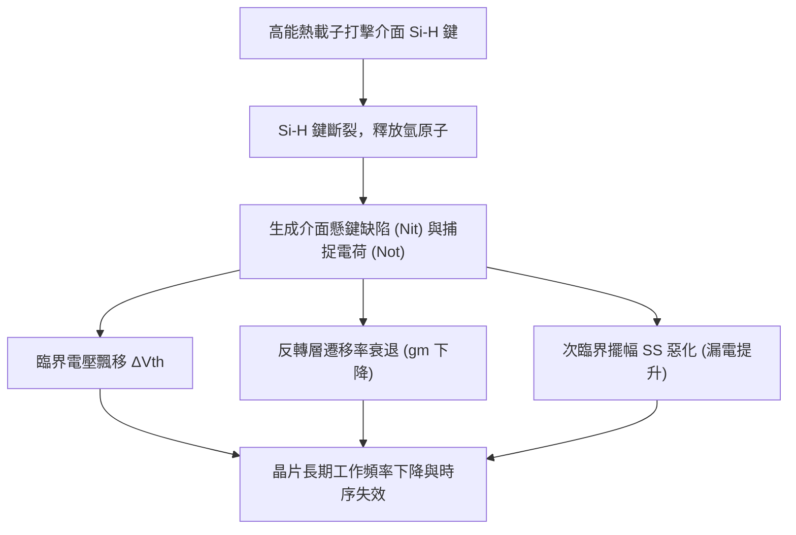

#### 製程緩解技術：輕摻雜汲極（LDD）
為了降低汲極端峰值電場 $\mathcal{E}_{max}$，工業界自亞微米節點起廣泛採用「輕摻雜汲極」（Lightly Doped Drain, LDD）結構。其核心物理概念是在高濃度重摻雜汲極區（$\text{N}^+$）與通道之間，插入一段濃度較低且結深較淺的摻雜延伸區（$\text{N}^-$）。

```
        閘極 (Gate)
     |--------------|
  間隔層            間隔層
 (Spacer)          (Spacer)
   |--|              |--|
------                ------
 N+   |   N-通道-N-  |   N+
(汲極)|  (LDD) (LDD) | (源極)
----------------------------
        P型基板 (P-Well)
```

透過此漸變的摻雜分布，空乏區在汲極端得以向 $\text{N}^-$ 區域展延，將陡峭的電壓降分散至較寬的空間範圍內。由於電場為電位的空間微分（$\mathcal{E} = -d\phi/dx$），空間展延大幅削平了汲極接面處的電場峰值 $\mathcal{E}_{max}$，從而降低了熱載子的平均動能與碰撞游離率，大幅改善了元件抵抗 HCI 劣化的能力。

## 5.4 閘極介電層極限與量子穿隧漏電

### 二氧化矽薄膜微縮與等效氧化層厚度

在金氧半場效電晶體（MOSFET，見第 4 章）的架構中，閘極介電層（Gate Dielectric）負責隔絕閘極電極與半導體通道，並透過靜電耦合在通道表面感應出反轉層電荷。依據前述之 Dennard 微縮法則（見第 5.1 節）以及特徵長度理論（見第 5.2 節），為了在微縮閘極長度 $L_g$ 的同時維持良好的閘極靜電控制能力、抑制汲極引發能障降低（DIBL）等短通道效應，必須等比例縮減閘極氧化層物理厚度 $t_{ox}$，以提高單位面積閘極電容：

$$C_{ox} = \frac{\varepsilon_{ox}}{t_{ox}} = \frac{\kappa_{ox} \varepsilon_0}{t_{ox}}$$

其中 $\varepsilon_0 \approx 8.854 \times 10^{-12}\ \text{F/m}$ 為真空介電常數，$\kappa_{ox}$ 為介電層之相對介電常數（對熱成長二氧化矽 $\text{SiO}_2$ 而言，典型值約為 $3.9$）。

在平面電晶體微縮至 90 奈米與 65 奈米世代的過程中，$\text{SiO}_2$ 的物理厚度被縮減至 $1.2\ \text{nm} \sim 1.4\ \text{nm}$。以面心立方晶系（FCC）晶胞之矽原子晶格常數約 $0.543\ \text{nm}$ 計算，厚度 $1.2\ \text{nm}$ 的 $\text{SiO}_2$ 僅相當於大約四至五層原子的厚度。在此極限厚度下，連續介質力學與古典靜電學假設失效，載子波函數穿透薄膜的機率急遽上升，導致巨大的閘極穿隧漏電流。

為了在不減小物理厚度（避免劇烈量子穿隧）的前提下持續增加單位電容，元件物理學引入了等效氧化層厚度（Equivalent Oxide Thickness, EOT）的概念。EOT 定義為：產生與某特定介電層相同單位電容時，理論上所需的理想 $\text{SiO}_2$ 物理厚度：

$$\text{EOT} = t_{high-\kappa} \left( \frac{\kappa_{\text{SiO}_2}}{\kappa_{high-\kappa}} \right) = t_{high-\kappa} \left( \frac{3.9}{\kappa_{high-\kappa}} \right)$$

其中 $t_{high-\kappa}$ 為高介電常數（High-$\kappa$）材料的實際物理厚度，$\kappa_{high-\kappa}$ 為該材料之相對介電常數。若採用 $\kappa \approx 20 \sim 25$ 的材料（例如氧化鉿 $\text{HfO}_2$），可使用較厚（約 $3 \sim 4\ \text{nm}$）的實體薄膜，達到小於 $1\ \text{nm}$ 的 EOT，藉此兼顧靜電控制能力與漏電流抑制。

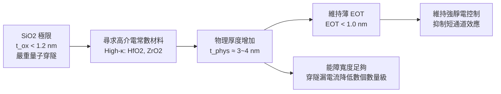

---

### 量子力學穿隧機制：直接穿隧與 FN 穿隧

在古典物理框架中，閘極介電層為高能障絕緣體，只要閘極偏壓所賦予電子的能量低於導帶能障高度（$\text{SiO}_2$ 與 $\text{Si}$ 介面之傳導帶不連續量 $\Delta E_c$ 典型值約為 $3.15\ \text{eV}$），電子便無法跨越此絕緣壁壘。然而，在微觀量子力學中，電子的行為由薛丁格方程式（Schrödinger Equation）描述，其機率波函數在穿入有限位能障壁時呈指數衰減，若障壁厚度小於數奈米，波函數在穿透障壁後仍具有非零振幅，導致電子穿透介電層形成穿隧電流（Tunneling Current）。

根據 WKB（Wentzel-Kramers-Brillouin）近似，能量為 $E$ 的電子穿透位能障壁 $V(x)$ 的穿透機率 $T(E)$ 可表示為：

$$T(E) \approx \exp \left( -2 \int_{x_1}^{x_2} \kappa(x) \, dx \right) = \exp \left( -\frac{2}{\hbar} \int_{x_1}^{x_2} \sqrt{2 m^* \left[ V(x) - E \right]} \, dx \right)$$

其中 $\hbar = h / (2\pi)$ 為約化普朗克常數，$m^*$ 為電子在介電質內的有效質量（Effective Mass，典型值約為自由電子質量的 $0.4\sim 0.5$ 倍），$x_1$ 與 $x_2$ 分別為古典禁制區的穿入與穿出轉折點。依據障壁幾何形狀與介電層兩端跨壓 $V_{ox}$ 的相對大小，穿隧機制主要分為直接穿隧（Direct Tunneling）與福勒－諾漢穿隧（Fowler-Nordheim Tunneling, FN 穿隧）。

```
        直接穿隧 (Direct Tunneling)                FN 穿隧 (Fowler-Nordheim)
             |V_ox| < Φ_B / q                          |V_ox| > Φ_B / q
      
           導帶 E_c (介電層)                           導帶 E_c (介電層)
           +----------------+                         +
          /|                |\                       /| \
         / |   梯形能障     | \                     / |  \  三角形能障
        /  |                |  \                   /  |   \
  E_F,m    |                |    E_F,s       E_F,m    |    \  穿入導帶
 ------->  |................|  ----        ------->   |.....\------
           |  穿透全厚度 t_ox|                         | x_t | 
           |                |                         |     |
         閘極            基板/通道                  閘極   基板/通道
```

#### 1. 直接穿隧（Direct Tunneling, DT）

當介電層跨壓 $V_{ox}$ 滿足 $q V_{ox} < \Phi_B$ 時（$\Phi_B$ 為電極與介電質間的導帶能障高度），電子穿隧過程中感受到的為「梯形能障」（Trapezoidal Barrier）。電子必須穿透介電層的全部物理厚度 $t_{ox}$。直接穿隧電流密度 $J_{DT}$ 可由能帶分析積分推導出如下形式：

$$J_{DT} = A \left(\frac{\mathcal{E}_{ox}}{\Phi_B}\right)^2 \exp \left\{ - \frac{4 \sqrt{2 m^*_{\text{diel}}} \Phi_B^{3/2}}{3 q \hbar \mathcal{E}_{ox}} \left[ 1 - \left( 1 - \frac{q V_{ox}}{\Phi_B} \right)^{3/2} \right] \right\}$$

在低電壓極限（$q V_{ox} \ll \Phi_B$）下，此關係式可簡化為對厚度 $t_{ox}$ 的直接指數關係：

$$J_{DT} \propto \exp \left( - \frac{2 \sqrt{2 m^*_{\text{diel}} \Phi_B}}{\hbar} \, t_{ox} \right)$$

直接穿隧是超薄介電層（$t_{ox} < 2\ \text{nm}$）在正常操作電壓（$V_{DD} \approx 0.7\ \text{V} \sim 1.0\ \text{V}$）下的主要漏電來源。

#### 2. 福勒－諾漢穿隧（Fowler-Nordheim Tunneling, FN 穿隧）

當介電層跨壓極高，滿足 $q V_{ox} > \Phi_B$ 時，介電層能帶嚴重傾斜，電子僅需穿透前半段的「三角形能障」（Triangular Barrier），進入介電層的傳導帶，隨後藉由電場加速漂移至對側。此時有效穿隧寬度為：

$$x_t = \frac{\Phi_B}{q \mathcal{E}_{ox}} < t_{ox}$$

利用 WKB 積分計算三角形能障之穿透率，可推導出經典的 FN 穿隧電流密度方程式：

$$J_{FN} = \frac{q^3 \mathcal{E}_{ox}^2}{8 \pi h \Phi_B} \exp \left( - \frac{4 \sqrt{2 m^*_{\text{diel}}} \Phi_B^{3/2}}{3 q \hbar \mathcal{E}_{ox}} \right)$$

FN 穿隧通常發生於高電場條件下（典型臨界電場 $\mathcal{E}_{ox} \gtrsim 6\ \text{MV/cm}$），廣泛應用於非揮發性記憶體（如 NOR/NAND Flash）的浮動閘極寫入與抹除操作，但在標準邏輯電晶體的正常工作偏壓下較少成為主導機制。

---

### 穿隧漏電流對厚度之指數相依性與待機功耗

直接穿隧漏電流對介電層物理厚度展現出極為劇烈的負指數相依性。以 $\text{SiO}_2$ 為例，微縮過程中的厚度變化與電流密度關係可歸納如下：

* 物理厚度 $t_{ox}$ 每減少 $0.2\ \text{nm}$（約單原子層尺度），穿隧電流密度 $J_{DT}$ 便增加約一個數量級（$10\times$）。
* 在 $V_{ox} = 1.0\ \text{V}$ 下，當 $t_{ox}$ 由 $3.0\ \text{nm}$ 微縮至 $1.5\ \text{nm}$ 時，漏電流密度由 $10^{-8}\ \text{A/cm}^2$ 暴增至約 $10\ \text{A/cm}^2$，膨脹達九個數量級。

下表列出熱成長 $\text{SiO}_2$ 於典型電壓條件下，物理厚度與穿隧漏電流密度之代表性數據：

| 物理厚度 $t_{ox}\ (\text{nm})$ | 主導穿隧機制 | 典型穿隧電流密度 $J_g\ (\text{A/cm}^2 \text{ at } 1\ \text{V})$ | 對邏輯電路的衝擊 |
| :--- | :--- | :--- | :--- |
| $3.5$ | 忽略不計（FN 需極高壓） | $< 10^{-10}$ | 靜態功耗可忽略 |
| $2.0$ | 直接穿隧 | $\approx 10^{-4}$ | 移動端低功耗元件臨界點 |
| $1.5$ | 直接穿隧 | $\approx 10^0 \sim 10^1$ | 靜態待機功耗顯著增加 |
| $1.2$ | 強烈直接穿隧 | $\approx 10^2 \sim 10^3$ | 漏電流超越開關切換電流極限 |
| $0.8$ | 量子力學透明（短路） | $> 10^4$ | 電晶體喪失開關功能 |

這種指數級的漏電流增長直接打破了 Dennard 微縮的功耗平衡。在單晶片整合數十億顆電晶體的超大型積體電路（VLSI）中，全晶片靜態閘極漏電所導致的總待機功耗（Standby Power）表示為：

$$P_{gate, standby} = V_{DD} \cdot \sum_{i=1}^{N} I_{gate, i} \approx V_{DD} \cdot N \cdot (W L_g J_{DT})$$

其中 $N$ 為電晶體總數，$W$ 與 $L_g$ 分別為閘極寬度與長度。當 $J_{DT}$ 突破 $1 \sim 10\ \text{A/cm}^2$ 時，晶片即使在未執行任何計算任務的待機狀態下，也會消耗數十至數百瓦特的功率並大量發熱，這促使產業界在 45 奈米世代全面淘汰使用了近四十年的純 $\text{SiO}_2$ 或氮氧化矽（$\text{SiON}$）閘極介電層，轉向高介電常數金屬閘極（High-$\kappa$ Metal Gate, HKMG）技術。

!!! warning "高介電常數材料的能障高度折衷"
    採用高介電常數材料雖然能增加實體厚度 $t_{phys}$，但多數 High-$\kappa$ 材料（如 $\text{TiO}_2$ 其 $\kappa \approx 80$）的能隙（Bandgap, $E_g$）顯著小於 $\text{SiO}_2$（$E_g \approx 8.9\ \text{eV}$），導致其對矽傳導帶的導帶不連續量 $\Delta E_c$ 過小（能障高度 $\Phi_B$ 偏低）。根據 WKB 近似，$\Phi_B$ 的降低同樣會大幅增加穿隧機率。因此，選擇介電材料時必須在介電常數 $\kappa$ 與能障高度 $\Phi_B$ 之間取得平衡，這也是 $\text{HfO}_2$（$\kappa \approx 25$, $\Delta E_c \approx 1.5\ \text{eV}$）成為業界標準的原因。

---

### 介電質崩潰之物理極限：時變介電質崩潰（TDDB）

極薄介電層除了面臨穿隧漏電問題外，亦受到高電場應力下的長期可靠度（Reliability）極限挑戰，其中最關鍵的劣化與失效機制為時變介電質崩潰（Time-Dependent Dielectric Breakdown, TDDB）。

#### 1. 缺陷生成與逾滲模型（Percolation Model）

當高電場施加於閘極介電層時，載子透過穿隧效應進入介電層傳導帶或直接穿透。部分高能載子在穿過介電層或抵達陽極介面時，透過非彈性散射釋放能量，導致晶格中化學鍵（如 $\text{Si}-\text{O}$ 或 $\text{Hf}-\text{O}$ 鍵）斷裂，釋放氫原子或誘發氧空位（Oxygen Vacancies），在介電層內部形成微觀局部電子陷阱（Traps/Defects）。

介電層崩潰的過程普遍採用逾滲理論（Percolation Theory）來解釋：

1. **缺陷均勻累積**：在電場與電流應力持續下，陷阱缺陷隨時間在介電層內部隨機隨機分佈生成，此時巨觀漏電流僅微幅上升（稱作應力引發漏電流，Stress-Induced Leakage Current, SILC）。
2. **逾滲路徑形成**：當介電質內隨機分佈的缺陷局部密度達到臨界值時，缺陷彼此重疊相連，於閘極電極與半導體基板之間形成一條跨越整個介電層厚度的微觀導電通道。
3. **軟崩潰（Soft Breakdown, SBD）**：單一或微弱的導電通道形成，漏電流發生非破壞性的階躍跳變，雜訊劇增，元件性能劣化但尚未完全失去電阻特性。
4. **硬崩潰（Hard Breakdown, HBD）**：局部通道形成後，局限電流密度激增引發嚴重的焦耳熱（Joule Heating），高溫進一步促使周圍化學鍵崩解，形成熔融導電絲（Filament），導致介電層絕緣性永久喪失，元件呈現短路失效。

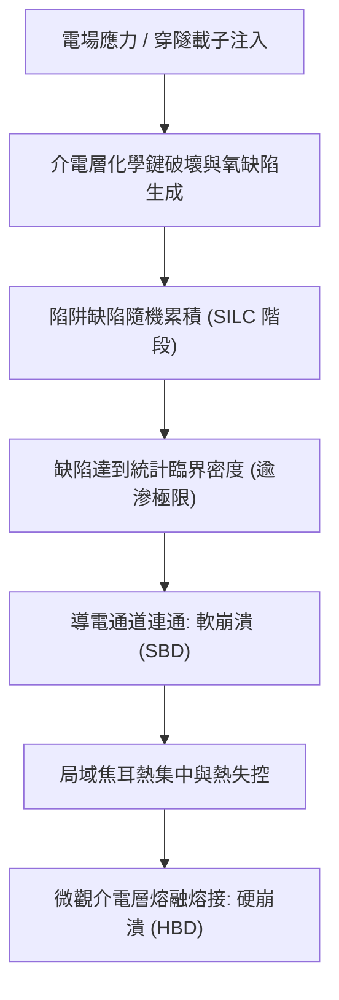

#### 2. 厚度極限與統計分佈

逾滲模型明確指出：**介電層越薄，觸發逾滲導電通道所需的臨界缺陷密度（$N_{bd}$）越低**。在相對較厚的介電層（如 $5\ \text{nm}$）中，要將多個隨機分佈的缺陷連成一線，需要相當龐大的缺陷總數；然而在 $1.2\ \text{nm}$ 的超薄層中，僅需兩至三個連續排列的點缺陷即可貫穿介電層。

在統計學上，元件的崩潰時間分佈遵循威布爾分佈（Weibull Distribution）：

$$F(t) = 1 - \exp \left[ - \left( \frac{t}{\eta} \right)^\beta \right]$$

其中 $F(t)$ 為在時間 $t$ 前發生崩潰的累積失效機率，$\eta$ 為特徵壽命（即 $63.2\%$ 元件失效的時間點），$\beta$ 為威布爾斜率（Weibull Slope）。研究顯示，威布爾斜率與介電層物理厚度呈線性正比：

$$\beta \propto t_{ox}$$

當介電層厚度 $t_{ox}$ 縮減至極限時，$\beta$ 值顯著下降，代表失效機率分佈的離散程度大幅增加。這意味著雖然元件的中位數壽命看似合格，但在微小累積失效率（如百萬分之一，即晶片良率保證指標）要求下，超薄介電層所允許的操作電壓上限將被迫大幅調低。這構成了阻礙純二氧化矽厚度持續微縮至 $1\ \text{nm}$ 以下的嚴苛物理可靠度界限。

!!! example "產業實例：從 SiO2 到 HKMG 的歷史性轉折"
    英特爾（Intel）於 2007 年在 45 奈米製程節點首度將沉積在 $\text{SiO}_2$ 介面層上的鉿基（Hafnium-based）高介電常數薄膜與金屬閘極（HKMG）導入量產。藉由將介電層物理厚度增至約 $3\ \text{nm}$ 同時將 EOT 降至 $1.0\ \text{nm}$ 以下，成功將閘極穿隧漏電流降低了三個數量級以上（$> 1000\times$），克服了因直接穿隧與 TDDB 可靠度崩潰而停滯的微縮難題。

<!-- fig:2 -->
<figure markdown>
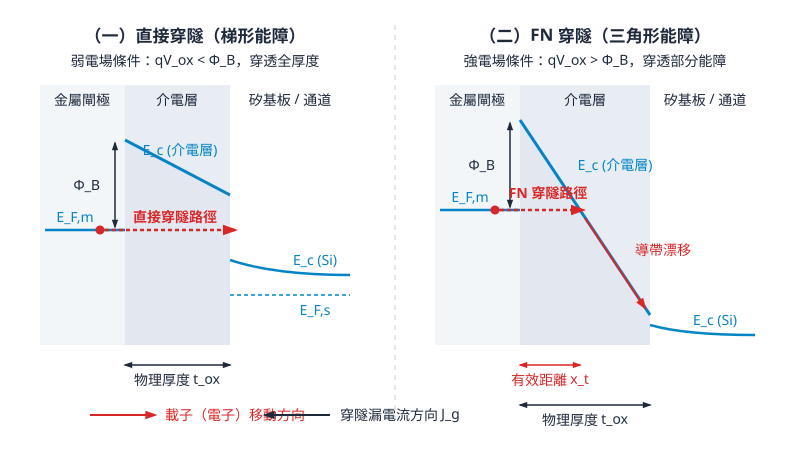
<figcaption>圖 5-2　閘極穿隧漏電能帶圖（AI 繪製的示意圖）</figcaption>
</figure>

## 5.5 次臨界行為、靜態漏電與功耗牆

### 弱反轉區與次臨界傳導模型

在 MOSFET 中，當閘極電壓小於臨界電壓（$V_{GS} < V_{th}$）時，通道尚未形成強反轉層（見第 4 章）。然而，通道表面並非完全沒有載子，而是處於「弱反轉」（Weak Inversion）狀態。在此工作區間內，半導體表面電位 $\psi_s$ 滿足 $\phi_B < \psi_s < 2\phi_B$（其中 $\phi_B = (k_B T/q) \ln(N_A/n_i)$ 為費米電位）。

在強反轉區，通道電流由橫向電場主導的「漂移電流」（Drift Current）支配；但在弱反轉區，通道內感應的電子濃度極低，且橫向電場極弱，電流傳導機制主要由源極越過表面位能障壁注入通道的「擴散電流」（Diffusion Current）主導。

根據波茲曼統計（Boltzmann Statistics），源極端熱游離越過位能障壁注入半導體表面的電子濃度 $n_s$，與表面電位 $\psi_s$ 呈指數關係：

$$n_s \propto \exp\left(\frac{q\psi_s}{k_B T}\right)$$

其中 $q$ 為基本電荷，$k_B$ 為波茲曼常數，$T$ 為絕對溫度。由於擴散電流密度與載子濃度梯度成正比，透過一維擴散方程式積分，可導出次臨界區域的汲極電流 $I_D$ 模型：

$$I_D = I_0 \cdot \exp\left[\frac{q(V_{GS} - V_{th})}{m k_B T}\right] \left[1 - \exp\left(-\frac{q V_{DS}}{k_B T}\right)\right]$$

式中 $I_0$ 為臨界電壓處的特徵電流（與通道寬長比 $W/L$、電子遷移率 $\mu_n$ 及氧化層電容成正比）；$m$ 為體效應係數（Body-effect Coefficient），亦稱次臨界理想因子（Ideality Factor）。當汲極偏壓滿足 $V_{DS} \ge 3 k_B T / q$（室溫下約大於 $78\text{ mV}$）時，括號項趨近於 $1$，次臨界電流便與 $V_{DS}$ 無關，完全由 $V_{GS}$ 呈指數型調控。

---

### 次臨界擺幅之推導與理論極限

為了量化閘極電壓關斷通道電流的能力，元件物理上定義「次臨界擺幅」（Subthreshold Swing, $S$，部分文獻亦稱次臨界斜率之倒數）為汲極電流每改變一個數量級（Decade，即 $10$ 倍）所需的閘極偏壓變化量：

$$S = \left( \frac{\partial \log_{10} I_D}{\partial V_{GS}} \right)^{-1} = \ln(10) \cdot \frac{\partial V_{GS}}{\partial \ln I_D}$$

利用連鎖律，將其拆解為「靜電分壓轉換」與「載子擴散注入」兩個物理機制：

$$S = \ln(10) \cdot \left( \frac{\partial V_{GS}}{\partial \psi_s} \right) \cdot \left( \frac{\partial \psi_s}{\partial \ln I_D} \right)$$

根據弱反轉電流公式，$\frac{\partial \ln I_D}{\partial \psi_s} = \frac{q}{k_B T}$；而閘極對表面電位的調控，可透過閘極介電層電容 $C_{ox}$、空乏層電容 $C_{dep}$ 及介面陷阱態電容 $C_{it}$ 所組成的電容分壓電路解析：

$$\frac{\partial \psi_s}{\partial V_{GS}} = \frac{C_{ox}}{C_{ox} + C_{dep} + C_{it}} = \frac{1}{m}$$

$$m = 1 + \frac{C_{dep} + C_{it}}{C_{ox}}$$

代入 $S$ 的定義式，可得次臨界擺幅的解析表示式：

$$S = \ln(10) \cdot \frac{k_B T}{q} \cdot \left( 1 + \frac{C_{dep} + C_{it}}{C_{ox}} \right)$$

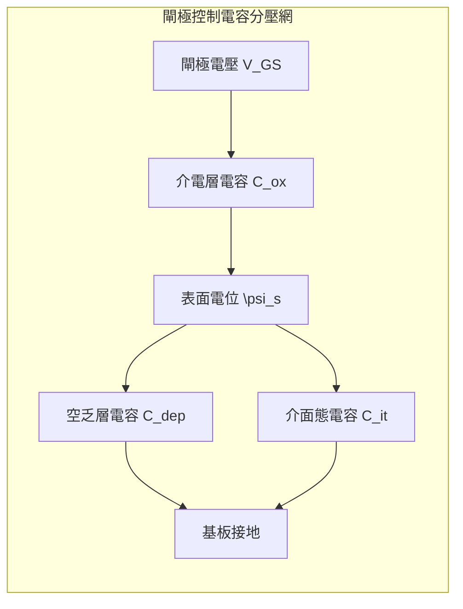

在極限狀態下，若介面缺陷完全消除（$C_{it} \to 0$），且閘極介電層極薄或介電常數極高，使得氧化層電容遠大於通道空乏電容（$C_{ox} \gg C_{dep}$），則分壓比達到理想上限 $m \to 1$。此時，$S$ 取得由熱力學波茲曼分佈決定的理論極限：

$$S_{\text{limit}} = \ln(10) \cdot \frac{k_B T}{q}$$

在標準室溫（$T = 300\text{ K}$）下：
- 熱電壓 $V_t = \frac{k_B T}{q} \approx 25.86\text{ mV}$
- 自然對數轉換係數 $\ln(10) \approx 2.3026$
- 計算得理論極限：

$$S_{\text{limit}} \approx 2.3026 \times 25.86\text{ mV} \approx 59.55\text{ mV/dec} \approx 60\text{ mV/dec}$$

此一數值是基於熱平衡載子越過能障的擴散傳導本質所決定的熱力學極限。傳統平面 MOSFET 無論製程如何精細，在室溫下的次臨界擺幅絕不可能低於 $60\text{ mV/dec}$。在實際長通道元件中，$S$ 的典型值約為 $70 \sim 90\text{ mV/dec}$；而在嚴重短通道效應與 DIBL 影響下，$S$ 甚至會劣化至 $100\text{ mV/dec}$ 以上。

---

### 臨界電壓微縮困境與操作電壓停滯

次臨界擺幅的下限限制，直接導致了現代半導體微縮過程中最關鍵的瓶頸：臨界電壓 $V_{th}$ 與操作電壓 $V_{DD}$ 無法等比例縮小。

數位邏輯電路要求電晶體在關斷狀態（$V_{GS} = 0\text{ V}$）時具備極低的待機漏電流（$I_{off}$），並在開啟狀態（$V_{GS} = V_{DD}$）時提供足夠的驅動電流（$I_{on}$）。兩者的比例定義為開關比（$I_{on}/I_{off}$），在高效能運算邏輯晶片中，此比值通常需要維持在 $10^4 \sim 10^6$ 以上。

若電晶體的次臨界擺幅為 $S = 80\text{ mV/dec}$，為了使電流從 $V_{GS} = V_{th}$ 下降 $4$ 到 $6$ 個數量級以達到容許的 $I_{off}$ 規格，臨界電壓必須保留足夠的緩衝電位：

$$V_{th} \ge (4 \sim 6) \times S \approx 0.32\text{ V} \sim 0.48\text{ V}$$

如果為了追求高速運算而強行降低 $V_{th}$（例如降至 $0.15\text{ V}$），則在 $V_{GS} = 0\text{ V}$ 時的次臨界漏電流將依指數倍數暴增數千倍，造成極其嚴重的待機功耗。

| 元件參數與目標 | 等比例 Dennard 微縮期望 | 物理限制下的實際結果 | 衍生問題 |
| :--- | :--- | :--- | :--- |
| **次臨界擺幅 ($S$)** | 隨尺度縮減 | 受熱力學限制，固定在 $\ge 60\text{ mV/dec}$ | 關斷斜率無法隨微縮變陡 |
| **臨界電壓 ($V_{th}$)** | 依比例 $\kappa$ 降低 | 受限於 $I_{off}$ 規格，鎖死在 $0.3\sim 0.4\text{ V}$ | 無法再往下微縮 |
| **操作電壓 ($V_{DD}$)** | 依比例 $\kappa$ 降低 | 為維持過驅電壓 ($V_{DD}-V_{th}$)，停滯於 $0.7\sim 1.0\text{ V}$ | 動態功耗無法依理論快速下降 |
| **過驅電壓** | 維持恆定比例 | 若 $V_{DD}$ 降低而 $V_{th}$ 不動，$(V_{DD}-V_{th})$ 急遽減小 | 開態電流 $I_{on}$ 劇降，速度變慢 |

如上表所示，一旦 $V_{th}$ 無法下降，若強行調降操作電壓 $V_{DD}$，過驅電壓（Overdrive Voltage, $V_{GS} - V_{th} = V_{DD} - V_{th}$）將急遽萎縮，直接導致飽和漂移電流暴跌、電路延遲劇增。因此，半導體產業界在進入 $90\text{ nm}$ 節點後，$V_{DD}$ 的微縮幅度顯著趨緩，最終在 $0.7\text{ V} \sim 0.9\text{ V}$ 附近形成停滯平台。

---

### 靜態漏電與功耗牆（Power Wall）

CMOS 邏輯電路的晶片總功耗 $P_{total}$ 由動態功耗（Dynamic Power）與靜態功耗（Static/Leakage Power）兩部分構成：

$$P_{total} = P_{dynamic} + P_{static} = \alpha C_L V_{DD}^2 f + I_{leak} V_{DD}$$

其中 $\alpha$ 為活動因子（Activity Factor），$C_L$ 為負載電容，$f$ 為運作時脈頻率，$I_{leak}$ 為晶片未切換狀態下的總漏電流。總漏電流主要由以下三項貢獻：
1. **次臨界漏電流（$I_{sub}$）**：受 $V_{th}$ 及短通道效應控制之擴散漏電。
2. **閘極介電層量子穿隧漏電流（$I_{gate}$）**：超薄介電層之穿隧效應（見第 5.4 節）。
3. **接面反向偏壓漏電流（$I_{junc}$）**：源極/汲極與基板 PN 接面之能帶間穿隧（Band-to-Band Tunneling, BTBT）及熱產生電流。

在 Dennard 微縮定律成立的黃金時期（見第 5.1 節），$V_{DD}$ 隨尺寸縮小，單位面積功耗保持恆定。然而，當 $V_{DD}$ 於 2000 年代中期停止微縮後，功耗平衡產生了質變：

```
晶片功耗演進曲線趨勢示意：
功耗密度 (W/cm²)
   ^
   |                                     / 總功耗密度爆炸（未受控預測）
100+------------------------------------/--- [ 封裝散熱物理極限：功耗牆 ]
   |                                   / :
   |                                  /  : 多核心轉折點 (約 2005 年)
   |                    動態功耗密度 /   : 頻率凍結在 3~4 GHz
   |                  ..............     :
   |            ...../                   :
   |      ...../       靜態漏電功耗暴增   :
   |...../             (次臨界與穿隧)    :
 0 +-------------------------------------:----------------------------> 
  180nm       130nm         90nm       65nm        45nm       製程節點
```

1. **靜態漏電超越動態功耗**：
   在 $90\text{ nm}$ 與 $65\text{ nm}$ 節點，由於閘極長度急遽縮短帶來的嚴重 DIBL，加上閘極氧化層厚度薄化至量子穿隧顯著的臨界點，靜態漏電功耗呈指數型攀升。在許多晶片中，待機狀態下的靜態漏電甚至佔據了總功耗的 $40\% \sim 50\%$。
   
2. **功耗牆的形成**：
   傳統風冷與高階水冷封裝架構下，矽晶片在可接受的操作溫度（通常低於 $105^\circ\text{C}$）內，能有效帶走的熱通量上限約為 $100\text{ W/cm}^2$。當操作電壓 $V_{DD}$ 無法按比例降低，若運作時脈 $f$ 依照早期趨勢持續向上攀升（如預期衝擊 $5\text{ GHz} \sim 10\text{ GHz}$），動態功耗密度將以無法承受的速率失控，導致晶片產生局部熱點（Hot Spots）甚至熱失控損毀。這種因「散熱極限」與「漏電流爆炸」共同築起的障礙，即稱為**功耗牆（Power Wall）**。

!!! note "說明：運算架構的歷史轉折"
    功耗牆的撞擊直接終結了依賴單一核心時脈拉升提升效能的時代。2004 至 2005 年間，處理器架構全面轉向「多核心並列運算」（Multi-core Architecture），將單一核心時脈限制在 $3\sim 4\text{ GHz}$ 左右，透過空間上的平行運算來換取效能的延續，同時在系統層面導入更複雜的動態電壓頻率調整（DVFS）與電源閘控（Power Gating）技術以壓抑靜態漏電。

---

### Dennard 微縮失效對立體結構元件的驅動

次臨界擺幅受制於熱力學常數，而平面電晶體之空乏電容與汲極穿透電場又持續破壞靜電控制力，標誌著平面架構 Dennard 微縮的徹底終結。

由次臨界擺幅的推導式 $S = \ln(10) \frac{k_B T}{q} \left(1 + \frac{C_{dep}}{C_{ox}}\right)$ 可以看出，若要將 $S$ 壓制在接近理論極限的數值，以重新取回調降 $V_{th}$ 與 $V_{DD}$ 的空間，唯一的元件物理途徑是徹底改變靜電架構：
1. **最小化空乏電容**：使通道本體極薄化（Ultra-thin Body），消除深層基板的漏電路徑。
2. **最大化閘極靜電耦合率**：將閘極由傳統的「單側頂部控制」，演進為三面包覆的鰭式架構（FinFET），甚至四面全包覆的環繞式閘極架構（GAAFET）。

立體結構元件能夠以極薄的通道幾何形態阻絕短通道效應與 DIBL，將理想因子 $m$ 強行逼近至趨近於 $1.0$（使 $S$ 達到 $65 \sim 70\text{ mV/dec}$ 的優異水準），從而在極小尺寸下維持低次臨界漏電。這一物理需求的轉折，驅動了半導體產業自 $22\text{ nm}$ 節點後全面告別平面元件，邁入三維多閘極電晶體的嶄新時代（詳見第 6 章）。

## 本章重點

1. **Dennard 等電場微縮法則之守恆性**：在維持內部電場不變（$E = \text{const}$）的前提下，幾何維度與工作電壓依微縮因子 $1/\kappa$ 同步縮小，基板摻雜濃度提高 $\kappa$ 倍，可使開關延遲縮短為 $1/\kappa$、時脈頻率提升 $\kappa$ 倍，且單一元件動態功耗降至 $1/\kappa^2$，達成全晶片功耗密度維持定值的理想狀態。
2. **等電壓微縮之物理後果**：為維持介面相容性而固定電源電壓（$V_{DD} = \text{const}$）的微縮模式，會導致通道與閘極介電層內部電場以 $\kappa$ 倍率暴增，晶片總功耗密度以 $\kappa^3$ 急遽膨脹，並引發嚴重的熱載子劣化與介電層崩潰。
3. **二維靜電場主導與短通道效應**：當通道長度微縮至與空乏區寬度或接面深度相當，漸變通道近似（GCA）失效，汲極電力線侵入通道產生電荷共享，導致臨界電壓隨尺寸縮短而急遽滾降（$V_{\text{th}}$ Roll-off）、汲極引致能障降低（DIBL）以及次表面空乏區直接相連的打穿（Punch-Through）效應。
4. **強電場非線性傳輸與載子衰退**：在高橫向電場下，強烈的光學聲子散射使載子漂移速度飽和（$v_{\text{sat}} \approx 10^7\text{ cm/s}$），飽和汲極電流與過驅電壓轉為一次方線性相依，跨導趨於飽和；同時，強垂直電場誘發嚴重的表面粗糙度散射，使反轉層有效遷移率顯著劣化。
5. **熱載子效應與可靠度退化**：汲極端局部強電場誘發碰撞游離，產生二次電子-電洞對並形成基板電流（$I_{\text{sub}}$），高能熱載子跨越界面能障注入閘極介電層（HCI），打斷 $\text{Si-H}$ 鍵生成介面態與氧化層捕捉電荷，造成 $V_{\text{th}}$ 不可逆漂移與次臨界斜率惡化。
6. **閘極量子穿隧與介電質逾滲崩潰**：二氧化矽厚度縮減至 $1.5\text{ nm}$ 以下將引發強烈的直接量子穿隧漏電，破壞待機功耗平衡；超薄介電層內部缺陷達統計臨界密度時會觸發逾滲導電通道，導致時變介電質崩潰（TDDB），迫使業界全面導入高介電常數金屬閘極（HKMG）以兼顧 EOT 與實體障壁厚度。
7. **次臨界極限與功耗牆**：受限於波茲曼分佈與室溫熱能（$k_B T$），傳統 MOSFET 次臨界擺幅存在理論物理極限（約 $60\text{ mV/decade}$），使得 $V_{\text{th}}$ 無法等比例調降以防待機漏電暴增，連帶阻礙操作電壓 $V_{DD}$ 微縮，最終引發晶片散熱極限的「功耗牆」，宣告古典 Dennard 微縮終結並促成 FinFET 等立體通道架構之誕生。

---


## 重點圖卡

複習時看這幾張就能抓住本章重點；[圖卡庫](../cards.md)可以下載成圖片。

<div class="ix-cards" markdown>

<figure markdown>

<figcaption>核心概念圖卡：從平面電晶體到 FinFET、GAAFET</figcaption>
</figure>

<figure markdown>
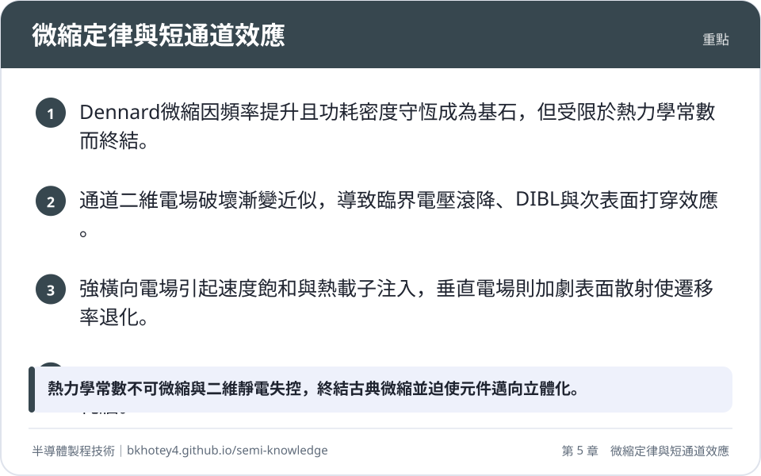
<figcaption>重點圖卡：微縮定律與短通道效應</figcaption>
</figure>

<figure markdown>
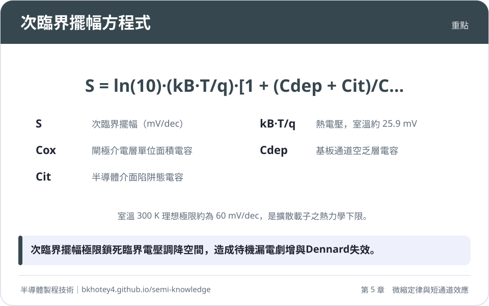
<figcaption>重點圖卡：次臨界擺幅方程式</figcaption>
</figure>

<figure markdown>
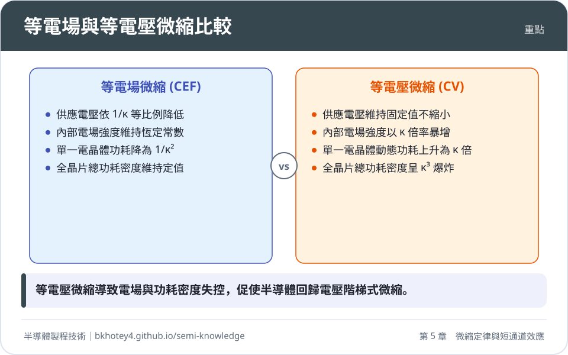
<figcaption>重點圖卡：等電場與等電壓微縮比較</figcaption>
</figure>

<figure markdown>
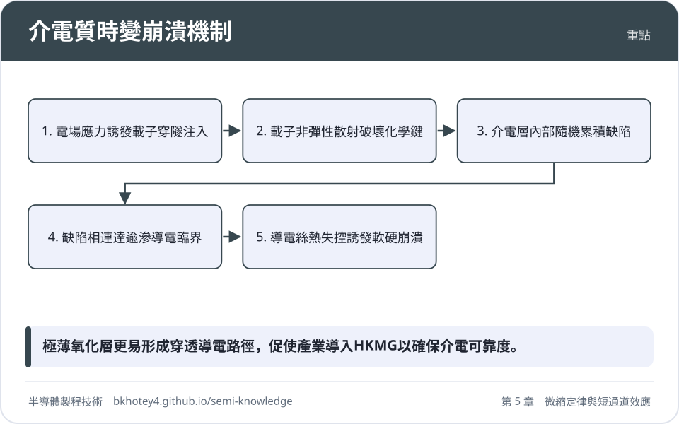
<figcaption>重點圖卡：介電質時變崩潰機制</figcaption>
</figure>

</div>

## 習題

**1.** 考慮一個依照 Dennard 等電場微縮法則（Constant-Electric-Field Scaling）設計的製程世代更替，其微縮因子設定為 $\kappa = \sqrt{2} \approx 1.414$。
(1) 請推導並計算微縮後單一電晶體佔用面積 $A'$、閘極總電容 $C_g'$ 以及理想長通道飽和驅動電流 $I_{on}'$ 相對於微縮前數值的倍率。
(2) 若晶片維持原有總面積不變，請證明其總體動態功耗在微縮後保持定值。

??? success "參考解答"
    **(1)**
    根據 Dennard 等電場微縮定義：
    幾何長度與寬度微縮為：$L' = L/\kappa$，$W' = W/\kappa$。
    
    * 單一電晶體面積：
      $$A' = W' \times L' = \left(\frac{W}{\kappa}\right) \left(\frac{L}{\kappa}\right) = \frac{A}{\kappa^2} = \frac{A}{2} = 0.5 A$$
      因此面積縮減為原本的 $0.5$ 倍（或 $1/\kappa^2$ 倍）。
    * 閘極單位面積電容 $C_{ox}' = \frac{\varepsilon_{ox}}{t_{ox}/\kappa} = \kappa C_{ox}$。
      閘極總電容：
      $$C_g' = W' L' C_{ox}' = \left(\frac{W}{\kappa}\right) \left(\frac{L}{\kappa}\right) (\kappa C_{ox}) = \frac{C_g}{\kappa} = \frac{C_g}{1.414} \approx 0.707 C_g$$
      因此閘極總電容縮減為原本的 $0.707$ 倍（或 $1/\kappa$ 倍）。
    * 理想長通道飽和電流：
      $$I_{on} = \frac{1}{2} \mu C_{ox} \frac{W}{L} (V_{GS} - V_{th})^2$$
      由於電壓同步微縮為 $(V_{GS}' - V_{th}') = (V_{GS} - V_{th}) / \kappa$，遷移率 $\mu$ 假設為常數：
      $$I_{on}' = \frac{1}{2} \mu (\kappa C_{ox}) \left(\frac{W/\kappa}{L/\kappa}\right) \left(\frac{V_{GS} - V_{th}}{\kappa}\right)^2 = \frac{I_{on}}{\kappa} \approx 0.707 I_{on}$$
      因此飽和驅動電流縮減為原本的 $0.707$ 倍（或 $1/\kappa$ 倍）。

    **(2)**
    單一電晶體的動態功耗為 $P = C_g V_{DD}^2 f$。
    其中開關延遲 $\tau = C_g V_{DD} / I_{on}$，微縮後：
    $$\tau' = \frac{(C_g/\kappa)(V_{DD}/\kappa)}{(I_{on}/\kappa)} = \frac{\tau}{\kappa} \implies f' = \kappa f$$
    故微縮後單一元件動態功耗為：
    $$P' = C_g' (V_{DD}')^2 f' = \left(\frac{C_g}{\kappa}\right) \left(\frac{V_{DD}}{\kappa}\right)^2 (\kappa f) = \frac{P}{\kappa^2}$$
    若晶片總面積維持為 $A_{chip}$ 不變，則容納之電晶體總數量 $N$ 隨密度提升為：
    $$N' = N \cdot \kappa^2$$
    因此，全晶片總體動態功耗 $P_{total}'$ 為：
    $$P_{total}' = N' \times P' = (N \kappa^2) \times \left(\frac{P}{\kappa^2}\right) = N \times P = P_{total}$$
    得證全晶片總體動態功耗維持定值（功耗密度維持恆定）。

**2.** 某長通道 MOSFET 操作於室溫環境（$T = 300\text{ K}$，此時熱電壓 $k_B T / q \approx 25.86\text{ mV}$）。經量測其介面態密度極低（$C_{it} \approx 0$），閘極氧化層單位面積電容為 $C_{ox} = 1.73\ \mu\text{F/cm}^2$，通道空乏層單位面積電容為 $C_{dep} = 0.35\ \mu\text{F/cm}^2$。
(1) 計算該元件的次臨界擺幅（Subthreshold Swing, $S$）。
(2) 若數位邏輯電路要求關斷狀態（$V_{GS} = 0\text{ V}$）下的漏電流比臨界電壓處的特徵電流（$I_D(V_{th})$）至少低 $5$ 個數量級（即 $I_D(V_{th})/I_{off} \ge 10^5$），試計算此元件所需設定之最低臨界電壓 $V_{th}$ 數值。
(3) 若因短通道效應造成靜電控制惡化，使次臨界擺幅增加至 $S = 95\text{ mV/decade}$，在維持原最低臨界電壓不變的條件下，關態漏電流 $I_{off}$ 將擴大為原本的多少倍？

??? success "參考解答"
    **(1)**
    次臨界擺幅公式為：
    $$S = \ln(10) \cdot \frac{k_B T}{q} \left(1 + \frac{C_{dep} + C_{it}}{C_{ox}}\right)$$
    在 $T = 300\text{ K}$ 時，$\ln(10) \frac{k_B T}{q} \approx 2.3026 \times 25.86\text{ mV} \approx 59.55\text{ mV/decade}$。
    代入電容值：
    $$1 + \frac{C_{dep}}{C_{ox}} = 1 + \frac{0.35}{1.73} \approx 1 + 0.2023 = 1.2023$$
    $$S = 59.55\text{ mV/decade} \times 1.2023 \approx 71.60\text{ mV/decade}$$

    **(2)**
    次臨界區汲極電流與閘極電壓之關係為：
    $$\log_{10}\left(\frac{I_D(V_{th})}{I_{off}}\right) = \frac{V_{th} - 0}{S}$$
    要求電流下降 $5$ 個數量級，即：
    $$5 = \frac{V_{th}}{S} \implies V_{th} = 5 \times S = 5 \times 71.60\text{ mV} = 358\text{ mV} = 0.358\text{ V}$$

    **(3)**
    在固定 $V_{th} = 358\text{ mV}$ 條件下，次臨界擺幅劣化至 $S_2 = 95\text{ mV/decade}$：
    新關態漏電滿足：
    $$\log_{10}\left(\frac{I_D(V_{th})}{I_{off,2}}\right) = \frac{V_{th}}{S_2} = \frac{358\text{ mV}}{95\text{ mV/decade}} \approx 3.768$$
    因此：
    $$\frac{I_D(V_{th})}{I_{off,2}} = 10^{3.768} \implies I_{off,2} = I_D(V_{th}) \times 10^{-3.768}$$
    而原本的漏電為 $I_{off,1} = I_D(V_{th}) \times 10^{-5}$。
    兩者比值為：
    $$\frac{I_{off,2}}{I_{off,1}} = \frac{10^{-3.768}}{10^{-5}} = 10^{5 - 3.768} = 10^{1.232} \approx 17.06$$
    關態漏電流將大幅暴增為原本的約 $17.1$ 倍。

**3.** 為了抑制超薄介電層的量子直接穿隧漏電流，先進製程採用高介電常數材料堆疊結構。某高介電常數閘極介電層由兩層薄膜構成：底層為熱成長之 $\text{SiO}_2$ 界面層（物理厚度 $t_1 = 0.6\text{ nm}$，相對介電常數 $\kappa_1 = 3.9$），頂層為原子層沉積之 $\text{HfO}_2$ 薄膜（物理厚度 $t_2 = 2.4\text{ nm}$，相對介電常數 $\kappa_2 = 23.4$）。
(1) 計算該雙層介電質之總等效氧化層厚度（EOT）。
(2) 若欲達成相同之 EOT，若完全使用純 $\text{SiO}_2$ 薄膜，其物理厚度應為多少？從微觀穿隧物理觀點，解釋為何前述堆疊結構在相同靜電控制能力下，能將直接穿隧漏電流大幅降低數個數量級。

??? success "參考解答"
    **(1)**
    等效氧化層厚度（EOT）為各串聯介電層轉換為純 $\text{SiO}_2$ 厚度後的線性總和：
    $$\text{EOT} = \sum_{i} t_i \left(\frac{\kappa_{\text{SiO}_2}}{\kappa_i}\right)$$
    其中 $\kappa_{\text{SiO}_2} = 3.9$。
    
    * 底層 $\text{SiO}_2$ 之貢獻：
      $$\text{EOT}_1 = 0.6\text{ nm} \times \left(\frac{3.9}{3.9}\right) = 0.6\text{ nm}$$
    * 頂層 $\text{HfO}_2$ 之貢獻：
      $$\text{EOT}_2 = 2.4\text{ nm} \times \left(\frac{3.9}{23.4}\right) = 2.4\text{ nm} \times \frac{1}{6} = 0.4\text{ nm}$$
    
    總等效氧化層厚度為：
    $$\text{EOT} = \text{EOT}_1 + \text{EOT}_2 = 0.6\text{ nm} + 0.4\text{ nm} = 1.0\text{ nm}$$

    **(2)**
    若完全使用純 $\text{SiO}_2$，所需之物理厚度即為 $\text{EOT} = 1.0\text{ nm}$。
    
    *漏電流抑制機制說明*：
    根據 WKB 近似，直接穿隧機率與穿隧物理厚度呈負指數相依關係：
    $$J_{DT} \propto \exp\left( - \frac{2 \sqrt{2 m^* \Phi_B}}{\hbar} \, t_{phys} \right)$$
    在純 $\text{SiO}_2$ 方案中，物理厚度僅有 $t_{phys} = 1.0\text{ nm}$，波函數穿透率極高，穿隧漏電流處於完全發散狀態；
    而在高介電常數堆疊方案中，總物理厚度達到：
    $$t_{phys} = t_1 + t_2 = 0.6\text{ nm} + 2.4\text{ nm} = 3.0\text{ nm}$$
    電子穿透位能障壁所需跨越的空間距離由 $1.0\text{ nm}$ 劇增至 $3.0\text{ nm}$，使得穿隧波函數在空間上發生極大幅度的指數衰減。因此，在提供相同單位閘極電容（維持等效靜電調控）的物理條件下，高介電常數材料能將直接穿隧電流壓抑達數個數量級。

**4.** 解釋汲極引致能障降低（DIBL）與次表面打穿（Punch-Through）的物理機制差異，並說明半導體製程中如何利用「暈狀佈植」（Halo/Pocket Implantation）與「逆行井」（Retrograde Well）分別緩解這兩項短通道失效。

??? success "參考解答"
    **(1) 物理機制差異**：
    * **汲極引致能障降低（DIBL）**：
      主導路徑位於半導體表面反轉層通道。當通道長度極短時，高汲極偏壓之二維電場線穿透通道侵入源極接面邊緣，直接拉低了原本由閘極控制之源極端注入能障（$\Delta \phi_B$），使得熱載子越過能障的擴散電流大幅增加，巨觀表現為臨界電壓 $V_{th}$ 隨 $V_{DS}$ 上升而向左偏移。
    * **次表面打穿（Punch-Through）**：
      主導路徑位於遠離閘極氧化層之次表面深層區域（Bulk 區域）。由於閘極電場隨深度指數衰減，汲極逆偏壓空乏區在深層區域橫向劇烈擴展，並直接與源極接面的深層空乏區實體相銜接合併，形成一條完全避開表面閘極靜電控制的深層導電路徑，導致次臨界漏電發散且電晶體失去關閉能力。

    **(2) 製程緩解技術之對應作用**：
    * **暈狀佈植（Halo / Pocket Implantation）緩解 DIBL 與臨界電壓滾降**：
      在源極與汲極延伸區末端的接面邊界處，以傾角離子佈植植入與基板井區相同型態之局部高濃度雜質（nMOS 植入硼）。在接面局部建立一道階梯位能障壁，阻絕汲極橫向電力線穿透至源極，抵消幾何電荷共享效應。當通道微縮至兩端 Halo 區域重疊時，通道等效摻雜被動提高，有效壓制能障降低現象。
    * **逆行井（Retrograde Well）緩解打穿效應**：
      透過高能離子佈植，在次表面深處（接面深度 $x_j$ 之下）形成一個峰值雜質濃度區域，而在表面維持相對較低的摻雜以維持載子遷移率。次表面深處的高雜質濃度能極大化壓縮深層接面空乏區寬度（$W_{dep} \propto 1/\sqrt{N_A}$），阻止源極與汲極之深層空乏區在縱深處發生空間重疊，從而根除打穿路徑。

**5.** 在短通道 MOSFET 中，考慮強橫向電場引發之速度飽和（Velocity Saturation）現象。
(1) 寫出在完全速度飽和極限下之短通道飽和汲極電流公式 $I_{D,sat,short}$，並對比長通道平方律公式，說明驅動電流對過驅電壓（$V_{GS} - V_{th}$）之相依性變化。
(2) 推導完全速度飽和下之跨導（$g_m$）表示式，並分析為何在速度飽和主導的次微米邏輯元件中，難以藉由拉高閘極電壓來獲得更高的放大效能。

??? success "參考解答"
    **(1)**
    長通道飽和汲極電流遵循二次方定律：
    $$I_{D,sat,long} = \frac{1}{2} \mu_{eff} C_{ox} \frac{W}{L} (V_{GS} - V_{th})^2$$
    在此條件下，電流對過驅電壓 $(V_{GS} - V_{th})$ 呈**二次方（Square Law）相依**。
    
    在短通道元件中，載子在達到夾斷點之前即在強電場下達到極限漂移速度 $v_{sat}$。在完全速度飽和極限下，通道末端的反轉層電荷密度為 $Q_{inv} = C_{ox}(V_{GS} - V_{th})$，飽和汲極電流改寫為：
    $$I_{D,sat,short} = W \cdot Q_{inv} \cdot v_{sat} = W C_{ox} v_{sat} (V_{GS} - V_{th})$$
    電流對過驅電壓由長通道的二次方相依驟降為**一次方線性相依（Linear Dependence）**。這使得加大閘極電壓所換取的驅動電流增幅顯著趨緩。

    **(2)**
    根據跨導定義：
    $$g_m = \frac{\partial I_{D,sat}}{\partial V_{GS}}$$
    將完全速度飽和電流微分可得：
    $$g_m = \frac{\partial}{\partial V_{GS}} \left[ W C_{ox} v_{sat} (V_{GS} - V_{th}) \right] = W C_{ox} v_{sat}$$
    
    *分析結論*：
    在速度飽和主導的短通道元件中，跨導 $g_m$ 與過驅電壓 $(V_{GS} - V_{th})$ 及通道長度 $L$ 徹底脫鉤，趨於一個由材料物理飽和速度 $v_{sat}$ 與閘極電容決定之常數上限值。因此，透過提高電源電壓或加大閘極過驅偏壓，跨導均無法進一步提高，導致類比/高頻放大電路之電壓增益（$A_v \propto g_m$）受到強烈的物理飽和箝制。

---

## 本章術語

- **摩爾定律（Moore's Law）**：由高登·摩爾提出之半導體產業經驗法則，指在最經濟的製造成本下，單一積體電路晶片所容納之電晶體數量約每 18 至 24 個月翻倍。
- **等電場微縮（Constant-Electric-Field Scaling, CEF）**：登納德提出之元件微縮法則，要求幾何尺寸與工作電壓以相同比例調降，以維持元件內部電場強度與功耗密度為定值。
- **等電壓微縮（Constant-Voltage Scaling, CV）**：僅微縮幾何尺寸而固定電源電壓不變的微縮方式，會導致內部電場急遽增強並使功耗密度呈三次方形勢爆炸。
- **短通道效應（Short-Channel Effects, SCE）**：當 MOSFET 通道長度微縮至與空乏區寬度相近時，因源汲極二維電力線侵入通道而引發之臨界電壓滾降、能障降低與漏電增加等物理異常。
- **漸變通道近似（Gradual Channel Approximation, GCA）**：長通道 MOSFET 的一維分析假設，視橫向通道電場梯度遠小於垂直閘極電場梯度而忽略橫向二維靜電耦合。
- **微縮長度 / 自然長度（Scaling Length / Natural Length, $\lambda$）**：表徵閘極對通道靜電控制能力與源汲極電場屏蔽程度的特徵物理長度，決定短通道效應的物理邊界。
- **臨界電壓滾降（$V_{\text{th}}$ Roll-off）**：在短通道元件中，臨界電壓隨閘極長度縮減而單調下跌的現象，主要由邊界電荷共享所引起。
- **電荷共享模型（Charge-Sharing Model）**：由 Yau 提出的一階幾何靜電分析模型，解釋源極與汲極接面內建電位分擔了部分通道空乏電荷，造成閘極所需反轉電荷與臨界電壓降低。
- **汲極引致能障降低（Drain-Induced Barrier Lowering, DIBL）**：高汲極偏壓電力線直接穿透通道壓低源極注入位能障壁，導致臨界電壓隨汲極偏壓上升而進一步下降的二維靜電現象。
- **打穿效應（Punch-Through）**：因通道過短或汲極電壓過高，源極與汲極在次表面深層的空乏區直接物理重疊合併，導致空間電荷限制漏電流失控導通。
- **超淺接面（Ultra-Shallow Junction, USJ）**：將源汲極延伸區深度壓縮至數十奈米以下的製程技術，用以減小汲極橫向靜電耦合截面積並抑制短通道效應。
- **逆行井（Retrograde Well）**：表面摻雜較低而在次表面深處具有高雜質濃度峰值的井區結構，用以抑制次表面空乏區橫向擴展並防止打穿。
- **暈狀佈植 / 口袋狀佈植（Halo Implantation / Pocket Implantation）**：在源


## 互動學習

<div class="quiz" data-quiz="01-05"></div>


## 產業最新進展

本節由每日產業新聞自動補充，說明本章技術在產業上的最新發展。

<!-- updates -->
（目前尚無補充。）
