# 第 6 章　從平面電晶體到 FinFET 與 GAAFET

<figure markdown>
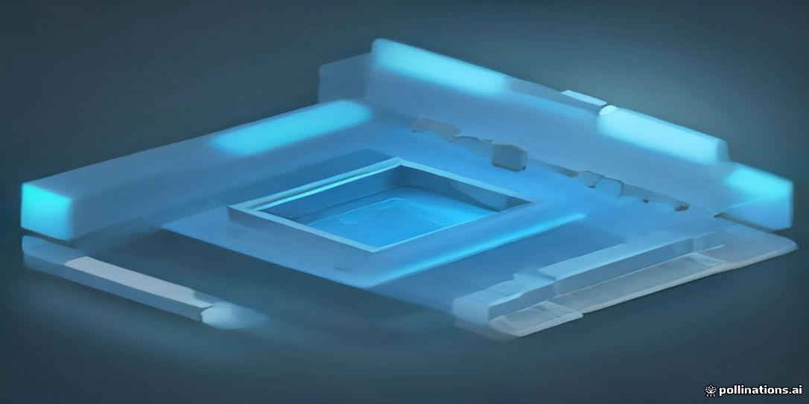
<figcaption>示意插畫：由 AI 生成，用來幫助記憶本章主題，細節請以內文與結構圖為準。</figcaption>
</figure>

!!! abstract "學習目標"
    - 理解平面 MOSFET 微縮至 20 奈米以下時面臨的靜電控制極限與漏電物理機制
    - 掌握 FinFET 之三維通道結構、靜電控制方程式及其驅動電流離散化帶來的設計限制
    - 深入分析 GAAFET 奈米片架構之全環繞閘極特性、有效通道寬度調整機制與相較於 FinFET 的優勢
    - 探討 CFET 垂直互補堆疊結構及次奈米世代前瞻元件架構的演進趨勢

## 6.1 平面金氧半場效電晶體的微縮瓶頸

### 靜電控制力衰減與天然長度標度

在平面金氧半場效電晶體（Planar MOSFET）微縮的過程中，維持閘極（Gate）對通道導電反轉層的靜電控制能力，是抑制漏電流與維持元件開關特性的核心物理要求。如第 5 章所述，當通道長度 $L_g$ 微縮至與空乏區寬度可比擬時，元件將展現嚴重的短通道效應（Short-Channel Effects, SCE）。

平面結構的幾何特徵為：閘極僅位於通道正上方，通道底部則為半無限大的半導體基板（Bulk substrate）。從二維帕松方程式（Poisson's equation）出發，通道內部的靜電位分布取決於閘極電容與基板空乏電容、汲極接面電容之間的邊界條件競爭。在準二維分析模型中，靜電控制能力的衰減程度可透過特徵「天然長度標度」（Natural Length Scale, 記為 $\lambda_1$）量化：

$$\lambda_1 = \sqrt{\frac{\varepsilon_{\text{si}}}{\varepsilon_{\text{ox}}} t_{\text{ox}} x_j}$$

其中，$\varepsilon_{\text{si}}$ 與 $\varepsilon_{\text{ox}}$ 分別為矽基板與閘極介電層的介電常數（Dielectric constant），$t_{\text{ox}}$ 為閘極氧化層之等效厚度，$x_j$ 為源極／汲極（Source/Drain）接面深度（Junction depth）。

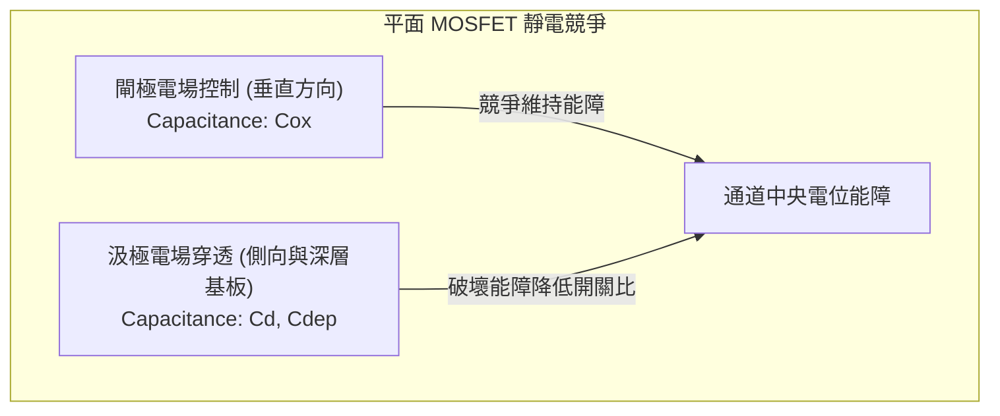

為確保閘極電場主導通道電位，避免汲極電場穿透至源極端，通道長度通常必須滿足經驗準則 $L_g \ge 3\lambda_1$ 至 $4\lambda_1$。當製程節點微縮至 $90\text{ nm}$ 以下時，若要縮短 $L_g$，必須同步縮減 $t_{\text{ox}}$ 與 $x_j$。然而，$t_{\text{ox}}$ 受到量子力學直接穿隧（Direct Tunneling）的限制，在傳統二氧化矽（$\text{SiO}_2$）薄於 $1.2\text{ nm}$ 時，閘極漏電流即急遽攀升（雖然後續導入高介電常數金屬閘極 High-$k$ Metal Gate, HKMG，短暫緩解了物理厚度微縮的極限）；同時，過淺的接面深度 $x_j$ 會導致極為嚴重的源極／汲極寄生電阻（Parasitic series resistance）。當幾何參數無法按比例等量縮減時，平面架構的 $\lambda_1$ 難以進一步微縮，導致閘極對通道中央與深層區域的靜電掌控能力全面潰散。

---

### 次臨界擺幅與汲極引發能障降低的物理極限

閘極靜電控制力衰減最直接的電性表徵，即為次臨界擺幅（Subthreshold Swing, $SS$）之劣化與汲極引發能障降低（Drain-Induced Barrier Lowering, DIBL）之加劇。

#### 1. 次臨界擺幅的熱力學與電容分壓極限

次臨界擺幅定義為使汲極電流 $I_D$ 改變一個數量級（One decade）所需的閘極電壓變化量：

$$SS = \ln(10) \cdot \frac{k_B T}{q} \cdot \left( 1 + \frac{C_{\text{dep}}}{C_{\text{ox}}} \right)$$

其中，$k_B$ 為波茲曼常數，$T$ 為絕對溫度，$q$ 為基礎電荷量，$C_{\text{dep}}$ 為基板空乏層電容，$C_{\text{ox}}$ 為閘極介電層電容。在室溫（$T = 300\text{ K}$）下，熱力學極限為：

$$\ln(10) \cdot \frac{k_B T}{q} \approx 59.6\text{ mV/dec} \quad (\text{常記為 } 60\text{ mV/dec})$$

在理想長通道元件中，若 $C_{\text{ox}} \gg C_{\text{dep}}$，體積電容分壓因子 $\left(1 + \frac{C_{\text{dep}}}{C_{\text{ox}}}\right) \to 1$，$SS$ 可逼近 $60\text{ mV/dec}$。但在平面短通道電晶體中，汲極端電場開始分擔通道電荷的感應，此二維電荷共享（Charge sharing）效應引發側向電容耦合，等效電容網絡中需計入源／汲極寄生電容，導致分壓因子顯著上升。平面元件在 $32\text{ nm}$ 節點附近，其 $SS$ 往往劣化至 $90 \sim 110\text{ mV/dec}$，造成元件無法在低電壓下迅速關閉。

#### 2. 汲極引發能障降低（DIBL）

在長通道條件下，源極與通道間的注入能障高度僅由閘極電壓調控。然而在短通道平面元件中，汲極施加的高偏壓（$V_{DS}$）所產生的側向電力線會直接穿透至通道近源極端，下拉該處的電子靜電位能障，此現象即為 DIBL：

$$\text{DIBL} = - \frac{\Delta V_{\text{th}}}{\Delta V_{DS}} = \frac{V_{\text{th}}^{\text{low}} - V_{\text{th}}^{\text{high}}}{V_{DS}^{\text{high}} - V_{DS}^{\text{low}}}$$

典型長通道元件之 DIBL 接近 $0\text{ mV/V}$，而次微米平面電晶體之 DIBL 往往超過 $100\text{ mV/V}$。能障的降低導致關態漏電流（Off-state leakage, $I_{\text{off}}$）隨 $V_{DS}$ 呈指數型增加：

$$I_{\text{off}} \propto \exp\left(\frac{q \cdot \text{DIBL} \cdot V_{DS}}{k_B T}\right)$$

這使得晶片在待機狀態下產生巨大的靜態功耗（Static power dissipation），形成難以克服的散熱瓶頸。

---

### 高基板摻雜的兩難：遷移率退化與能帶間穿隧

在平面 bulk 架構中，為抑制深層基板的穿透效應（Punch-through）並壓縮空乏區厚度以降低 DIBL，工程上必須大幅提高通道與基板的受體（或施體）摻雜濃度 $N_A$。例如自 $0.18\ \mu\text{m}$ 節點的 $10^{17}\text{ cm}^{-3}$ 提高至 $32\text{ nm}$ 節點的 $10^{18} \sim 10^{19}\text{ cm}^{-3}$，並導入暈圈植入（Halo/Pocket Implantation）。然而，高濃度基板摻雜會直接引發嚴重的物理副作用：

| 物理機制 | 起因 | 對元件電性之影響 |
| :--- | :--- | :--- |
| **游離雜質散射** (Ionized Impurity Scattering) | 通道內部高濃度摻雜原子提供庫侖散射中心。 | 低電場載子遷移率（$\mu_0$）嚴重衰退，驅動電流（$I_{\text{on}}$）飽和。 |
| **表面粗糙度散射** (Surface Roughness Scattering) | 高基板摻雜導致反轉層垂直電場 $\mathcal{E}_{\text{eff}} > 1\text{ MV/cm}$，載子極度貼近 $\text{Si}/\text{SiO}_2$ 介面。 | 高垂直電場下，電子/電洞受到介面原子級粗糙度強烈散射，飽和速度難以發揮。 |
| **能帶間穿隧** (Band-to-Band Tunneling, BTBT) | 汲極與 Halo 植入區形成高摻雜 $P^+/N^+$ 逆向偏壓接面，能帶顯著彎折。 | 價帶電子穿隧至導帶，形成可觀的接面漏電流（$I_{\text{BTBT}}$），墊高整體靜態功耗。 |
| **隨機摻雜抖動** (Random Dopant Fluctuation, RDF) | 微縮通道中的微觀摻雜原子數少於數十顆，統計泊松分佈引發微觀濃度起伏。 | 晶圓上不同電晶體的臨界電壓產生顯著變異（$\sigma V_{\text{th}}$ 升高），限制低電壓運作裕度。 |

特別是能帶間穿隧（BTBT）漏電，其穿隧電流密度隨局部電場強度 $\mathcal{E}$ 指數上升：

$$J_{\text{BTBT}} = A \mathcal{E}^2 \exp\left( - \frac{B}{\mathcal{E}} \right)$$

其中，$A$ 與 $B$ 為矽材料之物性參數（$B \propto E_g^{3/2} m^{*1/2}$）。此漏電路徑直接發生在矽基板內部，閘極對其完全失去靜電箝制能力。高摻雜濃度雖稍微推遲了幾何短通道效應的爆發，卻引入了不可逆的載子遷移率損失與量子穿隧漏電，使平面 bulk 元件在 $20\text{ nm}$ 世代面臨微縮天花板。

!!! warning "常見誤解"
    「調高通道摻雜濃度可以無限制地提高 $V_{\text{th}}$ 並降低漏電。」  
    事實上，當摻雜濃度超過 $10^{18}\text{ cm}^{-3}$ 時，雖然次臨界區的擴散電流受到抑制，但汲極-基板接面的逆向偏壓電場大幅強化，觸發強烈的 BTBT 機制與閘極引發汲極漏電（Gate-Induced Drain Leakage, GIDL），導致總關態漏電流不減反增。

---

### 超薄通道絕緣層覆矽（UTB-SOI）架構之過渡角色及其物理限制

為跳脫基板高摻雜的死胡同，超薄通道絕緣層覆矽（Ultra-Thin Body Silicon-on-Insulator, UTB-SOI），特別是完全空乏型絕緣層覆矽（Fully Depleted SOI, FD-SOI），被提出作為平面架構的改良方案。

FD-SOI 元件在矽基板與極薄的頂層單晶矽（Channel body, 厚度 $t_{\text{si}} \lesssim 5 \sim 7\text{ nm}$）之間，夾入一層埋入式氧化層（Buried Oxide, BOX，厚度 $t_{\text{box}}$）。

```
        [ Gate (閘極) ]
───────────────────────────────  ← 閘極介電層 (tox)
  Source    Channel (tsi)   Drain
 (源極)   (超薄未摻雜矽層)   (汲極)
═══════════════════════════════  ← 埋入式氧化層 (BOX, tbox)
        Substrate (矽基板)
```

FD-SOI 具備以下物理優勢：
1. **消除深層漏電路徑**：BOX 絕緣層直接阻斷了遠離閘極的次表面穿透路徑，汲極電力線無法透過基板深處直接穿透至源極。其天然長度標度改寫為：
   $$\lambda_{\text{SOI}} \approx \sqrt{\frac{\varepsilon_{\text{si}}}{\varepsilon_{\text{ox}}} t_{\text{ox}} t_{\text{si}}}$$
   只要 $t_{\text{si}}$ 薄於 $\sim 5\text{ nm}$，即使在無摻雜或輕摻雜通道（Undoped/Lightly-doped channel）下，亦能維持優異的靜電控制能力。
2. **遷移率恢復與 RDF 消除**：由於通道無需透過高濃度雜質來抑制短通道效應，載子免於游離雜質散射，室溫遷移率顯著回升；同時，通道內近乎無雜質原子，徹底消除了隨機摻雜抖動（RDF）所引發的臨界電壓不匹配問題。

!!! example "產業實例"
    意法半導體（STMicroelectronics）與格羅方德（GlobalFoundries）曾分別推出 $28\text{ nm}$ 與 $22\text{ nm}$ FD-SOI 製程（如 22FDX），利用極薄矽薄膜與背向偏壓（Back-biasing）技術，在物聯網與超低功耗射頻領域取得了優異的能效表現。

然而，UTB-SOI 仍屬單側（或搭配背閘極的非對稱雙側）靜電控制的平面演化版，當閘極長度試圖向 $15\text{ nm}$ 以下推進時，遭遇了難以克服的物理與製造瓶頸：

1. **通道厚度量子局限效應**：當矽層厚度 $t_{\text{si}}$ 縮減至 $5\text{ nm}$ 以下時，垂直方向的幾何尺寸小於電子的狄布羅意波長（de Broglie wavelength），量子局限效應（Quantum Confinement Effect）顯著，導帶基態能量位準（Subband energy）大幅抬升：
   $$E_1 \approx \frac{\hbar^2 \pi^2}{2 m^* t_{\text{si}}^2}$$
   此時，臨界電壓對膜厚產生極端敏感性：$\frac{\partial V_{\text{th}}}{\partial t_{\text{si}}} \propto -\frac{1}{t_{\text{si}}^3}$。在晶圓製程中，哪怕僅有單一原子層（約 $0.3\text{ nm}$）的膜厚波動，都會造成晶片內部電晶體臨界電壓發生數十毫伏（$\text{mV}$）的嚴重視散，喪失良率可控制性。
2. **嚴重的外部寄生串聯電阻（$R_{\text{sd}}$）**：源極與汲極區的薄膜厚度同樣受到 $t_{\text{si}}$ 限制，極薄的半導體截面積使接觸電阻與擴展電阻（Spreading resistance）劇烈上升。儘管可透過選擇性磊晶生長（Selective Epitaxial Growth, SEG）加厚源極／汲極區域，但製程複雜度大增且寄生電容難以壓制。
3. **自發熱效應（Self-Heating Effect, SHE）**：BOX 二氧化矽層的熱導率（Thermal conductivity）約僅為 $1.4\text{ W/(m}\cdot\text{K)}$，遠低於塊狀單晶矽的約 $150\text{ W/(m}\cdot\text{K)}$。通道內載子高速運動散射產生的熱能無法迅速向下導出至基板，元件核心工作溫度飆升，導致載子遷移率再度因聲子散射（Phonon scattering）而劣化，並引發嚴重的元件可靠度（如熱載子注入 HCI、負偏壓溫度不穩定性 NBTI）問題。

單一平面閘極的拓撲結構，在靜電邊界條件上已被證明無法在 sub-15 nm 尺度下兼顧驅動電流與漏電控制。半導體微縮架構因而必須脫離二維平面的範疇，全面轉向立體三維多閘極（Multi-gate）結構——即本章後續將深入探討的 FinFET 與 GAAFET。

## 6.2 三維通道結構：FinFET 的原理與靜電優勢

### FinFET 架構與靜電控制原理

當平面金氧半場效電晶體（Planar MOSFET）的閘極長度（Gate Length, $L_{\text{g}}$）縮減至 20 nm 以下時，汲極電場會穿透至通道深處，引發嚴重的汲極誘發能障降低（Drain-Induced Barrier Lowering, DIBL）與次臨界漏電（見第 5 章）。為了解決閘極對通道控制力不足的問題，加州大學柏克萊分校胡正明（Chenming Hu）教授團隊於 1999 年提出了鰭式場效電晶體（Fin Field-Effect Transistor, FinFET）。

FinFET 將原本平鋪於基板上的二維導電通道旋轉 90 度，豎立為立體薄片狀的半導體「鰭片」（Fin）。閘極電極與閘極介電層從兩個或三個維度包覆鰭片，形成雙閘極（Double-Gate, DG）或三閘極（Tri-Gate）控制架構。

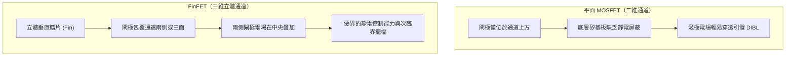

在雙閘極 FinFET 中，鰭片頂部覆蓋硬遮罩（Hard Mask, 如 $\text{Si}_3\text{N}_4$ 或 $\text{SiO}_2$），閘極僅由鰭片兩側進行電場調控；而在三閘極 FinFET 中，閘極介電層與金屬閘極直接包覆鰭片的頂部及左右兩側側面，三個面向皆能感應出反轉層（Inversion Layer）。

三維包覆架構帶來了兩項決定性的物理優勢：

1. **電場重疊與勢壘封閉**：兩側閘極的電力線在超薄鰭片內部疊加，將通道內部的靜電位完全箝制（Pinning），大幅阻斷汲極電力線由基板深處繞道入侵通道的途徑。
2. **免除高濃度通道摻雜**：在平面電晶體中，為了抑制短通道效應，必須對通道重度摻雜（如大於 $10^{18}\ \text{cm}^{-3}$），這會導致嚴重的游離雜質散射（Impurity Scattering）並降低載子移動率，同時引發隨機摻雜擾動（Random Dopant Fluctuation, RDF）。FinFET 仰賴多閘極的立體幾何形狀提供靜電控制，通道可採用未摻雜（Undoped）或輕摻雜的本質矽（Intrinsic Silicon），在維持極低關態漏電的同時，顯著提升載子移動率與閾值電壓（Threshold Voltage, $V_{\text{th}}$）的均勻度。

---

### 特徵長度與幾何微縮模型

評估多閘極電晶體抵抗短通道效應能力的指標為特徵長度（Natural Length，通常以 $\lambda$ 表示）。特徵長度物理意義為：汲極電勢向通道內部滲透的衰減長度常數。通道表面電位 $\phi(x)$ 在長度方向上近似滿足一維包絡波動方程式：

$$\frac{d^2 \phi(x)}{dx^2} - \frac{\phi(x) - V_{\text{GS}} + V_{\text{bi}}}{\lambda^2} = 0$$

其中 $x$ 為沿通道長度方向的座標，$V_{\text{GS}}$ 為閘源極電壓，$V_{\text{bi}}$ 為內建電位。根據經驗與解析模型，若要有效抑制短通道效應與次臨界擺幅（Subthreshold Swing, $S$）劣化，閘極長度必須滿足：

$$L_{\text{g}} \ge c \cdot \lambda \quad (c \approx 3 \sim 4)$$

對於對稱型雙閘極 FinFET，忽略角落效應的一維簡化微縮模型可推導出特徵長度 $\lambda_{\text{DG}}$：

$$\lambda_{\text{DG}} = \sqrt{\frac{\varepsilon_{\text{si}}}{2\varepsilon_{\text{ox}}} t_{\text{ox}} W_{\text{fin}}}$$

其中：
- $\varepsilon_{\text{si}}$ 為矽通道的介電常數（典型值約為 $11.7 \varepsilon_0$）。
- $\varepsilon_{\text{ox}}$ 為閘極氧化層的介電常數。
- $t_{\text{ox}}$ 為閘極介電層的等效氧化層厚度（Equivalent Oxide Thickness, EOT）。
- $W_{\text{fin}}$ 為鰭片的物理寬度。

若考慮實際常見的三閘極 FinFET（具備高度 $H_{\text{fin}}$ 與寬度 $W_{\text{fin}}$），特徵長度的二維解析近似式可表述為：

$$\lambda_{\text{TG}} = \sqrt{\frac{\varepsilon_{\text{si}}}{2\varepsilon_{\text{ox}}} t_{\text{ox}} W_{\text{fin}} \cdot \frac{1}{1 + \frac{W_{\text{fin}}}{2 H_{\text{fin}}}}}$$

下表分析各幾何參數對靜電特性的影響：

| 幾何參數 | 物理意義 | 對微縮（$L_{\text{g}} \downarrow$）之要求 | 限制與設計權衡 |
| :--- | :--- | :--- | :--- |
| **鰭片寬度 $W_{\text{fin}}$** | 左右兩側反轉層間的距離 | 必須極小化（通常要求 $W_{\text{fin}} \le \frac{1}{2} L_{\text{g}}$ 至 $\frac{2}{3} L_{\text{g}}$） | 過窄會導致量子局限效應使能隙變大，且大幅增加蝕刻製程變異 |
| **鰭片高度 $H_{\text{fin}}$** | 垂直方向的通道高度 | 增大 $H_{\text{fin}}$ 可增加單一鰭片的驅動電流 | 提升深寬比會引發鰭片傾倒、圖案轉移缺陷與應力崩塌 |
| **等效氧化層厚度 $t_{\text{ox}}$** | 閘極電容等效厚度 | 縮小以增強單位面積閘極電容 $C_{\text{ox}}$ | 受限於量子力學直接穿隧效應漏電，需導入高介電常數材料（High-$k$） |

由上述關係式可知，縮減 $W_{\text{fin}}$ 是壓低 $\lambda$、維持閘極對通道絕對主導權的關鍵物理手段。

!!! note "高階效應：超窄鰭片中的量子局限"
    當 $W_{\text{fin}}$ 微縮至 5 nm 以下時，通道幾何尺寸已接近電子之德布羅意波長（De Broglie Wavelength），矽的導帶底能階會因子能帶分裂（Sub-band Splitting）而上升。這會使材料的有效能隙（Effective Bandgap）增加，導致閾值電壓 $V_{\text{th}}$ 隨鰭片寬度劇烈漂移，對先進微影與蝕刻製程的關鍵尺寸（Critical Dimension, CD）控制提出極端嚴苛的要求。

---

### 有效通道寬度與鰭片量化效應

平面 MOSFET 的導通電流大小，可藉由在布局（Layout）中自由調整通道寬度 $W$ 連續微調。然而在 FinFET 中，通道是由立體鰭片構成，其幾何導通面積不再是平面維度。

對於頂部具有導電反轉層的三閘極 FinFET，單一鰭片所提供的有效通道寬度（Effective Channel Width, $W_{\text{eff, single}}$）由頂面寬度與兩側垂直壁高度總和決定：

$$W_{\text{eff, single}} = 2 H_{\text{fin}} + W_{\text{fin}}$$

若為頂部採用硬遮罩絕緣的雙閘極 FinFET，則頂面不形成導電通道：

$$W_{\text{eff, single}} = 2 H_{\text{fin}}$$

為了提供電路設計所需的總驅動電流，必須在同一個元件節點並聯多根物理鰭片。若一個電晶體由 $N$ 根並聯鰭片組成，其總有效通道寬度為：

$$W_{\text{eff, total}} = N \times W_{\text{eff, single}} \quad (N \in \mathbb{N}^+)$$

此物理現象稱為**鰭片量化效應（Fin Quantization Effect）**。

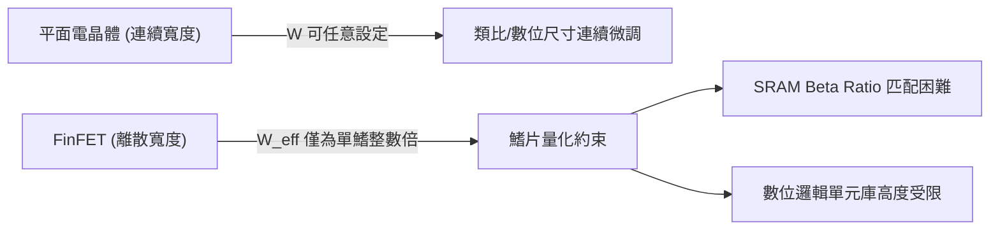

鰭片量化對積體電路設計帶來了顯著的約束：
- **驅動能力離散化**：設計者無法任意將電晶體設計為 $1.5 \times W_{\text{eff}}$。若要增強驅動電流，只能選擇 $N=2$ 或 $N=3$，這往往導致驅動過剩或晶片面積（Silicon Area）的浪費。
- **SRAM 穩定性設計挑戰**：靜態隨機存取記憶體（SRAM）單元仰賴下拉電晶體（Pull-Down）、上拉電晶體（Pull-Up）與傳輸電晶體（Pass-Gate）之間的電流比例（Beta Ratio）維持讀寫容限。在無法連續微調寬度的情況下，SRAM 設計必須依賴調整通道長度或在製程中採用不同的閘極功函數（Work Function）工程來調控臨界電壓。
- **標準元件庫（Standard Cell Library）高度定規化**：標準元件的高度通常由鰭片間距（Fin Pitch）乘以固定的鰭片軌數（Track Number，如 6-Track 或 7.5-Track）所硬性限制。

---

### 高深寬比鰭片的物理挑戰

為了在受限的晶片投影面積下榨取更高的驅動電流（$I_{\text{on}} \propto W_{\text{eff}}$），半導體製程逐步將鰭片推向**高深寬比（High Aspect Ratio, $\text{AR} = H_{\text{fin}} / W_{\text{fin}}$）**，在先進節點中深寬比普遍超過 5:1 甚至達到 10:1。此極限結構引發了嚴重的物理次生效應。

#### 1. 自熱效應（Self-Heating Effect, SHE）

在立體架構中，通道產生的高熱能難以消散，此現象稱為自熱效應。其根本物理機制包含：

- **熱傳導路徑受限**：矽的塊材熱導率（Thermal Conductivity）在室溫下約為 $148\ \text{W/(m}\cdot\text{K)}$，而周圍包覆的淺溝槽隔離（Shallow Trench Isolation, STI）二氧化矽熱導率僅約 $1.4\ \text{W/(m}\cdot\text{K)}$。細長立體的鰭片如同一根插入絕緣體中的發熱絲，產生的焦耳熱（Joule Heating）主要只能沿著極窄的垂直鰭片向下傳導至基板。
- **聲子邊界散射（Phonon Boundary Scattering）**：當鰭片寬度小於聲子的平均自由程（Mean Free Path，矽中約為數十奈米）時，晶格振動（聲子）在鰭片側壁發生劇烈散射，導致超薄鰭片的有效熱導率較塊材矽大幅衰減數倍。

自熱效應導致元件工作時局部通道溫度（Junction Temperature）顯著升高數十度，進一步引起載子聲子散射加劇、遷移率下降，並大幅加速負偏壓溫度不穩定性（Negative Bias Temperature Instability, NBTI）與熱載子注入（Hot Carrier Injection, HCI）等元件老化機制。

#### 2. 寄生阻抗挑戰

隨著鰭片尺寸極端微縮，非通道區的寄生電阻與電容逐漸成為箝制元件高頻與開關速度的主要瓶頸：

- **寄生電阻（Parasitic Resistance, $R_{\text{ext}}$）**：源極與汲極延伸區的截面積隨鰭片微縮而急遽縮小。由電阻公式：
  $$R = \rho \frac{L}{A}$$
  截面積 $A$（約為 $W_{\text{fin}} \times H_{\text{fin}}$）大幅下降使擴散電阻激增。此外，金屬矽化物（Silicide）與極窄鰭片頂部及側壁接觸時，接觸面積有限導致接觸電阻（Contact Resistance, $R_{\text{c}}$）急遽上升。為緩解此效應，先進製程必須在源極/汲極區導入升高的嵌入式異質磊晶（Raised Embedded SiGe 或 Si:C，見第 9 章），以擴大金屬接觸截面積並同時施加通道應變。
- **寄生電容（Parasitic Capacitance）**：密集排列的高深寬比鰭片，使閘極金屬與相鄰源極/汲極接觸插塞（Contact Plug）之間的邊緣電容（Fringe Capacitance, $C_{\text{fr}}$）與重疊電容（Overlap Capacitance, $C_{\text{ov}}$）急遽擴大，大幅抵消了立體通道帶來的導通電流增益，限制了邏輯閘的電路延遲性能（RC Delay）。

!!! example "產業實例：從三維鰭片到極限微縮的轉折"
    英特爾（Intel）於 2011 年在 22 nm 節點（Ivy Bridge 架構）首度導入三閘極 FinFET，台積電（TSMC）與三星電子（Samsung Electronics）則於 16/14 nm 節點全面跟進。FinFET 架構成功將摩爾定律延續了超過五個技術世代。然而，當製程微縮至 3 nm 以下時，鰭片寬度已縮減至 4 nm 左右的工程極限，鰭片深寬比過高造成物理支撐力不足；同時兩鰭片間距過窄使得閘極金屬材料難以在鰭片間隙均勻填入，促使產業轉向全環繞閘極（Gate-All-Around）架構（見第 6.3 節）。

<!-- fig:1 -->
<figure markdown>
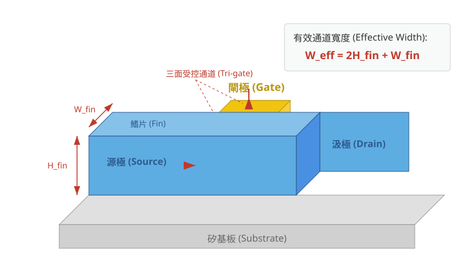
<figcaption>圖 6-1　FinFET 結構示意圖（AI 繪製的示意圖）</figcaption>
</figure>

## 6.3 全環繞閘極電晶體（GAAFET）與奈米片架構

### 6.3.1 FinFET 的微縮瓶頸與演進動力

在第 6.2 節中，三維鰭式場效電晶體（FinFET）藉由三面覆蓋通道的架構，有效克服了平面金氧半場效電晶體（MOSFET）嚴重的短通道效應（Short-Channel Effects, SCE）。然而，當製程節點微縮至 3 奈米（3 nm）甚至更先進的尺度時，FinFET 的幾何結構開始面臨物理與製造上的雙重極限。

```
FinFET（三面控制）               GAAFET 奈米片（四面全環繞）
      [閘極 Gate]                       [閘極 Gate]
     +-----------+                     +-----------+
     |   通道    |                     |   通道 1  |
     | (通道鰭片) |                     +-----------+
[閘] | Channel   | [閘]                [   閘極    ]
[極] |    Fin    | [極]                +-----------+
     |           |                     |   通道 2  |
-----+-----------+-----                +-----------+
      基板/氧化層                       [   閘極    ]
```

首先，為在極小的覆蓋區（Footprint）內提供足夠的驅動電流，FinFET 必須提高鰭片高度（$H_{\text{fin}}$）並縮小鰭片寬度（$W_{\text{fin}}$），導致鰭片深寬比（Aspect Ratio）急遽增加。當深寬比過高時，高介電常數金屬閘極（HKMG）於緊密排列的相鄰鰭片間進行沉積變得極度困難，容易產生孔洞（Voids），進而削弱電場控制。其次，隨著鰭片底部靠近次鰭片氧化層（Sub-fin region），閘極電場的拘束力逐漸衰減，次臨界漏電流（Subthreshold Leakage）傾向於自鰭片底部穿透，導致次臨界擺幅（Subthreshold Swing, $SS$）與汲極引致能障降低（Drain-Induced Barrier Lowering, DIBL，見第 5 章）特性惡化。

最後，FinFET 的有效通道寬度受到離散鰭片數量（Fin Count）的量子化限制。電路設計者僅能以整數倍鰭片數調整電流驅動能力（例如 1-fin、2-fin），無法針對特定時序或功耗路徑進行精細調整，限制了晶片功耗與效能最佳化的空間。

---

### 6.3.2 奈米片 GAAFET 的幾何構造與靜電學優勢

為了完全消除未受閘極控制的弱電場死角，全環繞閘極場效電晶體（Gate-All-Around FET, GAAFET）成為延續微縮的關鍵架構。目前產業主流採取的實作為「水平多層矽奈米片」（Vertically Stacked Horizontal Silicon Nanosheets）。

在奈米片 GAAFET 結構中，數層（通常為 3 至 4 層）厚度極薄（典型值約 $5 \sim 7\text{ nm}$）的單晶矽奈米片沿垂直方向平行堆疊，高介電常數閘極介電層與功函數金屬（Work Function Metal）從四個維度 360 度完全包覆每一層奈米片的周圍。

在靜電學分析中，短通道特徵長度（Natural Length, $\lambda$）是衡量閘極抵禦汲極電場穿透的關鍵物理量。對四面全環繞的矩形截面奈米片而言，其特徵長度可近似表示為：

$$\lambda_{\text{GAA}} \approx \sqrt{\frac{\epsilon_{\text{ch}}}{2\epsilon_{\text{ox}}} \left(1 + \frac{\epsilon_{\text{ox}} T_{\text{ns}}}{4\epsilon_{\text{ch}} t_{\text{ox}}}\right) T_{\text{ns}} t_{\text{ox}}}$$

其中：
- $\epsilon_{\text{ch}}$ 為通道半導體材料的介電常數（矽約為 $11.7 \epsilon_0$）
- $\epsilon_{\text{ox}}$ 為閘極介電層的有效介電常數
- $T_{\text{ns}}$ 為奈米片的物理厚度
- $t_{\text{ox}}$ 為閘極介電層的等效氧化層厚度（Equivalent Oxide Thickness, EOT）

當通道長度 $L_{\text{g}}$ 滿足 $L_{\text{g}} \ge 3\lambda$ 至 $4\lambda$ 時，短通道效應可被有效抑制。相較於 FinFET 的三面控制，GAA 結構消除了底部的邊緣場漏電路徑，使通道中央的電位完全由四面的閘極對稱鎖定。此全方位靜電拘束能力帶來顯著的電性改善：
1. **次臨界擺幅逼近理論極限**：在室溫（$T = 300\text{ K}$）下，$SS$ 可由 FinFET 後期的 $>70\text{ mV/dec}$ 壓縮至接近理想值 $60\text{ mV/dec}$（參見第 4 章公式推導）。
2. **DIBL 顯著降低**：汲極偏壓對源極能障的調變效應大幅減弱，抑制了關態漏電流（$I_{\text{off}}$）。

| 幾何與電性參數 | 平面 MOSFET | FinFET (Tri-Gate) | 奈米片 GAAFET |
| :--- | :--- | :--- | :--- |
| **閘極包覆維度** | 1 面（頂部） | 3 面（頂部及兩側） | 4 面（360度全環繞） |
| **通道寬度定義** | 平面佈局寬度 $W$ | 離散化：$N \times (2H_{\text{fin}} + W_{\text{fin}})$ | 連續可調：$N \times 2(W_{\text{ns}} + T_{\text{ns}})$ |
| **靜電控制能力** | 差（短通道效應嚴重） | 優良 | 極佳（特徵長度 $\lambda$ 最短） |
| **內部間隔壁需求** | 無 | 無 | 必需（隔離閘極與源汲極） |

---

### 6.3.3 可變奈米片寬度與電路設計彈性

奈米片 GAAFET 的關鍵工程優勢在於其有效通道寬度（Effective Channel Width, $W_{\text{eff}}$）的連續設計彈性。對於包含 $N_{\text{sheet}}$ 層奈米片的單一元件，其總有效通道寬度為：

$$W_{\text{eff}} = N_{\text{sheet}} \times \left(2W_{\text{ns}} + 2T_{\text{ns}}\right)$$

由於奈米片厚度 $T_{\text{ns}}$ 遠小於寬度 $W_{\text{ns}}$（$W_{\text{ns}} \gg T_{\text{ns}}$），驅動電流主要由水平頂面與底面的反轉層貢獻。與 FinFET 只能透過增減鰭片數量這種粗粒度調整不同，奈米片寬度 $W_{\text{ns}}$ 可在微影圖案化階段連續定義（典型值範圍介於 $15\text{ nm}$ 至 $50\text{ nm}$ 之間）。

```
        單一微影佈局面積（Footprint）
  |-------------------------------------|

  +-------------------------------------+  ---
  |              閘極 Gate              |   |
  |   +-----------------------------+   |   |
  |   |    奈米片通道 Channel       |   |  T_ns
  |   +-----------------------------+   |   |
  |              閘極 Gate              |  ---
  +-------------------------------------+
      |<----------- W_ns ---------->|
```

電路設計者可根據電路單元的效能與功耗目標進行取捨（Trade-off）：
- **寬奈米片元件（Wide Nanosheet）**：擁有較大的 $W_{\text{eff}}$，可提供高導通電流（$I_{\text{on}}$），適合用於高速運算的關鍵路徑（Critical Paths）或時脈驅動電路。
- **窄奈米片元件（Narrow Nanosheet）**：縮小元件佈局面積並降低閘極寄生電容（$C_{\text{gg}}$），大幅降低動態功耗（$P_{\text{dyn}} \propto C_{\text{gg}} V_{\text{dd}}^2 f$），特別適用於靜態隨機存取記憶體（SRAM）單元或超低功耗邏輯電路。

!!! note "通道導通取向的物理差異"
    在標準 (100) 晶圓表面上，FinFET 的主要傳導通道位於鰭片垂直側壁，其晶面為 (110)；而奈米片 GAAFET 的主要傳導通道位於水平寬表面，其晶面為 (100)。對於電子而言，(100) 晶面的有效質量較低且表面粗糙度散射較小，因此 NMOS 在奈米片架構下的電子遷移率相較於 FinFET 有實質提升；相對地，PMOS 則需仰賴額外的應變工程（Strain Engineering）補償電洞遷移率。

---

### 6.3.4 內部間隔壁（Inner Spacer）的幾何與電性權衡

在奈米片 GAAFET 製程中，於垂直方向分隔各層奈米片的閘極材料，必須在源極/汲極（S/D）磊晶成長前與 S/D 區域實體隔離，此結構即為**內部間隔壁**（Inner Spacer）。

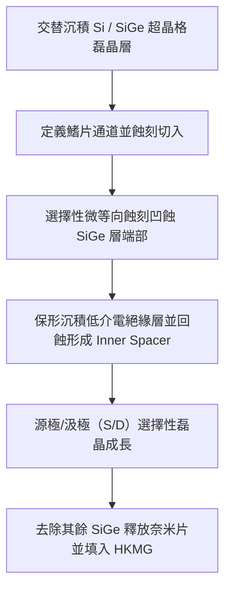

內部間隔壁具有至關重要的幾何與電氣邊界條件調控作用，其關鍵參數包含間隔壁長度（$L_{\text{sp}}$）、穿入深度與介電常數（$\kappa_{\text{sp}}$）。

```
           [閘極 Gate]
   |--- L_sp ---|
   +------------+===========================+
   | Inner      |   源極/汲極磊晶區         |
   | Spacer     |   (Source/Drain Epi)      |
   +------------+===========================+
   |   奈米片通道 (Channel Nanosheet)       |
   +----------------------------------------+
```

#### 1. 寄生電容控制
閘極與源/汲極之間的重疊寄生電容（$C_{\text{gdo}}$ 與 $C_{\text{gso}}$）主要由內部間隔壁的幾何形狀決定。平行板近似模型為：

$$C_{\text{inner}} \approx N_{\text{edges}} \cdot \epsilon_0 \kappa_{\text{sp}} \frac{T_{\text{gate\_ext}} \cdot W_{\text{ns}}}{L_{\text{sp}}}$$

其中 $T_{\text{gate\_ext}}$ 為垂直方向相鄰奈米片間的閘極厚度。若 $L_{\text{sp}}$ 過薄或採用高介電常數材料，將導致嚴重的寄生電容，增加電路延遲（$RC$ 延遲）並劣化高頻截止頻率（$f_T$）。因此，產業發展出低介電常數（Low-$\kappa$）間隔壁材料（如 SiBCN、SiOCN，$\kappa \approx 4 \sim 5$）以降低寄生耦合。

#### 2. 能障與串聯電阻權衡
內部間隔壁長度 $L_{\text{sp}}$ 直接決定了閘極邊界與源/汲極高摻雜區之間的實體位移（Offset）。
- **$L_{\text{sp}}$ 過小**：源極與汲極摻雜物（如磷或硼）在後續高溫活化退火時易擴散進入通道，造成通道有效長度縮短，引發嚴重的 DIBL 與漏電上升。
- **$L_{\text{sp}}$ 過大**：雖然短通道效應獲得良好抑制，但會形成較長的未調變延伸區（Underlap Region），導致源汲極外質串聯電阻（$R_{\text{sd}}$）急遽上升，進而大幅削弱元件的飽和導通電流：

$$I_{\text{ds,sat}} \approx \frac{g_{\text{m,int}} (V_{\text{gs}} - V_{\text{th}})}{1 + g_{\text{m,int}} R_{\text{sd}}}$$

內部間隔壁的形狀控制（如平整邊界 vs. 圓弧形凹陷邊界）與尺寸公差控制（通常需精準至亞奈米等級），是奈米片 GAAFET 元件製造中最嚴苛的模組工程之一。

!!! example "產業實例：3 奈米與 2 奈米技術節點的架構轉換"
    在先進半導體製程演進中，三星電子（Samsung Electronics）於 3 奈米節點（3GAE 製程）率先導入奈米片架構，命名為 MBCFET（Multi-Bridge Channel FET）；台積電（TSMC）則在 3 奈米節點（N3）持續沿用高度最佳化的 FinFET 架構，直至 2 奈米節點（N2）因物理間距極限全面轉向採用水平奈米片架構的 GAAFET。這項轉折代表電晶體幾何維度正式由「三面側壁控制」邁入「完全包覆靜電約束」的新世代。

<!-- fig:2 -->
<figure markdown>
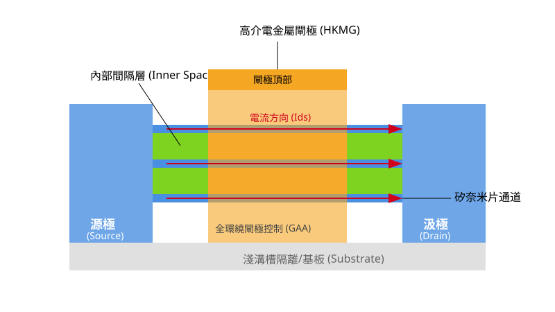
<figcaption>圖 6-2　奈米片 GAAFET 結構（AI 繪製的示意圖）</figcaption>
</figure>

## 6.4 互補型場效電晶體（CFET）與未來元件展望

### 互補型場效電晶體（CFET）之概念與微縮動機

在全環繞閘極奈米片（GAAFET Nanosheet）技術普及之後，邏輯元件的微縮再度面臨物理排列邊界。在互補式金氧半導體（CMOS）標準單元（Standard Cell）架構中，傳統作法均是將 nMOS 與 pMOS 於水平方向並排擺放（Side-by-side）。為避免兩者井區（Well）電位干擾並維持足夠的微影與蝕刻餘裕，nMOS 與 pMOS 之間必須保留物理隔離區（n-to-p separation / keep-out zone），如圖 6-12 所示。

隨著接觸閘極間距（Contacted Poly Pitch, $CPP$）與金屬間距（Metal Pitch, $MP$）持續微縮，標準單元的高度（Cell Height）已受限於此一水平間距，無法藉由單純微縮通道寬度而進一步減小。

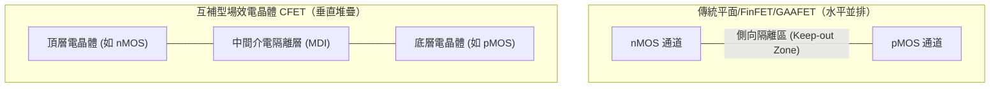

互補型場效電晶體（Complementary FET, CFET）突破了橫向排列的幾何限制，將 nMOS 與 pMOS 沿著晶圓法線方向進行三維垂直堆疊（Vertical 3D Stacking）。透過將互補對之中的一個電晶體疊置於另一個之上，橫向的 n-to-p 隔離區域在平面投影中被完全消除，轉化為垂直方向的中間介電隔離層（Middle Dielectric Isolation, MDI）。此架構在維持每個元件有效通道寬度（Effective Width, $W_{\text{eff}}$）的同時，大幅度縮減了標準單元的佔用面積。

---

### 標準單元高度縮減與面積微縮潛力

標準單元的高度通常以金屬訊號線軌道數（Track Height, $T$）表示，其計算公式為：

$$H_{\text{cell}} = N_{\text{track}} \times P_{\text{metal}}$$

其中 $N_{\text{track}}$ 為軌道數，$P_{\text{metal}}$ 為第 1 層金屬（M1）之最小間距。標準單元的總面積則由單元高度與閘極接觸間距決定：

$$A_{\text{cell}} = H_{\text{cell}} \times (N_{\text{gate}} \times CPP)$$

其中 $N_{\text{gate}}$ 為單元所需的閘極數。

在 GAAFET 架構下，受限於鰭片/奈米片切割間距及電源軌（Power Rails, $V_{\text{DD}}$ 與 $V_{\text{SS}}$）的佔位，單元高度難以壓縮至 $5T$ 以下。導入 CFET 後，由於 nMOS 與 pMOS 共享垂直投影投影面積，標準單元高度可有效縮減至 $4T$ 甚至 $3T$。在相同製程幾何節點下，單純藉由單元拓撲結構的改變，邏輯閘（例如反相器 Inverter、NAND 閘）的佔用面積理論上可減少約 40% 至 50%。

CFET 的製造主要分為兩大整合路徑：

1. **單晶整合（Monolithic CFET）**：
   在同一晶圓基板上連續成長多層磊晶層（如交替之 $\text{Si}$ 與 $\text{Si}_{1-x}\text{Ge}_x$ 超晶格結構），利用一次微影與深寬比極高的非等向性乾式蝕刻，同時定義上下兩層通道的鰭狀結構，隨後進行選擇性蝕刻以分別形成頂層與底層的奈米片通道。
2. **循序整合（Sequential CFET / 3D Smart Cut）**：
   先在底層晶圓完成第一層電晶體（如 pMOS）的主體製程，透過低溫晶圓接合（Wafer Bonding）技術將另一片晶圓轉移至其上方，再行製作頂層電晶體（如 nMOS）。循序整合可獨立最佳化上下兩層元件的基板材料（例如底層為高電洞遷移率的 $\text{Ge}$ 通道，頂層為 $\text{Si}$ 通道），然而其熱預算（Thermal Budget）受到嚴格限制，頂層製程溫度通常不得超過 $400\text{ }^\circ\text{C}$，以避免破壞下層已完成的矽化物（Silicide）與金屬接點。

---

### 背面供電網路（BSPDN）與立體通道架構之協同整合

CFET 將元件密度提升一倍，卻使正面金屬導線層（Frontside BEOL）的繞線複雜度（Routing Congestion）急遽惡化。在極限尺寸下，不僅訊號線相互干擾，傳統位於元件正面的電源軌（Power Rails）亦大幅擠壓訊號線通道，並引發嚴重的寄生電阻與壓降（$IR\text{ Drop}$）。

為克服此一瓶頸，CFET 必須與背面供電網路（Backside Power Delivery Network, BSPDN）進行系統級協同設計。

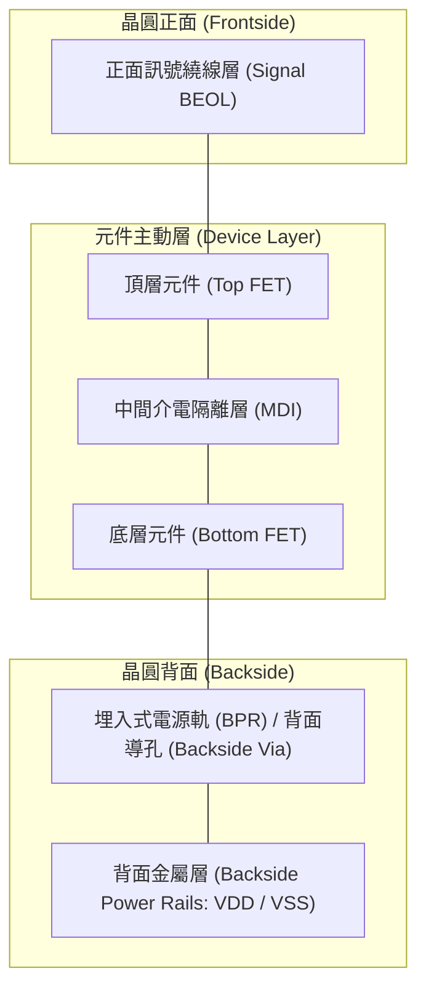

BSPDN 的實作概念是將晶圓翻轉並薄化至數百奈米以下，在晶圓基板背面建構厚金屬互連線，專門負責分流與輸送 $V_{\text{DD}}$ 與 $V_{\text{SS}}$。在 CFET 結構中：

1. **訊號線與電源線解耦**：正面 BEOL 金屬層得以全部用於邏輯訊號互連，大幅降低導線寄生電容與串音干擾（Crosstalk）。
2. **微縮埋入式電源軌（Buried Power Rail, BPR）**：電源直接由晶圓背面透過奈米級矽穿孔（Nano-Through Silicon Via, nTSV）或背面自對準接觸孔（Backside Via）連接至底層電晶體的源極，省去正面佔用標準單元軌道高度的電源軌，使單元高度得以微縮至極限（如 $3T$）。
3. **電阻與壓降改善**：背面金屬層不受嚴格光學微影臨界尺寸（CD）限制，可採用厚度較厚、電阻較低的導線，大幅降低大電流導通時的靜態與動態 $IR\text{ Drop}$。

!!! note "接觸工程與三維連接挑戰"
    CFET 的立體結構意味著單元內部必須處理高度複雜的三維端點接觸。底層電晶體的閘極、汲極與源極必須向上或向下引出，而上下層電晶體的閘極可能需要獨立控制（如傳輸閘邏輯），亦可能需電性短路（如互補反相器）。如何在單一微縮接觸孔內以自對準製程（Self-Aligned Contact）分開或連接不同深度的電極，為目前先進製造中極具挑戰的乾式蝕刻與介電質填膠難題。

---

### 二維過渡金屬硫屬化合物（2D TMDs）前瞻通道探索

即便將通道幾何重構為 GAAFET 或 CFET，當通道長度 $L_{\text{g}}$ 微縮至 $10\text{ nm}$ 以下時，矽（$\text{Si}$）基材料的物理極限便會浮現。回顧第 5 章中定義的通道靜電特徵長度 $\lambda$：

$$\lambda = \sqrt{\frac{\epsilon_{\text{ch}}}{N \epsilon_{\text{ox}}} t_{\text{ch}} t_{\text{ox}}}$$

其中 $\epsilon_{\text{ch}}$ 與 $\epsilon_{\text{ox}}$ 分別為通道與閘介電層之介電常數，$N$ 為有效閘極控制維度（GAAFET 時 $N=4$），$t_{\text{ch}}$ 為通道實體厚度，$t_{\text{ox}}$ 為閘介電層等效氧化層厚度（EOT）。

為抑制短通道效應（SCE），必須滿足 $L_{\text{g}} \ge 3\lambda$ 至 $4\lambda$。此公式指出，微縮閘極長度的關鍵在於使通道厚度 $t_{\text{ch}}$ 極小化。然而，當傳統三維矽晶材料之厚度薄於 $3\text{ nm}$ 時，表面粗糙度散射（Surface Roughness Scattering）極為劇烈，且量子侷限效應會使有效質量改變並誘發能帶結構崩解，導致載子遷移率（Mobility）發生斷崖式衰退。

為此，以過渡金屬硫屬化合物（Transition Metal Dichalcogenides, TMDs）為代表的二維半導體材料，被視為原子級厚度通道的最終候選者：

* **材料結構特徵**：化學通式為 $\text{MX}_2$（其中 $\text{M}$ 為過渡金屬，如 $\text{Mo}$、$\text{W}$；$\text{X}$ 為硫屬元素，如 $\text{S}$、$\text{Se}$）。單層 TMD 具備天然的單分子層厚度（約 $0.7\text{ nm}$），層內以共價鍵鍵結，層間則為凡得瓦力（van der Waals force）。
* **物理優勢**：
  1. **無懸鍵表面（Dangling-Bond-Free Surface）**：表面原子在晶格外側完全配位，無懸鍵缺陷，因此在原子級厚度下仍可維持相對優異的載子遷移率，大幅減輕介面散射。
  2. **適當的能隙與有效質量**：相較於零能隙的石墨烯（Graphene），單層 $\text{MoS}_2$ 與 $\text{WS}_2$ 具有 $1.2\text{–}2.0\text{ eV}$ 的直接能帶隙，室溫開關比（$I_{\text{on}}/I_{\text{off}}$）可輕易超越 $10^8$。此外，其較大的載子有效質量（$m^* \approx 0.5\text{–}0.6\text{ }m_0$）能有效抑制極短通道下源極至汲極的直接量子穿隧效應（Direct Source-to-Drain Tunneling）。

二維材料在製造實務上面臨兩大待解瓶頸：第一為晶圓級高結晶度大面積均勻成長技術（通常需採用前驅物化學氣相沉積法，見第 9 章磊晶討論）；第二為金屬-半導體接觸面的費米能階釘選（Fermi-Level Pinning）導致之極高接觸電阻（Contact Resistance, $R_{\text{c}}$），目前正透過引進鉍（$\text{Bi}$）、銻（$\text{Sb}$）等半金屬（Semimetal）以實現歐姆接觸（Ohmic Contact）。

---

### 電晶體結構演進與靜電指標總結

自平面電晶體演進至 CFET，元件結構歷經多次維度變革。表 6-1 總結了各世代主流與前瞻電晶體在結構幾何、靜電控制能力以及微縮驅動力方面的核心指標演進。

**表 6-1：平面 MOSFET 至 CFET 元件架構與關鍵靜電指標演進**

| 評估指標 | 平面電晶體 (Planar) | 鰭式電晶體 (FinFET) | 全環繞閘極奈米片 (GAAFET) | 互補型場效電晶體 (CFET) |
| :--- | :--- | :--- | :--- | :--- |
| **通道結構** | 平面二維通道 | 垂直直立鰭片 | 多層水平奈米片 | 垂直堆疊互補奈米片 |
| **閘極包覆維度 ($N$)** | 1 (單側上表面) | 3 (頂部及兩側壁) | 4 (四面全環繞) | 4 (上下通道皆為四面全環繞) |
| **靜電特徵長度 $\lambda$** | 最大（靜電控制最差） | 中等 | 短 | 極短（維持四面環繞優勢） |
| **次臨界擺幅 ($SS$)** *(典型值)* | $> 90\text{ mV/dec}$ | $70\text{–}80\text{ mV/dec}$ | $65\text{–}70\text{ mV/dec}$ | $\le 65\text{ mV/dec}$ |
| **汲極引發能障降低 ($DIBL$)** | $> 100\text{ mV/V}$ | $40\text{–}60\text{ mV/V}$ | $20\text{–}40\text{ mV/V}$ | $< 30\text{ mV/V}$ |
| **單位投影面積有效寬度 ($W_{\text{eff}}/\text{Footprint}$)** | 最小 ($W/W$) | 中等 ($[2H_{\text{fin}}+T_{\text{fin}}]/P$) | 高 ($2N_{\text{sheet}} W_{\text{ns}} / P$) | 最高（垂直疊加 n 與 p 通道寬度） |
| **主要微縮極限機制** | 劇烈短通道效應、漏電無法夾斷 | 鰭片微影間距限制、自發熱效應 | 垂直層數極限、內部間隔層製程容許度 | 高深寬比蝕刻、多層接觸電阻、散熱與熱預算 |

!!! warning "自發熱效應（Self-Heating Effect, SHE）在立體結構之挑戰"
    電晶體架構由 FinFET、GAAFET 演進至 CFET，通道受二氧化矽、低介電材料以及閘介電質包覆的體積比例大幅增加。由於介電質之熱導率（Thermal Conductivity）遠低於晶圓體矽基板（如 $\text{SiO}_2$ 熱導率約為 $1.4\text{ W/m}\cdot\text{K}$，而塊材 $\text{Si}$ 約為 $150\text{ W/m}\cdot\text{K}$），CFET 中頂層電晶體所產生的焦耳熱極難導向基板，導致通道內部局部溫度顯著升高。這不僅會降低載子遷移率，更會大幅加劇電遷移（Electromigration, EM）與負偏壓溫度不穩定性（NBTI）等可靠度退化問題。

縱觀電晶體結構的演進脈絡，元件技術的演進本質上是圍繞著「提升閘極靜電控制能力以壓制次臨界漏電流」以及「重整空間幾何以最大化單位晶圓面積內的有效通道寬度」兩大物理目標前進。CFET 作為矽基 CMOS 微縮架構的集大成者，將三維幾何配置推展至極致；而在其之後，結合二維半導體原子層通道與晶圓背面功能整合，將是半導體技術延續莫耳定律的終極探索方向。

## 本章重點

1. **平面 MOSFET 的微縮瓶頸**：當閘極長度縮減至與空乏區寬度可比擬時，二維電荷共享與汲極電力線穿透引發嚴重的短通道效應（SCE），導致次臨界擺幅（$SS$）劣化與汲極引發能障降低（DIBL）。藉由提高基板摻雜濃度抑制穿透，會引發游離雜質散射、能帶間穿隧（BTBT）漏電與隨機摻雜抖動（RDF）。
2. **超薄通道絕緣層覆矽（FD-SOI）之貢獻與極限**：FD-SOI 藉由埋入式氧化層（BOX）實體阻斷基板深層漏電路徑，免除通道高濃度摻雜；然而當通道厚度縮減至 $5\text{ nm}$ 以下時，嚴苛的量子局限效應使臨界電壓對膜厚公差極度敏感，加之寄生串聯電阻與自熱效應（SHE），限制了其向 $15\text{ nm}$ 以下世代推進。
3. **FinFET 之三維靜電包覆優勢**：FinFET 將通道轉為立體垂直鰭片，藉由雙側或三面閘極包覆，使電場在薄鰭片內部重疊並鎖定電位，天然特徵長度顯著縮短，通道可採用未摻雜本質矽。但鰭片寬度必須滿足 $W_{\text{fin}} \le \frac{1}{2} L_g$ 至 $\frac{2}{3} L_g$，引發導通寬度離散化的「鰭片量化效應」，且高深寬比鰭片易受自熱效應與接觸寄生電阻箝制。
4. **奈米片 GAAFET 架構之突破**：全環繞閘極（GAAFET）透過水平堆疊多層矽奈米片，由金屬閘極與高介電常數材料進行 360 度完全包覆，消除鰭片底部的弱電場死角，使 $SS$ 逼近理論極限 $60\text{ mV/dec}$；其奈米片寬度可在微影製程中連續微調，解決了 FinFET 驅動電流離散化的設計限制。
5. **內部間隔壁（Inner Spacer）的幾何與電性權衡**：內部間隔壁在垂直方向實體隔離閘極與源/汲極磊晶區，其長度 $L_{\text{sp}}$ 與介電常數決定元件效能：過薄會導致摻雜物熱擴散侵入通道並擴大閘極重疊寄生電容；過厚則產生較長之未調變延伸區，大幅增加源汲極串聯電阻 $R_{\text{sd}}$。
6. **互補型場效電晶體（CFET）突破標準單元邊界**：CFET 將傳統水平並排的 nMOS 與 pMOS 轉向垂直立體堆疊，完全消除橫向 n-to-p 隔離區，可將標準單元高度由 $5T$ 壓縮至 $3T \sim 4T$，邏輯單元面積理論縮減達 40%～50%，製程可分為單晶整合與低溫接合之循序整合。
7. **系統級背面供電網路與前瞻原子層通道**：為緩解立體堆疊結構極端嚴重的正面繞線擁擠與 $IR\text{ Drop}$，背面供電網路（BSPDN）將電源軌移至晶圓背面，實現訊號線與電源線解耦；對於次 $10\text{ nm}$ 閘長極限，單層過渡金屬硫屬化合物（2D TMDs）憑藉天然亞奈米厚度與無懸鍵介面，成為抑制極限穿隧的後矽基候選材料。

---


## 重點圖卡

複習時看這幾張就能抓住本章重點；[圖卡庫](../cards.md)可以下載成圖片。

<div class="ix-cards" markdown>

<figure markdown>
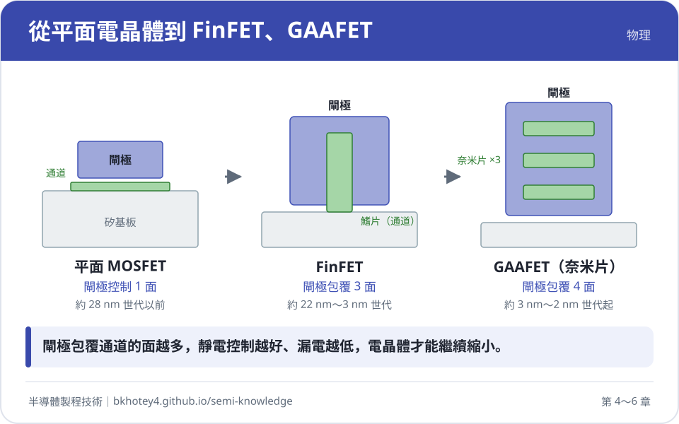
<figcaption>核心概念圖卡：從平面電晶體到 FinFET、GAAFET</figcaption>
</figure>

<figure markdown>
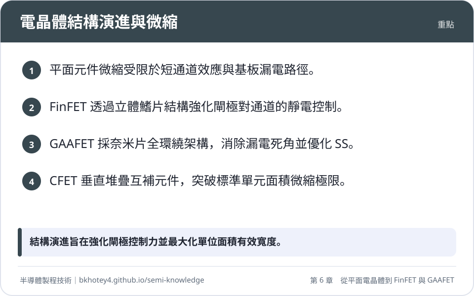
<figcaption>重點圖卡：電晶體結構演進與微縮</figcaption>
</figure>

<figure markdown>
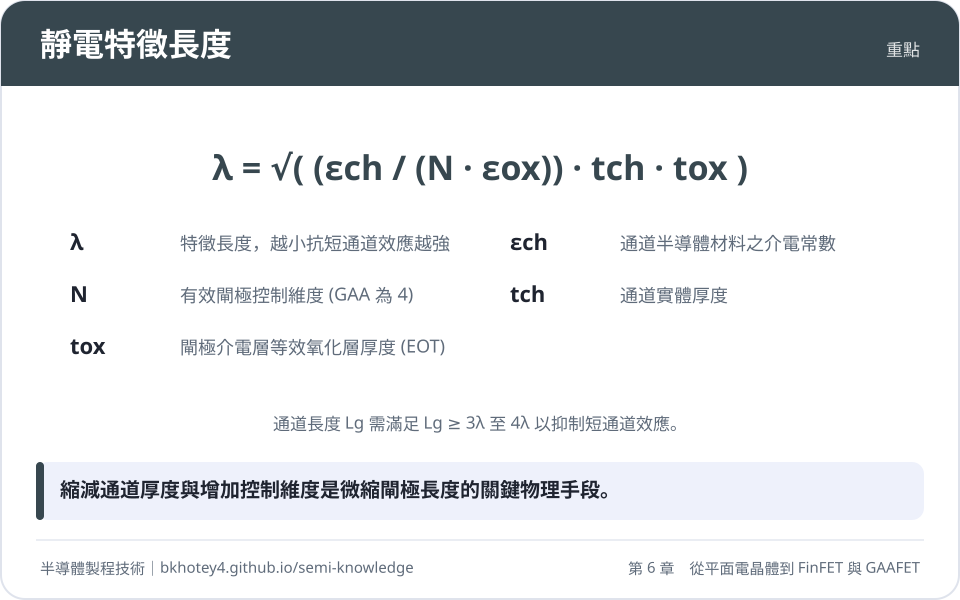
<figcaption>重點圖卡：靜電特徵長度</figcaption>
</figure>

<figure markdown>
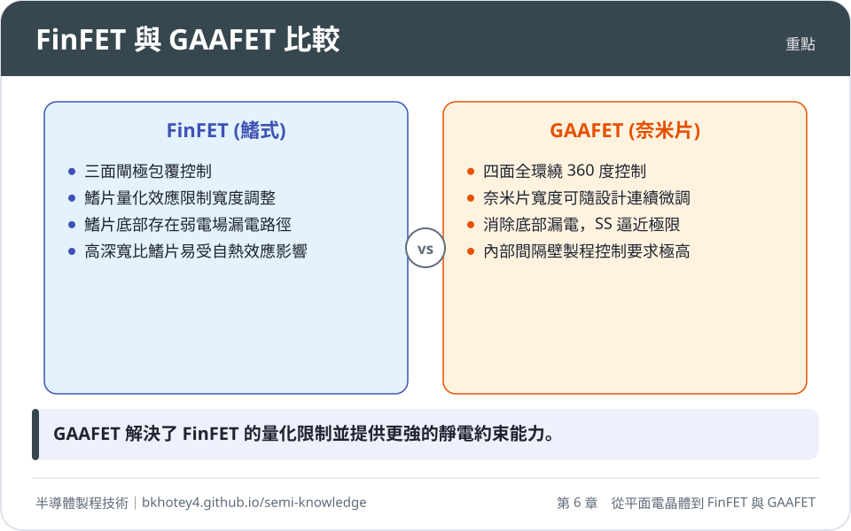
<figcaption>重點圖卡：FinFET 與 GAAFET 比較</figcaption>
</figure>

<figure markdown>
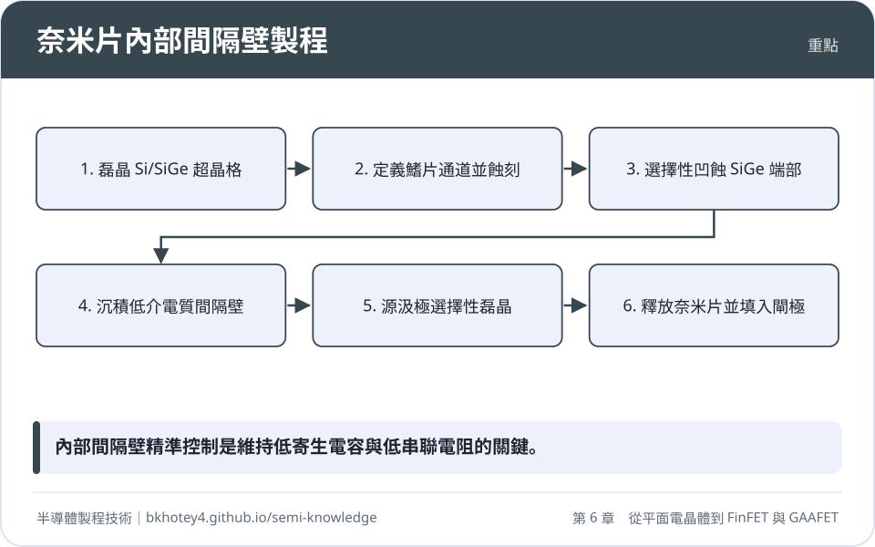
<figcaption>重點圖卡：奈米片內部間隔壁製程</figcaption>
</figure>

</div>

## 習題

**1.** 考慮一對稱型雙閘極（Double-Gate, DG）結構電晶體，其矽通道寬度（厚度）$W_{\text{fin}} = 6\text{ nm}$，閘極等效氧化層厚度 $\text{EOT} = t_{\text{ox}} = 0.8\text{ nm}$。已知矽的相對介電常數 $\varepsilon_{\text{si}} = 11.7$，二氧化矽相對介電常數 $\varepsilon_{\text{ox}} = 3.9$。  
(1) 試依據準一維特徵長度公式，計算該元件之天然長度標度 $\lambda_{\text{DG}}$。  
(2) 若設計準則要求通道長度必須滿足 $L_g \ge 3.5 \lambda_{\text{DG}}$ 以有效抑制短通道效應，則該結構所能容許的最小閘極長度 $L_{g,\min}$ 為何？

??? success "參考解答"
    (1) 根據對稱型雙閘極電晶體的天然長度標度公式：
    $$\lambda_{\text{DG}} = \sqrt{\frac{\varepsilon_{\text{si}}}{2\varepsilon_{\text{ox}}} t_{\text{ox}} W_{\text{fin}}}$$
    代入數值：
    $$\frac{\varepsilon_{\text{si}}}{\varepsilon_{\text{ox}}} = \frac{11.7}{3.9} = 3.0$$
    $$\lambda_{\text{DG}} = \sqrt{\frac{3.0}{2} \times 0.8\text{ nm} \times 6\text{ nm}} = \sqrt{1.5 \times 4.8\text{ nm}^2} = \sqrt{7.2\text{ nm}^2} \approx 2.683\text{ nm}$$

    (2) 依據抑制短通道效應之設計準則 $L_g \ge 3.5 \lambda_{\text{DG}}$：
    $$L_{g,\min} = 3.5 \times \lambda_{\text{DG}} \approx 3.5 \times 2.683\text{ nm} \approx 9.39\text{ nm}$$
    即該結構在維持優良靜電拘束條件下，閘極長度最小應約為 $9.4\text{ nm}$。

---

**2.** 試從靜電學邊界條件與載子傳輸機制，說明為何在平面 Bulk MOSFET 中提高基板摻雜濃度以抑制短通道效應，最終會在 $20\text{ nm}$ 世代面臨微縮天花板；並論述 FinFET 如何藉由幾何維度轉變本質性地解除此一兩難困境。

??? success "參考解答"
    1. **平面 Bulk MOSFET 的物理困境**：
       - **靜電學邊界失控**：平面結構僅有上方單側閘極，汲極電場易自基板深層穿透至源極引發 DIBL 與穿透效應。
       - **高摻雜的負面效應**：為壓縮基板空乏寬度，基板摻雜濃度須提升至 $>10^{18}\text{ cm}^{-3}$。這導致：
         - 游離雜質散射急遽增加，且垂直有效電場升高加劇表面粗糙度散射，使載子遷移率嚴重劣化；
         - 汲極/基板接面電場極高，觸發強烈的能帶間穿隧（BTBT）與閘極引發汲極漏電（GIDL），導致待機關態漏電流反而以指數級攀升；
         - 微觀摻雜原子數過少引起隨機摻雜抖動（RDF），造成臨界電壓變異（$\sigma V_{\text{th}}$）失控。
    2. **FinFET 的幾何維度解決方案**：
       - FinFET 將通道轉化為薄片立體鰭片，由兩側或三面包覆閘極。兩側閘極電場在通道內部疊加，直接鎖定（Pinning）中央電位，完全消除基板深處的漏電路徑。
       - 由於靜電控制力來自多閘極幾何包覆，通道可採用未摻雜（Undoped）或純質矽材料，完全免除游離雜質散射與 RDF，同時避免了重摻雜接面的強電場 BTBT 穿隧漏電，實現高遷移率與超低關態漏電之兼得。

---

**3.** 一個 3 奈米節點的三閘極 FinFET 元件，鰭片高度 $H_{\text{fin}} = 50\text{ nm}$，鰭片寬度 $W_{\text{fin}} = 6\text{ nm}$。另一奈米片 GAAFET 元件包含垂直堆疊的 3 層奈米片（$N_{\text{sheet}} = 3$），每層奈米片厚度 $T_{\text{ns}} = 5\text{ nm}$，寬度 $W_{\text{ns}} = 30\text{ nm}$。  
(1) 計算單一 FinFET 鰭片所提供的有效通道寬度 $W_{\text{eff, single}}$。  
(2) 計算該 3 層奈米片 GAAFET 所提供的總有效通道寬度 $W_{\text{eff, GAA}}$。  
(3) 若某邏輯單元需要約 $310\text{ nm}$ 的有效通道寬度以符合速度規格，分別評估採用 FinFET 與 GAAFET 在電路設計匹配上的差異。

??? success "參考解答"
    (1) 三閘極 FinFET 之有效通道寬度包含頂面與兩側壁：
    $$W_{\text{eff, single}} = 2 H_{\text{fin}} + W_{\text{fin}} = (2 \times 50\text{ nm}) + 6\text{ nm} = 106\text{ nm}$$

    (2) 奈米片 GAAFET 為四面包覆，每層奈米片之有效寬度為 $2(W_{\text{ns}} + T_{\text{ns}})$：
    $$W_{\text{eff, GAA}} = N_{\text{sheet}} \times 2(W_{\text{ns}} + T_{\text{ns}}) = 3 \times 2 \times (30\text{ nm} + 5\text{ nm}) = 6 \times 35\text{ nm} = 210\text{ nm}$$

    (3) 設計匹配性分析：
    - **FinFET（鰭片量化約束）**：有效寬度僅能以 $106\text{ nm}$ 的整數倍跳躍（1-fin: $106\text{ nm}$；2-fin: $212\text{ nm}$；3-fin: $318\text{ nm}$）。若要滿足 $310\text{ nm}$ 需求，必須使用 3 根鰭片（提供 $318\text{ nm}$），但此設計佔用三倍鰭片間距面積，且在不需要過高電流的路徑上缺乏彈性（若目標寬度為 $260\text{ nm}$ 則會造成嚴重面積浪費）。
    - **奈米片 GAAFET（連續可調性）**：固定 $N_{\text{sheet}} = 3$ 與 $T_{\text{ns}} = 5\text{ nm}$ 時，$W_{\text{eff}} = 6(W_{\text{ns}} + 5\text{ nm})$。若需精確達到 $W_{\text{eff}} = 310\text{ nm}$：
      $$W_{\text{ns}} = \frac{310\text{ nm}}{6} - 5\text{ nm} \approx 51.67\text{ nm} - 5\text{ nm} = 46.67\text{ nm}$$
      設計者可直接在光罩佈局上將奈米片寬度 $W_{\text{ns}}$ 繪製為約 $46.7\text{ nm}$，在相同覆蓋區（Footprint）下實現精確匹配，避免鰭片量化造成的動態功耗或面積浪費。

---

**4.** 在奈米片 GAAFET 製程中，內部間隔壁（Inner Spacer）的厚度（長度 $L_{\text{sp}}$）與材料介電常數（$\kappa_{\text{sp}}$）為核心微縮指標。  
(1) 說明內部間隔壁在寄生電容與源/汲極外質串聯電阻（$R_{\text{sd}}$）之間的物理權衡（Trade-off）。  
(2) 為何產業傾向採用低介電常數材料（如 SiBCN、SiOCN）取代傳統的氮化矽（$\text{Si}_3\text{N}_4$）作為內部間隔壁？

??? success "參考解答"
    (1) **幾何厚度 $L_{\text{sp}}$ 的物理權衡**：
    - **$L_{\text{sp}}$ 過薄**：源極/汲極重摻雜區與金屬閘極邊界的實體距離過短，在後續熱活化退火時雜質擴散入通道，造成有效通道長度縮減，引發嚴重的短通道效應與 DIBL；同時閘極至源/汲極之重疊寄生電容（$C_{\text{gdo}}, C_{\text{gso}} \propto 1/L_{\text{sp}}$）劇烈增加，導致電路切換延遲升高。
    - **$L_{\text{sp}}$ 過厚**：形成過長的未調變延伸區（Underlap Region），導致通道端點至接觸區的擴展與串聯電阻（$R_{\text{sd}}$）大幅上升，依據飽和電流公式 $I_{\text{ds,sat}} \approx \frac{g_{\text{m,int}}(V_{\text{gs}} - V_{\text{th}})}{1 + g_{\text{m,int}} R_{\text{sd}}}$，過大的 $R_{\text{sd}}$ 將顯著壓抑元件的驅動電流輸出。
    
    (2) **低介電常數材料（Low-$\kappa$）的導入原因**：
    - 垂直方向相鄰奈米片間的閘極延伸部與源/汲極磊晶區藉由內部間隔壁緊密相鄰，其寄生電容模型近似於平行板電容：$C_{\text{inner}} \approx \varepsilon_0 \kappa_{\text{sp}} \frac{A}{L_{\text{sp}}}$。
    - 傳統 $\text{Si}_3\text{N}_4$ 的相對介電常數較高（$\kappa \approx 7 \sim 7.5$），會帶來龐大的邊緣寄生電容；改採 SiBCN 或 SiOCN 等低介電材料（$\kappa \approx 4 \sim 5$），可在不犧牲 $L_{\text{sp}}$ 物理阻擋厚度的前提下，將內部寄生電容降低約 30%～40%，進而大幅減小邏輯閘的 $RC$ 充放電延遲並提高高頻響應。

---

**5.** 考慮一標準單元庫設計，金屬第一層間距 $P_{\text{metal}} = 24\text{ nm}$，接觸閘極間距 $CPP = 45\text{ nm}$。傳統 GAAFET 標準單元高度為 6 軌（6T），而採用互補型場效電晶體（CFET）搭配背面供電網路（BSPDN）後，單元高度可微縮至 3.5 軌（3.5T）。若一反相器（Inverter）需要 2 個閘極寬度（$N_{\text{gate}} = 2$）：  
(1) 分別計算此反相器在 6T GAAFET 與 3.5T CFET 下的單元佔用面積。  
(2) 計算面積縮減百分比，並從佈局幾何解釋 CFET 能實現此縮減的主因。

??? success "參考解答"
    (1) 標準單元高度公式為 $H_{\text{cell}} = N_{\text{track}} \times P_{\text{metal}}$，單元寬度為 $W_{\text{cell}} = N_{\text{gate}} \times CPP$。
    - 單元寬度：
      $$W_{\text{cell}} = 2 \times 45\text{ nm} = 90\text{ nm}$$
    - **6T GAAFET 單元**：
      $$H_{\text{cell, 6T}} = 6 \times 24\text{ nm} = 144\text{ nm}$$
      $$A_{\text{cell, 6T}} = 144\text{ nm} \times 90\text{ nm} = 12960\text{ nm}^2$$
    - **3.5T CFET 單元**：
      $$H_{\text{cell, 3.5T}} = 3.5 \times 24\text{ nm} = 84\text{ nm}$$
      $$A_{\text{cell, 3.5T}} = 84\text{ nm} \times 90\text{ nm} = 7560\text{ nm}^2$$

    (2) 面積縮減分析：
    - 面積縮減百分比：
      $$\text{縮減率} = \frac{12960 - 7560}{12960} \times 100\% = \frac{5400}{12960} \times 100\% \approx 41.67\%$$
    - **幾何機制解釋**：
      傳統 GAAFET 中，nMOS 與 pMOS 必須水平並排擺放，且兩者之間須預留防禦性隔離區（Keep-out zone），加上正面電源軌（$V_{\text{DD}}$ 與 $V_{\text{SS}}$）佔用金屬軌道，使單元高度難以低於 5T～6T；CFET 將 nMOS 與 pMOS 於垂直軸向上堆疊，使兩者共用相同的平面投影面積，直接消除了水平隔離區；搭配 BSPDN 將電源軌移至基板背面，完全釋放了正面的單元軌道高度，因而實現了超過 40% 的大幅度面積微縮。

---

## 本章術語

- **Planar MOSFET**（平面金氧半場效電晶體）：導電通道與閘極介電層平鋪於半導體基板表面的二維拓撲電晶體結構。
- **Natural Length Scale / $\lambda$**（天然長度標度 / 特徵長度）：表徵汲極電場向通道內部穿透衰減程度的物理常數，為元件抗短通道效應能力的指標。
- **Subthreshold Swing / $SS$**（次臨界擺幅）：使汲極次臨界電流改變一個數量級所需的閘極電壓增量，室溫理論物理極限約為 $60\text{ mV/dec}$。
- **Drain-Induced Barrier Lowering / DIBL**（汲極引發能障降低）：高汲極偏壓之側向電力線穿透至源極端，致使電子注入能障降低並引發臨界電壓漂移之短通道效應。
- **Band-to-Band Tunneling / BTBT**（能帶間穿隧）：強電場作用下，重摻雜接面之價帶電子直接量子穿隧進入導帶所產生的逆向接面漏電機制。
- **Random Dopant Fluctuation / RDF**（隨機摻雜抖動）：極微縮通道中因微觀摻雜原子數量的統計泊松分佈起伏，所引發之電晶體臨界電壓隨機變異現象。
- **Fully Depleted Silicon-On-Insulator / FD-SOI**（完全空乏型絕緣層覆矽）：於埋入式氧化層上方建構超薄單晶矽薄膜通道，利用全空乏特性消除基板深層穿透漏電的平面技術。
- **FinFET**（鰭式場效電晶體）：將半導體導電通道直立為薄片狀鰭狀結構，由閘極自兩側或三面包覆控制的三維場效電晶體。
- **Fin Quantization Effect**（鰭片量化效應）：FinFET 有效通道寬度僅能為單一實體鰭片高度與頂寬組合之整數倍，導致電流驅動能力無法連續調整之物理現象。
- **Gate-All-Around FET / GAAFET**（全環繞閘極場效電晶體）：閘極材料與介電層從四個維度 360 度完全包覆半導體通道（如奈米線或奈米片）之多閘極電晶體架構。
- **Nanosheet**（奈米片）：厚度在數奈米尺度、寬度大於厚度的水平扁平薄片狀單晶半導體導電通道。
- **Inner Spacer**（內部間隔壁）：奈米片 GAAFET 製程中，於垂直方向介於相鄰奈米片閘極延伸部與源汲極磊晶區之間，用於阻擋雜質擴散並降低寄生電容之介電絕緣層。
- **Complementary FET / CFET**（互補型場效電晶體）：將 n 型與 p 型金氧半場效電晶體於垂直方向直接進行三維堆疊，以消除橫向井區隔離間距之新世代標準單元架構。
- **Backside Power Delivery Network / BSPDN**（背面供電網路）：將晶圓薄化後，將電源與接地線路網絡轉移至晶圓基板背面，藉此降低正面繞線擁擠度與動態壓降之系統整合架構。
- **Self-Heating Effect / SHE**（自熱效應）：立體微縮通道被低熱導率介電層包覆且聲子邊界散射劇烈，導致焦耳熱難以散失而使元件工作核心溫度異常升高的物理現象。
- **Transition Metal Dichalcogenides / 2D TMDs**（二維過渡金屬硫屬化合物）：化學式為 $\text{MX}_2$ 的層狀半導體材料，具備天然分子層級厚度與表面無懸鍵特性，為次 10 奈米通道長度之後矽基候選材料。


## 互動學習

<div class="quiz" data-quiz="01-06"></div>


## 產業最新進展

本節由每日產業新聞自動補充，說明本章技術在產業上的最新發展。

<!-- updates -->
- **2026-10-18**　台積電 2 奈米製程導入閘極全環（GAA）架構以延續微縮進展。此架構能有效改善短通道效應與漏電流，呼應從平面電晶體轉向 FinFET 與 GAAFET 的元件設計演進。（來源：[台積電2奈米換架構，3奈米仍有大生意？「FinFET之父」胡正明為何看好？ - 數位時代](https://news.google.com/rss/articles/CBMiekFVX3lxTE9aakJOWDNJNVNzaUd3WWRZWlJTOHB6ZkZfQTlXOWFNOXJZYnFEb2JMNFFwb21pNjJpemJrazdxRWJFUFVISEVOQTRtVlNoNkcxNXBWUWNQZUdIWkhpU2hNVGVKTW9QbnpIX0s5TElRTTJHVi1EWlVhbVVn?oc=5)）
