# 第 7 章　電子級矽與單晶成長

<figure markdown>
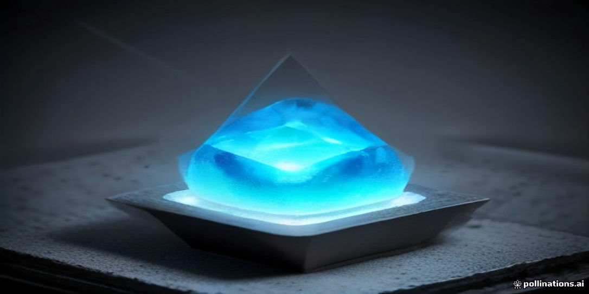
<figcaption>示意插畫：由 AI 生成，用來幫助記憶本章主題，細節請以內文與結構圖為準。</figcaption>
</figure>

!!! abstract "學習目標"
    - 理解從冶金級矽到電子級矽（EGS）的化學提煉與純化程序，以及 11N 純度的物理意義。
    - 掌握柴氏長晶法（CZ）與浮區法（FZ）的物理機制、製程參數與適用場景。
    - 分析單晶成長過程中的點缺陷、位錯及雜質（如氧、碳）的形成機制與控制方法。
    - 評估長晶設備的關鍵組件與當前產業主流廠商的技術發展現況。

## 7.1 矽材料的化學提煉與純化

在半導體元件的製造中，基板（Substrate）的品質直接決定了後續所有製程的成敗。矽（Silicon, Si）作為地殼中含量僅次於氧的第二豐富元素（約佔地殼質量的 27.7%），雖然來源廣泛，但自然界中多以二氧化矽（$SiO_2$）或矽酸鹽的形式存在。要將沙石轉化為能支撐奈米級電晶體的電子級矽（Electronic Grade Silicon, EGS），必須經歷極端複雜的熱化學還原與物理純化過程。

### 冶金級矽的提煉原理

半導體矽材料的生產起點是冶金級矽（Metallurgical Grade Silicon, MGS）。其原始原料通常是高純度的石英砂（Quartzite）或石英石，並以碳（如焦炭、木炭或煤）作為還原劑，在電弧爐（Submerged-Arc Furnace）中進行還原反應。

#### 碳還原反應

在電弧爐內，溫度需提升至約 2000°C 以上，此時會發生一系列複雜的化學反應，總反應式可簡化為：

$$SiO_2(s) + 2C(s) \rightarrow Si(l) + 2CO(g)$$

在實際反應過程中，會產生中間產物一氧化矽（$SiO$）與碳化矽（$SiC$）：

1.  $SiO_2 + C \rightarrow SiO + CO$
2.  $SiO + 2C \rightarrow SiC + CO$
3.  $SiC + SiO_2 \rightarrow Si + SiO + CO$

最終熔融的矽液會從爐底流出，經冷卻後形成固體。此階段產出的冶金級矽，其純度典型值約為 98% 至 99%。

#### MGS 的純度限制與雜質影響

儘管 99% 的純度在傳統冶金工業中已屬優異，但對於半導體元件而言，這類材料完全無法使用。MGS 中含有大量的雜質，主要包括：

*   **金屬雜質**：如鐵（Fe）、鋁（Al）、鈣（Ca）及鎂（Mg）。這些雜質若殘留在晶格中，會形成深能階缺陷（Deep-level defects），成為載子的復合中心（Recombination centers），嚴重降低少數載子壽命（見第 2 章）。
*   **摻雜元素**：如硼（B）與磷（P）。這些元素會直接改編材料的電阻率（Resistivity），使得後續精確的摻雜控制變得不可能。

因此，MGS 僅能作為化學純化的起始原料，必須透過進一步的化學程序將其純度提升至「電子級」水準。

### 西門子製程：從固體到氣體的純化

目前工業界生產電子級多晶矽（Polysilicon）的主流技術為西門子製程（Siemens Process）。該製程的核心邏輯在於：將固態的 MGS 轉化為氣態的矽化合物，利用不同物質沸點的差異進行精餾（Distillation）純化，最後再透過化學氣相沉積（Chemical Vapor Deposition, CVD）將純矽還原出來。

#### 三氯矽烷（TCS）的合成

首先，將粉碎後的 MGS 與氯化氫（$HCl$）氣體在流體化床反應器（Fluidized Bed Reactor）中反應。在約 300°C 的環境下，會產生三氯矽烷（Trichlorosilane, $SiHCl_3$, 簡稱 TCS）：

$$Si(s) + 3HCl(g) \xrightarrow{300^\circ C} SiHCl_3(g) + H_2(g)$$

在此反應中，除了目標產物 $SiHCl_3$（沸點 31.8°C）外，還會產生副產物如四氯化矽（$SiCl_4$，沸點 57.6°C）以及其他金屬氯化物（如 $FeCl_3$、$AlCl_3$）。

#### 多級分餾純化

利用 $SiHCl_3$ 與雜質氯化物之間顯著的沸點差異，製程進入精餾階段。透過多座分餾塔的連續操作，可以將硼、磷及金屬氯化物分離。

!!! note "為什麼選擇三氯矽烷？"
    在矽的氯化物中，三氯矽烷（$SiHCl_3$）被選為中間產物的原因有三：
    1. 在室溫下為液體，便於儲存與分餾。
    2. 沸點低（31.8°C），與雜質的分離效率高。
    3. 在氫氣還原反應中，其沉積速率比四氯化矽（$SiCl_4$）更快，且反應溫度相對較低。

#### 化學氣相沉積與西門子反應器

純化後的高純度 $SiHCl_3$ 隨後進入西門子反應器。反應器內部裝有數根以高純度矽製成的細棒（稱為種棒，Slim rods），透過通電產生焦耳熱，使種棒溫度維持在約 1100°C。

當 $SiHCl_3$ 與高純度氫氣（$H_2$）混合進入反應器並接觸到高溫種棒表面時，會發生還原反應：

$$SiHCl_3(g) + H_2(g) \rightarrow Si(s) + 3HCl(g)$$

矽原子會沉積在種棒上，使其直徑逐漸增粗，最終形成直徑達 15 至 20 公分、長度可達數公尺的「多晶矽棒」。

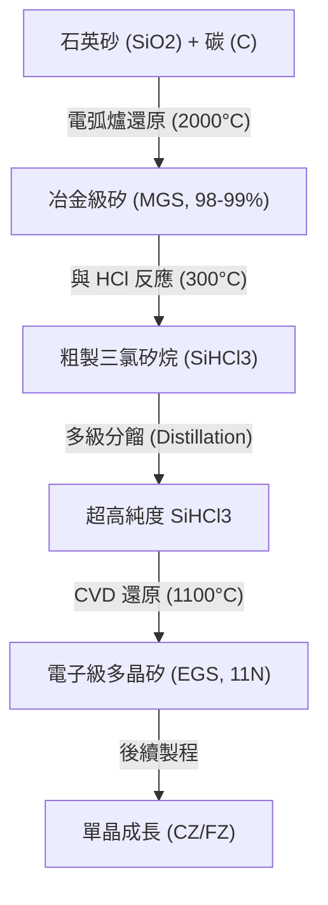

### 電子級矽（EGS）的定義與 11N 要求

經過西門子製程產出的多晶矽，被稱為電子級矽（EGS）。它是半導體產業中最純的物質之一，其純度標準通常被稱為「11N」。

#### 11N 的物理意義

「11N」代表 99.999999999%（共 11 個 9）。這意味著在 1,000 億個矽原子中，雜質原子的數量必須低於 1 個。

為了量化這種極致的純度，工程上常使用以下單位：
*   **ppb (parts per billion)**：十億分之一（$10^{-9}$）。
*   **ppt (parts per trillion)**：兆分之一（$10^{-12}$）。

對於 EGS 而言，關鍵雜質如硼（B）與磷（P）的含量通常需要控制在小於 0.01 ppb 的水準。

#### 純度對元件性能的必要性

之所以需要如此極端的純度，是因為半導體元件的電性對雜質極度敏感。例如：
1.  **電阻率控制**：在第 2 章中提到，矽的電阻率取決於摻雜濃度。若原始基板的雜質濃度過高且不均勻，將導致同一片晶圓上不同位置的電晶體臨界電壓（Threshold Voltage, $V_{th}$）出現劇烈偏差。
2.  **漏電流抑制**：金屬雜質會進入矽的禁帶（Energy Gap）形成陷阱態，增加接面漏電流（Leakage Current），這對於低功耗行動裝置與高密度邏輯晶片（見第 5、6 章）是致命的。

!!! warning "常見誤解：太陽能級矽與電子級矽"
    太陽能級矽（Solar Grade Silicon, SoG-Si）的純度要求約為 6N（99.9999%），遠低於電子級矽的 11N。雖然兩者皆可使用西門子製程生產，但電子級矽在分餾與環境潔淨度的要求上嚴苛許多。使用太陽能級矽製造積體電路會導致極低的良率與不可靠的電性。

### 產業實例：全球供應鏈與技術演進

目前全球電子級多晶矽的主要供應商包括德國的 **Wacker Chemie**、美國的 **Hemlock Semiconductor** 以及日本的 **Tokuyama**。

雖然西門子製程是目前的標準，但其缺點在於耗電量極大（因為需長時間維持高溫種棒）且副產物 $SiCl_4$ 的處理成本高。因此，部分廠商開發了「流體化床反應技術」（Fluidized Bed Reactor, FBR），利用矽顆粒作為種子，在氣流中直接沉積出顆粒狀的多晶矽。FBR 製程能顯著降低電力消耗並實現連續生產，但在控制雜質（特別是來自反應器壁的污染）與氫含量方面仍面臨挑戰，目前多用於太陽能級或作為電子級的輔助原料。

!!! example "產業實例：三氯矽烷的安全性"
    在半導體廠務系統中（見第 55 章），三氯矽烷（TCS）被歸類為極度危險物質。它具有高度揮發性，且在空氣中會自燃，與水反應則會產生腐蝕性的氯化氫（$HCl$）。因此，從 MGS 純化到 EGS 沉積的設備，其氣密性與自動化監控系統的規格極高，這也是進入此產業的高技術門檻之一。

本節介紹了矽材料從礦石到超純多晶矽的化學轉化過程。然而，西門子製程產出的 EGS 是多晶結構（Polycrystalline），其晶格排列混亂，無法直接用於製造微細的半導體元件。下一節將討論如何將這些 11N 純度的多晶矽，透過熔融與再結晶過程，轉化為具有完美晶格排列的單晶矽錠（Single Crystal Ingot）。

## 7.2 柴氏長晶法原理與實作

### 固液界面能與熱平衡動力學

單晶成長本質上是液相至固相的一階熱力學相變過程。在高純度石英坩堝（Quartz Crucible）內，電子級多晶矽於常壓氬氣環境下加熱至熔點（純矽理論熔點約為 $1414\ ^\circ\text{C}$，長晶爐內熔體溫度通常維持在約 $1420\ ^\circ\text{C}$ 左右以確保完全熔解）。單晶矽的持續生長取決於固—液界面（Solid-Liquid Interface）的熱傳導平衡與相變潛熱（Latent Heat of Fusion）的移除速率。

在固液生長前緣，熱量平衡方程式可表示為：

$$
k_S \left( \frac{\mathrm{d}T}{\mathrm{d}z} \right)_S - k_L \left( \frac{\mathrm{d}T}{\mathrm{d}z} \right)_L = L \cdot \rho_S \cdot v_p
$$

式中各符號之物理意義如下：
- $k_S$ 與 $k_L$：分別為固相矽與液相矽的熱導率（Thermal Conductivity，單位為 $\text{W}\cdot\text{m}^{-1}\cdot\text{K}^{-1}$）
- $\left( \frac{\mathrm{d}T}{\mathrm{d}z} \right)_S$：固相沿拉晶軸向（$z$ 方向）的溫度梯度（單位為 $\text{K}\cdot\text{m}^{-1}$）
- $\left( \frac{\mathrm{d}T}{\mathrm{d}z} \right)_L$：液相靠近介面的軸向溫度梯度（單位為 $\text{K}\cdot\text{m}^{-1}$）
- $L$：矽的熔解潛熱（Latent Heat of Fusion，矽的典型值約為 $1.8 \times 10^6\ \text{J}\cdot\text{kg}^{-1}$）
- $\rho_S$：固態矽的密度（$1414\ ^\circ\text{C}$ 下約為 $2.33 \times 10^3\ \text{kg}\cdot\text{m}^{-3}$）
- $v_p$：晶棒提拉速率（Pulling Rate，單位為 $\text{m}\cdot\text{s}^{-1}$）

上式表明，結晶放出的潛熱與液相導入的熱量，必須完全透過固態晶棒向上導出並藉由輻射散逸至爐壁。若提拉速率 $v_p$ 過快，固相散熱速率不及負荷，界面溫度上升，晶體將變細甚至脫離液面；反之，若提拉速率過慢，熱量散失過度，熔體會沿界面向外橫向凝固，造成晶體直徑不可控地擴大。

---

### 柴氏長晶製程步驟

柴氏長晶法（Czochralski Method, CZ）是目前製造積體電路用單晶矽錠（Silicon Ingot）最主流的工藝，其標準流程包含以下五個關鍵階段：

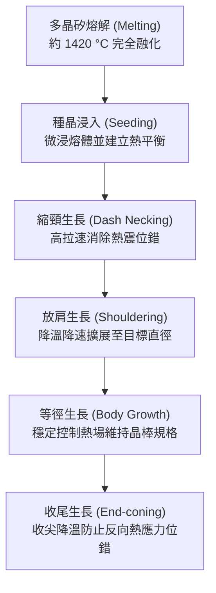

#### 1. 熔解（Melting）
高純度電子級多晶矽料塊裝填於高純石英坩堝中，爐腔抽至高真空後充入高純度氬氣保護（壓力通常維持在 $10\sim50\ \text{torr}$），石墨加熱器通電將原料加熱至 $1420\ ^\circ\text{C}$ 以上，直至多晶矽料完全熔化，並維持一定時間以排除熔體內之微氣泡。

#### 2. 種晶與縮頸（Seeding and Dash Necking）
選擇特定晶向（如 $\langle 100 \rangle$ 或 $\langle 111 \rangle$）的高純度無缺陷單晶「種晶」（Seed Crystal）浸入熔體表面。種晶與高溫熔體接觸時會產生劇烈熱震（Thermal Shock），在接觸界面生成高密度位錯（Dislocations）。

為消除這些原生位錯，William C. Dash 提出了關鍵的縮頸技術（Dash Technique）：將提拉速度提高至正常生長速度的數倍（典型值約 $3\sim6\ \text{mm}\cdot\text{min}^{-1}$），使晶體迅速收縮至直徑僅約 $2\sim4\ \text{mm}$、長度達 $100\sim200\ \text{mm}$ 的細頸。在此生長過程中，位錯線（Dislocation Lines）隨著晶格沿生長方向擴展，其滑移面與生長方向形成夾角，最終在到達晶體自由表面時終止並逸出晶格，實現完全無位錯（Dislocation-free）的晶體骨架。

!!! note "Dash 縮頸技術消除位錯的微觀機制"
    矽晶體中的位錯通常沿著最密堆積面 $\{111\}$ 滑移。當晶體直徑極小時，位錯向側向傳播並終止於晶體自由表面的機率遠高於其在晶體內部增殖的機率。一旦位錯線到達自由表面，晶格的幾何連續性被截斷，位錯應變能被釋放而消失。維持足夠長度的細頸可保證所有自浸入界面引發的滑移位錯完全滑出晶體邊界。

#### 3. 放肩（Shouldering / Crown Growth）
確認無位錯狀態建立後，適度降低提拉速度並微調加熱器功率，使晶體直徑從數公釐逐漸擴展至預定的目標規格（如 $200\ \text{mm}$ 或 $300\ \text{mm}$）。放肩階段晶體頂部呈現錐形，必須保持對稱且平緩的過渡角度，以防邊緣溫度梯度的劇烈變化激發新的晶格位錯。

#### 4. 等徑生長（Body Growth）
當直徑達到目標尺寸後，進入長時間的等徑生長段。此階段長晶爐的自動直徑控制系統（Automatic Diameter Control, ADC）會透過光學感測器監控固液界面處的「熱光環」（Meniscus Ring），即時微調提拉速度與加熱功率，維持直徑公差在極小範圍內（通常在 $\pm 1\ \text{mm}$ 內），長度可達 1 至 2 公尺以上。

#### 5. 收尾（Tail / End Coning）
晶棒生長接近尾聲時，剩餘熔體極少，若直接將晶棒拉離液面，底部將承受極大的熱衝擊，導致熱應力激發出高密度位錯，並沿 $\{111\}$ 滑移面反向向上傳播數十公分，摧毀已成長完畢的等徑晶棒。因此必須逐步加快提拉速率、升高溫度，使晶棒末端逐漸收細成一尖錐狀，最後以極細的接觸點脫離熔體。

!!! warning "熱震引發的滑移缺陷反撲"
    若收尾階段操作不慎發生斷晶或過早脫離，產生的滑移線（Slip Lines）在固態矽高溫區的擴散速度極快。若經 X 射線形貌術（X-ray Topography）檢驗發現末端有滑移位錯回移，整根晶棒可能需要切除大量受損段落，造成良率顯著損失。

---

### 熱場分佈與流體力學控制

在等徑生長過程中，熔體內部存在複雜的流體力學現象。石英坩堝側壁溫度最高，而晶體生長中心溫度最低，這在熔體內部引發了浮力驅動的**自然對流（Natural Convection）**與表面張力梯度驅動的**馬蘭戈尼對流（Marangoni Convection）**。

為控制熱場分佈與晶體對稱性，長晶設備採用了反向旋轉機制：晶棒以速度 $\Omega_s$ 旋轉，坩堝則以相反方向以速度 $\Omega_c$ 旋轉。

| 旋轉參數與運動 | 流場效應 | 對生長界面與雜質分佈之影響 |
| :--- | :--- | :--- |
| **晶棒旋轉 ($\Omega_s$)**<br>典型值：$10\sim25\ \text{rpm}$ | 產生強迫離心流，將中心低溫熔體向外推離，抑制直接衝向晶體中心的紊流。 | 減薄溶質擴散邊界層厚度 $\delta_c$；促進界面下方徑向溫度對稱性。 |
| **坩堝旋轉 ($\Omega_c$)**<br>典型值：$1\sim10\ \text{rpm}$ | 控制坩堝壁邊界層，限制外部富含氧雜質的熔體進入結晶區中心。 | 影響石英溶解速率與氧原子向晶棒的輸送速率，進而決定晶棒氧含量。 |

晶棒與熔體間的相對運動在結晶界面形成了一層厚度為 $\delta_c$ 的停滯邊界層（Boundary Layer）。當晶體提拉速度增加時，結晶界面傾向於向上突起（向固相凸出）；若提拉速度過低，界面則向液相凹陷。理想的界面應維持極微弱的向晶體微凸狀或平坦狀，以維持晶格生長面的穩定，防止小面生長（Facet Growth）產生應力集中。

---

### 摻雜技術與偏析行為

半導體晶圓需具備特定的導電型態（$n$ 型或 $p$ 型）與電阻率（Resistivity，見第 2 章），此特性取決於晶體生長過程中外加摻雜元素（如硼、磷、砷、銻）的濃度。在熔融液中摻雜通常透過在裝料時加入高摻雜矽母合金（Master Alloy）進行。

#### 平衡與有效偏析係數
當固相由液相凝固結晶時，雜質在兩相中的溶解度不同，此現象稱為**偏析（Segregation）**。在熱力學平衡狀態下，雜質在固相中的平衡濃度 $C_S$ 與液相中的濃度 $C_L$ 之比定義為**平衡偏析係數（Equilibrium Segregation Coefficient, $k_0$）**：

$$
k_0 = \frac{C_S}{C_L}
$$

對於矽中最常見的幾種摻雜物，$k_0$ 數值多小於 1：

| 摻雜物 | 導電型態 | 平衡偏析係數 ($k_0$) | 凝固行為特性 |
| :---: | :---: | :---: | :--- |
| **硼 (B)** | $p$ 型 | $\approx 0.80$ | 接近 1，軸向濃度分佈最均勻 |
| **磷 (P)** | $n$ 型 | $\approx 0.35$ | 具中度偏析效應，尾端濃度顯著升高 |
| **砷 (As)** | $n$ 型 | $\approx 0.30$ | 易於高摻雜，但尾端有富集現象 |
| **銻 (Sb)** | $n$ 型 | $\approx 0.023$ | 強偏析效應，大量留於液相，且具高揮發性 |

在實際長晶過程中，固液界面處持續析出（或排斥）雜質，因熔體流動受限，在界面固相側前緣會形成一個溶質富集（當 $k_0 < 1$ 時）的邊界層。因此，界面處晶體實際感受到的液相濃度高於整體平均液相濃度。此時必須導入**有效偏析係數（Effective Segregation Coefficient, $k_{eff}$）**，由 Barton, Prime, and Slichter 提出的 BPS 模型定義：

$$
k_{eff} = \frac{k_0}{k_0 + (1 - k_0) \exp\left( - \frac{v_p \cdot \delta_c}{D} \right)}
$$

式中符號定義：
- $v_p$：提拉生長速率（$\text{cm}\cdot\text{s}^{-1}$）
- $\delta_c$：溶質擴散邊界層厚度（Diffusion Boundary Layer Thickness，典型值約為 $10^{-3}\sim 10^{-2}\ \text{cm}$）
- $D$：雜質在矽熔體中的擴散係數（Liquid Diffusion Coefficient，典型值約為 $10^{-4}\ \text{cm}^2\cdot\text{s}^{-1}$）

由 BPS 方程式可推導出兩個極限狀態：
1. 當提拉速率極慢（$v_p \to 0$）或強烈攪拌使邊界層極薄（$\delta_c \to 0$）時，$\exp(0) = 1$，此時 $k_{eff} \approx k_0$。
2. 當生長速度極快時（$v_p \delta_c / D \gg 1$），指數項趨近於 0，導致 $k_{eff} \to 1$；此時雜質來不及擴散，全數被凍結於固相中，失去純化或偏析效果。

#### 軸向雜質分佈（正常凝固方程式）
在不補充熔料的單批次柴氏長晶中，熔體體積隨長晶進程減少，雜質不斷被排斥回熔體，導致整根晶棒從頭部至尾部的摻雜濃度呈現顯著梯度。根據普凡（Pfann）正常凝固模型（Normal Freezing Equation），晶棒在固化率為 $g$（固化質量佔初始總質量之比，$0 \le g < 1$）處的固相雜質濃度 $C_S(g)$ 為：

$$
C_S(g) = k_{eff} \cdot C_0 \cdot (1 - g)^{k_{eff} - 1}
$$

式中 $C_0$ 為熔化初始時的雜質濃度。

```
固相雜質濃度 Cs/C0
  ^
  |
  |                                        / (k_eff = 0.35, 磷)
4 |                                       /
  |                                      /
3 |                                     /
  |                                    /
2 |                                   /
  |    ------------------------------/---- (k_eff = 0.80, 硼)
1 |---/
  |  /
0 +------------------------------------------> 固化比例 g
  0.0       0.2       0.4       0.6       0.8   1.0
```

對於硼摻雜（$k_{eff} \approx 0.80$），$(k_{eff} - 1) = -0.2$ 為負小數，濃度隨 $g$ 的增加上升相對平緩，晶棒整體的電阻率較為均勻；但對於磷（$k_{eff} \approx 0.35$）或銻，$(k_{eff} - 1)$ 負值較大，當 $g > 0.8$ 時，殘留熔體內的雜質急遽累積，晶棒末端的電阻率會出現雪崩式下跌，嚴重偏離製程規格，常造成晶棒尾段無法製成合規晶片而必須廢棄。

!!! example "產業實例：磁場柴氏長晶法（MCZ）"
    現代 $300\ \text{mm}$（12 吋）單晶矽生產中，熔體容積龐大（坩堝裝料量達數百公斤），熱對流極為劇烈紊亂，極易導致界面局部生長速率震盪與條紋缺陷（Striations）。半導體材料廠廣泛導入**磁場柴氏長晶法（Magnetic Czochralski, MCZ）**。藉由在長晶爐外施加橫向（Horizontal MCZ）或尖點配置（Cusp MCZ）的高強度磁場（磁通量密度約 $0.2\sim0.4\ \text{T}$），利用熔融矽的高導電性在流動時產生勞侖茲力（Lorentz Force），其方向與流動方向相反，產生顯著的電磁阻尼（Electromagnetic Damping）作用，有效壓制熔體亂流。此技術不僅可精確控制氧析出，亦能大幅降低邊界層厚度 $\delta_c$ 的隨機擾動，將徑向電阻率變異（Radial Resistivity Variation, RRV）控制在極窄的製程許可範圍內。

<!-- fig:1 -->
<figure markdown>
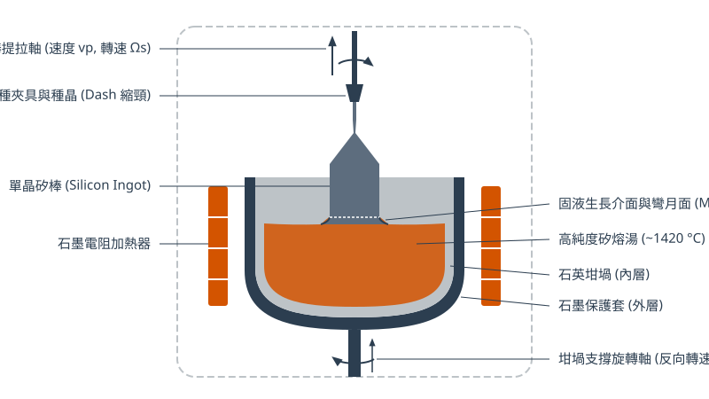
<figcaption>圖 7-1　柴氏長晶爐結構圖（AI 繪製的示意圖）</figcaption>
</figure>

## 7.3 浮區長晶法與高純度應用

### 浮區法之物理機制與系統架構

浮區長晶法（Float-Zone Method，簡稱 FZ 法）源自 William G. Pfann 於 1950 年代提出的區域精煉（Zone Refining）概念。不同於柴氏長晶法（CZ 法）將全部原料熔融於坩堝內，FZ 法屬於「局部移動熔融」製程。其基本架構為：將一根高純度垂直架設的電子級多晶矽進料棒（Feed Rod）固定於長晶爐內，下方放置具有特定晶向的單晶種晶（Seed Crystal）。長晶爐內部維持高純度惰性氣體環境（如氬氣）或真空狀態。

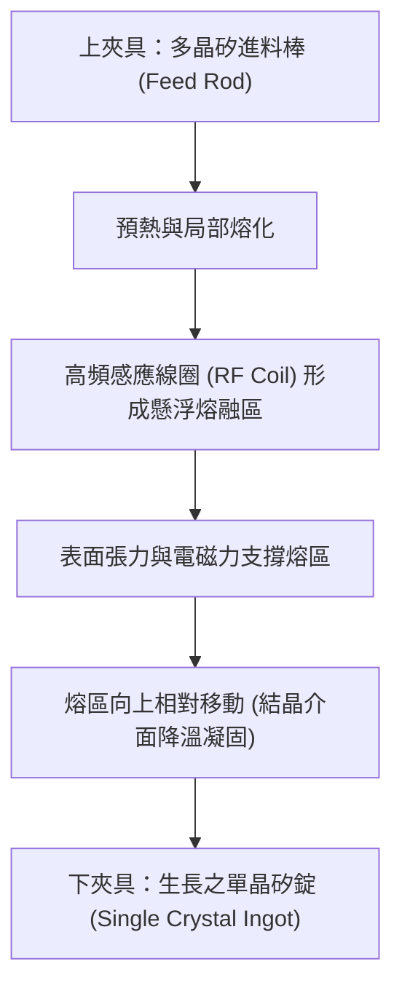

系統的核心加熱源為一環繞晶棒的高頻感應線圈（Radio-Frequency Induction Coil，RF 線圈），其工作頻率通常在數百 $\text{kHz}$ 至數 $\text{MHz}$ 範圍。交變磁場在矽棒內感應出高密度渦電流（Eddy Current），藉由焦耳熱（Joule Heating）將矽棒局部加熱至熔點（約 $1414\ ^\circ\text{C}$）以上，形成高度僅數毫米至數十毫米的懸浮熔融區（Molten Zone）。隨著射頻線圈與矽棒之間的相對垂直移動（通常為線圈緩慢向上平移，或晶棒等速向下移動），前端的多晶矽持續熔融進入熔液區，後端熔液則在種晶引導下依序降溫凝固，沉積出結構完整的單晶矽錠。

#### 熔區平衡之物理條件

浮區法的最大物理瓶頸在於維持懸浮熔液的毛細平衡。熔區在重力作用下傾向於向下崩塌或滴落，其穩定存在必須依賴表面張力與電磁支撐力抵抗靜液壓。忽略電磁夾緊效應之簡化條件下，熔融區的最大穩定高度 $h_{\max}$ 由毛細長度（Capillary Length, $l_c$）決定：

$$h_{\max} \approx c \cdot l_c = c \sqrt{\frac{\gamma}{\rho_L g}}$$

其中：
- $\gamma$ 為熔融矽之表面張力（在熔點下約為 $0.73\ \text{N/m}$）。
- $\rho_L$ 為液態矽之密度（約 $2.57\times 10^3\ \text{kg/m}^3$）。
- $g$ 為重力加速度（$9.8\ \text{m/s}^2$）。
- $c$ 為與幾何接觸角相關之常數（對於圓柱狀熔液系統，$c \approx 2$ 至 $2.8$）。

由此計算可知，純表面張力所能維持之最大熔區高度理論極限約為數公分。當晶棒直徑放大時，熔液體積與重力效應呈三次方向量放大，而周邊表面張力僅呈一次方增加，熔區極易失穩潰散。為克服此限制，現代 FZ 設備採用特殊幾何線圈設計（如針孔型線圈 Needle-Eye Coil），利用強烈的高頻交變電磁場在熔液外緣產生向內的馬克士威應力（Maxwell Stress，即電磁夾緊力，Electromagnetic Pinch Effect），以輔助支撐熔融液滴，使得商用 FZ 晶圓直徑能突破早期的 2 至 3 吋，達到 150 mm（6 吋）與 200 mm（8 吋）之量產水準。

---

### 無坩堝污染特性與純度極限

FZ 法在半導體材料學上最具價值的特徵為「無坩堝接觸（Crucible-Free）」。在傳統 CZ 長晶過程中，熔融矽液必須長時間盛裝於高純度熔融石英坩堝（$\text{SiO}_2$）中，高溫下的化學反應必然導致石英解離：

$$\text{SiO}_{2(s)} \rightleftharpoons \text{Si}_{(l)} + 2[\text{O}]$$

此機制使得 CZ 矽晶棒中無可避免地溶入高濃度的間隙氧原子（Interstitial Oxygen, $[\text{O}_i]$），濃度範圍通常達 $5\times 10^{17}\sim 1\times 10^{18}\ \text{atoms/cm}^3$（約 $10\sim 20\ \text{ppma}$）。同時，石英坩堝外的石墨加熱元件亦會藉由氣相沉積向熔液釋出碳雜質。

相對地，FZ 熔融區僅由上下兩端的固態高純度矽棒所懸持，完全杜絕外來容器的熱解化學污染。因此，FZ 晶圓展現出極致的純淨度：
1. **極低氧含量**：間隙氧濃度通常低於 $1\times 10^{16}\ \text{atoms/cm}^3$（$<0.2\ \text{ppma}$），甚至達到紅外吸收光譜儀（FTIR）之偵測下限。
2. **極低碳含量**：碳濃度普遍控制在 $1\times 10^{15}\ \text{atoms/cm}^3$ 以下。
3. **極高電阻率**：背景施體（Donor）與受體（Acceptor）雜質極少，本質純度高，未摻雜或輕摻雜狀態下之電阻率可輕易突破 $1,000\ \Omega\cdot\text{cm}$，最高甚至可達 $10,000\sim 100,000\ \Omega\cdot\text{cm}$（接近室溫下矽材料之理論本質電阻率 $2.3\times 10^5\ \Omega\cdot\text{cm}$）。

#### 區域精煉與均勻摻雜控制

FZ 法亦兼具區域精煉效應。當熔區自下而上掃掠時，平衡偏析係數 $k_0 = C_S / C_L < 1$ 的金屬雜質（如鐵、銅、鎳等過渡金屬，$k_0 \ll 10^{-3}$）將高度偏析並富集於移動的液相中，最終隨頂端截除之尾料被全數移除，從而實現單晶生長與超純化之同步完成。

然而，傳統熔融氣相摻雜法（如於流動氣氛中通入磷烷 $\text{PH}_3$ 或乙硼烷 $\text{B}_2\text{H}_6$）在長晶過程中容易受到熔液對流劇烈度與揮發速率影響，使得縱向與徑向電阻率分佈不均。為解決此問題，高規格 FZ 矽晶圓常結合**中子嬗變摻雜（Neutron Transmutation Doping, NTD）**技術。將未摻雜的高純度 FZ 矽單晶錠置入核反應爐中，利用熱中子（Thermal Neutron）輻照引發同位素核反應：

$${}^{30}\text{Si} + n_{\text{th}} \longrightarrow {}^{31}\text{Si} + \gamma \xrightarrow{\beta^-\ (t_{1/2}=2.62\ \text{hr})} {}^{31}\text{P} + \beta^- + \bar{\nu}_e$$

天然矽中約含有 $3.1\%$ 的 ${}^{30}\text{Si}$ 同位素，且分佈極其均勻。熱中子具有極高的穿透深度，經由上述嬗變反應生成的磷原子（${}^{31}\text{P}$，施體）在三維空間中呈現近乎完美的同質均勻度，其徑向電阻率變異率（Radial Resistivity Variation, RRV）可壓低至 $2\%\sim 5\%$ 以內，為高壓元件提供了穩定的擊穿場強基準。

---

### CZ 法與 FZ 法材料特性之對比

FZ 與 CZ 兩種長晶技術在熱流場、化學邊界條件及生長動力學上的根本差異，造就了兩者在物理特性上的鮮明對比。

| 材料/製程特性指標 | 柴氏長晶法（CZ 法） | 浮區長晶法（FZ 法） |
| :--- | :--- | :--- |
| **容器（坩堝）接觸** | 有（高純度石英坩堝 $\text{SiO}_2$） | **無**（自行懸浮於矽棒兩端） |
| **間隙氧含量（$[\text{O}_i]$）** | 高（$5\times 10^{17}\sim 1\times 10^{18}\ \text{cm}^{-3}$） | **極低**（$< 1\times 10^{16}\ \text{cm}^{-3}$） |
| **碳含量（$[\text{C}]$）** | 中至低（$1\times 10^{16}\sim 5\times 10^{16}\ \text{cm}^{-3}$） | **極低**（$< 1\times 10^{15}\ \text{cm}^{-3}$） |
| **最高商用電阻率** | 約 $50\sim 100\ \Omega\cdot\text{cm}$（受氧施體效應限制） | **$> 1,000\sim 10,000\ \Omega\cdot\text{cm}$** |
| **微觀電阻率均勻度** | 良好（磁場控制 MCZ） | **極高**（結合 NTD 技術後） |
| **抗高溫熱翹曲強度** | **極佳**（固溶氧形成位錯釘扎） | 較差（易誘發滑移線） |
| **內部吸雜（IG）能力** | **具備**（氧析出物誘發缺陷吸雜） | 無（需依賴外部吸雜技術） |
| **最大商業化晶片直徑** | **300 mm（主流）、450 mm（實驗）** | 150 mm ~ 200 mm（物理極限） |
| **製程能耗與成本** | 低至中等，大量生產經濟效益高 | 高（高頻線圈能耗大且長晶速率慢） |

!!! warning "常見誤解：氧在矽晶圓中必然是有害雜質嗎？"
    直觀上常認為半導體材料的純度越高越好，但對於先進邏輯製程（如 CMOS 元件），FZ 晶圓反而不如 CZ 晶圓適用。
    
    原因在於**機械強度**與**吸雜能力（Gettering）**：
    
    1. **位錯釘扎效應（Dislocation Pinning）**：CZ 晶圓中適量的間隙氧原子在高溫熱退火過程中會聚集在晶格缺陷處，阻止位錯滑移（Slip），從而賦予晶圓抵禦多次高溫爐管熱應力、避免晶圓翹曲（Warpage）的能力。完全無氧的 FZ 矽晶圓在高溫熱應力下極為脆弱，易產生大量滑移線（Slip Lines）。
    2. **內部吸雜（Internal Gettering, IG）**：CZ 矽中的過飽和氧可透過適當的溫度階躍控制，在晶圓內部深處沉積出微小的二氧化矽析出物（$\text{SiO}_x$ Precipitates）。這些微缺陷所產生的應力場能有效捕獲並鎖死極微量的過渡金屬雜質，在元件主動層下方形成天然的「垃圾桶」（詳見第 7.4 節）。FZ 矽晶圓缺乏氧析出物，無法實現內部吸雜機制。

---

### 高純度 FZ 矽晶圓之應用優勢

基於無坩堝所賦予的「超高純度」與「超高電阻率」兩大特徵，FZ 矽晶圓在特定高效能領域中具有不可替代的地位。

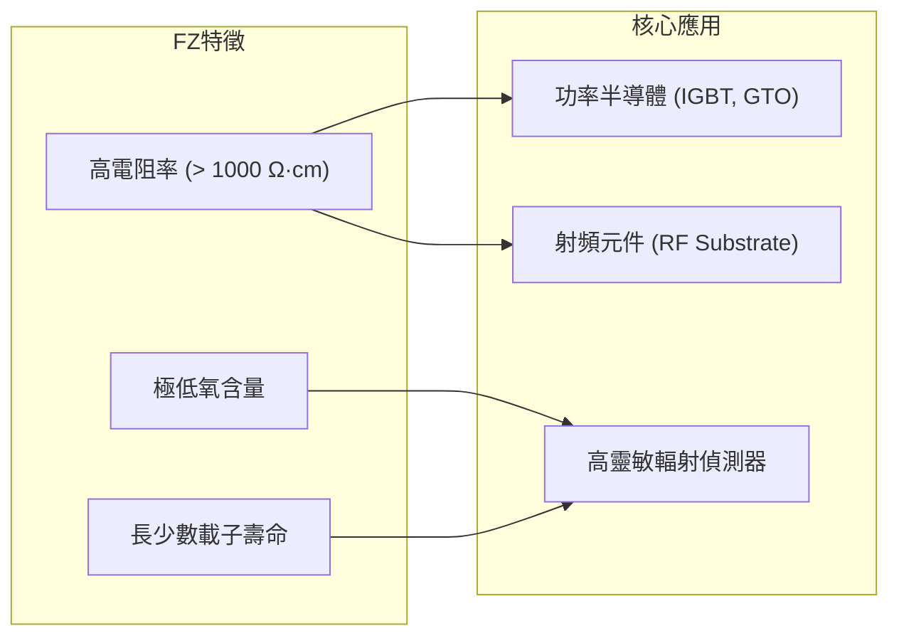

#### 1. 高壓功率半導體元件（Power Semiconductor Devices）

在高壓元件中，飄移區（Drift Region）的厚度與電阻率直接決定了元件的額定崩潰電壓（Breakdown Voltage, $V_{BD}$）。對於單邊突變接面（$p^+-n$ 接面），雪崩崩潰電壓與飄移層基板施體雜質濃度 $N_D$ 的關係可表示為：

$$V_{BD} \propto N_D^{-3/4}$$

若要製造崩潰電壓達數千伏特（如 $3.3\ \text{kV}\sim 6.5\ \text{kV}$）的絕緣柵雙極電晶體（IGBT）、閘流體（Thyristor）或對稱對稱閘極極雙向閘流體（GTO），飄移層必須具備極低的背景摻雜濃度（即極高電阻率，通常需大於數百至上千 $\Omega\cdot\text{cm}$）。
- **CZ 矽之限制**：CZ 晶圓中殘留的高濃度間隙氧在 $450\ ^\circ\text{C}$ 附近的後續熱處理過程中會聚集成「熱施體（Thermal Donors, TD）」，其濃度可達 $10^{15}\ \text{cm}^{-3}$ 等級，這會嚴重打亂原本精準設計的極低摻雜分佈，導致耐壓不足或局部電場集中崩潰。
- **FZ 矽之優勢**：FZ 矽完全杜絕了熱施體效應，且少數載子生命週期（Minority Carrier Lifetime，見第 2 章）高達數毫秒（$\text{ms}$）等級，能顯著降低 IGBT 於導通狀態下的正向導通壓降（$V_{CE(sat)}$）並提升開關效率。搭配 NTD 摻雜技術後，FZ 矽可保證整體晶圓在橫向與深層皆具備均勻一致的崩潰特性。

#### 2. 射頻元件與高阻矽基板（High-Resistivity Silicon, HRS）

隨著無線通訊工作頻率邁入微波（Microwave）與毫米波（Millimeter-Wave）頻段，被動元件（如微帶線、螺旋電感）及積體電路與導電基板之間的交互作用變得極為顯著。

當高頻交流電訊號在傳輸線中傳遞時，下方導電矽基板會透過容性耦合感應出渦電流，帶來兩大負面物理效應：
1. **基板介質損耗（Substrate Dielectric Loss）**：基板電導率 $\sigma$ 越大，高頻能量損耗越嚴重，電感元件的品質因子（Quality Factor, $Q$）急遽下降：
   $$Q = \frac{\omega L}{R_{\text{series}} + R_{\text{substrate-loss}}}$$
2. **寄生基板耦合與串擾（Crosstalk）**：高頻訊號透過導電基板相互干擾，降低射頻開關（RF Switches）與低雜訊放大器（LNA）的信號隔離度（Isolation）。

FZ 法製成之高阻矽基板（HRS，電阻率 $\rho > 3,000\sim 10,000\ \Omega\cdot\text{cm}$）使基板近似於半絕緣介電質（Dielectric），將高頻損耗抑制至接近砷化鎵（$\text{GaAs}$）或石英等昂貴絕緣基底的水準，同時保有矽材料優良的熱傳導率與成熟之微影蝕刻相容性，廣泛應用於射頻前端模組（RFFE）以及高靈敏度粒子/光子輻射偵測器基板。

!!! example "產業實例：大功率牽引驅動與智慧電網"
    在超高壓直流輸電系統（HVDC）、風力發電逆變器以及高鐵牽引驅動系統中，核心開關元件多為採用直徑 150 mm 至 200 mm 的 NTD-FZ 矽晶圓所製造之對稱對稱閘極極雙向閘流體（GTO）或大型壓裝式 IGBT 模組。這些系統要求單一元件必須能阻斷超過 $4,500\ \text{V}$ 的電壓並導通數千安培的電流。在寬能隙材料（如碳化矽 $\text{SiC}$，見第 10 章）的大尺寸晶圓良率完全普及前，超純度 FZ 矽晶圓依然是重電與特高壓功率轉換領域不可或缺的基底材料。

<!-- fig:2 -->
<figure markdown>
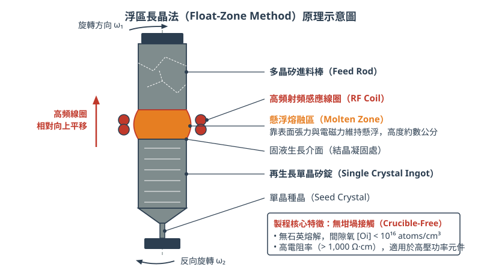
<figcaption>圖 7-2　浮區長晶法原理圖（AI 繪製的示意圖）</figcaption>
</figure>

## 7.4 晶體缺陷與雜質控制

### 點缺陷物理與平衡濃度

單晶矽在熱力學平衡狀態下，晶格並非完美無瑕。在絕對零度以上的任意有限溫度下，熵增效應（Entropy increase）使得晶格內部必然存在固有原生點缺陷（Point defects）。矽晶體中的主要原生點缺陷分為兩類：晶格位置缺失原子的「空位」（Vacancy, $V$），以及多餘矽原子擠入晶格間隙的「自間隙矽原子」（Silicon self-interstitial, $I$）。

在熱平衡狀態下，空位與自間隙矽原子的平衡濃度 $C^{eq}$ 與絕對溫度 $T$ 滿足阿瑞尼斯關係（Arrhenius relationship）：

$$C_{V}^{eq} = N_{\text{Si}} \exp\left(-\frac{\Delta G_{f,V}}{k_B T}\right) = N_{\text{Si}} \exp\left(\frac{\Delta S_{f,V}}{k_B}\right) \exp\left(-\frac{\Delta H_{f,V}}{k_B T}\right)$$

$$C_{I}^{eq} = N_{\text{Si}} \exp\left(-\frac{\Delta G_{f,I}}{k_B T}\right) = N_{\text{Si}} \exp\left(\frac{\Delta S_{f,I}}{k_B}\right) \exp\left(-\frac{\Delta H_{f,I}}{k_B T}\right)$$

其中，$N_{\text{Si}}$ 為矽原子密度（在室溫下約為 $5.0 \times 10^{22}\ \text{atoms/cm}^3$），$k_B$ 為波茲曼常數（Boltzmann constant），$\Delta G_f$、$\Delta H_f$ 與 $\Delta S_f$ 分別為缺陷之形成吉布斯自由能、形成焓與形成熵。在矽熔點（$T_m \approx 1414^\circ\text{C}$）附近，空位與自間隙矽原子的平衡濃度均達到 $10^{14} \sim 10^{15}\ \text{cm}^{-3}$ 的數量級。

在柴氏長晶法（Czochralski method, CZ）的冷卻過程中，熔融液固化為單晶時，過飽和的點缺陷會透過擴散互相復合（$V + I \leftrightarrow \text{Si}_{\text{lattice}}$）或向外擴散消散。晶體最終殘留的原生缺陷型態由晶體成長速率 $v$（Pulling rate）與固液界面處之軸向溫度梯度 $G$（Axial temperature gradient）的比值決定。根據伏隆可夫準則（Voronkov criterion）：

*   當 $v/G > (v/G)_{\text{crit}}$ 時：空位通量大於間隙原子通量，冷卻後晶體呈現空位過飽和（Vacancy-rich）。微觀空位聚集會形成八面體空洞，於晶圓表面經清洗蝕刻後呈現為坑洞，稱為晶穴缺陷（Crystal-Originated Particles, COP），嚴重破壞薄閘極氧化層的絕緣強度。
*   當 $v/G < (v/G)_{\text{crit}}$ 時：間隙矽原子主導（Interstitial-rich）。自間隙原子過飽和聚集會形成間隙型差排環（Interstitials-type dislocation loops），在後續製程高溫下易擴展為大型滑移缺陷。
*   當 $v/G \approx (v/G)_{\text{crit}}$ 時：兩者濃度達精確平衡，可獲得無原生微缺陷（Pure silicon）的晶體區域。在 $300\ \text{mm}$ 的晶棒拉製中，精確調控坩堝熱場使全徑向 $v/G$ 均勻落在臨界值附近，是先進晶圓製造的核心挑戰。

---

### 氧雜質的來源、狀態與效應

在常規柴氏長晶過程中，氧（Oxygen）是濃度最高的非刻意摻雜雜質。氧的存在深刻影響晶圓的機械強度與微結構特性。

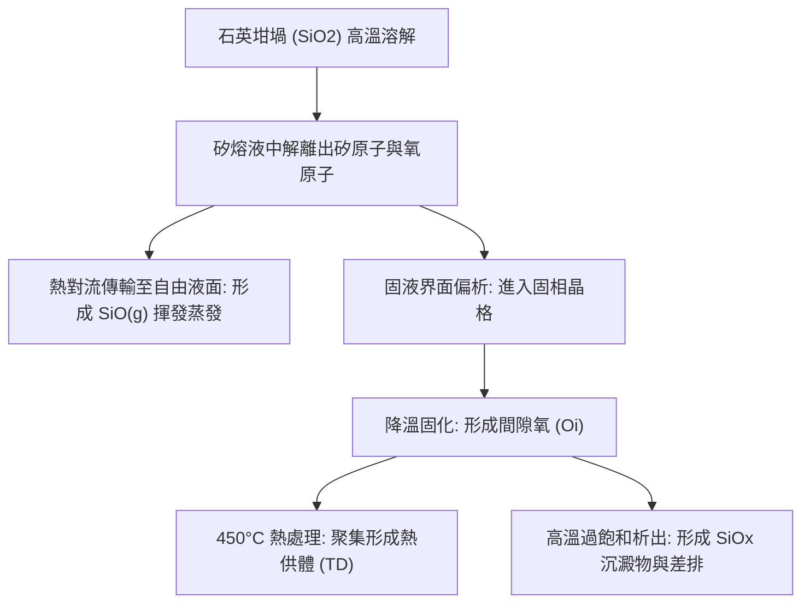

#### 1. 氧的來源與融入機制
CZ 單晶矽中的氧主要源自石英坩堝（$\text{SiO}_2$）在長晶高溫（$> 1420^\circ\text{C}$）下與矽熔液的接觸反應：

$$\text{SiO}_2(\text{s}) + \text{Si}(\text{l}) \rightarrow 2\text{SiO}(\text{dissolved})$$

大部分溶解的單氧化矽（$\text{SiO}$）藉由熔液之強制對流與自然對流傳送至熔液表面，並以氣態 $\text{SiO}(\text{g})$ 形式蒸發，由氬氣（$\text{Ar}$）載氣帶離爐體。僅有少部分（通常小於 $1\sim2\%$）的溶解氧抵達固液生長界面，並根據平衡偏析係數 $k_0 \approx 1.25$ 併入固相矽單晶中。CZ 矽晶圓中的典型氧濃度約落在 $5 \times 10^{17} \sim 1 \times 10^{18}\ \text{atoms/cm}^3$（約 $10 \sim 20\ \text{ppma}$）。相對地，浮區長晶法（Float-Zone, FZ）不使用石英坩堝，其氧含量可低於 $10^{16}\ \text{atoms/cm}^3$。

#### 2. 氧在晶格中的賦存狀態
冷卻至室溫後，氧原子主要以間隙氧（Interstitial Oxygen, $\text{O}_i$）形式存在。氧原子以共價鍵型式嵌於相鄰的兩個矽原子之間，形成非線性的 $\text{Si}-\text{O}-\text{Si}$ 鍵合結構，鍵角約為 $160^\circ$。間隙氧在晶格中不具備電活性，並在傅立葉紅外光譜（FTIR）中展現波數 $1107\ \text{cm}^{-1}$ 的特徵吸收峰，此原理常用於精密量測氧濃度。

#### 3. 氧的正面與負面效應
*   **機械強度強化（Dislocation Pinning）**：處於間隙位置的氧原子會在晶格微觀應變場作用下擴散並偏析至差排核心周圍，形成所謂柯垂耳氣團（Cottrell atmosphere）。此效應強烈釘扎差排線，阻止其滑移，使矽晶圓在承受多道高溫熱循環時不易發生重力翹曲（Warpage）與熱滑移。
*   **熱供體效應（Thermal Donors, TD）**：當晶體經過 $400^\circ\text{C} \sim 500^\circ\text{C}$ 溫度區間時，若干氧原子會聚集成微小的四聚體（$\text{SiO}_4$ 簇），形成淺能階施體（能階約為 $E_c - 0.07\ \text{eV}$ 及 $E_c - 0.15\ \text{eV}$），釋出電子並改變基板的電阻率。熱供體可於 $650^\circ\text{C}$ 以上退火數分鐘破壞其結構而消除（Donor annihilation）。
*   **氧化沉澱誘發缺陷**：固相矽中氧的固溶度隨溫度降低而急遽下降（在 $800^\circ\text{C}$ 時固溶度降至約 $10^{15}\ \text{cm}^{-3}$）。當晶體冷卻時，過飽和的氧易形核析出為微小的二氧化矽沉澱物（$\text{SiO}_x$ precipitates）。由於 $\text{SiO}_x$ 的莫耳體積約為純矽的兩倍，沉澱物成長會向外擠壓晶格，產生極高的局部剪切應力，迫使晶格釋放自間隙矽原子，進而誘發差排環或氧化誘發堆疊缺陷（Oxidation-Induced Stacking Fault, OISF）。

---

### 內部捕捉（Internal Gettering）機制

在積體電路製程中，鐵（$\text{Fe}$）、銅（$\text{Cu}$）、鎳（$\text{Ni}$）等重金屬雜質是嚴重的污染源，極低濃度的金屬污染即可形成深能階缺陷（Deep-level traps），導致載子壽命急遽劣化並誘發接面漏電流。內部捕捉（Internal Gettering, IG，又稱內在吸雜）是利用 CZ 矽晶圓本身固有的氧析出特性，在晶圓內部深處主動構建吸附區以捕捉金屬雜質的純化技術。

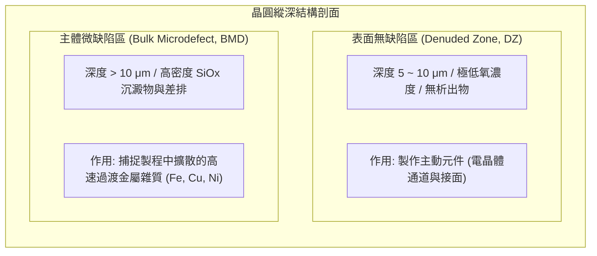

#### 典型三步驟退火程序（Hi-Lo-Hi Annealing）

為獲得理想的內部捕捉結構，晶圓需經過精密調控的三階段熱處理：

| 步驟 | 典型溫度與時間 | 物理化學機制 | 主要功能 |
| :--- | :--- | :--- | :--- |
| **第一步：高溫外擴散（Denudation）** | $1100^\circ\text{C} \sim 1150^\circ\text{C}$<br>數小時 | 氧固溶度大幅提高，晶圓表面附近的間隙氧經由高溫擴散逸出至晶圓外（Out-diffusion）。 | 降低晶圓近表面（深度約 $5 \sim 10\ \mu\text{m}$）的氧濃度，使其低於後續析出的臨界過飽和度，形成極低缺陷密度的無缺陷區（Denuded Zone, DZ）。 |
| **第二步：低溫晶核形核（Nucleation）** | $650^\circ\text{C} \sim 750^\circ\text{C}$<br>數小時至十餘小時 | 此溫度下氧原子擴散速率適中但過飽和度極高，依據均質形核理論，過飽和的氧在晶圓內部自發聚集形成高密度的穩定臨界晶核。 | 在晶圓主體深度建立均勻且密度高達 $10^9 \sim 10^{10}\ \text{cm}^{-3}$ 的微小氧化矽晶核。 |
| **第三步：中高溫析出成長（Growth）** | $1000^\circ\text{C} \sim 1050^\circ\text{C}$<br>數小時 | 氧擴散係數顯著增加，剩餘的過飽和氧快速向既有的氧化矽晶核擴散，晶核長大為巨觀的 $\text{SiO}_x$ 沉澱物（BMD）。 | 體積膨脹釋放自間隙矽原子，產生局部塑性形變，生成微差排纏結與微孔洞。這些缺陷邊緣的應變場即為金屬雜質的強力捕捉阱。 |

當後續晶圓製程（如離子佈植退火或氧化）使金屬雜質以間隙形式快速擴散時，金屬原子會被熱力學驅動，優先偏析並沉澱於晶體深層 BMD 的差排核心與相界上，從而遠離表層主動元件運作區，確保元件可靠度。

!!! note "外在捕捉（External Gettering）的對比"
    相較於利用晶圓內部氧沉澱的內部捕捉，外在捕捉（External Gettering, EG）是在晶圓**背面**人工引入機械損傷（如噴砂 Sandblasting）、沉積多晶矽薄膜（Polysilicon back-seal）或進行高劑量磷擴散形成高濃度磷矽玻璃（PSG），利用晶圓背面的晶格失配與應力場捕捉金屬。現代先進 CMOS 製程常將內部捕捉與外在捕捉結合使用。

---

### 熱應力與差排對元件電性之衝擊

在半導體製造的高溫爐管或快速熱退火（Rapid Thermal Processing, RTP）製程中，晶圓徑向各處的升降溫速率難免存在差異（晶圓邊緣散熱面積大，降溫通常快於中心），此溫度差 $\Delta T(r)$ 會在晶體內部誘發熱應力 $\sigma_{th}$。

當熱應力在特定晶面上投影的分切應力（Resolved shear stress）超過該溫度下單晶矽的臨界分切應力（Critical Resolved Shear Stress, CRSS, $\tau_{\text{crit}}$）時，晶體將透過原子面的相對剪切移動釋放應力，發生塑性形變，生成線缺陷——差排（Dislocations）：

$$\tau_{\text{resolved}} = \sigma_{th} \cdot m \ge \tau_{\text{crit}}(T)$$

其中 $m$ 為施密特因子（Schmid factor）。在矽的金剛石晶格結構中，滑移優先發生於原子最密排的 $\{111\}$ 晶面，沿著 $\langle 110 \rangle$ 晶向移動。宏觀上，在晶圓邊緣產生的整排滑移線稱為滑移（Slip lines），會嚴重損害晶圓的幾何平坦度。

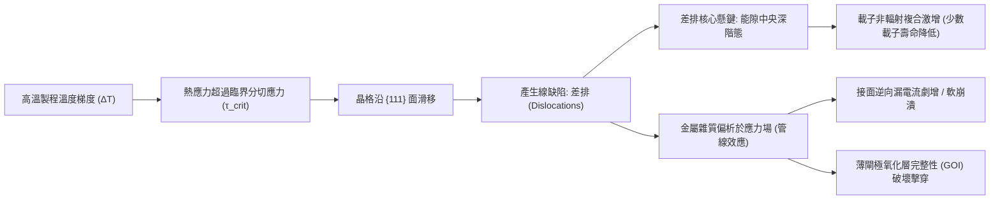

差排一旦穿透元件主動區（見第 4 章），將在微觀電性上造成嚴重打擊：
1.  **接面逆向漏電流（Junction Leakage）劇增**：差排核心周圍存在未配對的原子懸鍵（Dangling bonds），在矽能隙中央引入深能階態（Deep-level states），成為強烈的複合中心（Shockley-Read-Hall 複合中心，見第 2 章）。當差排穿越 PN 接面的空乏區時，熱產生電流呈數量級上升，造成接面軟崩潰（Soft breakdown）與靜態功耗攀升。
2.  **管線效應（Pipe Effect）導致短路**：在差排周圍高度拉伸的應變場中，摻雜劑（如砷、硼）或可動過渡金屬雜質會沿差排軸向發生高速「管線擴散」（Pipe diffusion）。這會造成局部雜質過度滲透，使雙極性電晶體的射極-集極穿透短路，或使 MOSFET 的源極-汲極經由缺陷微通道連通，造成通道完全失去截止能力。
3.  **閘極氧化層完整性（Gate Oxide Integrity, GOI）裂化**：若差排或 COP 缺陷暴露於矽表面，熱氧化或沉積的閘極介電質厚度與化學計量比將出現局部奇點，誘發局域電場集中，使閘極漏電流上升並導致介電質提早崩潰（Time-Dependent Dielectric Breakdown, TDDB）。

!!! warning "薄型化封裝時代的應力挑戰"
    隨著先進封裝對晶圓減薄（Wafer Thinning）的要求提升至 $30\ \mu\text{m}$ 甚至更薄，差排不僅是電性劣化的罪魁禍首，更成為晶圓在後續切割與覆晶接合過程中碎裂的起始點（Crack initiation site）。因此，控制初始單晶錠的無差排生長（Dash necking 技術）與晶片製程中的熱預算（Thermal budget）匹配，是半導體製程穩定度的基石。

## 7.5 設備與廠商技術

### 長晶爐系統架構與關鍵子系統

柴氏長晶法（Czochralski method, 簡稱 CZ 法，見第 7.2 節）所使用的設備統稱為長晶爐（Crystal Puller）。現代 300 mm（12 吋）乃至更大尺寸之單晶矽長晶爐，為高度整合的高溫、高真空、精密伺服機械與電磁流體控制系統。單台長晶爐的投料量通常達數百公斤以上，爐體高度可達十餘公尺。其核心由五大子系統構成：

1. **爐體與真空/氬氣流動系統（Chamber & Gas Purge System）**：
   爐體主要由雙層不銹鋼水冷壁構成，分為下部的熔融腔體（Furnace Chamber）與上部的提拉接收腔（Pulling Chamber）。長晶過程必須維持在減壓環境（典型值約為 $10 \sim 100 \text{ Torr}$），並自頂部導入高純度氬氣（Ar），向下拂過矽熔融液（Melt）表面後由底部的排氣口抽出。此氣流設計至關重要，因高溫下石英坩堝溶解會生成一氧化矽（$\text{SiO}$）氣體，若未藉由氬氣即時吹除，$\text{SiO}$ 將在冷凝部件凝結成顆粒並落入熔湯，引發單晶結構崩壞並生成差排（Dislocations）。
2. **熱區組件（Hot Zone Configuration）**：
   熱區泛指爐體內部所有承受高溫的組件，核心為石英坩堝（Quartz Crucible）、石墨承接座（Graphite Susceptor）、石墨電阻加熱器（Graphite Heater）及外圍的多層碳纖維隔熱屏（Insulation Shields）。加熱器通常採用高純度等方性石墨或碳/碳複合材料（C/C Composite）製成圓筒狀，包圍在石墨承接座外，透過焦耳熱輻射提供超過 $1420^\circ\text{C}$ 的熔融溫度。
3. **機械提拉與旋轉機構（Pulling and Rotation Mechanism）**：
   包含晶種提拉軸（Seed Lift）與坩堝升降軸（Crucible Lift）。兩軸皆具備精確的微步進伺服馬達，能以次微米級精度垂直位移並維持穩定旋轉。晶棒與坩堝通常採反向旋轉（Counter-rotation），藉以形成對稱的流場與熱場。長晶過程中，坩堝需隨熔湯消耗而持續上升，以維持固液介面（Solid-Liquid Interface）相對於加熱器與熱屏的相對高度不變。
4. **直徑自動控制系統（Automated Diameter Control, ADC）**：
   晶棒生長依序經歷引頸（Neck）、放肩（Crown/Shoulder）、等徑（Body）與收尾（Tail）。在等徑階段，直徑的變異量必須控制在極小公差內。ADC 系統利用光學高溫計（Optical Pyrometer）或高解析度 CCD 相機，透過視窗即時監測固液交界面彎月面（Meniscus）的光環亮度與寬度，藉此推算晶體當前直徑。控制演算法將偏差值即時反饋至晶棒提拉速率與加熱器功率進行雙迴路閉迴路控制。
5. **磁場模組（Magnetic Field Generator）**：
   包覆於爐體外側的超導或常導電磁線圈，用於實施磁場應用柴氏法（Magnetic Czochralski, MCZ），藉由羅倫茲力（Lorentz force）抑制大尺寸熔湯內部的劇烈熱對流。

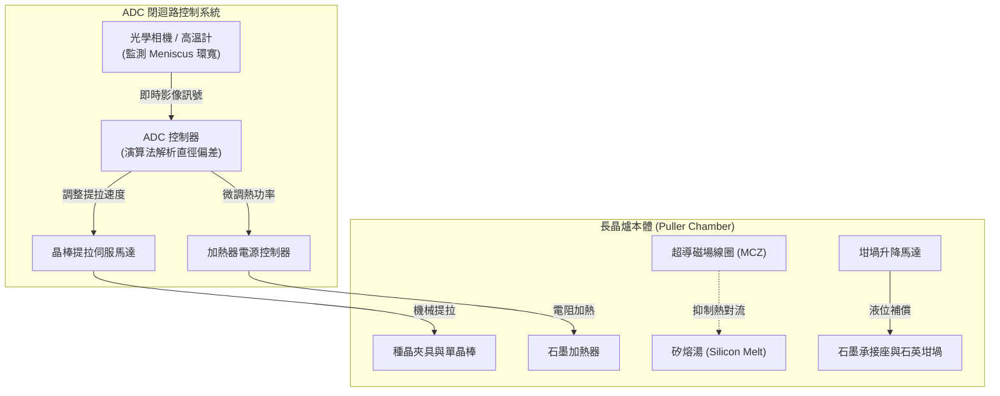

---

### 大尺寸晶圓長晶之熱對流控制與磁場應用技術

當晶圓直徑推進至 300 mm（對應熱區坩堝直徑需達 32 吋至 36 吋以上，投料量超過 $300 \sim 400 \text{ kg}$）時，熔融矽液面臨顯著的流體力學不穩定性。熔融態矽為低普朗特數（Prandtl number, $Pr \approx 0.05$）的高導電液體。隨著坩堝容積增加，描述浮力驅動自然對流強度的瑞立數（Rayleigh number, $Ra$）以尺寸的三次方劇烈攀升：

$$Ra = \frac{g \beta \Delta T L^3}{\nu \alpha}$$

其中 $g$ 為重力加速度，$\beta$ 為熱膨脹係數，$\Delta T$ 為坩堝壁至熔湯中心的溫差，$L$ 為特徵長度（熔湯深度或半徑），$\nu$ 為動黏滯係數，$\alpha$ 為熱擴散率。在大尺寸坩堝中，$Ra$ 常超過 $10^7 \sim 10^8$，熔湯內部由層流轉變為高度紊流（Turbulent convection），導致固液介面溫度劇烈震盪，引發晶體微缺陷、局部再熔融（Remelting）及氧雜質分布嚴重不均。

為抑制紊流，現代 300 mm 長晶爐普遍導入磁場應用柴氏法（MCZ）。其物理機制奠基於磁流體力學（MHD）：當導電的熔融矽（電導率 $\sigma \approx 1.2 \times 10^6 \ \Omega^{-1}\text{m}^{-1}$）在磁場 $\mathbf{B}$ 中流動時，流體內部將產生感應電流 $\mathbf{J} = \sigma (\mathbf{v} \times \mathbf{B})$。該電流進一步與外加磁場作用，產生阻礙流體運動的羅倫茲力：

$$\mathbf{F}_L = \mathbf{J} \times \mathbf{B} = \sigma (\mathbf{v} \times \mathbf{B}) \times \mathbf{B}$$

羅倫茲力的方向恆與垂直於磁場方向的流動速度相反，其作用如同人為增加熔湯的「磁黏滯度」，能有效平抑紊流微震盪。外加磁場主要有以下三種配置架構：

1. **橫向磁場（Horizontal MCZ, H-MCZ）**：
   由一對鞍型或螺線管線圈置於爐體兩側，產生水平貫穿熔湯的均勻磁場。H-MCZ 能有效壓制坩堝垂直方向的對流，但破壞了系統的軸對稱性，導致晶棒在旋轉過程中經歷非對稱熱場，沿圓周方向易產生熱應力與摻質偏析不均。
2. **縱向磁場（Vertical / Axial MCZ, V-MCZ）**：
   線圈環繞於爐體周圍，產生沿提拉軸平行的垂直磁場。此配置保有完美的軸對稱性，但由於磁力線垂直於液面，對沿徑向流向長晶介面的自然對流抑制力較弱，且容易大幅降低熱對流向外的傳輸，導致坩堝底部過熱，並促使氧雜質過度累積於晶棒中心。
3. **尖點磁場（Cusp MCZ）**：
   採用上下兩組反向電流線圈，在熔湯內部形成對稱但方向相反的磁場分布，其磁力線在坩堝中心固液介面處的垂直分量趨近於零，而在坩堝側壁與底部呈現與邊界垂直的放射狀發散。此種設計結合了對稱性與選擇性抑制：在靠近石英坩堝壁處，強磁場有效抑制熔湯沖刷，降低石英溶蝕速率；在固液生長介面下方，磁場極小，允許微弱的強制對流維持熱量傳遞與雜質擴散層的薄化。因此，Cusp MCZ 已成為現代 300 mm 先進製程晶圓長晶的主流標準配置。

!!! note "哈特曼數（Hartmann Number）與對流抑制效能"
    在磁流力學中，電磁力相對於黏滯力的比例常以無因次哈特曼數 $Ha$ 表示：
    $$Ha = B L \sqrt{\frac{\sigma}{\mu}}$$
    其中 $\mu$ 為液態矽之動態黏度。當長晶爐外加磁場強度達 $0.2 \sim 0.4 \text{ Tesla}$（$2000 \sim 4000 \text{ Gauss}$）時，$Ha$ 數值顯著提升，能將熔湯熱脈動（Thermal fluctuations）振幅由無磁場時的數十度大幅壓低至 $1^\circ\text{C}$ 以內，從根本上確保了固液生長介面的平整度。

---

### 晶圓製造廠商技術路線評析

全球半導體級矽晶圓供應高度集中於少數跨國巨擘。晶圓基板供應商（如信越半導體、勝高、環球晶等）多數採取自行設計熱區、客製化機台規格，並與專責設備製造商（如 Ferrotec、PVA TePla、Kayex 等）深度協同開發的專有長晶爐系統。

| 廠商 | 主要代表材料與技術系列 | 技術路線與特點 | 主要應用 |
| :--- | :--- | :--- | :--- |
| **信越半導體**<br>(Shin-Etsu Handotai) | Nano-topology 最佳化拋光晶圓系列、超低差排磊晶基板 | 採用高精密 Cusp MCZ 系統，結合極低熱應力熱區設計；獨家空缺-間隙原子（$V/I$）動態熱梯度控制演算法，達到完美的全面積純淨無原生缺陷區（Pure Silicon）。 | 邏輯先進製程（3nm / 2nm 以下 FinFET/GAAFET）、高階 3D NAND 快閃記憶體 |
| **勝高**<br>(SUMCO) | 高平坦度退火晶圓（Annealed Wafer）、無缺陷純矽晶圓 | 著重於先進動態磁場模擬與自動化直徑控制（ADC）；透過連續拉晶注料（Recharge/Continuous CZ）與自研熱形變補償模組，實現晶圓超低彎曲度（Warp）與極限平坦度。 | 先進邏輯代工基板、極紫外光（EUV）曝光專用低應力基板、先進 DRAM |
| **環球晶圓**<br>(GlobalWafers) | 高阻抗 MCZ 晶圓、大尺寸車用與功率元件基板系列 | 整合水平式與尖點式 MCZ 彈性熱區平台，具備高度熱場相容性；擅長透過磁場分布精確調控間隙氧含量（$[O_i]$）與大尺寸重摻雜（Heavy Doping）晶棒生長。 | 先進車用功率平台、射頻元件（RF-SOI 基板）、電源管理 IC、廣用型邏輯基板 |

各家廠商在長晶技術路線上的分歧，主要體現在下列工程維度的取捨：

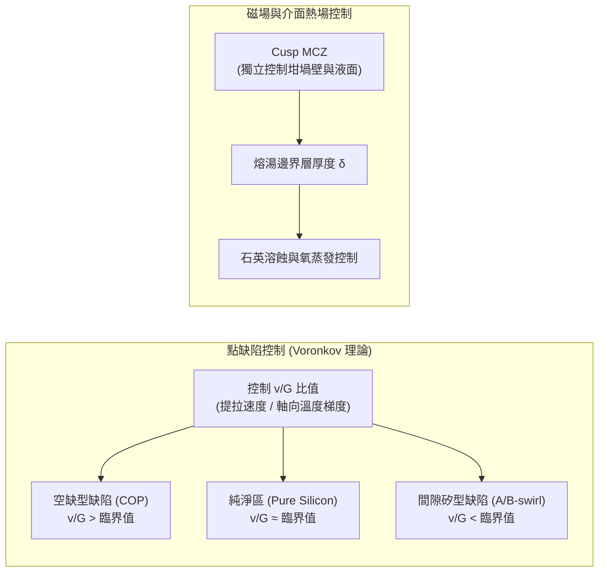

#### 1. 軸向溫度梯度（$G$）與提拉速度（$v$）的邊界調控
依據 Voronkov 理論，晶體內部原生點缺陷的形態由提拉速率 $v$ 與固液介面軸向溫度梯度 $G$ 之比值 $v/G$ 決定。當 $v/G$ 高於臨界值時，晶體富含空缺型缺陷（Crystal Originated Particles, COP）；低於臨界值時，則富含間隙矽型缺陷（Dislocation Loops / A-swirl）。為生產完全無缺陷的純淨矽（Defect-Free or Pure Silicon），各廠商在熱區設計中配置了各具專利的熱反射板與水冷夾套（Cooling Jacket），以精確操縱固液介面的 $G(r)$ 徑向分布均勻性，使全半徑範圍內的 $v/G$ 均嚴格落在無缺陷窗口內。

#### 2. 單晶坩堝投料模式：批次複拉（RCZ）與連續長晶（CCZ）
傳統 CZ 法為單次批次充填。隨長晶進行，液位下降導致熱場改變，且雜質偏析使晶棒尾端電阻率嚴重漂移。
*   **多晶複拉法（Recharge Czochralski, RCZ）**：在單次生長完成提拉後，不破壞爐體高溫真空環境，以加料管道導入多晶顆粒重新補充坩堝液面。其考量在於兼顧石英坩堝壽命與降低反覆冷卻/升溫所帶來的巨大能耗。
*   **連續柴氏長晶法（Continuous Czochralski, CCZ）**：配備雙室或環形坩堝（Double Crucible System），長晶同時藉由專屬進料系統以恆定速率持續向熔融腔補充矽粒。此路線能維持固液介面處於恆定幾何與熱力學穩態，生產出軸向摻雜濃度極度均勻之晶棒，但其代價為爐體結構複雜度倍增，且熔融顆粒飛濺風險極高。

!!! warning "石英坩堝溶蝕與高阻抗基板的矛盾"
    在製造射頻（RF）與通訊晶片基板時，元件需要高電阻率（High Resistivity, $\rho > 1000 \ \Omega\text{-cm}$）的單晶矽以減少基板訊號損耗。然而，長晶過程中石英坩堝壁持續被熔矽溶蝕，釋放出大量的硼、鋁等淺能階受體雜質，且氧原子在高溫熱處理後容易形成熱施體（Thermal Donors），使電阻率劇烈失控。因此，長晶廠商在此類規格中必須採用超高純度合成石英坩堝（Synthetic Quartz）、結合強大 Cusp MCZ 將液壁流速降至極限，並微調抽氣管路使間隙氧濃度減至最低。

晶圓代工廠（Foundry）在向基板廠商採購時，選機與規格驗證的評估指標包括：基板全域平坦度（Nanotopology、SFQR）、低角度晶界應力變形量、氧沉澱物（Bulk Micro Defects, BMD）的受控孕育均勻性，以及極紫外光（EUV）曝光下對極微小晶格滑移（Slip Lines）的容忍極限。長晶設備子系統的控制精度，本質上直接決定了後續先進微影與奈米尺度電晶體結構的良率下限。

## 本章重點

*   **化學提煉與純化**：半導體級矽原料始於高溫電弧爐以碳還原石英砂製成之冶金級矽（MGS，純度約 98～99%）；隨後經流體化床合成三氯矽烷（$\text{SiHCl}_3$）並透過多級精餾分離金屬與摻雜雜質，最後於西門子反應器內進行化學氣相沉積（CVD），製得達到 11N（99.999999999%）純度之電子級多晶矽（EGS）。
*   **柴氏長晶法（CZ）機制與動力學**：柴氏法為目前積體電路單晶矽錠之主流製程。其利用固液介面之熱傳導與潛熱平衡推動晶體生長，並透過 Dash 縮頸技術迫使熱震引發之滑移差排延伸至晶體自由表面逸出，奠定無差排（Dislocation-free）單晶結構。
*   **雜質偏析與軸向濃度梯度**：溶質於固液相中的溶解度差異導致偏析現象。平衡偏析係數 $k_0$ 結合流體擴散邊界層厚度 $\delta_c$ 決定了有效偏析係數 $k_{eff}$（BPS 模型）；在常態凝固過程中，如磷（$k_0 \approx 0.35$）等摻質會在殘存熔湯中強烈富集，致使晶錠尾端雜質濃度劇增、電阻率顯著漂移。
*   **浮區長晶法（FZ）與超純度特性**：FZ 法利用高頻感應線圈產生局部懸浮熔區，受熔液表面張力與電磁力支撐而無須使用石英坩堝。其產物具備極低間隙氧（$[\text{O}_i] < 10^{16}\ \text{cm}^{-3}$）、極高電阻率（$> 1,000\ \Omega\cdot\text{cm}$）與高少數載子壽命，結合中子嬗變摻雜（NTD）廣泛應用於高壓功率半導體與射頻元件。
*   **原生點缺陷與伏隆可夫準則**：晶棒冷卻期間原生點缺陷之型態取決於提拉速率與軸向溫度梯度的比值 $v/G$。當 $v/G > (v/G)_{\text{crit}}$ 時晶體富含空位並易聚集成晶穴缺陷（COP）；反之則由自間隙矽原子主導並形成差排環；唯有全徑向精確調控使 $v/G \approx (v/G)_{\text{crit}}$，方能達成無缺陷純矽生長。
*   **氧雜質調控與內部吸雜（IG）**：CZ 矽晶圓富含源自石英坩堝熔解之間隙氧。利用三步驟退火程序（高溫外擴散、低溫形核、中高溫析出），可在近表面建立無微缺陷區（DZ）供元件製作，並在晶圓深層誘發體微缺陷（BMD），藉其局部應變場強力捕捉製程中快速擴散的過渡金屬雜質。
*   **磁場應用柴氏長晶（MCZ）**：大尺寸坩堝內熔湯之瑞立數（$Ra$）極高，熱對流轉為劇烈紊流。導入尖點磁場（Cusp MCZ）等技術可利用羅倫茲力產生電磁阻尼，在抑制坩堝壁溶蝕的同時平抑固液介面熱脈動，確保徑向電阻率均勻度與氧含量之精確控制。

---


## 重點圖卡

複習時看這幾張就能抓住本章重點；[圖卡庫](../cards.md)可以下載成圖片。

<div class="ix-cards" markdown>

<figure markdown>
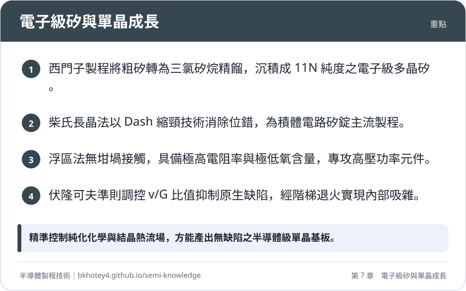
<figcaption>重點圖卡：電子級矽與單晶成長</figcaption>
</figure>

<figure markdown>
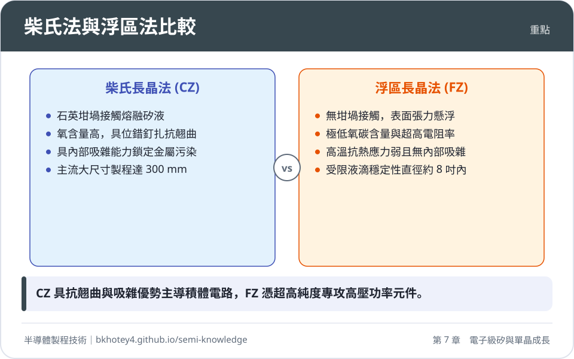
<figcaption>重點圖卡：柴氏法與浮區法比較</figcaption>
</figure>

<figure markdown>
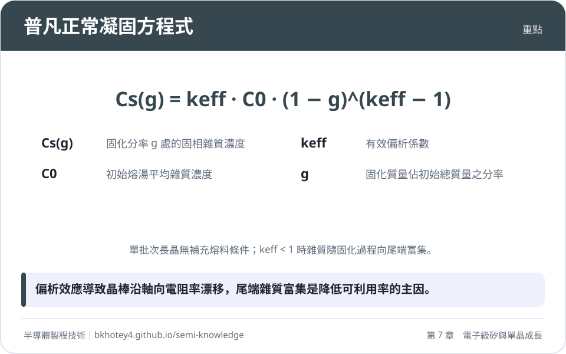
<figcaption>重點圖卡：普凡正常凝固方程式</figcaption>
</figure>

<figure markdown>
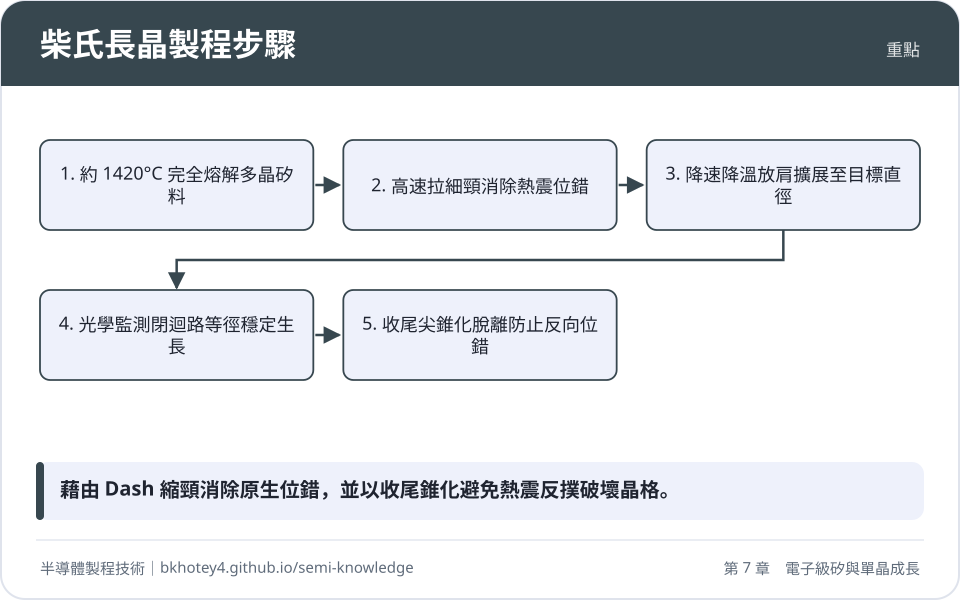
<figcaption>重點圖卡：柴氏長晶製程步驟</figcaption>
</figure>

</div>

## 習題

**1.** 試比較柴氏長晶法（CZ）與浮區長晶法（FZ）在設備幾何、雜質含量（特別是氧與碳）及機械強度上的主要差異，並說明為何先進 CMOS 邏輯製程多採用 CZ 晶圓而非純度更高的 FZ 晶圓？

??? success "參考解答"
    1. **設備與雜質差異**：
       * **幾何與接觸容器**：CZ 法將多晶原料完全熔融於高純度石英坩堝（$\text{SiO}_2$）中；FZ 法為無坩堝懸浮熔區製程，熔液僅由兩端固態矽棒支撐。
       * **雜質含量**：CZ 法因石英坩堝溶蝕與石墨熱區反應，含有高濃度的間隙氧（典型值 $5 \times 10^{17} \sim 1 \times 10^{18}\ \text{cm}^{-3}$）與中低濃度碳；FZ 法完全杜絕坩堝污染，氧含量極低（$< 1 \times 10^{16}\ \text{cm}^{-3}$），碳含量亦低於 $1 \times 10^{15}\ \text{cm}^{-3}$。
    2. **機械強度與製程相容性**：
       * **位錯釘扎效應**：CZ 晶圓中過飽和的間隙氧原子在高溫熱處理時會偏析於差排核心周圍（形成柯垂耳氣團），能有效釘扎差排、抑制差排滑移，使晶圓在歷經多道高溫爐管或快速熱退火時能抵抗重力翹曲與熱應力。FZ 晶圓因幾近無氧，高溫抗熱應力變形能力差，極易誘發滑移線（Slip lines）。
       * **內部吸雜（IG）能力**：CZ 晶圓可透過適當退火形成表面無缺陷區（DZ）與體微缺陷區（BMD），利用 $\text{SiO}_x$ 沉澱物主動捕捉製程中的金屬污染；FZ 晶圓則無法實現此內部吸雜機制。
       因此，兼顧機械強度抗翹曲能力與自帶金屬吸雜機制的 CZ 晶圓更適合先進 CMOS 邏輯製程。

**2.** 某柴氏長晶爐以等速提拉成長摻磷（Phosphorus, P）的矽單晶錠，初始熔湯中的磷濃度為 $C_0 = 1.0 \times 10^{15}\ \text{atoms/cm}^3$。已知磷在該長晶條件下的有效偏析係數 $k_{eff} = 0.35$。請根據普凡（Pfann）正常凝固方程式，計算：
(1) 當晶棒固化分率分別為 $g = 0$（晶棒起始端）與 $g = 0.8$（固化 80% 處）時的固相磷濃度。
(2) 計算 $g = 0.8$ 處相對於 $g = 0$ 處的摻雜濃度增加倍率，並簡述此現象對晶圓生產電阻率均勻度帶來的工程衝擊。

??? success "參考解答"
    (1) 根據普凡正常凝固方程式：
    $$C_S(g) = k_{eff} \cdot C_0 \cdot (1 - g)^{k_{eff} - 1}$$
    * 當 $g = 0$ 時：
      $$C_S(0) = k_{eff} \cdot C_0 = 0.35 \times 1.0 \times 10^{15}\ \text{cm}^{-3} = 3.5 \times 10^{14}\ \text{atoms/cm}^3$$
    * 當 $g = 0.8$ 時：
      $$1 - g = 0.2$$
      $$k_{eff} - 1 = 0.35 - 1 = -0.65$$
      $$C_S(0.8) = 0.35 \times 1.0 \times 10^{15} \times (0.2)^{-0.65}$$
      由於 $(0.2)^{-0.65} = (5)^{0.65} \approx 2.848$：
      $$C_S(0.8) \approx 3.5 \times 10^{14} \times 2.848 \approx 9.97 \times 10^{14}\ \text{atoms/cm}^3$$
    (2) 濃度增加倍率：
    $$\frac{C_S(0.8)}{C_S(0)} = (1 - 0.8)^{-0.65} \approx 2.85\ \text{倍}$$
    工程衝擊：由於磷的偏析係數遠小於 1，雜質大量滯留於殘餘熔湯中，使晶棒沿生長軸向的摻雜濃度急遽上升。因半導體電阻率反比於活性載子濃度（$\rho \approx 1 / (q \mu n)$），晶棒末端的電阻率將大幅降低（本例中下降至初始值的約 35%），導致整根晶錠有相當比例的尾端材料超出半導體元件嚴苛的電阻率規格，降低材料可利用率並增加邊際報廢成本。

**3.** 試依據伏隆可夫準則（Voronkov criterion），說明長晶速率 $v$ 與固液介面軸向溫度梯度 $G$ 的比值 $v/G$ 如何主導單晶矽內部原生點缺陷的生長型態。並說明長晶爐中「晶穴缺陷」（COP）的微觀本質及其對先進邏輯元件閘極氧化層的具體破壞機制。

??? success "參考解答"
    1. **$v/G$ 比值對缺陷之主導機制**：
       * 固液生長介面處同時存在熱平衡濃度的空位（$V$）與自間隙矽原子（$I$）。因空位擴散活化能與擴散速率在降溫過程中不同，系統缺陷主導型態取決於對流/傳輸平衡比值 $v/G$。
       * 當 $v/G > (v/G)_{\text{crit}}$（臨界值約 $1.3 \times 10^{-5}\ \text{cm}^2\cdot\text{s}^{-1}\cdot\text{K}^{-1}$）時，空位通量超越間隙原子，晶體冷卻後為空位過飽和（Vacancy-rich），空位相互聚集成微觀八面體空洞。
       * 當 $v/G < (v/G)_{\text{crit}}$ 時，自間隙矽原子主導（Interstitial-rich），過飽和間隙原子聚集成間隙型差排環（A/B-swirl 缺陷）。
       * 當 $v/G \approx (v/G)_{\text{crit}}$ 時，兩種點缺陷充分復合湮滅，形成無原生微缺陷的純淨矽（Pure Silicon）。
    2. **COP 的本質與破壞機制**：
       * 微觀本質：COP（Crystal-Originated Particles）為過飽和空位聚集形成之奈米級八面體空洞（Octahedral Voids），其內壁常附著極薄的非晶態氧化矽。當晶圓經化學機械拋光（CMP）與標準清洗（如 SC-1）微蝕刻後，暴露於表面的空洞呈現為微米或次微米級的表面凹坑。
       * 破壞機制：在 CMOS 製程中，若 COP 恰好坐落於閘極主動區，沉積或熱氧化的閘極介電層在凹坑邊緣會產生台階覆蓋不良與幾何薄化；同時尖銳邊緣會造成局域電場集中（Electric field enhancement），導致閘極漏電流大幅攀升，並提早引發介電質崩潰（TDDB），嚴重破壞閘極氧化層完整性（GOI）。

**4.** 請利用巴頓-普萊姆-斯里奇特（BPS）模型，計算當長晶提拉速度為 $v_p = 1.2\ \text{mm/min}$、界面溶質擴散邊界層厚度為 $\delta_c = 0.05\ \text{cm}$、雜質在矽熔液中的擴散係數為 $D = 2.5 \times 10^{-4}\ \text{cm}^2/\text{s}$，且該雜質之平衡偏析係數 $k_0 = 0.023$（以銻為例）時的有效偏析係數 $k_{eff}$。若透過增強坩堝旋轉將擴散邊界層厚度壓低至 $\delta_c = 0.01\ \text{cm}$，則 $k_{eff}$ 將變為多少？

??? success "參考解答"
    根據 BPS 模型方程式：
    $$k_{eff} = \frac{k_0}{k_0 + (1 - k_0) \exp\left( - \frac{v_p \cdot \delta_c}{D} \right)}$$
    首先將提拉速率 $v_p$ 換算為標準單位：
    $$v_p = 1.2\ \text{mm/min} = \frac{0.12\ \text{cm}}{60\ \text{s}} = 2.0 \times 10^{-3}\ \text{cm/s}$$
    
    (1) 當 $\delta_c = 0.05\ \text{cm}$ 時：
    計算無因次指數項：
    $$\frac{v_p \cdot \delta_c}{D} = \frac{2.0 \times 10^{-3}\ \text{cm/s} \times 0.05\ \text{cm}}{2.5 \times 10^{-4}\ \text{cm}^2/\text{s}} = \frac{1.0 \times 10^{-4}}{2.5 \times 10^{-4}} = 0.40$$
    計算指數值：
    $$\exp(-0.40) \approx 0.6703$$
    代入 BPS 公式：
    $$k_{eff} = \frac{0.023}{0.023 + (1 - 0.023) \times 0.6703} = \frac{0.023}{0.023 + 0.977 \times 0.6703}$$
    $$k_{eff} = \frac{0.023}{0.023 + 0.6549} = \frac{0.023}{0.6779} \approx 0.0339$$
    
    (2) 當 $\delta_c = 0.01\ \text{cm}$ 時：
    $$\frac{v_p \cdot \delta_c}{D} = \frac{2.0 \times 10^{-3}\ \text{cm/s} \times 0.01\ \text{cm}}{2.5 \times 10^{-4}\ \text{cm}^2/\text{s}} = \frac{2.0 \times 10^{-5}}{2.5 \times 10^{-4}} = 0.08$$
    計算指數值：
    $$\exp(-0.08) \approx 0.9231$$
    代入 BPS 公式：
    $$k_{eff} = \frac{0.023}{0.023 + (1 - 0.023) \times 0.9231} = \frac{0.023}{0.023 + 0.977 \times 0.9231}$$
    $$k_{eff} = \frac{0.023}{0.023 + 0.9019} = \frac{0.023}{0.9249} \approx 0.0249$$
    由此可見，邊界層厚度減薄（對流攪拌增強）會使 $k_{eff}$ 更逼近熱力學平衡值 $k_0$（0.023）。

**5.** 內部吸雜（Internal Gettering, IG）製程通常採用典型的「高溫—低溫—中高溫」（Hi-Lo-Hi）三步驟熱退火。試說明：
(1) 各階段溫度區間所驅動的氧原子物理擴散與相變行為。
(2) 為何若缺少第一步高溫退火，直接進行低溫形核與中溫成長，會導致積體電路元件嚴重損毀？

??? success "參考解答"
    (1) **Hi-Lo-Hi 三步驟之物理機制**：
    * **第一步：高溫外擴散（Denudation, 約 $1100^\circ\text{C} \sim 1150^\circ\text{C}$）**：此高溫下固溶度大幅提高，晶圓表層的過飽和度消失；靠近晶圓表面的間隙氧原子（$[\text{O}_i]$）快速朝外表面擴散並逸出（Out-diffusion），在近表面數微米深度範圍內形成低氧濃度的「表面無缺陷區」（DZ）。
    * **第二步：低溫形核（Nucleation, 約 $650^\circ\text{C} \sim 750^\circ\text{C}$）**：此時氧固溶度大幅降低，晶圓主體深處處於高度熱力學過飽和狀態。氧擴散速率受限但臨界形核功極低，依均質成核機制於晶圓深層內部自發形成高密度（$10^9 \sim 10^{10}\ \text{cm}^{-3}$）的穩定 $\text{SiO}_x$ 臨界晶核。
    * **第三步：中高溫析出成長（Growth, 約 $1000^\circ\text{C} \sim 1050^\circ\text{C}$）**：提升溫度以增強氧的擴散係數，使主體中的過飽和氧快速向既有晶核聚集並析出長大為巨觀的體微缺陷（BMD）。沉積物的體積膨脹誘發差排環與局部應變場，形成高效捕捉金屬雜質的吸雜阱。
    (2) **跳過第一步的毀滅性後果**：
    若未經第一步高溫外擴散，晶圓表面極淺層（深度 $< 5\ \mu\text{m}$，即電晶體通道、源/汲極接面所在區域）的間隙氧濃度仍維持在極高的初始過飽和狀態。在隨後的形核與析出成長退火中，氧化矽沉澱（BMD）將直接於元件主動層表面生長。這將直接截斷電晶體導電通道、破壞閘極介電層完整性，並在 PN 接面處形成深能階複合中心與微通道，導致元件面臨嚴重的接面漏電流崩潰與功能失效。

---

## 本章術語

- **MGS**（冶金級矽，Metallurgical Grade Silicon）：於電弧爐中以碳還原石英石所產出之粗矽原料，純度典型值約為 98% 至 99%。
- **EGS**（電子級矽，Electronic Grade Silicon）：經過三氯矽烷合成、分餾精餾純化與化學氣相沉積還原後，純度達到 11N（99.999999999%）的多晶矽材料。
- **CZ Method**（柴氏長晶法，Czochralski Method）：將電子級多晶矽於石英坩堝內熔解，藉由浸入種晶並精確控制提拉與旋轉，拉製成單晶矽錠的生長工藝。
- **FZ Method**（浮區長晶法，Float-Zone Method）：利用高頻電磁感應局部加熱多晶矽棒使其形成懸浮熔融區，不依賴坩堝直接生長超高純度單晶矽之長晶方法。
- **Dash Necking**（縮頸技術）：在種晶浸入高溫熔液後以高拉速生長細頸結構，利用晶格幾何邊界迫使熱震引發的滑移差排滑出晶體自由表面以消除線缺陷的關鍵工藝。
- **Segregation Coefficient**（偏析係數）：凝固相變平衡時，溶質雜質在固相中的濃度與其在液相中的濃度之比值（$k_0 = C_S / C_L$）。
- **BPS Model**（BPS 理論模型）：由 Barton、Prime 與 Slichter 提出，考量固液界面停滯邊界層擴散限制後，計算雜質有效偏析係數 $k_{eff}$ 的動力學公式。
- **MCZ**（磁場柴氏長晶法，Magnetic Czochralski）：於柴氏長晶爐外側施加靜態或尖點磁場，利用導電熔矽運動引發之羅倫茲力抑制熔湯亂流對流的技術。
- **Voronkov Criterion**（伏隆可夫準則）：指出單晶生長冷卻後殘存的原生點缺陷型態（空位型或間隙矽型）取決於生長速率與軸向溫度梯度比值 $v/G$ 是否高於臨界值的熱力學理論。
- **COP**（晶穴缺陷，Crystal-Originated Particles）：晶體冷卻過程中過飽和空位聚集形成之微觀八面體空洞，經清洗微蝕刻後於表面暴露形成的奈米級凹坑。
- **Internal Gettering**（內部吸雜，IG）：利用柴氏單晶矽固有之間隙氧，藉階梯式退火在晶圓內部深層沉積二氧化矽微缺陷以捕捉有害過渡金屬雜質的純化技術。
- **Denuded Zone**（表面無缺陷區，DZ）：經由高溫氧外擴散退火後，在晶圓表層所形成氧濃度極低、無氧化沉澱物與微缺陷的主動元件製作區域。
- **BMD**（體微缺陷，Bulk Microdefect）：在矽晶圓深層內部由過飽和氧析出形成的二氧化矽微沉澱物及其伴生微差排，為內部吸雜的主要物理捕捉結構。
- **Thermal Donors**（熱施體，TD）：固溶間隙氧於 $400^\circ\text{C} \sim 500^\circ\text{C}$ 區間退火時聚合形成的含氧複合微簇，會呈現淺能階施體特性並改變矽基板電阻率。
- **NTD**（中子嬗變摻雜，Neutron Transmutation Doping）：將高純度單晶矽置入反應爐以熱中子照射，使 ${}^{30}\text{Si}$ 同位素轉化為施體 ${}^{31}\text{P}$ 以獲得極限微觀電阻率均勻度的物理摻雜技術。


## 互動學習

<div class="quiz" data-quiz="02-01"></div>


## 產業最新進展

本節由每日產業新聞自動補充，說明本章技術在產業上的最新發展。

<!-- updates -->
（目前尚無補充。）
