# 第 8 章　晶圓加工與規格

<figure markdown>
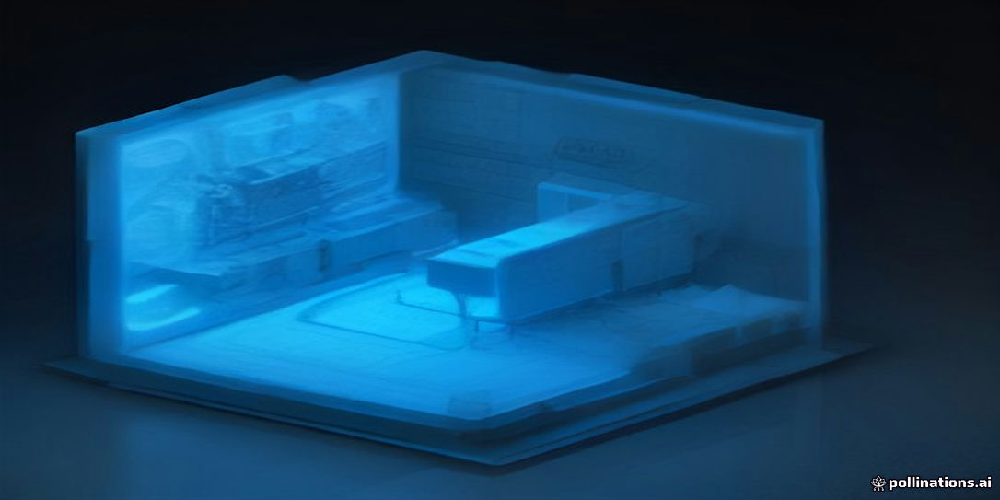
<figcaption>示意插畫：由 AI 生成，用來幫助記憶本章主題，細節請以內文與結構圖為準。</figcaption>
</figure>

!!! abstract "學習目標"
    - 理解從單晶矽棒轉換為精密晶圓基板之機械加工與化學平坦化完整流程與物理機制
    - 掌握晶圓直徑由 200 mm 演進至 300 mm 所引發的力學變形、厚度規格與邊緣排除效應
    - 辨析晶圓幾何形狀指標（TTV、Bow、Warp、SFQR）之定義、成因及其對微影焦深（DOF）的嚴格限制
    - 熟悉先進製程對矽晶圓表面清潔度規格（包含奈米級微粒、金屬雜質、表面粗糙度與有機殘留）的標準要求

## 8.1 晶圓尺寸演進與力學幾何規範

在完成第 7 章所述之柴可拉斯基法（Czochralski method, CZ）或區帶熔煉法（Float Zone, FZ）成長出單晶矽晶棒（Silicon Ingot）後，該晶棒尚無法直接進入微影或蝕刻等後續製程。原始晶棒的外觀通常呈現不規則的圓柱狀，且其晶體取向（Crystal Orientation）尚未在外部標記。本節將探討如何將粗製晶棒加工成符合產業標準規格的晶圓基板，並分析大尺寸晶圓在力學上的挑戰。

### 8.1.1 矽晶棒之前處理：滾圓與晶向定位

單晶矽晶棒在冷卻後，首要步驟是進行「滾圓」（Ingot Grinding）。由於單晶成長過程中，受限於熱流場與拉晶速率的波動，晶棒直徑會存在微小偏差。透過金剛石砂輪（Diamond Grinding Wheel）進行機械研磨，可將晶棒外徑精確校正至標準值（如 300 mm ± 0.2 mm）。

在完成外徑校正後，必須確定晶體的幾何軸向與晶格軸向是否一致。通常利用 X 光繞射（X-ray Diffraction）或光反射法判定晶圓表面之晶面取向（常見為 $\langle 100 \rangle$ 或 $\langle 111 \rangle$）。為了讓後續製程（如離子佈植的通道效應控制）以及自動化設備能辨識晶圓的旋轉角度，必須在晶棒側面加工出定位標誌：

1.  **平邊（Flat）**：主要用於 200 mm（8 吋）及更小尺寸的晶圓。在晶棒側面磨出一條或多條平邊。主平邊（Primary Flat）代表特定的晶向，次平邊（Secondary Flat）則用來區分摻雜類型（n-type 或 p-type）。
2.  **凹口（Notch）**：用於 300 mm（12 吋）及以上尺寸的晶圓。由於平邊會造成較大的材料浪費，且在高速旋轉製程（如旋轉塗佈光阻）中會引起空氣擾流與質量不平衡，現代大尺寸晶圓改採在邊緣切出一個直徑約 1 mm 的 V 型凹口作為定位基準。

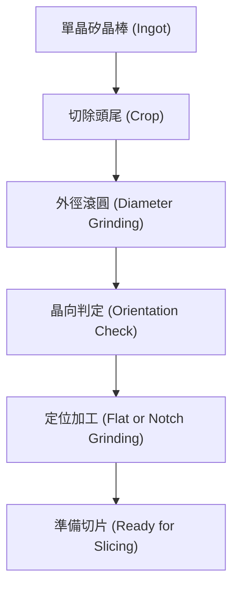

### 8.1.2 晶圓尺寸演進與標準化規格

半導體產業為了降低單一晶粒（Die）的生產成本，晶圓尺寸隨時間持續擴大。較大的晶圓面積意味著在相同的製程時間內，可以產出更多的晶粒，從而實現規模經濟。

下表列出半導體產業主流規格的演進與典型物理參數：

| 晶圓直徑 (mm) | 典型厚度 ($\mu m$) | 定位方式 | 導入年代 (大約) |
| :--- | :--- | :--- | :--- |
| 150 (6 吋) | 625 | 平邊 (Flat) | 1980s |
| 200 (8 吋) | 725 | 平邊 (Flat) | 1990s |
| 300 (12 吋) | 775 | 凹口 (Notch) | 2000s |

!!! note "關於 450 mm 晶圓"
    產業曾於 2010 年代討論推動 450 mm（18 吋）晶圓，但由於設備研發成本極高、機台佔地面積過大，且 300 mm 廠的自動化與良率已達極高水準，目前 450 mm 的量產計畫多處於停滯狀態。

晶圓厚度的增加是為了維持機械強度。隨著直徑增加，若厚度保持不變，晶圓將變得極易碎裂且難以在製程中保持平坦。

### 8.1.3 大直徑晶圓的自重撓曲力學分析

當晶圓尺寸從 200 mm 增加至 300 mm，其力學行為發生顯著變化。最核心的問題是「自重撓曲」（Self-weight Deflection）。在製程設備中，晶圓常被放置在支撐點上（如機械手臂的叉手或擴散爐的晶舟），此時晶圓會因自身重量產生向下彎曲。

根據固體力學中薄圓板（Thin Circular Plate）的變形理論，一個受均勻重力負載且在中心支撐或邊緣支撐的圓板，其最大撓曲量 $\delta_{max}$ 與半徑 $R$ 及厚度 $t$ 的關係如下：

$$\delta_{max} \propto \frac{\rho g R^4}{E t^2}$$

其中：
- $\rho$ 為矽的密度（約 $2.33 \, \text{g/cm}^3$）。
- $g$ 為重力加速度。
- $R$ 為晶圓半徑。
- $E$ 為矽的楊氏模量（Young's Modulus，對於 $\langle 100 \rangle$ 晶向約為 $130 \, \text{GPa}$）。
- $t$ 為晶圓厚度。

由公式可知，撓曲量與半徑的四次方成正比，與厚度的平方成反比。這解釋了為何 300 mm 晶圓必須比 200 mm 晶圓更厚（從 $725 \, \mu m$ 增加至 $775 \, \mu m$），以補償因半徑增加帶來的劇烈撓曲。

!!! warning "晶圓支撐挑戰"
    在 300 mm 製程中，若支撐點設計不當，自重撓曲會導致晶圓與感測器之間的距離改變，影響微影對焦精度，甚至在加熱製程中因應力分布不均引發位錯（Dislocation）或滑移（Slip），導致元件失效。

### 8.1.4 有效面積增益與邊緣排除區

晶圓尺寸升級的最直接驅動力是面積增益。從 200 mm 升級到 300 mm，直徑增加 1.5 倍，但總面積 $A = \pi R^2$ 則增加至約 2.25 倍。

然而，並非晶圓上的所有區域都能用於製造元件。在晶圓的最外圈區域，由於：
1.  **光阻邊緣去除（Edge Bead Removal, EBR）**：為了防止光阻在邊緣堆積剝落污染機台。
2.  **化學機械拋光（CMP）不均勻性**：邊緣處的研磨速率通常與中心不同。
3.  **電漿邊緣效應**：蝕刻或薄膜沉積時，邊緣電場分布不均。

因此，規範中定義了「邊緣排除區」（Edge Exclusion Zone, EEZ），通常為距離邊緣 $2 \, \text{mm}$ 至 $3 \, \text{mm}$ 的環狀區域。

有效利用面積 $A_{eff}$ 可表示為：
$$A_{eff} = \pi (R - EEZ)^2$$

隨著晶圓尺寸增大，EEZ 佔總面積的比例會下降。例如，在 $EEZ = 3 \, \text{mm}$ 的情況下：
- 200 mm 晶圓：邊緣浪費面積佔比約 $5.9\%$。
- 300 mm 晶圓：邊緣浪費面積佔比約 $3.9\%$。

這意味著大尺寸晶圓不僅提供了更多的總面積，還提升了面積的利用率。此外，對於大尺寸的晶粒（如高效能運算晶片 GPU/CPU），在大晶圓上排列時，邊緣處被切斷的「殘缺晶粒」（Partial Dies）比例較低，這進一步提升了整體的產出良率（Gross Die per Wafer）。

### 8.1.5 晶圓背面與倒角規範

除了正面規格外，現代製程對晶圓邊緣的幾何形狀亦有嚴格要求。切片後的晶圓邊緣極為鋒利，易產生應力集中導致碎裂，且容易掉落微塵（Particles）。因此，必須進行「倒角」（Edge Profiling），將邊緣加工成圓弧狀（R-shape）或梯形（T-shape）。

!!! example "產業實例"
    在 300 mm 邏輯製程中，晶圓邊緣的幾何形狀會直接影響光阻浸潤式微影（Immersion Lithography）的表現。若倒角處的平整度不佳，浸潤水珠可能在邊緣產生氣泡或殘留，進而造成缺陷。因此，領先供應商如環球晶圓（GlobalWafers）或信越半導體（Shin-Etsu）對倒角處的粗糙度與對稱性皆有極嚴苛的量測標準。

## 8.2 晶圓成形加工：切片、倒角與機械研磨

在單晶矽晶棒完成晶向判定、滾圓（Ingot Grinding）與定位槽（Notch）研磨後（見第 7 章），必須將塊材矽加工成具備極高幾何精度、極低表面粗糙度與最低結晶缺陷的薄片狀晶圓基板。此加工階段包含切片、倒角與雙面研磨，各道工序緊密相扣，整體成形流程如下圖所示：

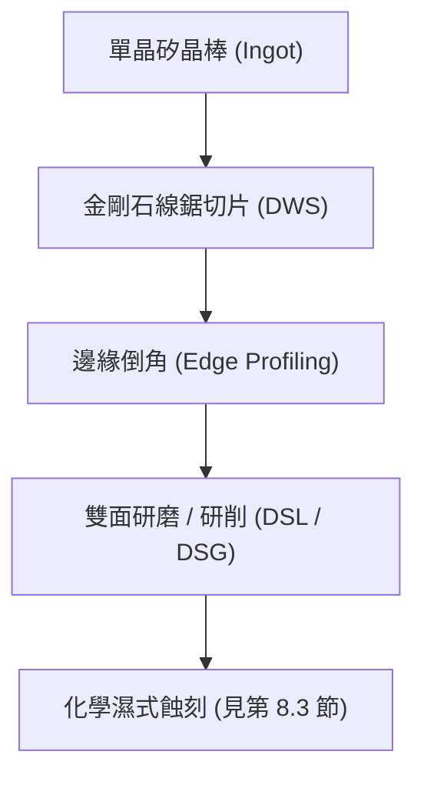

### 金剛石線鋸切割機制與切口損耗

切片工序的物理目標是將高剛性的單晶矽晶棒沿垂直晶軸方向精確分割為數百枚厚度均勻的薄片。現代 300 mm 矽晶圓製程已全面捨棄早期懸浮磨料漿的游離磨料線鋸（Slurry Wire Saw, SWS），改採固定磨料的「金剛石線鋸」（Diamond Wire Sawing, DWS）。

#### 切割去除力學
金剛石線鋸的核心為高強度芯線（如超高抗拉強度鋼線或鎢線），其表面透過電鍍鎳金屬基質或樹脂黏結劑，牢固鑲嵌粒徑分布均勻（典型粒徑為 $8 \sim 15\ \mu\text{m}$）之微米級金剛石磨粒。切割時，鋼線以極高線速（典型值達 $20 \sim 40\ \text{m/s}$）在導輪組引導下進行高速往復或單向行進，並施加微升/分等級的切削液降溫與潤滑。

矽為共價鍵結晶之典型硬脆材料，其材料去除行為取決於切削時施加於微觀接觸區的應力場。當單一金剛石磨粒劃過矽晶表面時，應力集中促使磨粒尖端下方產生高密度剪切應變。若切深低於臨界延性切削深度（Critical Depth of Cut, $d_c$），矽將經歷壓力誘發的相轉變（如從金剛石立方結構 Si-I 轉為金屬相 Si-II）並產生塑性流動（延性模式）；然而在追求產出的工業高速切削下，磨粒切深通常大於 $d_c$，加工處於「脆性斷裂模式」（Brittle Fracture Regime）。

在脆性模式下，磨粒受垂直力作用壓入矽材料時，基底內部首先形成垂直於表面的「中位裂紋」（Median Cracks）；當磨粒滑移卸載時，殘餘彈性應力驅使平行或斜向於表面的「側向裂紋」（Lateral Cracks）失穩擴展並交會至自由表面，最終使微小碎屑剝落，達到材料去除的目的。

```
       [金剛石磨粒] (運動方向 ->)
           ▼
    ═══════●══════════ 晶圓表面
          /|\
         / | \  <-- 側向裂紋 (Lateral Cracks, 導致材料碎屑剝落)
        /  |  \
           |    <-- 中位裂紋 (Median Crack, 殘留深入基板)
           ▼
```

#### 切口損耗
切片過程中轉化為矽廢粉（Kerf Slurry）而損耗的矽材體積稱為切口損耗（Kerf Loss）。單次切割所產生的切口寬度 $W_{\text{kerf}}$ 可表示為：

$$W_{\text{kerf}} = d_{\text{core}} + 2 \cdot t_{\text{bond}} + 2 \cdot h_{\text{diamond}} + 2 \cdot \delta_{\text{runout}}$$

其中：
* $d_{\text{core}}$ 為線鋸金屬芯線直徑。
* $t_{\text{bond}}$ 為電鍍或結合層厚度。
* $h_{\text{diamond}}$ 為金剛石突出有效高度。
* $\delta_{\text{runout}}$ 為線鋸在高速運轉時的橫向動態擺動振幅（Runout）。

在 300 mm 製程中，$W_{\text{kerf}}$ 典型值約為 $80 \sim 120\ \mu\text{m}$。由於 300 mm 晶圓最終基板厚度規範約為 $775\ \mu\text{m}$，若切口損耗過大，一根晶棒所能產出的晶圓數量將大幅縮減。因此，微細化芯線直徑（推進至 $50\ \mu\text{m}$ 以下）同時維持大於 $4000\ \text{MPa}$ 的抗拉極限，以抑制高張力下的斷線率，是當前線鋸機台的核心研發方向。

---

### 次表面機械損傷層之微裂紋分佈與評估

線鋸加工在晶圓表面產生物理分離的同時，因中位裂紋向下延伸與非均勻應力殘留，會在切削面下方形成數微米至十數微米深的結構退化區，稱為「次表面機械損傷層」（Subsurface Damage Layer, SSD）。

#### SSD 物理微觀構造
SSD 由外而內大致呈現三層連續分布：
1. **多晶/非晶層（Amorphous/Polycrystalline Layer）**：緊鄰切削表面，厚度約數十至數百奈米，由極限剪切應力引發晶格瓦解崩塌而成。
2. **高密度差排群與微裂紋層（Dislocation & Micro-crack Layer）**：厚度約 $1 \sim 10\ \mu\text{m}$，包含無數深度不一的微細解理裂紋（Cleavage Micro-cracks），裂紋尖端常伴隨局部塑性變形殘留之應力集中。
3. **深層彈性應力殘留區（Residual Elastic Strain Zone）**：微裂紋下方仍存在顯著之晶格彈性畸變。

根據壓痕力學推導，由剛性壓頭引發的中位裂紋最大擴展深度 $C_m$ 與施加之法向載重 $P_n$ 存在冪次關係：

$$C_m \propto \left( \frac{E}{H} \right)^{1/2} \left( \frac{K_{Ic}}{H} \right)^{-2/3} P_n^{2/3}$$

其中 $E$ 為揚氏模數（Young's Modulus），$H$ 為硬度（Hardness），$K_{Ic}$ 為矽單晶之斷裂韌性（Fracture Toughness）。由於晶向之原子面密度不同，微裂紋易沿解理能量最低之 $\{111\}$ 面優先延伸。若未完全清除 SSD 即進行後續高溫熱製程，殘留微裂紋尖端將誘發熱應力集聚，導致差排滑移擴散（Slip Lines），嚴重時甚至引發晶圓在高溫爐管中破裂。

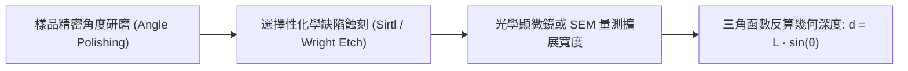

#### SSD 深度評估技術
SSD 深度的精準度量是決定後續研磨與化學蝕刻移除量的重要依據。常用評估方法包括：
* **角度研磨化學染色法（Angle Polishing and Etching）**：將晶圓切片樣品以極小傾角（如 $\theta = 1^\circ \sim 2^\circ$）進行斜向研磨拋光，將深度方向放大 $\csc\theta$ 倍（約 30 至 60 倍），再浸入選擇性缺陷蝕刻液（如 Wright 蝕刻液或 Sirtl 蝕刻液）腐蝕微裂紋與差排。透過光學顯微鏡測量染色區水平長度 $L$，即可精確換算物理損傷深度 $d = L \cdot \sin\theta$。
* **顯微共軛焦拉曼光譜（Micro-Raman Spectroscopy）**：利用波長穿透特性檢測矽晶格光學聲子峰（單晶矽典型尖銳峰位於 $520.5\ \text{cm}^{-1}$）。當存在殘餘拉伸應力或晶格非晶化時，拉曼譜峰會產生紅移（Red-shift）與半高寬增寬（FWHM Broadening），藉此非破壞性探測應力殘留深度。

---

### 邊緣倒角工程

剛切片完成的晶圓邊緣呈現銳利的 $90^\circ$ 直角邊緣，此處佈滿鋸切引起的微碎裂（Chipping）。在固體力學中，尖銳直角與表面微孔隙構成幾何不連續性，會產生極高的應力集中係數（Stress Concentration Factor, $K_t$）。

$$K_t = \frac{\sigma_{\max}}{\sigma_{\text{nominal}}} \approx 1 + 2\sqrt{\frac{a}{\rho}}$$

其中 $a$ 為邊緣裂紋深度，$\rho$ 為裂紋尖端曲率半徑。當尖端半徑 $\rho$ 趨近於零時，局部應力 $\sigma_{\max}$ 將放大數倍至數十倍。若未經處理，晶圓在後續製程的晶圓盒卡槽傳送、機械手臂夾持或高溫熱循環時，極易自邊緣起裂導致整片碎裂；此外，銳角外緣也容易刮擦剝落產生顆粒污染（Particle Contamination）。

```
直角邊緣（切片後）              倒角邊緣（Edge Profiling 後）
       │                                 ╭─────
       │ ◄-- 極高應力集中                │  R-type (圓弧形)
───────┘                                 ╰─────
```

#### 倒角幾何外型規範
半導體設備與材料國際組織（SEMI）制定了嚴格的邊緣倒角幾何輪廓規範。倒角外型主要分為兩類：
1. **多面角型（T-shape Profile）**：邊緣研磨成對稱的上斜角、垂直外周面與下斜角。
2. **圓弧型（R-shape Profile）**：邊緣研磨成平滑過渡的連續圓弧曲面，曲率半徑具嚴格公差。

現代 300 mm 晶圓主流均採 R-shape 輪廓，其幾何連續性可徹底消除應力集中點，並使旋轉塗佈製程中的光阻邊緣珠狀殘留（Edge Bead）易於藉由溶劑沖洗清除。

#### 倒角加工機台實作
倒角加工係使用鑲嵌精密金剛石砂粒的金屬結合劑成形砂輪（Formed Diamond Wheel）。加工時砂輪高速旋轉，冷卻液高速注入磨削區，晶圓以精密伺服馬達帶動低速自轉，並維持恆定法向進給阻抗。除外圓周外，晶圓定位槽（Notch）的微小幾何半徑處亦需專用的小型微細砂輪進行高精度磨削修整，確保無任何鋸切崩裂痕跡殘留。

---

### 雙面研磨與研削之材料去除力學

倒角完成後，晶圓表面仍保有明顯的切片波紋（Waviness）以及約數微米至十微米深度的次表面損傷層，且厚度均勻性尚未達標。此時必須導入高平坦化研磨程序。

#### 雙面研磨（Double-Side Lapping, DSL）
雙面研磨是一種利用游離磨料（Loose Abrasives）進行的面接觸加工。晶圓放置於行星齒輪機構帶動的星輪（Carrier）薄板型保持架內，上下夾於以反向旋轉的高硬度鑄鐵研磨盤（Lapping Plate）之間。由研磨液輸送管均勻滴入含懸浮磨粒（典型材料為硬質氧化鋁 $\alpha\text{-}\text{Al}_2\text{O}_3$ 或碳化矽 $\text{SiC}$，磨粒粒徑中位數 $d_{50} \approx 5 \sim 15\ \mu\text{m}$）的水基研磨漿。

雙面研磨的巨觀材料去除速率（Material Removal Rate, $MRR$）遵循經典的普雷斯頓方程式（Preston's Equation）：

$$MRR = \frac{dh}{dt} = k_P \cdot P \cdot v$$

其中：
* $h$ 為晶圓厚度移除量。
* $P$ 為施加於研磨盤的單位面積法向壓力（典型值 $10 \sim 30\ \text{kPa}$）。
* $v$ 為晶圓任一點相對於研磨盤的瞬時滑移相對速度。
* $k_P$ 為普雷斯頓係數（Preston Coefficient），綜合反映了磨料硬度、晶圓破壞韌性、化學載體摩擦係數與接觸介面力學性質。

在微觀尺度下，研磨盤的相對運動迫使多角形狀的磨粒在晶圓表面產生三體摩擦滾動（Three-body Rolling）與刮擦（Scratching）。磨粒的滾動壓入會產生極細微的微破碎凹坑（Pits），均勻侵蝕並迅速削平切片留下的宏觀起伏峰值，大幅降低總厚度變異（Total Thickness Variation, TTV）。

| 加工參數 / 特性 | 雙面研磨 (Double-Side Lapping, DSL) | 雙面研削 (Double-Side Grinding, DSG) |
| :--- | :--- | :--- |
| **磨料存在狀態** | 游離磨料（磨料懸浮於研磨液中） | 固定磨料（金剛石砂輪結合體） |
| **材料去除機制** | 三體微破碎滾動衝擊、微小刮擦 | 二體延性/脆性微切削、犁耕剪切 |
| **表面粗糙度 ($Ra$)** | 典型值 $0.2 \sim 0.5\ \mu\text{m}$ | 典型值 $0.02 \sim 0.1\ \mu\text{m}$ |
| **次表面損傷深度 ($SSD$)** | 深度較深（約 $5 \sim 15\ \mu\text{m}$） | 深度較淺（約 $1 \sim 3\ \mu\text{m}$） |
| **耗材與環保負擔** | 產生大量含磨料與矽粉之研磨廢漿 | 僅產生微細矽粉，水性冷卻液易回收 |
| **幾何形貌控制能力** | 宏觀厚度差均勻化佳，邊緣崩塌（Roll-off）控制較難 | 奈米級剛性軸控制，平坦度精度極高 |

#### 雙面研削（Double-Side Grinding, DSG）
由於游離磨料研磨在微裂紋深度控制以及研磨漿環保處置上的限制，高階 300 mm 晶圓產線廣泛引入以固定磨料（Bonded Abrasives）為基礎的雙面研削（DSG）技術。

DSG 採用超精密金剛石砂輪，其轉軸主軸由高剛性空氣軸承或靜壓液壓軸承支撐。晶圓在水平拘束下，兩側同時被上下兩組傾斜微小角度的薄壁杯型砂輪以數千轉每分的高速進行端面磨削。DSG 的接觸機制屬於「二體磨擦微切削」（Two-body Micro-cutting）。透過嚴格控制砂輪進給率（Feed Rate），使單顆磨粒的切深逼近延性轉變臨界厚度，大幅抑制微裂紋深度，使磨削後殘留的次表面損傷層深度由 DSL 的十餘微米驟降至 $2\ \mu\text{m}$ 以下，大幅減輕後續化學拋光站點的移除負擔。

經過切片、倒角與雙面研磨/研削後，晶圓已確立優異的宏觀幾何輪廓與厚度一致性，但晶體表層仍覆蓋著一層微觀損傷與加工應力；此應力層必須在進入超精密拋光前，藉由化學濕式蝕刻（見第 8.3 節）加以徹底消除。

!!! note "切片與研磨階段對晶圓整體平坦度（Warp）的影響"
    金剛石線鋸於晶棒內切割時，線鋸鋼線受到材料阻力會產生橫向彎曲形變（Bow-like deflection）。若切割張力與給進速度匹配不良，將使切出的晶圓自然呈現宏觀鞍型或碟型翹曲。後續的雙面研磨（DSL）或研削（DSG）製程雖能將晶圓正反兩面加工至高度互相平行（即降低 TTV），但若晶圓內部鋸切殘留應力分佈非對稱，一旦脫離機台真空吸盤或夾具，鬆弛釋放的彈性應力依然會造成嚴重的局部與全局翹曲（Bow/Warp，詳見第 8.4 節）。

!!! warning "游離磨料滾動嵌入效應"
    在使用碳化矽（$\text{SiC}$）進行雙面研磨時，由於 $\text{SiC}$ 硬度顯著高於單晶矽，若磨粒碎裂產生銳利碎片，部分微粉顆粒可能在三體擠壓時直接被「壓入」矽基底表層，形成物理性嵌入雜質。若未能在後續化學濕式蝕刻中完全溶蝕去除該嵌入層，這些殘留顆粒將在隨後的化學機械拋光（CMP）中被拖曳出深長刮痕，或在熱製程中作為成核中心引發嚴重的非故意堆垛層錯（Stacking Faults）。

## 8.3 化學濕式蝕刻與化學機械拋光

### 濕式化學蝕刻與表面應力釋放

矽晶圓在經歷線鋸切片與雙面機械研磨（見第 8.2 節）後，其表面與次表面區域會殘留深約數微米至十餘微米的機械損傷層（Subsurface Damage, SSD）。此損傷層包含高密度的差排（Dislocations）、微裂紋（Micro-cracks）以及顯著的殘留剪切應力。若直接進行化學機械拋光，微裂紋將在後續熱製程中延伸擴展，導致晶圓破裂或誘發滑移線（Slip Lines）。因此，在進入拋光階段前，必須透過濕式化學蝕刻（Wet Chemical Etching）精確剝離該損傷層，恢復單晶矽的原始晶格完整性。

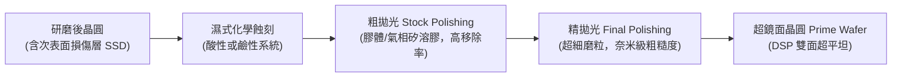

目前工業界去除應力損傷層的化學蝕刻技術主要分為酸性蝕刻與鹼性蝕刻兩大體系，兩者在反應熱力學、動力學機制及產生的微觀形貌上有顯著差異。

#### 1. 酸性蝕刻系統（$\text{HF}/\text{HNO}_3/\text{CH}_3\text{COOH}$）

酸性蝕刻通常採用氫氟酸（Hydrofluoric Acid, $\text{HF}$）、硝酸（Nitric Acid, $\text{HNO}_3$）與稀釋緩衝劑（如冰醋酸 $\text{CH}_3\text{COOH}$ 或水）組成的混合液。其化學反應本質為氧化還原搭配錯合溶解的兩步驟連續反應：

1. **矽的氧化（由硝酸主導）**：
   $$\text{Si} + 4\text{HNO}_3 \rightarrow \text{SiO}_2 + 4\text{NO}_2\uparrow + 2\text{H}_2\text{O}$$
2. **二氧化矽的溶解（由氫氟酸主導）**：
   $$\text{SiO}_2 + 6\text{HF} \rightarrow \text{H}_2\text{SiF}_6 + 2\text{H}_2\text{O}$$

總反應方程式為：
$$\text{Si} + 4\text{HNO}_3 + 6\text{HF} \rightarrow \text{H}_2\text{SiF}_6 + 4\text{NO}_2\uparrow + 4\text{H}_2\text{O}$$

在富含 $\text{HNO}_3$ 且 $\text{HF}$ 濃度受限的配比下，反應速率取決於氟離子向晶圓表面的擴散通量（擴散控制），此時蝕刻呈現等向性（Isotropic），能有效圓滑化研磨產生的銳角裂紋；然而，擴散控制機制容易在晶圓表面產生波長數十微米至數毫米的起伏，即俗稱的橘皮組織（Orange Peel）形貌。添加冰醋酸作為稀釋劑可降低溶液介電常數，抑制 $\text{HNO}_3$ 的離解，使反應維持在可控的穩定速率，典型材料移除量約為每面 $10\,\mu\text{m} \sim 20\,\mu\text{m}$。

#### 2. 鹼性蝕刻系統（$\text{KOH}$ 或 $\text{TMAH}$）

鹼性蝕刻主要採用氫氧化鉀（Potassium Hydroxide, $\text{KOH}$）或四甲基氫氧化銨（Tetramethylammonium Hydroxide, $\text{TMAH}$）水溶液。與酸性系統不同，鹼性蝕刻為非氧化還原反應，而是由親核性氫氧根離子（$\text{OH}^-$）直接攻擊矽原子背向鍵結所驅動的水解反應：

$$\text{Si} + 2\text{OH}^- + 2\text{H}_2\text{O} \rightarrow \text{SiO}_2(\text{OH})_2^{2-} + 2\text{H}_2\uparrow$$

鹼性蝕刻具有強烈的異向性（Anisotropic）。單晶矽不同晶面的原子面密度與懸鍵數（Dangling Bonds）不同，蝕刻速率呈現明顯級距：$R_{\{110\}} > R_{\{100\}} \gg R_{\{111\}}$。在 $\{100\}$ 晶圓表面，由於 $\{111\}$ 面的蝕刻速率極低（典型比值 $R_{\{100\}}/R_{\{111\}} \approx 50 \sim 100$），微觀表面容易形成由 $\{111\}$ 晶面所構成的四角錐體（Pyramids）。

| 特性比較指標 | 酸性蝕刻系統 ($\text{HF}/\text{HNO}_3/\text{CH}_3\text{COOH}$) | 鹼性蝕刻系統 ($\text{KOH}/\text{TMAH}$) |
| :--- | :--- | :--- |
| **反應控制機制** | 質傳擴散控制或化學活化控制（依比例而定） | 表面反應活化能控制（強烈晶向依賴） |
| **蝕刻特性** | 等向性（Isotropic） | 異向性（Anisotropic） |
| **微觀表面形貌** | 平滑、波浪狀起伏（橘皮現象） | 微觀晶面角錐、小琢面結構 |
| **平坦度（TTV）衝擊** | 邊緣易過度蝕刻，形貌控制挑戰大 | 晶面選擇性高，有助於維持大範圍平坦度 |
| **離子污染風險** | 極低（全揮發性酸，易於清洗） | $\text{KOH}$ 具金屬離子 $\text{K}^+$ 污染風險，需高階清洗 |

!!! warning "酸性蝕刻之熱失控效應"
    酸性蝕刻反應為劇烈放熱反應（反應熱約為 $-700\,\text{kJ/mol}$）。若產熱速率高於冷卻系統之熱傳導通量，局部微區溫度上升將呈指數級加速反應速率（阿瑞尼斯方程式關係），導致嚴重的厚度變異（TTV 劣化）與局部點蝕。因此蝕刻槽體必須配置高流通量熱交換器與精密紊流循環攪拌系統。

---

### 化學機械拋光（CMP）基板加工原理與 Preston 方程式

經過化學濕式蝕刻後，晶圓表面雖已排除應力損傷層，但殘留的微觀起伏與粗糙度仍無法滿足微影聚焦需求（見第 12 章）。基板加工必須導入化學機械拋光（Chemical Mechanical Polishing, CMP）。在晶圓製造（Wafer Fabrication）階段，CMP 的物理目標與元件多層內連線（見後續後段製程）截然不同：此處旨在消除全晶圓尺度（Wafer-scale）的起伏並取得原子級平坦表面。

CMP 過程結合了拋光墊（Polishing Pad）的彈性力學作用、拋光漿料（Slurry）的流體力學行為，以及磨粒與化學液在奈米界面的固－液－固相摩擦化學反應。在宏觀尺度上，材料移除率（Material Removal Rate, $MRR$）由普雷斯頓方程式（Preston's Equation）精確描述：

$$MRR = \frac{\Delta h}{\Delta t} = K_p \cdot P \cdot V$$

其中：
* $\Delta h/\Delta t$ 為單位時間內的薄膜或基板厚度移除量（$\text{nm/min}$ 或 $\mu\text{m/min}$）。
* $P$ 為施加於晶圓背面的向下壓力（Downforce Pressure, $\text{kPa}$ 或 $\text{psi}$）。
* $V$ 為晶圓任一點相對於拋光墊表面的相對切線線速度（Relative Velocity, $\text{m/s}$）。
* $K_p$ 為普雷斯頓係數（Preston's Coefficient, $\text{m}^2/\text{N}$ 或 $\text{Pa}^{-1}$）。

$K_p$ 並非純粹的幾何常數，而是高度濃縮了化學與微觀接觸力學的非線性函數：

$$K_p = f\left(\text{Slurry Chemistry}, \text{Abrasive Properties}, \text{Pad Mechanical Properties}, T\right)$$

根據格林伍德－威廉森（Greenwood-Williamson）微觀粗糙接觸理論，拋光墊表面的微凸體（Asperities）受壓與晶圓接觸。當磨粒直徑小於微凸體變形深度時，單顆磨粒所承受的有效法向力取決於拋光墊楊氏模數（Young's Modulus, $E$）與填料硬度。流體剪切場帶動化學漿料軟化後的表面分子鍵，藉由機械摩擦切剪自晶格中剝離。

---

### 粗拋與最終精拋之漿料機制

基板 CMP 為了同時兼顧高生產吞吐量（Throughput）與極限表面粗糙度（Surface Roughness），在工序上嚴格劃分為粗拋（Stock Polishing）與精拋（Final Polishing）兩階段，兩者在化學漿料（Slurry）組成與磨粒物理特性上有顯著差異。

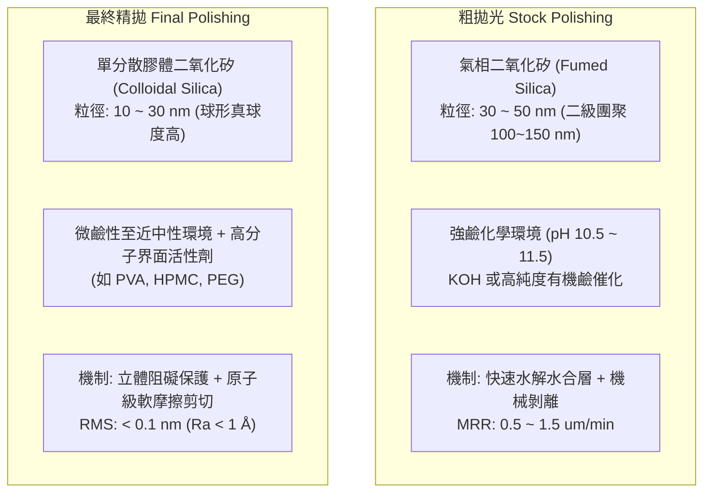

#### 1. 粗拋（Stock Polishing）

粗拋階段的主要任務為迅速消除蝕刻殘留的巨觀微起伏並修正晶圓幾何厚度變異，要求極高的移除速率（典型值 $MRR \approx 0.5\,\mu\text{m/min} \sim 1.5\,\mu\text{m/min}$）：

* **磨粒材料與形態**：採用氣相二氧化矽（Fumed Silica）或煅燒氧化鋁磨粒。氣相矽顆粒由高溫水解 $\text{SiCl}_4$ 製成，具有分支狀鏈狀聚集結構（Agglomerates），一次粒徑約 $30\,\text{nm} \sim 50\,\text{nm}$，二次團聚粒徑達 $100\,\text{nm} \sim 150\,\text{nm}$，具備高機械研磨剪切應力。
* **漿料化學與環境**：漿料處於強鹼環境（$\text{pH} \approx 10.5 \sim 11.5$），藉由 $\text{OH}^-$ 的催化作用，在矽表面迅速生成一層疏鬆多孔的水合二氧化矽膜層（Hydrated Silica Layer, $\text{Si}(\text{OH})_4$ 或 $\text{SiO}_x\cdot n\text{H}_2\text{O}$）。磨粒緊接著將該低剪切強度的水合層刮除，再由化學液重新水化，周而復始。

#### 2. 最終精拋（Final Polishing）

精拋階段的目標在於全面清除粗拋所產生的微細刮痕（Micro-scratches）與微霧度（Haze），達到次埃米級（Sub-Angstrom）微粗糙度（$\text{RMS} < 0.1\,\text{nm}$），其材料移除速率大幅降至數十奈米每分鐘：

* **磨粒材料與形態**：嚴格採用水熱合成或矽酸鹽縮合製備的單分散膠體二氧化矽（Colloidal Silica）。此類磨粒具有完美的真球度（Sphericity）且粒徑分佈呈單峰狹窄分佈（典型平均粒徑 $10\,\text{nm} \sim 30\,\text{nm}$），無硬團聚體存在，從根本上避免了表面刮痕的產生。
* **介面保護機制**：漿料中加入特定分子量的高分子界面活性劑（Surfactants，例如聚乙烯醇 PVA、羥丙基甲基纖維素 HPMC 或聚乙二醇 PEG）。高分子長鏈藉由物理吸附固定於拋光後的平整矽表面，形成一層奈米級的立體阻礙保護層（Steric Hindrance Layer），抑制化學蝕刻在低窪處繼續進行，僅允許微凸處與磨粒接觸研磨，從而達成超光滑化（Smoothening）。

---

### 雙面拋光（DSP）與單面拋光（SSP）之製程架構

隨著先進半導體製程向微縮極限推進，微影製程的景深（Depth of Focus, DOF）預算已降至數十奈米以下。晶圓背面若存在任何幾何形貌缺陷或微觀顆粒，在曝光機靜電吸盤或真空載台（見第 12 章）吸附時，將直接投射至正面上形成失焦區，因此當代直徑 $300\,\text{mm}$ 的超鏡面晶圓（Prime Wafer）製造已全面採用雙面拋光（Double-Side Polishing, DSP）製程。

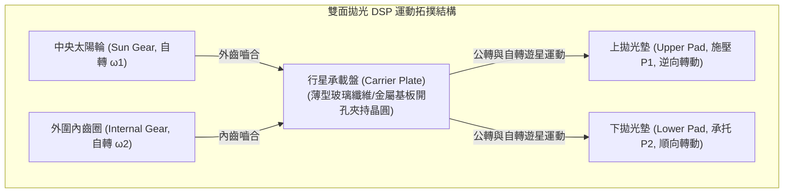

#### 1. 雙面拋光（DSP）之運動幾何學與力學優勢

在 DSP 設備中，晶圓被置於行星齒輪承載盤（Carrier Plate）的專屬孔位中。承載盤同時與中央的太陽輪（Sun Gear）和外圍的內齒圈（Internal Ring Gear）嚙合。晶圓在由聚胺酯（Polyurethane）發泡材料製成的上拋光盤與下拋光盤之間進行行星軌跡運動。

* **受力對稱性**：晶圓正反兩面承受絕對對稱的流體動壓（Hydrodynamic Pressure）與磨粒摩擦剪切力。
* **平坦度控制**：由於兩面同步切削，不僅消除了單面吸附夾持所導致的機械彎曲變形，更能同時消除晶圓的大範圍厚度波動，將總厚度變異（Total Thickness Variation, TTV）與奈米級表面平坦度指標（如 $SFQR$，見第 8.4 節）壓制在最嚴苛的微影公差內。

#### 2. 單面拋光（SSP）與背面霧面（Backside Etch）之控制

相較於超鏡面晶圓，非關鍵性監控晶圓（Monitor Wafer）、擋片晶圓（Dummy Wafer）或部分功率半導體晶圓仍沿用單面拋光（Single-Side Polishing, SSP）工藝：

* **工藝特徵**：晶圓背面透過軟質吸附墊（Backing Film）結合水張力或蠟固定於陶瓷拋光頭（Ceramic Chuck）上，僅對正面進行 CMP 加工。
* **背面霧面（Backside Etched Finish）之功能性保留**：
  在 SSP 流程中，背面通常保留濕式酸性或鹼性蝕刻後的微粗糙霧面狀態。保留一定程度粗糙度的主要目的包括：
  1. **防止無塵室真空吸盤滑移**：過於光滑的背面在真空吸附釋放時，容易因凡得瓦力與殘留真空產生沾黏，導致機械手臂（見第 55 章）取放時脫卡破片。
  2. **非均相外在吸雜（Extrinsic Gettering）**：受控的背面微裂紋與晶格應變場能夠作為金屬雜質（如 $\text{Cu}^+、\text{Fe}^{2+}$ 等過渡金屬，見第 2 章）在後續高溫退火製程中的沉澱捕捉中心（Trap Sites），阻止雜質擴散至正面主動元件區（Active Region）。
  
然而，背面霧面的波紋度必須受到嚴格管制，若表面高低起伏（Peak-to-Valley）過大，微影機吸盤將因接觸應力集中而產生局部翹曲，引發微影疊對（Overlay）誤差。

!!! example "產業實例：先進 300 mm 矽晶圓 DSP 機台架構"
    在主流全球矽晶圓供應體系中（如日本信越化學 Shin-Etsu 與勝高 SUMCO），$300\,\text{mm}$ 單晶矽基板之拋光產線普遍採用高剛性行星式雙面拋光機台（例如 Peter Wolters AC 系列平台）。該類機台導入多通道即時氣壓閉環伺服控制，能針對承載盤不同徑向分區施加非對稱動態補償壓力，配合溫控精度在 $\pm 0.1^\circ\text{C}$ 範圍內的研磨漿循環冷卻系統，使出廠 Prime Wafer 的局部平坦度 $SFQR$ 極值穩定小於 $15\,\text{nm}$。

<!-- fig:1 -->
<figure markdown>
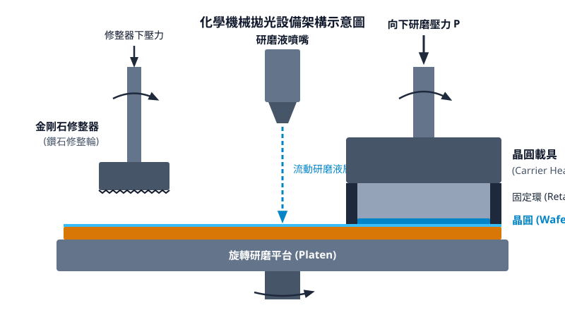
<figcaption>圖 8-1　化學機械拋光設備架構（AI 繪製的示意圖）</figcaption>
</figure>

## 8.4 晶圓平坦度與形貌度量：Bow、Warp 與局部平坦度

### 晶圓幾何基準與中平面定義

在半導體製造中，晶圓幾何形貌（Wafer Geometry）直接決定了後續微影對焦精度與薄膜均勻性。為了定量描述晶圓的三維形狀，國際半導體產業協會（SEMI）制定了一套嚴謹的空間座標與表面定義標準。

設晶圓的前表面（Front Surface，元件製造面）高度分佈為 $z_{\text{front}}(x, y)$，後表面（Back Surface）高度分佈為 $z_{\text{back}}(x, y)$。晶圓在任意點 $(x, y)$ 的局部厚度 $t(x, y)$ 定義為前表面與後表面之垂直距離：

$$t(x, y) = z_{\text{front}}(x, y) - z_{\text{back}}(x, y)$$

晶圓的「中平面」（Median Surface）$z_{\text{med}}(x, y)$ 則為前表面與後表面在垂直方向上的幾何中點軌跡：

$$z_{\text{med}}(x, y) = \frac{z_{\text{front}}(x, y) + z_{\text{back}}(x, y)}{2}$$

基於中平面與厚度分佈，晶圓的全域形貌變異主要由以下參數表徵：

1. **總厚度變異（Total Thickness Variation, TTV）**：在指定有效晶圓區域（Fixed Quality Area, FQA）內，厚度最大值與最小值之差：
   $$\text{TTV} = t_{\max} - t_{\min}$$
2. **中心厚度（Center Thickness）**：晶圓幾何中心點 $(0, 0)$ 處的厚度 $t(0, 0)$。

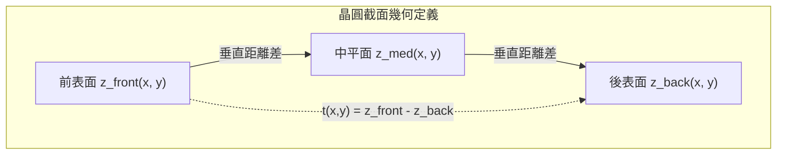

---

### 自由狀態巨觀形貌：彎曲度（Bow）與翹曲度（Warp）

在不受任何外力拘束（如真空吸盤吸附）的「自由狀態」（Free State）下，晶圓會因晶格缺陷、單晶拉晶過程中的熱應力累積，或是表面研磨殘留的機械損傷而呈現巨觀形變。為了消除重力造成的下垂形變，量測時通常採用三點等距支撐法建立量測基準。

#### 1. 彎曲度（Bow）
彎曲度用於表徵晶圓中心相對於邊緣基準平面的凹凸程度，具有正負符號。其定義步驟如下：
- 在半徑為 $R - \delta$ 的圓周上選取三點建立基準平面（Reference Plane），其中 $R$ 為晶圓半徑，$\delta$ 為邊緣排除區（Edge Exclusion Zone，典型值為 $1\,\text{mm}$ 至 $3\,\text{mm}$）。
- 計算中平面在晶圓中心點 $(0, 0)$ 處偏離該基準平面的垂直位移 $\Delta z_{\text{med}}(0, 0)$。

$$\text{Bow} = z_{\text{med}}(0, 0) - z_{\text{ref}}(0, 0)$$

當晶圓中平面中心凸起時，$\text{Bow} > 0$（凸面，Convex）；中心凹陷時，$\text{Bow} < 0$（凹面，Concave）。此指標之缺點為僅取晶圓中心單點計算，無法反映中心以外的高階形變（如馬鞍形形變）。

#### 2. 翹曲度（Warp）
翹曲度是衡量晶圓整體三維變形的真形貌指標。其計算中平面相對於最小平方法（Least Squares Method）擬合出之最佳參考平面的最大峰對谷（Peak-to-Valley, PV）位移：
- 透過最小平方法，在中平面 $z_{\text{med}}(x, y)$ 上擬合出一基準平面 $z_{\text{fit}}(x, y) = ax + by + c$。
- 計算中平面上所有量測點至擬合平面的垂直距離差：

$$\text{Warp} = \max_{(x,y) \in \text{FQA}} \left[ z_{\text{med}}(x, y) - z_{\text{fit}}(x, y) \right] - \min_{(x,y) \in \text{FQA}} \left[ z_{\text{med}}(x, y) - z_{\text{fit}}(x, y) \right]$$

翹曲度恆為非負值（$\text{Warp} \ge 0$），能夠全面捕捉晶圓所有高階彎曲形態（包括波紋狀或馬鞍狀扭曲）。

!!! warning "常見誤解：Bow 與 Warp 的等價性"
    Bow 與 Warp 描述不同的幾何維度。當晶圓呈現對稱的單純球狀形變時，$\text{Warp} \approx |\text{Bow}|$；然而，當晶圓呈現非對稱變形（如四角翹起之馬鞍形）時，中心點可能恰巧落在邊緣擬合平面上，導致 $\text{Bow} \approx 0$，但此時 $\text{Warp}$ 依然可能極大。微影與晶圓傳輸機台評估幾何完整性時，必須同時監控兩者。

---

### 真空吸附狀態與局部平坦度：SFQR 與微影焦深預算

在實際元件製造流程中，晶圓並非處於自由狀態，而是透過真空吸盤（Vacuum Chuck）或靜電吸盤（Electrostatic Chuck, ESC）剛性平貼於平整基準面上。此時，晶圓背面的所有形變被迫壓平，後表面強制貼合吸盤表面，原本的厚度變異（TTV）直接轉化為前表面的絕對高度變化：

$$z_{\text{front, chucked}}(x, y) \approx t(x, y) - t_{\text{ref}}$$

在此狀態下，影響微影成像解析度的關鍵不再是整片晶圓的巨觀 Warp，而是局部曝光視場（Site/Field）內的奈米級平坦度。

#### 1. SFQR 之數學定義
**SFQR**（Site Front-surface Referenced Least-squares Range）是現代先進製程中評估晶圓表面幾何最核心的參數：
- **Site**：將晶圓劃分為固定大小的矩形陣列區域（例如 $26\,\text{mm} \times 33\,\text{mm}$，對應步進掃描式曝光機的單一曝光曝光視野）。
- **Front-surface Referenced**：以吸附狀態下的晶圓前表面數據為基準。
- **Least-squares**：在單一 Site 區域內部，以最小平方法求得該 Site 的前表面擬合局部平面 $z_{\text{site\_fit}}(x, y)$。
- **Range**：計算該 Site 內前表面實際高度對擬合平面的最大正偏差（Peak）與最大負偏差（Valley）之差值：

$$\text{SFQR}_{\text{site}} = \max_{(x,y) \in \text{Site}} \left[ z_{\text{front}}(x, y) - z_{\text{site\_fit}}(x, y) \right] - \min_{(x,y) \in \text{Site}} \left[ z_{\text{front}}(x, y) - z_{\text{site\_fit}}(x, y) \right]$$

整片晶圓的平坦度合格與否，通常以所有 Site 中最大之 $\text{SFQR}$ 值（$\text{SFQR}_{\max}$）或特定百分位數（如 $99.7\%$ 的 Site 皆小於指定閥值）進行判定。

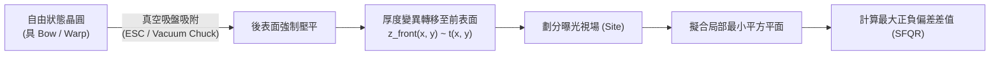

#### 2. SFQR 與微影焦深（DOF）預算的分配
依據光學繞射極限，微影解析度極限由瑞利準則（Rayleigh Criterion）規範，微影焦深（Depth of Focus, DOF）的關係式為（細節推導見第 12 章）：

$$\text{DOF} = k_2 \frac{\lambda}{\text{NA}^2}$$

其中 $\lambda$ 為曝光光源波長，$\text{NA}$ 為物鏡數值孔徑，$k_2$ 為微影製程因子。

在先進微影技術中，由於高數值孔徑（例如浸潤式 ArF 系統 $\text{NA} = 1.35$，或 High-NA EUV 系統 $\text{NA} = 0.55$），系統的焦深預算急遽收縮至數十奈米（nm）以內。微影系統的總焦點預算（Focus Budget）包含多項幾何與光學誤差分配：

$$\text{Focus Budget} \ge \text{SFQR} + \Delta z_{\text{chuck}} + \Delta z_{\text{focus\_sensor}} + \Delta z_{\text{resist\_thickness}}$$

其中 $\Delta z_{\text{chuck}}$ 為曝光機吸盤本身之平整度誤差，$\Delta z_{\text{focus\_sensor}}$ 為對焦感測器誤差，$\Delta z_{\text{resist\_thickness}}$ 為光阻層厚度。若單片晶圓的局部 SFQR 超過總對焦裕度（Focus Margin）所允許的值，曝光成像的光波前將脫離焦深範圍，引發嚴重的散焦現象，導致臨界尺寸（Critical Dimension, CD）線寬失真或圖案斷線。

| 晶圓規格參數 | 量測力學狀態 | 基準參考系統 | 先進 $300\,\text{mm}$ 矽晶圓典型值 |
| :--- | :--- | :--- | :--- |
| **總厚度變異 (TTV)** | 自由狀態或非吸附 | 晶圓背面或厚度極值 | $< 0.5\,\mu\text{m}$ |
| **彎曲度 (Bow)** | 自由狀態（三點支撐） | 邊緣固定半徑擬合平面 | $< \pm 20\,\mu\text{m}$ |
| **翹曲度 (Warp)** | 自由狀態（三點支撐） | 全中平面最小平方擬合面 | $< 30\,\mu\text{m}$ |
| **局部平坦度 (SFQR)** | 理想吸附狀態（背面歸零）| 各 Site 前表面最小平方擬合面 | $< 15\,\text{nm}$ (先進節點要求) |

---

### 奈米級形貌量測技術原理

精確量測矽晶圓的巨觀與微觀幾何，需要具備次奈米級垂直解析度且兼具高取樣速率的度量（Metrology）技術。目前工業界主流採用對置式電容感測技術與光學干涉測量術。

#### 1. 雙對置電容位移感測技術（Dual Opposed Capacitive Gauging）
電容位移感測器基於平行板電容器原理，探頭與晶圓表面形成電容結構：

$$C = \frac{\varepsilon_0 \varepsilon_r A}{d}$$

其中 $\varepsilon_0$ 為真空電容率，$\varepsilon_r$ 為介質（空氣）相對電容率，$A$ 為探頭電極面積，$d$ 為探頭與晶圓導電表面之垂直間距。透過交流阻抗電路檢測電容值變動，可推導出距離 $d$。

在非吸附狀態量測機台中，採用一對共軸但配置於晶圓兩側的探頭（Probe 1 與 Probe 2）。設兩探頭表面之間的絕對距離已知且固定為 $D$：
- 上探頭量測至晶圓前表面間距 $d_1(x, y)$。
- 下探頭量測至晶圓後表面間距 $d_2(x, y)$。

由此幾何關係，可同時推導任意座標點的厚度與中平面位置：

$$t(x, y) = D - d_1(x, y) - d_2(x, y)$$

$$z_{\text{med}}(x, y) = \frac{d_2(x, y) - d_1(x, y)}{2}$$

電容式感測具備量測速度極快（可透過旋轉掃描建立高密度網格）、結構穩定之優點，廣泛應用於晶棒切片後至拋光階段之 TTV、Bow 與 Warp 全自動篩選檢驗。

#### 2. 光學干涉量測術（Optical Interferometry）
針對 SFQR 等次微米至次奈米級的局部前表面形貌，光學干涉儀為準確度最高之量測手段。常見架構包含菲索干涉儀（Fizeau Interferometer）與掠角入射干涉儀（Grazing Incidence Interferometer）。

在移相菲索干涉儀（Phase-Shifting Fizeau Interferometry）中，雷射光源（波長為 $\lambda$，典型為氦氖雷射 $\lambda = 632.8\,\text{nm}$）發射之同調光束通過分光鏡後分為兩路：一束自超平參考光學平板（Reference Flat）反射作為參考光波，另一束投射至晶圓表面反射作為測試光波。

兩束反射光重組後於感測元件（CCD 或 CMOS）形成干涉條紋。干涉光強分佈 $I(x, y)$ 表達為：

$$I(x, y) = I_0(x, y) \left[ 1 + V(x, y) \cos \Delta \phi(x, y) \right]$$

其中 $V(x, y)$ 為條紋對比度（Fringe Visibility），$\Delta \phi(x, y)$ 為測試光波相對於參考光波的相位差。由於光路為垂直入射雙程傳播，相位差直接對應晶圓前表面高度 $z(x, y)$：

$$\Delta \phi(x, y) = \frac{4\pi}{\lambda} z(x, y)$$

透過壓電微動換能器（PZT）微調參考平板位置，引入已知相移步進量（例如每次移動 $\lambda / 8$ 造成 $\pi/2$ 相移），透過多步相移演算法（Phase-Shifting Algorithm）解算每點的相位：

$$\Delta \phi(x, y) = \arctan \left( \frac{I_4 - I_2}{I_1 - I_3} \right)$$

解出相位並進行相位解包裹（Phase Unwrapping）後，即可獲得解析度達次奈米級之晶圓表面三維拓撲高程圖，為先進製程微影前的平坦度合格篩選提供了絕對度量基礎。

!!! note "說明：軟體吸附（Software Chucking）演算法"
    光學干涉儀量測裸晶圓時，晶圓常置於自由懸浮或多點支撐平台上。為了預測其在微影機台吸盤上的行為，量測機台軟體會利用電容法或雙面干涉法獲得的 $t(x, y)$ 厚度分佈，以數學方式將後表面強行投影為理想平面（即假設吸盤剛性無限大且吸附力足以弭平 Warp），從而推算出前表面之等效吸附形貌，此計算程序稱為「軟體吸附模擬」。由此計算出的局部形貌數據，方能有效轉換為 SFQR 指標。

<!-- fig:2 -->
<figure markdown>
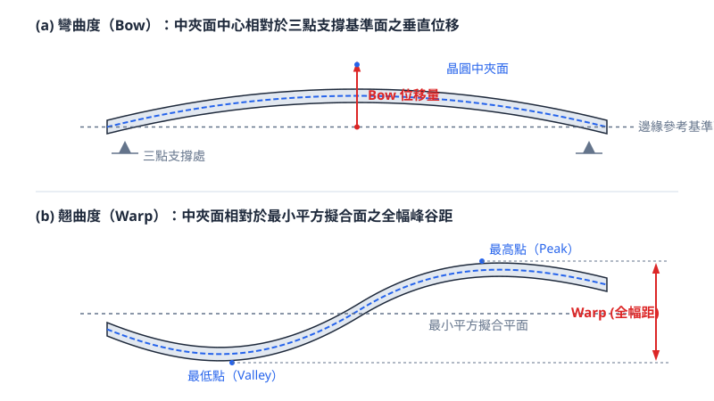
<figcaption>圖 8-2　彎曲度與翹曲度定義（AI 繪製的示意圖）</figcaption>
</figure>

## 8.5 晶圓表面清潔度與微粗糙度規格

### 表面微粒污染與光點缺陷（LPD）規範

在奈米級互補式金屬氧化物半導體（CMOS）製程中，晶圓表面的微粒污染（Particulate Contamination）會直接導致圖案缺陷，進而造成電路斷路（Open）、短路（Short）或閘極介電層崩潰。落在拋光矽晶圓表面的微粒、結晶缺陷或表面微孔（Crystal Originated Particles, COP），在自動光學檢測系統中皆表現為光散射點，通稱為光點缺陷（Light Point Defects, LPD）。

光學表面掃描儀（Surface Scanning Inspection System, SSIS）利用雷射光束照射晶圓表面，當光束遇到微粒或幾何突起時，會產生彈性散射（Rayleigh 散射或 Mie 散射）。感測器收集散射光訊號強度後，以聚苯乙烯膠乳球（Polystyrene Latex Sphere, PSL）的等效散射剖面進行校正，將缺陷換算為等效 PSL 粒徑大小。若微粒半徑 $r$ 遠小於雷射波長 $\lambda$（即滿足 Rayleigh 散射條件 $2\pi r / \lambda \ll 1$），其散射光強度 $I_{\text{scat}}$ 與粒徑的六次方呈正比：

$$I_{\text{scat}} \propto \frac{r^6}{\lambda^4}$$

由上式可知，隨著檢測極限向數十奈米以下微縮，散射光訊號急劇衰減，必須採用更短波長之紫外線雷射與極高靈敏度的光電倍增管（PMT）或電荷耦合元件（CCD）偵測器。

國際半導體產業協會（SEMI）在 SEMI M1 等標準中，嚴格規範了不同等級拋光晶圓（Polished Wafer）與磊晶晶圓（Epi Wafer）的微粒尺寸臨界值與容許密度。以先進製程所使用的 300 mm 裸晶圓為例，出廠規格通常要求檢測極限下限達到 $19\text{ nm}$ 甚至 $15\text{ nm}$，且全片表面累積的 LPD 總數必須控制在極低水準。

| 晶圓規格指標 | 200 mm 拋光晶圓（典型值） | 300 mm 先進拋光晶圓（典型值） | 300 mm 磊晶晶圓（典型值） |
| :--- | :--- | :--- | :--- |
| **檢測臨界粒徑 ($D_{\text{crit}}$)** | $\ge 65\text{ nm}$ | $\ge 19\text{ nm}$ | $\ge 15\text{ nm}$ |
| **全片容許微粒總數** | $< 50\text{ ea/wafer}$ | $< 20\text{ ea/wafer}$ | $< 10\text{ ea/wafer}$ |
| **邊緣排除區域 (Edge Exclusion, EE)** | $3\text{ mm}$ | $2\text{ mm}$ | $1.5\text{ mm}$ |
| **微孔洞（COP）容許密度** | $< 0.1\text{ defects/cm}^2$ | 無（要求完全消除或退火平整化） | 無（磊晶層完全覆蓋 COP） |

!!! note "邊緣排除區域（Edge Exclusion）"
    晶圓最外圍區域在化學機械拋光（CMP）及邊緣倒角加工過程中，邊界效應會導致薄膜均勻性與平坦度急劇劣化，且此處為機械手臂夾持與晶圓盒接觸之高應力區。因此，SEMI 標準定義量測微粒與平坦度時，必須扣除自晶圓物理外徑向內算起的邊緣排除區域（目前先進規範通常設定為 $1.5\text{ mm}$ 至 $2.0\text{ mm}$）。

---

### 金屬離子污染機制與超微量分析

矽晶圓在切片、研磨、化學清洗與退火過程中，極易受到環境或化學試劑中的過渡金屬（如鐵 $\text{Fe}$、銅 $\text{Cu}$、鎳 $\text{Ni}$、鉻 $\text{Cr}$）及鹼金屬（如鈉 $\text{Na}$、鉀 $\text{K}$）污染。金屬雜質的存在對半導體元件特性具有毀滅性破壞：

1. **深能階複合中心（Deep-level Recombination Centers）**：
   如第 2 章所述，過渡金屬如 $\text{Fe}$ 與 $\text{Cu}$ 在單晶矽能隙（Bandgap）中央引入深能階缺陷能階。這些能階大幅加速了蕭克利–雷德–霍爾（Shockley-Read-Hall, SRH）複合過程，造成少數載子生命週期（Minority Carrier Lifetime, $\tau$）劇烈劣化。少數載子擴散長度 $L = \sqrt{D \tau}$ 因而縮短，直接導致光二極體暗電流劇增、雙極性接面電晶體增益下降，以及 CMOS 井區漏電流上升。
2. **閘極氧化層完整性（Gate Oxide Integrity, GOI）破壞**：
   在熱氧化過程中，表面附著的金屬原子會沉澱於 $\text{Si/SiO}_2$ 界面或偏析至氧化層中，造成區域性局部電場集中，導致薄閘極介電層提早發生經時介電崩潰（Time-Dependent Dielectric Breakdown, TDDB）。
3. **可動離子漂移（Mobile Ion Drift）**：
   $\text{Na}^+$ 與 $\text{K}^+$ 等鹼金屬離子在熱應力與正向電場下具有極高的擴散率，會在二氧化矽層內漂移，造成金氧半元件的臨界電壓（$V_{\text{th}}$）發生不可逆的飄移（見第 4 章）。

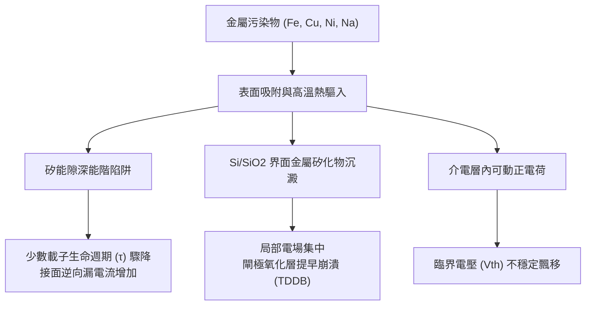

為防止金屬雜質侵入，現代晶圓規格要求表面過渡金屬濃度必須低於 $1\times 10^9\text{ atoms/cm}^2$。量測如此極低濃度的表面金屬，需仰賴全反射 X 射線螢光光譜儀（TXRF）與氣相分解感應偶合電漿質譜儀（VPD-ICP-MS）：

* **全反射 X 射線螢光光譜儀（Total Reflection X-Ray Fluorescence, TXRF）**：
  入射 X 射線以極小角度（小於全反射臨界角 $\theta_c \approx 0.1^\circ$）照射晶圓表面。由於全反射效應，X 射線在矽內部的穿透深度僅數奈米，大幅降低基板矽原子產生的背景訊號，並激發表面金屬原子放射出特徵螢光 X 射線。TXRF 為非破壞性量測，量測極限典型值約在 $10^9 \sim 10^{10}\text{ atoms/cm}^2$。
* **氣相分解感應偶合電漿質譜儀（Vapor Phase Decomposition Inductively Coupled Plasma Mass Spectrometry, VPD-ICP-MS）**：
  此為破壞性化學萃取分析法。首先將晶圓置於密閉反應室中，通入氫氟酸（$\text{HF}$）蒸氣使晶圓表面的熱氧化層或原生氧化層溶解分解：
  
  $$\text{SiO}_2 + 6\text{HF} \rightarrow \text{H}_2\text{SiF}_6 + 2\text{H}_2\text{O}$$
  
  隨後，利用自動化微量液滴掃描機構，將一滴含有微量酸液（如 $\text{HF/H}_2\text{O}_2$）的萃取液滴在晶圓表面滾動，全面收集溶解後的表面金屬離子。最後將萃取液注入 ICP-MS 進行離子化與質譜分析。VPD-ICP-MS 的檢測極限可達 $10^7 \sim 10^8\text{ atoms/cm}^2$，為晶圓出廠認證的最高標準。

---

### 表面微粗糙度（Micro-roughness）之統計定義與影響

晶圓經過最終化學機械拋光後，巨觀上呈現鏡面狀態，但在奈米尺度下，表面仍具有原子級別的凹凸起伏，此即為表面微粗糙度（Surface Micro-roughness）。微粗糙度通常使用原子力顯微鏡（Atomic Force Microscopy, AFM）於特定微觀視區（例如 $1\,\mu\text{m} \times 1\,\mu\text{m}$ 或 $10\,\mu\text{m} \times 10\,\mu\text{m}$）內進行三維形貌掃描。

微粗糙度的評估指標主要包含算術平均粗糙度（$R_a$）與均方根粗糙度（$R_q$ 或 RMS）。在長度為 $L$ 的一維連續剖面曲線 $z(x)$ 中，各參數數學定義如下：

$$R_a = \frac{1}{L} \int_0^L |z(x) - \bar{z}| \, dx$$

$$R_q = \sqrt{\frac{1}{L} \int_0^L [z(x) - \bar{z}]^2 \, dx}$$

若擴展至二維離散取樣面積 $M \times N$，高度資料矩陣為 $z(x_i, y_j)$，其均方根粗糙度表示為：

$$R_q = \sqrt{\frac{1}{M \cdot N} \sum_{i=1}^M \sum_{j=1}^N [z(x_i, y_j) - \bar{z}]^2}$$

其中 $\bar{z}$ 為指定評估區域內的高度平均值。

微粗糙度對深奈米元件物理特性具有顯著負面效應：
1. **反轉層載子遷移率劣化**：
   當電晶體開啟並進入強反轉區時，導電通道被強烈的垂直電場壓制在緊鄰 $\text{Si/SiO}_2$ 或高介電常數（High-$k$）材料界面之數奈米範圍內。界面微粗糙度會引發嚴重的表面粗糙度散射（Surface Roughness Scattering，見第 4 章），導致強垂直電場下的載子有效遷移率（$\mu_{\text{eff}}$）大幅下滑。
2. **極薄閘極氧化層漏電流增強**：
   在等效氧化層厚度（EOT）小於 $1\text{ nm}$ 的情境下，若表面粗糙度 $R_q$ 達到 $0.2\text{ nm}$，局部的物理厚度變異便高達 $20\%$。微觀突起處將導致局部量子穿隧機率（Quantum Tunneling Probability）以指數方式增加，引發過量的閘極漏電流並降低介電層抗擊穿能力。

先進 300 mm 拋光晶圓出廠規格要求均方根粗糙度 $R_q < 0.1\text{ nm}$（在 $1\,\mu\text{m} \times 1\,\mu\text{m}$ 掃描範圍下）。考量到單晶矽的晶格常數 $a \approx 0.543\text{ nm}$，一個 $\text{Si}(100)$ 面單原子階梯（Monoatomic Step）高度約為 $a/4 \approx 0.136\text{ nm}$，此規格意味著晶圓表面必須達成接近無原子步階缺陷的原子級平整度。

---

### 氣態分子污染物（AMC）防制與表面化學狀態控制

晶圓經過終端化學清洗與拋光後，其最外層原子之化學鍵結狀態決定了表面的物理化學性質，主要分為兩種極端狀態：

1. **親水性表面（Hydrophilic Surface）**：
   晶圓最後經由標準 RCA 清洗中的 SC-1（$\text{NH}_4\text{OH/H}_2\text{O}_2/\text{H}_2\text{O}$）或臭氧水處理，表面會覆蓋一層厚度約 $0.5 \sim 1.0\text{ nm}$ 的化學原生氧化層（Chemical Native Oxide）。此氧化層外層充斥著矽醇基（$\text{Si-OH}$），水滴接觸角極小（$< 5^\circ$）。此氧化層可保護底層矽晶不受顆粒直接刮傷，但其厚度不均勻性會干擾後續精準的超薄熱氧化或磊晶生長。
2. **疏水性表面（Hydrophobic Surface）**：
   若以稀釋氫氟酸（DHF）進行最終漂洗，原生氧化層被徹底剝除，表面懸鍵被氫原子鈍化，形成氫終端表面（$\text{Si-H}$）。此狀態水滴接觸角較大（$> 70^\circ$）。氫終端表面暫時具備抗化學氧化能力，但處於高度熱力學不穩定狀態，極易吸附環境中的有機揮發物，並在有氧與水氣條件下局部重新成核氧化，形成島狀缺陷。

在潔淨室儲存與跨廠運送期間，環境中的氣態分子污染物（Airborne Molecular Contaminants, AMC）會透過化學吸附劣化晶圓表面。AMC 依化學性質分類為：
* **酸性分子（Molecular Acids, MA）**：如 $\text{HF}$、$\text{HCl}$、$\text{SO}_x$，會腐蝕晶圓金屬互連線或加速原生氧化層異向生長。
* **鹼性分子（Molecular Bases, MB）**：如氨氣（$\text{NH}_3$）、胺類，吸附於晶圓表面會中和化學增幅光阻（CAR）中的光酸產生劑（PAG），造成嚴重的光阻光酸淬滅與「T-頂部（T-topping）」光阻缺陷（見第 11 章）。
* **可凝聚有機物（Molecular Condensables, MC）**：由無塵室濾網密封膠、塑膠機殼或無塵衣散發出的鄰苯二甲酸酯等高沸點有機物，會化學沉積於矽表面形成富碳層，在後續熱處理過程中形成微缺陷碳化物。
* **摻雜物質（Molecular Dopants, MD）**：環境中微量的含硼或磷有機分子（如阻燃劑），沉積於高阻抗晶圓表面會造成不可控的反向摻雜。

為阻絕 AMC 並長期維持表面清潔度，拋光晶圓出廠時均封裝於前開式運送盒（Front Opening Shipping Box, FOSB）中，晶圓廠內部則使用前開式晶圓傳送盒（Front Opening Unified Pod, FOUP）。容器本體材料採用超低逸氣量（Outgassing）之聚碳酸酯（PC）或聚醚醚酮（PEEK），盒體外部以熱封高阻隔真空鋁箔袋包裝，內部充入超高純度惰性氣體（如乾淨乾燥氮氣 $\text{N}_2$），且通氣孔配置有專門吸附 MA、MB、MC 之高效率化學濾網（Chemical Filters），確保晶圓在出廠至開盒投入產線期間，表面微粒增長與化學膜增生達到零污染標準。

## 8.6 設備與廠商技術

### 晶圓加工設備體系與核心子系統

將單晶矽晶棒加工為符合先進積體電路規格之拋光晶圓（Polished Wafer），需依序透過多線鋸切片、邊緣研磨倒角、雙面研磨、化學濕式蝕刻、雙面拋光（Double-Side Polishing, DSP）與化學機械拋光（CMP），最後進行幾何形貌檢測。此系列製程機台仰賴精密微米至奈米級的機械驅動、多變數閉環控制與化學流體力學設計。

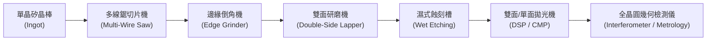

#### 1. 多線鋸切片機架構（Multi-Wire Saw, MWS）
現代 $300\text{ mm}$ 晶棒切片普遍採用電鍍金剛石線鋸（Diamond Wire Saw, DWS）。機台主要子系統包含：
*   **線網傳動與擺動機構**：高強度碳素鋼絲表面固著鑽石微粒，繞經數百道導線輪（Grooved Rollers）形成平行的切割線網。晶棒承載台在主軸伺服馬達驅動下向下進給，線網以數十公尺每秒的線速度高速往復運動。
*   **閉環線張力控制系統**：切割過程中線鋸承受週期性衝擊載荷。系統利用張力擺桿（Dancing Roller）搭配非接觸式位移感測器，結合高頻響伺服馬達進行即時張力回授控制。張力 $T$ 必須恆定維持在典型值 $25\text{–}35\text{ N}$ 之間；張力過低會導致線條漂移引起晶圓厚度變異（Total Thickness Variation, TTV），張力過高則引發斷線。
*   **切削冷卻液動力學分配系統**：冷卻液（通常為水基添加潤滑劑與界面活性劑之冷卻介質）透過雙向高壓噴嘴陣列直接注入鋸縫。流場動力學設計必須克服高速移動鋼線所產生的流體邊界層，將切屑（Silicon Swarf）迅速帶離接觸區，並將摩擦生熱導出，使切割區域熱梯度 $\nabla T$ 最小化，抑制熱應力引發的晶圓翹曲。

#### 2. 高精密雙面研磨與拋光設備
雙面研磨（Lapping/Grinding）與雙面拋光（DSP）係利用行星輪系機構對晶圓正反兩面同步進行材料去除。
*   **多區壓力平衡載台（Multi-Zone Pressure Control）**：晶圓置於游星輪（Carrier）之定位孔內，夾於上、下研磨盤或拋光墊之間。上盤經由氣壓囊或多通道氣缸提供垂直加工載荷。藉由 Preston 方程：
    $$MRR = k_p \cdot P \cdot v$$
    其中 $MRR$ 為材料去除率（Material Removal Rate），$k_p$ 為 Preston 係數，$P$ 為局部接觸壓力，$v$ 為相對滑動速度。設備透過上盤內部同心多區氣囊之動態壓力補償，消除轉速差與幾何偏心造成的邊緣受壓不均，抑制邊緣滾降（Edge Roll-Off, ERO）。
*   **接觸面溫控冷卻機構**：拋光過程伴隨顯著的剪切摩擦熱，使局部溫度升高並改變拋光液（Slurry）的化學反應動力學。上、下研磨盤內部嵌有閉環螺旋冷卻水道，配合紅外線測溫儀與循環冷卻機（Chiller），將研磨盤表面溫度波動壓制在 $\pm 0.5^\circ\text{C}$ 以內，以確保研磨墊的機械剛性與化學水解反應速率均一。

#### 3. 非接觸式全晶圓平坦度與形貌度量設備
微影製程之景深（Depth of Focus, DOF）隨數值孔徑（NA）提高而劇烈縮減，基板幾何規範進入亞奈米級（見第 12 章與第 15 章）。檢測機台採用非破壞性光學測量：
*   **斜入射/掠入射干涉儀（Grazing-Incidence Interferometer）**：雷射光束以大入射角 $\theta$（相對於法線）投射至未完全鏡面化的晶圓表面。有效波長 $\lambda_{\text{eff}}$ 隨角度拉長：
    $$\lambda_{\text{eff}} = \frac{\lambda}{\cos\theta}$$
    藉此降低未拋光或粗糙表面產生的漫散射，取得足夠對比度之干涉條紋，一次性重構晶圓正反表面波前，萃取厚度、平坦度（Site Front Least Squares Range, SFQR）、彎曲度（Bow）與翹曲度（Warp）。
*   **電容式/光共軛雙面掃描感測器**：利用雙對向探頭在晶圓無應力自由夾持（Free-state chucking）狀態下進行螺旋或光柵式掃描，同步測量厚度與局部奈米拓撲（Nanotopography）。

---

### 主要廠商與技術規格比較

晶圓加工與幾何量測設備市場由少數具備極高超精密機械設計與光學計量能力的廠商主導；矽晶圓材料則由國際少數幾家材料巨頭供應。

#### 表 8.6.1：晶圓加工與幾何量測代表性設備商
| 廠商 | 代表產品系列 | 技術路線與特點 | 主要應用 |
| :--- | :--- | :--- | :--- |
| **DISCO** | DWS 系列（線鋸）<br/>DGP 系列（研磨機） | • 固著磨料超薄金剛石線切割技術<br/>• 高剛性主軸與全自動化雙軸晶圓減薄研磨機構 | 矽晶棒精密切片、晶圓背面減薄與邊緣成形研磨 |
| **Lapmaster Wolters** | AC microLine 系列 | • 行星齒輪高精度雙面研磨與拋光架構<br/>• 動態氣壓補償多區壓控與精密氣隙即時量測 | $200\text{ mm} / 300\text{ mm}$ 晶圓粗拋光與雙面鏡面拋光 |
| **KLA** | WaferSight 系列 | • 雙面同軸掠入射干涉儀（Grazing Incidence）<br/>• 具備穿透式波前分析與奈米拓撲高頻空間濾波算法 | 先進製程裸晶圓幾何、平坦度（SFQR）與形貌量測 |
| **Corning Tropel** | UltraFlat 系列 | • 掠入射干涉計量搭配專利無應力重力補償載台<br/>• 一次全視場快速掃描，測量厚度、形貌與邊緣滾降 | 晶圓出廠形貌校驗與微影機卡盤適配形貌分析 |

#### 表 8.6.2：全球主要矽晶圓基板供應商高規格技術路徑
| 廠商 | 核心製程技術路線 | 基板技術特點與應用領域 |
| :--- | :--- | :--- |
| **信越化學<br/>(Shin-Etsu Chemical)** | • 超低氧/無缺陷 CZ 晶棒提拉控制<br/>• 極致 ERO 控制化學機械拋光技術 | 先進邏輯（$<3\text{ nm}$）與高階記憶體專用極低 SFQR 晶圓；高純度微缺陷調控基板 |
| **SUMCO** | • 磁場柴可拉斯基法（MCZ）動態熱流模擬<br/>• 奈米級局部平坦度拋光優化 | 浸潤式微影與 EUV 專用超平坦晶圓；高度均勻摻雜之低電阻率磊晶基板（見第 9 章） |
| **環球晶圓<br/>(GlobalWafers)** | • 連續式長晶與精密熱應力退火工藝<br/>• 寬能隙材料（SiC/GaN）與特殊 SOI 整合技術 | 先進邏輯運算、功率半導體（見第 10 章）及射頻基板（RF-SOI） |
| **Siltronic** | • 高速多線金剛石切片配合自調諧 DSP 拋光<br/>• 先進邊緣缺陷光學掃描檢驗系統 | 超低奈米拓撲波紋度晶圓；車用高可靠度基板與感測元件用特殊規格基板 |

---

### 技術路線差異與關鍵工程取捨

#### 1. 切片技術路線：游離磨料（Slurry）vs. 固著磨料（Diamond Wire）
早期多線鋸採用高碳鋼線搭配碳化矽（$\text{SiC}$）游離磨料懸浮切削液。切削力主要藉由滾動衝擊達成，其表面微裂紋均勻，但切削速度緩慢且漿料回收處理成本高。

現代晶圓廠與基板廠已全面轉向電鍍金剛石線鋸（DWS）：
*   **優勢**：金剛石微粒直接固著於線芯，以微劃痕（Micro-scratching）機制去除材料，切削速度較游離磨料提升 2 至 3 倍，鋸縫損耗（Kerf Loss）由 $>300\,\mu\text{m}$ 降低至 $150\,\mu\text{m}$ 左右，大幅提升晶棒利用率。
*   **缺點與取捨**：固著磨料的刮擦模式會在矽表面形成深達數微米的方向性次表面損傷層（Sub-surface Damage, SSD）以及線痕（Wire Marks）。這要求後續化學濕式蝕刻（酸洗或鹼洗）必須剝除更多厚度的矽層，增加了蝕刻化學品消耗與均勻度控制的難度。

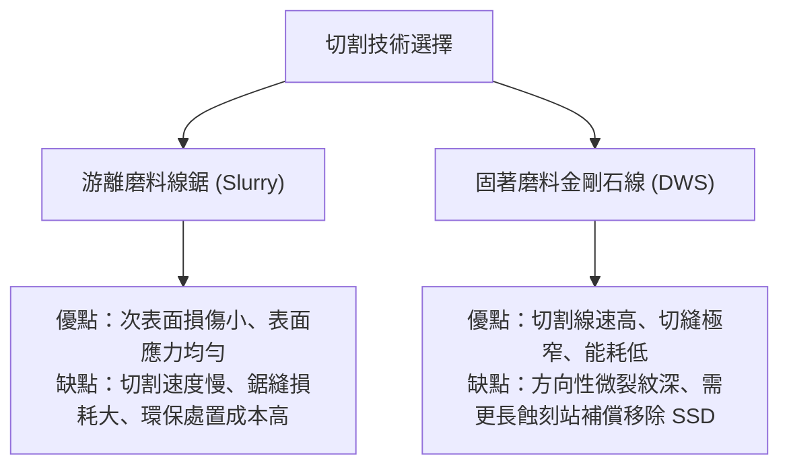

#### 2. 拋光機制取捨：批次雙面拋光（DSP）vs. 單晶圓單面拋光（SSP）
*   **雙面拋光（DSP）**：晶圓正反兩面同時受拋光布研磨，材料應力在兩側均勻釋放，能夠達到優良的整體全域平坦度（GBIR/TTV）。然而，由於晶圓置於游星輪中處於自由浮動狀態，晶圓邊緣與游星輪邊界接觸碰撞，容易在邊緣 $1\text{–}2\text{ mm}$ 區域產生嚴重的邊緣滾降（ERO），對微影邊緣晶粒良率（Edge Die Yield）造成威脅。
*   **單晶圓化學機械拋光（Single-Wafer CMP）**：採用吸附式真空或水膜載台夾持，透過精密環狀加壓環（Retaining Ring）分區施壓。此技術能精確微調外圍壓力分布以修正 ERO，但加工吞吐量（Throughput）較低，且載台的背壓均一性與殘留顆粒極易導致晶圓背面的微觀變形反射至正面。基板廠通常採用「批次 DSP 建立全域平坦度，搭配最終極軟質二氧化矽懸浮液單面精拋」之複合工藝。

#### 3. 幾何量測原理取捨：斜入射干涉 vs. 電容位移感測
在量測高階晶圓平坦度時，技術取向取決於空間解析度與反射率要求：
*   **掠入射光學干涉法**（如 KLA WaferSight、Corning Tropel）：透過光學同調性對整片直徑 $300\text{ mm}$ 晶圓產生全視場干涉圖形，空間解析度可達到次毫米級（Sub-millimeter），能精確分離出空間波長在 $0.2\text{ mm}$ 至 $8\text{ mm}$ 之間的奈米拓撲（Nanotopography）信號。但該設備對無塵室微振動極度敏感，需佈設於高規格防震地基或主動式氣墊隔震平台上。
*   **雙面對向電容式量測**：利用電容感測器與矽晶圓表面的間隙電容量換算距離。此技術完全不受晶圓光學反射率、表面薄膜折射率或微觀粗糙度影響，系統抗震與抗環境干擾能力強，校準程序簡單；缺點是電容探頭的空間積分面積較大，極限橫向解析度受限於探頭直徑（通常為數毫米），無法有效捕捉高頻奈米拓撲微小起伏。

---

### 晶圓廠採購基板之評估指標

先進邏輯製程（$<7\text{ nm}$）與高密度 3D NAND 製程進入量產時，晶圓廠對裸基板供應商（如信越、SUMCO、環球晶圓）的機台選型與材料交付驗收，存在下列關鍵指標考量：

!!! example "先進微影對基板平坦度之極限要求"
    在浸潤式 ArF 微影或 EUV 微影中（見第 13、14 章），若曝光視場（Exposition Field）尺寸為 $26\text{ mm} \times 33\text{ mm}$，曝光機的有效景深（DOF）可能小於 $80\text{ nm}$。此時要求基板在該曝光單元內的局部平坦度指標 $\text{SFQR}$（Site Front Least Squares Range）必須滿足：
    $$\text{SFQR} \le \frac{1}{3} \text{DOF}$$
    亦即晶圓表面局部位移極值差距不得超過 $20\text{–}25\text{ nm}$，且邊緣禁區（Edge Exclusion）由傳統的 $3\text{ mm}$ 縮緊至 $1\text{ mm}$，基板廠必須採用最新世代具備動態補償之 DSP 拋光設備方能達標。

1.  **幾何外形度量參數**：
    *   **SFQR / ESFQR**：評估晶圓各曝光站點（Site）去除一階傾斜分量後的厚度差，ESFQR 則進一步延伸評估晶圓最外緣區域，確保微影設備在晶圓邊界曝光時不致脫焦。
    *   **ZDD（Second Derivative of Thickness Profile）**：厚度輪廓的二階導數，直接反映表面曲率與局部應力加速度，用於防範化學機械拋光（CMP）製程中引發的研磨液堆積與過研磨問題。
2.  **晶格微缺陷與原生空洞（COP, Crystal-Originated Particle）**：
    基板內部空隙在經過熱循環後會暴露成為表面坑洞。材料商長晶設備之固液界面溫度梯度降溫速率控制，決定了八面體空洞缺陷的大小。高階製程多要求使用完美無空洞晶圓（Pure Epitaxial Wafer 或 Defect-Free Annealed Wafer）。
3.  **邊緣幾何成形（Edge Profile Optimization）**：
    晶圓邊緣若有倒角曲率不連續，傳送手臂（Robot End-Effector）抓取或晶圓傳送盒（FOUP）裝載時，易發生邊緣接觸碎裂（Chipping），碎裂產生之微米級顆粒將擴散至整片晶圓，導致嚴重的圖案化缺陷。因此，全自動邊緣倒角研磨機台的研磨輪軌跡精度，是決定基板微塵缺陷密度的關鍵機台環節。

## 本章重點

1. **晶圓尺寸演進與力學幾何**：晶棒需經切頭尾、滾圓與定位特徵加工（200 mm 採平邊 Flat，300 mm 採凹口 Notch）。依薄圓板力學，晶圓自重撓曲量與半徑四次方成正比、與厚度平方成反比（$\delta_{\max} \propto \frac{\rho g R^4}{E t^2}$），故 300 mm 晶圓需增厚至典型值 $775\,\mu\text{m}$ 以維持剛性並抑制邊緣形變。
2. **切片機制與次表面損傷**：現代製程普遍採用固定磨料之金剛石線鋸（DWS）切片，於脆性斷裂模式下藉由側向裂紋交會剝落材料。切削引發之微裂紋向下延伸形成次表面機械損傷層（SSD，包含非晶層、微裂紋與應力殘留區），切口損耗（Kerf Loss）典型值為 $80 \sim 120\,\mu\text{m}$。
3. **邊緣倒角與機械平坦化**：切片邊緣因應力集中係數高，易萌生裂紋與微塵，須以金剛石砂輪修整為圓弧型（R-shape）倒角。後續透過雙面研磨（DSL）或雙面研削（DSG）消除鋸切起伏並降低總厚度變異（TTV），其中 DSG 採二體微切削機制，能將 SSD 深度大幅壓低至 $2\,\mu\text{m}$ 以下。
4. **化學蝕刻與化學機械拋光**：化學濕式蝕刻用於剝除殘留 SSD。酸性蝕刻（$\text{HF}/\text{HNO}_3/\text{CH}_3\text{COOH}$）屬等向性擴散控制反應，易誘發橘皮起伏；鹼性蝕刻（$\text{KOH}/\text{TMAH}$）屬異向性水解反應，易產生微觀角錐。後續 CMP 結合 Preston 方程式力學與介面化學，以粗拋去除微米級起伏、精拋配合奈米級膠體二氧化矽與界面活性劑達到次埃米級粗糙度（$\text{RMS} < 0.1\,\text{nm}$）。
5. **巨觀與局部平坦度指標**：在自由懸浮狀態下以中平面為基準量測中心對稱變形（Bow）與全域最大峰谷值（Warp）。在微影機台真空/靜電吸盤剛性貼合下，晶圓厚度變異轉移至正面，以單一曝光視場內的局部最大正負偏差差值（SFQR）作為核心管制指標，其極值必須納入微影焦深（DOF）預算（通常要求 $\text{SFQR} \le \frac{1}{3} \text{DOF}$）。
6. **表面清潔度、微粗糙度與氣態分子防制**：光點缺陷（LPD）藉由 Rayleigh 散射檢測（$I_{\text{scat}} \propto r^6/\lambda^4$）；過渡金屬離子透過 TXRF 與 VPD-ICP-MS 監控於 $1\times 10^9\,\text{atoms/cm}^2$ 以下，以防少數載子生命週期劣化與閘極氧化層提早崩潰。晶圓儲存與傳送採 FOUP 搭配化學濾網，阻絕酸性（MA）、鹼性（MB）、可凝聚有機物（MC）與摻雜物（MD）等氣態分子污染物。

---


## 重點圖卡

複習時看這幾張就能抓住本章重點；[圖卡庫](../cards.md)可以下載成圖片。

<div class="ix-cards" markdown>

<figure markdown>
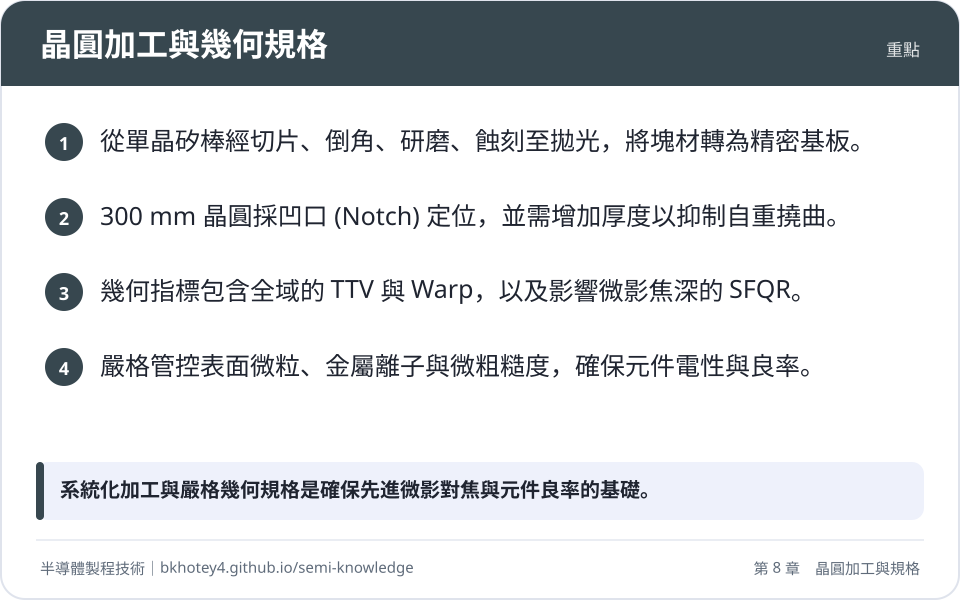
<figcaption>重點圖卡：晶圓加工與幾何規格</figcaption>
</figure>

<figure markdown>
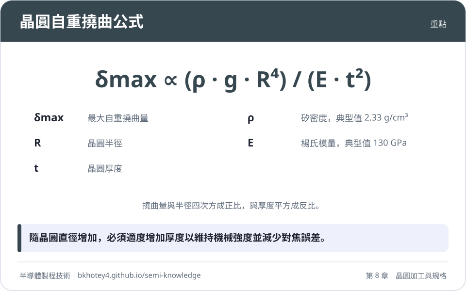
<figcaption>重點圖卡：晶圓自重撓曲公式</figcaption>
</figure>

<figure markdown>
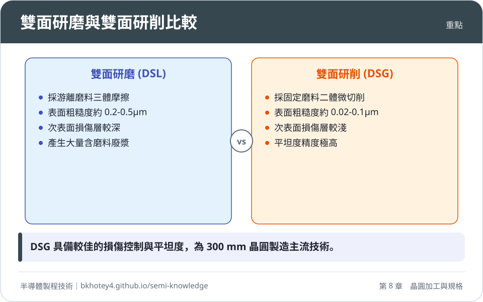
<figcaption>重點圖卡：雙面研磨與雙面研削比較</figcaption>
</figure>

<figure markdown>
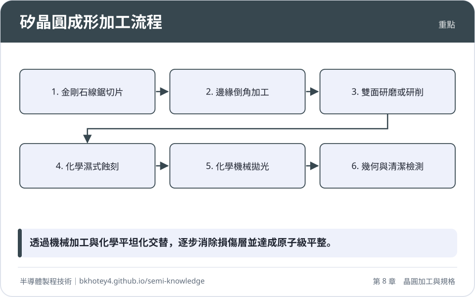
<figcaption>重點圖卡：矽晶圓成形加工流程</figcaption>
</figure>

</div>

## 習題

**1.** 試比較直徑 $200\,\text{mm}$（標準厚度 $725\,\mu\text{m}$）與直徑 $300\,\text{mm}$（標準厚度 $775\,\mu\text{m}$）矽晶圓在相同中心支撐與重力條件下的最大自重撓曲量。求兩者最大自重撓曲之理論比值（$\delta_{\max, 300} / \delta_{\max, 200}$）；若 300 mm 晶圓厚度未予增厚而維持 $725\,\mu\text{m}$，其撓曲量將增加為 200 mm 晶圓的幾倍？

??? success "參考解答"
    依據薄圓板彎曲力學，自重撓曲量公式為：
    $$\delta_{\max} \propto \frac{\rho g R^4}{E t^2}$$
    在材料常數（$\rho, g, E$）相同條件下，撓曲比值可簡化為幾何半徑比與厚度比之關係：
    $$\frac{\delta_{\max, 300}}{\delta_{\max, 200}} = \left( \frac{R_{300}}{R_{200}} \right)^4 \cdot \left( \frac{t_{200}}{t_{300}} \right)^2$$
    帶入幾何參數：
    * $R_{300} / R_{200} = 150\,\text{mm} / 100\,\text{mm} = 1.5$
    * $t_{200} / t_{300} = 725\,\mu\text{m} / 775\,\mu\text{m} \approx 0.9355$
    
    代入計算：
    $$\frac{\delta_{\max, 300}}{\delta_{\max, 200}} = (1.5)^4 \cdot (0.9355)^2 = 5.0625 \cdot 0.8751 \approx 4.43$$
    因此，標準厚度下 300 mm 晶圓之最大自重撓曲量約為 200 mm 晶圓的 **$4.43$ 倍**。
    
    若 300 mm 晶圓厚度維持 $t = 725\,\mu\text{m}$（厚度比為 1），則撓曲比值為：
    $$\frac{\delta_{\max, 300}'}{\delta_{\max, 200}} = (1.5)^4 = 5.0625$$
    即撓曲量將劇增為 200 mm 晶圓的 **$5.06$ 倍**（增幅達 $406\%$）。

**2.** 試說明次表面機械損傷層（Subsurface Damage, SSD）於單晶矽切片製程中的成因與三層微觀物理構造。為何晶圓成形製程不能直接以化學機械拋光（CMP）消除 SSD，而必須導入濕式化學蝕刻工序？

??? success "參考解答"
    * **SSD 成因**：金剛石線鋸於脆性斷裂模式下切削單晶矽時，高壓磨粒尖端產生應力集中，使材料局部發生相變與微剪切，並在磨粒下方引發向基底深處擴展之「中位裂紋」（Median Cracks）與殘餘微觀彈性應變場。
    * **微觀三層構造**：
      1. *多晶/非晶層*：表層數十至數百奈米，晶格受極限剪切完全崩潰。
      2. *高密度差排群與微裂紋層*：深度約 $1 \sim 10\,\mu\text{m}$，包含沿 $\{111\}$ 解理面擴展的微裂紋及裂紋尖端塑性應變區。
      3. *深層彈性應力殘留區*：微裂紋下方的晶格局部畸變與殘留拉應力區。
    * **必須導入濕式化學蝕刻的原因**：
      1. *去除速率與加工成本*：CMP 屬於原子級至次微米級精細加工，移除速率極低（典型精拋僅數十奈米每分鐘，粗拋約 $0.5 \sim 1.5\,\mu\text{m/min}$），若以 CMP 完全磨除厚達十餘微米的 SSD，耗時過長且拋光墊與漿料耗損巨大，不具工業量產效益。
      2. *抑制缺陷熱擴散*：化學濕式蝕刻（酸性或鹼性）反應速率快（每面可達數微米至十餘微米每分鐘），能在無機械應力導入的前提下等向或結晶取向性地完全溶蝕微裂紋與應力層。若跳過蝕刻直接進行拋光或熱製程，殘留微裂紋在後續高溫環境下將誘發嚴重的差排滑移擴散（Slip Lines），甚至導致晶圓於熱應力下脆裂。

**3.** 某金剛石線鋸切片機台之鋼芯線直徑 $d_{\text{core}} = 60\,\mu\text{m}$，結合層厚度 $t_{\text{bond}} = 10\,\mu\text{m}$，金剛石突出有效高度 $h_{\text{diamond}} = 8\,\mu\text{m}$，運轉時鋼線動態擺動振幅 $\delta_{\text{runout}} = 5\,\mu\text{m}$。
(1) 計算該線鋸之切口損耗寬度（$W_{\text{kerf}}$）。
(2) 若取一根有效加工長度為 $300\,\text{mm}$ 的矽單晶棒進行切片，預計切出每片最終厚度為 $820\,\mu\text{m}$（切片原始厚度，供後續研磨保留餘量）之晶圓，忽略頭尾夾持損失，理論上最多可切出幾枚晶圓？矽材料因切口損耗轉化為切屑廢粉的體積百分比約為多少？

??? success "參考解答"
    **(1) 計算切口損耗寬度 $W_{\text{kerf}}$：**
    依據切口寬度公式：
    $$W_{\text{kerf}} = d_{\text{core}} + 2 \cdot t_{\text{bond}} + 2 \cdot h_{\text{diamond}} + 2 \cdot \delta_{\text{runout}}$$
    代入已知數值：
    $$W_{\text{kerf}} = 60 + 2(10) + 2(8) + 2(5) = 60 + 20 + 16 + 10 = 106\,\mu\text{m}$$
    
    **(2) 計算理論產出枚數與損耗比例：**
    * 單枚晶圓加工單元週期長度 $L_{\text{pitch}} = t_{\text{wafer}} + W_{\text{kerf}} = 820\,\mu\text{m} + 106\,\mu\text{m} = 926\,\mu\text{m} = 0.926\,\text{mm}$。
    * 有效晶棒長度 $L_{\text{total}} = 300\,\text{mm}$。
    * 理論出片數量：
      $$N = \left\lfloor \frac{L_{\text{total}}}{L_{\text{pitch}}} \right\rfloor = \left\lfloor \frac{300}{0.926} \right\rfloor = \lfloor 323.97 \rfloor = 323\,\text{枚}$$
      理論上最多可切出 **$323$ 枚** 晶圓。
    
    * 材料轉化為切屑之體積百分比：
      由於橫截面積恆定，切口體積損耗比即為長度維度之佔比：
      $$\text{Kerf Loss Ratio} = \frac{W_{\text{kerf}}}{t_{\text{wafer}} + W_{\text{kerf}}} \times 100\% = \frac{106}{926} \times 100\% \approx 11.45\%$$
      矽材料轉化為切屑廢粉的體積百分比約為 **$11.45\%$**。

**4.** 何謂晶圓的彎曲度（Bow）與翹曲度（Warp）？請闡述兩者在基準定義與形貌捕捉能力上的核心差異。若一片晶圓的 Bow 測得為 $0\,\mu\text{m}$，是否可斷定該晶圓表面完全平坦？試申論之。

??? success "參考解答"
    * **彎曲度（Bow）**：以晶圓邊緣排除區內特定半徑的三點決定一基準參考平面，量測晶圓幾何「中平面」在幾何中心點相對於該基準平面的垂直偏差距離。具有正負號（正值為中心凸起，負值為中心凹陷）。
    * **翹曲度（Warp）**：以最小平方法對晶圓整個中平面擬合出最佳參考平面，計算整片晶圓有效區域內所有量測點至擬合平面的最大正偏差與最大負偏差的絕對差值（Peak-to-Valley, PV）。翹曲度恆為非負值（$\ge 0$）。
    * **核心差異**：
      1. Bow 僅取中心單點計算，僅能表徵一階球狀對稱之宏觀凹凸形變。
      2. Warp 遍歷全晶圓中平面的所有資料點，能夠完整捕捉非對稱、馬鞍形（Saddle）、波紋狀或四角扭曲等高階複合形貌。
    * **論述**：**不能斷定完全平坦**。
      若晶圓呈現非對稱之對角馬鞍形變形（即兩端向上翹起、另兩端向下彎折），其晶圓中心點恰好落在邊緣三點構成的基準平面上，此時計算得出的 $\text{Bow} = 0\,\mu\text{m}$。然而，此時晶圓邊緣與對角線存在顯著的起伏，其 $\text{Warp}$ 可能極大。因此，單憑 $\text{Bow} = 0$ 無法代表晶圓幾何平坦，必須同時監控 Warp 指標。

**5.** 某浸潤式 ArF 微影設備之曝光波長 $\lambda = 193\,\text{nm}$，物鏡數值孔徑 $\text{NA} = 1.35$，製程因子 $k_2 = 0.55$。
(1) 依瑞利準則計算該微影系統的光學焦深（Depth of Focus, DOF）。
(2) 在微影對焦預算（Focus Budget）分配架構中，若曝光機靜電吸盤平整度誤差 $\Delta z_{\text{chuck}} = 12\,\text{nm}$、對焦感測器量測不確定度 $\Delta z_{\text{sensor}} = 10\,\text{nm}$、光阻層厚度帶來的聚焦深度裕度消耗 $\Delta z_{\text{resist}} = 15\,\text{nm}$，為確保成像不脫焦，晶圓在曝光單元（Site）內之局部平坦度極限值 $\text{SFQR}_{\max}$ 不得超過多少奈米？

??? success "參考解答"
    **(1) 計算微影系統之光學焦深（DOF）：**
    依據瑞利焦深公式：
    $$\text{DOF} = k_2 \frac{\lambda}{\text{NA}^2}$$
    代入各項物理參數：
    $$\text{DOF} = 0.55 \times \frac{193\,\text{nm}}{(1.35)^2} = \frac{106.15}{1.8225} \approx 58.24\,\text{nm}$$
    該系統之光學焦深約為 **$58.24\,\text{nm}$**。
    
    **(2) 計算允許之極限局部平坦度 $\text{SFQR}_{\max}$：**
    總焦點預算必須滿足大於或等於各項幾何誤差與平坦度之和：
    $$\text{Focus Budget} \ge \text{SFQR}_{\max} + \Delta z_{\text{chuck}} + \Delta z_{\text{sensor}} + \Delta z_{\text{resist}}$$
    在系統邊界極限下，將總焦點預算上限設為光學焦深 $\text{DOF}$：
    $$\text{SFQR}_{\max} \le \text{DOF} - (\Delta z_{\text{chuck}} + \Delta z_{\text{sensor}} + \Delta z_{\text{resist}})$$
    代入數值：
    $$\text{SFQR}_{\max} \le 58.24\,\text{nm} - (12\,\text{nm} + 10\,\text{nm} + 15\,\text{nm}) = 58.24 - 37 = 21.24\,\text{nm}$$
    因此，該晶圓在此微影節點規範下，局部平坦度極限值 $\text{SFQR}_{\max}$ 不得超過 **$21.24\,\text{nm}$**。

---

## 本章術語

- **DWS**（金剛石線鋸）：以高強度金屬線為芯線、表面固著微米級金剛石磨粒的高速切片技術，藉脆性微刮擦機制分割晶棒。
- **Kerf Loss**（切口損耗）：切片過程中因鋸絲直徑、結合層、磨粒高度及擺動振幅而轉化為微細矽廢粉的材料體積損失。
- **SSD**（次表面機械損傷層）：機械切削與研磨在單晶表面下方引發的晶格破壞區，包含非晶層、微裂紋與殘留應變場。
- **Edge Profiling**（邊緣倒角）：利用成形砂輪將切片後晶圓直角邊緣研磨成圓弧狀或多面斜角，以消除應力集中並抑制邊緣碎裂與微塵掉落之製程。
- **DSL**（雙面研磨）：使用游離磨料懸浮液在上下研磨盤旋轉滾動摩擦下，均勻切削晶圓兩面以降低巨觀厚度變異的工藝。
- **DSG**（雙面研削）：利用超精密金剛石砂輪之固定磨料進行微切削，兼具極淺損傷深度與高平坦度控制之晶圓減薄加工技術。
- **Preston's Equation**（普雷斯頓方程式）：描述化學機械拋光中材料去除率與向下壓力及介面相對滑移速度成正比的力學方程式。
- **DSP**（雙面拋光）：晶圓於遊星輪夾持下同步對正反兩面施加化學拋光，能兼顧優良全域平坦度並消除夾持彎曲變形的鏡面化加工架構。
- **TTV**（總厚度變異）：晶圓有效品質區域內，表面局部厚度最大值與最小值之絕對差值。
- **Bow**（彎曲度）：中平面中心點相對於由邊緣固定半徑三點建立之基準平面的垂直位移量，具正負幾何方向性。
- **Warp**（翹曲度）：中平面上所有點相對於全域最小平方擬合基準平面的最大正負偏差差值，恆為非負值。
- **SFQR**（曝光視場前表面最小平方法平坦度範圍）：晶圓於吸附狀態下，單一曝光視場（Site）前表面相對於該區域局部最小平方擬合平面的最大峰谷高度差。
- **LPD**（光點缺陷）：雷射表面掃描儀在晶圓表面量測到的微粒、刮痕或結晶空洞等造成彈性光散射的缺陷總稱。
- **TXRF**（全反射 X 射線螢光光譜儀）：利用小於全反射臨界角的 X 射線照射晶圓表面，藉激發特徵螢光定量表層超微量金屬雜質的非破壞性分析技術。
- **VPD-ICP-MS**（氣相分解感應偶合電漿質譜儀）：利用氫氟酸蒸氣分解晶圓表面氧化膜並以微量酸液掃描萃取金屬離子後注入質譜儀分析的超高靈敏度破壞性檢測法。
- **AMC**（氣態分子污染物）：潔淨室環境中會透過物理或化學吸附劣化晶圓表面電性或微影成形的微量氣態化學物質，分為酸、鹼、有機物及摻雜物四大類。
- **EEZ**（邊緣排除區）：晶圓物理外徑向內算起的邊界環狀禁區，此區域因設備夾持與邊緣效應嚴重而不列入元件良率與幾何規格規範。


## 互動學習

!!! tip "動手試試看"
    - [設備機台圖鑑：切割與研磨機](../equipment.md)

<div class="quiz" data-quiz="02-02"></div>


## 產業最新進展

本節由每日產業新聞自動補充，說明本章技術在產業上的最新發展。

<!-- updates -->
（目前尚無補充。）
