# 第 9 章　磊晶與 SOI

<figure markdown>
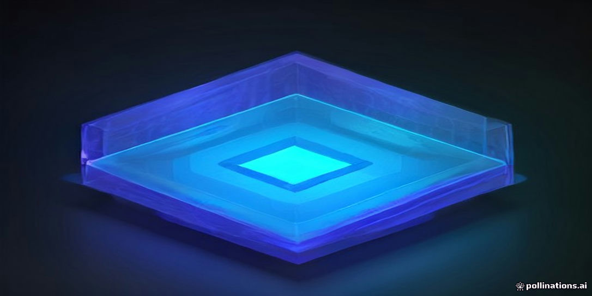
<figcaption>示意插畫：由 AI 生成，用來幫助記憶本章主題，細節請以內文與結構圖為準。</figcaption>
</figure>

!!! abstract "學習目標"
    - 掌握同質磊晶與異質磊晶的熱力學驅動力、表面動力學機制及晶格缺陷生成條件。
    - 理解雙軸應變工程（應變矽）調變半導體能帶結構與載子遷移率之物理機制。
    - 深入分析絕緣層覆矽（SOI）基板結構特性，並掌握 Smart Cut™ 等薄膜鍵合與轉移製程原理。
    - 比較全空乏型（FD-SOI）與部分空乏型（PD-SOI）之元件物理特性，理解其在低功耗與射頻領域之應用優勢。
    - 認識工業界主流磊晶反應爐架構與商業化 SOI 晶圓量產製造技術。

## 9.1 磊晶成長基礎與物理化學機制

### 同質磊晶、異質磊晶與晶格匹配性

磊晶（Epitaxy）源自希臘文「epi」（在其之上）與「taxis」（排列），指在單晶基板上，依循基板既有的結晶學取向生長出結構完整之單晶薄膜的製程技術。根據磊晶層與基板材料化學組成的同異，可劃分為兩大範疇：

1. **同質磊晶（Homoepitaxy）**：沉積層與基板為完全相同的材料（如在單晶矽基板上磊晶生長矽薄膜）。此技術主要用於精確控制薄膜的電阻率、厚度與摻雜分布，同時避開直拉法（CZ）矽晶圓中氧、碳雜質與原生微缺陷（見第 7 章與第 8 章）對元件主動區的負面影響。
2. **異質磊晶（Heteroepitaxy）**：沉積層與基板為不同化學成分的材料（例如在矽基板上生長鍺化矽 $\text{Si}_{1-x}\text{Ge}_x$、碳化矽 $\text{SiC}$ 或氮化鎵 $\text{GaN}$）。異質磊晶能將能帶工程（Bandgap Engineering）與異質接面導入矽基整合電路中。

在異質磊晶系統中，薄膜與基板介面的結晶幾何相容性取決於未受應變時的晶格常數差異。定義**晶格常數失配度（Lattice Mismatch, $f$）**為：

$$f = \frac{a_f - a_s}{a_s}$$

其中 $a_f$ 為磊晶層材料在塊材（Bulk）鬆弛狀態下的晶格常數，$a_s$ 為單晶基板的晶格常數。
* 當 $a_f > a_s$ 時，$f > 0$，磊晶層在基板平面方向受到雙軸壓縮應力（Biaxial Compressive Strain）。
* 當 $a_f < a_s$ 時，$f < 0$，磊晶層在基板平面方向受到雙軸伸張應力（Biaxial Tensile Strain）。

晶格失配度決定了薄膜初期的形核模式，並深刻影響異質介面所積累的彈性應變能及晶體缺陷生成密度。

---

### 氣相磊晶之質傳動力學與溫控分區

化學氣相磊晶（Vapor Phase Epitaxy, VPE）通常是在高溫反應腔體中通入反應氣體前驅物（Precursors），藉由氣流傳輸與表面化學反應形成固相晶體。氣體流經晶圓表面時，黏滯力使反應室內的自由流動氣體（Bulk Gas）在晶圓表面形成一層速度梯度極大的**流體力學邊界層（Hydrodynamic Boundary Layer）**。

反應物前驅物由反應流主體擴散通過邊界層，並在晶圓表面產生化學吸附與反應。根據穩態質傳守恆，氣相傳輸通量 $J_1$ 與表面反應消耗通量 $J_2$ 必須平衡：

$$J_1 = h_g (C_g - C_s)$$

$$J_2 = k_s C_s$$

其中 $h_g$ 為邊界層質量傳輸係數（Mass Transfer Coefficient, $\text{cm/s}$），$C_g$ 為邊界層外緣的主體氣相前驅物濃度（$\text{cm}^{-3}$），$C_s$ 為晶圓表面處的反應物濃度（$\text{cm}^{-3}$），$k_s$ 為表面化學反應速率常數（$\text{cm/s}$）。

在穩態條件下（$J = J_1 = J_2$），可解出沉積通量 $J$ 及薄膜成長速率 $R$：

$$J = \frac{C_g}{\frac{1}{h_g} + \frac{1}{k_s}}$$

$$R = \frac{J}{N_{film}} = \frac{C_g}{N_{film} \left( \frac{1}{h_g} + \frac{1}{k_s} \right)}$$

其中 $N_{film}$ 為磊晶薄膜的原子密度（原子數/$\text{cm}^3$）。表面反應速率常數遵循阿瑞尼斯方程式（Arrhenius Equation）：

$$k_s = k_0 \exp\left(-\frac{E_a}{k_B T}\right)$$

其中 $E_a$ 為表面熱化學反應之活化能，$k_B$ 為波茲曼常數，$T$ 為絕對溫度。依據溫度與擴散、反應速率的相對強弱，磊晶動力學分為兩個明顯的溫控區：

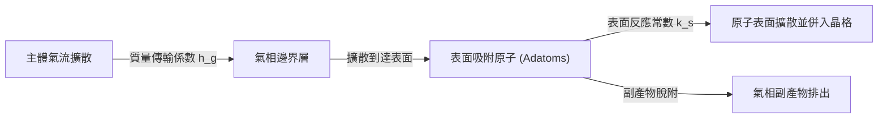

| 動力學分區 | 溫度區間 | 控制機制與特徵 | 活化能與反應特性 |
| :--- | :--- | :--- | :--- |
| **表面化學反應限制區**<br>*(Surface Reaction-Limited Regime)* | 低溫區 | $k_s \ll h_g$ 時，$R \approx \frac{k_s C_g}{N_{film}}$。<br>成長速率對溫度極為敏感，反應腔內微小的溫度梯度即會導致膜厚顯著不均勻。 | 活化能較高（典型值為 $1.5 \sim 3.0\text{ eV}$）。適用於對厚度與摻雜具原子級精度控制之低壓化學氣相沉積。 |
| **質量傳輸限制區**<br>*(Mass Transport-Limited Regime)* | 高溫區 | $k_s \gg h_g$ 時，$R \approx \frac{h_g C_g}{N_{film}}$。<br>氣相邊界層的分子擴散成為瓶頸。因氣體擴散係數隨溫度的相依性較弱（約 $D \propto T^{1.5 \sim 2.0}$），成長速率曲線在此區呈現平坦高台。 | 活化能極低（典型值小於 $0.3\text{ eV}$）。沉積速率極度仰賴氣體流場分佈與邊界層厚度均勻性。 |

---

### 薄膜核化與成長模式

到達基板表面的吸附原子（Adatoms）在完成熱化並沿表面擴散後，其凝聚成核與後續薄膜生長機制，主要由系統的介面自由能熱力學平衡所主導。

設基板表面自由能為 $\gamma_s$、沉積薄膜表面自由能為 $\gamma_f$、薄膜與基板間的介面自由能為 $\gamma_i$。根據熱力學自由能變化量判據：

$$\Delta \gamma = \gamma_f + \gamma_i - \gamma_s$$

磊晶薄膜存在三種經典的生長模式：

```
(a) Frank-van der Merwe (FM)    (b) Volmer-Weber (VW)          (c) Stranski-Krastanov (SK)
   [ 二維層狀成長 ]                [ 三維島狀成長 ]               [ 潤濕層 + 三維島狀 ]
  ┌───────────────┐              ┌──┐   ┌──┐   ┌──┐             ┌──┐   ┌──┐   ┌──┐
  └───────────────┘              └──┘   └──┘   └──┘             └──┘   └──┘   └──┘
  ┌───────────────┐              ───────────────────           ─────────────────── (潤濕層)
  ═════════════════              ═══════════════════           ═══════════════════
       Substrate                      Substrate                     Substrate
```

1. **Frank-van der Merwe 模式（FM，二維層狀生長）**：
   * 熱力學條件：$\Delta \gamma \le 0$。基板對吸附原子的鍵合親和力強於薄膜沉積原子彼此間的引力。
   * 特性：原子沉積傾向於完整鋪滿單一原子層（Monolayer, ML）後再行沉積下一層。同質磊晶或晶格失配極小（$f \approx 0$）的同構異質晶體沉積皆屬於此模式，是製造超晶格（Superlattices）與微電子元件通道層的最理想模式。

2. **Volmer-Weber 模式（VW，三維島狀生長）**：
   * 熱力學條件：$\Delta \gamma > 0$。吸附原子間的內聚能高於吸附原子與基板的鍵合能。
   * 特性：沉積原子直接聚集成三維島狀晶核，島狀物各自長大並互相合併（Coalescence）。這種合併邊界極易引入高密度的貫穿錯位與微雙晶，多見於金屬沉積或晶格差異巨大之極性/非極性材料介面（如藍寶石基板上直接長 GaN）。

3. **Stranski-Krastanov 模式（SK，層狀接續島狀之混合生長）**：
   * 熱力學條件：初始階段介面能較低，滿足層狀潤濕條件（$\Delta \gamma \le 0$）；但隨著沉積層厚度增加，異質磊晶晶格形變所累積的彈性應變能（Elastic Strain Energy）隨層厚線性累積。
   * 特性：在長出幾層原子級厚度的**潤濕層（Wetting Layer）**後，系統為釋放過高的應變能，自發性轉變為生成三維微型島狀體，以藉由島狀側面橫向彈性形變來鬆弛應變。SK 模式常被用於製造自組裝量子點（Self-Assembled Quantum Dots）。

---

### 應變累積、臨界厚度與弛豫機制

在異質磊晶初期，若失配度 $f$ 較小，薄膜在平行介面方向被迫拉伸或壓縮以匹配基板的晶格點陣，此狀態稱為**假晶成長（Pseudomorphic Growth）**。此時晶體在面內（In-plane）承受應變 $\epsilon_{\parallel} = -f$，而在垂直介面方向（Out-of-plane）則因波松效應（Poisson Effect）產生相反符號之應變 $\epsilon_{\perp}$：

$$\epsilon_{\perp} = -\frac{2\nu}{1-\nu}\epsilon_{\parallel}$$

其中 $\nu$ 為磊晶層材料的波松比（Poisson's Ratio）。

假晶薄膜每單位表面積累積的彈性應變能 $E_{\epsilon}$ 與厚度 $h$ 成正比：

$$E_{\epsilon} = 2G \left( \frac{1+\nu}{1-\nu} \right) \epsilon_{\parallel}^2 h$$

其中 $G$ 為磊晶層的剪切模數（Shear Modulus）。隨著厚度 $h$ 增加，彈性應變能單調上升，當厚度超越特定臨界點時，藉由引入介面錯位來釋放應變，在能量上比維持全彈性形變更為有利。此厚度轉折點即為**臨界厚度（Critical Thickness, $h_c$）**。

#### Matthews-Blakeslee (M-B) 模型

Matthews 與 Blakeslee 透過力學力平衡機制推導出臨界厚度模型。假設基板中原生的一條貫穿錯位受外力作用：薄膜應變產生的橫向合力 $F_\epsilon$ 驅使錯位在滑移面上滑移，同時錯位線本身的線張力（Line Tension）會產生抵抗伸長的線張力阻止力 $F_l$：

$$F_{\epsilon} = \frac{2G(1+\nu)}{1-\nu} b f h \cos\lambda$$

$$F_l = \frac{G b^2}{4\pi (1-\nu)} (1 - \nu \cos^2\theta) \left[ \ln\left(\frac{h}{b}\right) + 1 \right]$$

其中 $b$ 為錯位之伯格斯向量（Burgers Vector）大小，$\theta$ 為錯位線與伯格斯向量的夾角，$\lambda$ 為滑移方向與介面法線正交軸向之夾角。在力平衡臨界點（$F_\epsilon = F_l$），可推得著名之 Matthews-Blakeslee 臨界厚度閉合關係式：

$$h_c = \frac{b (1 - \nu \cos^2\theta)}{8\pi |f| (1+\nu) \cos\lambda} \left[ \ln\left(\frac{h_c}{b}\right) + 1 \right]$$

在面心立方晶系（FCC）或鑽石立方晶格（Diamond Cubic，如 Si、Ge）的 $\{111\}\langle 110\rangle$ 滑移系統中，最容易生成的錯位為 $60^\circ$ 錯位（$\theta = 60^\circ, \cos\lambda = 0.5$）。

!!! note "動態弛豫障壁與低溫磊晶"
    M-B 模型屬於熱力學平衡態估算。在實際半導體低溫外延生長（如 $T < 550^\circ\text{C}$ 的超高真空化學氣相沉積）中，由於錯位成核與滑移具有極高的動態熱活化能障（Kinetic Barrier），實驗測得的應變鬆弛厚度往往遠大於熱力學預測的 $h_c$。這項動力學受阻現象使現代製程得以在非平衡條件下長出高鍺含量且超臨界厚度的亞穩態（Metastable）無缺陷應變矽層。

---

### 磊晶常見晶體缺陷

當異質磊晶厚度超過臨界厚度，或者沉積初始表面存在有機殘留物、原生氧化層等污染物時，晶格完整性遭到破壞，將誘發微觀結晶缺陷。

#### 1. 介面錯位與貫穿錯位 (Misfit and Threading Dislocations)

* **介面錯位（Misfit Dislocations）**：平行座落於異質接面邊界的刃錯位（Edge Dislocation）或 $60^\circ$ 錯位。它們透過截斷額外原子半平面來消除雙軸應變，其線方向局限於介面平面內。
* **貫穿錯位（Threading Dislocations, TDs）**：介面錯位無法在單晶基體內部憑空消失，其兩端必須向上偏折並沿滑移面貫穿伸展至磊晶層的自由表面。

```
磊晶層表面 ───────────────────*─────── (貫穿錯位點，漏電中心)
                         /
     磊晶層              /  Threading Dislocation
                       /
異質介面 ═════════════┴══════════════ (介面錯位，Misfit Dislocation)
     基板
```

貫穿錯位貫穿整個主動元件通道區。由於錯位核心（Dislocation Core）含有大量懸鍵（Dangling Bonds），能帶中會形成深能階缺陷態（Deep-level States），造成嚴重的載子非輻射複合中心（減少少數載子壽命），並在強反向偏壓下成為漏電流（Leakage Current）通道，嚴重降低邏輯元件的靜態功耗表現與崩潰電壓。

#### 2. 堆疊層錯 (Stacking Faults, SFs)

在鑽石立方與閃鋅礦（Zinc-Blende）結構中，密排面 $\{111\}$ 的正常堆垛序列為 $\text{...ABCABCABC...}$。
若生長過程中遭遇介面雜質顆粒遮蔽，或局域應變導致不全錯位（Partial Dislocation，例如 Frank 錯位或 Shockley 錯位）剪切滑移，堆疊序列便會中斷，形成如 $\text{...ABCAB|ABC...}$ 的堆疊層錯。

堆疊層錯具有二維平面特徵，在晶圓表面常呈現線狀或金字塔形凹坑（Stacking Fault Pyramids），極易誘發雜質金屬偏析（Precipitation），進而造成閘極氧化層完整性（GOI）劣化。

#### 3. 磊晶缺陷之工程抑制策略

針對異質磊晶晶格失配引起的缺陷問題，半導體製程主要採行以下工程對策：

* **組成漸變緩衝層（Compositionally Graded Buffer Layer）**：
  若欲在 $\text{Si}$ 基板長出高純度鬆弛 $\text{Ge}$ 薄膜，若直接生長（$f \approx 4.2\%$）將誘發大於 $10^9\text{ cm}^{-2}$ 的貫穿錯位。工業界藉由逐步增加 Ge 的摩爾分率（例如每微米厚度增加 $10\% \text{ Ge}$），將介面應力均勻分散於數微米厚的漸變緩衝層內，促使相鄰貫穿錯位相交並發生湮滅反應（Annihilation），使表面有效貫穿錯位密度壓低至 $10^5 \sim 10^6\text{ cm}^{-2}$ 範圍。
* **熱循環退火（Thermal Cycle Annealing, TCA）**：
  磊晶完成後在特定高溫與中溫區間進行多次快速熱升降溫退火，利用熱膨脹係數差異誘發交變熱應力，大幅增加錯位滑移速度，促使異號錯位碰撞反應成閉合環狀（Dislocation Loops）並滑移出晶圓邊緣。
* **縱橫比展限捕捉（Aspect Ratio Trapping, ART）**：
  在矽基板上預先以介電質氧化層（$\text{SiO}_2$）蝕刻出深寬比（Aspect Ratio）大於 $2:1$ 的次微米溝槽，再於溝槽底部開孔進行選擇性異質磊晶（Selective Epitaxial Growth）。自底層介面產生的貫穿錯位沿著 $\{111\}$ 滑移面以固定角度（約 $54.7^\circ$）向上傳播時，會在極短距離內直接撞擊並終結於氧化層側壁，進而獲得頂部無錯位穿透的超高純度半導體通道材料。

## 9.2 氣相磊晶與應變矽工程

### 氣相磊晶化學前驅物與熱分解反應

矽氣相磊晶（Silicon Vapor Phase Epitaxy, Si-VPE）主要是透過含矽前驅氣體（Precursors）在加熱基板表面進行非均相化學反應（Heterogeneous Reactions），使解離出的矽原子依照基板晶格排列形成單晶薄膜。半導體工業常用的矽前驅氣體依氯化程度遞增，主要包含矽甲烷（Silane, $\mathrm{SiH_4}$）、二氯矽烷（Dichlorosilane, DCS, $\mathrm{SiH_2Cl_2}$）與四氯化矽（Silicon Tetrachloride, $\mathrm{SiCl_4}$）。

不同前驅氣體在化學鍵結強度與熱力學穩定性上有顯著差異，直接決定了磊晶製程的操作溫度區間與薄膜沉積機制：

1. **矽甲烷（$\mathrm{SiH_4}$）**：
   矽甲烷的熱分解為不可逆的熱裂解反應，其總反應式為：
   $$\mathrm{SiH_4(g)} \xrightarrow{\Delta} \mathrm{Si(s)} + 2\mathrm{H_2(g)}$$
   此反應通常發生於較低的溫度範圍（典型值約 $550^\circ\mathrm{C} \sim 800^\circ\mathrm{C}$）。由於分子內不含氯原子，反應系統中不存在蝕刻逆反應，因而在低溫下具有較高的生長速率。然而，氣相中容易因局部過飽和而產生均相氣相成核（Homogeneous Gas-phase Nucleation），在晶圓表面形成微米級顆粒缺陷（Particulates）。

2. **二氯矽烷（$\mathrm{SiH_2Cl_2}$）**：
   二氯矽烷是先進積體電路磊晶製程中最廣泛採用的前驅物，典型操作溫度為 $750^\circ\mathrm{C} \sim 950^\circ\mathrm{C}$。其主反應為：
   $$\mathrm{SiH_2Cl_2(g)} \rightleftharpoons \mathrm{Si(s)} + 2\mathrm{HCl(g)}$$
   氯化氫（$\mathrm{HCl}$）的生成使系統具備化學可逆性，能抑制氣相粉塵產生，並提供良好的膜厚均勻度。

3. **四氯化矽（$\mathrm{SiCl_4}$）**：
   四氯化矽熱力學極為穩定，需要高溫（典型值 $1000^\circ\mathrm{C} \sim 1200^\circ\mathrm{C}$）配合過量氫氣還原：
   $$\mathrm{SiCl_4(g)} + 2\mathrm{H_2(g)} \rightleftharpoons \mathrm{Si(s)} + 4\mathrm{HCl(g)}$$
   由於反應活化能高且高濃度 $\mathrm{HCl}$ 副產物具備顯著的逆向蝕刻效應，高溫環境會加劇基板摻雜物的熱擴散與自摻雜效應（Auto-doping），故已極少用於先進次微米元件的主動區製程。

| 前驅物分子 | 典型沉積溫度 ($^\circ\mathrm{C}$) | 熱力學可逆性 | 氣相成核傾向 | 主要應用領域 |
| :--- | :--- | :--- | :--- | :--- |
| **$\mathrm{SiH_4}$** | $550 \sim 800$ | 不可逆 | 高 | 低溫超薄磊晶、低熱預算製程 |
| **$\mathrm{SiH_2Cl_2}$** | $750 \sim 950$ | 弱可逆（含 $\mathrm{Cl}$） | 低 | 先進 CMOS 元件、應變工程磊晶 |
| **$\mathrm{SiCl_4}$** | $1000 \sim 1200$ | 強可逆（富 $\mathrm{Cl}$） | 極低 | 厚膜功率元件基板（見第 7 章） |

---

### 選擇性磊晶成長之物理化學平衡

在現代電晶體製程中，通常需要在特定開口（如暴露的矽源極/汲極區）生長單晶，同時避免在介電保護層（如二氧化矽 $\mathrm{SiO_2}$ 或氮化矽 $\mathrm{Si_3N_4}$ 間隔壁 Spacer）表面析出多晶矽或非晶矽，此技術稱為**選擇性磊晶成長**（Selective Epitaxial Growth, SEG）。

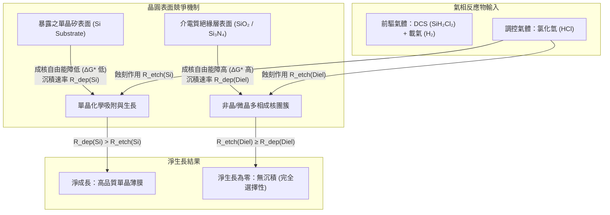

SEG 的物理化學機制建構於沉積反應與蝕刻反應的動態平衡：

$$R_{\mathrm{net}} = R_{\mathrm{deposition}} - R_{\mathrm{etching}}$$

式中 $R_{\mathrm{net}}$ 為淨沉積速率，$R_{\mathrm{deposition}}$ 為前驅氣體裂解沉積速率，$R_{\mathrm{etching}}$ 為含氯化合物引發的逆反應蝕刻速率。

在介電質表面，矽原子的化學吸附能較低，形成穩定成核團簇（Nuclei）所需克服的熱力學臨界成核自由能 $\Delta G^*$ 遠高於單晶矽表面。若成核團簇尺寸小於臨界半徑 $r^*$，此團簇熱力學上不穩定且極易被蝕刻。藉由在反應腔體中精確通入額外的 $\mathrm{HCl}$ 氣體，調控氯化蝕刻反應：

$$\mathrm{Si(s)} + 2\mathrm{HCl(g)} \rightarrow \mathrm{SiCl_2(g)} + \mathrm{H_2(g)}$$

由於介電質上微小的多晶矽成核中心其比表面積大、化學活性高，蝕刻速率 $R_{\mathrm{etching, Diel}}$ 顯著高於沉積速率 $R_{\mathrm{deposition, Diel}}$，達成淨成長量為零（$R_{\mathrm{net, Diel}} \le 0$）。相對地，在單晶矽表面，磊晶膜層與基板原子維持連續點陣，化學鍵結穩定，沉積速率主導整個反應（$R_{\mathrm{deposition, Si}} > R_{\mathrm{etching, Si}}$），從而維持高度單晶選擇性。

!!! warning "圖案負載效應（Pattern Loading Effect）"
    SEG 製程高度敏感於晶圓表面的非等向分佈。由於晶圓上介電質遮蔽區與矽開口區的面積比例（Loading Ratio）在局部晶粒（Die）間不均勻，非反應區表面所累積的多餘前驅氣體分子會透過氣相擴散至相鄰的開口區，造成開口密集區與稀疏區的磊晶層厚度及化學成分（如 SiGe 中的 Ge 含量）出現偏差，稱為微負載效應（Micro-loading Effect）。

---

### 應變矽工程之能帶物理機制

載子遷移率（Mobility, $\mu$）直接決定了電晶體的飽和驅動電流（見第 4 章），根據能帶理論與德魯德模型（Drude Model），載子遷移率定義為：

$$\mu = \frac{q \tau}{m^*}$$

其中 $q$ 為基本電荷，$\tau$ 為載子散射弛豫時間（Scattering Relaxation Time），$m^*$ 為載子的電導有效質量（Conductivity Effective Mass）。

在未應變的鬆弛塊材矽（Bulk Si）中：
1. **導帶（Conduction Band）**：具有 6 個能量完全簡併的等能谷（Energy Valleys），沿著 $\langle 100 \rangle$ 晶向對稱分佈（記為 $\Delta_6$ 能谷）。電子在這些能谷間傳輸時，會受到強烈的縱向聲子（Phonon）散射影響，造成能谷間散射（Inter-valley Scattering），大幅縮短散射時間 $\tau$。
2. **價帶（Valence Band）**：在布里元區中心（$\Gamma$ 點），由重電洞帶（Heavy Hole, HH）與輕電洞帶（Light Hole, LH）發生能量簡併。在熱平衡狀態下，絕大多數電洞分佈於能態密度高但有效質量較大的重電洞帶，使得整體電洞遷移率偏低。

應變矽（Strained Silicon）工程透過外加應力破壞晶格的對稱性，誘發能帶結構的**退簡併分裂（Degeneracy Splitting）**，同時改變能帶色散關係的曲率（Curvature），達到調控載子傳輸特性的目的。

$$E(\mathbf{k}) \approx \frac{\hbar^2 \mathbf{k}^2}{2 m^*}$$

能帶極值處的曲率愈大，載子有效質量 $m^*$ 愈小。

---

### 雙軸張應力對電子遷移率之提升機制

雙軸張應變（Biaxial Tensile Strain）主要透過在鬆弛的矽鍺虛擬基板（Relaxed SiGe Virtual Substrate）上磊晶生長超薄矽層達成。由於矽的晶格常數（典型值 $a_{\mathrm{Si}} = 0.5431\,\mathrm{nm}$）小於矽鍺合金的晶格常數（$a_{\mathrm{SiGe}}$），磊晶矽原子在面內方向（In-plane, $x-y$ 軸）受到張應力拉伸，在垂直方向（Out-of-plane, $z$ 軸）則因帕松效應（Poisson Effect）被壓縮。

此對稱性破缺使導帶的 6 個簡併能谷分裂為兩組子能帶：
* **$\Delta_2$ 能谷**：包含 2 個沿著垂直晶圓表面方向（$[001]$ 與 $[00\bar{1}]$）排列的能谷，其能量位準下降 $\Delta E_C$。
* **$\Delta_4$ 能谷**：包含 4 個沿著面內方向（$[100], [010]$ 等）排列的能谷，其能量位準上升。

$$\Delta E_C \propto \Xi_u \left( \varepsilon_{\perp} - \varepsilon_{\parallel} \right)$$

式中 $\Xi_u$ 為導帶剪切形變位能（Deformation Potential），$\varepsilon_{\perp}$ 與 $\varepsilon_{\parallel}$ 分別為垂直與面內應變張量分量。

```
未應變矽導帶 (簡併態)                雙軸張應變矽導帶 (分裂態)
  
       Δ6 (6-fold)                         Δ4 (4-fold) [能量上升]
  ====================                      ──────────── 
                                                 ↑
                                                 │ ΔEc
                                                 ↓
                                            ────────────
                                            Δ2 (2-fold) [能量下降]
```

當 $\Delta_2$ 與 $\Delta_4$ 的能量差 $\Delta E_C$ 顯著大於熱能 $k_B T$（室溫下約 $26\,\mathrm{meV}$）時，電子將依據費米-狄拉克統計大幅優先佔據能量較低的 $\Delta_2$ 能谷：
1. **有效傳輸質量降低**：$\Delta_2$ 能谷的面內等能面長軸垂直於傳輸平面，因此面內傳輸方向的有效質量為橫向有效質量 $m_t^* \approx 0.19\,m_0$，而非縱向有效質量 $m_l^* \approx 0.98\,m_0$（$m_0$ 為自由電子靜止質量）。電導有效質量顯著降低。
2. **能谷間聲子散射受到抑制**：低能態電子要散射至 $\Delta_4$ 能谷需吸收高能量聲子，因能階分裂使散射相空間（Phase Space）大幅縮小，載子弛豫時間 $\tau$ 大幅增加。

雙軸張應變使電子遷移率提升超過 50%。然而，雙軸應變基板製程繁複且缺陷密度高，後續已被單軸應變架構取代。

---

### 嵌入式源汲極應力源：e-SiGe 與 Si:C

在奈米級 MOSFET 中，單軸應變（Uniaxial Strain）比雙軸應變在短通道元件下展現出更強的驅動電流增益與較低的接面漏電流。目前業界主要採用在電晶體主動區兩側嵌入異質晶格材料的方式，沿著通道傳輸方向直接誘導單軸應變。

#### 1. 嵌入式矽鍺（e-SiGe）於 p-MOSFET 之壓應力機制
鍺的共價半徑（$0.122\,\mathrm{nm}$）大於矽（$0.117\,\mathrm{nm}$）。依據維加德定律（Vegard's Law），無缺陷的固溶合金晶格常數與組分呈線性關係：

$$a_{\mathrm{Si}_{1-x}\mathrm{Ge}_x} = (1-x) a_{\mathrm{Si}} + x a_{\mathrm{Ge}}$$

式中 $x$ 為鍺莫耳分率，$a_{\mathrm{Ge}} = 0.5658\,\mathrm{nm}$。

在先進 p-MOSFET 製程中，先利用非等向乾式蝕刻在閘極兩側的矽基板挖出凹槽（Cavity，通常配合晶面非等向蝕刻形成 $\Sigma$ 形刻槽），隨後藉由 SEG 技術在凹槽內選擇性成長出晶格常數較大的 $\mathrm{Si}_{1-x}\mathrm{Ge}_x$ 單晶。

```mermaid
graph LR
    subgraph pMOS ["p-MOSFET 結構橫截面"]
        direction LR
        S["嵌入式 e-SiGe (源極)<br/>晶格常數 a_SiGe > a_Si"] -->|"單軸壓應力 (Compressive)"| CH["通道區 (Si Channel)<br/>通道方向 [110]"]
        CH <--|"單軸壓應力 (Compressive)"| D["嵌入式 e-SiGe (汲極)<br/>晶格常數 a_SiGe > a_Si"]
    end
```

由於通道區矽晶格受兩側膨脹體積的箝制，通道沿傳輸方向承受強烈**單軸壓應力（Uniaxial Compressive Strain）**。此應變對價帶產生以下效應：
* **解除價帶頂的重電洞（HH）與輕電洞（LH）簡併**：在單軸壓應變下，原本在 $\Gamma$ 點重合的能帶分裂，頂部子能帶向上移動，主導低能量載子分佈。
* **能帶色散扭曲**：頂部能帶沿著傳輸方向的曲率顯著增加，使電洞有效質量大幅減小。
* **帶間聲子散射（Inter-band Scattering）減少**：能帶分裂能階差抑制電洞在 HH 與 LH 帶之間的躍遷機率。

上述物理機制使 p-MOSFET 的電洞飽和遷移率提高 100% 以上。

#### 2. 矽碳化合物（Si:C）於 n-MOSFET 之張應力機制
針對 n-MOSFET，為在通道誘導單軸張應力，必須在源極/汲極嵌入晶格常數小於矽的材料。碳原子的共價半徑僅為 $0.077\,\mathrm{nm}$，若將替代式碳原子（Substitutional Carbon）併入矽晶格中形成 $\mathrm{Si}_{1-y}\mathrm{C}_y$ 合金，其晶格常數將小於純矽：

$$a_{\mathrm{Si}_{1-y}\mathrm{C}_y} \approx a_{\mathrm{Si}} - y (a_{\mathrm{Si}} - a_{\mathrm{C}})$$

在源汲極凹槽中磊晶成長 $\mathrm{Si}_{1-y}\mathrm{C}_y$ 薄膜，會對通道施加單軸張應力（Uniaxial Tensile Strain），沿傳輸方向拉伸通道矽晶格，誘發與前述張應力相似的導帶分裂，降低電子電導有效質量並提升驅動電流。

!!! note "替代式碳與間隙碳的冶金挑戰"
    碳在純矽中的固溶度極低（熱平衡下小於 $10^{17}\,\mathrm{atoms/cm^3}$）。若要在 $\mathrm{Si:C}$ 中達到足夠的應變量，替代式碳濃度需達到 $1\% \sim 2\%$（約 $10^{21}\,\mathrm{atoms/cm^3}$），此為極端介穩態（Metastable State）。製程必須在超低溫（典型值 $< 600^\circ\mathrm{C}$）下進行低壓磊晶，使用如甲基矽烷（Monomethylsilane, $\mathrm{SiH_3CH_3}$）為碳源。若熱預算控制不當，碳原子將脫離晶格點成為間隙碳（Interstitial Carbon），導致應力鬆弛並產生漏電中心。

!!! example "產業實例"
    單軸應變矽工程於 90 nm 節點首次量產導入。當時在 p-MOSFET 的源汲極凹槽中採用 SEG 成長鍺濃度約 17% 的 $\mathrm{Si}_{0.83}\mathrm{Ge}_{0.17}$，並配合氮化矽接觸蝕刻停止層（Contact Etch Stop Layer, CESL）沉積時產生的內建張應力薄膜覆蓋 n-MOSFET，成功在不依賴微影微縮的情況下，使電晶體飽和電流（$I_{\mathrm{on}}$）大幅提升約 30%。隨後製程演進中，e-SiGe 中的鍺濃度更逐步推升至 30% 到 50% 範圍，並演化出多層梯度磊晶結構以優化接觸電阻與缺陷分佈。

<!-- fig:1 -->
<figure markdown>
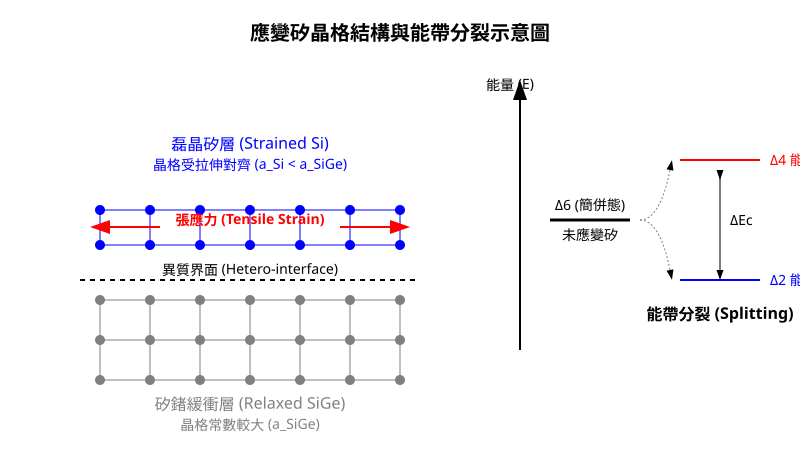
<figcaption>圖 9-1　應變矽晶格結構圖（AI 繪製的示意圖）</figcaption>
</figure>

## 9.3 絕緣層覆矽 (SOI) 結構與製程物理

### 9.3 絕緣層覆矽 (SOI) 結構與製程物理

絕緣層覆矽（Silicon on Insulator, SOI）技術是藉由在單晶矽薄膜與塊狀矽基板（Bulk Silicon Substrate）之間引入一層絕緣介電質，從而改變元件的物理邊界條件。相較於傳統塊狀矽元件，SOI 結構能有效消除寄生接面電容、抑制閂鎖效應（Latch-up），並在極低功耗與高頻應用中展現優勢。

#### 9.3.1 SOI 晶圓之三層物理結構

典型的 SOI 晶圓由下至上分為三個主要層級：

1.  **基底矽晶圓（Handle Wafer / Base Wafer）**：
    通常為標準的電子級單晶矽（見第 7 章），其主要功能是提供機械支撐力。在射頻（RF）應用中，基底矽晶圓通常選用高阻值矽（High Resistivity Silicon），以減少訊號在基板中的損耗。
2.  **埋入氧化層（Buried Oxide, BOX）**：
    位於中間的絕緣層，成分通常為二氧化矽（$SiO_2$）。其厚度視應用而定，典型值介於 $10\text{ nm}$ 至 $2\text{ }\mu\text{m}$ 之間。BOX 的存在阻斷了頂層元件與基板之間的電荷傳輸路徑。
3.  **頂層單晶矽（Top Si / Device Layer）**：
    此為製作電晶體主體的區域。根據頂層矽的厚度，SOI 可分為厚膜 SOI（厚度 $> 100\text{ nm}$）與薄膜 SOI（厚度 $< 50\text{ nm}$）。目前先進製程中的全耗盡型 SOI（Fully Depleted SOI, FD-SOI），其頂層矽厚度通常微縮至 $5\text{ nm}$ 至 $20\text{ nm}$ 之間。

#### 9.3.2 早期注氧隔離技術 (SIMOX)

在 1990 年代，製作 SOI 晶圓的主流技術為「注氧隔離」（Separation by Implantation of Oxygen, SIMOX）。其物理基礎是利用高能量離子植入技術，將大量的氧離子注入矽基板內部，隨後透過高溫退火誘發相變化。

**SIMOX 製程流程：**

1.  **高劑量氧離子植入**：使用離子植入機將 $O^+$ 注入矽晶圓。為了形成連續的 $SiO_2$ 層，植入劑量（Dose）極高，典型值約為 $10^{17}$ 至 $10^{18}\text{ atoms/cm}^2$，植入能量則決定了埋入層的深度。
2.  **高溫退火（High Temperature Annealing）**：植入後的晶圓需在接近矽熔點的高溫（典型值約 $1300^\circ\text{C}$ 至 $1350^\circ\text{C}$）下進行長時間退火。此時，注入的氧原子與周圍的矽原子反應形成 $SiO_2$ 析出物，並逐漸合併成連續的氧化層。

**物理限制與缺點：**
SIMOX 技術面臨嚴峻的挑戰。首先，極高劑量的離子植入會對頂層矽造成嚴重的晶格損傷，導致位錯密度（Dislocation Density）居高不下（典型值約 $10^4$ 至 $10^6\text{ cm}^{-2}$）。其次，BOX 層的厚度與均勻度受限於植入能譜的分布，難以製作極薄且高品質的絕緣層。因此，SIMOX 目前已非先進逻辑製程的主流。

#### 9.3.3 晶圓直接鍵合 (Direct Wafer Bonding) 物理

現代 SOI 製作的核心在於晶圓鍵合技術。其物理原理是利用兩片平整度極高的晶圓表面，在接觸時產生分子間作用力，進而結合為一體。

**表面親水性與鍵合機制：**
為了達成高品質鍵合，晶圓表面通常需經過化學清洗（如 SC-1 清洗，見第 20 章），使其表面覆蓋一層羥基（$-OH$）。

1.  **室溫預鍵合（Pre-bonding）**：
    當兩片具有親水性（Hydrophilic）表面的晶圓接觸時，表面的水分子與羥基之間會形成氫鍵。此時的結合力主要源自凡得瓦力（Van der Waals force），強度較弱。
2.  **熱退火鍵合（Annealing）**：
    將預鍵合的晶圓置於高溫環境（典型值 $200^\circ\text{C}$ 至 $1100^\circ\text{C}$）。隨著溫度升高，表面發生脫水縮合反應：
    $$Si-OH + HO-Si \rightarrow Si-O-Si + H_2O$$
    原本的氫鍵轉化為強大的共價鍵（Covalent Bond）。水分則擴散至氧化層中或沿著界面排出。

!!! note "疏水性鍵合"
    若移除表面氧化物使矽表面呈現疏水性（Hydrophobic），則鍵合主要由 $Si-H$ 鍵驅動。在極高溫退火下，氫原子脫離並形成 $Si-Si$ 共價鍵。這種方式常用於製作無氧化層界面的矽/矽鍵合結構。

#### 9.3.4 Smart Cut™ 技術流程與物理機制

目前商業化生產 SOI 晶圓最成功的技術為 Smart Cut™（由法國 Soitec 公司開發）。該技術結合了離子植入的精確深度控制與晶圓鍵合的表面品質，被形象地稱為「原子級劈裂」（Atomic Scalpel）。

**Smart Cut™ 製程步驟：**

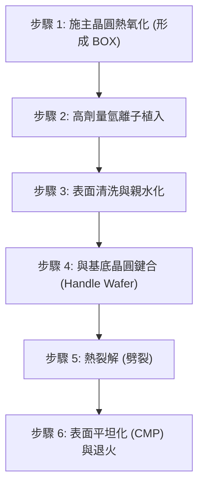

1.  **氧化與植入**：
    選取一片高品質單晶矽作為「施主晶圓」（Donor Wafer），先在其表面生長一層熱氧化層（未來成為 BOX）。接著植入高劑量的氫離子（$H^+$ 或 $H_2^+$），劑量典型值約為 $5 \times 10^{16}$ 至 $10^{17}\text{ cm}^{-2}$。
2.  **微氣孔（Micro-cavities）形成物理**：
    氫離子進入矽晶格後，會停留在特定的投影射程（Projected Range, $R_p$）深度。在該處，氫原子會與矽的懸鍵（Dangling bonds）結合，並在高劑量下形成微小的氣泡或盤狀缺陷（Platelets）。
3.  **鍵合**：
    將施主晶圓翻轉，與另一片基底晶圓進行親水性鍵合。
4.  **熱裂解（Thermal Exfoliation）**：
    將鍵合後的晶圓加熱至 $400^\circ\text{C}$ 至 $600^\circ\text{C}$。此時，微氣孔內部的氫氣壓力急劇增加，且氫原子會誘導矽晶格中的裂紋沿著植入損傷帶（Damage layer）橫向擴展。最終，施主晶圓會沿著 $R_p$ 深度發生大面積劈裂，將一層薄膜單晶矽「轉移」到基底晶圓上。
5.  **後處理**：
    劈裂後的表面具有較大的粗糙度（RMS 典型值約 $5\text{ nm}$ 至 $10\text{ nm}$），需透過化學機械研磨（CMP）與高溫氫氣退火進行平坦化，使頂層矽達到原子級平整度。

!!! warning "常見誤解"
    讀者常誤以為 Smart Cut 過程會損耗整片施主晶圓。事實上，劈裂後剩下的施主晶圓經過重新研磨與拋光後，可以多次重複使用作為施主或基底晶圓，這大幅降低了 SOI 的生產成本。

#### 9.3.5 SOI 結構之物理優勢分析

SOI 結構之所以在高效能運算與低功耗元件中佔有一席之地，源於其獨特的物理特性：

*   **降低寄生電容**：
    在塊狀矽中，源極/汲極（S/D）與基板之間存在較大的 PN 接面電容 $C_{j}$。在 SOI 中，由於 BOX 的介電常數（$\epsilon_{SiO_2} \approx 3.9$）遠低於矽（$\epsilon_{Si} \approx 11.7$），且 BOX 厚度遠大於耗盡層寬度，使得寄生電容大幅下降，提升了電晶體的切換速度（見第 4 章與第 5 章）。
*   **消除閂鎖效應（Latch-up Free）**：
    SOI 利用介電質進行完全隔離，物理上不存在塊狀矽中常見的寄生雙極性接面電晶體（BJT）路徑，因此徹底消除了 CMOS 製程中的閂鎖效應風險。
*   **陡峭的次臨界擺幅（Subthreshold Swing, SS）**：
    對於 FD-SOI 元件，由於通道下方的埋入氧化層限制了耗盡區的擴張，使得閘極對通道電荷的受控能力增強。理想情況下，其 SS 值能更接近物理極限 $60\text{ mV/dec}$（於 $300\text{ K}$ 下）。

#### 9.3.6 物理挑戰：自我加熱效應 (Self-Heating Effect, SHE)

儘管 SOI 具有電學優勢，但其熱學特性卻是一大挑戰。二氧化矽的熱傳導率（Thermal Conductivity, $\kappa$）約為 $1.4\text{ W/(m}\cdot\text{K)}$，遠低於單晶矽的 $148\text{ W/(m}\cdot\text{K)}$。

當元件在高電流下運作時，產生的熱量會被 BOX 層阻隔，難以傳導至基板散熱。這會導致通道溫度升高，進而降低載子遷移率（Mobility）並影響元件可靠性。在設計 SOI 製程時，必須在 BOX 厚度（電學隔離）與熱阻（熱學散熱）之間進行權衡。

!!! example "產業實例"
    Soitec 是全球最大的 SOI 晶圓供應商，其 Smart Cut™ 技術已成為製作 FD-SOI、RF-SOI 與 Power-SOI 的工業標準。GlobalFoundries 與 Samsung 則是採用 FD-SOI 技術進行代工的主要廠商，廣泛應用於物聯網（IoT）與行動通訊晶片中。

<!-- fig:2 -->
<figure markdown>
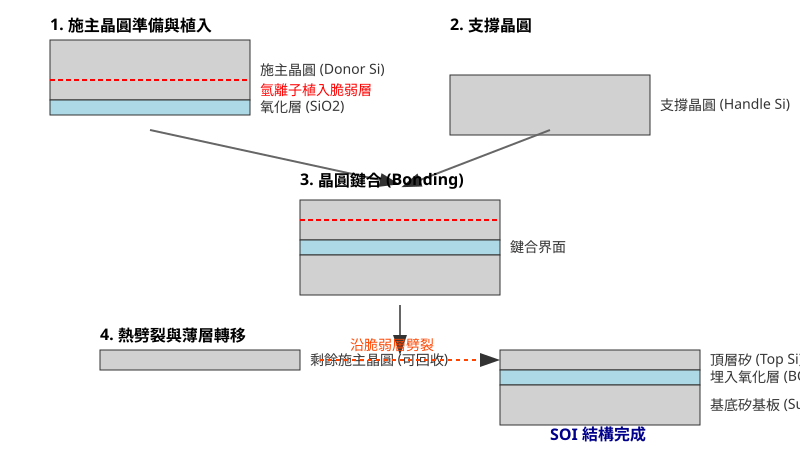
<figcaption>圖 9-2　Smart Cut 製程圖（AI 繪製的示意圖）</figcaption>
</figure>

## 9.4 SOI 元件物理與電氣應用特性

### 部分空乏型 SOI 與浮動基底效應

在絕緣層覆矽（Silicon on Insulator, SOI）架構中，頂層單晶矽薄膜（Silicon Film, 厚度記為 $t_{\text{Si}}$）的厚度相對於閘極引發之最大空乏區寬度（Maximum Depletion Width, $x_{\text{d,max}}$，推導見第 4 章）的大小關係，決定了元件的運作模式。當 $t_{\text{Si}} > x_{\text{d,max}}$ 時，通道下方仍保留一段未被完全空乏的中性矽區（Neutral Body），此結構稱為部分空乏型 SOI（Partially Depleted SOI, PD-SOI）。

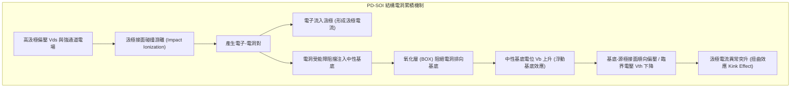

PD-SOI 元件最顯著的物理特徵為**浮動基底效應**（Floating Body Effect, FBE）。在傳統主體矽（Bulk-Si）MOSFET 中，基底通常經由基極接觸（Body Contact）接地或維持固定電位；但在標準 PD-SOI 元件中，中性主體被閘極介電層、淺溝槽隔離（STI）以及下方的埋入式氧化層（Buried Oxide, BOX）完全包覆，失去直接的直流電位參考點。

當 n 型 PD-SOI MOSFET 操作於飽和區的高汲極電壓（$V_{\text{ds}}$）下時，夾止點（Pinch-off point）附近的高電場會誘發**碰撞游離**（Impact Ionization），產生電子－電洞對。電子順著電場快速排入汲極端，而電洞則在中性基底的最低位能處累積。由於 BOX 的阻隔，電洞無法逸散至基板，導致基底電位（$V_{\text{b}}$）自發性上升。

基底電位升高將產生兩大元件效應：
1. **扭曲效應（Kink Effect）**：基底電位上升等同於對通道施加順向基底偏壓，藉由基底效應（Body Effect）使臨界電壓（$V_{\text{th}}$）下降：
   $$\Delta V_{\text{th}} = -\gamma \left( \sqrt{2\phi_{\text{F}} - V_{\text{bs}}} - \sqrt{2\phi_{\text{F}}} \right)$$
   其中 $\gamma$ 為基底效應係數，$\phi_{\text{F}}$ 為費米位能，$V_{\text{bs}} = V_{\text{b}} - V_{\text{s}} > 0$ 為基底對源極偏壓。臨界電壓下降促使通道電導驟增，使輸出特性曲線（$I_{\text{ds}} - V_{\text{ds}}$）在特定 $V_{\text{ds}}$ 下出現電流異常陡升的「扭曲（Kink）」轉折點。
2. **寄生雙極性電晶體效應（Parasitic BJT Action）**：源極（n+）、中性基底（p）與汲極（n+）構成寄生 NPN 雙極性接面電晶體（BJT）。當電洞累積使 $V_{\text{bs}}$ 升高至約 $0.6\sim 0.7\text{ V}$ 時，源極－基底接面順偏，引發源極向基底大量注入電子，並由汲極收集，此雙極性電流與 MOSFET 通道電流疊加，嚴重時將導致元件擊穿甚至暫態失控。

此外，浮動基底中的電荷充放電需歷經複合（Recombination）與產生（Generation）過程，其時間常數可達微秒（$\mu\text{s}$）至毫秒（$\text{ms}$）等級，造成高頻切換下的「歷史效應（History Effect）」，即當前時脈週期的延遲時間取決於前數個週期的開關狀態，增加了數位電路時序分析（Timing Closure）的複雜度。

---

### 全空乏型 SOI 元件物理與靜電完整性

為克服 PD-SOI 的浮動基底問題並進一步微縮電晶體，**全空乏型 SOI**（Fully Depleted SOI, FD-SOI）技術將頂層單晶矽厚度縮減至空乏層寬度以下（$t_{\text{Si}} < x_{\text{d,max}}$，在先進節點中典型值為 $5\sim 7\text{ nm}$），使元件在未施加閘極偏壓或僅處於熱平衡時，整個矽主體已處於完全空乏狀態，稱為超薄主體（Ultra-Thin Body, UTB）架構。

```
       閘極電極 (Gate Metal)
   ┌───────────────────────────┐
   │    閘極介電層 (High-k)     │
┌──┴───────────────────────────┴──┐
│源極 (S)  超薄矽通道 (UTB, <7nm)  汲極 (D)│
└──┬───────────────────────────┬──┘
   │   超薄埋入式氧化層 (Thin BOX)  │
   ├───────────────────────────┤
   │      背向偏壓井 (Back-Well)   │
   │      矽基板 (Si Substrate)    │
   └───────────────────────────┘
```

#### 短通道效應抑制機制

在微縮製程中，汲極電場穿透至通道引發之汲極感應能障降低（DIBL，見第 5 章）是短通道效應的主要成因。FD-SOI 利用幾何約束而非高摻雜來控制靜電場。元件的自然比例長度（Natural Length, $\lambda_{\text{FD}}$）表徵了汲極電場側向穿透的有效距離：

$$\lambda_{\text{FD}} = \sqrt{\frac{\varepsilon_{\text{Si}}}{\varepsilon_{\text{ox}}} t_{\text{Si}} t_{\text{ox}}}$$

其中 $\varepsilon_{\text{Si}}$ 與 $\varepsilon_{\text{ox}}$ 分別為矽與二氧化矽之介電常數，$t_{\text{ox}}$ 為閘極氧化層厚度。由式中可知，當頂層矽厚度 $t_{\text{Si}}$ 降至極低時，$\lambda_{\text{FD}}$ 大幅縮小。

超薄主體在物理結構上完全阻絕了遠離閘極的深層基底漏電路徑，迫使汲極電力線無法藉由矽基底深入穿透至源極能障區，從根本上削弱了 DIBL 效應，抑制次臨界漏電流（Subthreshold Leakage），使元件在極短閘極長度下仍能保持高關斷特性。此外，由於通道內部不依賴超高濃度離子植入（Ion Implantation）來抑制穿透（Punch-through），通道維持未摻雜或輕微摻雜狀態，徹底消除了隨機摻雜擾動（Random Dopant Fluctuation, RDF）引起的臨界電壓變異，並大幅降低了游離雜質散射，使載子遷移率（Mobility）得以回升。

---

### 次臨界擺幅改善與背向偏壓調控

#### 次臨界擺幅之理論極限改善

次臨界擺幅（Subthreshold Swing, $SS$）定義為汲極電流變化一個數量級（Decade）所需的閘極電壓變動量：

$$SS = \ln(10) \cdot \frac{k_{\text{B}} T}{q} \cdot \left(1 + \frac{C_{\text{dep}}}{C_{\text{ox}}}\right)$$

其中 $k_{\text{B}}$ 為波茲曼常數，$T$ 為絕對溫度，$q$ 為基本電荷，$C_{\text{ox}}$ 為閘極氧化層電容，$C_{\text{dep}}$ 為通道空乏層電容。

在傳統主體矽 MOSFET 中，為了抑制短通道效應必須提高通道摻雜濃度，造成 $C_{\text{dep}} = \varepsilon_{\text{Si}}/x_{\text{d}}$ 顯著增大，導致室溫（$300\text{ K}$）下的 $SS$ 普遍劣化至 $80\sim 100\text{ mV/dec}$。

相對地，在 FD-SOI 中，通道完全空乏，空乏層受限於實體矽薄膜厚度（$t_{\text{Si}}$），其等效主體電容轉為與底層 BOX 電容（$C_{\text{BOX}} = \varepsilon_{\text{ox}}/t_{\text{BOX}}$）串聯：

$$C_{\text{body}} = \left(\frac{1}{C_{\text{Si}}} + \frac{1}{C_{\text{BOX}}}\right)^{-1} = \left(\frac{t_{\text{Si}}}{\varepsilon_{\text{Si}}} + \frac{t_{\text{BOX}}}{\varepsilon_{\text{ox}}}\right)^{-1}$$

由於超薄矽薄膜與相對較厚的 BOX 使得整體下層串聯電容 $C_{\text{body}} \ll C_{\text{ox}}$，體積因數（Body factor）$n = 1 + C_{\text{body}}/C_{\text{ox}} \to 1.0$。FD-SOI 元件在室溫下之 $SS$ 可達到接近理論極限的 $60\sim 65\text{ mV/dec}$。優異的次臨界陡峭度允許元件在維持極低關斷漏電流（$I_{\text{off}}$）的前提下，大幅下調臨界電壓與操作電壓（$V_{\text{dd}}$），顯著節省動態功耗（$P_{\text{dynamic}} \propto V_{\text{dd}}^2$）。

#### 背向偏壓動態調節技術

採用薄埋入式氧化層（Ultra-Thin BOX, 典型值厚度 $t_{\text{BOX}} \approx 10\sim 25\text{ nm}$）的先進 FD-SOI 製程具備獨特的靜電控制機制——雙閘極耦合特性。頂層通道由前方的主閘極（Front Gate）與底部的矽基板「背閘極（Back Gate）」共同控制。

```
              ┌────────────────────────┐
              │ 前閘極控制 Vg (C_ox)    │
              └───────────┬────────────┘
                          ▼
通道電位 φ_ch ──[C_Si]── 超薄矽薄膜通道 (UTB)
                          ▲
              ┌───────────┴────────────┐
              │ 背閘極控制 Vbg (C_BOX) │
              └────────────────────────┘
```

根據電容分壓原理，背向偏壓（Back Biasing, $V_{\text{bg}}$）對臨界電壓的調控斜率定義為體係數（Body Factor, $\gamma_{\text{FD}}$）：

$$\Delta V_{\text{th}} \approx -\frac{C_{\text{BOX}}}{C_{\text{ox}}} \Delta V_{\text{bg}} = -\frac{\varepsilon_{\text{ox}} / t_{\text{BOX}}}{\varepsilon_{\text{ox}} / t_{\text{ox}}} \Delta V_{\text{bg}} = -\frac{t_{\text{ox}}}{t_{\text{BOX}}} \Delta V_{\text{bg}}$$

在薄 BOX 結構中，體係數可達到 $80\sim 140\text{ mV/V}$，約為傳統主體矽元件（約 $20\sim 30\text{ mV/V}$）的數倍。

| 偏壓模式 | 施加條件 ($V_{\text{bg}}$) | 臨界電壓效應 | 應用場景 |
| :--- | :--- | :--- | :--- |
| **正向背偏 (Forward Back Bias, FBB)** | 對 nMOS 背井施加正偏壓 ($V_{\text{bg}} > 0$) | $V_{\text{th}}$ 調降，驅動電流 $I_{\text{on}}$ 激增 | 運算高峰期動態超頻、突發工作負載 |
| **反向背偏 (Reverse Back Bias, RBB)** | 對 nMOS 背井施加負偏壓 ($V_{\text{bg}} < 0$) | $V_{\text{th}}$ 調高，漏電流 $I_{\text{off}}$ 指數下降 | 系統待機、低功耗休眠模式 |

!!! example "產業實例：超低功耗微控制器"
    產業界利用 22 奈米 FD-SOI 製程（如 GlobalFoundries 22FDX）開發之物聯網（IoT）邊緣運算處理器，在常規操作時維持標準偏壓；當需要爆發運算能力時，軟體控制器動態啟動 FBB 將 $V_{\text{th}}$ 下拉數十至上百毫伏，以低供電電壓提供極高的工作頻率；進入睡眠模式後則切換為 RBB，將次臨界漏電壓制在皮安培（$\text{pA}$）等級。

---

### 射頻特性與高電阻基板 SOI

在射頻（RF）與毫米波（mmWave）前端電路中，開關元件（RF Switch）與低雜訊放大器（LNA）對基板損耗有嚴苛要求。傳統主體矽基板之電阻率僅約 $1\sim 10\ \Omega\cdot\text{cm}$，在高頻訊號下會產生劇烈的基板渦電流損耗與電容耦合。

**高電阻基板 SOI**（High-Resistivity SOI, HR-SOI）採用電阻率 $\rho > 1\text{ k}\Omega\cdot\text{cm}$（甚至高達 $3\sim 10\text{ k}\Omega\cdot\text{cm}$）的單晶矽基板。結合厚 BOX 層，HR-SOI 元件展現出顯著優勢：
1. **降低基板射頻損耗與寄生電容**：源極與汲極接面由 BOX 實體墊底，寄生接面電容（$C_{\text{j}}$）大幅降低至傳統基板的數分之一，截止頻率（Unity-gain Frequency, $f_{\text{T}}$）與最高振盪頻率（Maximum Oscillation Frequency, $f_{\text{max}}$）顯著推升。
2. **富陷阱層（Trap-rich Layer）消除寄生表面導電**：在單晶矽高阻基板與 BOX 介面處，熱氧化製程的正固定電荷（$Q_{\text{ox}}$）會在基板表面感應出電子累積層（Accumulation layer）或逆轉層，形成低電阻的「寄生表面導電（Parasitic Surface Conduction, PSC）」，嚴重削弱高阻基板效益。現代 RF-SOI 在基板與 BOX 之間沉積一層無摻雜的多晶矽薄膜（稱為富陷阱層）。此層具備極高密度的晶界缺陷能階，能有效捕獲並固定介面自由載子，在高溫熱預算後仍可完整維持基板的高阻抗狀態，將高頻諧波失真（Harmonic Distortion）壓制至超低水準。

---

### 抗輻射與杜絕寄生拉閂效應

在惡劣環境（如太空輻射、高能物理實驗室與高可靠性車用電子）中，SOI 結構具備先天優勢。

#### 杜絕寄生拉閂（Latch-up Free）

在傳統主體 CMOS 製程中，相鄰的 pMOS 與 nMOS 會在微縮佈局中形成寄生 p-n-p-n 晶閘管（SCR）結構（包含寄生垂直 NPN 與側向 PNP 雙極性電晶體，見第 4 章接面結構）。當電源線突波或基板電流促使其中一個寄生 BJT 導通時，將形成正回授迴路，誘發短路大電流，導致電路失效或物理燒毀。

```
主體 CMOS (存在 Latch-up 通道)           SOI CMOS (絕緣介質物理阻隔)
    pMOS         nMOS                        pMOS         nMOS
┌───┬───┐    ┌───┬───┐                   ┌───┬───┐    ┌───┬───┐
│ p+│ p+│    │ n+│ n+│                   │ p+│ p+│    │ n+│ n+│
└───┴───┴────┴───┴───┘                   └───┴───┴────┴───┴───┘
│  N-Well │   P-Sub  │                   ═════════ BOX ═════════ (絕緣阻斷)
└─────────┴──────────┘                   ───────────────────────
    ▲ 寄生雙極性通路 ▲                          基板 (Substrate)
```

在 SOI 技術中，元件之間經由 STI 與底層絕緣 BOX 實現了完整的三維介質隔離（Dielectric Isolation）。源極與汲極直接座落於 BOX 之上，缺乏提供基極偏壓的共享半導體基底，寄生四層 NPNP 結構在物理幾何上被完全截斷，因此 SOI CMOS **完全杜絕寄生拉閂現象**，省去了主體矽製程繁瑣的保護環（Guard Ring）佈局面積。

#### 抗單一事件擾亂（Single Event Upset, SEU）

當太空宇宙射線中的高能重離子、質子或大氣中經分裂產生的中子穿透晶片時，粒子沿其行進路徑因電離作用產生高密度的電子－電洞對。若此游離電荷沉積於記憶體單元（如 SRAM 反相器）的敏感反向偏壓節點附近，將引發暫態電流脈衝（Single Event Transient, SET），進而翻轉儲存位元，此現象稱為**單一事件擾亂（SEU）**。

沉積電荷被敏感節點收集的量（$Q_{\text{coll}}$）取決於有效電荷收集體積（Charge Collection Volume, 深度記為 $L_{\text{coll}}$）：

$$Q_{\text{coll}} \approx \int_{0}^{L_{\text{coll}}} \left(\frac{\mathrm{d}E}{\mathrm{d}x}\right) \cdot \frac{q}{E_{\text{ehp}}} \, \mathrm{d}x$$

其中 $\mathrm{d}E/\mathrm{d}x$ 為粒子的側向能量轉移（Linear Energy Transfer, LET），$E_{\text{ehp}}$ 為矽中產生一對電子－電洞所需的平均能量（約 $3.6\text{ eV}$）。

在傳統主體矽中，$L_{\text{coll}}$ 包含接面空乏區及其下方的擴散長度，總深度可達數微米至十數微米；而在 FD-SOI 中，元件的有源區實體厚度僅由超薄單晶矽薄膜決定（$t_{\text{Si}} \approx 6\text{ nm}$）。BOX 絕緣層成為強大的能障阻絕層，粒子穿過深層基板產生的龐大游離電荷無法跨越絕緣氧化層注入上層通道。收集體積的微縮使 $Q_{\text{coll}}$ 驟降兩個數量級以上，使其極難超過記憶單元翻轉所需的臨界電荷（$Q_{\text{crit}}$），賦予 FD-SOI 卓越的抗單一事件效應能力。

## 9.5 設備與廠商技術

在半導體製造中，磊晶（Epitaxy）與絕緣層覆矽（SOI）技術的實現高度依賴於精密控制的熱力學環境與化學反應動力學。本節將探討工業界如何透過先進的反應爐架構、原位清洗技術以及晶圓鍵合設備，將理論上的單晶生長與層狀結構轉化為高良率的量產製程。

### 9.5.1 工業級氣相磊晶爐架構與設計原理

工業級磊晶製程主要採用減壓氣相磊晶（Reduced Pressure Chemical Vapor Deposition Epitaxy, RP-CVD Epi），其核心目標是在維持高生長速率的同時，確保極佳的晶格完整性與厚度均勻性。

#### 冷壁型反應室 (Cold-wall Reactor)
與傳統熱壁型 CVD 爐管不同，磊晶爐多採用「冷壁型」設計。其反應室壁面（通常為石英材質）在製程中保持較低溫度，僅透過紅外線加熱燈管（Lamp heating）或感應加熱（Induction heating）針對承載晶圓的石墨基座（Susceptor）進行加熱。
*   **物理優勢**：冷壁設計能有效抑制前驅物在反應室壁面上的熱分解，降低壁面沉積物剝落導致的微塵（Particle）污染。
*   **熱場控制**：透過多組加熱燈管的分區（Zoning）控制，可精確補償晶圓邊緣的熱散失，確保 300mm 晶圓表面的溫度均勻度偏差小於 $\pm 1^\circ \text{C}$。

#### 單晶圓減壓氣相磊晶 (Single-wafer RP-CVD)
現代先進製程（如 7nm 以下節點）普遍採用單晶圓處理模式，而非批次式處理，以獲得更好的製程重複性。
*   **減壓環境**：操作壓力通常設定在 $10 \text{ Torr}$ 至 $100 \text{ Torr}$ 之間。減壓環境可增加反應氣體的平均自由徑（Mean Free Path），加速副產物的擴散脫離，並減少氣相中的寄生反應。
*   **氣流噴淋頭 (Showerhead) 設計**：氣體透過位於晶圓正上方的多孔噴淋頭垂直引入。這種設計結合晶圓的高速旋轉（典型值為 $300 \text{--} 1000 \text{ rpm}$），能形成穩定的滯留層（Stagnant Layer），使反應物濃度在晶圓表面達到高度均勻分布。

### 9.5.2 磊晶製程原位清洗 (In-situ Pre-bake Clean)

磊晶生長對基板表面的潔淨度極為敏感，任何殘留的原生氧化層（Native Oxide, $SiO_2$）都會破壞晶格連續性，導致位錯（Dislocation）或堆垛層錯（Stacking Fault）。

在進入生長步驟前，機台必須進行原位預烘烤清洗（In-situ Pre-bake）：
1.  **高溫氫氣還原**：在 $800^\circ \text{C}$ 至 $1100^\circ \text{C}$ 的氫氣氣氛下，利用 $H_2$ 還原表面氧化物：
    $$SiO_2(s) + H_2(g) \rightarrow SiO(g) + H_2O(g)$$
2.  **矽表面重構**：高溫下矽原子具備足夠的表面遷移率，會重新排列形成穩定的二聚體結構（Dimer rows），並由氫原子飽和懸鍵（Dangling bonds），形成穩定的 $H$-terminated 表面，為後續磊晶提供理想的模板。

### 9.5.3 應變源極/汲極選擇性磊晶技術

在 FinFET 與 GAAFET 結構中，為了提升載子遷移率，必須在源極（Source）與汲極（Drain）區域進行選擇性磊晶生長（Selective Epitaxial Growth, SEG）。

*   **PMOS 應變工程**：生長矽鍺（$Si_{1-x}Ge_x$），利用 $Ge$ 原子較大的晶格常數對矽通道施加壓縮應力（Compressive Stress）。
*   **NMOS 應變工程**：生長摻磷矽（$Si:P$）或矽碳（$Si_{1-x}C_x$），施加張應力（Tensile Stress）。

工業設備（如 Applied Materials 的 Centura Epi 系列）透過精確控制氯化氫（$HCl$）與前驅氣體（如 $SiH_4$、$GeH_4$）的比例，利用 $HCl$ 對絕緣層（$SiO_2$ 或 $Si_3N_4$）上非晶質沉積物的蝕刻速率遠高於單晶矽表面的特性，實現僅在矽區域生長的「選擇性」。

### 9.5.4 SOI 晶圓量產製造：Smart Cut™ 技術

目前全球商用 SOI 晶圓的主流生產技術為法國 Soitec 公司開發的 Smart Cut™ 製程。該技術結合了離子佈植與晶圓鍵合，能精確控制矽層厚度。

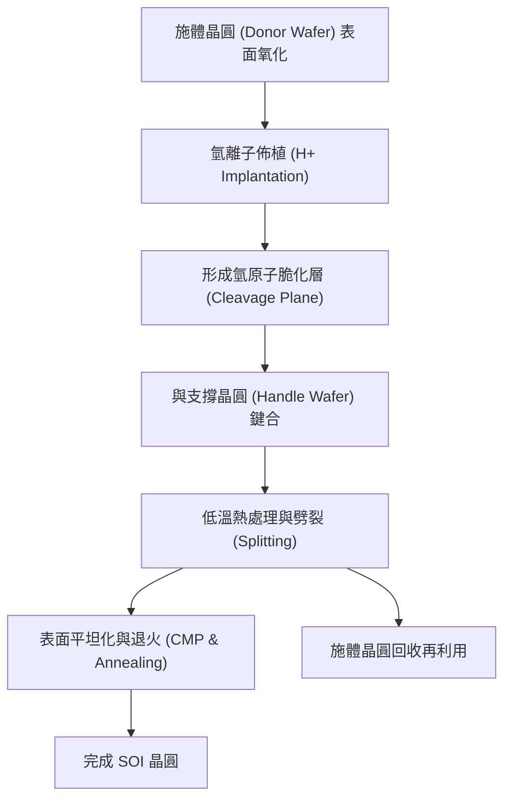

#### Smart Cut™ 關鍵物理機制
*   **離子佈植**：將高劑量的 $H^+$ 離子注入施體晶圓，深度由離子能量決定。氫離子在特定深度聚集形成微小氣泡（Micro-cavities）。
*   **劈裂 (Splitting)**：在約 $400 \text{--} 600^\circ \text{C}$ 的熱處理下，微小氣泡壓力增加並相互連結，最終導致矽片沿著佈植深度發生大面積斷裂，將超薄矽層轉移至支撐晶圓上。

!!! note "說明"
    Smart Cut™ 技術的優勢在於其厚度均勻性僅受離子佈植能量控制，而非機械研磨，因此可達到奈米級的厚度精準度，且施體晶圓可重複使用，降低了生產成本。

### 9.5.5 晶圓鍵合設備 (Wafer Bonder) 工程實作

SOI 製造與 3D 整合（如 Hybrid Bonding）的核心設備是晶圓鍵合機。其工程挑戰在於如何在原子級平坦度下排除界面缺陷。

1.  **表面活化模組 (Surface Activation)**：在鍵合前使用電漿（通常為 $N_2$ 或 $O_2$）轟擊晶圓表面，增加表面能與親水性（Hydrophilicity），使晶圓在常溫接觸時即可產生強大的凡得瓦力（Van der Waals force）。
2.  **對準精度 (Alignment)**：對於 SOI 製作，對準要求較低；但對於 3D IC 的晶圓對晶圓（Wafer-to-Wafer）鍵合，對準精度需達到 $< 50 \text{ nm}$。
3.  **高真空與環境控制**：鍵合過程必須在高真空或受控的惰性氣體環境中進行，以防止界面捕捉到空氣分子形成氣泡（Voids）。

### 9.5.6 主要廠商與技術比較

下表列出磊晶與 SOI 相關製程的主要設備商與技術特點：

| 廠商 | 代表產品系列 | 技術路線與特點 | 主要應用 |
| :--- | :--- | :--- | :--- |
| **Applied Materials (AMAT)** | Centura / Endura Epi | 單晶圓冷壁 RP-CVD，具備多腔體整合能力 | 先進節點應變矽、SEG 選擇性磊晶 |
| **ASMI (ASM International)** | Intrepid / Epsilon | 高產出單晶圓 Epi，優異的熱場控制與低溫生長技術 | 邏輯晶片 $SiGe$ 源汲極、GAA 奈米片生長 |
| **Tokyo Electron (TEL)** | CELLESTA / Citius | 批次式與單晶圓兼容，強調與清洗機台的整合 | 高產能磊晶、厚膜磊晶生長 |
| **Soitec** | Smart Cut™ 生產線 | 專利離子佈植與劈裂技術，全球 SOI 基板龍頭 | RF-SOI、FD-SOI 晶圓供應 |
| **EV Group (EVG)** | GEMINI / ComBond | 高精度自動化鍵合，具備原位表面活化功能 | SOI 製造、3D 封裝、Hybrid Bonding |
| **SUSS MicroTec** | XBS / XB8 | 針對 MEMS 與先進封裝的鍵合方案 | 特殊基板鍵合、功率元件 SOI |

### 9.5.7 晶圓廠選機考量與技術取捨

在實際晶圓廠環境中，設備的選擇取決於以下物理與經濟指標的權衡：

1.  **熱預算 (Thermal Budget)**：隨著元件微縮，過高的磊晶溫度會導致先前摻雜區域的擴散（見第 2 章）。因此，具備「低溫磊晶」能力（如利用電漿輔助或特殊前驅物在 $< 600^\circ \text{C}$ 生長）的機台在先進節點中更具競爭力。
2.  **產出率 (Throughput) 與均勻性**：批次式爐管雖然產出高，但在厚度均勻性與摻雜分布控制上不如單晶圓機台。對於 12 吋晶圓的先進邏輯製程，單晶圓機台已成為標準配置。
3.  **原位整合能力**：由於矽表面極易氧化，現代機台傾向將「預清洗（Pre-clean）」與「磊晶生長（Epi Growth）」整合在同一個真空叢集系統（Cluster System）中，避免晶圓暴露於大氣，這稱為「真空原位轉移」。

!!! warning "常見誤解"
    工程師常誤以為磊晶生長速率越快越好。實際上，過快的生長速率會導致反應物來不及在晶格位置上定位，進而產生多晶（Polycrystalline）或非晶（Amorphous）結構。在工業實務中，生長速率必須與表面反應動力學（Surface Reaction Kinetics）嚴格匹配。

## 本章重點

1.  **磊晶分類與晶格匹配**：磊晶分為同質磊晶與異質磊晶。異質磊晶中，薄膜與基板的晶格常數失配度（Lattice Mismatch）決定了薄膜內部的初始應變狀態（壓縮或伸張應力）。
2.  **氣相磊晶動力學**：磊晶成長受控於質量傳輸限制區（高溫區）與表面化學反應限制區（低溫區）。先進製程為求原子級精度，多操作於表面反應限制區。
3.  **薄膜成長模式**：由表面自由能平衡決定，分為二維層狀成長（FM）、三維島狀成長（VW）及混合模式（SK）。SK 模式是應變能釋放的結果，常用於製造自組裝量子點。
4.  **臨界厚度與位錯**：異質磊晶存在臨界厚度（Critical Thickness），超越此厚度後，系統會引入介面錯位以釋放彈性應變能，導致貫穿錯位等缺陷生成，損害元件電性。
5.  **應變矽工程**：透過嵌入式矽鍺（e-SiGe）或矽碳（Si:C）在通道誘導單軸應力，可解除能帶簡併並降低載子有效質量，顯著提升電晶體的遷移率與驅動電流。
6.  **SOI 結構與 Smart Cut™ 技術**：絕緣層覆矽（SOI）結構藉由埋入氧化層（BOX）實現全介質隔離。Smart Cut™ 技術利用離子植入與晶圓鍵合實現原子級精度的薄膜轉移。
7.  **FD-SOI 之元件優勢**：全空乏型 SOI（FD-SOI）具備極佳的靜電完整性，能有效抑制短通道效應與汲極感應能障降低（DIBL），並具備陡峭的次臨界擺幅與背向偏壓調控能力。
8.  **RF 與抗輻射特性**：SOI 結構能大幅降低寄生接面電容，配合高電阻基板可優化射頻性能；其微小的電荷收集體積使其具備天然的抗輻射單一事件擾亂（SEU）能力。


## 重點圖卡

複習時看這幾張就能抓住本章重點；[圖卡庫](../cards.md)可以下載成圖片。

<div class="ix-cards" markdown>

<figure markdown>
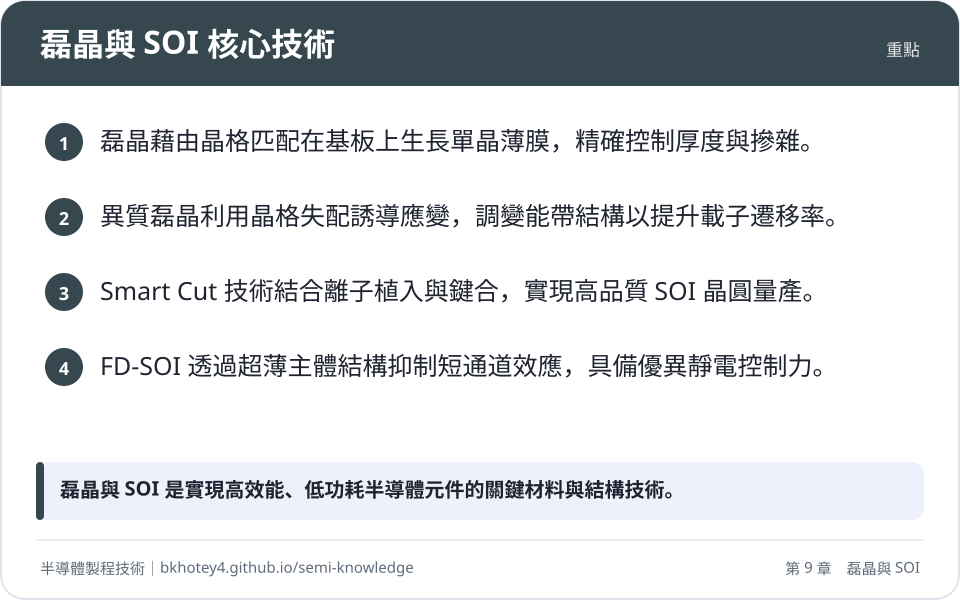
<figcaption>重點圖卡：磊晶與 SOI 核心技術</figcaption>
</figure>

<figure markdown>
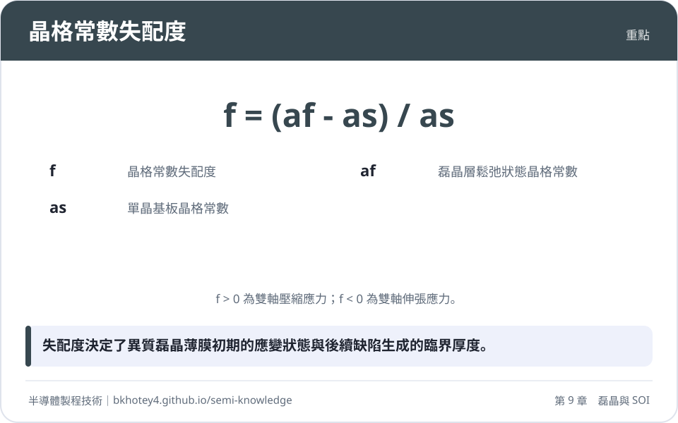
<figcaption>重點圖卡：晶格常數失配度</figcaption>
</figure>

<figure markdown>
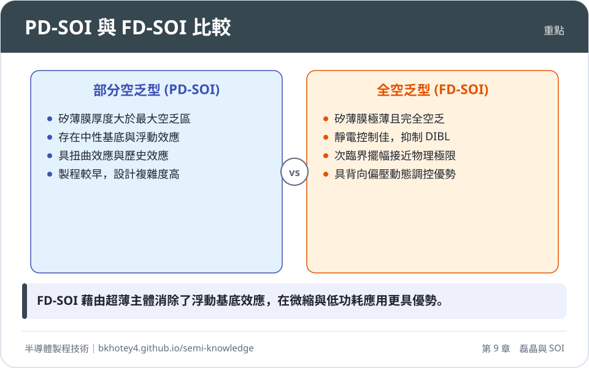
<figcaption>重點圖卡：PD-SOI 與 FD-SOI 比較</figcaption>
</figure>

<figure markdown>
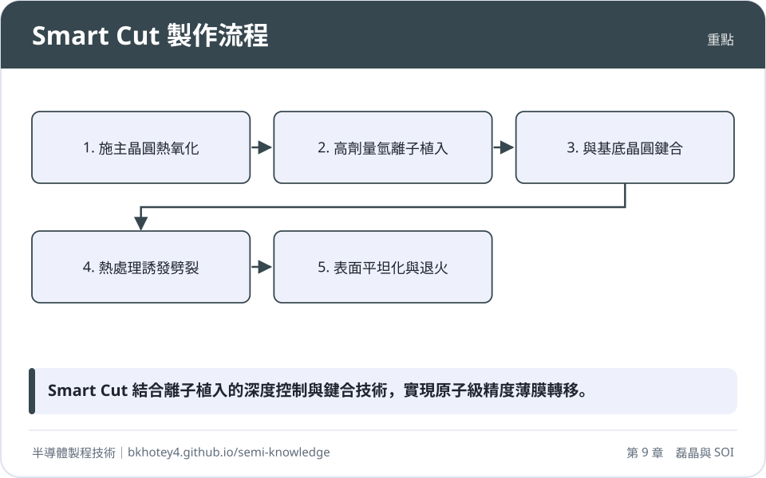
<figcaption>重點圖卡：Smart Cut 製作流程</figcaption>
</figure>

</div>

## 習題

**1.** 試說明在化學氣相磊晶（VPE）製程中，為何在「表面化學反應限制區」操作時，對反應爐內的溫度均勻性要求遠高於「質量傳輸限制區」？

??? success "參考解答"
    在表面化學反應限制區（低溫區），成長速率 $R$ 正比於反應速率常數 $k_s$，而 $k_s$ 遵循阿瑞尼斯方程式 $k_s = k_0 \exp(-E_a / k_B T)$。由於活化能 $E_a$ 較高（典型值 $1.5 \sim 3.0 \text{ eV}$），成長速率對溫度 $T$ 呈指數級敏感，微小的溫度波動即會導致顯著的膜厚不均。而在質量傳輸限制區（高溫區），成長速率受控於氣體擴散，擴散係數隨溫度的變化較為平緩（約 $T^{1.5 \sim 2.0}$），因此對溫度的敏感度較低。

**2.** 計算鍺莫耳分率 $x = 0.2$ 的 $\text{Si}_{0.8}\text{Ge}_{0.2}$ 磊晶層長在單晶矽基板上的晶格失配度 $f$。已知 $a_{\text{Si}} = 0.5431 \text{ nm}$，$a_{\text{Ge}} = 0.5658 \text{ nm}$，並判斷該磊晶層承受何種應力。（假設符合維加德定律）

??? success "參考解答"
    1. 根據維加德定律計算 $\text{Si}_{0.8}\text{Ge}_{0.2}$ 的塊材晶格常數：
       $a_f = 0.8 \times 0.5431 + 0.2 \times 0.5658 = 0.43448 + 0.11316 = 0.54764 \text{ nm}$。
    2. 計算晶格失配度 $f$：
       $f = (a_f - a_s) / a_s = (0.54764 - 0.5431) / 0.5431 \approx 0.00836$ 或 $0.836\%$。
    3. 應力判斷：
       由於 $a_f > a_s$（$f > 0$），磊晶層為了匹配較小的基板晶格，在面內方向會被擠壓，因此承受雙軸壓應力（Biaxial Compressive Strain）。

**3.** 比較部分空乏型 SOI（PD-SOI）與全空乏型 SOI（FD-SOI）在物理結構與電學特性上的主要差異。

??? success "參考解答"
    1. 結構差異：PD-SOI 的矽薄膜厚度大於最大空乏區寬度，通道下方保有中性基底（Neutral Body）；FD-SOI 的矽薄膜極薄，使整個主體在工作時處於完全空乏狀態。
    2. 電學特性：PD-SOI 存在浮動基底效應（FBE），會導致扭曲效應（Kink Effect）與歷史效應，並可能觸發寄生 BJT 導通；FD-SOI 則消除了中性基底，具有更佳的靜電完整性、更低的次臨界擺幅（SS）以及優異的短通道效應抑制能力。

**4.** 簡述 Smart Cut™ 技術中，氫離子植入與後續熱處理在實現薄膜劈裂中的物理作用。

??? success "參考解答"
    1. 氫離子植入：高劑量的氫離子被植入施主晶圓的特定深度（投影射程 $R_p$），氫原子與矽懸鍵結合並形成微小的氣孔（Micro-cavities）或盤狀缺陷。
    2. 熱處理：加熱（$400 \sim 600^\circ\text{C}$）促使微氣孔內的氫氣壓力增加，並誘導裂紋沿著植入損傷帶橫向擴展。當裂紋連結成片時，便會沿著 $R_p$ 深度發生原子級的平整劈裂，實現薄膜轉移。

## 本章術語

- **Epitaxy**（磊晶）：在單晶基板上依循其結晶取向生長出一層單晶薄膜的技術。
- **Lattice Mismatch**（晶格失配度）：磊晶材料與基板材料之間自然晶格常數的相對差異百分比。
- **Critical Thickness**（臨界厚度）：異質磊晶薄膜在不產生應變鬆弛位錯的前提下所能生長的最大厚度。
- **Pseudomorphic Growth**（假晶成長）：磊晶層完全匹配基板晶格，透過自身彈性形變維持無錯位介面的成長狀態。
- **Selective Epitaxial Growth, SEG**（選擇性磊晶成長）：僅在暴露的矽表面生長單晶，而在介電質遮蔽區不產生沉積的製程。
- **Floating Body Effect**（浮動基底效應）：SOI 元件中因中性基底與外界絕緣，導致電荷累積並改變基底電位的現象。
- **Buried Oxide, BOX**（埋入氧化層）：SOI 結構中位於頂層矽與底層基板之間的絕緣二氧化矽層。
- **Smart Cut**（智慧切割）：利用離子植入產生的脆化層結合晶圓鍵合技術，實現單晶薄膜精確轉移的製程。
- **Aspect Ratio Trapping, ART**（縱橫比展限捕捉）：利用高深寬比溝槽側壁終結貫穿錯位，以獲得高品質異質磊晶層的技術。
- **Subthreshold Swing, SS**（次臨界擺幅）：描述電晶體由關斷轉向開啟之速率的指標，數值愈小代表開關特性愈佳。


## 互動學習

!!! tip "動手試試看"
    - [設備機台圖鑑：磊晶機](../equipment.md)

<div class="quiz" data-quiz="02-03"></div>


## 產業最新進展

本節由每日產業新聞自動補充，說明本章技術在產業上的最新發展。

<!-- updates -->
（目前尚無補充。）
