# 第 10 章　化合物與寬能隙半導體

<figure markdown>
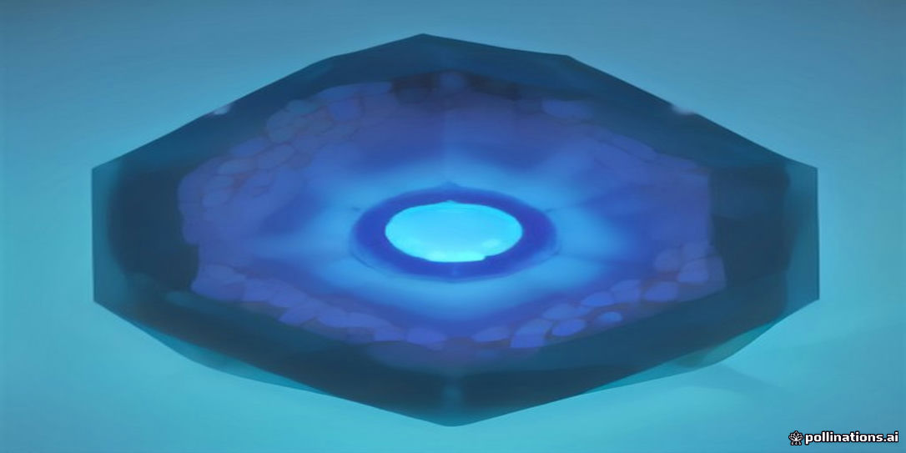
<figcaption>示意插畫：由 AI 生成，用來幫助記憶本章主題，細節請以內文與結構圖為準。</figcaption>
</figure>

!!! abstract "學習目標"
    - 掌握 III-V 族化合物與寬能隙半導體（SiC、GaN）的晶體結構、物理特性及其性能優值（如 BFOM 與 JFOM）之評估方法。
    - 理解碳化矽（SiC）之多型體現象、高擊穿電場優勢，以及高壓功率元件（SBD、MOSFET）的結構與界面挑戰。
    - 剖析氮化鎵（GaN）之自發與壓電極化效應、AlGaN/GaN 異質接面與二維電子氣（2DEG）機制，以及高電子移動率電晶體（HEMT）之工作原理。
    - 比較化合物半導體單晶長晶（PVT 法）、異質磊晶晶格不匹配問題與超硬脆材料晶圓加工瓶頸。

## 10.1 III-V 族化合物半導體基礎與物理特性

### 晶體結構：閃鋅礦與纖鋅礦

在探討化合物半導體之前，必須先理解其晶格結構對物理性質的決定性影響。矽（$\text{Si}$）與鍺（$\text{Ge}$）等元素半導體屬於金剛石結構（Diamond structure），由兩個面心立方（Face-Centered Cubic, FCC）子晶格沿體對角線平移 $1/4$ 晶胞長度交錯而成，晶格內每個原子皆為同種元素，具備反轉對稱性（Inversion symmetry）。

III-V 族化合物半導體由週期表第 III 族元素（如 $\text{Al, Ga, In}$）與第 V 族元素（如 $\text{N, P, As, Sb}$）以化學計量比 $1:1$ 結合而成。其晶體結構主要可分為兩大類：**閃鋅礦結構（Zinc-blende structure）**與**纖鋅礦結構（Wurtzite structure）**。

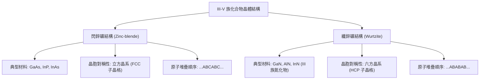

#### 閃鋅礦結構
多數傳統 III-V 族半導體（如砷化鎵 $\text{GaAs}$、磷化銦 $\text{InP}$）在室溫及常壓下採取閃鋅礦結構。其結構幾何形狀與金剛石相同，但兩個互相穿插的 FCC 子晶格分別由第 III 族與第 V 族原子佔據。每個原子與相鄰的四個異種原子形成四面體配位（Tetrahedral coordination）。

由於陽離子（第 III 族）與陰離子（第 V 族）的電負度（Electronegativity）不同，化學鍵具有部分離子鍵性質（Partial ionic character），使得晶體缺乏空間反轉對稱性。這種極性鍵結會導致晶格在特定晶向（如 $\langle 111 \rangle$ 方向）顯現極性面，例如由鎵原子終止的 $(111)\text{A}$ 面與由砷原子終止的 $(111)\text{B}$ 面，兩者在化學蝕刻速率與表面吸附能量上有顯著差異。

#### 纖鋅礦結構
以氮化鎵（$\text{GaN}$）、氮化鋁（$\text{AlN}$）為代表的 III 族氮化物，其熱力學最穩定結構為六方晶系的纖鋅礦結構。纖鋅礦由兩個六方密堆積（Hexagonal Close-Packed, HCP）子晶格沿 $c$ 軸（$[0001]$ 方向）平移交錯形成。

與閃鋅礦沿 $[111]$ 方向呈現的三層堆疊週期（$\dots\text{ABCABC}\dots$）不同，纖鋅礦沿 $c$ 軸呈現雙層堆疊週期（$\dots\text{ABABAB}\dots$）。由於氮原子的電負度極高且離子半徑較小，鍵結的離子性大幅增加，導致沿 $c$ 軸方向的正負電荷中心不重合，產生極強的**自發極化（Spontaneous polarization）**。此外，當晶格受到雙軸應力應變時，亦會引發顯著的**壓電極化（Piezoelectric polarization）**，這項特性在異質接面高電子移動率電晶體中扮演核心角色（見 10.3 節）。

---

### 能帶結構與光電特性對比

半導體的能帶結構決定了電子的能量 $E$ 與晶格動量波向量 $\mathbf{k}$ 之間的色散關係（Dispersion relation，見第 1 章）。當導帶底（Conduction Band Minimum, CBM）與價帶頂（Valence Band Maximum, VBM）在布里元區（Brillouin zone）具有相同的波向量時，稱為**直接能隙（Direct bandgap）**；若 CBM 與 VBM 位於不同的 $\mathbf{k}$ 點，則稱為**間接能隙（Indirect bandgap）**。

| 物理參數 / 特性 | 矽 ($\text{Si}$) | 砷化鎵 ($\text{GaAs}$) | 氮化鎵 ($\text{GaN}$) |
| :--- | :--- | :--- | :--- |
| **晶體結構** | 金剛石 | 閃鋅礦 | 纖鋅礦 |
| **能隙型態** | 間接能隙 | 直接能隙 | 直接能隙 |
| **室溫能隙 $E_g$ ($\text{eV}$, 300 K)** | 1.12 | 1.42 | 3.44 |
| **CBM 位置** | 沿 $\Delta$ 軸（接近 $X$ 點） | $\Gamma$ 點 ($\mathbf{k}=0$) | $\Gamma$ 點 ($\mathbf{k}=0$) |
| **輻射復合係數 $B$ ($\text{cm}^3/\text{s}$, 典型值)** | $\sim 10^{-15} - 10^{-14}$ | $\sim 10^{-10}$ | $\sim 10^{-11} - 10^{-10}$ |
| **光吸收係數 $\alpha$ (接近邊界, $\text{cm}^{-1}$)** | $\sim 10^2 - 10^3$ | $> 10^4$ | $> 10^4$ |

在載子復合（Recombination）過程中，系統必須同時遵循能量守恆與動量守恆：

$$\Delta E = \hbar \omega$$

$$\Delta \mathbf{k} = \mathbf{k}_{\text{photon}} \approx 0$$

由於光子的動量相較於布里元區邊界的電子動量（$\sim \pi / a$）極小，光學躍遷在能帶圖中幾乎為垂直躍遷（Vertical transition）。

在直接能隙半導體（如 $\text{GaAs, GaN}$）中，電子自導帶底躍遷至價帶頂不需要晶格動量的改變，輻射復合機率極高，載子的輻射生命週期通常在奈秒（$\text{ns}$）量級。因此，直接能隙材料具備極高的內部量子效率，成為半導體雷射（Laser Diode, LD）與發光二極體（Light-Emitting Diode, LED）的理想材料。

在間接能隙半導體（如 $\text{Si}$）中，導帶底的電子要轉移到位於 $\Gamma$ 點的價帶頂，必須同時吸收或發射一個具備適當動量的晶格振動量子（聲子，Phonon）：

$$\Delta \mathbf{k} = \mathbf{k}_{\text{phonon}}$$

此過程屬於二階微擾（Second-order perturbation process），發生機率相較直接躍遷低了數個數量級，輻射復合生命週期通常長達微秒（$\mu\text{s}$）甚至毫秒（$\text{ms}$）量級。這使得間接能隙材料中的非輻射復合（如 Shockley-Read-Hall 陷阱復合與 Auger 復合）佔據主導地位，發光效率極為低下。

!!! warning "間接能隙材料不適合做為發光光源"
    雖然矽在微電子領域佔據絕對主導地位，但由於其間接能隙本質，光生載子絕大部分透過晶格熱震盪（聲子散射）或缺陷釋放能量，無法高效率發光。因此，光通訊光源與顯示器背光源皆必須仰賴 III-V 族直接能隙材料。

---

### 高載子移動率與高飽和漂移速度之物理機制

載子在電場下的傳輸表現取決於低電場下的**移動率（Mobility, $\mu$）**以及高電場下的**飽和漂移速度（Saturation drift velocity, $v_{\text{sat}}$）**（見第 2 章）。III-V 族化合物半導體在此兩項傳輸指標上顯著優於單晶矽。

#### 有效質量與低電場移動率
在固態物理中，電子的有效質量 $m^*$ 反映了導帶能帶的曲率：

$$m^* = \hbar^2 \left( \frac{d^2 E}{d k^2} \right)^{-1}$$

根據 Drude 傳輸模型，載子移動率 $\mu$ 可表示為：

$$\mu = \frac{q \tau}{m^*}$$

其中 $q$ 為基本電荷，$\tau$ 為動量弛豫時間（Momentum relaxation time）。

直接能隙 III-V 族材料的導帶底通常位於 $\Gamma$ 點，其能帶曲率極大，電子有效質量遠小於矽：
- 矽的導帶具備 6 個等價能谷，其傳導有效質量典型值為 $m^*_{e, \text{cond}} \approx 0.26 \, m_0$（$m_0$ 為自由電子質量）。
- 砷化鎵（$\text{GaAs}$）在 $\Gamma$ 谷的電子有效質量僅為 $m^*_e \approx 0.067 \, m_0$。
- 銦鎵砷（$\text{In}_{0.53}\text{Ga}_{0.47}\text{As}$）的電子有效質量更低至 $m^*_e \approx 0.041 \, m_0$。

在室溫聲子散射限制的晶格環境下，動量弛豫時間 $\tau$ 的差異不足以抵消有效質量的巨大優勢，因此 III-V 族材料展現出極高的室溫電子移動率。例如純淨的未摻雜 $\text{GaAs}$ 室溫電子移動率可達 $\sim 8500 \, \text{cm}^2/\text{V}\cdot\text{s}$，約為矽（$\sim 1400 \, \text{cm}^2/\text{V}\cdot\text{s}$）的 6 倍。

#### 高電場傳輸與谷間散射
當外加電場升高時，載子因加速而獲得動能，漂移速度偏離線性關係。在極高電場下，載子發射光學聲子（Optical phonon）的速率大幅提升，導致漂移速度趨於飽和：

$$v_d = \frac{\mu E}{1 + \frac{\mu E}{v_{\text{sat}}}}$$

III-V 族材料（特別是寬能隙材料如 $\text{GaN}$）具有極強的化學鍵能與高光學聲子能量（$\hbar \omega_{\text{LO}}$ 在 $\text{GaN}$ 中約為 $91 \, \text{meV}$，而在 $\text{Si}$ 中約為 $63 \, \text{meV}$），使得載子能維持更高的極限動能，其飽和漂移速度 $v_{\text{sat}}$ 顯著高於矽。

此外，在 $\text{GaAs}$ 與 $\text{InP}$ 中，能帶結構存在次級能谷（如能量較高且曲率較平坦的 $L$ 谷與 $X$ 谷）。當電場超過臨界值時（如 $\text{GaAs}$ 中的電場閾值約 $3.5 \, \text{kV/cm}$），電子自低有效質量的 $\Gamma$ 谷被散射進入高有效質量的 $L$ 谷，導致電子移動率驟降，產生**負微分電阻（Negative Differential Resistance, NDR）**效應（稱為 Ridley-Watkins-Hilsum 機制，在耿氏二極體 Gunn diode 中廣泛應用）。

---

### 半導體性能評估指標：BFOM 與 JFOM

為了定量評估不同半導體材料在高功率或高頻率應用上的理論極限，學界提出了多項材料優值（Figure of Merit, FOM）。

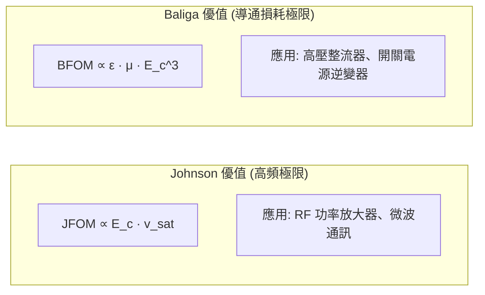

#### Baliga 功率優值（BFOM）
Baliga 功率優值（Baliga's Figure of Merit, BFOM）主要用於評估半導體材料在**低頻功率開關元件**（如功率 MOSFET、垂直二極體）中的極限性能。在功率電子元件中，理想元件應在高壓關斷時承受極高的崩潰電壓（$V_{\text{BR}}$），而在開啟導通時呈現極低的比導通電阻（Specific on-resistance, $R_{\text{on,sp}}$）。

考慮一個漂移區長度為 $W$、摻雜濃度為 $N_D$ 的理想單向階梯接面，其雪崩擊穿電場為 $E_c$，介電常數為 $\epsilon$。根據卜瓦松方程式（見第 3 章）：

$$V_{\text{BR}} = \frac{\epsilon E_c^2}{2 q N_D}$$

$$W = \frac{2 V_{\text{BR}}}{E_c}$$

理想漂移區的比導通電阻可表示為：

$$R_{\text{on,sp}} = \frac{W}{q \mu_n N_D} = \frac{4 V_{\text{BR}}^2}{\epsilon \mu_n E_c^3}$$

為了極小化給定崩潰電壓下的導通電阻，定義材料本身的性能指標為 Baliga 功率優值：

$$\text{BFOM} \equiv \epsilon \mu_n E_c^3$$

式中：
- $\epsilon$ 為材料介電常數（Permittivity，$\epsilon = \epsilon_r \epsilon_0$）
- $\mu_n$ 為多數載子（電子）移動率
- $E_c$ 為臨界擊穿電場（Critical breakdown field）

由於寬能隙材料的臨界擊穿電場與能隙大小呈現強烈的超線性關係（經驗公式約為 $E_c \propto E_g^{2 \sim 2.5}$），其 $E_c^3$ 因子帶來巨大的放大效應，使寬能隙化合物半導體的導通損耗理論極限比矽低數百至數千倍。

#### Johnson 高頻優值（JFOM）
Johnson 高頻優值（Johnson's Figure of Merit, JFOM）用於評估半導體元件在**高頻射頻功率放大（RF Power）**架構下的頻率與電壓極限乘積。元件的截止頻率 $f_T$ 取決於載子穿越通道或空乏區的渡越時間（Transit time）$\tau_t = L / v_{\text{sat}}$，而元件所能承受的最大操作電壓受到臨界電場限制 $V_m = E_c L$。兩者相乘消除長度 $L$，得到電壓與頻率的理論極限：

$$V_m \cdot f_T = \frac{E_c \cdot v_{\text{sat}}}{2\pi}$$

因此，Johnson 優值定義為：

$$\text{JFOM} \equiv \frac{E_c v_{\text{sat}}}{2\pi}$$

式中：
- $E_c$ 為臨界擊穿電場
- $v_{\text{sat}}$ 為電子飽和漂移速度

JFOM 說明，若要元件在高頻微波與毫米波頻段下輸出極高功率，材料必須同時具備高雪崩耐受力與高極限載子傳輸速率。

下表列出幾種代表性材料的物理參數及其相對應的優值（以矽為基準歸一化）：

| 材料 | 能隙 $E_g$ ($\text{eV}$) | 介電常數 $\epsilon_r$ | 電子移動率 $\mu_n$ ($\text{cm}^2/\text{V}\cdot\text{s}$) | 擊穿電場 $E_c$ ($\text{MV/cm}$) | 飽和速度 $v_{\text{sat}}$ ($10^7 \, \text{cm/s}$) | BFOM (相對 $\text{Si}$) | JFOM (相對 $\text{Si}$) |
| :--- | :--- | :--- | :--- | :--- | :--- | :--- | :--- |
| **$\text{Si}$** | 1.12 | 11.7 | 1400 | 0.3 | 1.0 | 1 | 1 |
| **$\text{GaAs}$** | 1.42 | 12.9 | 8500 | 0.4 | 1.2 | 15 | 1.6 |
| **4H-$\text{SiC}$** | 3.26 | 9.7 | 900 | 2.5 | 2.0 | 330 | 17 |
| **$\text{GaN}$** | 3.44 | 8.9 | 1500 | 3.3 | 2.5 | 870 | 28 |

從表中可見，雖然 $\text{GaAs}$ 具備極高的載子移動率，但由於擊穿電場與矽相近，其在功率開關領域（BFOM）的優勢有限，主要專注於高線性度微波開關與功率放大模組；而以 $\text{GaN}$ 與 $\text{SiC}$ 為代表的寬能隙材料，受惠於極高的臨界電場，在功率轉換（BFOM）與射頻輸出（JFOM）兩方面皆展現超越傳統矽材料數個數量級的理論潛力。

!!! note "寬能隙半導體的代際劃分"
    學術界與產業界常將半導體依材料發展歷程劃分：第一代為元素半導體（$\text{Si, Ge}$）；第二代為傳統 III-V 與 II-VI 族化合物半導體（$\text{GaAs, InP}$，主要用於光電與高頻通訊）；第三代為寬能隙半導體（Wide Bandgap, WBG，如 $\text{SiC, GaN}$，主攻高壓功率轉換與高功率射頻）。本節所推導的優值模型正是解釋不同代際材料在各應用領域分工的物理基石。

## 10.2 碳化矽 (SiC) 特性與高壓功率元件

### 10.2.1 晶體結構與多型體現象

碳化矽（Silicon Carbide, $\text{SiC}$）是由第 IV 族元素矽（$\text{Si}$）與碳（$\text{C}$）以 $1:1$ 化學計量比組成的化合物半導體。其基本結構單元為強共價鍵結的 $\text{Si-C}_4$ 或 $\text{C-Si}_4$ 正四面體，鍵長約為 $1.89\ \text{Å}$，鍵能高達約 $4.6\ \text{eV}$。此強大的鍵結賦予了材料極高的機械硬度、化學穩定性與高熱導率。

在晶體生長過程中，雙原子層（由一層矽原子網與一層碳原子網緊密結合構成）在垂直於基面（Basal plane）堆疊時，會因配位旋轉差異而產生多種堆疊序列（Stacking sequences）。這種化學組成相同但晶體堆疊週期互異的物理現象稱為多型體現象（Polytypism）。自然界與實驗室已發現超過 200 種 $\text{SiC}$ 多型體，其分類採用 Ramsdell 標記法，以「堆疊重複週期數 + 晶系英文字母」表示，主要包括：

*   **3C-SiC**：立方晶系（Cubic, 閃鋅礦結構），堆疊順序為三層一循環的 $\text{ABC}\dots$（對應於面心立方晶系之 $(111)$ 晶向）。
*   **4H-SiC**：六方晶系（Hexagonal），堆疊順序為四層一循環的 $\text{ABCB}\dots$。
*   **6H-SiC**：六方晶系，堆疊順序為六層一循環的 $\text{ABCACB}\dots$。

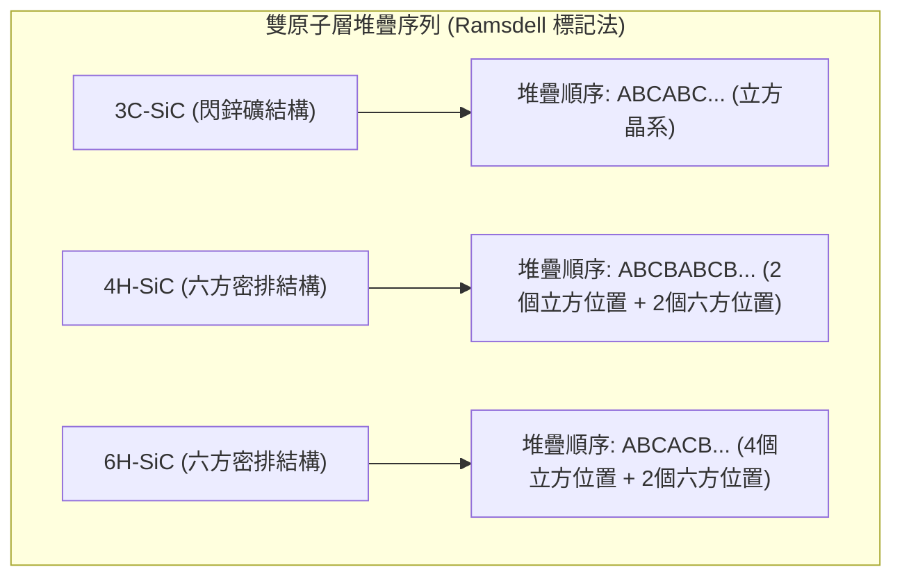

在這些多型體中，不同堆疊序列會導致相異的晶體內部對稱性與自發電極化，進而顯著改變其電子能帶結構。3C-SiC 的能隙寬度（Bandgap, $E_g$）為 $2.36\ \text{eV}$，6H-SiC 為 $3.02\ \text{eV}$，而 4H-SiC 則高達 $3.26\ \text{eV}$。此外，4H-SiC 在沿著 $c$ 軸（$[0001]$ 晶向）方向具有較高的電子遷移率（$\mu_n$）且載子傳輸的各向異性（Anisotropy）相對於 6H-SiC 顯著較低，因此 **4H-SiC** 成為現今高壓、大功率電力電子元件的主流基板與磊晶材料。

---

### 10.2.2 物理特性與高壓功率元件優勢

相較於第一代單晶矽（$\text{Si}$，能隙約 $1.12\ \text{eV}$，見第 1 章），4H-SiC 展現出極為優越的物理極限特性：

| 材料特性 | 矽 ($\text{Si}$) | 4H 碳化矽 ($4\text{H-SiC}$) | 物理意義與元件效益 |
| :--- | :--- | :--- | :--- |
| **能隙寬度** $E_g$ ($\text{eV}$, $300\ \text{K}$) | $1.12$ | $3.26$ | 抑制本質熱激發，大幅降低高溫漏電流 |
| **極限擊穿電場** $E_{\text{crit}}$ ($\text{MV/cm}$) | $0.3$ | $2.8\sim 3.0$ | 耐受高崩潰電壓，可大幅縮減漂移區厚度 |
| **飽和漂移速度** $v_{\text{sat}}$ ($\times 10^7\ \text{cm/s}$) | $1.0$ | $2.0$ | 提高開關瞬態響應速度與高頻操作能力 |
| **熱導率** $\kappa$ ($\text{W/(m}\cdot\text{K)}$) | $150$ | $370\sim 490$ | 熱擴散效能約為 $\text{Si}$ 的三倍，便於散熱封裝 |
| **介電常數** $\epsilon_r$ | $11.7$ | $9.7$ | 降低元件輸出電容，減少開關切換損失 |

#### 1. 高擊穿電場與漂移區設計
在功率元件（如單極性 MOSFET，工作原理參見第 4 章）中，承受反向偏壓的漂移區（Drift region）設計受限於雪崩擊穿（Avalanche breakdown）條件。根據一維突變接面近似，崩潰電壓 $V_B$ 與漂移區厚度 $W_{\text{drift}}$ 及摻雜濃度 $N_D$ 的關係可表示為：

$$V_B = \frac{\epsilon_s E_{\text{crit}}^2}{2 q N_D}$$

$$W_{\text{drift}} = \frac{2 V_B}{E_{\text{crit}}}$$

其中 $\epsilon_s$ 為半導體介電常數，$q$ 為基本電荷，$E_{\text{crit}}$ 為極限臨界擊穿電場。因 4H-SiC 的 $E_{\text{crit}}$ 約為 $\text{Si}$ 的 10 倍，在設計相同的崩潰電壓 $V_B$（例如 $1200\ \text{V}$）時：
1. 漂移區所需厚度 $W_{\text{drift}}$ 可縮減至矽元件的約 $\frac{1}{10}$；
2. 漂移區摻雜濃度 $N_D$ 則可提升至矽元件的近 $100$ 倍。

#### 2. Baliga 優質指數 (BFOM)
漂移區的單位面積導通電阻（Specific On-Resistance, $R_{\text{on,sp}}$）為衡量功率單極元件性能的核心指標：

$$R_{\text{on,sp}} = \frac{W_{\text{drift}}}{q \mu_n N_D} = \frac{4 V_B^2}{\epsilon_s \mu_n E_{\text{crit}}^3}$$

由此定義出評估功率半導體導通損耗極限的「Baliga 優質指數」（Baliga's Figure of Merit, $\text{BFOM}$）：

$$\text{BFOM} = \epsilon_s \mu_n E_{\text{crit}}^3$$

由於 BFOM 與臨界電場的三次方成正比，4H-SiC 的理論值約為矽的 500 倍左右。這意味著在相同的耐壓等級下，4H-SiC 功率 MOSFET 的漂移區導通電阻在理論上可縮減二至三個數量級，進而巨幅降低元件傳導時的焦耳熱損失。

---

### 10.2.3 功率元件工作原理

#### 1. 碳化矽蕭特基障壁二極體 (SBD) 與結型二極體 (JBS/MPS)
傳統高壓矽二極體多採用 PN 接面雙極型結構（PiN 二極體，見第 3 章），其順向導通仰賴少數載子注入引發的電導調變（Conductivity modulation）。然而，少數載子在關斷過程中的複合會導致嚴重的逆向恢復電荷（Reverse Recovery Charge, $Q_{rr}$）與逆向恢復電流峰值，引發極高的動態開關損耗。

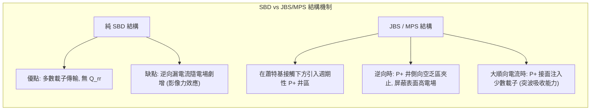

4H-SiC SBD 屬於多數載子元件，理論上不存在少數載子儲存效應，具有極微小的逆向恢復時間與動態損耗。但傳統平坦金屬-半導體接面在高逆向電壓下，蕭特基接觸表面會承受極大電場，引發強烈的影像力降低效應（Image-force lowering）與穿隧效應，造成元件漏電流過大。

為解決此問題，現代商業元件普遍採用**接面障壁蕭特基（Junction Barrier Schottky, JBS）**或**融合 PiN 蕭特基（Merged PiN Schottky, MPS）**結構。其設計核心是在陽極下方引入高密度的週期性 $\text{P}^+$ 離子植入井區。
*   **逆向偏壓狀態**：相鄰 $\text{P}^+$ 井與 $\text{N}^-$ 漂移區形成的 PN 接面空乏區在蕭特基介面下方迅速向兩側擴展並相互交疊（夾止效應，Pinch-off），將表面金屬接面處的電場錨定在安全範圍內，大幅抑制高電場引發的漏電流。
*   **突波電流狀態**：當順向突波電流（Surge current）發生、端電壓超過 PN 接面內建電位（4H-SiC 約 $2.7\ \text{V}$）時，$\text{P}^+$ 井開始向漂移區注入電洞，觸發電導調變機制，安全吸收超額突波能量，大幅提升二極體的耐受可靠度。

#### 2. 功率 MOSFET 結構演進
碳化矽功率金氧半場效電晶體（Power MOSFET）主要區分為垂直雙擴散型（VDMOS / Planar MOSFET）與溝槽型（Trench MOSFET）。

1.  **平面型 (Planar VDMOS)**：
    通道形成於晶圓表面的熱氧化層下方。製造時透過光罩與離子植入形成 P-well 與 $\text{N}^+$ 源極。其主要缺點在於接面型場效電晶體區域（JFET region）的寄生電阻較高，且表面通道的逆轉層電子遷移率受界面缺陷限制嚴重。
2.  **溝槽型 (Trench MOSFET)**：
    透過乾式蝕刻將閘極凹蝕至晶圓內部，使垂直側壁成為導電通道。此結構完全消除了表面 JFET 區域，使單元間距（Cell pitch）大幅縮減，單位面積晶片導通電阻顯著降低。然而，溝槽底角頂點處會產生強烈的幾何電場集中效應，極易擊穿底部的薄閘極氧化層。因此，製程上必須在溝槽底端下方精確植入深層 $\text{P}^+$ 遮蔽區（Shielding region），藉由局域 PN 接面在逆向偏壓時形成的空乏區，屏蔽溝槽底角所受的高電場。

---

### 10.2.4 製程技術瓶頸

由於 $\text{SiC}$ 具有極高的化學鍵能與熱穩定性，許多標準矽製程技術無法直接套用，存在極具挑戰性的製程物理極限：

#### 1. $\text{SiC}/\text{SiO}_2$ 界面缺陷態密度 ($D_{\text{it}}$) 抑制
$\text{SiC}$ 可透過熱氧化反應生成二氧化矽（$\text{SiO}_2$）：

$$\text{SiC} + \frac{3}{2} \text{O}_2 \longrightarrow \text{SiO}_2 + \text{CO} \uparrow$$

在此氧化過程中，大部分碳原子以 $\text{CO}$ 氣體形式揮發脫離，但仍有部分碳原子未完全氧化而滯留在介面處，形成碳團簇（Carbon clusters）、石墨烯態缺陷（$sp^2\ \text{C}$）及近介面氧化層缺陷（Near-interface oxide traps, NIOTs）。這些缺陷在能隙近導帶邊緣（Conduction band edge, $E_c$）處引發極高密度的介面陷阱態（$D_{\text{it}} > 10^{13}\ \text{cm}^{-2}\text{eV}^{-1}$）。

高 $D_{\text{it}}$ 會嚴重捕捉反轉通道中的自由電子，使反轉層有效載子遷移率（Field-effect mobility, $\mu_{\text{FE}}$）巨幅驟降（由單晶體內的 $900\ \text{cm}^2/\text{V}\cdot\text{s}$ 跌落至典型平面介面的 $20\sim 40\ \text{cm}^2/\text{V}\cdot\text{s}$），導致通道電阻劇烈上升。

!!! note "介面氮化鈍化技術 (Nitridation)"
    為壓制介面缺陷，工業界在熱氧化後引進一氧化氮（$\text{NO}$）或一氧化二氮（$\text{N}_2\text{O}$）於 $1150^\circ\text{C}\sim 1300^\circ\text{C}$ 下進行高溫界面鈍化退火。氮原子會與介面處的未鍵結懸鍵（Dangling bonds）以及多餘碳原子反應，形成強固的 $\text{Si-N}$ 與 $\text{C-N}$ 鍵，阻斷碳團簇生成，使近帶邊 $D_{\text{it}}$ 降至 $10^{11}\sim 10^{12}\ \text{cm}^{-2}\text{eV}^{-1}$，將反轉層遷移率提升至 $40\sim 80\ \text{cm}^2/\text{V}\cdot\text{s}$。

#### 2. 超高溫離子植入與晶格活化退火
在矽元件製程中，摻雜雜質通常可透過熱擴散（Thermal diffusion）方式引入。但在 $\text{SiC}$ 中，原子間鍵結過強，多數雜質（如做為受體的鋁 $\text{Al}$、做為施體的氮 $\text{N}$ 或磷 $\text{P}$）在 $1800^\circ\text{C}$ 以下的擴散係數接近於零。因此，**離子植入（Ion Implantation）**成為唯一可行的摻雜手段。

離子植入伴隨著巨大的製程挑戰：
1.  **高溫植入（Hot Implantation）**：室溫植入高能量重離子（如 $\text{Al}^+$）會直接打碎 $\text{SiC}$ 晶格，使材料局部非晶化（Amorphization）。非晶化的 $\text{SiC}$ 在後續熱退火中極難重構為完美的單晶結構，多半轉變為多晶相或包含大量位錯（Dislocations）。因此，植入製程必須將基板加熱至 $500^\circ\text{C}\sim 1000^\circ\text{C}$ 進行，利用動態動能自退火效應（Dynamic annealing），即時修復被位移的晶格原子，避免完全非晶化。
2.  **超高溫活化退火（Ultra-high Temperature Activation）**：受體雜質（$\text{Al}$）的游離能較深（約 $190\sim 250\ \text{meV}$），為了促使植入的鋁原子取代晶格中的矽位置並被電性活化，退火溫度必須高達 $1600^\circ\text{C}\sim 1850^\circ\text{C}$。
3.  **碳保護層技術（Carbon Cap）**：在高於 $1400^\circ\text{C}$ 的真空或氬氣環境下，$\text{SiC}$ 表面的矽原子蒸汽壓遠高於碳原子，表面矽會發生優先脫出昇華（Preferential silicon sublimation），導致晶圓表面嚴重粗糙化並轉變為石墨相（Graphitization），使元件崩潰特性徹底劣化。因此，在進行活化退火前，必須先在晶圓表面均勻旋塗光阻並於中溫碳化，形成一層緻密的非晶碳薄膜（Carbon Cap）。待超高溫退火完成後，再藉由氧電漿灰化（Oxygen plasma ashing）徹底去除碳保護層，以確保晶圓表面達到原子級平整度。

!!! warning "受體能階過深對元件驅動的影響"
    由於 $\text{Al}$ 受體在室溫下的游離率極低（典型值僅約 $1\%\sim 5\%$），為了在 P-well 區或深層保護結構中獲得足夠的電洞濃度，離子植入劑量必須大幅提高（達到 $10^{18}\sim 10^{20}\ \text{cm}^{-3}$）。這對植入機台的束流強度、光罩厚度及材料耐熱性提出了極嚴苛的工程要求。

<!-- fig:1 -->
<figure markdown>
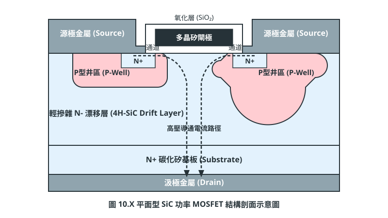
<figcaption>圖 10-1　SiC功率MOSFET剖面（AI 繪製的示意圖）</figcaption>
</figure>

## 10.3 氮化鎵 (GaN) 極化效應與高頻元件

### 纖鋅礦 GaN 之晶體非對稱結構與極化效應

氮化鎵（Gallium Nitride, GaN）在室溫與常壓下最穩定的熱力學晶體結構為六方晶系的纖鋅礦（Wurtzite）結構，其空間群為 $P6_3mc$。該晶體結構缺乏反轉對稱中心（Inversion Center），且沿著特定的六角對稱軸（通常定義為晶格的 $c$ 軸，即 $[0001]$ 方向）具有明顯的離子性極向鍵結。當沿著 $[0001]$ 方向觀察時，氮（N）原子與鎵（Ga）原子並未處於同一平面，兩者間的電負度差異（N 的電負度約為 3.04，Ga 的電負度約為 1.81）導致 Ga-N 共價鍵具有強烈的離子鍵成分。每個正負電荷中心在沿軸方向無法完全重合，因而形成固有的電偶極矩（Electric Dipole Moment）。

在宏觀物理表現上，這種晶體非對稱性賦予了 GaN 極為顯著的極化（Polarization）特性，包含**自發極化**（Spontaneous Polarization, $\mathbf{P}_{\text{SP}}$）與**壓電極化**（Piezoelectric Polarization, $\mathbf{P}_{\text{PE}}$）：

1. **自發極化 ($\mathbf{P}_{\text{SP}}$)**：在完全無外加應力或應變的理想平衡狀態下，由於纖鋅礦晶胞之非理想晶格常數比（$c/a$ 軸比偏離理想密排六方結構的 $\sqrt{8/3} \approx 1.633$）所固有的巨觀極化向量。對於金屬面（Ga-face, 即極性朝向 $[0001]$）磊晶層，自發極化向量指向基底方向（定義為 $-c$ 方向）；其典型極化值約為 $-0.034\text{ C/m}^2$。
2. **壓電極化 ($\mathbf{P}_{\text{PE}}$)**：當 GaN 薄膜或其三元合金（如 $\text{Al}_x\text{Ga}_{1-x}\text{N}$）在異質磊晶中承受雙軸應力（Biaxial Stress）時，晶格變形導致原子相對位置改變，進而產生額外的偶極矩。

若外延生長方向為 $z$ 軸（平行於 $c$ 軸），材料所承受之面內雙軸應變（In-plane strain）定義為：

$$\epsilon_{xx} = \epsilon_{yy} = \frac{a - a_0}{a_0}$$

其中 $a$ 為應變後的晶格常數，$a_0$ 為材料在弛豫（Relaxed）狀態下的鬆弛晶格常數。垂直方向的應變 $\epsilon_{zz}$ 則透過彈性常數（Elastic Constants）與面內應變連結：

$$\epsilon_{zz} = -2 \frac{C_{13}}{C_{33}} \epsilon_{xx}$$

式中 $C_{13}$ 與 $C_{33}$ 為材料之四階彈性勁度張量元素（Elastic Stiffness Tensor Components）。沿 $c$ 軸產生的壓電極化強度分量 $P_{\text{PE}, z}$ 可表述為：

$$P_{\text{PE}, z} = 2 e_{31} \epsilon_{xx} + e_{33} \epsilon_{zz} = 2 \left( e_{31} - e_{33} \frac{C_{13}}{C_{33}} \right) \epsilon_{xx}$$

其中 $e_{31}$ 與 $e_{33}$ 為相應的壓電張量係數（Piezoelectric Coefficients）。由於對於 III 族氮化物而言，$(e_{31} - e_{33} C_{13} / C_{33}) < 0$，當材料承受張應力（Tensile Strain，即 $\epsilon_{xx} > 0$）時，壓電極化向量 $\mathbf{P}_{\text{PE}}$ 的方向與自發極化向量 $\mathbf{P}_{\text{SP}}$ 相同，皆指向晶體生長的反方向（$-c$ 方向），使得總極化效應進一步增強。

---

### AlGaN/GaN 異質接面與二維電子氣 (2DEG) 形成機制

在傳統矽基或砷化鎵金屬氧化物半導體（MOSFET，見第 4 章）及調制摻雜場效電晶體（MODFET）中，導電通道內的載子通常來自於雜質能階的游離（如磷或砷摻雜）。然而，氮化鎵高電子移動率電晶體（High Electron Mobility Transistor, HEMT）之運作核心在於**無摻雜異質接面處由極化效應自發感應生成的二維電子氣（Two-Dimensional Electron Gas, 2DEG）**。

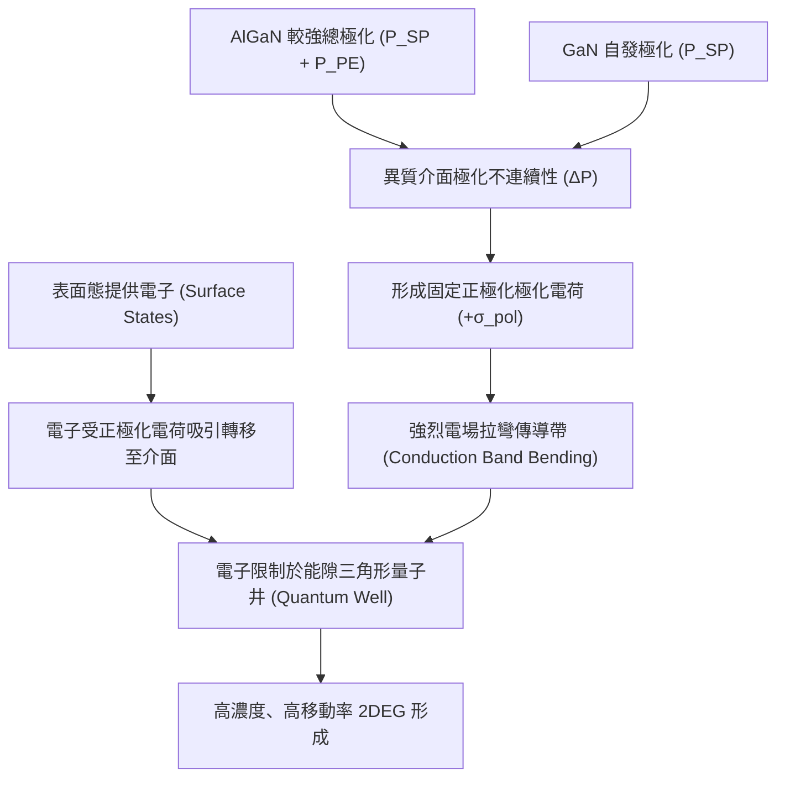

當在弛豫的 GaN 緩衝層（Buffer Layer）上同軸磊晶生長一層厚度僅約 15 至 30 奈米的未摻雜 $\text{Al}_x\text{Ga}_{1-x}\text{N}$ 阻障層（Barrier Layer）時，由於 AlN 的晶格常數（$a_0 = 3.112\text{ \AA}$）小於 GaN（$a_0 = 3.189\text{ \AA}$），AlGaN 阻障層在假晶生長（Pseudomorphic Growth）下將處於面內雙軸張應變狀態。

此外，AlN 的自發極化強度約為 $-0.090\text{ C/m}^2$，大幅高於 GaN（$-0.034\text{ C/m}^2$）。因此，在 AlGaN/GaN 接面處，兩側材料的總極化向量（$\mathbf{P} = \mathbf{P}_{\text{SP}} + \mathbf{P}_{\text{PE}}$）存在顯著的不連續性。根據馬克士威方程式中的邊界條件，極化梯度的散度將在異質介面處感應出極化面電荷密度（Fixed Polarization Sheet Charge, $\sigma_{\text{pol}}$）：

$$\sigma_{\text{pol}} = |\mathbf{P}_{\text{AlGaN}} - \mathbf{P}_{\text{GaN}}| = |(\mathbf{P}_{\text{SP, AlGaN}} + \mathbf{P}_{\text{PE, AlGaN}}) - \mathbf{P}_{\text{SP, GaN}}|$$

對於 Ga-face 極向的磊晶結構，該極化不連續性會在異質接面處感應出高密度的**正固定極化電荷**（$+q \cdot N_{\text{pol}}$）。為了屏蔽此強烈正電荷所建立的極高內建電場（數個 $\text{MV/cm}$ 量級），AlGaN 傳導帶能階產生顯著彎曲，使異質介面處的傳導帶底（Conduction Band Minimum, $E_C$）被強烈往下拉陷至費米能階（Fermi Level, $E_F$）之下，形成一個近乎三角形的超薄量子井（Triangular Quantum Well）。

根據當前學界廣為接受的表面施體態模型（Surface Donor State Model），AlGaN 表面存在高密度的深能階中性態。當 AlGaN 厚度超過臨界厚度時，表面態能階被推升至費米能階之上，使表面電子游離並沿著電場方向漂移至介面量子井內蓄積，形成面密度高達：

$$n_s \approx 1 \times 10^{13} \sim 1.5 \times 10^{13}\text{ cm}^{-2}$$

的二維自由電子層。

| 物理參數（室溫 300 K 典型值） | 矽 (Si) 反轉層 | 砷化鎵 (GaAs) 異質介面 | 氮化鎵 (GaN) 2DEG |
| :--- | :--- | :--- | :--- |
| 面載子濃度 $n_s$ ($\text{cm}^{-2}$) | $1 \sim 5 \times 10^{12}$ | $2 \sim 4 \times 10^{11}$ | **$1 \sim 1.5 \times 10^{13}$** |
| 電子遷移率 $\mu_n$ ($\text{cm}^2/\text{V}\cdot\text{s}$) | $400 \sim 800$ | $6000 \sim 8500$ | **$1500 \sim 2200$** |
| 薄層電阻 $R_{\text{sh}}$ ($\Omega/\Box$) | $1000 \sim 3000$ | $200 \sim 500$ | **$250 \sim 450$** |

此 2DEG 之所以具備極優越的導電性，關鍵在於**通道內完全無需摻雜游離雜質**（Undoped 或 Unintentionally Doped, UID）。傳統矽 MOSFET 中，高載子濃度必然伴隨重摻雜引發的游離雜質散射（Ionized Impurity Scattering，見第 2 章），使遷移率急遽劣化；而 AlGaN/GaN 系統將供電區域（表面態/極化場）與載子傳輸通道在空間上完全分離，在維持超高載子濃度的同時，電子僅受限於極薄的空間內做二維平移運動，避開了雜質散射，進而實現極低的薄層電阻（$R_{\text{sh}} = 1 / (q n_s \mu_n)$）。

---

### HEMT 工作機制：D-mode 與 E-mode 架構實現

利用上述 2DEG 特性所製作之元件稱為高電子移動率電晶體（HEMT）。標準的蕭基閘極（Schottky Gate）AlGaN/GaN HEMT 具備源極（Source）、汲極（Drain）與位於兩者之間的控制閘極。由於強大的極化場在未施加閘極偏壓時便已在介面建立深厚量子井，該元件在零閘極偏壓（$V_{GS} = 0\text{ V}$）下即處於高度導通狀態，其臨界電壓為負值（典型值 $V_{th} \approx -3 \text{ 至 } -5\text{ V}$），此種元件運作特性稱為**耗盡型**（Depletion-mode, D-mode）或**常開型**（Normally-on）。

在電力電子系統與高可靠度射頻電路中，常開型元件在系統啟動瞬態可能導致電源短路直通（Shoot-through），引發燒毀風險。因此，產業對於具備正臨界電壓（$V_{th} > 0\text{ V}$）的**增強型**（Enhancement-mode, E-mode）或**常關型**（Normally-off）元件具備極為迫切的需求。

實現常關型 GaN HEMT 的核心物理機制在於：**透過特定結構或材料介入，在 $V_{GS} = 0\text{ V}$ 時將閘極下方的傳導帶底抬升至費米能階之上，徹底耗盡該區域的 2DEG**。主流製程實現技術路徑如下：

1. **p-GaN 閘極結構（p-GaN Gate）**：
   在 AlGaN 障壁層上方磊晶沉積一層重摻雜鎂（Mg）的 p 型 GaN 層。利用 p-GaN 的高功函數與 pn 異質介面的內建電位，將介面處的能帶整體往上拉升，完全耗盡閘極下方區域之 2DEG。施加正向偏壓（$V_{GS} > V_{th} > 0$）時，電洞空乏區縮小，能帶重新下拉，2DEG 再次連通。此技術已成為中低壓功率元件之工業主流標準。
2. **凹槽閘極技術（Gate Recess）**：
   利用反應離子蝕刻（Reactive Ion Etching, RIE，見第 19 章）精準減薄閘極下方的 AlGaN 障壁層厚度。由於壓電極化電荷總量與障壁層形變厚度密切相關，極度減薄的 AlGaN 將顯著削減其極化電位降，使得三角形量子井變淺，2DEG 自然耗盡。此製程之挑戰在於乾式蝕刻對超薄層的終點控制與電漿誘發缺陷之修復。
3. **氟離子電漿處理（Fluorine Plasma Treatment）**：
   在閘極區域注入強電負度的氟離子（$\text{F}^-$）。帶負電的氟離子充當固定負電荷，產生與下層極化正電荷相反的電場，抵銷其拉低能帶的作用，從而將傳導帶底頂高以阻斷 2DEG。
4. **串聯共源共柵架構（Cascode）**：
   此方案並非材料層面的常關，而是在封裝內部將一顆低壓常關型矽 MOSFET（Low-voltage Si MOSFET）與一顆高壓常開型 GaN HEMT 串聯。由矽元件控制整體開關，但此做法會額外引入矽元件的寄生電感與電阻，高頻切換性能略受抑制。

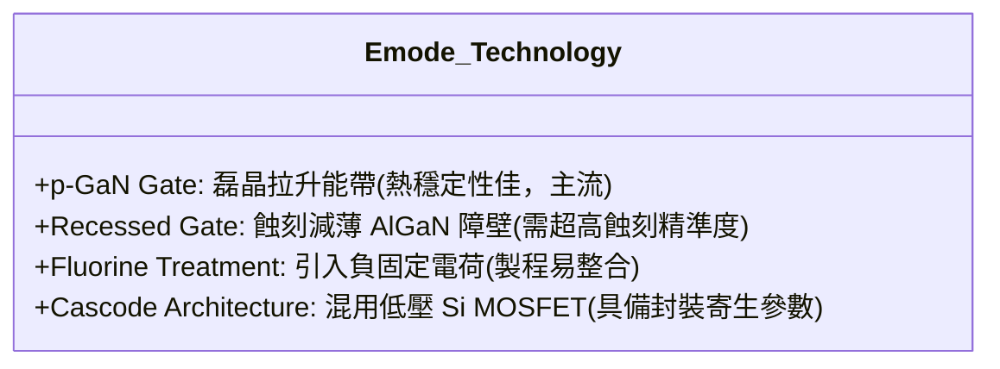

---

### 射頻功率放大器與高頻高密度電源轉換之應用優勢

GaN 材料相對於傳統半導體（Si 與 GaAs）具備極高的材料優值（Figure of Merit, FOM），包含強大的能隙（$E_g \approx 3.4\text{ eV}$）、超高擊穿電場（$E_{br} \approx 3.3\text{ MV/cm}$，約為 Si 的 10 倍）以及優異的電子飽和飄移速度（$v_{\text{sat}} \approx 2.5 \times 10^7\text{ cm/s}$，為 Si 的 2.5 倍）。這些固有物理特性使 GaN HEMT 在高頻射頻（RF）與高頻電源轉換兩大領域展現出突破性的優勢。

#### 1. 射頻功率放大器（RF Power Amplifiers）
電晶體之高頻截止頻率（Unity Current-gain Cutoff Frequency, $f_T$）在簡化一維傳輸模型下可表示為：

$$f_T \approx \frac{v_{\text{sat}}}{2\pi L_g}$$

其中 $L_g$ 為電晶體微影定義之閘極長度（Gate Length）。GaN 具有極高的飽和速率，使得微縮微影節點下的 HEMT 可輕易突破數十至上百 GHz 之運作頻率。再者，高擊穿電場代表元件能承受極高的汲極工作電壓（例如典型射頻電壓 $28\text{ V} \sim 48\text{ V}$，遠高於 GaAs 之 $5\text{ V} \sim 10\text{ V}$），根據輸出功率公式：

$$P_{\text{out}} \propto \frac{V_{\text{bias}}^2}{R_L}$$

GaN RF 元件可在極小的晶片面積下提供高達 $5 \sim 10\text{ W/mm}$ 的飽和功率密度。這大幅降低了阻抗匹配網絡（Impedance Matching Network）的轉換難度，並廣泛應用於 5G/6G 基地台毫米波主動相控陣天線（MIMO）與軍工雷達（AESA）系統。

#### 2. 高頻高密度電源轉換（Power Electronics）
在交換式電源供應器中，開關損失與元件之輸出電荷 $Q_{\text{oss}}$ 及閘極電荷 $Q_g$ 呈正比。GaN 元件具備極小的特定導通電阻（Specific On-resistance, $R_{\text{on}} \cdot A$）與極低的閘極輸入電容，使得 $R_{\text{on}} \times Q_g$ 性能優值較傳統矽 Superjunction MOSFET 改善一個數量級以上。

此外，GaN HEMT 屬於多數載子元件，在異質結構中**不存在如矽基 MOSFET 內部的本質 pn 接面二極體**，因此其反向恢復電荷（Reverse Recovery Charge, $Q_{rr}$）在物理本質上接近於零。這消除了在半橋或全橋拓撲（Half-bridge / Full-bridge Topologies）硬切換（Hard Switching）時的主要動態損耗，使得系統切換頻率（Switching Frequency）能從傳統的數十 kHz 推升至數個 MHz。高頻化直接促成電感、電容等無源濾波元件體積的指數型微縮，達成前所未有的電源功率密度（Power Density）。

!!! warning "常見誤解：GaN 元件不存在本體二極體即無法進行反向導通"
    雖然 GaN HEMT 沒有矽 MOSFET 的反向 pn 接面二極體，因而 $Q_{rr} = 0$，但當汲極電位低於源極電位且超過臨界電壓差時（$V_{DG} > |V_{th}|$），通道將被自發開啟以實現反向導通（Third-quadrant Conduction）。此時其等效導通壓降略高於傳統二極體，通常須利用精確的死區時間（Dead-time）控制或外加蕭基二極體以降低該區間之損耗。

!!! example "產業實例：消费電子高密度快充與通訊基地台"
    消費級氮化鎵充電器普遍採用單晶片整合驅動電路的 GaN 功率 IC（如 Navitas 的 GaNFast 平台），在 65W 至 240W 區間內將開關頻率推至數百 kHz，顯著降低變壓器體積；而在高頻通訊領域，Qorvo、Wolfspeed 等業者則廣泛採用高散熱係數的碳化矽基氮化鎵（GaN-on-SiC）技術，專攻 5G 巨量天線發射模組中的高效率射頻放大器。

<!-- fig:2 -->
<figure markdown>
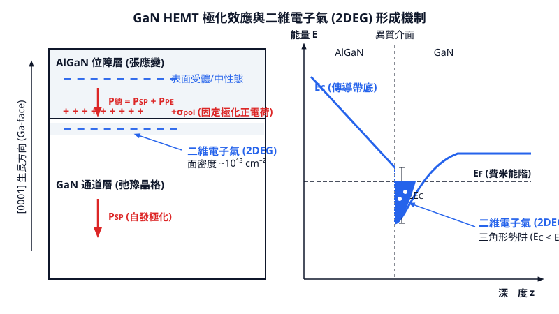
<figcaption>圖 10-2　GaN HEMT極化與2DEG（AI 繪製的示意圖）</figcaption>
</figure>

## 10.4 基板與長晶挑戰

### 10.4.1 碳化矽單晶生長：物理氣相傳輸法與缺陷控制

碳化矽（Silicon Carbide, SiC）在常壓下並不存在化學計量平衡的液相熔融態。當溫度升高至約 $2000^\circ\text{C}$ 以上時，SiC 會直接昇華分解為氣相成分，而非熔化為液體。因此，傳統矽晶圓所採用的柴可斯基提拉法（Czochralski, CZ，見第 7 章）無法應用於 SiC 的單晶製備。

當前工業界量產 SiC 塊材晶錠（Ingot）的主要技術為**物理氣相傳輸法**（Physical Vapor Transport, PVT），亦稱改良式萊利法（Modified Lely Method）。

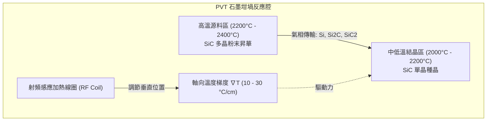

PVT 的物理機制如下：在密閉的高純度石墨坩堝中，底部放置 SiC 多晶源料，頂部懸掛單晶晶種（Seed Crystal）。藉由坩堝外部的高頻射頻（RF）感應線圈加熱，在坩堝內部建立精確的軸向溫度梯度 $\nabla T$。源料區維持在 $2200^\circ\text{C} \sim 2400^\circ\text{C}$，而晶種區溫度略低（約 $2000^\circ\text{C} \sim 2200^\circ\text{C}$），兩者間的軸向溫差通常控制在典型值 $10 \sim 30^\circ\text{C/cm}$。

高溫下的 SiC 源料昇華並分解為多種氣相組分：
$$
\text{SiC}_{(s)} \rightleftharpoons \text{Si}_{(g)} + \text{Si}_2\text{C}_{(g)} + \text{SiC}_2_{(g)} + \dots
$$
氣相分子在分壓梯度的驅動下，由高溫源料區向較低溫的晶種表面傳輸，並在晶種上過飽和析出，維持與晶種相同的晶體結構（主流功率元件使用 4H-SiC 多型體）。

PVT 生長面臨的關鍵缺陷為**微管**（Micropipe, MP）。微管是沿生長方向延伸的中空穿透性管道，本質上是柏格斯向量（Burgers Vector）極大的巨大螺旋差排（Giant Screw Dislocation）。依據法蘭克能量判據（Frank's Criterion），當差排的柏格斯向量大小 $b$ 超過臨界值時，應變能過高導致差排核心釋放晶格應變而形成空心孔洞：
$$
r_{\text{pore}} = \frac{\mu b^2}{8\pi^2 \gamma}
$$
其中 $r_{\text{pore}}$ 為中空管道半徑，$\mu$ 為剪切模數（Shear Modulus），$\gamma$ 為表面自由能（Surface Free Energy）。若微管穿透至主動元件工作區，元件在高電場下將因局部電場集中而發生提早擊穿（Premature Breakdown），造成元件完全失效。

抑制微管與其他延伸差排（如基面差排 Basal Plane Dislocations, BPD 與螺差排 Threading Screw Dislocations, TSD）的工程手段包括：
1. **嚴格控制晶種品質**：採用無微管（Micropipe-free）的高品質晶種進行同質複製。
2. **優化熱場幾何結構**：控制等溫線彎曲度，維持微凸（Convex）的固液/固氣生長界面，避免多晶核心在生長邊緣寄生。
3. **穩定氣相組分比**：調控反應腔中惰性氣體（氬氣）分壓與矽/碳化學計量比（$\text{Si}/\text{C}$ 比值），防止過剩的矽液滴凝結引發微管缺陷。

---

### 10.4.2 氮化鎵自立基板瓶頸與異質基板策略

氮化鎵（GaN）常壓下的熔點估算超過 $2200^\circ\text{C}$，但在高溫下其熱分解平衡分壓極高。在熔點溫度下，欲抑制 GaN 分解為金屬鎵液滴與氮氣，所需的氮氣平衡分壓高達約 $6\,\text{GPa}$（約 60,000 個大氣壓）。

此物理極限導致利用傳統高溫高壓融體法生長 GaN 體單晶（Bulk Single Crystal）極度困難。雖然可透過氨熱法（Ammonothermal Method）或鈉助熔劑法（Na-flux Method）生長單晶，但生長速率極慢（通常 $< 5\,\mu\text{m/h}$），難以工業規模化。

目前製造商業化**自立基板**（Free-standing GaN Substrate）的主流替代途徑為**氫化物氣相磊晶**（Hydride Vapor Phase Epitaxy, HVPE）：
1. 在藍寶石或 GaAs 異質基板上，利用 $\text{GaCl}$ 與 $\text{NH}_3$ 反應，以高生長速率（典型值 $50 \sim 200\,\mu\text{m/h}$）沈積數百微米至數毫米厚的厚膜 GaN。
2. 降溫過程藉由雷射剝離（Laser Lift-off, LLO）或自然熱應力開裂技術將異質基板剝除。
3. 將剝離後的 GaN 厚膜拋光加工為自立基板晶圓。

自立基板直徑擴徑緩慢（目前仍以 2 至 4 吋為主），成本極高，主要供應雷射二極體（Laser Diode）與超高頻高功率基地台放大器。一般消費性快充功率元件與商用 LED 則全面採用**異質基板外延生長**。

| 基板材料 | 晶格常數面內值 $a$ ($\text{Å}$) | 與 GaN 晶格不匹配率 | 熱膨脹係數 $\alpha$ ($10^{-6}/\text{K}$) | 熱導率 $\kappa$ ($\text{W/m}\cdot\text{K}$) | 晶圓主要尺寸與成本 |
| :--- | :--- | :--- | :--- | :--- | :--- |
| **GaN (wurtzite)** | 3.189 | 0%（同質基板） | 5.59 | 130 ~ 200 | 2~4 吋；成本極高 |
| **藍寶石 ($\text{Al}_2\text{O}_3$)** | 4.758 (轉 $30^\circ$ 為 2.747) | -13.9%（壓縮應變） | 7.50 | 35 ~ 40 | 4~8 吋；成本極低 |
| **4H-SiC** | 3.081 | -3.4%（壓縮應變） | 4.20 | 360 ~ 490 | 6~8 吋；成本高 |
| **矽 Si(111)** | 3.840 | +17.0%（拉伸應變） | 3.59 | 130 ~ 150 | 8~12 吋；成本低 |

異質基板選擇策略由應用規格與散熱需求決定：
* **GaN-on-SiC**：晶格與熱失配相對較小，且 SiC 熱導率優良，為 RF 射頻通訊元件（如 5G/6G 功率放大器）的首選。
* **GaN-on-Si**：可直接相容於成熟的 8 吋甚至 12 吋矽晶圓代工廠（CMOS 產線相容），大幅壓低中低壓功率元件（快充、資料中心電源）成本。
* **GaN-on-Sapphire**：電絕緣性佳、可見光透過率高，廣泛用於固態照明 LED 及部分微波元件。

---

### 10.4.3 晶格不匹配、熱膨脹差異與應力工程

異質磊晶（Heteroepitaxy）中，基板與磊晶層的物理性質不匹配會產生兩大嚴重缺陷：**高密度穿透差排**與**熱應力形變（晶圓翹曲）**。

#### 1. 晶格常數不匹配（Lattice Mismatch）
晶格不匹配率定義為：
$$
f = \frac{a_{\text{film}} - a_{\text{sub}}}{a_{\text{sub}}} \times 100\%
$$
其中 $a_{\text{film}}$ 與 $a_{\text{sub}}$ 分別為薄膜與基板的面內晶格常數。在初始磊晶階段，薄膜晶格被基板強制拉伸或壓縮以維持同構假晶生長（Pseudomorphic Growth）。薄膜中積累的應變能隨厚度 $h$ 增加而線性上升。當薄膜厚度超過**臨界厚度**（Critical Thickness, $h_c$）時，體系能量過高，薄膜產生塑性變形，藉由在介面處釋放錯位差排（Mismatch Dislocations）以釋放應變。

這些介面差排向晶體生長表面延伸，演變成貫穿整個元件主動區的**穿透差排**（Threading Dislocations, TDs）。GaN 異質磊晶層中的 TD 密度常高達 $10^8 \sim 10^{10}\,\text{cm}^{-2}$（相較之下，電子級單晶矽的差排密度通常小於 $10^2\,\text{cm}^{-2}$）。差排作為非輻射複合中心（Non-radiative Recombination Center）會降低發光效率，在電路運作時更作為漏電通道與雜質吸附處，嚴重損害功率元件的崩潰電壓與可靠度。

#### 2. 熱膨脹係數不匹配（Thermal Expansion Coefficient, CTE Mismatch）
金屬有機化學氣相沉積（MOCVD）的生長溫度通常高達 $1000^\circ\text{C} \sim 1100^\circ\text{C}$。降至室溫（$\Delta T \approx -1000^\circ\text{C}$）過程中，薄膜與基板受熱收縮率不同產生的雙軸雙層熱應力為：
$$
\sigma_{\text{th}} = \frac{E_{\text{film}}}{1 - \nu_{\text{film}}} \int_{T_{\text{growth}}}^{T_{\text{room}}} (\alpha_{\text{sub}}(T) - \alpha_{\text{film}}(T))\, dT
$$
其中 $E_{\text{film}}$ 為楊氏模數，$\nu_{\text{film}}$ 為帕松比（Poisson's Ratio），$\alpha$ 為熱膨脹係數。

以 GaN-on-Si 為例，$\alpha_{\text{GaN}} > \alpha_{\text{Si}}$，在降溫過程中 GaN 薄膜的收縮速率遠大於矽基板，薄膜承受巨大的雙軸**拉伸應力**（Tensile Stress）。若拉伸應力超過材料斷裂極限，磊晶層會直接產生宏觀龜裂（Cracking）。反之，在藍寶石基板上（$\alpha_{\text{Sapphire}} > \alpha_{\text{GaN}}$），GaN 承受**壓縮應力**（Compressive Stress），降溫後基板向上凸起，產生嚴重的晶圓翹曲（Wafer Bowing）。晶圓翹曲會導致微影製程焦點偏移（Defocusing）及自動化機台真空吸盤夾持破裂。

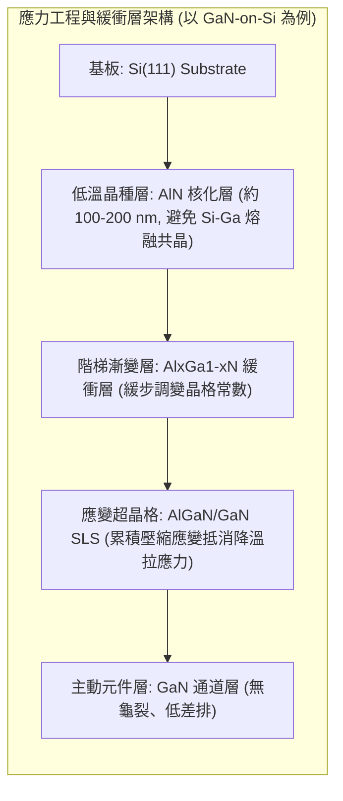

為克服上述問題，異質磊晶必須導入**應力工程與緩衝層技術**（Buffer Layer Engineering）：
* **AlN 核化層（Nucleation Layer）**：高溫下金屬鎵會與矽反應生成低熔點的矽-鎵共晶液滴（稱熔蝕效應 Meltback Etching）。沈積一層緻密的超薄 AlN，既阻絕了 Ga 與 Si 的直接接觸，又提供後續生長的晶核。
* **階梯式 AlGaN 緩衝層或應變超晶格（Strain-layer Superlattices, SLS）**：利用薄層 $\text{Al}_x\text{Ga}_{1-x}\text{N}/\text{Al}_y\text{Ga}_{1-y}\text{N}$ 多層交替結構，在升溫生長階段先預先蓄積足夠的「壓縮應力」，用以完全抵消降溫冷卻過程中所引發的「熱拉伸應力」，最終在室溫下實現平整且無龜裂的晶圓（Wafer Bow $< 20\,\mu\text{m}$）。同時，超晶格介面能有效促使穿透差排彎曲並相互湮滅（Annulment），將主動層的穿透差排密度抑制降至 $10^7 \sim 10^8\,\text{cm}^{-2}$ 範圍。

---

### 10.4.4 硬脆晶圓加工瓶頸：切片、薄化與化學機械研磨

化合物半導體如 SiC 與 GaN 在物理與化學特性上皆屬於超硬脆（Hard and Brittle）材料，其莫氏硬度（Mohs Hardness）SiC 達 9.2 $\sim$ 9.3，GaN 約為 9.0，僅次於鑽石（硬度 10），遠高於單晶矽（硬度約 6.5 $\sim$ 7.0）。這些特性使得自錠切片至後段表面平坦化的晶圓加工（見第 8 章）面臨極高的技術門檻與耗損成本。

```mermaid
flowchart TD
    A["SiC 晶錠 (Ingot)"] --> B{"晶錠切片技術選擇"}
    B -->|鑽石線切 DWS| C["切削損耗大 (Kerf Loss > 200 μm)<br/>速度慢、表面下損傷深"]
    B -->|雷射剝離 / 冷切 (Cold Split)| D["雷射聚焦改質層 + 應力剝離<br/>近乎零切削耗損、產能翻倍"]
    C --> E["粗研磨與薄化 (Grinding)"]
    D --> E
    E --> F["化學機械研磨 (CMP)"]
    F -->|強氧化劑: KMnO4, H2O2 + 機械磨料| G["原子級平坦表面 (Ra < 0.1 nm)<br/>無表面下損傷層 (Subsurface Damage)"]
```

#### 1. 晶圓切片（Wafer Slicing）瓶頸
傳統矽晶圓所採用的多線式鑽石線切法（Diamond Wire Sawing, DWS）在切割 SiC 時面臨嚴峻挑戰：
* **切削速率低**：切割單顆 6 吋至 8 吋 SiC 晶錠往往耗時數十至上百小時。
* **材料損耗嚴重（Kerf Loss）**：傳統切割線直徑加上擺動餘裕，每次切割造成的切口損耗深達 $150 \sim 250\,\mu\text{m}$。由於 SiC 晶錠軸向生長速度極為緩慢（PVT 速率約 $0.1 \sim 2\,\text{mm/h}$），相當於晶錠生長長度中有一半以上化為廢棄鋸屑。
* **次表面損傷層深（Subsurface Damage, SSD）**：機械微磨粒脆性破壞機制會在晶片切面留下數微米至十數微米深的微裂紋（Micro-cracks）與塑性應變區，必須在後續製程大幅研磨拋光予以去除。

為突破瓶頸，產業已開發雷射剝離法（Laser Slicing，如 Cold Split 技術）：利用超快皮秒/飛秒雷射聚焦於 SiC 晶圓內部預定切割深度，形成連續微米級非晶化/微裂紋熱改質層，再藉由外部施加精準的熱應力或超音波機械拉伸，使晶圓沿改質界面自然剝離。此法切口損耗可壓縮至 $20\,\mu\text{m}$ 以下，使單根晶錠產出之晶圓片數提升 $30\% \sim 50\%$。

#### 2. 薄化與拋光（Thinning and CMP）瓶頸
功率元件製程完成後，通常需要自晶圓背面進行薄化（Grinding），以降低垂直導通電阻並利於散熱封裝：
* **機械加工極限**：使用固定金剛石磨粒（Diamond Grinding Wheel）進行機械減薄時，SiC 的高硬度與高斷裂韌性導致砂輪磨耗極為迅速，加工應力易引發脆性崩裂（Chipping）及翹曲碎裂。
* **化學機械研磨（CMP）化學惰性**：如第 8 章所述，矽的 CMP 可藉由鹼性矽溶膠在常溫快速氧化水解。然而 SiC 與 GaN 具備優異的化學穩定度，耐強酸強鹼腐蝕。SiC 的 Si 面（Silicon-face）與 C 面（Carbon-face）表現出顯著的化學極性差異，Si-C 鍵能高達 $318\,\text{kJ/mol}$，一般拋光液難以使其化學軟化。

現代寬能隙半導體的 CMP 必須依靠強氧化性漿料（如添加高錳酸鉀 $\text{KMnO}_4$ 或過氧化氫 $\text{H}_2\text{O}_2$ 的酸性/鹼性膠體二氧化矽懸浮液），在特定的電位-pH（Pourbaix）平衡區間內，強迫材料表面形成奈米級的氧化矽（$\text{SiO}_x$）或氧化鎵（$\text{Ga}_2\text{O}_3$）軟質鈍化層，再由拋光墊與奈米磨粒透過機械剪切作用將其剝除：
$$
\text{SiC} + 2\text{KMnO}_4 \xrightarrow{\text{Acidic}} \text{SiO}_2 + \text{CO}_2 \uparrow + 2\text{MnO}_2 + \dots
$$
此一「氧化-研磨去除」的動態平衡速度極慢，SiC 的移除速率（Material Removal Rate, MRR）通常僅約 $0.5 \sim 2\,\mu\text{m/h}$（矽 CMP 典型 MRR 可達數 $\mu\text{m/min}$）。

因此，如何發展電化學輔助拋光（ECMP）、電漿輔助拋光（PAP）以及紫外光光催化 CMP，藉由外部能量提升表面反應活性以加速達到原子級平坦度（表面粗糙度 $R_a < 0.1\,\text{nm}$，徹底消除刮痕及次表面缺陷），為寬能隙晶圓製造端極具挑戰性的課題。

!!! example "產業實例：8 吋（200 mm）SiC 晶圓轉型的長晶與加工雙重瓶頸"
    全球半導體產業由 6 吋轉進 8 吋 SiC 晶圓時，PVT 面臨熱場均勻性急遽惡化，徑向與軸向溫場梯度在巨大尺寸下更難維持，導致晶錠外圍極易產生多晶相與高密度基面差排。此外，8 吋晶圓厚度需相應增厚以對抗加工翹曲，使得傳統鑽石線切加工時間大幅翻倍，促使製造廠全面轉向雷射剝離輔助切割與全自動化 CMP 平台，以降低邊緣碎裂率並控制昂貴的晶圓缺陷成本。

## 10.5 設備與廠商技術

### 寬能隙半導體長晶與磊晶設備架構

寬能隙半導體材料（碳化矽 $\text{SiC}$ 與氮化鎵 $\text{GaN}$）具備高原子鍵結能、極高熔點以及獨特的晶體結構，其單晶成長與薄膜沉積無法直接沿用傳統矽晶圓的柴可斯基拉晶法（Czochralski method，見第 7 章）或常規化學氣相沉積機台（見第 9 章與第 21 章）。寬能隙製程設備必須在超高溫、強腐蝕性前驅氣體以及多重熱應力場下維持嚴苛的真空度與材料純度。

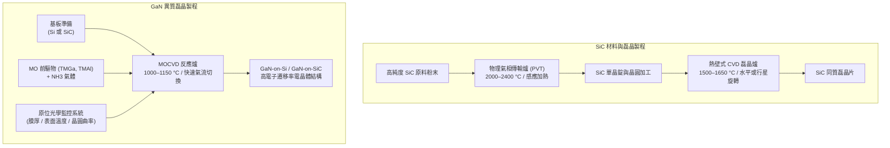

#### 物理氣相傳輸法（PVT）長晶爐

碳化矽在常壓下並不存在化學計量平衡的液相，加熱至 $2000\ {}^\circ\text{C}$ 以上時會直接昇華分解。工業界生長導電型與半絕緣型 $\text{SiC}$ 塊材晶體（Ingot）的核心設備為物理氣相傳輸（Physical Vapor Transport, PVT）長晶爐，其核心子系統包含：

1. **射頻感應加熱系統**：採用外置射頻（RF）感應線圈圍繞石墨反應室，頻率通常落在 $10\ \text{kHz} \sim 50\ \text{kHz}$，使高純度緻密石墨坩堝感應發熱。
2. **坩堝與熱場溫控模組**：石墨坩堝底部填裝高純度 $\text{SiC}$ 原料粉末，頂部固定單晶晶種（Seed crystal），外部包覆高溫多孔性碳氈隔熱層。長晶時原料區溫度維持在 $2200\ {}^\circ\text{C} \sim 2400\ {}^\circ\text{C}$，晶種區溫度控制在 $2100\ {}^\circ\text{C} \sim 2200\ {}^\circ\text{C}$。
3. **真空與惰性氣體分壓控制**：生長腔體抽至高真空後，通入高純度氬氣（$\text{Ar}$）維持在數百至數千帕斯卡（$\text{Pa}$）的低壓環境，藉由氣相分壓抑制自發成核並調控氣態組分（如 $\text{Si}$、$\text{Si}_2\text{C}$ 與 $\text{SiC}_2$）的質傳擴散通量。
4. **即時光學測溫系統**：由於熱電偶無法承受超過 $2000\ {}^\circ\text{C}$ 的高溫與腐蝕環境，機台於頂部與底部石墨視窗配置雙波長高溫計（Two-color pyrometer），即時監控軸向溫度梯度 $dT/dz$ 與徑向溫度分佈。

#### 碳化矽高溫熱壁式化學氣相沉積（Hot-Wall CVD）機台

$\text{SiC}$ 基板加工完成後，必須沉積一層厚度與摻雜濃度精確受控的同質外延層（見第 9 章）。由於 $\text{Si-C}$ 鍵能極高，外延生長溫度需達到 $1500\ {}^\circ\text{C} \sim 1650\ {}^\circ\text{C}$，傳統矽冷壁 CVD 爐在此溫度下會產生巨大輻射熱損失與不可接受的晶圓面內溫度梯度。

高溫熱壁式化學氣相沉積（Hot-Wall CVD）機台透過將晶圓載盤（Susceptor）與反應腔上壁同時感應加熱至目標反應溫度，使晶圓處於熱輻射黑體腔體中，消除晶圓垂直方向的熱漂移。反應前驅氣體通常為矽烷（$\text{SiH}_4$）或二氯二氫矽（$\text{SiH}_2\text{Cl}_2$）搭配丙烷（$\text{C}_3\text{H}_8$）或乙烯（$\text{C}_2\text{H}_4$），以超高純氫氣（$\text{H}_2$）為載氣。為了在厚膜功率元件（如高於 $100\ \mu\text{m}$ 的特高壓元件）維持產出效率，當前機台導入氯基化學輔助（Chlorine-assisted chemistry，添加 $\text{HCl}$），可抑制氣相矽滴凝結，將磊晶沉積速率由傳統的 $5 \sim 10\ \mu\text{m/h}$ 提升至 $30 \sim 50\ \mu\text{m/h}$。

#### 氮化鎵金屬有機化學氣相沉積（MOCVD）反應腔

$\text{GaN}$ 功率與射頻元件的活性層主要透過金屬有機化學氣相沉積（Metal-Organic Chemical Vapor Deposition, MOCVD）生長於異質基板（如矽或碳化矽）上。MOCVD 反應腔設計必須解決熱對流不穩定性與化學前驅物過早反應（Parasitic reaction）兩大物理挑戰：

1. **前驅物歧管與注入結構**：III 族有機金屬源（如三甲基鎵 $\text{Ga(CH}_3)_3$、三甲基鋁 $\text{Al(CH}_3)_3$）與 V 族氫化物（氨氣 $\text{NH}_3$）在氣相中極易生成非揮發性加合物（Adduct），導致顆粒缺陷並浪費前驅物。機台透過密閉式噴淋頭（Close Coupled Showerhead, CCS）或水平多通道氣體注入器，將 III 族與 V 族氣流完全隔離，直到進入距離加熱晶圓表面僅數公分甚至數公釐的邊界層內時才進行均勻混合。
2. **高速旋轉晶圓載盤**：載盤具備氣體軸承（Gas-bearing）自轉驅動機制，轉速可達數百至上千轉每分鐘（$\text{rpm}$）。高速旋轉產生的向心力能有效壓制浮力驅動的自由熱對流，建立層流（Laminar flow）邊界層，實現晶圓面內原子級厚度均勻性。

#### 晶圓原位即時監控技術（In-situ Monitoring）

寬能隙半導體磊晶厚度極為嚴苛且熱膨脹係數差異顯著，製程機台全面整合多種光學原位監控儀器：

* **多波長反射儀（Multi-wavelength Reflectometer）**：發射特定波長雷射垂直入射晶圓表面，量測反射光強度振盪。根據薄膜干涉原理（Fabry-Pérot interference），反射光強度週期變化與薄膜光學厚度直接相關，即時解析生長速率與表面粗糙度演化。
* **發射率校正高溫計（Emissivity-Corrected Pyrometer）**：在材料生長過程中，由於能隙隨溫度漂移及薄膜干涉效應，表面光譜發射率持續變化。透過結合反射光譜即時校正發射率，方能精確讀取晶圓表面真實溫度（誤差需控制在 $\pm 0.5\ {}^\circ\text{C}$ 以內）。
* **雷射偏轉曲率感測器（Laser Curvature Sensor）**：在矽基氮化鎵（GaN-on-Si）生長過程中，晶格失配與熱膨脹係數不匹配會在降溫時產生巨大張應力。雷射曲率感測器即時量測多光束反射偏移，並透過 Stoney 公式計算晶圓應力 $\sigma$：
  $$\sigma = \frac{E_s d_s^2}{6 (1 - \nu_s) d_f} \left( \frac{1}{R} - \frac{1}{R_0} \right)$$
  式中 $E_s$、$\nu_s$、 $d_s$ 分別為基板的楊氏模數、卜松比與厚度，$d_f$ 為沉積膜厚，$R$ 與 $R_0$ 則為當前與初始的晶圓曲率半徑。工程師藉此動態調控超晶格過渡層（Superlattice buffers）的鋁濃度與厚度，確保降溫至室溫時晶圓曲率維持在平整規格內（見第 8 章）。

---

### 主要廠商與技術路線比較

寬能隙半導體長晶、磊晶與製造鏈涵蓋設備供應商、垂直整合製造商（IDM）與專業晶圓代工廠。下表整理代表性廠商、其技術路線特點與主要應用場域：

| 廠商 | 代表產品系列 | 技術路線與特點 | 主要應用 |
| :--- | :--- | :--- | :--- |
| **Aixtron** | — | 採用行星式旋轉反應爐（Planetary Reactor）與密閉式噴淋頭（CCS）架構；具備 SiC 雙晶圓自動裝載與熱壁式生長模組 | GaN 功率與射頻元件磊晶、大尺寸 SiC 同質磊晶 |
| **LPE** | — | 專注於單晶圓熱壁式 SiC CVD 磊晶爐，具備垂直反應腔與高速晶圓自轉，著重超厚膜生長速率與低缺陷密度 | 6 吋與 8 吋 SiC 功率半導體（二極體與 MOSFET）磊晶 |
| **Wolfspeed** | — | 整合 PVT 長晶、精密晶圓加工與磊晶的垂直製造流程，開發零微管（Zero-micropipe）單晶基板與自動化長晶產線 | 導電型與半絕緣型 SiC 襯底、SiC 功率模組、GaN-on-SiC 射頻磊晶 |
| **Coherent** | — | 具備大直徑（200 mm）PVT 長晶熱場控制能力，導入機械與化學平坦化表面加工技術 | 高壓功率元件用 SiC 晶圓、高頻通訊用半絕緣基板 |
| **台積電 (TSMC)** | — | 提供 6 吋與 8 吋 GaN-on-Si 專業晶圓代工製程，建立矽相容高電壓異質磊晶與常關型（Enhancement-mode）電晶體製程平台（註：台積電已於 2025 年宣布將在 2027 年前逐步退出 GaN 代工業務）| 消費級快充功率 IC、資料中心伺服器電源供應系統 |
| **Qorvo** | — | 採用 GaN-on-SiC 磊晶與次微米閘極（Sub-micron gate）射頻元件製造工藝，整合高導熱基板消除熱瓶頸 | 5G 巨量多輸入多輸出（Massive MIMO）基站功率放大器、雷達射頻前端 |

#### 技術路線差異與選機考量

化合物半導體晶圓廠在規劃長晶與磊晶產線時，機台選型聚焦於以下工程權衡：

1. **反應腔流場架構（噴淋頭 CCS vs 行星式 Planetary）**：密閉式噴淋頭反應腔的氣流垂直衝擊晶圓，滯留時間短且邊界層厚度薄，利於快速切換氣相組分，在生長陡峭的異質接面（如 AlGaN/GaN 介面，見第 10.3 節）時具備優勢；行星式反應腔則藉由晶圓公轉與自轉的複合運動，在大批量生產時展現優異的膜厚與載子濃度均勻性，但水平徑向氣流耗竭效應（Depletion effect）需要更複雜的進氣歧管分段配比。
2. **SiC 磊晶的熱壁（Hot-Wall）與溫壁（Warm-Wall）取捨**：全熱壁式反應腔能提供最佳的軸向與徑向熱場對稱性，有效抑制晶圓滑移線（Slip lines）與差排增生，但在長時間連續鍍膜時，腔體石墨內壁的沉積剝落物較多，需頻繁進行高溫氯氣原位蝕刻清潔；溫壁式設計則冷卻特定非沉積表面以降低副反應生成物沉積，但晶圓邊緣熱損補償較為複雜。
3. **晶圓變形容忍度與晶圓尺寸相容性**：由 6 吋（150 mm）邁向 8 吋（200 mm）寬能隙製程時，基板幾何應力急遽上升。設備選型需檢視基板乘載載具（Pocket）對晶圓翹曲（Warpage）的物理限位容忍度，避免在高溫自轉過程中晶圓卡滯或邊緣摩擦產生晶格裂痕。

---

### 產業實例與元件代工生態

寬能隙半導體與傳統矽基 IC（如微處理器或記憶體）高度依賴先進微影設備（見第 13 章至第 15 章）的產業生態不同，其元件性能瓶頸高度集中於材料基板品質與磊晶生長缺陷控制。

!!! example "產業實例：SiC 基板供應鏈與車用功率模組"
    在車用電動動力系統逆變器（Inverter）中，碳化矽金屬氧化物半導體場效電晶體（SiC MOSFET，見第 10.2 節）已成為主流核心元件。由於高壓 SiC 元件需要極厚（$>10\ \mu\text{m}$）且缺陷密度極低的磊晶層，基板中的基面差排（Basal Plane Dislocations, BPD）若穿透至磊晶層轉化為成核缺陷，元件在長期高電壓應力下將引發順向電壓漂移與可靠度劣化。垂直整合商（如 Wolfspeed）與設備商（如 Aixtron、LPE）合作，透過在高溫熱壁 CVD 製程中調控碳矽比（C/Si ratio）與起始化學蝕刻，將基面差排向無害的刃差排（Threading Edge Dislocations, TED）轉化率提升至接近 $100\%$，確保車規級產品的生產良率。

!!! example "產業實例：GaN 快充與高頻射頻代工技術"
    氮化鎵元件依照應用領域形成兩種壁壘分明的製造路線：
    
    1. **GaN-on-Si 快充與電源轉換**：瞄準消費者快充及資料中心電源，以成本為首要考量。IC 設計公司（如 Navitas、EPC）將產品委由專業晶圓代工廠（如台積電）生產。代工廠利用標準矽晶圓產線的現有設備，導入具備複雜 AlGaN/AlN 應變工程緩衝層的 8 吋矽基氮化鎵磊晶技術，在常規 CMOS 相容產線實現量產，大幅降低製造成本。
    2. **GaN-on-SiC 射頻元件**：針對國防雷達與 5G 通訊基站等高頻功率放大器（PA），材料散熱能力為第一優先。通訊元件 IDM 廠（如 Qorvo）採用單晶 SiC 作為基板（熱導率約為矽的三倍），克服異質磊晶晶格常數差異，製備出截面閘極長度僅數十奈米的高電子遷移率電晶體（HEMT，見第 10.3 節），在數十吉赫（$\text{GHz}$）的高頻下仍維持極佳的功率附加效率（PAE）。

## 本章重點

1. **晶體結構與極化本質**：閃鋅礦（如 $\text{GaAs}$）為具極性面的面心立方晶系；纖鋅礦（如 $\text{GaN}$）為缺乏反轉對稱中心的六方晶系，具備顯著的自發極化與雙軸應變引發的壓電極化。
2. **能隙型態與光電/傳輸特性**：直接能隙半導體（$\text{GaAs, GaN}$）之輻射躍遷遵循垂直躍遷，內部量子效率遠高於需聲子輔助的間接能隙矽材料；其導帶底電子有效質量小且光學聲子能量高，兼具極高的低場載子移動率與高飽和漂移速度。
3. **優值指標對元件極限的評估**：Baliga 優值（$\text{BFOM} \propto \epsilon \mu E_c^3$）說明寬能隙材料（4H-$\text{SiC}$, $\text{GaN}$）在高壓開關時能大幅降低漂移區比導通電阻；Johnson 優值（$\text{JFOM} \propto E_c v_{\text{sat}}$）則界定了射頻功率元件操作頻率與輸出電壓的極限乘積。
4. **碳化矽高壓功率元件與製程瓶頸**：4H-$\text{SiC}$ 憑藉高臨界電場與高熱導率成為千伏級功率元件主流，但面臨 $\text{SiC/SiO}_2$ 界面高密度陷阱（$D_{\text{it}}$，需高溫氮化鈍化）、離子擴散係數極低（需 $>500^\circ\text{C}$ 高溫植入與 $>1600^\circ\text{C}$ 碳保護層活化退火）及超硬脆加工耗損等瓶頸。
5. **氮化鎵二維電子氣與 HEMT 運作架構**：$\text{AlGaN/GaN}$ 異質接面藉由極化不連續性自發誘發正極化面電荷，在無雜質摻雜下形成高濃度（$\sim 10^{13}\,\text{cm}^{-2}$）且免於游離雜質散射的高移動率 2DEG；透過 p-GaN 閘極、凹槽閘極或串聯共源共柵（Cascode）技術可將天然常開的 D-mode 轉為常關型的 E-mode 元件。
6. **長晶、異質磊晶與應力工程**：$\text{SiC}$ 塊材晶體需透過高溫物理氣相傳輸法（PVT）生長並嚴格抑制微管缺陷；$\text{GaN}$ 缺乏經濟的大尺寸同質晶圓，異質磊晶（如 GaN-on-Si）依賴 $\text{AlN}$ 核化層與 $\text{AlGaN}$ 階梯或超晶格緩衝層蓄積壓縮應變，以抵消冷卻過程中的熱拉伸應力並抑制晶圓龜裂與翹曲。
7. **專用設備與代工生態體系**：寬能隙製造依賴射頻感應高溫熱壁 CVD、具備密閉式噴淋頭或行星式結構之 MOCVD 反應爐，以及即時雷射曲率與發射率校正高溫計；產業生態劃分為相容 CMOS 矽晶圓線的 GaN-on-Si 功率開關，以及強調散熱極限的 GaN-on-SiC 高頻通訊射頻前端。

---


## 重點圖卡

複習時看這幾張就能抓住本章重點；[圖卡庫](../cards.md)可以下載成圖片。

<div class="ix-cards" markdown>

<figure markdown>
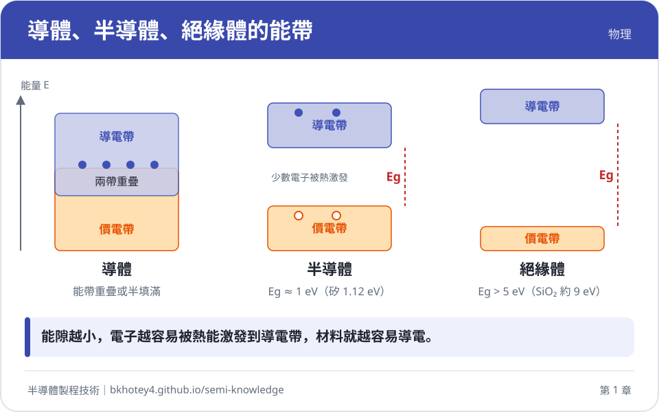
<figcaption>核心概念圖卡：導體、半導體、絕緣體的能帶</figcaption>
</figure>

<figure markdown>
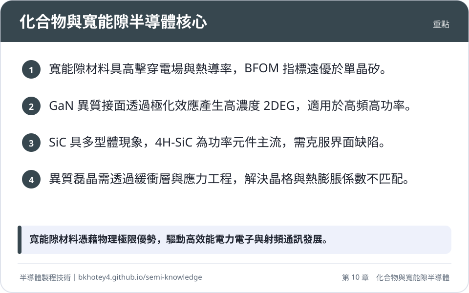
<figcaption>重點圖卡：化合物與寬能隙半導體核心</figcaption>
</figure>

<figure markdown>
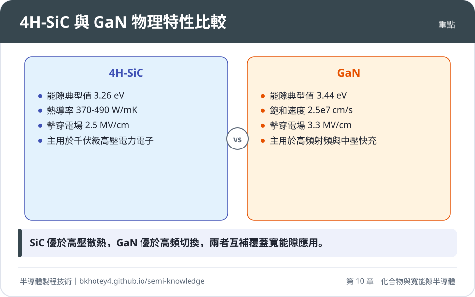
<figcaption>重點圖卡：4H-SiC 與 GaN 物理特性比較</figcaption>
</figure>

<figure markdown>
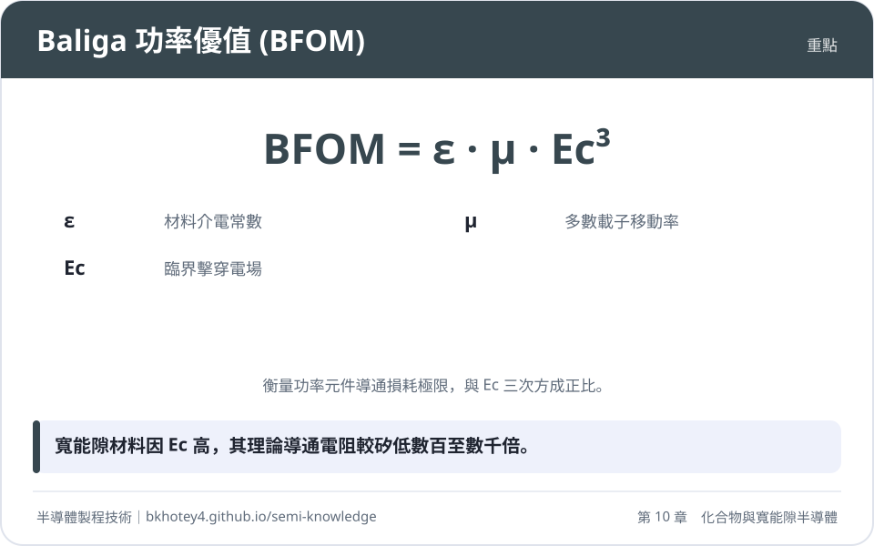
<figcaption>重點圖卡：Baliga 功率優值 (BFOM)</figcaption>
</figure>

<figure markdown>
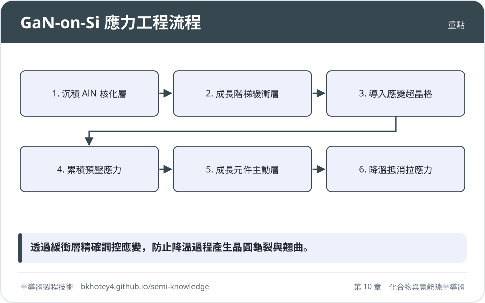
<figcaption>重點圖卡：GaN-on-Si 應力工程流程</figcaption>
</figure>

</div>

## 習題

**1.** 試從固態物理之動量守恆與能量守恆觀點，比較直接能隙材料（如 $\text{GaAs}$）與間接能隙材料（如 $\text{Si}$）在電子-電洞輻射復合機率上的差異，並說明為何間接能隙材料難以作為高效率發光光源。

??? success "參考解答"
    在半導體載子復合產生光子的過程中，系統必須同時遵守能量守恆與動量守恆：
    
    $$\Delta E = E_i - E_f = \hbar \omega$$
    
    $$\Delta \mathbf{k} = \mathbf{k}_i - \mathbf{k}_f = \mathbf{k}_{\text{photon}} \approx 0$$
    
    由於可見光與近紅外光之光子動量 $\mathbf{k}_{\text{photon}}$ 相較於布里元區邊界之電子動量（$\sim \pi/a$）微乎其微，電子在能帶間的躍遷在 $\mathbf{k}$ 空間中幾乎為一條垂直線（垂直躍遷）。
    
    1. **直接能隙材料（如 $\text{GaAs, GaN}$）**：傳導帶底（CBM）與價帶頂（VBM）位於布里元區相同的動量位置（$\Gamma$ 點，$\mathbf{k}=0$）。電子自傳導帶底躍遷至價帶頂不需要動量改變，單一步驟的一階微擾過程即可完成輻射發光，輻射躍遷機率高，載子生命週期落在奈秒（$\text{ns}$）量級，內部量子效率極佳。
    2. **間接能隙材料（如 $\text{Si}$）**：傳導帶底（沿 $\Delta$ 軸）與價帶頂（$\Gamma$ 點）在 $\mathbf{k}$ 空間分離。電子若要與電洞復合發光，必須額外吸收或放射一個具備特定動量的晶格振動量子（聲子，Phonon）以補足動量差：
       $$\Delta \mathbf{k} = \mathbf{k}_{\text{phonon}}$$
       此過程屬於涉及電子、光子與聲子三粒子交互作用的二階微擾過程，發生機率相較於直接躍遷低了 3 到 5 個數量級，輻射生命週期長達微秒（$\mu\text{s}$）乃至毫秒（$\text{ms}$）量級。在此漫長時間尺度下，非輻射復合途徑（如 Shockley-Read-Hall 陷阱復合與 Auger 復合）佔據主導地位，絕大部分載子能量轉化為晶格熱能，導致發光效率極度低下。

**2.** 假設有兩種理想單向階梯接面二極體，分別以單晶矽（$\text{Si}$）與 $4\text{H-SiC}$ 製造，設計之雪崩崩潰電壓皆為 $V_{\text{BR}} = 1200\ \text{V}$。已知材料參數如下：
* 矽：$\epsilon_r = 11.7$，$E_{\text{crit}} = 0.3\ \text{MV/cm}$，$\mu_n = 1400\ \text{cm}^2/\text{V}\cdot\text{s}$
* 4H-SiC：$\epsilon_r = 9.7$，$E_{\text{crit}} = 2.8\ \text{MV/cm}$，$\mu_n = 900\ \text{cm}^2/\text{V}\cdot\text{s}$
真空介電常數 $\epsilon_0 = 8.854 \times 10^{-14}\ \text{F/cm}$，基本電荷 $q = 1.6 \times 10^{-19}\ \text{C}$。
試計算：（1）兩者漂移區所需的理論厚度 $W$；（2）兩者漂移區允許之最大摻雜濃度 $N_D$；（3）4H-SiC 理想漂移區比導通電阻（$R_{\text{on,sp}}$）相較於矽可縮減之百分比。

??? success "參考解答"
    **（1）漂移區理論厚度 $W$**
    根據反向偏壓臨界擊穿條件：$W = \frac{2 V_{\text{BR}}}{E_{\text{crit}}}$
    
    * 對於矽元件：
      $$W_{\text{Si}} = \frac{2 \times 1200\ \text{V}}{0.3 \times 10^6\ \text{V/cm}} = 8.0 \times 10^{-3}\ \text{cm} = 80\ \mu\text{m}$$
    * 對於 4H-SiC 元件：
      $$W_{\text{SiC}} = \frac{2 \times 1200\ \text{V}}{2.8 \times 10^6\ \text{V/cm}} = 8.57 \times 10^{-4}\ \text{cm} \approx 8.57\ \mu\text{m}$$

    **（2）漂移區摻雜濃度 $N_D$**
    由崩潰電壓公式：$V_{\text{BR}} = \frac{\epsilon_r \epsilon_0 E_{\text{crit}}^2}{2 q N_D} \implies N_D = \frac{\epsilon_r \epsilon_0 E_{\text{crit}}^2}{2 q V_{\text{BR}}}$
    
    * 對於矽元件：
      $$\epsilon_{\text{Si}} = 11.7 \times 8.854 \times 10^{-14} = 1.036 \times 10^{-12}\ \text{F/cm}$$
      $$N_{D, \text{Si}} = \frac{(1.036 \times 10^{-12}\ \text{F/cm}) \times (0.3 \times 10^6\ \text{V/cm})^2}{2 \times (1.6 \times 10^{-19}\ \text{C}) \times 1200\ \text{V}} \approx 2.43 \times 10^{14}\ \text{cm}^{-3}$$
    * 對於 4H-SiC 元件：
      $$\epsilon_{\text{SiC}} = 9.7 \times 8.854 \times 10^{-14} = 8.588 \times 10^{-13}\ \text{F/cm}$$
      $$N_{D, \text{SiC}} = \frac{(8.588 \times 10^{-13}\ \text{F/cm}) \times (2.8 \times 10^6\ \text{V/cm})^2}{2 \times (1.6 \times 10^{-19}\ \text{C}) \times 1200\ \text{V}} \approx 1.75 \times 10^{16}\ \text{cm}^{-3}$$

    **（3）理想漂移區比導通電阻比值與縮減百分比**
    由理論公式：$R_{\text{on,sp}} = \frac{4 V_{\text{BR}}^2}{\epsilon \mu_n E_{\text{crit}}^3}$
    
    * 矽元件比導通電阻：
      $$R_{\text{on,sp, Si}} = \frac{4 \times (1200)^2}{(1.036 \times 10^{-12}) \times 1400 \times (0.3 \times 10^6)^3} \approx 0.147\ \Omega\cdot\text{cm}^2$$
    * 4H-SiC 元件比導通電阻：
      $$R_{\text{on,sp, SiC}} = \frac{4 \times (1200)^2}{(8.588 \times 10^{-13}) \times 900 \times (2.8 \times 10^6)^3} \approx 3.39 \times 10^{-4}\ \Omega\cdot\text{cm}^2$$
    * 比導通電阻比值：
      $$\frac{R_{\text{on,sp, SiC}}}{R_{\text{on,sp, Si}}} \approx \frac{3.39 \times 10^{-4}}{0.147} \approx 0.0023\ (\text{約為矽的 } 0.23\%)$$
      
    因此，4H-SiC 相較於單晶矽，其漂移區比導通電阻縮減了約：
    $$1 - 0.23\% = 99.77\%$$

**3.** 在未摻雜的 $\text{Al}_{0.25}\text{Ga}_{0.75}\text{N}/\text{GaN}$ 異質接面中，試說明為何能在介面處形成高面濃度（$>10^{13}\ \text{cm}^{-2}$）的二維電子氣（2DEG）。請由晶體極化不連續性、表面施體態能帶拉彎模型以及載子傳輸優勢三方面進行物理機制剖析。

??? success "參考解答"
    1. **極化不連續性與固定極化電荷之形成**：
       纖鋅礦 GaN 與 AlN 沿 $[0001]$ 軸均具有固有的自發極化（$\mathbf{P}_{\text{SP}}$）。當在鬆弛的 GaN 緩衝層上假晶生長薄層 AlGaN 時，因 AlGaN 平面晶格常數小於 GaN，障壁層承受張應變，進而產生與自發極化同向的壓電極化（$\mathbf{P}_{\text{PE}}$）。在異質接面處，AlGaN 側的總極化強度顯著大於 GaN 側，依據邊界條件，極化梯度的發散在異質介面感應出極高密度的固定正極化電荷：
       $$\sigma_{\text{pol}} = (\mathbf{P}_{\text{SP, AlGaN}} + \mathbf{P}_{\text{PE, AlGaN}}) - \mathbf{P}_{\text{SP, GaN}} > 0$$
    2. **表面施體態游離與三角形量子井形成**：
       介面處的正極化電荷建立強大的內建電場（數個 $\text{MV/cm}$），導致 AlGaN 傳導帶顯著傾斜。當 AlGaN 厚度超過臨界厚度時，其表面的深能階施體態被拉升至費米能階 $E_F$ 之上，表面電子電離脫落。受介面正極化電荷之庫侖吸引，這些游離電子轉移至異質介面處，同時將介面傳導帶底 $E_C$ 強烈向下拉陷至費米能階之下，形成極薄的三角形量子井，電子在垂直方向被量子侷限化，形成二維電子氣（2DEG）。
    3. **載子傳輸優勢**：
       在傳統半導體反轉層中，高載子濃度依賴高雜質摻雜，引發嚴重的游離雜質散射。而在 AlGaN/GaN 系統中，2DEG 的電子來自表面態轉移，通道本體完全無須摻雜（UID）；電子在二維平面傳導時免除了雜質庫侖散射，且載子移動被限制於未摻雜的高純 GaN 側，因此能同時兼具極高面密度（$\sim 10^{13}\ \text{cm}^{-2}$）與極高低電場電子移動率（室溫下 $>1500\ \text{cm}^2/\text{V}\cdot\text{s}$）。

**4.** 試比較 SiC 功率 MOSFET 中「平面型（Planar VDMOS）」與「溝槽型（Trench MOSFET）」的結構差異與電性優劣。並針對溝槽底角極易發生的閘極氧化層電場過高問題，說明製程工程上如何藉由局部離子植入結構進行電場屏蔽。

??? success "參考解答"
    1. **結構差異與電性優劣**：
       * **平面型 (Planar VDMOS)**：導電通道沿晶圓表面水平形成，由表面熱氧化層控制。製程相對成熟，但存在相鄰 P-well 之間的接面型場效電晶體（JFET）寄生通道電阻，且晶圓表面反轉層因介面缺陷態導致有效移動率偏低，限制了單元微縮（Cell Pitch）與整體比導通電阻的下降空間。
       * **溝槽型 (Trench MOSFET)**：透過乾式蝕刻將閘極垂直凹蝕入半導體基底，垂直側壁作為導電通道。完全消除了 JFET 區域寄生電阻，且側壁晶格面之反轉通道載子移動率較高，單元密度大幅提升，比導通電阻顯著低於平面型。
    2. **溝槽底角氧化層電場過高機制**：
       4H-SiC 的極限擊穿電場高達 $3\ \text{MV/cm}$（約為矽的 10 倍）。在關斷承受高阻斷電壓時，溝槽垂直底角處因幾何效應產生嚴重的尖端電場集中；若無特殊防護，底角處二氧化矽（$\text{SiO}_2$）絕緣層所承受的介電質電場為 $E_{\text{ox}} = \frac{\epsilon_{\text{SiC}}}{\epsilon_{\text{ox}}} E_{\text{SiC}} \approx \frac{9.7}{3.9} E_{\text{SiC}} \approx 2.5 E_{\text{SiC}}$。這會使氧化層電場迅速超越其物理擊穿極限（$>10\ \text{MV/cm}$），導致閘極絕緣層提早發生介電質擊穿破壞。
    3. **電場屏蔽之製程對策**：
       在溝槽底端正下方及兩側底角，透過自我對準或專用光罩導入高能量高溫鋁離子植入，建立深層 $\text{P}^+$ 遮蔽區（Shielding region）。當元件處於逆向高壓阻斷時，深層 $\text{P}^+$ 井與 $\text{N}^-$ 漂移區形成的 PN 接面會率先空乏並橫向擴展交疊（夾止效應），將等電位線限制在遠離溝槽底部的漂移區深處，有效屏蔽溝槽底部角落之電場，保護閘極氧化層免於強電場破壞。

**5.** 在異質磊晶（如 GaN-on-Si）降溫過程中，基板與磊晶層之熱膨脹係數不匹配（CTE Mismatch）是造成晶圓翹曲與薄膜龜裂的主要物理機制。
已知在生長溫度 $T_{\text{growth}} = 1050^\circ\text{C}$ 冷卻至室溫 $T_{\text{room}} = 50^\circ\text{C}$（$\Delta T = -1000^\circ\text{C}$）期間，假定各材料熱膨脹係數為常數：
GaN 薄膜之平均熱膨脹係數 $\alpha_{\text{film}} = 5.6 \times 10^{-6}\ \text{K}^{-1}$；
Si(111) 基板之平均熱膨脹係數 $\alpha_{\text{sub}} = 3.6 \times 10^{-6}\ \text{K}^{-1}$。
GaN 薄膜之楊氏模數 $E_{\text{film}} = 390\ \text{GPa}$，帕松比 $\nu_{\text{film}} = 0.22$。
試計算：（1）冷卻過程在 GaN 薄膜內所引發的熱應力 $\sigma_{\text{th}}$ 大小與正負符號；（2）說明此應力屬於拉伸應力或壓縮應力，以及若未導入緩衝層工程時對磊晶圓造成的物理破壞；（3）說明 MOCVD 磊晶時如何利用「應變超晶格（SLS）」克服此問題。

??? success "參考解答"
    **（1）熱應力數值計算**
    根據二維雙軸熱應力積分公式：
    $$\sigma_{\text{th}} = \frac{E_{\text{film}}}{1 - \nu_{\text{film}}} (\alpha_{\text{sub}} - \alpha_{\text{film}}) \Delta T$$
    
    將數值代入：
    $$\frac{E_{\text{film}}}{1 - \nu_{\text{film}}} = \frac{390 \times 10^9\ \text{Pa}}{1 - 0.22} = \frac{390}{0.78} \times 10^9\ \text{Pa} = 5.0 \times 10^{11}\ \text{Pa}$$
    
    $$(\alpha_{\text{sub}} - \alpha_{\text{film}}) = (3.6 - 5.6) \times 10^{-6}\ \text{K}^{-1} = -2.0 \times 10^{-6}\ \text{K}^{-1}$$
    
    $$\Delta T = T_{\text{room}} - T_{\text{growth}} = 50 - 1050 = -1000\ \text{K}$$
    
    因此：
    $$\sigma_{\text{th}} = (5.0 \times 10^{11}\ \text{Pa}) \times (-2.0 \times 10^{-6}\ \text{K}^{-1}) \times (-1000\ \text{K}) = +1.0 \times 10^9\ \text{Pa} = +1.0\ \text{GPa}$$

    **（2）應力型態與破壞機制**
    計算所得 $\sigma_{\text{th}} > 0$，代表薄膜內部承受高達 $1.0\ \text{GPa}$ 的強烈**雙軸拉伸應力（Tensile Stress）**。
    物理成因在於 GaN 的熱收縮係數大於矽基板，降溫時 GaN 收縮幅度較大，但受到厚重矽基板的剛性鉗制無法自由收縮。由於拉伸應力遠超材料之臨界斷裂韌性，若無應變補償，GaN 表面將產生大面積裂紋（Cracking），使晶片徹底報廢。
    
    **（3）應變超晶格（SLS）工程機制**
    在沉積 GaN 前，先磊晶生長週期性之 $\text{Al}_x\text{Ga}_{1-x}\text{N}/\text{GaN}$ 或 $\text{AlN/GaN}$ 應變超晶格（Strain-layer Superlattices, SLS）。因為下層晶格常數較小，可迫使後續生長的磊晶層在 $1050^\circ\text{C}$ 的高溫狀態下蓄積足夠強大的**假晶壓縮應力（Compressive Stress）**。當磊晶完成降溫時，此預存的壓縮應變剛好與冷卻過程中產生的 $+1.0\ \text{GPa}$ 熱拉伸應變完全相消，最終在室溫下獲得近乎零應變、平整無龜裂且翹曲度受控（Bow $< 20\ \mu\text{m}$）的優良晶圓。

---

## 本章術語

- **Zinc-blende Structure**（閃鋅礦結構）：由兩套面心立方子晶格沿體對角線平移交錯形成之晶體結構，為多數傳統 III-V 族材料如 $\text{GaAs}$ 之穩定相。
- **Wurtzite Structure**（纖鋅礦結構）：由兩套六方密堆積子晶格沿 $c$ 軸平移交錯形成之六方晶系結構，缺乏反轉對稱中心，為 III 族氮化物之熱力學穩定相。
- **Spontaneous Polarization**（自發極化）：晶體在無外加電場及零機械應變下，因纖鋅礦非對稱晶胞之離子性鍵結電荷中心不重合而固有的電偶極極化。
- **Piezoelectric Polarization**（壓電極化）：材料在異質磊晶承受雙軸機械應變引發晶格幾何變形時，所感應產生的額外電偶極極化。
- **BFOM / Baliga's Figure of Merit**（Baliga 功率優值）：定義為 $\epsilon \mu E_c^3$，用於評估半導體材料在低頻高壓單極開關元件中達成極低比導通電阻的理論極限。
- **JFOM / Johnson's Figure of Merit**（Johnson 高頻優值）：定義為 $\frac{E_c v_{\text{sat}}}{2\pi}$，用於評估半導體材料在射頻功率放大架構下操作頻率與擊穿電壓之極限乘積。
- **Polytypism**（多型體現象）：同種化學組成物質在二維原子層堆疊序列上呈現週期性差異而形成不同對稱性結構的物理現象（如 3C-、4H- 與 6H-SiC）。
- **JBS / MPS Diode**（接面障壁蕭特基 / 融合 PiN 蕭特基二極體）：在蕭特基接觸下方嵌入週期性 $\text{P}^+$ 井，於反向偏壓時夾止電場以抑制漏電流，並在突波電流時注入少數載子以防燒毀之複合二極體結構。
- **2DEG / Two-Dimensional Electron Gas**（二維電子氣）：異質接面（如 AlGaN/GaN）極化電荷在能帶拉彎量子井中感應形成，且電子運動被嚴格侷限於二維平面的高移動率電子層。
- **Normally-off / E-mode**（常關型 / 增強型）：元件在閘極與源極間偏壓為零（$V_{GS}=0\text{ V}$）時通道處於斷開無電流狀態，必須施加正臨界電壓方能開啟導通的電晶體運作模式。
- **PVT / Physical Vapor Transport**（物理氣相傳輸法）：在 $2000^\circ\text{C}$ 以上高溫封閉石墨反應腔中，藉由熱場溫度梯度使 $\text{SiC}$ 原料昇華分解並在晶種上過飽和重結晶的單晶塊材生長技術。
- **Micropipe**（微管缺陷）：柏格斯向量過大的巨大螺旋差排，因應變能釋放而在晶錠內部沿生長方向形成的貫穿型中空管道孔洞。
- **Hot-Wall CVD**（高溫熱壁式化學氣相沉積）：晶圓載盤與腔體壁面同時受感應加熱至 $>1500^\circ\text{C}$ 的磊晶機台，能消除軸向熱梯度，專門用於 $\text{SiC}$ 高均勻同質厚膜磊晶。
- **MOCVD / Metal-Organic CVD**（金屬有機化學氣相沉積）：利用氣態 III 族有機金屬前驅物與 V 族氫化物在加熱基板表面進行熱分解化學反應，以沉積化合物薄膜的磊晶設備。
- **Cold Split / Laser Slicing**（冷切 / 雷射剝離技術）：利用超快短脈衝雷射聚焦於基板預定深度形成局部熱改質脆化層，再施加應力剝離以實現極低材料切削損耗的晶圓切片工藝。


## 互動學習

!!! tip "動手試試看"
    - [互動實驗：本質載子濃度與溫度](../labs.md#intrinsic)

<div class="quiz" data-quiz="02-04"></div>


## 產業最新進展

本節由每日產業新聞自動補充，說明本章技術在產業上的最新發展。

<!-- updates -->
- **2026-10-29**　氮化鎵藍光 MicroLED 調制頻寬創下 2.75 GHz 新紀錄。這項技術成果與化合物半導體的物理特性及高速光電元件應用緊密相關，展現出氮化鎵材料在高頻調制領域的優勢。（來源：[氮化鎵藍光MicroLED調制頻寬創下2.75GHz新紀錄 - LEDinside](https://news.google.com/rss/articles/CBMiY0FVX3lxTE51bm9qR2p0WExhS3oyUWo1UjZDdkNVWHdGWlYyUno1dUtQTGE1c0d5V1ByRzJ6QmJ6SEhrWjNPLTlaOUw5VWlveURsS2JDNlFlWXh5cTVhcGtKb1JuTjJVUFNLYw?oc=5)）
- **2026-10-29**　英飛凌宣布於歐洲設立全球首座採用 12 吋氮化鎵功率半導體晶圓廠。此發展對應化合物與寬能隙半導體章節，標誌著寬能隙材料從 6 吋或 8 吋邁向大尺寸晶圓量產的製程里程碑。（來源：[英飛凌將於歐洲設立全球首座採用 12 吋氮化鎵功率半導體晶圓廠 - TechNews 科技新報](https://news.google.com/rss/articles/CBMi0gFBVV95cUxQZ1lnNGJweXF5WjVSU3k3VEVjYnV2alJ0Z25WWUFHTGYtRUVmUVpYampFOG9aYklZeThjRFNfdkl2eHR4cDB6VndkVlVjM3VwQWNDcXJ5dFJ1aEFCdFhFRW92REFJT0x1dDBaYWtTdWVQY3VhZ05oUUw5TVVCeDRBaUdGcnJTNXFXMnpLMV9DcGhDdnhyUE50dURnak1aOVNOOVFlczR5UWxPcDl2eGRoVWpya25va1RmUDV1WTBHSEtEV3pHSTY3SEF1YWNjQXlwYmc?oc=5)）
- **2026-10-28**　英飛凌於歐洲建立 12 吋氮化鎵功率半導體大規模量產廠。這對應化合物與寬能隙半導體章節，說明氮化鎵從小尺寸基板邁向 12 吋大尺寸量產的製程發展。（來源：[AI資料中心推升高效供電需求！第三代半導體牽動產業鏈，英飛凌砸11億歐元建12吋GaN廠 - Yahoo新聞](https://news.google.com/rss/articles/CBMi7gNBVV95cUxQTU8tZ05GZGRSbmtnaHA1MXFzeXFJaE9iVG9seERldEdOWHVYQks2OFI4Y0N2d1VjdmZpaWtFNWtZNVdaTTVSWjhhcW03dmNQT2tidkQxc0k3MUFBQXpESTYxb1BPT3V2LUV3Uk1YTzZ0QWtnVlpWa1RGQjNkaElMNDJuNGJBbXBKSFAwby1kUUhVanFBRUVoZlFtaV9JMjZoV2ROZ0pNcFc5SGFGejBHNENsWE5ianNTVUVaRU1wMkNHcXFpU3dieXo3TURHNVNSTmpJbnJRUS1scXpUYTQzNjBxRFhkMHZ6YzNCTFMwYzZHUnZDMlVSa1liZWtKZ1ZxMnVaZmtTb2pxVTl2MURmVXF5TW9fci1jNXVaQXUxenVTT2VwS3NUZDdWUkNtbThnczdJYmItNEgtXzZWVU11RmRBVVlXN0NOMnp5Y1hrdUFDX0pteFFyalFFSG9NTHFDdkx2Ui1hZHlMQ3hXTlBxS19MTnV0MkstSDVST1NlZ2dtQXNGNWlqMEM0QXBWYjh4akdTZWQzUTlhNVBtVUhwVHUtamJmbXBwLUlKdDJjUWMwTDdiaTk4SFBCTTE1RzdxMzN6c3o0QmZqM2FieXVoaXJfTERxVXNHMkRxTDFYNEluYWU0cHNFZEw4ZnQ2UQ?oc=5)）
- **2026-10-27**　氮化鎵（GaN）等寬能隙半導體材料具備高崩潰電場與高電子遷移率特性。此技術應用於資料中心供電系統中，能有效降低高頻開關時的功率損耗，提升整體能源轉換效率。（來源：[氮化鎵（GaN）技術在資料中心供電應用中，具體優勢是什麼？ - UDN](https://news.google.com/rss/articles/CBMiekFVX3lxTE5GeEdHanZCMjBEbEhxUVFMUWdpVy1ySG1GdDk2U0lUaXNJOWFnazlBc1NHUS1iQkdsVGhqVHVmdm9HRkJtaWJXdkk2SkIzTTZkX0N5cWhSbU96V3F4MktWY2ZyRkRlZ05ETGpCQWhZM3F6OFBaOXkxN0F3?oc=5)）
- **2026-10-24**　英飛凌與輝達合作採用氮化鎵（GaN）技術提升800VDC系統效率。此發展對應化合物與寬能隙半導體章節中，寬能隙材料在高電壓與高頻率應用下的崩潰電場與導通電阻優勢。（來源：[英飛凌偕輝達攻800VDC 採GaN技術提升效率| 科技 - 非凡新聞台](https://news.google.com/rss/articles/CBMiW0FVX3lxTE1aMUVZSDlBLVVGUkRaSlF6dG1fM2FNTS1tQ3VqMWctVDZmZFNCYTFvQ0s5Y184S0JSc1hnamU4WnFpajl2RkRlVVVDVjJnQ05QUlNYeU1jSUplMjg?oc=5)）
- **2026-10-23**　英飛凌與NVIDIA合作開發應用於AI資料中心的氮化鎵（GaN）電源轉換系統。此技術運用寬能隙半導體的特性，提升高電壓直流（800 VDC）電源轉換的效率與功率密度。（來源：[英飛凌與NVIDIA 合作開發800 VDC AI 資料中心的氮化鎵電源轉換系統- 商情 - 工商時報](https://news.google.com/rss/articles/CBMiX0FVX3lxTE1YNnVTUjI4R2JrLTU0bDNLTUJDeUxpNWxkMXJrYm4zNDA4OUYwMGJkTjhwLWI4Y3ZfeGVibm9BZWpuQkdDZ01haTZnV01iSnZOaXR2Vm9MTUtxLVZtODZV?oc=5)）
- **2026-10-21**　英飛凌與 Wolfspeed 簽訂八吋碳化矽晶圓供應協議。這反映出寬能隙半導體材料從六吋過渡至八吋大尺寸晶圓的產業趨勢，與化合物半導體材料特性及晶圓加工規格的章節內容相呼應。（來源：[英飛凌與Wolfspeed簽訂8吋碳化矽晶圓供應協議強化供應鏈韌性- 股市爆料同學會 - CMoney](https://news.google.com/rss/articles/CBMiWEFVX3lxTE8tRndQWm9oS2NMd21CY1ctWDYxYlU5TUNrcFdVWm5rdWhmSGdsTmRlM05QZ180ZUU5Qzd1MDNqUWY5ZW1MeXBiQzFmRndlOVhBUmtCblZGTFE?oc=5)）
- **2026-10-20**　功率半導體大廠加速推動 8 吋碳化矽（SiC）晶圓的供應與應用布局。這與寬能隙半導體的材料特性及大尺寸單晶成長製程實作密切相關。（來源：[英飛凌加速8吋碳化矽布局！與Wolfspeed簽供應協議，支援電動車與AI資料中心需求 - Yahoo新聞](https://news.google.com/rss/articles/CBMiwgNBVV95cUxPWWpLQ2dVeGtnRnJBY01zOGtBazQta2EwZEJLYmsxZkczZTR2Y3hYZ2JwRW9kY1BScTlmc2lNV2RHN2RuYXlSU2dYY2ZMakQ1QV9zemF2MXRMNWtzMlk0cTJVZjFUSzF5RkVWUDFOMEtjb0xyNUJ3dUNhNGNFU1VUemJOeTdLdjJ0SHJKaDJoWUJKVHk5NDhaNEV0M29qcF95VlpjaElCR3hPLVJMc0dMVW1UcUtlUkFZNEthSzJsbl9FSjU1Ymd5ZnFxTDQwRWdCYkZIRHh4OGQ0VU1XRWZxT1d4andsQ0M1eGFtWUNRUDBrSnNQRTdMSXkzMHNsRnJoYy1MbFkxQWJma0RYQWlHMC1CNC02bFlCSVk5TVo3UnVmUkZVYlM2eExIc0dNV3A5ckFvY3V5MEI3bTViX0tOQWxvOVhybElTVUZ3UHBzQXM3N0RRTWRsOHlDTUxMVnFfOHpvdmtlNE5yRDJVaXEyT3BvUllGWXhSX3VCaUM5SEp5cFpZRktJdTRSZWgwaWdJVktOU1JZNjR2RGY2N0E2OFVzYlFHLWJtWlpsNVQ1bEh5dVJrZzAycWJGU3hrdE92c0E?oc=5)）
- **2026-10-19**　次世代半導體材料研發聚焦於氧化鎵等寬能隙材料，旨在打造更具省電效益的功率元件。這呼應了化合物與寬能隙半導體章節中，利用大能隙材料在高電壓與高溫環境下的優異載子傳輸特性來提升能源效率的物理原理。（來源：[台灣人在柏林做 AI 資料中心想吃的「漢堡肉」，NextGO Epi 押注下代省電材料氧化鎵 - TechNews 科技新報](https://news.google.com/rss/articles/CBMiVEFVX3lxTE1aS1FfbjBpVlJJdWZLUXhQOFhwY21yUW4tSFdWREQ3T0R2dXFGenFnRkJKVGhWbE1IcEZ3aVhKckJfLVFSNXF4ZmVocEgySE5oR01uWQ?oc=5)）
- **2026-10-17**　半導體廠積極佈局8吋碳化矽（SiC）產線並準備進入量產。碳化矽屬於寬能隙半導體材料，具備高崩潰電場與高導熱率等特性，適用於高功率與高溫元件製程。（來源：[世界訂單升溫，布局8吋SiC產線拚年底量產 - 台視全球資訊網](https://news.google.com/rss/articles/CBMinAFBVV95cUxOYm5qdkNxUEdKNWVibS1IekZqTTVwSU1zYmRIWWxyZ3BVbnU2WF9ocGRuS3hHYXd2cTB1cnZxUnBrX0E4MENOQTJxQlVJNEJGdV9lZVJvY3c0R3Z1aGpnWWstN0FMQzlBLTZzTnM3dUtoQVc1SzJwOC1XOVBObEhkMjNyTklMNWctczNFUl8tYUVadkF3LW9mQ0NuWXc?oc=5)）
