# 第 11 章　微影製程流程與光阻化學

<figure markdown>
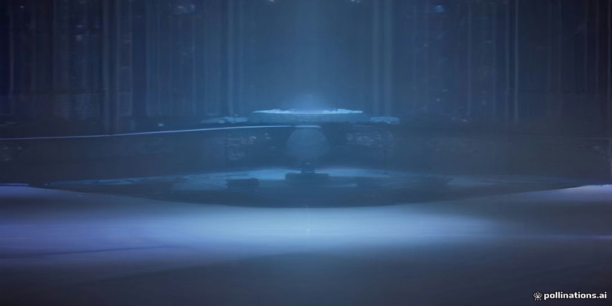
<figcaption>示意插畫：由 AI 生成，用來幫助記憶本章主題，細節請以內文與結構圖為準。</figcaption>
</figure>

!!! abstract "學習目標"
    - 掌握微影黃光微影製程的完整工序流，理解塗佈、軟烤、曝光、曝後烤及顯影等步驟的物理與化學作用機制
    - 辨析正型與負型光阻的成像原理、溶解度對比曲線及其在圖案轉移中的關鍵性能指標
    - 深入理解化學增幅型光阻（CAR）的催化脫保護機制、酸擴散現象及其在解析度、線寬粗糙度與靈敏度（RLS）間的權衡關係
    - 分析先進製程中金屬氧化物光阻（MOR）相較於傳統有機光阻的材料特性、反應機理與抗蝕刻優勢
    - 認識塗佈顯影機（Track）的模組架構及其與曝光機的線上整合技術

## 11.1 微影製程標準流程與工序機制

### 微影標準工序總覽

微影製程（Photolithography）是半導體製造中定義平面圖案結構的核心工序，其功能在於將積體電路的光罩圖案忠實轉移至晶圓表面的感光材料（光阻）上，並做為後續離子植入或蝕刻製程的暫態遮罩。單一圖案層的標準微影流程包含多道循序漸進的物理與化學步驟，如下圖所示：

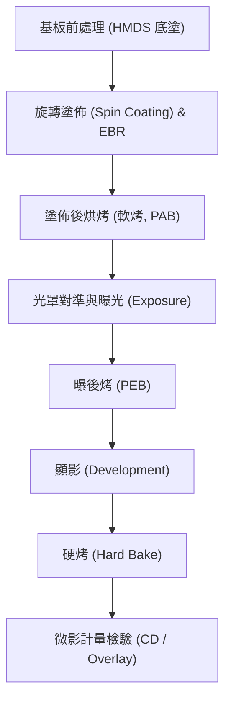

---

### 基板表面改質：HMDS 氣相底塗

矽晶圓在暴露於大氣或經過濕式清洗（如 RCA 洗淨，見第 20 章）後，表面自然氧化層會吸附空氣中的水氣，水解生成極性甚高的矽醇基（Silanol groups, $\equiv\text{Si-OH}$）。然而，多數商業化光阻所採用的樹脂基質（如酚醛樹脂 Novolac 或聚羥基苯乙烯 PHS）多為弱極性或非極性有機化合物，極性差異導致光阻對親水性矽基板的濕潤性（Wettability）不佳，在後續液相顯影或酸鹼化學環境中極易發生圖案底切（Undercut）甚至剝離剝落。

為建立穩固的界面鍵結，塗佈前必須進行基板脫水烘烤，並通入氣態六甲基二矽氮烷（Hexamethyldisilazane, HMDS, 示性式 $[(\text{CH}_3)_3\text{Si}]_2\text{NH}$）進行化學氣相改質。HMDS 分子與表面矽醇基在約 $100^\circ\text{C} \sim 150^\circ\text{C}$ 的真空腔體內發生親核取代反應：

$$2 \equiv\text{Si-OH} + [(\text{CH}_3)_3\text{Si}]_2\text{NH} \rightarrow 2 \equiv\text{Si-O-Si}(\text{CH}_3)_3 + \text{NH}_3 \uparrow$$

反應將親水性的羥基置換為非極性的三甲基矽基（Trimethylsilyl groups, $-\text{Si}(\text{CH}_3)_3$），並釋出氨氣副產物。此單分子層改質使基板表面能顯著下降，水接觸角（Contact Angle）通常由原本小於 $30^\circ$ 提升至 $70^\circ \sim 80^\circ$ 的疏水狀態，大幅改善光阻在基板上的黏著性（Adhesion）。

---

### 旋轉塗佈動力學與邊緣珠狀堆積控制

光阻薄膜的沉積普遍採用旋轉塗佈法（Spin Coating），其目標在於在晶圓全域形成厚度高度均勻（厚度變異通常需小於 $\pm 1\%$）且無針孔缺陷的固態非晶質薄膜。此動態過程可細分為四個連續階段：

1. **液滴沉積（Dispense）：** 將計量的光阻液滴注於靜止或低速旋轉（典型值 $300 \sim 500\text{ rpm}$）的晶圓中心。
2. **旋轉加速（Spin-up）：** 晶圓快速加速，離心力克服光阻的黏滯阻力，驅使液體向外輻射狀鋪展，大部分過量光阻在此階段被甩離晶圓。
3. **等速流體平整（Spin-off）：** 晶圓維持在高速旋轉平台（典型轉速 $1000 \sim 4000\text{ rpm}$），向外的離心力與流體的向內黏滯剪切力達到動態平衡。
4. **揮發固化（Drying）：** 隨薄膜變薄，液面溶劑對流揮發加劇，光阻黏度非線性驟增，流動行為停止，薄膜厚度凍結。

根據 Meyerhofer 建立的旋轉塗佈流體力學蒸發耦合模型，乾燥後的最終膜厚 $h_f$ 可表示為：

$$h_f = C_0 \left( \frac{3 \nu_0 e}{2 (1 - C_0) \omega^2} \right)^{1/3}$$

其中 $C_0$ 為原始光阻液中的固成份體積分率，$\nu_0$ 為初始動黏滯係數（Kinematic Viscosity），$e$ 為溶劑的自然蒸發速率，$\omega$ 為晶圓旋轉角速度。在固定配方系統中，工程上常將其簡化為經驗冪定律關係式：

$$h_f = \frac{K \cdot S^\alpha}{\omega^{1/2}}$$

此處 $K$ 與 $\alpha$ 為製程校準常數，$S$ 為固含量百分比。該關係顯示最終膜厚與旋轉角速度的平方根成反比。

#### 邊緣堆積（Edge Bead）與去除技術

在高速旋轉過程的末期，晶圓外緣的流體受表面張力束縛，無法即時分離，因而在晶圓周緣 $1 \sim 3\text{ mm}$ 範圍內形成隆起的珠狀增厚結構，稱為邊緣堆積（Edge Bead）。若不予以清除，在後續傳輸模組中易發生夾爪接觸碎裂，產生嚴重的微粒污染（Defectivity）。

去除方式分為兩類：
* **化學邊緣去除（Chemical Edge Bead Removal, W-EBR）：** 於塗佈旋轉末期，利用微調噴嘴自晶圓正面周邊與背面邊緣精確噴射專用溶劑（如丙二醇單甲醚醋酸酯，PGMEA），藉由局部溶解截切過厚光阻。
* **光學邊緣去除（Optical EBR, O-EBR）：** 在晶圓塗佈烘烤後，利用專用 UV 光源沿晶圓外環照射，使邊緣光阻完全感光，於後續顯影工序中溶解剝除，以保護晶圓倒角（Bevel）區域。

---

### 塗佈後烘烤（軟烤，PAB/Soft Bake）

剛塗佈完成的光阻層並非均勻固體，內部仍殘留質量分率約 $20\% \sim 30\%$ 的有機溶劑（如 PGMEA 或乳酸乙酯 Ethyl Lactate），且旋轉剪切過程在聚合物分子鏈間遺留了高度的非平衡態殘餘機械應力。

塗佈後烘烤（Post-Apply Bake, PAB，傳統亦稱軟烤 Soft Bake）通常在真空吸附熱板（Hot Plate）上進行，典型烘烤溫度區間為 $90^\circ\text{C} \sim 130^\circ\text{C}$，持溫數十秒。其核心物理與材料效應包括：
* **去除揮發性溶劑：** 將殘留溶劑含量降至 $5\% \sim 10\%$，固化光阻薄膜，防止在後續接觸對準或真空曝光環境中污染設備。
* **應力鬆弛：** 提供熱能使高分子聚合物鏈進行構型重排，消除剪切殘留應力，避免薄膜在顯影時產生微裂紋（Micro-cracking）。
* **調控光學性質：** 隨自由體積（Free Volume）縮減，薄膜密度提高，光阻層的折射率（Refractive Index, $n$）與消光係數（Extinction Coefficient, $k$）穩定化，確保曝光計量之重現性。

---

### 曝後烤（PEB）與駐波效應平滑化

晶圓完成曝光後（曝光光學機制詳見第 12 章至第 15 章），針對先進微影廣泛採用的化學增幅型光阻（Chemically Amplified Resist, CAR，反應化學見 11.3 節），必須即刻進行曝後烤（Post-Exposure Bake, PEB）。

PEB 具備兩項決定製程成敗的機制：

1. **催化去保護反應之熱活化：** 光酸產生劑（PAG）在曝光區所釋放的光酸（Photoacid, $\text{H}^+$），在此熱能激發下做為觸媒，誘導聚合物保護基發生連續去保護鏈反應（Deprotection Reaction），使樹脂極性產生巨幅轉變。
2. **駐波效應（Standing Wave Effect）的擴散平滑化：** 單色相干曝光光束在光阻層中向下傳遞時，會在基板界面產生反射，入射波與反射波發生光學干涉，形成垂直方向的週期性光強度駐波分佈：

$$I(z) \propto 1 + R + 2\sqrt{R}\cos\left(\frac{4\pi n}{\lambda} z + \phi\right)$$

其中 $R$ 為基板反射率，$n$ 為光阻折射率，$\lambda$ 為曝光波長，$z$ 為沿薄膜深度方向的座標。若無外加機制介入，垂直光強度的極大與極小交替會使光酸濃度呈現層狀節點分佈，顯影後光阻側壁將出現波紋狀起伏（Scalloping），劣化側壁垂直度。

PEB 提供受控熱驅動力，促使光酸分子在基質中產生微觀布朗運動擴散。酸擴散特徵長度 $L_{\text{diff}}$ 可由 Fick 第二定律推導：

$$L_{\text{diff}} = 2\sqrt{D_{\text{acid}}(T) \cdot t_{\text{PEB}}}$$

式中 $D_{\text{acid}}(T)$ 為相依於烘烤溫度 $T$ 的酸擴散係數，$t_{\text{PEB}}$ 為烘烤時間。藉由精密控制 $L_{\text{diff}}$ 使其略大於駐波半週期（$\lambda / 4n$），可有效熨平潛影中的酸濃度梯度波紋；但若烘烤溫度過高或時間過長，過度的酸擴散將滲入未曝光區，造成圖案模糊化（Acid Blur），導致關鍵尺寸（CD）縮減與線寬粗糙度（LWR）劣化。

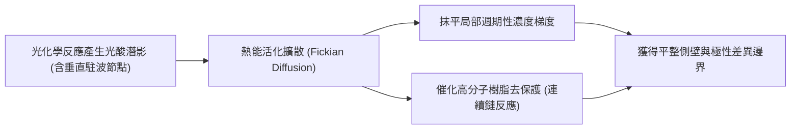

---

### 水相鹼性顯影機制與動力學

顯影工序旨在利用化學溶劑將曝光潛影轉換為實體拓撲圖案。在先進製程的正型光阻系統中，標準顯影液為不含金屬離子的四甲基氫氧化銨水溶液（Tetramethylammonium Hydroxide, TMAH, 示性式 $(\text{CH}_3)_4\text{NOH}$），工業標準質量濃度嚴格規範為 $2.38\ \text{wt}\%$（莫耳濃度約為 $0.26\ \text{N}$）。

正型 CAR 光阻在曝光並經 PEB 催化後，不溶於水的聚合物基質側鏈保護基被切除，轉化為具親水酸性的羧酸基（$-\text{COOH}$）或酚羥基（$-\text{Ar-OH}$）。當接觸到弱鹼性 TMAH 水溶液時，發生酸鹼中和去質子化反應：

$$\text{R-COOH} + (\text{CH}_3)_4\text{N}^+ + \text{OH}^- \rightarrow \text{R-COO}^- (\text{CH}_3)_4\text{N}^+ + \text{H}_2\text{O}$$

高分子鏈去質子化後帶負電荷，分子間靜電斥力克服凡德瓦力，顯影液分子滲入聚合物網絡形成膨潤凝膠層（Swelling layer），最終聚合物完全水合並溶解進入水相主體，未曝光區的非極性疏水樹脂則維持完好不溶。

顯影溶解速率 $R$ 與局部去保護程度直接相關。光阻材料的反差或對比度（Contrast, $\gamma$）定義為溶解速率比值對曝光劑量（Dose）變化的靈敏度：

$$\gamma = \left. \frac{d \ln R}{d \ln D} \right|_{D = D_{\text{th}}}$$

高對比度系統在劑量微幅跨越臨界值 $D_{\text{th}}$ 時，未曝光區溶解速率（$R_{\text{min}}$）與完全曝光區溶解速率（$R_{\text{max}}$）的比值（$R_{\text{max}}/R_{\text{min}}$）可達 $10^4$ 以上，從而確保圖案邊界具備陡峭的側壁幾何剖面。

顯影完成後必須立即以超純水（UPW）進行旋轉清洗，並配合表面張力控制吹乾，防止圖案在微胞毛細管力作用下發生倒塌（Pattern Collapse）。

---

### 硬烤與微影品質指標概論

顯影並乾燥後的晶圓，在進行後續乾式電漿蝕刻（見第 19 章）或離子植入前，通常會經歷硬烤（Hard Bake, HB）。硬烤溫度通常高於軟烤（約 $110^\circ\text{C} \sim 140^\circ\text{C}$），其目的在於：
1. 蒸發光阻在顯影膨潤過程中吸收的微量水分。
2. 促使聚合物基質進一步熱交聯（Cross-linking），提升光阻對後續電漿離子轟擊的抗性。

若硬烤溫度超過光阻樹脂的玻璃轉移溫度（Glass Transition Temperature, $T_g$），過度的熱流動（Thermal Flow）將導致光阻截面角度塌陷，必須透過製程窗口優化加以規避。

#### 微影圖案品質評估指標

微影製程的物理結果最終需透過計量檢測（Metrology）模組評定，主要指標列於下表：

| 指標名稱 | 縮寫 | 物理定義與製程意涵 |
| :--- | :--- | :--- |
| **關鍵尺寸** | CD (Critical Dimension) | 圖案的主要幾何特徵線寬或接觸孔直徑，決定元件電氣通道特性。 |
| **關鍵尺寸均勻度** | CDU (CD Uniformity) | 晶圓內（Intra-wafer）或晶圓間（Inter-wafer）同一特徵尺寸的統計標準差（$3\sigma$）。 |
| **線邊緣粗糙度** | LER (Line Edge Roughness) | 單一圖案邊緣相對理想直線偏離的統計偏差（通常以 $3\sigma$ 表示）。 |
| **線寬粗糙度** | LWR (Line Width Roughness) | 沿線長方向兩側邊緣距離變動的統計偏差，反映短通道漏電流風險。 |
| **疊對對準誤差** | Overlay | 當前微影圖案層與前置層基準標記之間的二維平面向量偏移量。 |

!!! note "先進製程之疊對容許界限"
    在先進互補式金氧半導體（CMOS）邏輯節點中，結構特徵尺度已推進至十餘奈米以下，微影疊對誤差（Overlay Budget）通常被嚴格限縮在閘極長度或互連金屬線距的典型百分比內。先進製程的疊對對準誤差已普遍要求壓低至 $1.5\text{ nm}$ 以內。若對準偏差失控，將引發接觸孔未對準（Unlanded Via）導致開路，或不同金屬線短路等災難性結構失效。疊對量測與校準補償機制將於第 17 章專題探討。

<!-- fig:1 -->
<figure markdown>
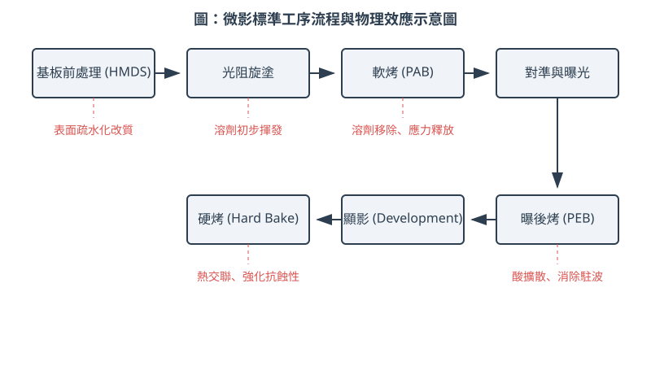
<figcaption>圖 11-1　微影標準工序流程圖（AI 繪製的示意圖）</figcaption>
</figure>

## 11.2 光阻分類與曝光化學基礎

光阻（Photoresist）是一種對特定波長輻射敏感的感光材料，其核心功能是透過光化學反應，將光罩上的幾何圖案轉移至晶圓表面的薄膜層。光阻主要由聚合物樹脂（Resin）、感光劑（Photoactive Compound, PAC）、溶劑（Solvent）以及各類添加劑組成。本節將探討光阻的分類機制、經典的曝光化學反應模型，以及評估光阻性能的物理參數。

### 11.2.1 正型與負型光阻之極性轉換機制

根據曝光後光阻在顯影液（Developer）中溶解度的變化方向，光阻可分為正型光阻（Positive Resist）與負型光阻（Negative Resist）。

#### 正型光阻（Positive Resist）
正型光阻在未曝光前，其聚合物結構對顯影液具有較低的溶解度。當受光照射後，光阻內部的感光劑發生化學變化，使曝光區域的溶解度大幅增加。在顯影過程中，曝光區會被顯影液移除，最終留在晶圓上的光阻圖案與光罩上的透光圖案一致。
*   **機制**：通常涉及高分子鏈的降解（Chain Scission）或極性轉換（如由疏水性轉為親水性）。

#### 負型光阻（Negative Resist）
負型光阻的特性則相反。未曝光前，光阻易溶於顯影液；曝光後，感光劑引發聚合物分子間的交聯反應（Cross-linking），形成高分子量的網狀結構，使其在顯影液中變得不可溶。顯影後，未曝光區被移除，留下的圖案與光罩上的透光圖案互補。
*   **機制**：主要透過光起始聚合反應（Photo-initiated Polymerization）形成三維交聯結構。

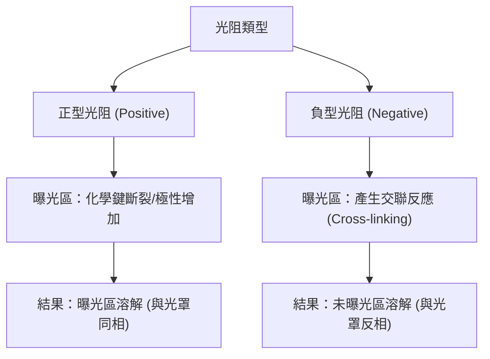

### 11.2.2 傳統 i-line 光阻化學：DNQ-Novolac 系統

在深紫外光（DUV）微影技術普及前，g-line（436 nm）與 i-line（365 nm）微影是產業主流。此階段最著名的光阻系統為「重氮萘醌-酚醛樹脂」（DNQ-Novolac）系統。

#### 1. 組成成分
*   **酚醛樹脂（Novolac Resin）**：作為基體聚合物，提供抗蝕刻性與薄膜機械強度。酚醛樹脂本身易溶於鹼性顯影液（如氫氧化四甲基銨，TMAH）。
*   **重氮萘醌（Diazonaphthoquinone, DNQ）**：作為感光劑（PAC）。在未曝光狀態下，DNQ 分子會填充在酚醛樹脂的空隙中，並透過氫鍵與樹脂結合，形成「溶解抑制劑」（Dissolution Inhibitor），使光阻整體不溶於鹼液。

#### 2. 沃爾夫重排（Wolff Rearrangement）反應動力學
當 DNQ 吸收 i-line 光子後，會發生一系列化學反應，將溶解抑制劑轉化為溶解促進劑。其反應步驟如下：
1.  **光解反應**：DNQ 分子吸收光子後，釋放出一分子氮氣（$N_2$），產生不穩定的碳烯（Carbene）中間體。
2.  **沃爾夫重排（Wolff Rearrangement）**：碳烯中間體極不穩定，迅速發生分子內重排，形成烯酮（Ketene）結構。
3.  **水合反應**：烯酮與光阻環境中微量的水分反應，最終生成茚羧酸（Indene Carboxylic Acid, ICA）。

$$ \text{DNQ} + h\nu \rightarrow \text{Carbene} + N_2 \uparrow \xrightarrow{\text{Rearrangement}} \text{Ketene} \xrightarrow{H_2O} \text{ICA} $$

#### 3. 溶解度變化
生成的茚羧酸（ICA）含有羧基（-COOH），在鹼性顯影液中會發生酸鹼中和反應，產生易溶於水的鹽類。因此，曝光區的溶解速率會比未曝光區快 100 至 1000 倍。這種巨大的溶解度差異（Dissolution Rate Contrast）是形成高解析度圖案的基礎。

!!! note "說明"
    DNQ-Novolac 系統屬於「非化學增幅型」光阻，一個光子僅能轉化一個 PAC 分子，因此靈敏度較低，不適用於光源強度較弱的 DUV 或 EUV 製程。

### 11.2.3 光阻特性曲線與數學參數

評估光阻性能最直觀的方法是觀測「特性曲線」（Characteristic Curve），又稱為對比曲線。該曲線描述了顯影後光阻剩餘厚度（Normalized Remaining Thickness, NRT）與曝光劑量（Dose, $D$）對數值之間的關係。

#### 1. 關鍵參數定義
*   **曝光劑量閾值（Dose-to-Clear, $D_0$）**：對於正型光阻，指將光阻完全溶解所需的最小曝光能量（單位：$mJ/cm^2$）。$D_0$ 越小，代表光阻的**靈敏度（Sensitivity）**越高。
*   **起始曝光劑量（Threshold Dose, $D_i$）**：光阻厚度開始發生明顯變化時的最小劑量。
*   **對比度（Contrast, $\gamma$）**：特性曲線在 $D_0$ 處的斜率絕對值。

#### 2. 對比度的數學推導
對比度 $\gamma$ 定義為光阻厚度對曝光劑量對數的變化率。假設光阻初始厚度為 $T_{initial}$，顯影後剩餘厚度為 $T$，則歸一化厚度為 $T/T_{initial}$。在 $D_i$ 與 $D_0$ 之間的線性區域，其數學關係式可表示為：

$$ \frac{T}{T_{initial}} = \gamma \cdot \log_{10} \left( \frac{D_0}{D} \right) $$

當 $D = D_i$ 時，$\frac{T}{T_{initial}} = 1$，代入上式可得對比度的計算公式：

$$ \gamma = \left[ \log_{10} \left( \frac{D_0}{D_i} \right) \right]^{-1} $$

!!! warning "常見誤解"
    高對比度（高 $\gamma$ 值）意味著光阻邊緣非常陡峭，有利於減少光學衍射造成的模糊（Blur），從而提升解析度。然而，過高的對比度有時會縮小製程視窗（Process Window），使得對曝光劑量的波動過於敏感。

### 11.2.4 負型光阻的溶脹效應（Swelling Effect）

傳統負型光阻（如環化橡膠基光阻）在顯影過程中面臨一個嚴重的物理限制：**溶脹效應**。

#### 1. 物理機制
負型光阻曝光後形成交聯結構。在顯影時，通常使用有機溶劑作為顯影液。雖然交聯區域不會溶解，但有機溶劑的小分子會滲透進入聚合物網格中，導致光阻體積膨脹，這種現象稱為溶脹。

#### 2. 對解析度的限制
當顯影結束、進行沖洗（Rinse）與乾燥時，溶劑從光阻中撤出，光阻體積重新收縮。這一脹一縮的過程會產生以下問題：
*   **圖案扭曲（Pattern Distortion）**：細長線條可能發生彎曲。
*   **橋接（Bridging）**：相鄰的兩條線條因溶脹而接觸，乾燥後無法分開，造成短路。
*   **解析度瓶頸**：由於溶脹效應，傳統負型光阻的解析度通常難以突破 1 微米（$\mu m$），因此在先進製程中，正型光阻（或不產生溶脹的化學增幅型負型光阻）更受青睞。

### 11.2.5 產業實例：光阻系統的演進

在半導體製程的演進中，光阻化學隨光源波長縮減而多次更迭：

| 曝光光源 | 波長 (nm) | 典型光阻系統 | 關鍵化學機制 |
| :--- | :--- | :--- | :--- |
| **g-line / i-line** | 436 / 365 | DNQ-Novolac | 沃爾夫重排 (非化學增幅) |
| **KrF** | 248 | PHS (聚羥基苯乙烯) | 化學增幅 (CAR) - 酸催化脫保護 |
| **ArF** | 193 | 丙烯酸酯 (Acrylate) | 化學增幅 (CAR) - 脂環族結構抗蝕 |
| **EUV** | 13.5 | CAR 或 金屬氧化物 (MOR) | 高光子吸收截面與二次電子反應 |

!!! example "產業實例"
    在 28 奈米（nm）以上的成熟製程中，**東京威力科創（TEL）**與**迪恩士（SCREEN）**的塗佈顯影機（Track）仍大量處理 i-line 光阻，用於厚膜製程或非關鍵層（Non-critical layers）。而在 7 奈米以下的先進製程，為了克服光子隨機效應（Stochastics），業界開始導入金屬氧化物光阻（Metal Oxide Resist, MOR），其化學機制與本節所述之有機聚合物系統截然不同（詳見第 11.4 節）。

## 11.3 化學增幅型光阻（CAR）反應動力學

在微影技術的演進過程中，光源波長從近紫外光（NUV，如 G-line 436nm、I-line 365nm）縮減至深紫外光（DUV，如 KrF 248nm、ArF 193nm）時，光學能量的提升伴隨著光子通量（Photon Flux）的劇減。傳統的非化學增幅型光阻（如 DNQ/Novolac 體系）遵循「一個光子誘發一個化學反應」的線性關係，其量子產率（Quantum Yield）通常小於 1。在 DUV 高能光源下，若維持此種低感度反應，將導致曝光時間過長，嚴重影響晶圓廠的產出率（Throughput）。

為了解決此瓶頸，化學增幅型光阻（Chemically Amplified Resist, CAR）應運而生。其核心思想是引入「催化循環」機制，使單一光子產生的化學物質能誘發數百至數千次的連鎖化學反應，從而將感度提升數個數量級。

### 11.3.1 化學增幅機制：光酸產生劑與去保護反應

化學增幅型光阻主要由聚合物基材（Polymer Matrix）、光酸產生劑（Photoacid Generator, PAG）以及溶劑組成。其反應過程分為兩個主要階段：曝光時的光解反應與曝後烤（PEB）時的熱催化反應。

#### 1. 光酸產生劑（PAG）的光解
當 DUV 光束照射至光阻層時，PAG 吸收光子能量並發生光化學分解（Photolysis），釋放出強酸（通常為質子 $H^+$）。此過程定義了初始的酸濃度分佈，其量子產率 $\Phi$ 可表示為：
$$\Phi = \frac{\text{產生的酸分子數}}{\text{吸收的光子數}}$$

#### 2. 去保護基反應（Deprotection）的催化循環
在曝光後的「曝後烤」（Post-Exposure Bake, PEB）階段，外部提供的熱能活化了酸催化反應。以正型 CAR 為例，聚合物側鏈上通常接有疏水性的「保護基」（Protecting Groups，如叔丁氧羰基 t-BOC）。在酸分子的催化下，保護基發生斷裂，轉化為親水性的羥基（-OH），同時釋放出一個質子回到系統中繼續下一次反應。

其化學反應簡化式如下：
$$\text{Polymer-R (疏水)} + H^+ \xrightarrow{\Delta T} \text{Polymer-H (親水)} + \text{副產物} + H^+$$

在此循環中，酸分子並未被消耗，而是作為催化劑重複使用。這種「一變多」的放大效應，使得極低劑量的曝光即可達成極高的顯像對比度。

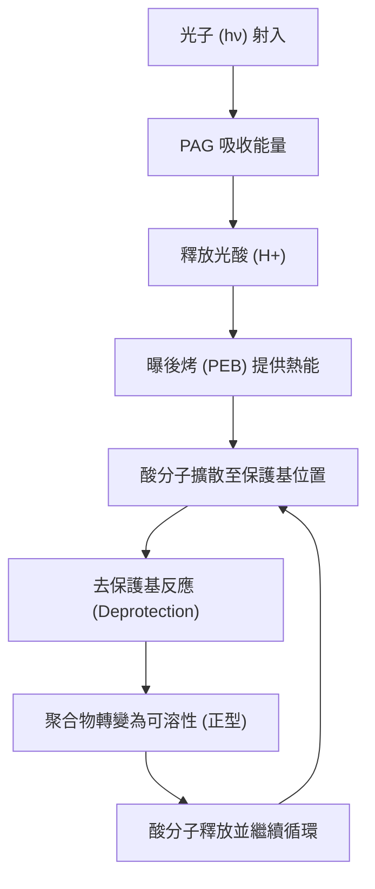

### 11.3.2 酸擴散行為與動力學控制

雖然化學增幅機制提升了感度，但酸分子在聚合物基材中的擴散行為卻成為解析度的主要限制因素。若酸分子擴散範圍過大，會導致曝光區邊界模糊，進而造成關鍵尺寸（Critical Dimension, CD）失真。

#### 1. 菲克擴散定律（Fick's Law）
酸分子在 PEB 過程中的運動遵循菲克第二定律：
$$\frac{\partial [H^+]}{\partial t} = D \nabla^2 [H^+]$$
其中 $[H^+]$ 為酸濃度，$D$ 為擴散係數。在特定溫度與時間 $t$ 下，酸分子的平均擴散長度（Diffusion Length）$L$ 約為：
$$L = \sqrt{2Dt}$$

#### 2. 鹼性猝滅劑（Base Quencher）的角色
為了精確控制酸擴散並抑制「酸爬行」現象，現代 CAR 配方中會加入微量的鹼性猝滅劑（Base Quencher）。鹼性物質能中和擴散至非曝光區（暗區）的微量酸分子，從而使酸濃度梯度在曝光邊界處變得極為陡峭，顯著提升影像對比度。

!!! note "PEB 溫度的敏感性"
    由於去保護反應與擴散係數均強烈依賴溫度（遵循阿瑞尼斯方程式 $k = A e^{-E_a/RT}$），PEB 溫度的均勻性對 CD 控制至關重要。在先進製程中，晶圓加熱板（Hot Plate）的溫差通常需控制在 $\pm 0.1^\circ C$ 以內。

### 11.3.3 RLS 三角約束：微影的核心權衡

在評估 CAR 性能時，製程工程師必須面對三個互相衝突的指標，稱為 RLS 三角（RLS Triangle）：

1.  **解析度（Resolution, R）**：指光阻能定義出的最小特徵尺寸。受限於酸擴散長度。
2.  **線邊緣粗糙度（Line Edge Roughness, LER / LWR）**：指圖案邊緣的隨機起伏。這主要源於光子隨機性（Shot Noise）與化學分子分佈的不均勻性。
3.  **靈敏度（Sensitivity, S）**：指達成設計尺寸所需的曝光能量（Dose）。

這三者之間存在著此消彼長的權衡關係。例如，若要降低 LER，通常需要增加曝光劑量（降低 S）以減少光子隨機效應；若要提高解析度，則需縮短酸擴散長度，這往往會降低反應效率，進而要求更高的曝光劑量。

| 指標 | 提升方法 | 副作用 |
| :--- | :--- | :--- |
| **解析度 (R)** | 增加猝滅劑、降低 PEB 溫度 | 降低靈敏度 (S) |
| **靈敏度 (S)** | 增加 PAG 濃度、提高 PEB 溫度 | 增加酸擴散，劣化解析度與 LER |
| **粗糙度 (LER)** | 增加曝光劑量 (Dose) | 降低產出率 (Throughput) |

### 11.3.4 環境胺污染與 T-topping 缺陷

CAR 對環境中的鹼性雜質極為敏感，尤其是空氣中的胺類物質（Airborne Molecular Contamination, AMC，如氨氣 $NH_3$、三甲胺等）。這些鹼性分子會吸附在光阻表面，中和曝光產生的酸，導致光阻表層的去保護反應不完全。

對於正型光阻，這會造成表層無法在顯影液中溶解，最終形成頂部較寬、底部符合設計的橫截面，稱為 **T-形頂部（T-topping）** 缺陷。若污染嚴重，甚至會形成一層薄膜（Scum）導致圖案無法開口。

!!! warning "環境控制重要性"
    在微影設備（Scanner）與塗佈顯影機（Track）之間，必須建立嚴格的化學濾網系統（Chemical Filter）以去除環境胺類。此外，從曝光到 PEB 之間的等待時間（Post-Exposure Delay, PED）必須嚴格限制，以減少光阻表面與空氣接觸的時間。

### 11.3.5 產業實例：DUV 與 EUV 時代的 CAR 演進

在 248nm 與 193nm 時代，CAR 的發展重點在於優化聚合物的透明度與酸擴散控制。進入極紫外光（EUV, 13.5nm）時代後，雖然 CAR 仍是主流應用材料，但由於 EUV 光子能量極高（約 92.5 eV），產生的次級電子（Secondary Electrons）會導致更複雜的化學反應路徑。

!!! example "產業實例"
    在 7 奈米及更先進節點，JSR 與 TOK 等光阻供應商開發了高負載 PAG 的 CAR，旨在藉由增加 PAG 密度來緩解 EUV 光子隨機性（Stochastics）造成的 LER 問題。然而，隨著特徵尺寸微縮至 20 奈米以下，CAR 的分子尺寸（約 5-10nm）已接近解析度極限，這促使了第 11.4 節將討論的金屬氧化物光阻（MOR）的發展。

透過對化學增幅動力學的深入理解，製程工程師能藉由調整 PEB 參數、光阻配方與環境控制，在解析度與產能之間取得最佳平衡。這套理論體系不僅支撐了過去三十年摩爾定律的推進，也是理解次世代微影材料的基礎。

<!-- fig:2 -->
<figure markdown>
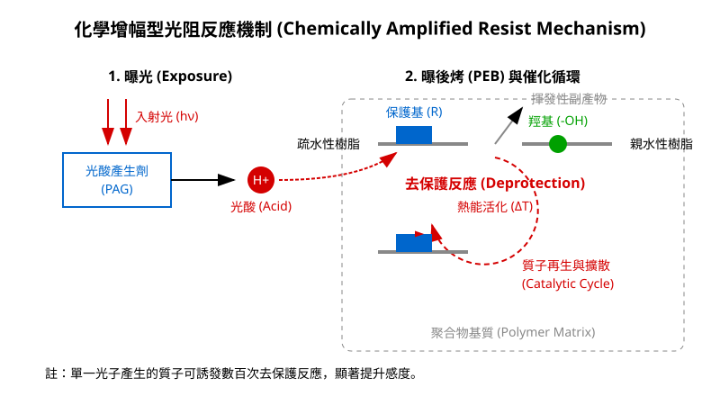
<figcaption>圖 11-2　化學增幅型光阻反應機制（AI 繪製的示意圖）</figcaption>
</figure>

## 11.4 次世代微影材料：金屬氧化物光阻

### EUV 曝光挑戰：光子隨機效應與吸收截面瓶頸

在進入極紫外光（Extreme Ultraviolet, EUV）微影時代（光波長 $\lambda = 13.5\text{ nm}$，見第 14 章）後，單一光子的能量大幅提升。根據普朗克-愛因斯坦關係式：

$$E = \frac{hc}{\lambda}$$

其中 $h$ 為普朗克常數，$c$ 為光速。單一 EUV 光子的能量約為 $91.8\text{ eV}$，是深紫外光（DUV, ArF 準分子雷射 $\lambda = 193\text{ nm}$，約 $6.4\text{ eV}$）的 14 倍以上。

在相同的曝光劑量（Dose, 單位面積接收能量，通常以 $\text{mJ/cm}^2$ 表示）下，晶圓單位面積所接收到的 EUV 光子數僅為 DUV 的約十四分之一。當圖案尺寸縮小至 10 奈米以下的關鍵尺寸（Critical Dimension, CD）時，微小特徵區域內的光子到達數量極度稀少。這種微觀下光子分佈的不均勻性，稱為光子散粒雜訊（Photon Shot Noise），連同材料內部的化學反應起伏，統稱為光子隨機效應（Photon Stochastics）。光子隨機效應會導致顯影後的圖案邊緣粗糙度（Line Edge Roughness, LER）與線寬粗糙度（Line Width Roughness, LWR）嚴重劣化，甚至引發奈米級的隨機微橋接（Microbridging）或開路斷線（Pinch-off）缺陷。

傳統化學增幅型光阻（Chemically Amplified Resist, CAR，見第 11.3 節）主要由碳、氫、氧、氮等低原子序（$Z$）輕元素組成。這些元素在 $13.5\text{ nm}$ 處的極紫外光吸收截面（Absorption Cross Section）相對較低。物質對光子的線性吸收係數 $\alpha$ 取決於原子密度與各組分原子的吸收截面：

$$\alpha = \sum_i N_i \sigma_{a,i}$$

其中 $N_i$ 為第 $i$ 種原子的體積密度（$\text{atoms/cm}^3$），$\sigma_{a,i}$ 為該原子在特定波長下的光吸收截面（$\text{cm}^2$）。CAR 材料因整體吸收截面不足，EUV 光子穿透率過高而能量轉換效率低；若單純提高光酸產生劑（Photoacid Generator, PAG）濃度以增加吸收，又會因酸擴散長度（Acid Diffusion Length）引發圖案模糊，陷入解析度（Resolution）、粗糙度（Roughness）與靈敏度（Sensitivity）三者相互牽制的「RLS 三角權衡極限」。

---

### 金屬氧化物光阻（MOR）的奈米簇分子結構

為克服傳統有機高分子光阻的物理極限，半導體製程發展出以過渡金屬或後過渡金屬為基底的「金屬氧化物光阻」（Metal Oxide Resist, MOR）。

MOR 的設計核心在於引入對 $13.5\text{ nm}$ 光子具有巨大吸收截面的高原子序元素，例如錫（Tin, $\text{Sn}, Z=50$）、鉿（Hafnium, $\text{Hf}, Z=72$）或鋯（Zirconium, $\text{Zr}, Z=40$），其中尤以錫基氧化物最受注目。在 $13.5\text{ nm}$ 輻射下，錫原子的外層 $4d$ 電子能階發生強烈的巨共振躍遷（Giant Resonance），其光吸收截面遠高於碳（$\text{C}$）或氧（$\text{O}$）原子達數倍至十倍以上。高吸收截面確保了材料能高效補獲有限的 EUV 光子，顯著改善光子隨機分佈不均的問題。

```
       [R 配位基]
           │
  [R] ── Sn ── O ── Sn ── [R]
         │          │
         O          O
         │          │
  [R] ── Sn ── O ── Sn ── [R]
           │
       [R 配位基]
```

在材料形態上，傳統 CAR 是由長鏈聚合物糾纏而成，其高分子迴轉半徑（Radius of Gyration, $R_g$）典型值在 $2 \sim 5\text{ nm}$ 之間，其物理尺度本身就構成了顯影解析度與 LER 的下限。相較之下，MOR 不採用長鏈高分子，而是採用離散的「有機金屬核殼簇」（Organometallic Core-Shell Nanocluster）結構：
- **無機核心（Inorganic Core）：** 通常由數個至十數個金屬原子與氧原子構成的緻密網絡（例如烷基氧化錫簇物 $[(\text{R-Sn})_{12}\text{O}_{14}(\text{OH})_6]^{2+}$），尺寸僅約 $1 \sim 2\text{ nm}$。
- **有機外殼（Organic Shell）：** 由直接與金屬鍵結的短鏈烷基（如丁基 $\text{C}_4\text{H}_9\text{-}$）或羧酸根配位基（Carboxylate Ligands）包裹。配位基的作用是鈍化核心反應活性，賦予材料優良的溶解度，並防止奈米簇在未曝光前自發聚集。

MOR 分子級別的超小均勻單元，使材料在微觀上具有極高的化學均質性，從結構根源上大幅降低了圖案化過程中的本質粗糙度。

---

### MOR 的光化學反應機制與顯影路徑

金屬氧化物光阻通常表現為負型光阻（Negative-tone Resist）機制。其圖案化反應並非依賴長程的酸催化連鎖反應，而是依賴游離輻射引發的鍵結斷裂與隨後的凝聚交聯。

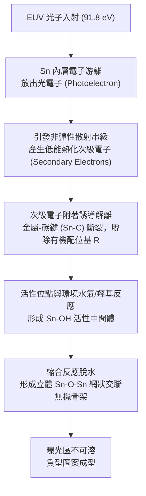

#### 1. 能量吸收與次級電子引發鍵裂
當單一 EUV 高能光子轟擊錫基簇核心時，激發光電效應與歐傑效應（Auger Effect），釋放出高能光電子與低能次級電子（Secondary Electrons, 能量通常小於 $20\text{ eV}$）。次級電子的非彈性散射平均自由徑（Inelastic Mean Free Path）約在 $1 \sim 2\text{ nm}$ 範圍內，限制了化學反應的橫向擴散範圍。這些次級電子透過解離電子附著（Dissociative Electron Attachment, DEA）機制，攻擊錫-碳共價鍵（$\text{Sn-C}$），使得外圍保護性的烷基有機配位基（$\text{R}^\bullet$）發生斷裂脫附，轉化為揮發性烷烴或烯烴氣體溢出。

#### 2. 縮合交聯反應（Condensation）
脫除有機配位基後，錫原子暴露出的不飽和配位親電子金屬中心極度不穩定，迅速與材料內部原有的羥基（$-\text{OH}$）或薄膜吸附的環境水氣（$\text{H}_2\text{O}$）反應，生成反應性極強的羥基錫（$\text{Sn-OH}$）基團。在曝後烤（Post-Exposure Bake, PEB）過程中，鄰近奈米簇的羥基與活化中心之間發生脫水縮合反應：

$$\equiv\text{Sn}-\text{OH} + \text{HO}-\text{Sn}\equiv \;\longrightarrow\; \equiv\text{Sn}-\text{O}-\text{Sn}\equiv + \;\text{H}_2\text{O}\uparrow$$

數個奈米簇透過強固的金屬-氧-金屬（$\text{M-O-M}$）鍵相互鍵結，由原先離散的奈米球體交織成緻密的不溶性三維非晶態金屬氧化物網狀結構。

#### 3. 顯影相容性：濕式顯影與乾式顯影
MOR 展現出高度的顯影彈性，可支援兩種完全不同的工藝路徑：
- **濕式顯影（Wet Development）：** 利用有機溶劑（例如正庚烷、2-庚酮等）沖洗晶圓。未受光的區域由於保有完整的有機配位基外殼，能溶解於溶劑中並被移除；已曝光區域形成無機網狀聚合物而留存，呈現負型圖案。然而，在線寬極窄、高深寬比的圖案中，濕式乾燥時溶劑的表面張力可能引發毛細管力，導致奈米圖案倒塌（Pattern Collapse）。
- **乾式顯影（Dry Development）：** 為徹底消除液體毛細力，MOR 可進一步導入全乾式微影流程。晶圓進入真空腔體中，通入特定鹵化氫氣體（如 $\text{BCl}_3$ 或無水 $\text{HCl}$ / $\text{HBr}$）。未曝光的 MOR 配位化合物極易與鹵素反應生成揮發性的錫鹵化物（如 $\text{SnCl}_4$，其沸點約為 $114^\circ\text{C}$）被真空抽除；曝光後交聯緊密的 $\text{Sn-O-Sn}$ 網絡則耐受鹵素侵蝕而完整保留，達成奈米級解析度且無微結構倒塌的純氣相圖案轉移。

---

### 高蝕刻選擇比特性與極薄光阻微影圖案轉移

在先進半導體製程中，微影所建立的光阻圖案並非最終目的，其核心使命是作為後續乾式蝕刻（見第 19 章）的阻擋遮罩（Mask）。

#### 蝕刻選擇比與厚度微縮矛盾
光阻的蝕刻選擇比（Etch Selectivity, $S$）定義為底層目標材料蝕刻速率與光阻自身蝕刻速率的比值：

$$S = \frac{ER_{\text{target}}}{ER_{\text{resist}}}$$

傳統有機光阻在面對含氧電漿（用於有機層蝕刻）或高偏壓氟/氯反應離子蝕刻（RIE）時，其碳氫骨架容易迅速被物理撞擊濺鍍或化學氧化消耗。為了維持足夠的蝕刻阻擋時間，傳統光阻必須維持一定厚度（通常大於 $35\text{ nm}$）。然而，在 20 奈米以下的圖案特徵尺寸中，厚膜會使圖案深寬比（Aspect Ratio, $\text{AR} = \text{厚度}/\text{線寬}$）超過 3:1 甚至更高，極易在濕式清洗乾燥過程中因毛細力產生應力失衡而倒塌。

| 特性比較維度 | 化學增幅型光阻 (CAR) | 金屬氧化物光阻 (MOR) |
| :--- | :--- | :--- |
| **主要骨架組成** | 碳氫鏈有機聚合物 | 錫/鉿-氧無機金屬簇 |
| **EUV (13.5 nm) 光子吸收截面** | 低（由輕元素主導） | 極高（金屬 $d$ 能階巨共振躍遷） |
| **反應傳遞機制** | 光酸擴散連鎖脫保護反應 | 電子解離引發直接縮合交聯 |
| **分子物理尺寸** | $R_g \sim 2 \text{--} 5\text{ nm}$（聚合物） | 直徑 $\sim 1 \text{--} 2\text{ nm}$（奈米簇） |
| **乾式蝕刻阻擋能力** | 較低（耐濺鍍與耐化學侵蝕弱） | 極高（本質無機氧化物結構） |
| **典型塗佈厚度需求** | $30 \text{--} 45\text{ nm}$ | $10 \text{--} 20\text{ nm}$ |
| **顯影途徑** | 濕式鹼性水溶液（TMAH） | 濕式有機溶劑 或 全真空乾式蝕刻氣體 |

#### MOR 對微影堆疊結構的簡化
MOR 固化後本質上是一層高密度的金屬氧化物陶瓷薄膜（例如富錫氧化物）。金屬-氧鍵（$\text{Sn-O}$）擁有極高的鍵結能量（約 $530\text{ kJ/mol}$），在典型的含氧（$\text{O}_2$）或含鹵素（$\text{CF}_4, \text{CHF}_3, \text{Cl}_2$）反應電漿中，其物理濺鍍產率極低，且金屬氧化物難以轉化為常溫高揮發性副產物。這賦予 MOR 針對下層碳基底層（如旋塗碳 Spin-On Carbon, SOC 或非晶碳硬遮罩 Advanced Patterning Film, APF）高達數十比一的驚人蝕刻選擇比。

這種高抗蝕刻能力使光阻塗佈厚度得以激進地薄層化（Thin-film Lithography），薄膜厚度可安全降至 $10 \sim 15\text{ nm}$ 甚至更薄，深寬比被嚴格控制在 1.5:1 以下，徹底消除了圖案倒塌的物理機制。此外，由於 MOR 本身兼具光敏材料與硬遮罩（Hardmask）的雙重功能，在先進製程的多層圖案化（Patterning Stack）流程中，可省略傳統光微影堆疊中的中介層（如含矽抗反射層 SiARC），簡化整體沉積與蝕刻工序，大幅降低薄膜缺陷與疊對誤差（Overlay Error）累積。

!!! note "光微影中的隨機效應指標：RLS 權衡"
    解析度（Resolution, $R$）、線寬粗糙度（Line-edge Roughness, $L$）與曝光靈敏度（Sensitivity, $S$）構成微影化學著名的 RLS 權衡三角形。一般而言，縮短酸擴散長度可提升解析度並改善粗糙度，但必須犧牲靈敏度（需要更高的曝光劑量）；降低曝光劑量則會加劇光子隨機散粒雜訊，使粗糙度惡化。MOR 藉由大幅提升單一分子的光吸收截面與減小單元分子尺寸，成功打破了傳統有機體系在 EUV 節點下的 RLS 極限瓶頸。

!!! example "產業實例：乾式沉積與乾式顯影金屬光阻技術"
    半導體微影材料早期全面由液態化學品主導。隨著 EUV 與 High-NA EUV 製程對極限線寬的要求，業界領導廠商（如 Inpria，後由 JSR 收購；以及蝕刻設備大廠 Lam Research 等）推動了全乾式金屬光阻架構。該技術利用有機金屬氣相沉積（MOCVD）或分子原子層沉積（ALD）方式，將錫基配位前驅物氣相直接沉積於晶圓表面形成超均勻奈米薄膜；曝光後再以乾式化學氣相進行顯影。此一全乾式方案消除了溶劑膨潤、廢液處理與液體毛細作用問題，已成為次世代先進邏輯節點圖案轉移的重要技術路徑之一。

## 11.5 設備與廠商技術

在現代半導體量產線中，微影製程並非由單一機台完成，而是由「塗佈顯影機」（Coater/Developer Track）與「曝光機」（Scanner）兩大系統透過機械接口與軟體連線，組成所謂的「微影單元」（Litho Cell）。本節將探討這些設備的硬體架構、精密控制技術以及產業實務中的技術整合。

### 11.5.1 塗佈顯影機之模組化架構

塗佈顯影機（以下簡稱 Track）的主要功能是精確控制光阻膜層的形成與顯影後的圖案定義。為了達成高產能（Throughput）並減少晶圓在各工序間的暴露時間，Track 採用高度模組化的垂直或水平堆疊設計。

其核心子系統包含：

1.  **塗佈模組（Spin Coater）**：利用高速旋轉產生的離心力將液態光阻均勻分佈於晶圓表面。其轉速控制精度需達 $\pm 1$ rpm，以確保薄膜厚度變異控制在奈米等級。
2.  **顯影模組（Developer）**：透過噴嘴（Nozzle）將顯影液均勻覆蓋於曝光後的晶圓。常見方式包括噴霧式（Spray）或覆液式（Puddle），後者利用液體表面張力使其在晶圓表面形成靜止液膜，以達成反應均勻性。
3.  **熱處理模組（Hot Plate / Chill Plate）**：包含軟烤（SB）、曝後烤（PEB）與硬烤（HB）所需的精密熱板。
4.  **機械手傳輸系統（Wafer Handling Robot）**：負責在各模組與曝光機介面間快速傳送晶圓，其排程演算法直接影響機台的整體產能。

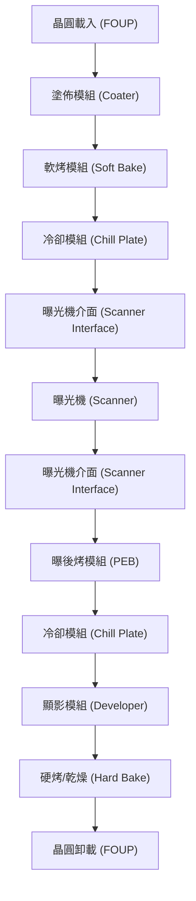

### 11.5.2 熱板技術與熱預算控制

在化學增幅型光阻（CAR）製程中，曝後烤（PEB）溫度的均勻性對關鍵尺寸（Critical Dimension, CD）的控制至關重要。PEB 溫度微小的偏差會導致酸催化反應速率的劇烈變化。

其 CD 對溫度的敏感度通常以 $\Delta CD / \Delta T$ 表示（單位為 nm/°C）。對於先進製程，此數值可能高達 5–10 nm/°C。因此，熱板技術需具備以下特點：

*   **多區加熱控制（Multi-zone Heating）**：熱板內部區分為數十個獨立的加熱區塊，透過 PID 控制器補償邊緣熱損失，確保晶圓面內溫度均勻性（Within-Wafer Uniformity, WIW）優於 $\pm 0.1$ °C。
*   **鄰近烘烤（Proximity Baking）**：晶圓並非直接接觸熱板，而是支撐在高度僅約 0.1 mm 的支撐銷（Support Pins）上，利用空氣層導熱。這能避免因接觸不均產生的熱點，並減少背面污染。

### 11.5.3 線上整合介面與自動化排程

「線上整合」（In-line Integration）是指 Track 與曝光機（如 ASML TWINSCAN 系列）物理連接。晶圓在 Track 完成塗佈與軟烤後，直接進入曝光機的緩衝區（Buffer），完成曝光後立即送回 Track 進行 PEB。

這種整合方式的關鍵挑戰在於**排程平衡（Scheduling Balance）**：
*   曝光機通常是整條生產線中最昂貴的設備，必須維持 100% 的稼動率。
*   Track 的各個模組（如 4 個塗佈槽、8 個熱板）必須透過排程演算法，確保每一片晶圓從塗佈到曝光、從曝光到 PEB 的「等待時間」（Queue Time）完全一致。若等待時間不一，將導致酸擴散長度差異，進而造成 CD 不均。

### 11.5.4 化學品分注與缺陷控制技術

微影製程對缺陷（Defectivity）的要求極其嚴苛。化學品供應系統必須解決以下問題：

1.  **超潔淨分注系統（Micro-dispense System）**：
    *   **氣泡消除**：光阻液中的微小氣泡在塗佈時會破裂，形成空洞（Void）或「彗星狀缺陷」（Comet Defect）。分注系統需具備自動排氣功能。
    *   **回吸機制（Suck-back）**：在分注結束時，噴嘴需產生微小負壓將殘餘液體吸回，防止液滴滴落於晶圓邊緣。
2.  **點對點過濾（Point-of-Use Filtration）**：在光阻噴嘴前端安裝奈米級過濾器，攔截可能存在的聚合物膠體或微粒子。
3.  **邊緣洗淨（Edge Bead Removal, EBR）**：光阻在旋轉塗佈時會堆積在晶圓邊緣。Track 需利用溶劑噴嘴洗去邊緣光阻，防止後續製程中光阻碎屑剝落造成污染。

### 11.5.5 產業實例與廠商技術比較

在微影設備市場中，塗佈顯影設備與光阻材料供應商維持高度的技術協作。下表列出主要廠商及其技術特點：

| 廠商 | 代表產品系列 | 技術路線與特點 | 主要應用 |
| :--- | :--- | :--- | :--- |
| **Tokyo Electron (TEL)** | CLEAN TRACK LITHIUS Pro Z | 採用高精度的熱板補償技術與高速傳輸排程，具備極高的產能穩定性與低缺陷率。 | 先進 DUV 與 EUV 量產線之標準塗佈顯影平台。 |
| **ASML** | TWINSCAN NXT / NXE / EXE | 雖然主攻曝光機，但其與 Track 的介面協定（Interface Protocol）定義了全球微影單元的通訊標準。 | 全球浸潤式 DUV、EUV 及 High-NA EUV 微影核心。 |
| **JSR** | — | 提供化學增幅型光阻（CAR），在浸潤式 ArF 與 EUV 領域具備高感度與低線邊緣粗糙度（LER）特性。 | 邏輯與記憶體製程之主流光阻供應。 |
| **信越化學 (Shin-Etsu)** | — | 專精於光阻底層材料（Underlayer）與高純度 CAR 光阻，強調材料的熱穩定性與附著力。 | 先進製程多重圖案化（Multiple Patterning）應用。 |
| **Inpria** | — | 專注於金屬氧化物光阻（MOR），利用錫（Sn）等金屬原子的高 EUV 吸收率，提升解析度。 | 次世代 EUV 與 High-NA EUV 之高解析度需求。 |

!!! note "設備選機考量"
    晶圓廠在選擇微影設備組合時，除了考慮產能（WPH, Wafers Per Hour）外，最重要的指標是「疊對精度」（Overlay）與「關鍵尺寸均勻性」（CDU）。雖然曝光機決定了成像對準，但 Track 的熱板均勻性與塗佈平整度（見第 12 章）對最終的 CDU 貢獻度往往超過 30%。

!!! example "產業實例：EUV 時代的挑戰"
    隨著 EUV 微影進入量產，東京威力科創（TEL）的 CLEAN TRACK LITHIUS Pro Z 平台針對 EUV 光阻易發生的圖案倒塌（Pattern Collapse）問題，導入了特殊的乾燥技術與新型顯影液分注系統，並與 JSR 及 Inpria 合作，針對金屬氧化物光阻的特殊化學性質優化廢液處理與腔體清洗流程。

## 本章重點

1.  **微影標準工序**：微影製程由基板前處理、旋轉塗佈、塗佈後烘烤（PAB）、曝光、曝後烤（PEB）、顯影及硬烤（HB）組成，各步驟均涉及精密的物理化學變化。
2.  **表面改質機制**：透過 HMDS 氣相底塗將親水性的矽醇基轉化為疏水性的三甲基矽基，能顯著提升光阻與基板間的黏著力，防止顯影時圖案剝落。
3.  **旋轉塗佈動力學**：光阻膜厚與旋轉角速度的平方根成反比。製程中需透過化學或光學邊緣去除（EBR）技術消除邊緣堆積，以降低微粒污染風險。
4.  **化學增幅機制（CAR）**：現代微影利用光酸產生劑（PAG）釋放質子，於曝後烤階段催化聚合物去保護反應，達成「一變多」的放大效應，顯著提升曝光靈敏度。
5.  **酸擴散與 RLS 權衡**：曝後烤能平滑駐波效應產生的側壁波紋，但過度的酸擴散會導致圖案模糊。解析度（R）、線邊緣粗糙度（L）與靈敏度（S）之間存在物理性的相互制約關係。
6.  **金屬氧化物光阻（MOR）**：為因應 EUV 光子隨機效應，MOR 利用高原子序元素（如錫）提升光子吸收截面，並以奈米簇結構取代長鏈聚合物，突破傳統 CAR 的解析度瓶頸。
7.  **設備整合與熱預算**：塗佈顯影機（Track）與曝光機（Scanner）構成微影單元，其中 PEB 熱板的溫度均勻性（典型值需優於 $\pm 0.1^\circ\text{C}$）是控制關鍵尺寸均勻度（CDU）的核心。


## 重點圖卡

複習時看這幾張就能抓住本章重點；[圖卡庫](../cards.md)可以下載成圖片。

<div class="ix-cards" markdown>

<figure markdown>
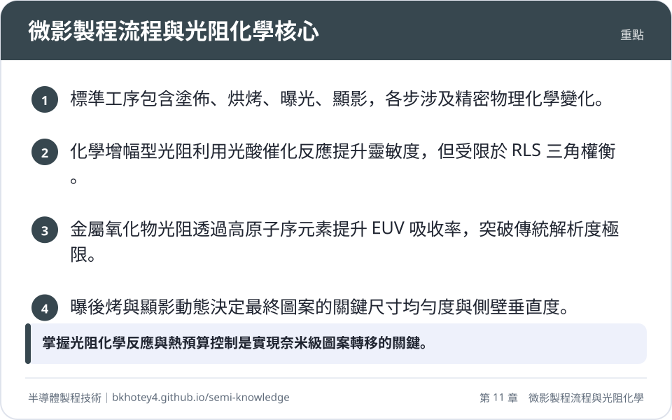
<figcaption>重點圖卡：微影製程流程與光阻化學核心</figcaption>
</figure>

<figure markdown>
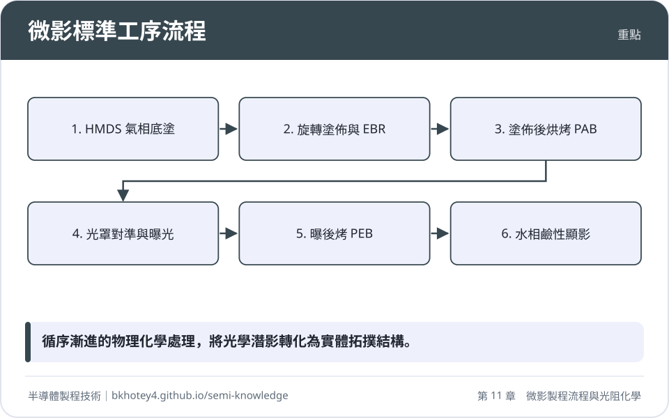
<figcaption>重點圖卡：微影標準工序流程</figcaption>
</figure>

<figure markdown>
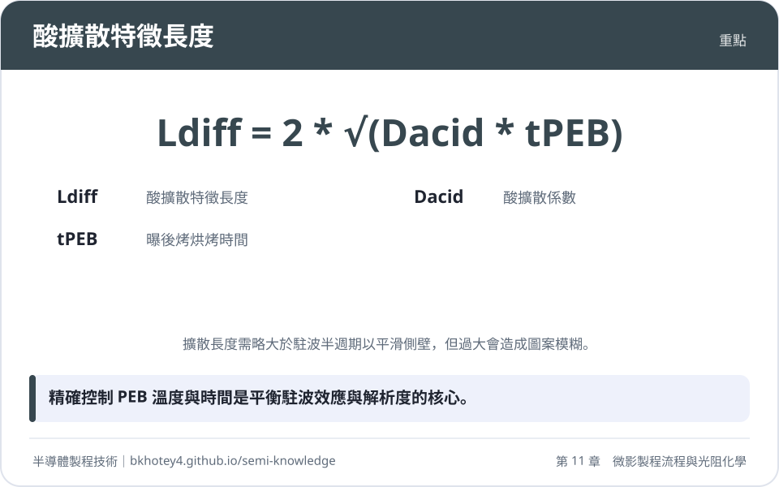
<figcaption>重點圖卡：酸擴散特徵長度</figcaption>
</figure>

<figure markdown>
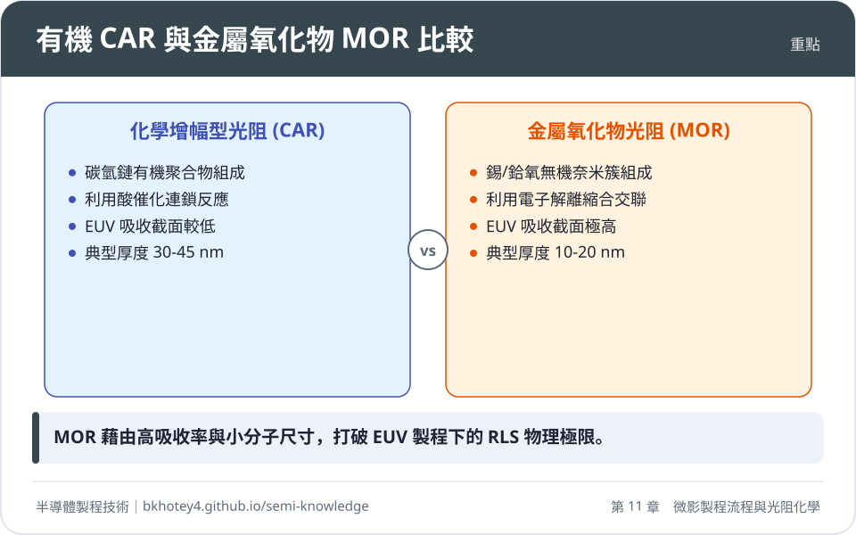
<figcaption>重點圖卡：有機 CAR 與金屬氧化物 MOR 比較</figcaption>
</figure>

</div>

## 習題

**1. 試說明 HMDS 處理前後，矽晶圓表面的化學鍵結變化及其對水接觸角（Contact Angle）的影響。若省略此步驟，在顯影工序中可能觀察到何種失效現象？**

??? success "參考解答"
    HMDS 與表面矽醇基（$\equiv\text{Si-OH}$）反應，將羥基置換為非極性的三甲基矽基（$-\text{Si}(\text{CH}_3)_3$）。此轉變使表面能下降，水接觸角由原本小於 $30^\circ$ 提升至 $70^\circ \sim 80^\circ$。若省略此步驟，光阻與基板黏著力不足，在液相顯影或後續濕式製程中，極易發生圖案底切（Undercut）或完全剝離（Lifting）。

**2. 某光阻在旋轉速度為 $2500\text{ rpm}$ 時得到的最終膜厚為 $200\text{ nm}$。若欲將膜厚降低至 $100\text{ nm}$，根據經驗冪定律關係式（$h_f \propto \omega^{-1/2}$），應將轉速調整為多少 rpm？**

??? success "參考解答"
    根據公式 $h_f = K \cdot \omega^{-1/2}$，可得知 $h_1 \sqrt{\omega_1} = h_2 \sqrt{\omega_2}$。
    代入已知數值：$200 \times \sqrt{2500} = 100 \times \sqrt{\omega_2}$
    $200 \times 50 = 100 \times \sqrt{\omega_2}$
    $100 = \sqrt{\omega_2}$
    $\omega_2 = 10000\text{ rpm}$。
    （註：實際製程中轉速通常有上限，過高轉速可能導致塗佈不均，需配合調整光阻固含量 $S$）。

**3. 詳述曝後烤（PEB）在化學增幅型光阻（CAR）中的雙重物理化學功能。為何 PEB 溫度的精確控制對關鍵尺寸（CD）至關重要？**

??? success "參考解答"
    PEB 的兩大功能為：(1) 提供熱能活化酸催化去保護反應，使曝光區樹脂產生極性轉變以利顯影；(2) 促使光酸分子微觀擴散，平滑化由光學干涉產生的垂直駐波效應，改善側壁平整度。由於去保護反應速率與擴散係數均遵循阿瑞尼斯方程式，對溫度極為敏感（典型 CD 敏感度達 $5 \sim 10\text{ nm/}^\circ\text{C}$），因此微小的溫度偏差會導致嚴重的 CD 變異。

**4. 假設某光阻在 $110^\circ\text{C}$ 下的酸擴散係數 $D_{\text{acid}}$ 為 $25\text{ nm}^2/\text{s}$，曝後烤時間為 $60$ 秒。試計算其酸擴散特徵長度 $L_{\text{diff}}$。若曝光波長為 $193\text{ nm}$，光阻折射率為 $1.7$，此擴散長度是否足以抹平駐波效應（駐波半週期為 $\lambda/4n$）？**

??? success "參考解答"
    利用公式 $L_{\text{diff}} = 2\sqrt{D_{\text{acid}} \cdot t}$：
    $L_{\text{diff}} = 2\sqrt{25 \times 60} = 2\sqrt{1500} \approx 2 \times 38.7 = 77.4\text{ nm}$。
    駐波半週期為 $\lambda/4n = 193 / (4 \times 1.7) \approx 193 / 6.8 \approx 28.4\text{ nm}$。
    由於 $77.4\text{ nm} > 28.4\text{ nm}$，此擴散長度足以抹平駐波節點，但可能因擴散過度導致圖案模糊（Acid Blur）。

**5. 為什麼在極紫外光（EUV）微影中，金屬氧化物光阻（MOR）比傳統有機 CAR 更有利於降低線邊緣粗糙度（LER）？請從光子吸收與分子尺寸兩個角度說明。**

??? success "參考解答"
    (1) 光子吸收：MOR 含有錫（Sn）等高原子序元素，在 $13.5\text{ nm}$ 處具備極大吸收截面，能捕捉更多光子，減輕光子隨機散粒雜訊（Shot Noise）。(2) 分子尺寸：傳統 CAR 由長鏈聚合物組成（尺寸約 $2 \sim 5\text{ nm}$），而 MOR 由離散的奈米簇組成（尺寸僅約 $1 \sim 2\text{ nm}$），較小的基本感光單元能提供更高的化學均質性，從而降低圖案邊緣的隨機起伏。

## 本章術語

- **HMDS**（六甲基二矽氮烷）：用於基板表面改質，將親水性表面轉化為疏水性以提升光阻黏著力的化學試劑。
- **Spin Coating**（旋轉塗佈）：利用離心力在晶圓上形成均勻微米或奈米級薄膜的製程技術。
- **EBR**（邊緣珠狀堆積去除）：利用溶劑或曝光方式移除晶圓邊緣過厚光阻的工序。
- **PAB / Soft Bake**（塗佈後烘烤）：移除光阻殘留溶劑並釋放薄膜內應力的熱處理步驟。
- **PEB**（曝後烤）：曝光後進行的烘烤，用於驅動化學增幅反應及平滑駐波效應。
- **CAR**（化學增幅型光阻）：利用酸催化連鎖反應提升感光靈敏度的現代光阻系統。
- **PAG**（光酸產生劑）：光阻中的關鍵組分，吸收輻射能後釋放質子（酸）以引發後續反應。
- **TMAH**（四甲基氫氧化銨）：半導體製程中標準的鹼性水相顯影液，典型濃度為 $2.38\ \text{wt}\%$。
- **RLS Triangle**（RLS 三角）：描述解析度、粗糙度與靈敏度之間互斥權衡關係的理論模型。
- **MOR**（金屬氧化物光阻）：以金屬奈米簇為核心，具備高 EUV 吸收率與高蝕刻選擇比的次世代微影材料。
- **Stochastics**（隨機效應）：微觀下光子分佈與化學反應的隨機波動，是先進微影缺陷的主要來源。
- **CDU**（關鍵尺寸均勻度）：衡量晶圓內同一特徵尺寸一致性的統計指標。


## 互動學習

!!! tip "動手試試看"
    - [設備機台圖鑑：塗佈顯影機](../equipment.md)

<div class="quiz" data-quiz="03-01"></div>


## 產業最新進展

本節由每日產業新聞自動補充，說明本章技術在產業上的最新發展。

<!-- updates -->
- **2026-10-23**　半導體微影製程中使用的光致產酸劑（PAG）供應吃緊，影響光阻化學反應的進行。光致產酸劑是極紫外光（EUV）與深紫外線（DUV）光阻劑中產生酸催化反應以改變溶解度的關鍵化學成分。（來源：[半導體關鍵微影材料告急：光致產酸劑成為卡住AI的隱形火種 - 鉅亨網](https://news.google.com/rss/articles/CBMiT0FVX3lxTFA1bjNvMW9OYUNhRzlSczVWTUNQcDI0bFRNTEJKTXFUbUpndE51VXlxbFFLTnRMZkFNRjVyZjNIZnhoZnJyZ0dQUjVzWU41VGc?oc=5)）
