# 第 12 章　光學成像與解析度極限

!!! abstract "學習目標"
    - 掌握阿貝成像理論與繞射極限在投影微影中的物理機制，理解空間頻率與光瞳濾波概念
    - 推導並應用瑞利準則（Rayleigh Criterion），定量分析臨界尺寸（CD）與景深（DOF）隨數值孔徑（NA）及波長的權衡關係
    - 解析照明同調性（Partial Coherence）及離軸照明（OAI）提升影像對比度的繞射光學原理
    - 理解製程因子 k1 的物理極限，並掌握相位移光罩（PSM）與波前調控等解析度提升技術（RET）的基本機制
    - 建立曝光機投影光學系統的架構概念，理解像差控制與高數值孔徑透鏡設計之工程實現

## 12.1 光學微影成像原理與繞射極限

### 投影微影系統的光學架構

在先進半導體製程中，微影技術的核心任務是將光罩（Reticle 或 Photomask）上的電路圖案，以極高的幾何保真度縮小投射至塗布光阻的晶圓表面。現代微影設備普遍採用縮小投影式曝光系統（Reduction Projection Exposure System），其典型的縮小倍率為 $4:1$（即光學放大率 $M = 0.25$）。此架構能有效降低光罩製造時對圖案極限尺寸與缺陷密度的嚴苛要求。

投影微影機台的光學幾何結構主要由五個核心子系統依序組成：

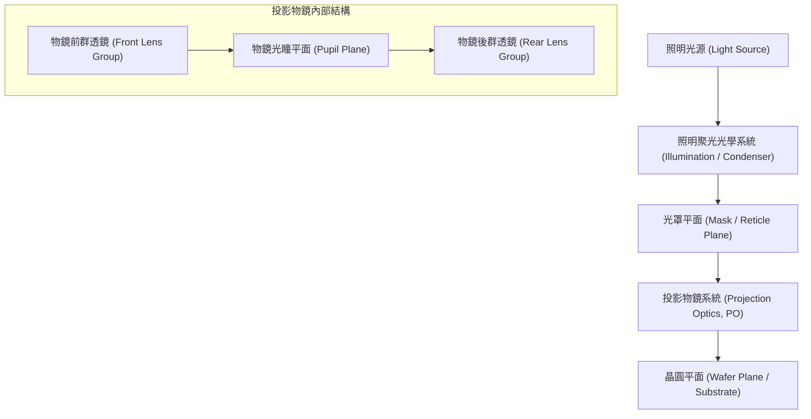

1. **照明光源（Light Source）**：提供特定波長 $\lambda$ 的高純度光子，例如深紫外光（DUV）的 $193\text{ nm}$ 氟化氬（$\text{ArF}$）準分子雷射，或極紫外光（EUV）的 $13.5\text{ nm}$ 電漿光源。
2. **聚光光學系統（Condenser Optics）**：將雷射光源發出的非均勻光束進行擴束、均勻化（Homogenization）以及角度整形，以定義特定的照明光瞳形狀（如環形、雙極或四極照明）。
3. **光罩平面（Reticle Plane）**：承載設計電路圖案的介質，由石英基板與鉻吸收層（或相移材料層）構成。
4. **投影物鏡系統（Projection Optics Lens, PO）**：微影機台最精密且龐大的核心模組，內部包含數十枚極高表面精度的折射透鏡（或 EUV 系統中的反射式多層膜面鏡），其主要功用是收集光罩繞射光，並重建成倒立縮小的幾何影像。其內部存在一個關鍵的傅立葉轉換面——**物鏡光瞳平面（Pupil Plane）**。
5. **晶圓平面（Wafer Plane）**：塗布有感光光阻劑（Photoresist）的矽晶圓表面，物鏡將光場能量匯聚於此形成潛影（Latent Image）。

---

### 阿貝成像理論與繞射本質

光學微影的物理極限無法單純以幾何光學的射線追跡（Ray Tracing）解釋，必須仰賴物理光學中的波動理論。1873 年，恩斯特·阿貝（Ernst Abbe）提出了顯微成像理論，確立了波動光學中成像的兩步雙重傅立葉轉換（Double Fourier Transform）本質：

$$
\text{光罩圖案 } E_{\text{mask}}(x, y) \xrightarrow{\text{繞射 (第一步)}} \text{光瞳平面頻譜 } \tilde{E}_{\text{pupil}}(k_x, k_y) \xrightarrow{\text{干涉 (第二步)}} \text{晶圓空間影像 } E_{\text{wafer}}(x', y')
$$

#### 1. 第一步：光罩圖案的夫朗和斐繞射
當同調光（Coherent Light）照射至光罩時，光罩微結構（例如週期為 $p$ 的一維光柵）可視為光波震幅與相位的空間調變器。光波通過光罩後發生夫朗和斐繞射（Fraunhofer Diffraction），光場被分解為不同角度傳播的平面波。繞射角 $\theta_m$ 由光柵方程式決定：

$$\sin \theta_m = m \frac{\lambda}{p}$$

其中：
*   $m$ 為繞射階次（Diffraction Order，取 $0, \pm 1, \pm 2, \dots$）。
*   $\lambda$ 為曝光光源的波長。
*   $p$ 為光罩圖案在晶圓側等效的空間週期（節距，Pitch）。

在空間頻域中，空間頻率定義為 $f_x = \frac{\sin \theta}{\lambda} = \frac{m}{p}$。光罩圖案越微小（$p$ 越小），繞射角 $\theta$ 越大，意味著高空間頻率成分落在偏離光軸較大的角度上。

#### 2. 第二步：光瞳平面的空間濾波作用
繞射光束行進至投影物鏡的前透鏡群後，被匯聚於物鏡的光瞳平面上。在數學上，光瞳平面上的複數電場分佈即為光罩透射率函數的二維傅立葉轉換：

$$\tilde{E}(k_x, k_y) = \mathcal{F}\{E_{\text{mask}}(x, y)\}$$

投影物鏡的開口大小是有限的，其物理孔徑半徑定義了光學系統能收集的最大角度 $\theta_{\max}$，由此引出**數值孔徑（Numerical Aperture, $\text{NA}$）**：

$$\text{NA} = n \sin \theta_{\max}$$

其中 $n$ 為物鏡與晶圓之間介質的折射率（空氣中 $n \approx 1$）。

物鏡光瞳扮演著**低通濾波器（Low-pass Filter）**的角色。其光瞳傳遞函數（Pupil Function）$P(k_x, k_y)$ 在理想無像差情況下為圓形階躍函數：

$$P(k_x, k_y) = \begin{cases} 1, & \sqrt{k_x^2 + k_y^2} \le k_0 \text{NA} \\ 0, & \sqrt{k_x^2 + k_y^2} > k_0 \text{NA} \end{cases}$$

其中 $k_0 = \frac{2\pi}{\lambda}$ 為真空波數。若繞射角大於 $\theta_{\max}$，該階次之繞射光將直接被鏡筒光闌（Aperture Stop）截斷，其所攜帶的細微邊界與高頻資訊將徹底遺失。

#### 3. 第三步：晶圓平面的干涉重組
通過光瞳孔徑的各階繞射波，經物鏡後群透鏡匯聚至晶圓焦點平面上，再次進行反傅立葉轉換（Inverse Fourier Transform）。晶圓上的複數電場分佈是通過光瞳的所有繞射光束進行多光束同調疊加干涉的結果：

$$E_{\text{wafer}}(x', y') = \mathcal{F}^{-1}\{\tilde{E}(k_x, k_y) \cdot P(k_x, k_y)\}$$

阿貝理論給出了一個極為關鍵的繞射物理極限定理：**要在影像平面解析出週期性結構，光學系統至少必須收集到第 $0$ 階與至少一個第 $\pm 1$ 階繞射光束**。如果圖案過於密集，導致第 $\pm 1$ 階繞射角超過物鏡能接收的 $\theta_{\max}$，光瞳平面將僅有均勻的第 $0$ 階光通過，晶圓平面上只會產生均勻的光強度背景，無法產生週期性明暗相間的圖案，幾何資訊全數喪失。

---

### 空間頻率與空間影像形成

#### 空間頻率截止極限
針對完全同調光源（Coherent Illumination，光線垂直入射光罩），要滿足第 $0$ 階與第 $+1$ 階繞射光同時進入光瞳，最小圖案週期條件為：

$$\sin \theta_1 = \frac{\lambda}{p_{\min}} \le \text{NA} \implies p_{\min} = \frac{\lambda}{\text{NA}}$$

此時對應的同調光截止頻率（Coherent Cut-off Frequency）為：

$$f_{\text{coherent}} = \frac{1}{p_{\min}} = \frac{\text{NA}}{\lambda}$$

高於此空間頻率的電路結構無法在完全同調光系統下成像。若使用完全非同調光（Incoherent Illumination），頻譜極限可拓展至 $f_{\text{incoherent}} = \frac{2\text{NA}}{\lambda}$。

!!! note "高頻資訊遺失與幾何失真"
    由於物鏡光瞳濾除了高於截止頻率的傅立葉分量，原本在光罩上具備直角特徵的矩形電路（其邊界包含無限多項奇數階諧波成分），在空間影像中會發生「轉角圓化（Corner Rounding）」以及直導線端點的「線端縮減（Line-End Shortening）」。這些光學繞射引發的幾何變形，必須依賴光學鄰近效應修正（OPC）進行預先補償（詳見第 16 章）。

#### 空間影像強度分佈
晶圓處感光材料對光波的反應並非電場振幅 $E$，而是時間平均的光強度 $I(x, y)$。此即所謂的**空間影像（Aerial Image）**：

$$I_{\text{aerial}}(x, y) = |E_{\text{wafer}}(x, y)|^2$$

以一維密集線條與間距（Line/Space）為例，若僅有 $0$ 階與 $\pm 1$ 階光束對稱通過光瞳產生三光束干涉，空間影像的強度分佈可表示為：

$$I(x) = I_0 + I_1 \cos\left(\frac{2\pi}{p} x\right)$$

此正弦波狀的空間影像強度分佈，決定了光阻層接收到的曝光能量梯度。

```
光強 I(x)
  ^
  |        I_max ---------
  |       /     \
  |------/--I_th-\-------- (光阻反應臨界門檻)
  |     /         \
  |    /   I_min   \
  0----------------------------> 空間位置 x
         <--CD-->
```

#### 光阻對應與臨界尺寸（CD）的決定
空間影像進入光阻層後，引發光化學反應（如 DUV 化學增幅光阻中的光酸產生劑活化，見第 11 章），形成化學濃度的「潛影」。

在最基礎的「臨界強度模型（Threshold Model）」中，光阻具備一個固定的顯影能量門檻值 $I_{\text{th}}$。當局部空間影像強度 $I(x) \ge I_{\text{th}}$，正型光阻（Positive Photoresist）在後續顯影液中將被溶解去除；當 $I(x) < I_{\text{th}}$ 則保留。空間影像在 $I(x) = I_{\text{th}}$ 處的物理寬度，即為晶圓最終顯影後的**臨界尺寸（Critical Dimension, CD）**。

空間影像在臨界門檻附近的斜率（Image Log-Slope, ILS）直接決定了製程寬容度：

$$\text{ILS} = \left. \frac{d \ln I(x)}{dx} \right|_{x = x_{\text{edge}}} = \left. \frac{1}{I_{\text{th}}} \frac{dI(x)}{dx} \right|_{x = x_{\text{edge}}}$$

當斜率越陡峭，曝光機光源強度的微小飄移或光阻厚度的非均勻性，對 CD 所造成的尺寸漂移就越微小。

---

### 調變轉換函數（MTF）與光學對比度

微影系統重現物體細節的能力，可由**調變度（Modulation）**或**對比度（Contrast）**來量化。

#### 光學對比度定義
對於任一正弦光強分佈，空間影像的光學對比度 $C$ 定義為：

$$C = \frac{I_{\max} - I_{\min}}{I_{\max} + I_{\min}}$$

其中 $I_{\max}$ 與 $I_{\min}$ 分別為空間影像中波峰與波谷的光強度。
*   當 $C = 1$ 時：$I_{\min} = 0$，明暗交界極其鮮明，對比度最高。
*   當 $C = 0$ 時：$I_{\max} = I_{\min}$，無任何明暗波動，完全無法成像。

#### 調變轉換函數（MTF）
調變轉換函數（Modulation Transfer Function, MTF）描述微影光學系統在不同空間頻率 $f$ 下傳遞對比度的能力，其定義為影像對比度與光罩原始物體對比度的比值：

$$\text{MTF}(f) = \frac{C_{\text{image}}(f)}{C_{\text{mask}}(f)}$$

在無像差的圓形光瞳非同調成像系統中，MTF 隨空間頻率增長呈現單調遞減趨勢，其解析表示式為：

$$\text{MTF}(f) = \frac{2}{\pi} \left[ \arccos\left(\frac{f}{f_c}\right) - \frac{f}{f_c} \sqrt{1 - \left(\frac{f}{f_c}\right)^2} \right] \quad \left(\text{當 } f \le f_c = \frac{2\text{NA}}{\lambda}\right)$$

當 $f > f_c$ 時，$\text{MTF}(f) = 0$。

| 空間頻率 $f$ 區間 | MTF 行為 | 微影成像特性 |
| :--- | :--- | :--- |
| $f \to 0$（孤立大圖案） | $\text{MTF} \approx 1$ | 影像對比度高，重現性極佳，製程裕度大 |
| $0 < f < f_c$（密集微細圖案） | MTF 隨頻率增加而衰減 | 影像邊緣漸趨模糊，光學對比度顯著下降 |
| $f \ge f_c$（極限週期圖案） | $\text{MTF} = 0$ | 幾何對比完全消失，光阻無法感光出任何結構 |

```
MTF
 1.0 |-\
     |  \
     |   \
     |    \
 C_th|-----\----------------- (光阻對比度門檻，約 0.3~0.5)
     |      \
   0 +-------\-------------> 空間頻率 f
             f_limit   f_c
```

#### 光阻對比度臨界值
理論上，只要 $\text{MTF} > 0$，光場強度便存在空間調變；但在實際製程中，光阻材料本身具有非線性化學反應特性與感度極限。光阻要能清晰分辨出線條與間距且維持側壁垂直度，空間影像的對比度必須大於光阻本身的**臨界對比度門檻值（$C_{\text{th}}$）**：

$$C_{\text{image}} \ge C_{\text{th}}$$

典型先進化學增幅光阻所需的光學對比度下限通常介於 $0.3$ 至 $0.5$（即 $30\% \sim 50\%$）。一旦高密度電路圖案的空間頻率導致 MTF 跌落至 $C_{\text{th}}$ 以下，即便光學系統理論上未達截止頻率 $f_c$，光阻在顯影後仍會產生線條倒塌（Pattern Collapse）、浮渣殘留（Scumming）或斷線（Bridging）等微影缺陷。

這項限制確立了光學微影的工程解析度極限——該極限並非阿貝理論的光學截止點 $f_c$，而是維持 $C_{\text{image}} \ge C_{\text{th}}$ 所能容許的最大空間頻率。如何透過光源波長微縮、數值孔徑提升以及光瞳照明工程來延緩 MTF 的衰減，構成了後續各節解析度強化技術的物理基礎。

## 12.2 瑞利準則、數值孔徑與景深權衡

### 瑞利解析度公式與物理意涵

光學微影系統本質上是一套高度精密的繞射受限（Diffraction-limited）投影成像光學系統。當光源穿過光罩（Mask）上的微細圖案時，光波會產生繞射現象；投影物鏡（Projection Lens）收集這些繞射光束，並在塗布光阻的晶圓表面重新干涉聚焦成圖案（光阻受光與光化學機制見第 11 章）。

根據古典波動光學，一個點光源經圓形孔徑透鏡成像後，在像平面上並非形成理想的幾何幾何點，而是形成具有明暗相間同心圓環的繞射圖樣，稱為艾里斑（Airy Disk）。其光強度分佈由第一類一階貝氏函數（Bessel Function of the first kind of order one, $J_1$）描述：

$$I(r) = I_0 \left[ \frac{2 J_1(2\pi \cdot \text{NA} \cdot r / \lambda)}{2\pi \cdot \text{NA} \cdot r / \lambda} \right]^2$$

其中 $r$ 為徑向距離，$I_0$ 為中心峰值強度，$\lambda$ 為光源在真空中的波長，$\text{NA}$ 為成像系統的數值孔徑。當 $2\pi \cdot \text{NA} \cdot r / \lambda \approx 3.8317$ 時，光強出現第一個零點（First Minimum），對應的半徑為：

$$r_{\text{Airy}} = 0.61 \frac{\lambda}{\text{NA}}$$

19 世紀物理學家瑞利（Lord Rayleigh）提出準則：當兩個非同調（Incoherent）點光源的成像中心間距，剛好等於其中一個艾里斑的第一零點半徑時，兩點之間合成光強度的中央鞍點（Saddle Point）約為峰值的 73.5%，人眼或光學系統恰可將兩者分辨。

在半導體微影製程中，圖案並非孤立點光源，而是由線寬（Line）與間距（Space）構成的週期性圖樣。微影工程界將瑞利準則延伸，定義微影設備所能解析的最小特徵尺寸，即臨界尺寸（Critical Dimension, CD）：

$$\text{CD} = k_1 \frac{\lambda}{\text{NA}}$$

此公式中各項之物理意義如下：
- $\text{CD}$（臨界尺寸）：光刻機能在晶圓光阻層中精確定義的最小半間距（Half-Pitch）或線寬。
- $\lambda$（曝光波長）：微影系統所採用的曝光光波波長。縮短波長是半導體微影演進的主軸之一（如從汞燈 G-line 436 nm、I-line 365 nm，演進至深紫外光 DUV 248 nm KrF、193 nm ArF，乃至極紫外光 EUV 13.5 nm）。
- $\text{NA}$（數值孔徑）：物鏡收集繞射光錐角度範圍的物理度量，決定了系統傳遞高頻空間資訊的能力。
- $k_1$（製程因子）：綜合反映光阻材料特性、光罩技術、照明模式（Illumination Mode）與機台光學像差的無因次參數。

!!! note "說明：$k_1$ 因子的理論與物理極限"
    對於完全同調光（Coherent light），成像需至少收集到 0 階與 $\pm 1$ 階繞射光；當使用離軸照明（Off-Axis Illumination, OAI）配合移相光罩時，系統僅需收集 0 階與其中一個 $+1$ 或 $-1$ 階繞射光即可形成週期性干涉條紋。此時繞射角度達到物鏡極限所對應的最小圖案半週期為 $p/2 = \lambda / (4 \text{NA})$。因此，**單次曝光微影的物理絕對極限為 $k_1 = 0.25$**。在量產環境中，$k_1 < 0.3$ 時製程裕度會急遽壓縮，必須仰賴進階計算微影（Computational Lithography）與波前工程方能實現（見第 16 章）。

---

### 數值孔徑（NA）的幾何限制與介質折射率

數值孔徑（Numerical Aperture, NA）定義為物鏡在像方（晶圓側）收集光線最大錐角半角的正弦值與周圍介質折射率的乘積：

$$\text{NA} = n \sin\theta_{\max}$$

式中 $n$ 為成像透鏡最後一個光學元件與晶圓表面之間填充介質的折射率，$\theta_{\max}$ 為投影物鏡所能匯聚至晶圓焦點的最邊緣光線與光軸夾角（即孔徑半角，Half-angle of acceptance）。

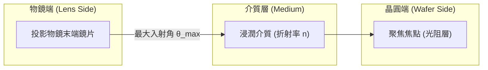

數值孔徑的物理極限取決於幾何光學與材料物理：
1. **乾式微影（Dry Lithography）的空氣限制**：在傳統微影中，介質為空氣或高純度氮氣（$n \approx 1.0$）。幾何上 $\theta_{\max}$ 不可能達到 $90^\circ$（這意味著透鏡直徑需為無限大且工作距離為零）。實務上，乾式系統透鏡設計極限通常在 $\sin\theta_{\max} \approx 0.93$，即乾式微影系統的 $\text{NA}$ 上限約為 $0.93$。
2. **介質折射率的突破（浸潤式技術）**：根據 $\text{NA} = n \sin\theta_{\max}$，若在鏡片與晶圓間注入高於空氣折射率的透明液體，光波在介質中的等效波長將縮減為 $\lambda_n = \lambda / n$。以 193 nm 紫外光為例，注入超純水（Ultra-pure Water, UPW，$n \approx 1.44$）後，使物鏡在維持相同幾何角度下將 $\text{NA}$ 推升至 $1.35$（具體架構見第 13 章）。

!!! warning "常見誤解：增大 NA 僅需把透鏡做大？"
    增加 $\text{NA}$ 不僅涉及透鏡口徑的物理放大與拋光極限，更會引發強烈的**偏振效應（Polarization Effects）**。當 $\theta_{\max}$ 超過 $45^\circ$（$\text{NA} > 0.7$）時，橫電波（TE, s-polarized）與橫磁波（TM, p-polarized）在焦點處的干涉行為產生分歧：p 偏振光的電場向量會相互抵消，大幅降低影像對比度（Contrast）。因此，高 $\text{NA}$ 系統必須導入偏振照明控制，嚴格限制非干涉偏振態的光通過。

---

### 景深（DOF）的推導：幾何光學與波動光學視角

晶圓在微影製程中並非絕對平整，沉積層的不均勻性、晶圓翹曲（Warpage）以及機台載台在高速掃描下的垂直移動誤差，皆要求成像系統具備縱向聚焦寬容度。景深（Depth of Focus, DOF）即指在成像對比度與線寬尺寸變化維持在工程可接受規格（通常為 CD 變動 $\le \pm 10\%$）範圍內，晶圓表面允許沿著光軸（縱向 $z$ 軸）偏移的最大距離區間。

#### 1. 幾何光學推導
在幾何光學中，將焦點前後光線發散形成的模糊斑稱為模糊圈（Circle of Confusion, $d_{\text{blur}}$）。設容許的模糊圈直徑與臨界尺寸成正比，即 $d_{\text{blur}} = c \cdot \text{CD}$。
光錐邊緣與光軸的夾角為 $\theta$，由光線發散幾何關係可知單側焦深公差 $\Delta z$ 滿足：

$$\tan\theta = \frac{d_{\text{blur}} / 2}{\Delta z}$$

在小角度近似下，$\tan\theta \approx \sin\theta = \frac{\text{NA}}{n}$。將 $d_{\text{blur}} \propto \text{CD} = k_1 \frac{\lambda}{\text{NA}}$ 代入：

$$\Delta z \approx \frac{c \cdot k_1 \frac{\lambda}{\text{NA}}}{2 \frac{\text{NA}}{n}} \propto n \frac{\lambda}{\text{NA}^2}$$

#### 2. 波動光學推導
波動光學從波前像差（Wavefront Aberration）的角度給予更精確的定義。當晶圓沿光軸由最佳焦平面偏移距離 $\Delta z$ 時，由光軸中心入射的中心光線（Chief Ray，$\theta = 0$）與物鏡邊緣入射的光線（Marginal Ray，夾角 $\theta$）之間會產生光程差（Optical Path Difference, OPD）：

$$\text{OPD} = n \Delta z (1 - \cos\theta)$$

利用泰勒展開式將餘弦項展開：$\cos\theta \approx 1 - \frac{\theta^2}{2} \approx 1 - \frac{\sin^2\theta}{2}$，代入光程差公式：

$$\text{OPD} \approx n \Delta z \left[ 1 - \left(1 - \frac{\sin^2\theta}{2}\right) \right] = n \Delta z \frac{\sin^2\theta}{2} = \frac{\Delta z \cdot \text{NA}^2}{2n}$$

根據瑞利四分之一波長法則（Rayleigh's Quarter-Wavelength Criterion），當成像系統的波前像差不超過四分之一波長（即相位誤差 $\le \pi/2$）時，成像品質可視為無顯著劣化：

$$\text{OPD} \le \frac{\lambda}{4} \implies \frac{\Delta z \cdot \text{NA}^2}{2n} \le \frac{\lambda}{4} \implies \Delta z \le \frac{n \lambda}{2 \text{NA}^2}$$

全焦深 $\text{DOF}$ 為光軸正負向位移的總合（$\text{DOF} = 2 \Delta z$），導入工程經驗因子 $k_2$，得到微影系統通用的景深公式：

$$\text{DOF} = k_2 \frac{\lambda}{\text{NA}^2}$$

其中 $k_2$ 為製程相關的景深因子，數值通常介於 $0.5$ 到 $1.0$ 之間，取決於光阻對比度、照明模式與光罩圖案密度。

---

### CD 與 DOF 的物理拉鋸：製程容許度的微縮挑戰

將瑞利解析度公式與景深公式並列分析，可清楚看見微影成像的核心物理矛盾：

$$\text{CD} \propto \frac{1}{\text{NA}}, \quad \text{DOF} \propto \frac{1}{\text{NA}^2}$$

若試圖透過提高物鏡數值孔徑 $\text{NA}$ 來縮減線寬，景深將以平方反比的速率劇烈萎縮。

| 參數維度 | 波長微縮途徑 ($\lambda \downarrow$) | 數值孔徑提升途徑 ($\text{NA} \uparrow$) |
| :--- | :--- | :--- |
| **解析度改善** ($\text{CD}$) | $\text{CD} \propto \lambda$（線性改善） | $\text{CD} \propto \frac{1}{\text{NA}}$（線性改善） |
| **景深劣化程度** ($\text{DOF}$) | $\text{DOF} \propto \lambda$（線性縮小） | $\text{DOF} \propto \frac{1}{\text{NA}^2}$（**平方加速惡化**） |
| **主要工程挑戰** | 全新光源研發、光學反射鏡與光罩材料更替 | 極大口徑物鏡鏡頭製造、超高平坦度研磨、極端焦點追蹤 |

這項物理拉鋸直接反映在製程容許度（Process Window）上。在半導體製程評估中，通常利用**博森曲線（Bossung Curves）**分析不同曝光能量（Exposure Dose）下，線寬隨焦點偏移量（Focus Offset）的變化曲線。

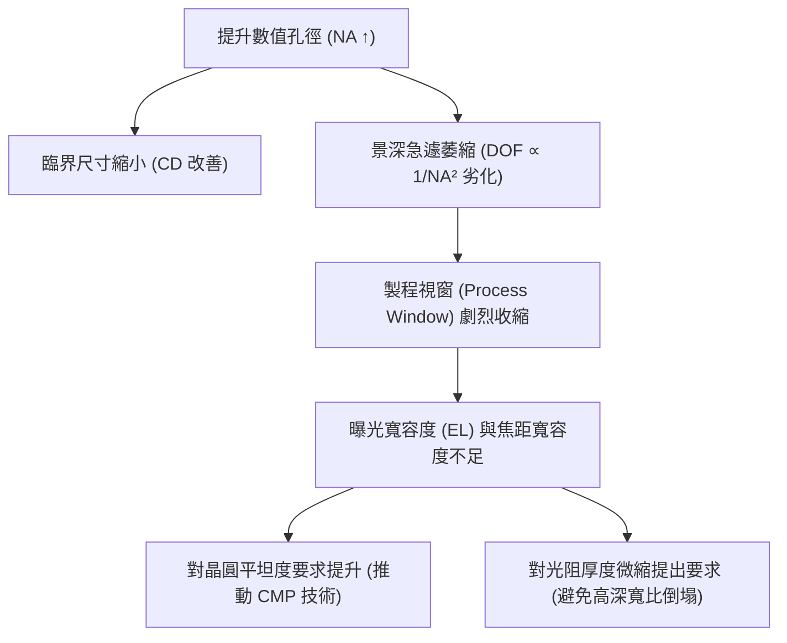

在 Bossung 曲線中，曲線平坦且間距穩定的區域構成可量產的製程視窗。由該視窗所定義的曝光寬容度（Exposure Latitude, EL）與景深範圍呈現互為消長的關係：
1. **焦點控制公差極限**：當乾式微影演進至 $\text{NA} = 1.35$ 的浸潤式微影時，實務上的可用 DOF 常已跌破 $100\text{ nm}$。在如此嚴苛的景深範圍內，晶圓表面任何奈米級的形貌起伏都會造成嚴重的散焦（Defocus），進而引發線寬變異甚至圖形斷裂。
2. **對薄膜沉積與平坦化的連帶影響**：微影景深的潰縮促使晶圓前段製程必須全面導入化學機械研磨（CMP，見第 24 章），將層間介電層（ILD）的局部平坦度控制在數十奈米以下。
3. **光阻薄層化趨勢**：由於焦點在光阻垂直深度內的有效覆蓋範圍變小，光阻厚度必須同步微縮；然而光阻變薄又會削弱其後續乾式蝕刻阻擋能力（見第 19 章），最終迫使業界導入多層光阻（Multilayer Resist）與硬遮罩（Hardmask）架構。

!!! example "產業實例：High-NA EUV 面臨的 DOF 危機"
    在極紫外光微影演進中，標準 0.33 NA EUV 系統跨入 0.55 High-NA EUV 時（系統技術細節見第 15 章），雖然解析度由約 $13\text{ nm}$ 突破至 $8\text{ nm}$，但其 $\text{DOF}$ 縮減幅度超過 $60\%$，可用焦點深度僅剩數十奈米。此物理限制迫使光學大廠導入「變形物鏡設計（Anamorphic Optics）」將特定方向放大倍率改為 8 倍以維持成像角度，且光阻塗布厚度必須壓低至 $20\text{ nm}$ 以下，正是瑞利準則中 CD 與 DOF 物理拉鋸下的工程妥協成果。

## 12.3 照明條件與離軸照明技術

### 12.3.1 同調性與部分同調因子

在光學微影系統中，照明光源並非完美的單色點光源，亦非完全無關聯的發散光源，而是處於兩者之間的「部分同調光」（Partially Coherent Light）。評估照明系統同調程度的核心物理參數為「部分同調因子」（Partial Coherence Factor），工程與學術界普遍以希臘字母 $\sigma$ 表示。

部分同調因子在幾何光學上定義為聚光鏡數值孔徑（Condenser Numerical Aperture, $\text{NA}_c$）與投影物鏡數值孔徑（Objective Numerical Aperture, $\text{NA}_o$）之比值：

$$\sigma = \frac{\text{NA}_c}{\text{NA}_o} = \frac{\sin \theta_c}{\sin \theta_o}$$

式中，$\theta_c$ 為照明光束射向光罩時的最大半孔徑角，$\theta_o$ 為物鏡在光罩端所能收集的最大光束半孔徑角。在光瞳面（Pupil Plane）的歸一化坐標系中，$\sigma$ 亦代表照明光瞳投影在投影物鏡進瞳（Entrance Pupil）上的相對半徑大小。

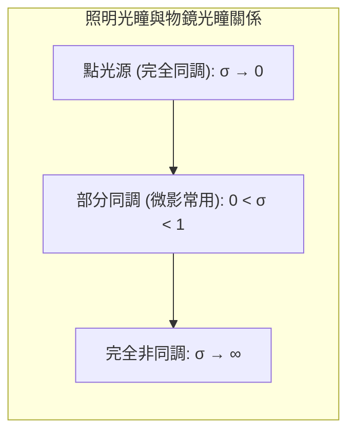

$\sigma$ 值的物理極限與對應特性如下：
1. **完全同調光（Coherent Illumination, $\sigma \to 0$）**：光源縮小為空間上的單一點光源，入射光為平行平面波。成像邊緣具有極高的對比度，但光學振盪現象（Ringing Artifacts，即吉布斯現象 Gibbs Phenomenon）顯著，且鄰近效應極度嚴重。
2. **完全非同調光（Incoherent Illumination, $\sigma \to \infty$）**：光源尺寸無限大，各點光源發出的波列互不干涉。其光學轉移函數（Optical Transfer Function, OTF）截止頻率雖高，但在高空間頻率下的調制度（Modulation）衰減極快，無法維持微細線路所需的對比度。
3. **部分同調光（Partially Coherent Illumination, 典型值 $0.3 \le \sigma \le 0.9$）**：微影機台採用的折衷設計。適度增大 $\sigma$ 值可抑制波前干涉產生的邊緣振鈴現象，並增加光通量（Throughput）；然而，過高的 $\sigma$ 會稀釋空中影像（Aerial Image）的最高對比度。

$\sigma$ 的選取直接影響影像邊緣陡峭度，常以歸一化影像對數斜率（Normalized Image Log-Slope, NILS）量化：

$$\text{NILS} = w \cdot \left. \frac{d \ln I(x)}{dx} \right|_{x = x_{\text{edge}}} = \frac{w}{I_{\text{th}}} \left. \frac{dI(x)}{dx} \right|_{x = x_{\text{edge}}}$$

式中，$w$ 為目標臨界尺寸（Critical Dimension, CD），$I(x)$ 為空間光強分布，$I_{\text{th}}$ 為光阻感光閾值光強。較高的 NILS 代表光阻邊界的光強梯度大，對曝光劑量誤差（Exposure Latitude）與焦點漂移具有更高的容忍度。

---

### 12.3.2 傳統照明的繞射限制

傳統照明（Conventional Illumination）指照明光瞳中心具有均勻圓形光強分布的光束，光罩的主入射角為零度（垂直入射）。依據恩斯特·阿貝（Ernst Abbe）的顯微成像理論，具有週期 $p$（空間頻率 $f = 1/p$）的線與空間（Lines and Spaces, L/S）光罩圖案，可視為穿透式繞射光柵。光束垂直入射時，繞射角 $\theta_m$ 滿足光柵方程式：

$$\sin \theta_m = m \frac{\lambda}{p} \quad (m = 0, \pm 1, \pm 2, \dots)$$

式中，$\lambda$ 為曝光波長，$m$ 為繞射階數。

垂直入射時，零階繞射光（$m = 0$）沿光軸直行（$\theta_0 = 0^\circ$），攜帶光罩圖案的平均光強資訊；正負一階繞射光（$m = \pm 1$）對稱分布於光軸兩側，攜帶空間頻率的週期資訊。物鏡光瞳必須同時收集到零階光與至少一個一階繞射光，光束在晶圓表面產生雙光束或三光束干涉，方能重構出週期性圖案的強度調制度。

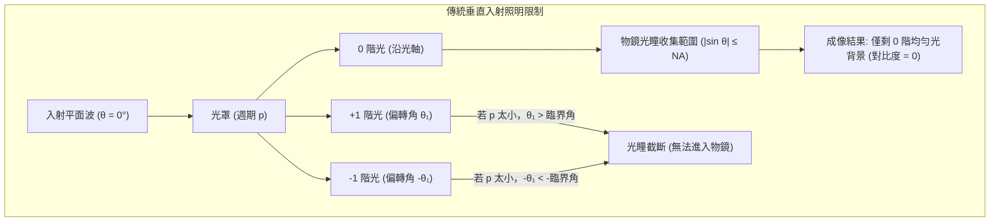

在完全同調垂直入射極限下，物鏡所能收集的最大孔徑角為 $\text{NA} = \sin \theta_{\max}$。若要保留 $\pm 1$ 階繞射光，必須滿足：

$$\sin \theta_{\pm 1} = \frac{\lambda}{p} \le \text{NA} \implies p_{\min} = \frac{\lambda}{\text{NA}}$$

對應的半週期解析度極限為 $R = p_{\min} / 2 = 0.5 \times (\lambda / \text{NA})$，即瑞利公式中 $k_1$ 因子的物理極限為 $0.5$。當圖案尺寸縮小至 $p < \lambda / \text{NA}$ 時，$\pm 1$ 階繞射光偏折角度過大而逸出物鏡孔徑外，進入物鏡的僅存零階繞射光，晶圓平面上只得到均勻光場分布，對比度降為零，無法完成微影成像。

---

### 12.3.3 離軸照明 (OAI) 原理與光學優勢

為了突破傳統垂直照明的空間頻率截止限制，離軸照明（Off-Axis Illumination, OAI）改變了照明系統的幾何路徑，迫使光線以特定的傾斜角 $\theta_{\text{in}}$ 入射至光罩表面。此時光柵方程式修正為：

$$\sin \theta_m - \sin \theta_{\text{in}} = m \frac{\lambda}{p}$$

若令照明入射角精確滿足 $\sin \theta_{\text{in}} = \frac{\lambda}{2p}$，則零階與正一階繞射光的出射角呈現完美的正負對稱：

$$\sin \theta_0 = -\sin \theta_{\text{in}} = -\frac{\lambda}{2p}$$

$$\sin \theta_{+1} = \frac{\lambda}{p} - \sin \theta_{\text{in}} = +\frac{\lambda}{2p}$$

此時，負一階與更高階繞射光由於角度過大被完全摒除於物鏡之外，成像過程轉變為純粹的「雙光束干涉」（Two-beam Interference）。

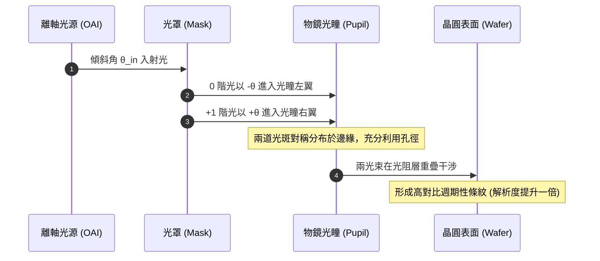

離軸照明技術的核心光學優勢體現在兩個維度：

#### 1. 解析度極限倍增 ($k_1$ 逼近理論下限 0.25)
因零階與一階光各自分擔一半的偏折量，物鏡僅需容納 $\lambda / (2p)$ 的孔徑範圍即可收集兩道光束：

$$\frac{\lambda}{2p} \le \text{NA} \implies p_{\min} = \frac{\lambda}{2\text{NA}}$$

此時最小可解析半週期為：

$$R_{\min} = \frac{p_{\min}}{2} = \frac{\lambda}{4\text{NA}} = 0.25 \frac{\lambda}{\text{NA}}$$

這意味著單重曝光下，離軸技術將理論的製程因子 $k_1$ 極限由 $0.50$ 推升至 $0.25$。

#### 2. 景深 (DOF) 的實質改善
在傳統垂直入射的三光束干涉中，零階光與 $\pm 1$ 階光在物鏡光瞳內的徑向位置截然不同（零階位於中心，$r=0$；一階位於邊緣，$r=\text{NA}$）。當系統出現焦點偏移（Defocus, $\Delta z$）時，波前光程差（Optical Path Difference, OPD）隨光瞳徑向坐標成平方關係展開：

$$\Delta \Phi \approx \frac{2\pi}{\lambda} \Delta z \cdot \frac{r^2}{2}$$

中心光束與邊緣光束的光程變化速率不一致，導致波前相位失真，空中影像的對比度迅速崩塌。

相反地，在對稱配置的雙光束 OAI 系統中，零階光與正一階光在光瞳面上距離光軸的徑向半徑完全相等（$|r_0| = |r_{+1}| = \frac{\lambda}{2p}$）。在焦點偏移 $\Delta z$ 時，兩束光經歷幾乎相同的波前光程變化：

$$\Delta \Phi_0(\Delta z) \approx \Delta \Phi_{+1}(\Delta z)$$

兩者之間的相對相位差對焦點漂移表現出極高的一階不敏感性，因此空中影像調制度在離焦狀態下衰減極慢，大幅擴展了緻密圖案的可用景深（Depth of Focus, DOF）。

---

### 12.3.4 常見 OAI 光瞳結構與圖案相依性

為了滿足晶片上不同方向與形態的圖形需求，工業界發展出多種離軸光瞳光強分布結構。光瞳幾何形狀決定了光源對特定方向空間頻率的調變能力。

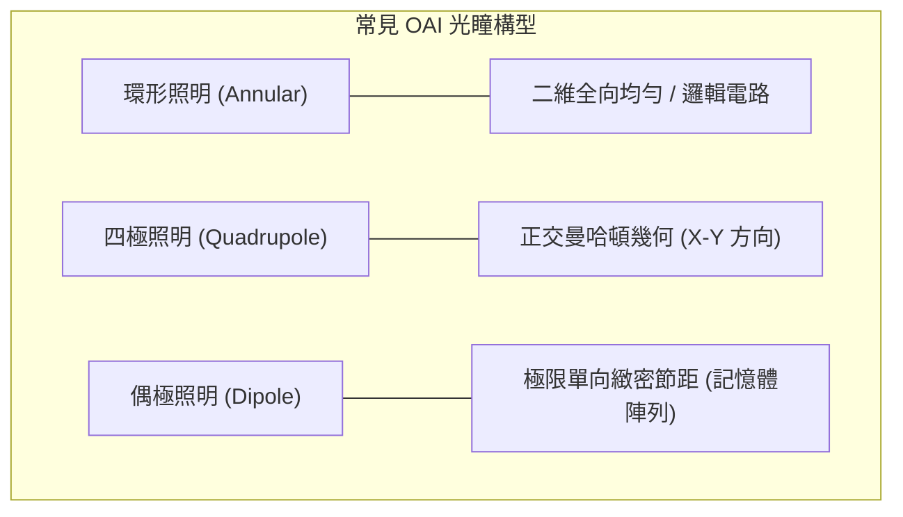

| 照明模式 | 光瞳形狀特徵 | 主要強化方向 | 緻密線（Dense）表現 | 孤立線（Isolated）表現 |
| :--- | :--- | :--- | :--- | :--- |
| **傳統照明 (Conventional)** | 實心圓形 ($\sigma_{\text{out}} \approx 0.6 \sim 0.8$) | 無方向性 | 差（高頻光斑落於光瞳外） | 優良（光譜低頻能量集中） |
| **環形照明 (Annular)** | 環狀同心圓 ($\sigma_{\text{in}} / \sigma_{\text{out}}$) | 二維任意角度均勻 | 中等 | 中等 |
| **四極照明 (Quadrupole)** | 四個分離極點（分佈於軸向或對角線） | 正交方向（$0^\circ$ 與 $90^\circ$） | 優良 | 差（低頻能量遭阻擋） |
| **偶極照明 (Dipole)** | 兩個對稱極點（沿 X 軸或 Y 軸分佈） | 極限單一方向（垂直於極點連線） | 極優（可達 $k_1 \approx 0.28$） | 極差（無法自發干涉） |

#### 1. 環形照明 (Annular Illumination)
以內半徑 $\sigma_{\text{in}}$ 與外半徑 $\sigma_{\text{out}}$ 界定透光環帶（典型配置如 $\sigma_{\text{in}}/\sigma_{\text{out}} = 0.55/0.85$）。由於保有圓對稱性，環形照明在 X、Y 及各斜向圖案上提供均勻的對比增益，是隨機邏輯電路（Random Logic）最常用的通用型離軸配置。

#### 2. 四極照明 (Quadrupole Illumination)
包含十字形四極（Cross-Quad）與旋轉 $45^\circ$ 的 Quasar 型。極點精確放置在與目標圖形幾何相關的空間頻率位置。對於遵循曼哈頓網格（Manhattan Grid，線路全數沿 X 或 Y 方向延伸）的積體電路，四極照明能同時最大化兩個正交維度的對比與景深。

#### 3. 偶極照明 (Dipole Illumination)
將光源能量高度濃縮於光軸兩側的兩塊微小區域。若偶極沿 X 軸排列，其對 Y 方向延伸的緻密垂直線條具有物理上最強的雙光束干涉強化效果，能將該方向的解析度推向單重曝光的極限；然而，其對平行於偶極排列方向（X 方向）的線路則完全缺乏離軸強化機制。偶極照明通常需配合雙重曝光技術（Double Patterning）或高度規則化的光罩設計架構。

!!! warning "禁制間距現象 (Forbidden Pitches)"
    離軸照明並非在所有圖案間距下均能帶來增益。當光罩包含從極致密到完全孤立的多種節距時，某些中等間距（Intermediate Pitches）的一階繞射光恰好落在物鏡光瞳的最外邊界處，或與零階光產生毀滅性干涉，導致影像對比度與景深急遽跌落至無法感光的程度。此特定無效節距區間稱為「禁制間距」（Forbidden Pitches）。在先進製程佈局設計中，必須透過設計規則檢查（Design Rule Check, DRC）強制禁止使用禁制節距，或在計算微影階段插入次解析度輔助圖案（Sub-Resolution Assist Features, SRAF，見第 16 章）以彌補光譜空缺。

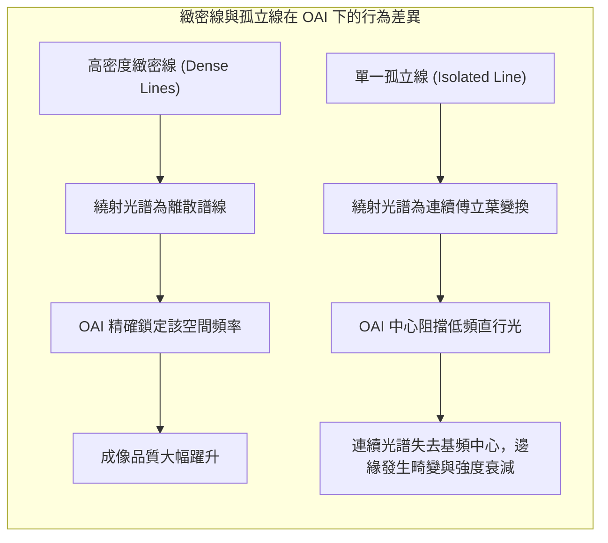

緻密線與孤立線的物理衝突在於：緻密線需要離軸照明將中心光束剝離並將高階光拉回光瞳以提升調制度；孤立線的空間頻率則由大量的低頻分量主導，強行抽離軸心低頻光會造成孤立線影像變形、對比度不足，並誘發顯著的「孤立-緻密尺寸偏差」（Iso-Dense Bias）。因此，在先進製程節點中，照明光源的設計已從固定幾何構型進化為光源-光罩協同優化（Source-Mask Optimization, SMO），動態計算出自由形態（Freeform）的最佳照明光瞳以平衡全晶片不同節距的製程裕度。

!!! example "產業實例：ASML FlexRay 可客製化照明技術"
    早期 DUV 微影機台更換照明模式需仰賴機械式光瞳光闌片（Aperture Stop/Blade），更換耗時且幾何形狀受限。現代先進浸潤式 ArF 微影機台（如 ASML Twinscan NXT 系列）導入「FlexRay」可程式化照明技術。該模組內部由數千顆微型可動反射鏡陣列組成，能在數秒內藉由改變微鏡角度動態調配光瞳面上的能量分布，產生自由形態（Freeform）光源。製程工程師可針對特定晶片層的繞射圖譜，客製化產出兼顧緻密陣列與周邊隨機邏輯的專屬 OAI 光強分布，將成像系統的整體製程視窗（Process Window）最大化。

<!-- fig:1 -->
<figure markdown>
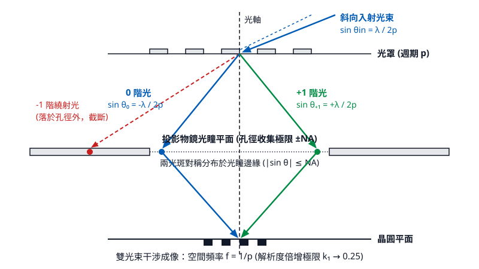
<figcaption>圖 12-1　離軸照明繞射光學路徑（AI 繪製的示意圖）</figcaption>
</figure>

## 12.4 解析度提升技術總覽與波前工程

### 單次曝光的理論極限：k1 因子 0.25 的物理屏障

在光學微影技術中，極限解析度由瑞利準則（Rayleigh criterion）決定：

$$\text{CD} = k_1 \frac{\lambda}{\text{NA}}$$

其中 $\text{CD}$ 為臨界尺寸（Critical Dimension），$\lambda$ 為曝光光源波長，$\text{NA}$ 為投影物鏡系統的數值孔徑（Numerical Aperture），而 $k_1$ 為表徵微影製程能力的無因次因子（Process Factor）。

根據恩斯特·阿貝（Ernst Abbe）的微觀光學成像理論，影像的形成本質上是物鏡瞳孔（Pupil）收集樣品（光罩）所產生的繞射光束，並在成像平面（晶圓光阻層）重新干涉重組的過程。若光學系統僅收集到單一繞射階（例如僅通過透鏡中央的 0 階未繞射光），成像平面將僅有一致的背景光強，無法形成任何空間強度明暗對比（Contrast）。因此，在晶圓表面重建空間週期性影像的絕對充要條件為：**系統至少必須捕捉到兩個繞射階（例如 0 階與 $+1$ 階，或 0 階與 $-1$ 階）進行雙光束干涉（Two-beam interference）**。

考慮一個週期性密集線對（Dense lines/spaces），其節距為 $P$（$P = 2 \times \text{CD}$）。當照明光垂直入射光罩時，其一階繞射角 $\theta_1$ 符合繞射公式：

$$\sin\theta_1 = \frac{\lambda}{P}$$

在傳統垂直正入射的對稱配置下，若要物鏡同時收集 0 階光以及 $\pm 1$ 階繞射光，繞射角不能超出透鏡的最大收集角，即 $\sin\theta_1 \le \text{NA}$，由此導出的最小可分辨節距為 $P_{\min} = \frac{\lambda}{\text{NA}}$，對應的半節距臨界尺寸為 $\text{CD}_{\min} = \frac{\lambda}{2 \cdot \text{NA}}$，此時 $k_1 = 0.5$。

若導入極限的離軸照明（Off-Axis Illumination, OAI，詳見 12.3 節），使照明光束以物鏡邊緣的極限角度 $\theta_{\text{in}}$（$\sin\theta_{\text{in}} = \text{NA}$）斜向入射光罩，此時 0 階光剛好擦過物鏡瞳孔的一側邊緣進入系統。為了形成干涉，其 $-1$ 階繞射光最多可容許偏折至物鏡瞳孔的另一側極限邊緣（$\sin\theta_{-1} = -\text{NA}$）。此時繞射空間頻率的極限為：

$$\Delta \sin\theta = \sin\theta_{\text{in}} - \sin\theta_{-1} = \text{NA} - (-\text{NA}) = 2\text{NA}$$

根據繞射公式 $\Delta \sin\theta = \frac{\lambda}{P}$，在單次曝光與線型光學系統下，理論最小物理節距為：

$$P_{\min} = \frac{\lambda}{2\text{NA}}$$

對應的單一線寬極限為半節距（Half-pitch）：

$$\text{CD}_{\min} = \frac{P_{\min}}{2} = \frac{\lambda}{4\text{NA}} = 0.25 \frac{\lambda}{\text{NA}}$$

由此可知，$k_1 = 0.25$ 是光學微影單次曝光的理論截止物理屏障（Cutoff limit）。當 $k_1 < 0.25$ 時，繞射角過大導致任何高階繞射光均無法落入物鏡瞳孔內，空間調變對比度（Modulation Transfer Function, MTF）嚴格降至零。為了使實際製程逼近此一物理邊界，必須引入波前工程（Wavefront Engineering）與各類解析度提升技術（Resolution Enhancement Technologies, RET）。

---

### 相位移光罩（PSM）原理與相消干涉機制

傳統二元光罩（Binary Intensity Mask, BIM）是由透明石英基板（Quartz）與局部沈積的不透光鉻金屬遮光層（Chromium）所構成。光波穿透相鄰兩開口時，其出射波前的電場相位均為 $0^\circ$（同相）。

當光罩圖案尺寸縮小至接近波長時，光線通過開口會產生強烈的繞射擴散。兩個鄰近開口的繞射電場在晶圓表面的重疊區，其電場振幅同向相加：

$$E_{\text{total}}(x) = E_1(x) + E_2(x)$$

其光強分佈 $I(x) = |E_{\text{total}}(x)|^2$ 在兩開口幾何中心處無法降至零，形成明顯的背景殘留光強，如圖 12-1 所示。這導致空間影像對比度大幅劣化，使得光阻無法清晰顯影出彼此分離的線條。

相位移光罩（Phase Shift Mask, PSM）的基本物理機制，在於主動調控光罩上不同空間區域的光電場相位。透過在相鄰透光開口處引入 $\Delta \phi = 180^\circ$（$\pi$ 弧度）的相位差，穿透兩開口的繞射電場在中央過渡區域形成大小相等、符號相反的電場向量（$E_1(x) = -E_2(x)$）。由於電場為一連續函數，其振幅在兩區域邊界處必須穿過零點：

$$E_{\text{total}}(x_{\text{center}}) = E_1(x_{\text{center}}) + E_2(x_{\text{center}}) = E_0 - E_0 = 0$$

根據強度公式 $I = |E|^2$，幾何中心點的光強被強制鎖定為絕對零值。這種完全相消干涉（Destructive Interference）顯著陡峭化了圖案邊緣的光強梯度（Image Log-Slope），大幅拉升成像對比度，抑制鄰近效應所引起的線條黏合。

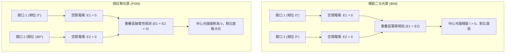

---

### 交替型（Alt-PSM）與衰減型（Att-PSM）之結構與分析

在半導體工業實作中，依據相位調變深度與材料特性，主要分為交替型相位移光罩與衰減型相位移光罩兩類。

#### 交替型相位移光罩（Alternating PSM, Alt-PSM）

交替型相位移光罩（又稱 Levenson PSM）主要應用於週期性極密集的線條與間距（Line/Space）。其物理結構是在相鄰的透光石英區域中，利用乾式反應性離子蝕刻（RIE）交替挖除特定深度的石英基板。

若石英材料在曝光波長 $\lambda$ 下的折射率為 $n$，環境介質（空氣）的折射率為 1，當光程差滿足半波長的奇數倍時，穿透蝕刻區與未蝕刻區的光束即產生 $180^\circ$ 的相位差。蝕刻深度 $d$ 必須精確滿足以下關係：

$$\Delta \phi = \frac{2\pi}{\lambda} (n - 1) d = \pi \implies d = \frac{\lambda}{2(n - 1)}$$

*典型值*：對於 ArF 準分子雷射光源（$\lambda = 193\text{ nm}$），石英玻璃的折射率 $n \approx 1.56$，計算可得蝕刻深度典型值約為：

$$d \approx \frac{193\text{ nm}}{2(1.56 - 1)} \approx 172.3\text{ nm}$$

在空間頻譜上，Alt-PSM 產生的電場在空間上呈現均勻正負交替。因此，其電場的週期實質上擴大為圖案幾何週期的兩倍（$2P$）。根據傅立葉光學分析，電場的基頻分量不再具有 0 階未繞射分量，其繞射光譜對稱分佈在 $\pm 1$ 階。換言之，Alt-PSM 自然消除了 0 階直射光，使光能完全集中於產生有效干涉的繞射階次，從而能夠以極低的 $k_1$（逼近 0.25）穩定成像。

然而，Alt-PSM 存在先天拓撲限制：在任意形狀的積體電路幾何佈局中，三維閉合迴路無法使用兩種相位完成無衝突的二著色（Phase Conflict / Topological Deadlock）。此外，在相位反轉交界的暗線邊緣往往會產生非預期的殘留暗條紋，因此製程上通常需要進行雙重曝光，搭配第二道修整光罩（Trim Mask）將無效暗區移除，顯著提高了光罩製造週期與製造成本。

#### 衰減型相位移光罩（Attenuated PSM, Att-PSM）

衰減型相位移光罩（又稱半調相位移光罩，Halftone PSM）是目前工業界應用最廣泛的技術。Att-PSM 捨棄了對石英基板的深溝蝕刻，而是將光罩上的不透光純鉻層改以極薄的半透明材料取代。工業上最常見的移相層材料為矽化鉬化合物（$\text{MoSiON}$ 或 $\text{MoSi}$）。

該材料層經過化學計量比與厚度的嚴格調控，使其在特定波長下滿足兩個關鍵光學條件：
1. **光振幅相位反轉**：光穿透該薄膜時，產生的相位延遲相較於穿透空氣的區域恰為 $180^\circ$。
2. **光強度部分穿透**：控制材料對光強度的穿透率（Transmittance, $T$）維持在很低的比例，典型值為 $6\%$ 或 $18\%$（$T = |E_{\text{att}} / E_0|^2$）。

以 $6\%$ 穿透率的 Att-PSM 為例，穿透半透明區的電場振幅為負值（反相）：

$$E_{\text{att}} = -\sqrt{0.06} \, E_0 \approx -0.245 \, E_0$$

在圖案的幾何邊緣，來自全透光開口（$E = +1.0$）的側向繞射光波，與半透光區洩漏的微弱反相光（$E \approx -0.245$）產生局部相消干涉。這抑制了圖案邊界的光暈（Flare-like blur），大幅提升幾何輪廓邊緣的光強對比斜率。由於非圖案區域的光強僅有原入射光的 $6\%$，該強度低於光阻劑的感光閾值（Threshold Energy, $E_{\text{th}}$），因此在主開口感光的同時，大面積的半透光區域並不會引起光阻交聯或分解。

| 特性比較項目 | 交替型相位移光罩 (Alt-PSM) | 衰減型相位移光罩 (Att-PSM) |
| :--- | :--- | :--- |
| **結構機制** | 局部蝕刻石英基板 $d = \frac{\lambda}{2(n-1)}$ | 單一圖案化半透明移相層（如 $\text{MoSiON}$） |
| **相移區穿透率** | $100\%$ | 典型值 $6\%$ 或 $18\%$ |
| **繞射頻譜特性** | 完全消除 0 階直射光，僅 $\pm 1$ 階干涉 | 仍保留 0 階光，但在幾何邊界相消干涉 |
| **解析度極限** | 極高（$k_1$ 可逼近 0.25） | 中等（改善密集與孤立圖案邊緣對比） |
| **主要缺點** | 存在相位衝突問題、需要額外 Trim 光罩 | 高透光率時易出現副瓣效應（Side Lobe） |
| **主要適用佈局** | 高密度週期性記憶體陣列（SRAM、DRAM 節距）| 隨機邏輯閘（Logic Gates）、接觸孔（Contact Holes）|

!!! warning "衰減型相位移光罩的副瓣效應（Side Lobe Effect）"
    當使用 $18\%$ 等較高穿透率的 Att-PSM 時，若相鄰孔徑的間距恰好使半透明背景區各處滲漏的光束發生同相疊加干涉，該位置的光強度可能突破光阻的感光閾值，在晶圓上產生非設計預期的凹痕或破洞，稱為副瓣效應。在光罩資料準備（Mask Data Preparation）時，必須透過佈局檢查軟體預先識別此風險區域並補加不透光的鉻金屬阻擋層（Cr-shield）。

---

### 光學鄰近效應修正（OPC）概述

當特徵尺寸縮小並落入次波長尺度（Sub-wavelength regime，例如使用波長 $193\text{ nm}$ 的光源曝光小於 $65\text{ nm}$ 的圖案），成像系統表現出強烈的非線性空間低通濾波特性。光罩上原本具有銳利邊角的多邊形幾何圖形，經物鏡瞳孔截斷高頻繞射成分後，投射在晶圓上的光學強度輪廓會產生嚴重畸變，稱為光學鄰近效應（Optical Proximity Effect, OPE）。

常見的幾何失真現象包括：
1. **線端縮短（Line-end shortening）**：由於二維端點高頻繞射光的流失，長條形線條兩端在曝光顯影後長度嚴重退縮，可能導致接觸孔無法完全對準覆蓋（Landing failure）。
2. **角落圓角化（Corner rounding）**：直角區域包含無限大的二維空間頻率，受孔徑截斷影響，晶圓上的直角特徵全數退化為平滑圓角。
3. **孤立-密集尺寸偏差（Iso-Dense Bias, IDB）**：相同設計線寬的線條，置於密集排列環境與單獨孤立環境時，因周圍繞射光干涉增強的程度不同，在晶圓表面量測到的實際臨界尺寸出現顯著差異。

光學鄰近效應修正（Optical Proximity Correction, OPC）的核心物理思想，是將光學投影系統視為一個已知的數學正向傳遞運算元 $\mathcal{F}_{\text{optics}}$。為了在晶圓成像平面獲得合乎設計規範的目標圖案 $I_{\text{target}}(x, y)$，設計者必須逆向求解，主動在光罩多邊形邊界上預先施加幾何形變補償 $M_{\text{mask}}(x, y)$，使失真後的波前在空間疊加後反向重構出目標形狀。

實務上的修正手段包含：
* **線端延伸與狗骨狀補償（Dog-bone / Hammerheads）**：在線條端點額外增加局部對稱方塊，提供光能補償以抵抗線端退縮。
* **襯線（Serifs）**：在凸角加入外擴微小矩形，或在凹角挖除方形，藉以補償二維高頻光強度的不足。
* **次解析度輔助特徵（Sub-Resolution Assist Features, SRAF）**：在孤立主特徵圖案兩側，平行加入寬度極窄、小於系統解析極限的長條狀輔助鉻條。SRAF 本身因尺寸過小無法在晶圓上感光成像，但其產生的繞射波前能與主特徵的繞射波前干涉，使孤立圖案的光學環境偽裝成密集線條環境，進而大幅擴展主特徵在失焦時的景深（Depth of Focus, DOF）與製程容忍度（Process Window）。

有關模型導向光學鄰近效應修正（Model-Based OPC）演算法與反向微影技術（Inverse Lithography Technology, ILT）的數值計算細節，將於第 16 章深入討論。

---

### 高 NA 條件下的偏振光效應

在傳統標量繞射理論（Scalar Diffraction Theory）中，光波被簡化為純量場，光電場的振盪方向被忽略。此假設僅在數值孔徑較小（$\text{NA} < 0.6$）時成立，此時晶圓表面入射光線的匯聚半角 $\theta$ 很小（$\sin\theta = \text{NA} / n \ll 1$），所有光線幾近垂直射入光阻層。

當微影技術跨入深紫外光浸潤式系統（ArFi）時，以純水為介質（折射率 $n = 1.44$），物鏡孔徑數值達到 $\text{NA} \ge 1.2 \sim 1.35$，此時光線射入光阻介質的最大入射角可突破 $60^\circ$。在這種大角度干涉（Large-angle interference）條件下，電場的空間指向性發揮決定性作用，光學成像必須採用馬克士威方程組進行向量繞射理論（Vector Diffraction Theory）分析。

考慮兩束具有相同波長、在同一平面內以夾角 $2\theta$ 匯聚並產生干涉的單色平面波：

#### 1. 垂直偏振態（s-偏振 / TE 模態）
電場向量振盪方向垂直於入射平面（橫向電場，Transverse Electric）。兩束光的電場方向均垂直於圖紙表面，其向量方向完全平行：

$$\mathbf{E}_{1} \parallel \mathbf{E}_{2} \implies \mathbf{E}_{1} \cdot \mathbf{E}_{2} = |\mathbf{E}_{1}||\mathbf{E}_{2}|$$

其干涉疊加項完全不受光線匯聚角度 $\theta$ 的影響，其影像空間強度分佈的干涉調變對比始終維持在理論極限：

$$I_{\text{TE}}(x) \propto |E_1|^2 + |E_2|^2 + 2 |E_1||E_2| \cos(\Delta \phi)$$

#### 2. 平行偏振態（p-偏振 / TM 模態）
電場向量振盪方向平行於入射平面（橫向磁場，Transverse Magnetic）。此時，兩束入射光的電場向量方向不再平行，彼此存在一個等於兩倍入射角的相對夾角（夾角為 $2\theta$），電場內積展開為：

$$\mathbf{E}_{1} \cdot \mathbf{E}_{2} = |\mathbf{E}_{1}||\mathbf{E}_{2}| \cos(2\theta)$$

此時空間總光強分佈變為：

$$I_{\text{TM}}(x) \propto |E_1|^2 + |E_2|^2 + 2 |E_1||E_2| \cos(2\theta) \cos(\Delta \phi)$$

干涉調變項乘上了角度因子 $\cos(2\theta)$。此物理因子對影像對比度造成致命衝擊：
* 當匯聚夾角使光線在介質中的入射角 $\theta = 45^\circ$ 時，$2\theta = 90^\circ$，此時 $\cos(2\theta) = 0$。兩束 p-偏振光在空間中完全失去互相干涉的能力，其在晶圓上的強度表現為無調變的純背景直流光，影像對比度衰減至零。
* 當入射角 $\theta > 45^\circ$ 時，$\cos(2\theta) < 0$。干涉項反轉為負值，原本設計為亮紋的位置變成暗紋，原本應為暗紋的幾何位置反而變亮，產生影像反相（Contrast inversion），徹底破壞光阻圖案的形成。

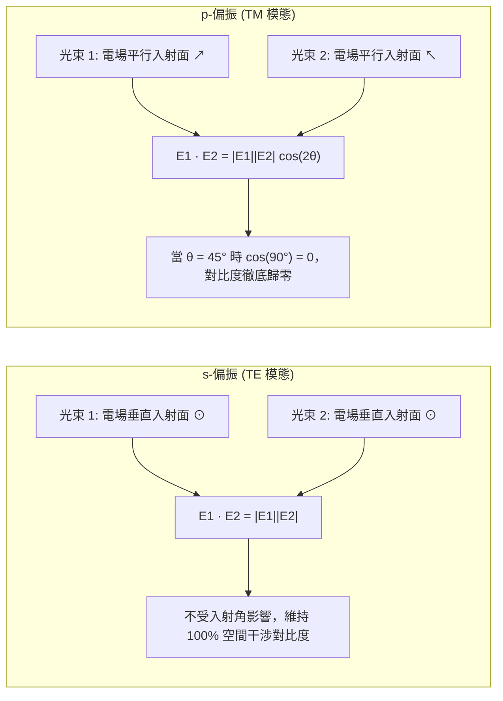

除了晶圓表面的向量干涉損失外，光線射入光阻薄膜介面時，s-偏振與 p-偏振的菲涅耳穿透係數與反射係數（Fresnel Coefficients）亦存在巨大差異，導致多重薄膜反射干涉條紋產生偏振相依性。

為了在高 NA 環境下維持足夠的正規化影像對數斜率（Normalized Image Log-Slope, NILS），現代高階 DUV 浸潤式機台均全面配置偏振照明控制器。針對線條圖案的方向性，照明光瞳會主動轉化為偏振態分佈，例如針對週期性線條採用切向偏振（Tangential Polarization）或方位偏振（Azimuthal Polarization）。此類工程控制確保所有通過照明孔徑繞射的光線，在晶圓表面匯聚干涉時，均以 TE 模態（s-偏振）進行耦合，藉此在 $k_1$ 逼近理論極限的同時，維持足夠的微影成像寬容度。

<!-- fig:2 -->
<figure markdown>
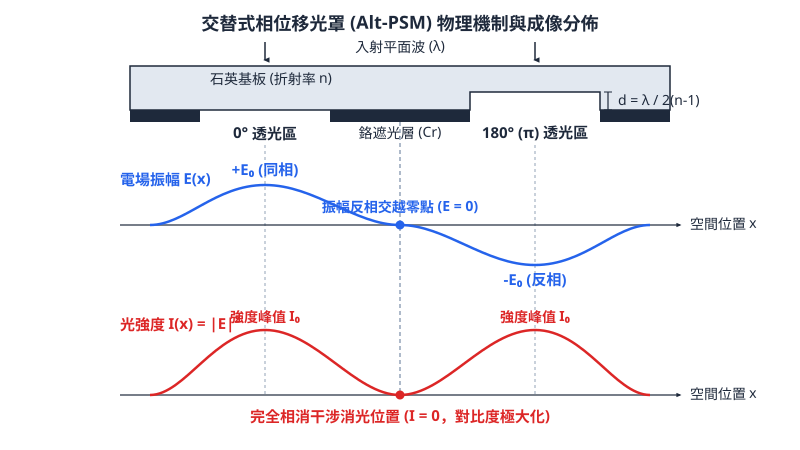
<figcaption>圖 12-2　交替式相位移光罩原理（AI 繪製的示意圖）</figcaption>
</figure>

## 12.5 設備與廠商技術

### 12.5.1 微影曝光機關鍵子系統架構

微影曝光機（Photolithography Scanner）是半導體前段製程中機構複雜度與整合精準度最高的量產設備。其主要功能在於將光罩（Reticle / Mask）上的電路幾何圖案，透過投影透鏡組以高保真度縮小成像至覆蓋有光感應材料的晶圓表面。典型的微影曝光機主要由以下五個關鍵子系統組成：

1. **照明系統（Illumination System）**：包含光源介面、光束整形單元（Beam Delivery and Shaping System）、光瞳整形模組（Pupil Shaping Unit）及視野光圈（Field Stop）。該系統負責提供光譜線寬極窄、空間同調性與均勻度受控的曝光光束，並支援傳統照明、環形照明或偶極/四極照明等離軸照明（Off-Axis Illumination, OAI）模式設定。
2. **光罩傳送與定位模組（Reticle Stage System）**：承載光罩進行高速、高加速度往復運動，並配置多軸雷射干涉儀與光學編碼器，以達到次奈米等級的即時位置閉迴路控制。
3. **投影物鏡系統（Projection Optics Box, POB）**：作為縮小成像的核心元件，通常具備 $4:1$ 的幾何縮小倍率，由多組超高精度光學鏡片或多層膜反射鏡所構成。
4. **晶圓掃描平台（Wafer Stage System）**：承載晶圓並實現六個自由度（$X, Y, Z, \theta_x, \theta_y, \theta_z$）的超精密動態運動，需具備高剛性、高阻尼特性以抵抗高速掃描下的慣性衝擊。
5. **對準與水平感測系統（Alignment and Leveling Sensors）**：包含光學繞射對準感測器與多通道光學水平感測器（Leveling Sensor），負責在曝光前與掃描過程中動態量測晶圓平整度拓撲與各層間的圖案重合度。

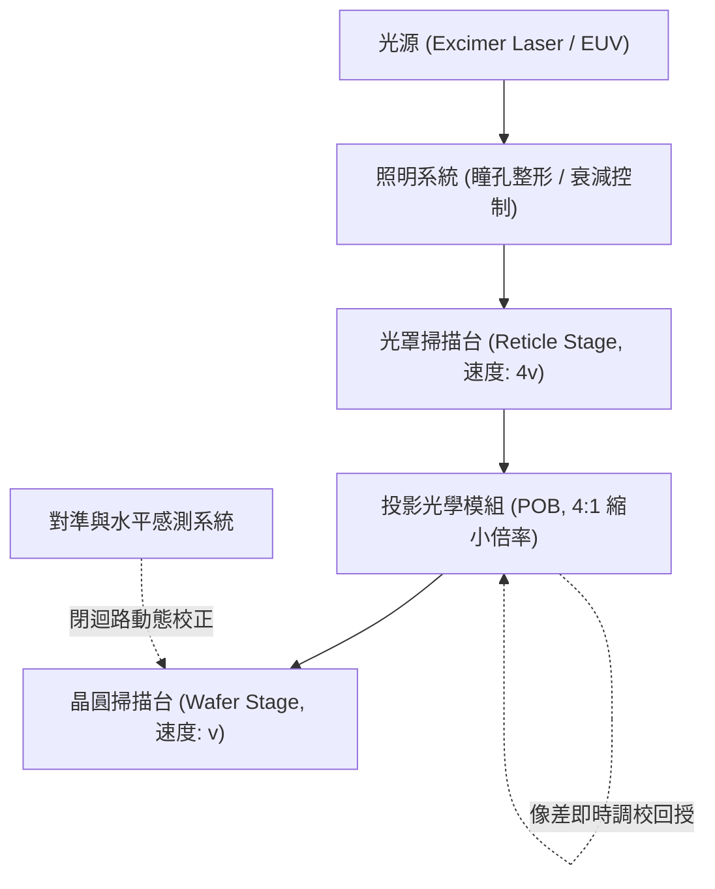

#### 步進機與掃描機成像機制

早期光學微影採用步進重複機（Step-and-Repeat Stepper），光學鏡頭視野（Field of View, FOV）必須涵蓋整個曝光視場（例如 $22\text{ mm} \times 22\text{ mm}$ 的正方形區域），曝光期間晶圓與光罩皆靜止。然而，透鏡口徑隨著 NA 提升急遽膨脹，靜態大視場邊緣的波前向差極難校正。

現代量產機台全面轉向步進掃描機（Step-and-Scan System）。掃描機使用狹縫（Slit，典型尺寸為晶圓端 $26\text{ mm} \times (5\sim8)\text{ mm}$）對光罩進行動態連續掃描。狹縫長邊橫跨曝光場寬度，短邊為掃描方向。在 $4:1$ 縮小成像系統中，光罩平台移動速度 $v_R$ 與晶圓平台移動速度 $v_W$ 必須滿足動態同步條件：

$$v_R(t) = 4 \cdot v_W(t)$$

光罩台與晶圓台以反向（或同向，依物鏡內部反相成像次數而定）等速移動。掃描模式將光學透鏡所需的等暈區（Isoplanatic Patch）限制在狹縫範圍內，大幅降低了離軸像差校正難度，同時利用動態掃描的積分效應，平均化了掃描方向上的光強度不均勻性與局部靜態像差。

在高速掃描過程中，平台的動態軌跡誤差被分解為移動平均誤差（Moving Average, MA）與移動標準差（Moving Standard Deviation, MSD）。MA 直接轉化為圖案位置的靜態偏移（Overlay Error），而高頻微振動引起的 MSD 則會導致空間影像邊界模糊，等效於調變轉換函數（MTF）下降，造成晶圓端臨界尺寸（Critical Dimension, CD）均勻性劣化。

---

### 12.5.2 投影物鏡光學架構：折射式與反射折射式

投影物鏡的設計架構取決於工作波長 $\lambda$ 與數值孔徑 $\text{NA} = n \sin\theta$ 的物理限制。

```
折射式架構 (Refractive):
  光罩 ──[ 透鏡組 L1 ]──[ 透鏡組 L2 ]──[ 透鏡組 L3 ]── 晶圓
  特點：全透光設計，軸對稱，NA 增加時透鏡厚度與色差劇增

反射折射式架構 (Catadioptric):
  光罩 ──[ 折射透鏡 ]──[ 分光鏡/偏折鏡 ]──[ 凹面反射鏡 ]──[ 透鏡組 ]── 晶圓
  特點：利用凹面鏡提供正光學倍率且色差為負，有效抵消玻璃色差，支援 NA > 1.0
```

#### 折射式（Refractive / Dioptric）系統
全折射式物鏡完全由透光透鏡組成，具有共軸對稱、機械封裝穩定度高的優點，廣泛應用於乾式 DUV 曝光機（$\text{NA} \le 0.93$）。然而，在 193 nm 深度紫外光（DUV）波段，光學玻璃材料的選擇極為有限，主要依賴高純度熔融石英（Fused Silica, $\text{SiO}_2$）與單晶氟化鈣（$\text{CaF}_2$）。由於石英在 193 nm 處色散顯著（$\text{d}n/\text{d}\lambda \approx -1.5 \times 10^{-3}\text{ nm}^{-1}$），若光源雷射光譜線寬（FWHM）未壓抑至次皮米（sub-pm）等級，將引發嚴重的色像差（Chromatic Aberration）。藉由在光路中配置正負屈光度配合、熱光學係數相反的 $\text{CaF}_2$ 與 $\text{SiO}_2$ 複合鏡片組，可實現色差校正。

#### 反射折射式（Catadioptric）系統
當浸潤式技術（見第 13 章）將 NA 推升至 $1.0$ 以上（最高達 $1.35$）時，折射式透鏡為維持邊緣光線的偏折角，鏡片曲率半徑過小且邊緣厚度暴增，導致光能吸收過大與製造難度失控。反射折射式系統導入了凹面反射鏡（Concave Mirror）。凹面鏡具有兩項關鍵優點：
1. 本身不產生任何色差。
2. 其皮茲瓦爾曲率（Petzval Curvature）符號與正折射透鏡相反，能以緊湊結構補償全系統的場曲。

反射折射式系統通常採用偏折稜鏡、半透半反分光鏡或離軸偏軸瞳孔結構，引導光線經凹面鏡聚焦後再經折射鏡片組投影至晶圓，有效壓縮了光學元件的實體尺寸，是高數值孔徑 DUV 浸潤式曝光機的核心架構。

---

### 12.5.3 波前像差與任尼克多項式線上調校

實際光學系統由於透鏡表面加工公差、裝配應力、光學元件材料不均質性，以及高能量雷射照射引發的熱吸收（Lens Heating Effect），其實際波前（Actual Wavefront）必與理想球面波前存在偏差。波前像差函數 $W(\rho, \theta)$ 定義為出射瞳孔面上實際波前與理想無像差波前之間的光程差（Optical Path Difference, OPD）。

#### 任尼克多項式展開
在單位圓瞳孔座標 $(\rho, \theta)$ 系統下（$0 \le \rho \le 1, 0 \le \theta < 2\pi$），波前像差通常展開為圓域正交的任尼克多項式（Zernike Polynomials）級數：

$$W(\rho, \theta) = \sum_{j=1}^{\infty} Z_j \cdot R_n^m(\rho) \cdot \Theta(m\theta)$$

其中 $Z_j$ 為第 $j$ 項任尼克係數（通常以奈米或波長分數表示），$R_n^m(\rho)$ 為徑向多項式，$\Theta(m\theta)$ 為三角函數方位角項。任尼克各項多項式對應到特定的幾何像差類別：

* $Z_1$：活塞平移（Piston），表示整體相位偏移。
* $Z_2, Z_3$：$X/Y$ 傾斜（Tilt），對應空間影像的整體側向位移（圖案失真）。
* $Z_4$：離焦（Defocus），表示聚焦點沿光軸的位移，表徵最佳焦距漂移。
* $Z_5, Z_6$：初級散光（Astigmatism，第三階），造成垂直與水平線寬（H-V CD Bias）在焦點深度上的不對稱。
* $Z_7, Z_8$：初級彗差（Coma，第三階），破壞像場空間反稱性，導致密集線條陣列邊緣的圖案不對稱或左右位移。
* $Z_9$：初級球差（Spherical Aberration，第三階），光軸不同半徑處的光線聚焦點不一致，導致最佳焦距隨特徵尺寸大小（Pitch）漂移。

#### 即時鏡頭調校技術（Active Optics Control）
曝光過程中，投影鏡頭吸收深紫外光光子能量，鏡片產生局部的溫度梯度，進而透過熱光效應（$\text{d}n/\text{d}T$）與熱膨脹改變局部的折射率分佈與鏡片曲率，引發隨曝光時間累積的動態像差。為維持微影繞射極限，現代曝光機物鏡內部配置了主動調校機構：

1. **壓電致動器（Piezoelectric Actuators）**：安裝於特定鏡片的邊緣懸吊點，可在次微米級精度下推拉鏡片，引入微小形變或傾斜以抵消非對稱彗差與散光。
2. **多軸可動鏡組（Manipulator Lenses）**：藉由精密步進馬達沿光軸平移單個鏡片，動態補償球差與放大率誤差。
3. **分區熱補償控制器**：在透鏡周圍配置環形或分區電阻加熱絲，或是透過紅外線雷射主動補償非曝光區的溫差，維持旋轉對稱的熱場，壓抑非對稱波前形變。
4. **密封腔體氣壓調節**：透鏡元件間的氣室充入高導熱的純氮氣或氦氣，藉由動態微調腔體內絕對氣壓以改變氣體折射率，達成系統等效焦距與球差的高速修正。

---

### 12.5.4 曝光機廠商技術特點與產業評估

微影曝光設備製造涉及光學極限加工、極高真空/流體力學控制、精密次奈米機電整合與感測演算法。全球前段微影曝光設備市場呈現高度專業化的競爭格局。

| 廠商 | 代表產品系列 | 技術路線與特點 | 主要應用 |
| :--- | :--- | :--- | :--- |
| **ASML** | TWINSCAN NXT | 雙工件台（Dual-stage）架構；反射折射式浸潤物鏡（NA 1.35）；磁浮驅動平台與閉迴路繞射對準感測 | 高階 DUV 浸潤式微影（邏輯多重圖案化、先進 DRAM 關鍵層） |
| **ASML** | TWINSCAN NXE | 0.33 NA 反射式全光學系統（莫茲托夫物鏡架構）；雷射激發電漿（LPP）光源；氫氣環境維持鉬矽多層膜壽命 | 先進邏輯與記憶體 EUV 單次曝光關鍵層（見第 14 章） |
| **ASML** | TWINSCAN EXE | 0.55 High-NA EUV；變形物鏡（Anamorphic Optics，縮小倍率 $4\times / 8\times$）；次奈米動態控制平台 | 次 2 奈米世代超先進邏輯與高密度記憶體（見第 15 章） |
| **Nikon** | — | 採用全折射式與反射折射式投影光學；專注於區域局域浸潤控制技術；高剛性平台導引機制 | DUV 乾式/浸潤式量產線，記憶體與成熟/特殊邏輯製程 |
| **Canon** | — | 採用折射式光學系統；聚焦於超高良率步進機與掃描機；開發奈米壓印技術作為替代方案 | 成熟製程節點、後段封裝厚光阻曝光與特殊半導體元件 |

#### 關鍵技術路線差異與晶圓廠評估維度

半導體製造廠在規劃微影機台配置（Toolset Configuration）時，需針對各設備商架構進行多維度的技術與經濟效益評估：

1. **工件台架構取捨：雙工件台 vs. 單工件台**  
   ASML 的 TWINSCAN 平台核心在於雙工件台配置：當一側工件台進行晶圓曝光時，另一側工件台同步進行晶圓晶載、對準標記空間座標搜索以及整片晶圓的超高密度高度拓撲圖測量（Mapping）。兩台功能分離使得測量時間不佔用實體曝光時間，大幅提升機台產出率（Throughput，典型大於 250 晶圓/小時）。相對地，單工件台架構需在同一實體模組完成晶圓測量與曝光，機械結構相對單純，但高解析度測量取樣數受限於產出節拍。

2. **光學系統複雜度與消色差能力**  
   高階浸潤式系統中，全折射式鏡頭與反射折射式鏡頭存在設計哲學的差異。反射折射式系統能顯著壓抑光程體積並容忍稍寬的雷射頻寬，但內部光路折疊需要高精度的平面轉折鏡或稜鏡，對偏振態的維持（Polarization Control）提出極嚴苛的雙折射公差要求。光學鏡頭製造公差與長期受高能量準分子雷射轟擊產生的壓實效應（Compaction）劣化速率，是晶圓廠評估鏡頭壽命（Lens Lifetime）的關鍵指標。

3. **疊對精度（Overlay）控制鏈路**  
   隨著線寬縮小，對準精度已成為超越解析度極限的瓶頸（見第 17 章）。機台內部的對準感測技術區分為影像比對式與多波長繞射干涉式。機台是否支援複雜多層膜沉積後的弱標記（Faint Mark）信號重建、晶圓高應力製程翹曲（Wafer Warpage）下的場內高階非線性形變補償，直接決定了該機台在跨廠牌、跨機台混搭（Mix-and-Match）生產時的整體擁有成本（Cost of Ownership, CoO）。

## 本章重點

1. **阿貝微影成像本質**：光學微影成像為雙重傅立葉轉換過程；光罩圖案經繞射分解為空間頻譜，物鏡光瞳扮演低通濾波器角色，晶圓表面的空間影像則由通過光瞳的繞射階次干涉重組而成。光阻反應受臨界能量門檻主導，空間影像對比度與對數斜率（ILS）決定了顯影後的臨界尺寸（CD）。
2. **瑞利準則與物理瓶頸**：微影極限解析度由 $\text{CD} = k_1 \frac{\lambda}{\text{NA}}$ 決定，景深則遵循 $\text{DOF} = k_2 \frac{\lambda}{\text{NA}^2}$。提高數值孔徑（$\text{NA}$）雖能線性縮減特徵尺寸，卻會導致景深以平方反比速率急遽收縮，促使前段製程導入嚴苛的化學機械研磨（CMP）與超薄光阻工程。
3. **部分同調與離軸照明（OAI）機制**：部分同調因子 $\sigma$ 決定光瞳光源大小與影像對比特性；離軸照明藉由斜向入射，迫使零階與一階繞射光對稱分佈於光瞳兩端，將單次曝光極限因子推向理論物理屏障 $k_1 = 0.25$，並顯著改善緻密線條之景深，但同時引發圖案相依性與禁制間距（Forbidden Pitches）現象。
4. **波前工程與相位移技術**：傳統二元光罩受繞射邊界電場同相疊加限制，對比度低；交替型相位移光罩（Alt-PSM）利用石英蝕刻引入 $180^\circ$ 相位差消除零階光；衰減型相位移光罩（Att-PSM）利用半透明材料（如 $\text{MoSi}$）引發邊界相消干涉，大幅提升邊緣陡峭度。
5. **高 NA 向量偏振效應**：當晶圓側入射角超過 $45^\circ$ 時（大角度匯聚），平行偏振態（p-偏振 / TM 模態）電場因 $\cos(2\theta)$ 內積項導致干涉對比度劇烈衰減；現代高 NA 機台必須全面導入方位偏振或切向偏振等 s-偏振照明工程以維持成像反差。
6. **曝光設備主動像差控制**：步進掃描機（Scanner）藉由反向同步動態掃描縮小透鏡等暈區需求，並利用任尼克多項式分解即時監控波前光程差；透過鏡頭加熱補償器、壓電可動鏡片與氣壓微調系統，動態消除球差、散光與彗差。

---


## 重點圖卡

複習時看這幾張就能抓住本章重點；[圖卡庫](../cards.md)可以下載成圖片。

<div class="ix-cards" markdown>

<figure markdown>

<figcaption>核心概念圖卡：瑞利公式與微影世代</figcaption>
</figure>

<figure markdown>
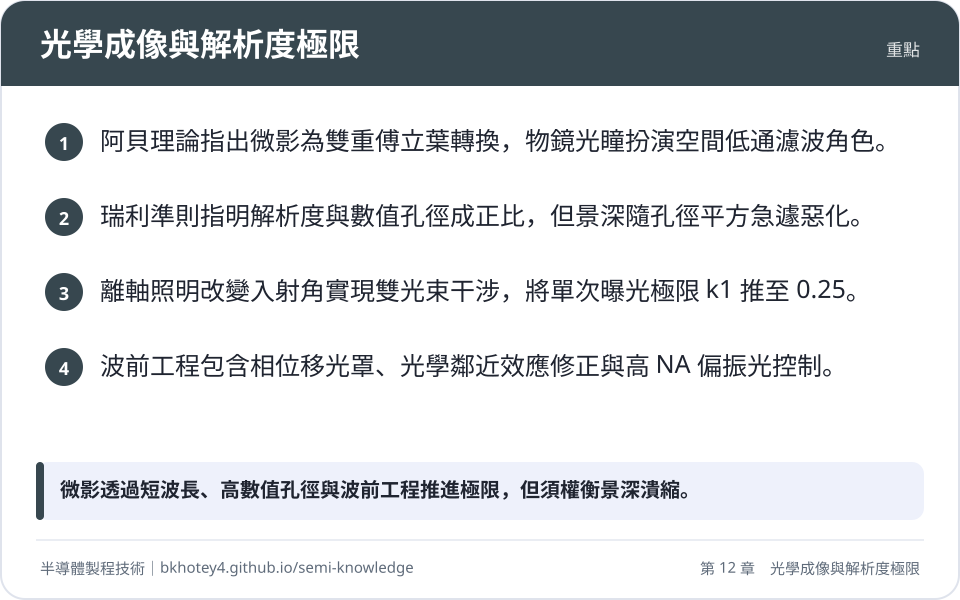
<figcaption>重點圖卡：光學成像與解析度極限</figcaption>
</figure>

<figure markdown>
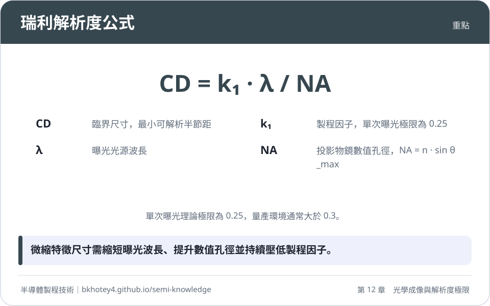
<figcaption>重點圖卡：瑞利解析度公式</figcaption>
</figure>

<figure markdown>
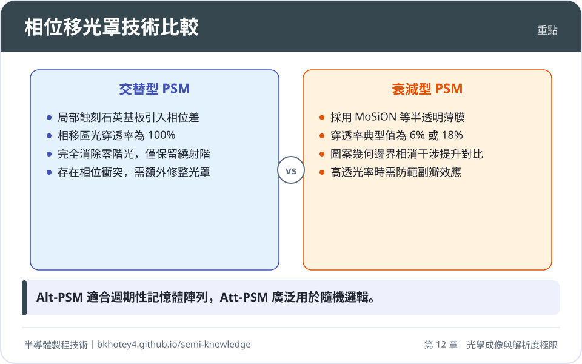
<figcaption>重點圖卡：相位移光罩技術比較</figcaption>
</figure>

<figure markdown>
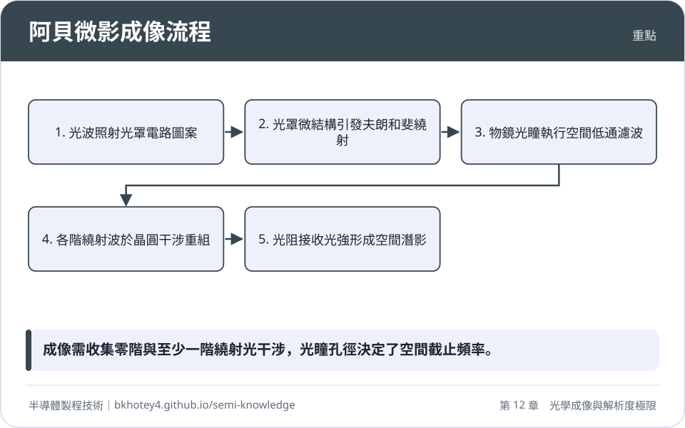
<figcaption>重點圖卡：阿貝微影成像流程</figcaption>
</figure>

</div>

## 習題

**1.** 某半導體廠預計評估由乾式 ArF 準分子雷射曝光機轉換至水浸潤式（Immersion）曝光機之微影極限。已知光源波長 $\lambda = 193\text{ nm}$，乾式機台之 $\text{NA}_{\text{dry}} = 0.93$，純水折射率為 $1.44$，浸潤式機台之最大數值孔徑提升至 $\text{NA}_{\text{imm}} = 1.35$。若取製程因子 $k_1 = 0.28$、$k_2 = 0.60$：
(1) 請分別計算乾式與浸潤式機台所能定義的最小臨界尺寸（CD）。
(2) 請分別計算兩機台在該極限條件下的景深（DOF），並定量討論 NA 提升對焦深寬容度的影響。

??? success "參考解答"
    (1) 依據瑞利解析度公式 $\text{CD} = k_1 \frac{\lambda}{\text{NA}}$：
    * 乾式機台：
      $$\text{CD}_{\text{dry}} = 0.28 \times \frac{193\text{ nm}}{0.93} \approx 58.11\text{ nm}$$
    * 浸潤式機台：
      $$\text{CD}_{\text{imm}} = 0.28 \times \frac{193\text{ nm}}{1.35} \approx 39.99\text{ nm}$$
    
    (2) 依據景深公式 $\text{DOF} = k_2 \frac{\lambda}{\text{NA}^2}$：
    * 乾式機台：
      $$\text{DOF}_{\text{dry}} = 0.60 \times \frac{193\text{ nm}}{(0.93)^2} = \frac{115.8}{0.8649} \approx 133.89\text{ nm}$$
    * 浸潤式機台：
      $$\text{DOF}_{\text{imm}} = 0.60 \times \frac{193\text{ nm}}{(1.35)^2} = \frac{115.8}{1.8225} \approx 63.54\text{ nm}$$
    
    定量分析：浸潤式機台將 NA 自 $0.93$ 提高至 $1.35$（增幅約 $45.2\%$），臨界尺寸 CD 縮減了 $31.2\%$；然而其景深 DOF 由 $133.89\text{ nm}$ 劇降至 $63.54\text{ nm}$，衰退幅度達 $52.5\%$。此結果驗證了景深隨 $\text{NA}^2$ 平方反比急速惡化的物理限制。

**2.** 試從物理光學繞射理論，論證交替型相位移光罩（Alt-PSM）的相移層蝕刻深度公式，並計算在曝光波長 $\lambda = 193\text{ nm}$ 下，石英玻璃基板（折射率 $n = 1.56$）的理論蝕刻深度。同時說明為何 Alt-PSM 能夠消除零階繞射光。

??? success "參考解答"
    (1) 蝕刻深度推導：
    設石英基板厚度蝕刻量為 $d$，環境介質（空氣）之折射率近似為 $1.0$。
    光波穿透未蝕刻石英區之光程為 $n \cdot d$，穿透蝕刻凹槽（填滿空氣）之光程為 $1 \cdot d$。
    兩者光程差為 $\Delta \text{OPD} = (n - 1)d$。
    對應的相位差為 $\Delta \phi = \frac{2\pi}{\lambda}\Delta \text{OPD} = \frac{2\pi}{\lambda}(n - 1)d$。
    要達到完全相消干涉所需的相移量為 $\pi$（$180^\circ$）：
    $$\frac{2\pi}{\lambda}(n - 1)d = \pi \implies d = \frac{\lambda}{2(n - 1)}$$
    代入數值：
    $$d = \frac{193\text{ nm}}{2(1.56 - 1)} = \frac{193}{1.12} \approx 172.32\text{ nm}$$

    (2) 消除零階光之物理機制：
    傳統二元光罩之透光區電場為同向（均為正向電場分佈），其空間平均電場 $\bar{E} > 0$，經傅立葉轉換後，頻譜中央之直流分量（即零階繞射光）強度顯著。
    交替型相位移光罩相鄰透光區電場分別為 $+E_0$ 與 $-E_0$（反向），在一個完整幾何週期內，電場對空間的積分（空間平均值）嚴格為零：
    $$\int_{\text{週期}} E(x) \, dx = 0$$
    依據傅立葉轉換性質，空間頻域中 $f=0$ 處的振幅 $\tilde{E}(0)$ 正比於空間平均電場。因此其零階繞射光振幅完全相消為零，入射光能全數轉移至產生干涉解像的 $\pm 1$ 階繞射光中。

**3.** 試比較傳統垂直正入射照明（Conventional Illumination）與離軸照明（Off-Axis Illumination, OAI）在極限解析度下的光瞳空間頻譜分佈差異，並解釋為何離軸照明能將單次曝光製程的極限因子 $k_1$ 從 $0.5$ 推升至 $0.25$。

??? success "參考解答"
    (1) 傳統垂直正入射照明（$\theta_{\text{in}} = 0^\circ$）：
    * 零階繞射光沿光軸中心通過光瞳中央（空間頻率為 $0$）。
    * 正負一階繞射光對稱分佈在兩側，繞射角滿足 $\sin\theta_{\pm 1} = \pm \frac{\lambda}{P}$。
    * 雙束或三束光干涉成像的充要條件為物鏡必須同時收納零階光與至少一個一階光，即 $\sin\theta_1 \le \text{NA}$。
    * 由 $\frac{\lambda}{P_{\min}} = \text{NA}$ 可得最小節距 $P_{\min} = \frac{\lambda}{\text{NA}}$，對應的半節距臨界尺寸為 $\text{CD}_{\min} = \frac{P_{\min}}{2} = 0.5 \frac{\lambda}{\text{NA}}$，故此時極限 $k_1 = 0.5$。

    (2) 離軸照明（OAI）：
    * 光束以角度 $\theta_{\text{in}}$ 斜向入射光罩。光柵繞射方程式修正為 $\sin\theta_m - \sin\theta_{\text{in}} = m\frac{\lambda}{P}$。
    * 當照明角度精準配置在物鏡瞳孔邊界時（$\sin\theta_{\text{in}} = \text{NA}$），零階光恰好自物鏡光瞳的一端邊界射入。
    * 此時負一階繞射光最高可容許偏折至物鏡光瞳的對向極限邊界（出射角 $\sin\theta_{-1} = -\text{NA}$）。
    * 兩束光在光瞳面展開的最大跨度為：
      $$\Delta \sin\theta = \sin\theta_{\text{in}} - \sin\theta_{-1} = \text{NA} - (-\text{NA}) = 2\text{NA}$$
    * 根據光柵方程式，$\frac{\lambda}{P_{\min}} = 2\text{NA} \implies P_{\min} = \frac{\lambda}{2\text{NA}}$。
    * 對應之半節距極限解析度為 $\text{CD}_{\min} = \frac{P_{\min}}{2} = \frac{\lambda}{4\text{NA}} = 0.25 \frac{\lambda}{\text{NA}}$，成功將 $k_1$ 極限下推至 $0.25$。

**4.** 浸潤式微影（如 $\text{NA} = 1.35$）在大角度聚焦條件下，向量繞射效應對影像對比度具有關鍵衝擊。考慮兩束頻率相同、以夾角 $2\theta$ 匯聚干涉的光束：
(1) 請寫出 s-偏振（TE 模態）與 p-偏振（TM 模態）干涉項的電場內積表示式。
(2) 若光線在介質中之匯聚角達到 $\theta = 45^\circ$，請計算此時 TM 模態的光學對比度，並說明其物理成因與製程意涵。

??? success "參考解答"
    (1) 電場內積表示式：
    * s-偏振（TE 模態）：兩光束之電場向量皆垂直於入射平面，向量完全同向平行。
      $$\mathbf{E}_1 \cdot \mathbf{E}_2 = |\mathbf{E}_1||\mathbf{E}_2|$$
      其干涉項振幅不隨入射角 $\theta$ 衰減。
    * p-偏振（TM 模態）：兩光束之電場向量平行於入射平面，兩電場向量之間存在夾角 $2\theta$。
      $$\mathbf{E}_1 \cdot \mathbf{E}_2 = |\mathbf{E}_1||\mathbf{E}_2| \cos(2\theta)$$

    (2) 當 $\theta = 45^\circ$ 時：
    * 夾角項 $\cos(2\theta) = \cos(90^\circ) = 0$。
    * 此時代入 TM 模態之總光強分佈式：
      $$I_{\text{TM}}(x) = |E_1|^2 + |E_2|^2 + 2|\mathbf{E}_1 \cdot \mathbf{E}_2|\cos(\Delta \phi) = |E_1|^2 + |E_2|^2 + 0$$
    * 空間干涉調變項完全消失，$I_{\max} = I_{\min} = |E_1|^2 + |E_2|^2$。
    * 光學對比度：
      $$C = \frac{I_{\max} - I_{\min}}{I_{\max} + I_{\min}} = \frac{0}{2(|E_1|^2 + |E_2|^2)} = 0$$
    * 物理成因與製程意涵：當匯聚半角為 $45^\circ$ 時，兩道 TM 偏振光的電場震盪方向恰成正交（垂直），正交向量在波動力學上無法產生干涉現象，光強退化為均勻背景光。若匯聚半角進一步大於 $45^\circ$，$\cos(2\theta) < 0$，將引發影像對比反轉（亮暗紋互換）。因此高 NA 機台必須配置偏振控制器，強迫使用 TE 偏振光曝光以確保對比度。

**5.** 試述調變轉換函數（MTF）與光阻臨界對比度（$C_{\text{th}}$）之物理關聯。為何即使微影機台的光學成像截止頻率可達 $f_c = \frac{2\text{NA}}{\lambda}$，積體電路實際可製造的圖案空間頻率卻遠低於此理論值？

??? success "參考解答"
    (1) MTF 描述光學系統對不同空間頻率圖案的對比度傳遞能力，定義為影像對比度與物體對比度的比值 $\text{MTF}(f) = C_{\text{image}}(f) / C_{\text{mask}}(f)$，在無像差非同調系統中隨空間頻率單調遞減，直到截止頻率 $f_c = \frac{2\text{NA}}{\lambda}$ 時降為零。
    (2) 光阻並非理想感光元件，其材料內部存在光酸擴散、非線性化學增幅反應以及顯影溶解臨界門檻。光阻要能在光阻層形成垂直側壁且無殘留浮渣，輸入的空間影像對比度必須大於光阻本身的材料臨界對比度門檻 $C_{\text{th}}$（先進光阻典型值介於 $0.3 \sim 0.5$）。
    (3) 當圖案空間頻率增加使得 $\text{MTF}(f) < C_{\text{th}}$ 時，即使空間影像在物理上仍保有微弱明暗變化（$\text{MTF} > 0$），光阻化學反應已無法有效區分亮區與暗區的化學溶解度差異。強行曝光會造成圖案側壁嚴重傾斜、膜厚損失、線條倒塌（Pattern Collapse）或相鄰線條沾黏（Bridging）。因此實際製程解析極限由 $\text{MTF}(f) = C_{\text{th}}$ 的頻率點截斷，遠小於光學截止頻率 $f_c$。

---

## 本章術語

- **Projection Optics System**（投影物鏡系統）：微影機台內部用於收集光罩繞射波並以高保真度縮小聚焦於晶圓表面的精密光學透鏡模組。
- **Abbe's Imaging Theory**（阿貝成像理論）：將光學顯微成像解析為光罩繞射、光瞳低通濾波與晶圓干涉之雙重傅立葉轉換的波動光學理論。
- **Numerical Aperture, NA**（數值孔徑）：衡量透鏡收集光錐角範圍與介質折射率之乘積的無因次光學參數，直接決定系統解析能力。
- **Airy Disk**（艾里斑）：單色點光源通過圓形物鏡孔徑後，在像平面繞射聚焦形成具同心環明暗相間的光斑。
- **Rayleigh Criterion**（瑞利準則）：定義兩繞射點光源中心剛好落在彼此艾里斑第一暗環時，系統恰可分辨的解析度極限法則。
- **Depth of Focus, DOF**（景深）：成像線寬與對比度能維持在工程容忍規格內，晶圓表面允許沿光軸縱向偏移的最大位移範圍。
- **Aerial Image**（空間影像）：物鏡匯聚之光場在晶圓焦點平面形成的時間平均光強度二維空間分佈。
- **Normalized Image Log-Slope, NILS**（正規化影像對數斜率）：評估空間影像在圖案邊界處光強梯度的無因次指標，數值越高代表製程寬容度越佳。
- **Modulation Transfer Function, MTF**（調變轉換函數）：光學系統在不同空間頻率下傳遞明暗對比度能力的頻率響應函數。
- **Partial Coherence Factor, $\sigma$**（部分同調因子）：照明系統數值孔徑與物鏡數值孔徑之比值，表徵曝光光場的空間同調性。
- **Off-Axis Illumination, OAI**（離軸照明）：迫使光束以特定傾斜角入射光罩，使零階光與一階繞射光在光瞳對稱分佈以提升解析度與焦深的技術。
- **Forbidden Pitches**（禁制間距）：採用特定離軸照明時，因繞射光落於光瞳外側或發生毀滅性干涉而導致對比度劇降的無效節距區間。
- **Phase Shift Mask, PSM**（相位移光罩）：藉由調控光罩局部光波相位差（通常為 $180^\circ$）引發破壞性相消干涉，藉以陡峭化邊緣對比的光罩技術。
- **Alternating PSM, Alt-PSM**（交替型相位移光罩）：在相鄰石英開口交替蝕刻特定深度以消除零階光、達成雙光束極限干涉的強相移光罩。
- **Attenuated PSM, Att-PSM**（衰減型相位移光罩）：以微透光移相層取代不透光鉻層，藉由微弱反相滲透光與主透光相消干涉提升邊緣對比的光罩。
- **Optical Proximity Correction, OPC**（光學鄰近效應修正）：預先在光罩邊界施加幾何形變補償（如襯線、偏置），以抵消空間低通繞射失真的計算微影技術。
- **Sub-Resolution Assist Features, SRAF**（次解析度輔助特徵）：尺寸小於曝光極限、不自身成像但能提供繞射干涉以改善主圖案景深的光罩輔助條紋。
- **Vector Diffraction Effect**（向量繞射效應）：高數值孔徑大角度聚焦下，因橫磁波（TM / p-偏振）向量正交抵消導致成像對比度大幅衰退的物理現象。
- **Step-and-Scan System**（步進掃描系統）：光罩台與晶圓台以狹縫為視野同步等速反向移動，藉由動態掃描平均像差並擴大曝光視場的量產機台架構。
- **Zernike Polynomials**（任尼克多項式）：定義於單位圓域的正交多項式級數，用於精確分解微影鏡頭之球差、散光、彗差等各階波前光程差。


## 互動學習

!!! tip "動手試試看"
    - [互動實驗：微影解析度（瑞利公式）](../labs.md#rayleigh)
    - [設備機台圖鑑：曝光機（掃描式步進機）](../equipment.md)

<div class="quiz" data-quiz="03-02"></div>


## 產業最新進展

本節由每日產業新聞自動補充，說明本章技術在產業上的最新發展。

<!-- updates -->
（目前尚無補充。）
