# 第 13 章　DUV 浸潤式微影與多重圖案化

!!! abstract "學習目標"
    - 理解 ArF 浸潤式微影的光學物理原理，掌握利用高折射率介質突破數值孔徑極限的機制與流體介面挑戰。
    - 深入分析 LELE、LFLE 等基於曝光分割之雙重圖案化製程步驟、圖案拆解限制與縫合問題。
    - 掌握自對準間隔層技術（SADP、SAQP）的製程流程、幾何倍增機制，以及切割光罩在圖案定義中的作用。
    - 評估多重圖案化製程對邊緣置放誤差、疊對預算、製程循環時間與光罩成本的衝擊。
    - 瞭解工業界主流浸潤式微影掃描機的流體控制架構與先進製程節點之多重圖案化整合實務。

## 13.1 ArF 浸潤式微影之物理原理與流體控制

### 介質折射率與光學極限拓展

在傳統乾式微影系統中，投影物鏡最後一片透鏡與晶圓表面之間的介質為空氣或氮氣，其折射率近似為 1（$n \approx 1.0$）。由第 12 章探討的瑞利解析度準則（Rayleigh criterion），微影系統能解析的最小半間距（half-pitch, $HP$）與景深（Depth of Focus, $DOF$）分別表述為：

$$HP = k_1 \frac{\lambda_0}{\text{NA}} = k_1 \frac{\lambda_0}{n \sin \theta_{\max}}$$

$$DOF = k_2 \frac{\lambda_0}{\text{NA}^2} = k_2 \frac{\lambda_0}{n^2 \sin^2 \theta_{\max}}$$

其中，$\lambda_0$ 為曝光光源在真空中的波長（對於氬氟準分子雷射 ArF，$\lambda_0 = 193.3\text{ nm}$），$k_1$ 與 $k_2$ 為製程因數（process factors），$\theta_{\max}$ 為透鏡所能收集的最大會聚半角，$\text{NA} = n \sin \theta_{\max}$ 為數值孔徑（Numerical Aperture）。

若在物鏡與晶圓之間填入折射率 $n > 1$ 的液體介質，光波在介質中的傳播速度減慢，導致有效波長縮短為 $\lambda = \lambda_0 / n$。此時，微影系統的物理孔徑角 $\theta_{\max}$ 雖然受限於透鏡幾何極限（$\sin \theta_{\max} < 1$），但系統的有效數值孔徑卻可突破 1.0 的物理屏障：

$$\text{NA}_{\text{imm}} = n_{\text{liquid}} \sin \theta_{\max}$$

當光束以大角度從物鏡最後一片透鏡（折射率為 $n_{\text{lens}}$）射入浸潤液體時，根據司乃耳定律（Snell's law）：

$$n_{\text{lens}} \sin \theta_{\text{lens}} = n_{\text{liquid}} \sin \theta_{\text{liquid}} = \text{NA}$$

若介質為空氣（$n_{\text{air}} \approx 1$），當 $\text{NA} \to 1$ 時，$\sin \theta_{\text{air}} \to 1$，光線在介面處將發生全內反射（Total Internal Reflection, TIR）而無法進入晶圓。若填入高折射率液體，折射角得以縮小，使光學系統能夠容納空間頻率更高的繞射光束進入光阻層成像。

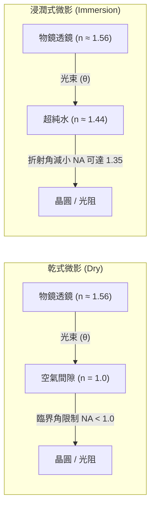

在景深方面，將浸潤介質折射率納入波動光學精確推導後，軸上光線與邊緣光線在介質中的相位差所決定的景深公式應修正為：

$$DOF = \frac{\lambda_0}{2 n_{\text{liquid}} (1 - \cos \theta_{\max})} \approx k_2 \frac{n_{\text{liquid}} \lambda_0}{\text{NA}^2}$$

在相同 $\text{NA}$ 條件下，浸潤式系統的景深為乾式系統的 $n_{\text{liquid}}$ 倍；若在相同的物理角 $\theta_{\max}$ 下將 $\text{NA}$ 提升至 $n_{\text{liquid}}$ 倍，則解析度提升 $n_{\text{liquid}}$ 倍，而 $DOF$ 僅隨 $1/n_{\text{liquid}}$ 等比下降，相較於在空氣中單純縮小波長具備更寬裕的製程窗口。

---

### 浸潤介質之選擇與超純水之光學物理特性

浸潤液體的選用必須同時滿足多項嚴苛的光學與材料相容性要求：
1. **高折射率**：以最大化 $\text{NA}$。
2. **高穿透率（低光吸收）**：在 $193\text{ nm}$ 波長下的吸收係數 $\alpha$ 必須極低，以防止曝光能量衰減及不均勻熱吸收。
3. **低黏度與高流動性**：滿足每秒超過半米的高速晶圓載台掃描需求。
4. **極高化學穩定性與純度**：不侵蝕透鏡最末端的光學鍍膜與光阻材料，且不殘留微粒。

在 193 nm 紫外波段，超純水（Ultra-Pure Water, UPW）展現了優異的綜合特性，成為工業界唯一廣泛採用的第一代浸潤液體。

| 物理/光學參數 | 典型數值（於 $193.3\text{ nm},\, 21.5^\circ\text{C}$） | 單位 | 備註與工程意義 |
| :--- | :--- | :--- | :--- |
| 折射率 $n$ | $1.4366 \pm 0.0002$ | 無因次 | 決定系統極限 $\text{NA}$ 之上限 |
| 吸收係數 $\alpha$ | $< 0.015$（脫氣後典型值） | $\text{cm}^{-1}$ | 穿透率 $> 98\%$（液層厚度 $1\text{ mm}$ 時） |
| 折射率溫度係數 $dn/dT$ | $-1.00 \times 10^{-4}$ | $\text{K}^{-1}$ | 流體熱擾動會引發嚴重波前畸變 |
| 折射率壓力係數 $dn/dP$ | $+3.4 \times 10^{-10}$ | $\text{Pa}^{-1}$ | 流場壓力梯度對光程差影響極小 |
| 動力黏度 $\mu$ | $0.975 \times 10^{-3}$ | $\text{Pa}\cdot\text{s}$ | 決定液態彎月面流場與剪切應力 |
| 表面張力 $\gamma$ | $72.6 \times 10^{-3}$ | $\text{N}\cdot\text{m}^{-1}$ | 決定毛細現象與氣液介面穩定度 |

整個光學成像系統的極限 $\text{NA}$ 取決於光路所經各介質折射率的最小值：

$$\text{NA}_{\max} < \min(n_{\text{lens}}, n_{\text{liquid}}, n_{\text{resist}})$$

雖然合成石英（$\text{SiO}_2$）透鏡在 $193\text{ nm}$ 下的折射率約為 1.56，光阻折射率約為 1.68 至 1.75，但因超純水的折射率為 1.44，使得光學孔徑的理論上限受限於 1.44。考慮到避免在透鏡—水介面與水—光阻介面發生臨界全反射並保留適當的操作邊際，量產型物鏡的最大極限孔徑角 $\sin \theta_{\max}$ 實務上落在 0.93 至 0.94 左右，因此 ArF 浸潤式微影（ArFi）系統的極限實用 $\text{NA}$ 定格於 **$1.35$**（即 $1.4366 \times 0.94 \approx 1.35$）。

!!! note "高折射率流體（Second-generation Immersion Fluids）的研發瓶頸"
    半導體界曾嘗試開發折射率高於 1.6 的有機烴類液體（如環烷烴衍生物 Luperox 系列），期望將 NA 推升至 1.55 以上。然而此類液體在 193 nm 下吸收係數偏高（$\alpha > 0.1\text{ cm}^{-1}$）、黏度大導致散熱與換液困難，且在強紫外線照射下易發生光化學裂解並污染透鏡，最終未能量產，使 1.35 成為單一透鏡投影曝光技術的最終 NA 上限。

---

### 氣液介面流場力學與高速掃描控制

在步進掃描微影機（Scanner）中，浸潤液並非將整片晶圓浸泡於水槽內，而是採用「局部浸潤噴頭」（Local Immersion Hood 或 Showerhead）設計。噴頭懸浮於物鏡末端透鏡與晶圓之間，維持一厚度僅約 $1.0\text{ mm}$ 左右的受限液膜（Liquid Puddle）。

```
        +-----------------------------------------------+
        |                 物鏡終端透鏡                   |
        +-----------------------------------------------+
                             | 液膜 (~1 mm)
   [注水/除氣孔] --->  ~~~~~~~~~~~~~~~~~~~  <--- [注水/除氣孔]
   [氣刀/抽吸孔] ===> (   浸潤超純水彎月面  ) <=== [氣刀/抽吸孔]
  --------------------~~~~~~~~~~~~~~~~~~~--------------------
             =======> 晶圓以 > 500 mm/s 掃描移動 =======>
  -----------------------------------------------------------
```

#### 彎月面穩定性與毛細數

當晶圓載台以高達 $500 \sim 1000\text{ mm/s}$ 的速度高速相對移動時，浸潤水邊界的彎月面（Meniscus）會承受強烈的流體動態剪切力。流體動力學中以毛細數（Capillary Number, $Ca$）描述黏滯力相對於表面張力效應的比值：

$$Ca = \frac{\mu U}{\gamma}$$

其中 $U$ 為載台掃描速度，$\mu$ 為流體黏度，$\gamma$ 為表面張力。
當載台速度 $U$ 超過動態後退接觸角（Dynamic Receding Contact Angle, $\theta_{\text{rec}}$）維持彎月面幾何平衡的臨界極限時，彎月面後緣會失穩拉長，形成液絲並斷裂，導致水滴殘留於晶圓表面（Film pulling 或 Droplet loss）。

殘留微水滴在蒸發過程中會將環境中的微量揮發性有機物或光阻溶析物濃縮沉澱，形成直徑數十奈米的光學缺陷，稱為「水痕」（Water Marks）。

#### 微氣泡成因與控制機制

氣液介面若夾帶微氣泡（Micro-bubbles）進入曝光場域，將造成災難性的圖案缺陷。若微氣泡直徑 $d > 0.1 \lambda$，氣泡會引發強烈的米氏散射（Mie scattering），完全破壞局部的光波相位與強度，導致光阻圖案斷線或短路。微氣泡主要成因與防制對策如下：

1. **氣體溶解度平衡**：超純水若處於空氣飽和狀態，在進入曝光區吸收雷射能量後溫度上升，氣體在水中的溶解度驟降，釋出過飽和氮氣與氧氣形成奈米級氣泡。防制方式為在廠務入機端配置多級真空脫氣模組（Degasser），將水中的溶解氮氣與氧氣濃度強制降至 $5\text{ ppb}$ 以下。
2. **前進接觸線夾帶（Air Entrainment）**：晶圓高速進入噴頭下方時，若固-液-氣三相交界線處的動態前進接觸角（Advancing Contact Angle）接近 $180^\circ$，流體無法及時潤濕晶圓表面，周圍氣體會被機械性捲入液膜。工程上藉由優化噴頭周邊的環形真空抽吸口（Scavenge seals）以及配置氣刀（Air knife），精確控制周邊微氣流壓差，藉此穩定彎月面。

---

### 流體熱光效應與波前像差控制

浸潤水層作為物鏡成像光學系統中的最後一個透射元件，其光學均勻度直接決定了最終成像品質。超純水的折射率對溫度變化極為敏感，其熱光係數（Thermo-optic coefficient）約為：

$$\frac{dn}{dT} \approx -1.00 \times 10^{-4}\text{ K}^{-1} \quad (\text{在 } 21.5^\circ\text{C}, \lambda = 193.3\text{ nm})$$

相較之下，合成石英透鏡的熱光係數為正值且絕對值較小（$dn/dT \approx +2 \times 10^{-5}\text{ K}^{-1}$）。當 ArF 脈衝雷射以高達數十瓦的平均功率透過浸潤液時，水層吸收紫外光能量（即便吸收係數僅約 $0.01\text{ cm}^{-1}$），加上晶圓載台驅動馬達的熱傳導與高速剪切熱，均會使液層產生非均勻的三維溫度梯度 $\Delta T(x, y, z)$。

由溫度不均勻所引發的光程差（Optical Path Difference, $OPD$）為：

$$OPD(x, y) = \int_0^d \frac{dn}{dT} \Delta T(x, y, z) \, dz$$

其中 $d$ 為液膜厚度。依據光學繞射理論，波前畸變（Wavefront Aberration）若超過馬雷夏爾準則（Marechal criterion，即波前均方根誤差 $\text{RMS} < \lambda / 14 \approx 13.8\text{ nm}$），影像對比度（Normalized Image Log-Slope, NILS）將顯著惡化。

例如，若光路中局部水溫產生僅 $\Delta T = 1\text{ mK}$（$0.001^\circ\text{C}$）的擾動，在 $d = 1\text{ mm}$ 的水層中所造成的光程差為：

$$OPD = (-1.00 \times 10^{-4}\text{ K}^{-1}) \times (10^{-3}\text{ K}) \times (10^{-3}\text{ m}) = -1 \times 10^{-10}\text{ m} = -0.1\text{ nm}$$

然而若局部產生 $0.1^\circ\text{C}$ 的溫差，波前畸變即達 $10\text{ nm}$，這將引發嚴重的散焦（Defocus）、球差（Spherical Aberration）及慧差（Coma）。

為此，浸潤式微影機台必須配置高動態恆溫循環系統，流體更新率達到每分鐘數公升，使光束曝光區內的流體持續汰換，同時將浸潤水的工作溫度穩定度控制在極嚴苛的範圍內：

$$\sigma_T < \pm 1.0 \times 10^{-3}\text{ K} \quad (\pm 1\text{ mK})$$

---

### 光阻介面相互作用與污染抑制

在浸潤式微影架構中，感光材料直接與流動的超純水接觸，引發了乾式微影所沒有的表面界面化學問題（見第 11 章化學放大光阻化學機制）。

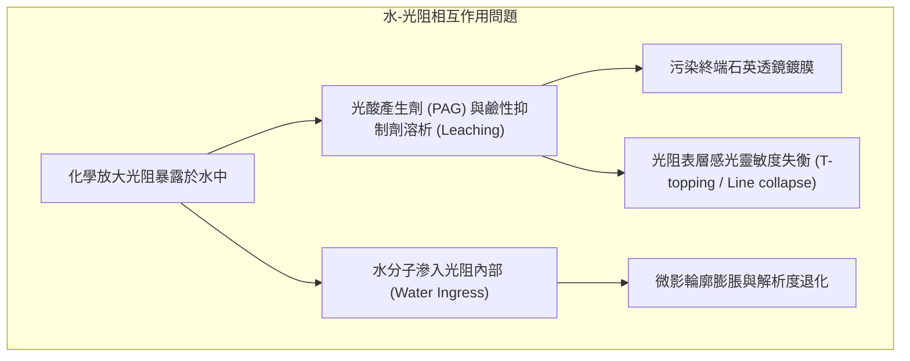

#### 溶析機制（Leaching）

化學放大光阻（CAR）含有光酸產生劑（Photoacid Generator, PAG，如鋶鹽或碘鹽）與有機鹼抑制劑（Quencher，如烷基胺）。這些添加劑多為中等極性分子，具有一定的親水性。在曝光過程中或曝光前，水流沖刷光阻表面會使未反應的 PAG 陰陽離子與抑制劑溶析出並擴散至水層中：

$$\text{PAG}_{\text{(resist)}} \rightleftharpoons \text{PAG}_{\text{(aqueous)}}$$

溶析帶來的負面影響包括：
1. **物鏡鍍膜污染**：溶析至水中的含氟有機酸與硫化合物在 $193\text{ nm}$ 強光照射下會於透鏡表面光解沉積，形成不可逆的霧化層（Lens hazing），大幅降低透鏡穿透率並扭曲像差。
2. **光阻頂部輪廓畸變**：表面光酸流失導致曝光臨界劑量變化，常使光阻顯影後產生頂部外擴（T-topping）或橋接現象。

業界對溶析量的標準規範極為嚴格，通常要求 PAG 溶析總量必須低於 $1 \times 10^{-12}\text{ mol/cm}^2$。

#### 表面改質與保護策略

為阻絕水與光阻之間的直接質傳，並滿足高速掃描對疏水性的需求，發展出兩條技術路徑：

1. **頂部抗反射保護層（Top Anti-Reflective Coating, TARC / Topcoat）**：
   在光阻上方旋塗一層氟聚合物薄膜（厚度約數十奈米）。該薄膜具備雙重功能：其一作為物理阻隔屏障，徹底阻絕 PAG 與抑制劑向外溶析；其二藉由調控薄膜的折射率（滿足 $n_{\text{topcoat}} \approx \sqrt{n_{\text{water}} \cdot n_{\text{resist}}}$），在光阻上表面達成破壞性干涉以抑制駐波效應（Standing wave effects）。該層聚合物在微影後通常可直接在鹼性顯影液（TMAH 2.38%）中溶解剝除，無需額外溶劑清洗。

2. **無上塗層自疏水光阻（Topcoatless Resist）**：
   額外塗佈與去除 TARC 會增加晶圓處理時間與物料成本。無上塗層光阻技術藉由在光阻配方中添加微量含氟基團的表面活性疏水寡聚物（Hydrophobic additives）。在旋塗與軟烤（Soft bake）過程中，因表面能量最小化驅動，含氟基團自發性偏析並向上遷移至光阻自由表面，形成一層單分子厚度尺度的疏水屏障。

```
無上塗層光阻烘烤自組裝示意：
+~~~~~~~~~~~~~~~~~~~~~~~~~~~~~~~~~~~~~~~~+ <--- 浸潤超純水 (UPW)
| [F-F-F] 含氟疏水保護層 (自發性表面偏析)  | <--- 高後退接觸角 (> 75°)，阻止水滲透
+----------------------------------------+
|                                        |
|   光阻主體聚合物基質 + PAG + Quencher   | <--- 化學放大核心，不受溶析干擾
|                                        |
+========================================+ <--- 底層抗反射層 (BARC) / 晶圓底材
```

無上塗層光阻的關鍵指標為其表面接觸角：
- **動態前進接觸角（$\theta_{\text{adv}}$）**：需控制在小於 $90^\circ$ 以利注水均勻潤濕。
- **動態後退接觸角（$\theta_{\text{rec}}$）**：必須大於 $75^\circ$。高後退接觸角能確保晶圓高速抽離噴頭時，水膜能俐落脫離，杜絕水痕產生，使機台產能（Throughput）維持在每小時 200 片晶圓以上。

!!! warning "乾燥水痕對圖案轉移之破壞性"
    即使只殘留數皮升（picoliter, $10^{-12}\text{ L}$）的微水滴，一旦在光阻表面揮發完全，局部形成的水痕會導致光阻產生應力集中，或是引起未曝光區光阻在曝光後烘烤（PEB）時酸催化去保護反應異常。此一局部微米尺度的凹陷或殘渣，在後續乾式蝕刻（見第 19 章）時將化為硬遮罩缺陷，引發嚴重的金屬線開路或接觸窗未開孔異常。因此浸潤液體力學控制的核心原則，始終圍繞在「零液滴脫落」的完全液膜約束。

<!-- fig:1 -->
<figure markdown>
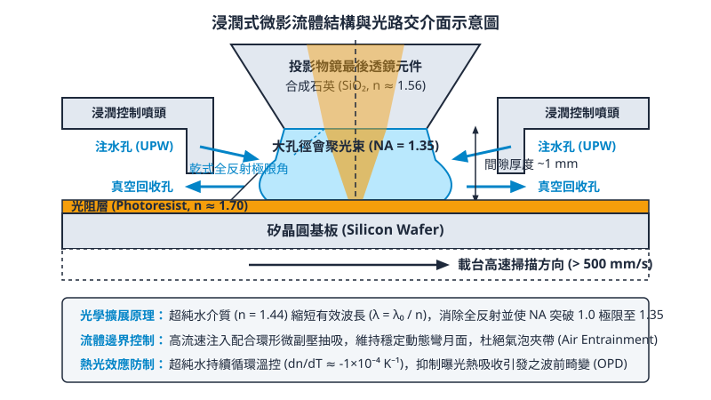
<figcaption>圖 13-1　浸潤式曝光流體結構圖（AI 繪製的示意圖）</figcaption>
</figure>

## 13.2 間距分割微影：LELE 與雙重曝光技術

### 單次曝光極限與間距分割概念

在光學微影技術中，單次曝光所能達到的解析度受限於繞射極限。根據瑞利準則（Rayleigh Criterion，見第 12 章），光學系統能解析的最小半間距（Half-Pitch, $HP$）表示為：

$$HP = k_1 \frac{\lambda}{\text{NA}}$$

其中 $\lambda$ 為曝光光源波長，$\text{NA} = n \sin\theta$ 為投影物鏡的數值孔徑（Numerical Aperture），$k_1$ 為製程複雜度因子。在傳統單次曝光微影中，繞射光束必須至少有第 0 階與第 $\pm 1$ 階繞射光進入物鏡光瞳（Pupil）才能產生干涉對比。當採用離軸照明（Off-Axis Illumination, OAI）結合相移光罩（Phase-Shifting Mask, PSM）時，物鏡恰好能收集對稱的兩道光束，此時對應的物理極限為：

$$k_{1, \text{min}} = 0.25$$

採用 ArF 浸潤式微影技術（$\lambda = 193.36\text{ nm}$，高純度去離子水浸潤液之折射率 $n = 1.44$，物鏡數值孔徑極限約 $\text{NA} = 1.35$），理論上的最小物理半間距極限為：

$$HP_{\text{min}} = 0.25 \times \frac{193.36\text{ nm}}{1.35} \approx 35.8\text{ nm}$$

對應之最小圖案間距（Pitch, $P_{\text{min}} = 2 \times HP_{\text{min}}$）約為 $71.6\text{ nm}$。在半導體量產環境中，考量光阻對比度、像差、聚焦深度（Depth of Focus, DOF）與機台振動等實際非理想因素，單次曝光的 $k_1$ 因子通常被限制在 $k_1 \ge 0.28$，此時能穩定生產的最小間距約為 $80\text{ nm}$。

當半導體製程微縮至 20 奈米邏輯節點及以下時，後段金屬層（BEOL）與前段多晶矽閘極層所需的間距遠小於 $80\text{ nm}$。在極紫外光（EUV）微影技術尚未純熟投入量產之前，突破單次曝光光學極限的唯一手段為**間距分割**（Pitch Splitting）。

間距分割的核心概念是：將原本空間頻率超過光學繞射極限的超高密度圖案，以計算微影拆解為兩組或多組低密度圖案；每一組圖案的間距均放大至單次曝光的解析極限以上（即 $k_1 > 0.28$），再分別透過獨立的光罩與曝光步驟轉移至晶圓上，最終在空間中交錯重組，達成物理間距減半之目的。

---

### LELE 製程架構

若僅在同一層光阻上進行兩次曝光後再顯影（稱為雙重曝光，Double Exposure, 2E），由於傳統化學增幅光阻（CAR）的曝光劑量反應屬於連續積分函數，兩次曝光的空間光強分佈會在光阻內部直接疊加（Linear Dose Summation），光學對比度將被嚴重稀釋，無法解析出密集的圖案。因此，必須在兩次曝光之間引入材料沉積與乾式蝕刻步驟，將第一道光學影像固化為不可逆的幾何實體，此技術稱為**雙重圖案化**（Double Patterning, 2P），其中最典型的工業實踐即為 **LELE（Litho-Etch-Litho-Etch）**。

#### 1. 材料堆疊與製程流程

LELE 依賴由兩層或多層不同蝕刻選擇比的硬光罩（Hardmask, HM）所組成的薄膜堆疊。典型的薄膜堆疊由下至上包含：目標材料層（如金屬間介電質或多晶矽）、下層硬光罩（Hardmask 2，常為氧化矽 $\text{SiO}_2$）、上層硬光罩（Hardmask 1，常為氮化矽 $\text{Si}_3\text{N}_4$ 或非晶碳層 Spin-On Carbon, SOC）、底部抗反射層（BARC）以及第一道光阻（Photoresist 1）。

LELE 的完整物理轉印步驟如下：

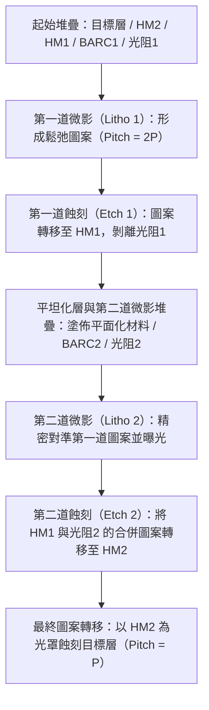

1. **第一道微影與蝕刻（Litho 1 & Etch 1）**：
   使用光罩 A 對光阻 1 進行曝光顯影，圖案間距為目標間距的兩倍（$2P$）。隨後利用非等向性反應離子蝕刻（RIE，見第 19 章）將圖案轉印至上層硬光罩（HM1），並徹底去除殘留光阻與有機抗反射層。
2. **二次平面化與第二道微影（Litho 2）**：
   在已形成微結構的 HM1 表面旋塗有機平坦化層（通常為旋塗碳層 SOC），以填補第一道圖案之深溝並提供平整的光學表面；接著沉積低溫含矽抗反射層（Si-ARC）並塗佈第二道光阻（光阻 2）。在微影機台（Scanner）中，光罩 B 必須以奈米級的高精度與第一道 HM1 圖案執行疊對（Overlay）對準曝光，兩者在空間上精確交錯位移一個半週期。
3. **第二道蝕刻與最終圖案轉印（Etch 2 & Transfer）**：
   進行第二次反應離子蝕刻。此時，第一道由 HM1 構成的硬圖案與第二道光阻 2 共同作為遮罩，透過高度選擇比的蝕刻化學，將合成後的密集圖案同步轉印至下層硬光罩（HM2）。最後以 HM2 為單一硬光罩，向下垂直蝕刻底部的目標材料層，獲得空間間距減半（$P$）的最終微縮電路。

---

### 簡化替代方案：LFLE 與雙重曝光技術

LELE 流程雖然幾何自由度高，但包含兩次完整的蝕刻、乾蝕刻清洗及多次化學氣相沉積（CVD，見第 21 章），製程週期時間長且缺陷引入機率高。為精簡製程，業界曾提出簡化方案。

#### 1. 化學凍結法（LFLE, Litho-Freeze-Litho-Etch）
LFLE 的核心目標在於省去「第一道硬光罩蝕刻（Etch 1）」步驟。其流程為：
1. 正常進行第一道微影（Litho 1）形成光阻圖案。
2. 在顯影後的光阻圖案表面施加「化學凍結劑」（Freezing Agent）或電子束/深紫外光固化處理。凍結劑滲入第一道光阻表層，藉由酸催化交聯反應（Cross-linking）使光阻結構產生高度不溶性與耐熱性，形成一層鈍化表面。
3. 塗佈第二道光阻。由於第一道光阻已化學凍結，不會溶解於第二道光阻的溶劑（如丙二醇單甲醚醋酸酯，PGMEA）中。
4. 進行第二道微影（Litho 2），隨後**僅透過單次蝕刻製程**同時將兩道光阻圖案轉印至下方的單一硬光罩層。

!!! warning "LFLE 的物理化學限制"
    LFLE 在先進製程節點量產時面臨嚴苛挑戰。首先，化學凍結過程常伴隨體積膨脹（Swelling）或收縮，造成臨界尺寸（Critical Dimension, CD）嚴重偏移；其次，凍結層的光學常數（折射率 $n$ 與消光係數 $k$）會改變，對第二道微影產生不可預期的駐波效應與光學干涉；再者，兩道光阻在乾蝕刻電漿環境下的抗蝕刻速率（Etch Resistance）難以完全匹配，極易導致嚴重的側向蝕刻不對稱與線邊粗糙度惡化。因此，在先進邏輯節點中，LFLE 多數已被自對準技術（見第 13.3 節）或完整 LELE 取代。

#### 2. 自對準接觸孔雙重曝光技術
對於後段導線的接觸孔（Contact Hole, CH）或介層孔（Via），單次微影受限於圓形孔洞的二維繞射擴散，孔洞密集排列時極易發生光學強度互消與串擾。雙重圖案化應用於接觸孔時，通常將棋盤狀排列的密集孔洞陣列拆解至兩張獨立光罩。兩次曝光分別以大間距開鑿孔洞，彼此之間維持足夠的微影空間餘裕（Process Window），避免單次曝光中相鄰孔洞因光波干擾黏合（Bridge）的致命缺陷。

---

### 光罩拆圖與佈局幾何規則

在多重圖案化設計中，設計自動化（EDA）軟體必須將積體電路版圖（GDSII/OASIS 格式）從幾何上分割至兩張互補的光罩上，此演算法過程稱為**光罩拆圖**（Decomposition）或**著色**（Coloring）。

#### 1. 圖案著色問題（Graph Coloring Problem）
版圖拆圖在拓撲學上可抽象化為圖論中的「雙色著色問題」（Two-Color Problem）：
- **節點（Vertices）**：代表版圖中的每一個獨立多邊形幾何體。
- **邊（Edges）**：若兩多邊形邊界間的空間距離 $d$ 小於單次曝光所允許的最小設計規則距離 $S_{\text{min}}$（即 $d < S_{\text{min}}$），兩節點間即建立一條連接邊，代表兩者在物理上不能出現在同一張光罩中，必須賦予不同顏色（如光罩 A 設為綠色，光罩 B 設為紅色）。

若且唯若該圖為一個**二分圖（Bipartite Graph）**時，版圖可完全實現無衝突的雙光罩著色。

```
衝突範例（奇數環衝突）：
幾何圖形：   [ A ] <--- d < Smin ---> [ B ]
              \                      /
               \                    /
             d < Smin            d < Smin
                 \                /
                  v              v
                        [ C ]
(A、B、C 彼此間距皆小於 Smin，形成三節點閉環，雙色系統無法著色)
```

#### 2. 奇數環衝突（Odd Cycle Conflict）
當電路佈局中出現奇數個多邊形（最常見為三個）彼此環狀相鄰，且兩兩之間的距離均小於 $S_{\text{min}}$ 時，將構成數學上的奇數環（Odd Cycle）。此時若將節點 A 著為綠色，節點 B 必須為紅色，則節點 C 同時與 A、B 相鄰，無法著上任何顏色而不違反微影規則。此現象稱為「奇數環衝突」，在純邏輯閘的隨機排布中極為常見。

#### 3. 縫合處（Stitch）設計規則
為了解析奇數環衝突，EDA 演算法可將長條狀多邊形在幾何上人為裁切成兩段，稱為引入「縫合」（Stitch）。被裁切的左半段保留在光罩 A，右半段分配至光罩 B，兩者在空間上有適當的重疊區（Overlap Region）。

$$L_{\text{stitch}} \ge 2 \times \sigma_{\text{overlay}} + L_{\text{margin}}$$

其中 $L_{\text{stitch}}$ 為縫合重疊長度，$\sigma_{\text{overlay}}$ 為微影機台的疊對標準差，$L_{\text{margin}}$ 為考量光阻近接效應修整（OPC，見第 16 章）之餘裕。

縫合技術的代價極高：在縫合介面處，微影機台的疊對誤差會直接導致圖案寬度產生頸縮（Neck）甚至斷路；亦可能因疊對位移過大導致線寬膨脹短路。因此，進階設計規則（Design Rule Check, DRC）通常嚴格限制單一導線網（Net）上的縫合數量，並盡量透過單向化佈局（1D Layout，即所有導線強制同一方向排列）消除奇數環。

---

### 製程變異與幾何不對稱性

相較於單次曝光技術，LELE 製程中不可避免地會引入兩大類微影變異：**空間間距交替變異**與**臨界尺寸雙峰性**。

| 變異指標 | 物理產生機制 | 幾何表現特徵 | 關鍵控制參數 |
| :--- | :--- | :--- | :--- |
| **空間間距交替變異 (Space Walk)** | 第二道光罩相對於第一道光罩產生橫向疊對位移 ($\Delta x$) | 相鄰的空間間距一寬一窄交替出現 ($S_1 \neq S_2$) | 機台疊對精度 ($\sigma_{\text{overlay}}$) |
| **CD 雙峰分佈 (CD Bimodality)** | 兩次獨立曝光/顯影/蝕刻製程的熱力學與化學劑量偏差 | 來自不同光罩的導線寬度出現系統性偏差 ($CD_A \neq CD_B$) | 劑量均勻度、熱板均溫性、蝕刻速率差 |
| **線寬粗糙度疊加 (LWR Stacking)** | 兩次微影光化學散彈雜訊與側向蝕刻擾動的非相關疊加 | 最終介電質間隔的粗糙度統計方差放大 | 光阻酸擴散長度、電漿離子轟擊均勻度 |

#### 1. 空間間距變異（Space Walk）
設理想目標線寬為 $W_0$，目標間距為 $S_0$。在完美的對稱 LELE 製程中，$S_1 = S_2 = S_0$。若第二道曝光相對於第一道硬光罩產生微小的疊對誤差向量 $\Delta x$：

$$S_1 = S_0 + \Delta x$$

$$S_2 = S_0 - \Delta x$$

此時雖然線寬本身受各自的光罩決定而不變，但相鄰兩線之間的電氣寄生電容（Capacitance）將產生週期性非對稱漂移，嚴重影響高速信號傳輸的阻抗匹配（RC 延遲變異）。

#### 2. 臨界尺寸雙峰性（CD Bimodality）
由於光罩 A 與光罩 B 歷經了不同的製程歷程（光罩 A 經歷兩次反應離子蝕刻及多次高溫烘烤，光罩 B 僅經歷一次），加之兩次微影的曝光機照明劑量（Dose）、數值孔徑微調、光阻批次、烘烤熱板（Hot Plate）溫度分佈難以完全絕對一致，最終晶圓上測得的線寬分佈直方圖將不再呈現單一高斯分佈，而是由兩個均值相異的峰值疊合而成的**雙峰分佈（Bimodal Distribution）**：

$$\mu_{\text{total}} = \frac{\mu_A + \mu_B}{2}, \quad \Delta CD = |\mu_A - \mu_B|$$

當系統性偏差 $\Delta CD$ 過大時，電晶體通道或互連導線的電氣特性將分化為兩群，使電路時序分析（Timing Closure）難度急遽升高。

#### 3. 線寬粗糙度（LWR）疊加
線寬粗糙度（Line Width Roughness, LWR，見第 11 章）受光子散彈雜訊（Photon Shot Noise）與化學增幅擴散效應控制。在單次微影中，間距的邊界波動由同一曝光波前決定；但在 LELE 架構下，一個介電質溝槽的左側邊界由第一道微影/蝕刻界定，右側邊界則由第二道微影/蝕刻界定。由於兩次微影的光子隨機擾動在統計學上完全獨立，溝槽空間粗糙度（Space LWR）呈現變異數相加：

$$\sigma_{\text{Space}}^2 = \sigma_{\text{Edge 1}}^2 + \sigma_{\text{Edge 2}}^2$$

這意味著溝槽最窄處的局部擊穿風險（Dielectric Breakdown）將高於單次微影成形之結構。上述幾何與製程缺陷，迫使半導體架構在邁向 14/10 奈米甚至更小節點時，對疊對精準度的要求提高到數奈米以下，亦促成了不依賴光學二次精確對準的自對準多重圖案化技術（SADP/SAQP，見第 13.3 節）之發展。

## 13.3 自對準多重圖案化技術（SADP 與 SAQP）

在微影技術受限於光學解析度極限（見第 12 章）與疊對（Overlay）誤差的雙重挑戰下，自對準多重圖案化（Self-Aligned Multi-Patterning, SAMP）技術成為延續摩爾定律、實現 10 奈米以下製程節點的關鍵路徑。與第 13.2 節討論的 LELE（Litho-Etch-Litho-Etch）技術不同，自對準技術的核心邏輯是將「臨界尺寸（CD）」的決定權從光學曝光轉移至薄膜沉積厚度，藉此規避昂貴且精密度受限的光學對準程序。

### 13.3.1 自對準間隔層概念與幾何機制

自對準技術的基本原理是利用「間隔層（Spacer）」的幾何特性來倍增圖案密度。在傳統微影中，圖案的邊界由光阻曝光後的顯影邊界決定；而在自對準製程中，圖案的邊界是由預先定義的「芯模（Mandrel）」側壁所沉積的薄膜厚度決定。

由於薄膜沉積（特別是原子層沉積 ALD，見第 23 章）能達到埃（Å）等級的厚度控制精度，且其厚度均勻性遠優於光學曝光產生的線寬變異（Line Width Roughness, LWR），因此能定義出極其精細且均勻的線條。

!!! note "自對準的物理意義"
    「自對準」一詞意指最終生成的間隔層圖案在幾何上必然依附於芯模側壁，兩者之間不存在光學機械定位產生的疊對誤差。最終圖案的間距（Pitch）由芯模的初始間距決定，而線條寬度則由沉積薄膜的厚度決定。

### 13.3.2 SADP 製程流程與物理實作

自對準雙重圖案化（Self-Aligned Double Patterning, SADP）是此類技術的最基本形式，其目標是將原始微影定義的間距縮減為二分之一。

#### SADP 標準流程

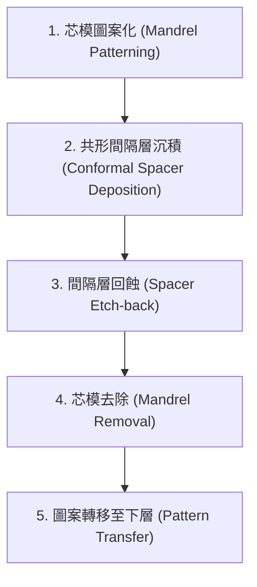

1.  **芯模圖案化**：使用傳統 DUV 浸潤式微影在犧牲層（通常為非晶矽或硬光罩材料）上定義出較寬的線條，稱為芯模。此時的間距為 $P_{initial}$。
2.  **共形間隔層沉積**：利用低溫 CVD 或 ALD 沉積一層高度共形（Conformal）的薄膜（如 $SiO_2$ 或 $Si_3N_4$）。薄膜會均勻地覆蓋在芯模的頂部與側壁，其厚度 $T_{spacer}$ 決定了最終金屬線或閘極的寬度。
3.  **間隔層回蝕**：使用具備高度各向異性（Anisotropic）的乾式蝕刻（見第 19 章），移除位於芯模頂部和平坦區域的薄膜，僅留下附著於芯模側壁的垂直部分。
4.  **芯模去除**：利用高選擇比（Selectivity）的濕式或乾式製程將原始芯模材料移除，此時基板上僅留下成對的間隔層。
5.  **圖案轉移**：以留下的間隔層作為硬光罩，將圖案蝕刻至下方的目標層（如介電層或矽基板）。

#### 幾何關係式
在 SADP 製程中，最終形成的圖案間距 $P_{final}$ 與原始芯模間距 $P_{mandrel}$ 的關係為：
$$P_{final} = \frac{P_{mandrel}}{2}$$
若要達成均勻的線條與間隙（Line/Space），芯模的寬度 $W_{mandrel}$ 與間隔層厚度 $T_{spacer}$ 必須滿足：
$$W_{mandrel} = T_{spacer} = \text{Gap}_{mandrel}$$
其中 $\text{Gap}_{mandrel}$ 為芯模之間的空隙寬度。

### 13.3.3 SAQP：級聯間隔層與四倍微縮

當製程節點演進至 7 奈米或更先進階段，單次的 SADP 已不足以提供所需的密度。自對準四倍圖案化（Self-Aligned Quadruple Patterning, SAQP）透過兩次連續的 SADP 製程，實現間距的四倍微縮。

SAQP 的物理過程可視為將第一代間隔層作為第二代製程的「芯模」。其流程如下：
1.  **第一代芯模（Mandrel 1）**：定義極寬的初始圖案。
2.  **第一代間隔層（Spacer 1）**：沉積並回蝕，移除 Mandrel 1。
3.  **第二代間隔層（Spacer 2）**：將 Spacer 1 視為芯模，在其側壁沉積第二層薄膜並回蝕。
4.  **最終圖案**：移除 Spacer 1，留下 Spacer 2 作為最終硬光罩。

其間距縮減公式為：
$$P_{final} = \frac{P_{mandrel}}{4}$$

!!! warning "製程複雜度"
    SAQP 雖然能將 193 奈米波長的解析度極限推向 10 奈米以下，但其代價是極高的製程步驟數。完成一次 SAQP 需要多次沉積、蝕刻與清洗循環，這顯著增加了晶圓在廠內的週轉時間（Cycle Time）與缺陷風險。

### 13.3.4 圖案重建與斷線技術：切割光罩（Cut/Block Mask）

SADP/SAQP 產生的是連續且閉合的環狀線條（Loop），這在實際電路設計中是無法直接使用的。為了形成電路所需的離散線段（如標準元件中的導線），必須引入額外的微影步驟來「切割」或「阻擋」這些線條。

1.  **切割光罩（Cut Mask）**：在間隔層圖案形成後，利用額外的一層光阻覆蓋不需要保留的區域，隨後透過蝕刻將該段線條移除。
2.  **阻擋光罩（Block Mask）**：在圖案轉移至下層的過程中，利用光阻保護特定區域不被蝕刻。

#### 佈局策略與邊緣餘裕
由於切割光罩本身仍受限於光學微影的疊對精度，因此設計規則（Design Rules）必須保留足夠的「端點對端點（End-to-End）」距離。若切割光罩發生位移，可能會導致線條斷裂不完全或誤切鄰近導線，這被稱為邊緣置放誤差（Edge Placement Error, EPE）。

### 13.3.5 自對準技術之非對稱性變異：間距遊走（Pitch Walking）

自對準技術雖然消除了光學疊對誤差，卻引入了特有的幾何變異問題，其中最嚴重的是「間距遊走（Pitch Walking）」。

#### 物理成因
在 SADP 中，最終生成的四條縫隙（Space）其實來自於不同的製程步驟：
-   **Space A**：原先由芯模（Mandrel）佔據的位置。
-   **Space B**：原先由非芯模區域（Non-mandrel / Gap）佔據的位置。

如果芯模的 CD 控制不精準，或者間隔層沉積的厚度不均勻，會導致 Space A 與 Space B 的寬度不一致。在 SAQP 中，這種現象會演變成三種不同的間距誤差（$P_1, P_2, P_3$），在掃描式電子顯微鏡（SEM）下觀察，會呈現出線條成對靠近或疏離的現象。

#### 數學描述
假設芯模寬度誤差為 $\Delta W$，間隔層厚度誤差為 $\Delta T$，則相鄰線條間距的偏差 $\Delta P$ 可表示為：
$$\Delta P = |W_{mandrel} - (P_{mandrel} - W_{mandrel} - 2T_{spacer})|$$
當此數值不為零時，即發生間距遊走。這會導致寄生電容的不均勻分布，進而影響電路的時序（Timing）表現。

#### 間隔層輪廓斜率的影響
理想的間隔層應具有 $90^\circ$ 的垂直側壁。然而，在實際的回蝕製程中，間隔層頂部常會出現圓角（Rounding）或底部出現拖尾（Footing）。
-   **輪廓斜率（Slope）**：若間隔層側壁非完全垂直，在後續將圖案轉移至硬光罩時，蝕刻前沿會隨深度改變，導致最終線寬與設計值產生偏差。
-   **選擇性（Selectivity）**：在移除芯模時，若對間隔層的選擇比不足，會導致間隔層高度損失（Height Loss），進而削弱其作為後續蝕刻遮罩的能力。

### 13.3.6 SADP 與 SAQP 之比較

| 特性 | SADP | SAQP |
| :--- | :--- | :--- |
| **間距縮減倍率** | 2x | 4x |
| **典型應用節點** | 14nm / 10nm | 7nm / 5nm |
| **關鍵尺寸控制** | 依賴一次薄膜沉積 | 依賴兩次薄膜沉積 |
| **間距遊走風險** | 中（兩種間距組合） | 高（三至四種間距組合） |
| **製程成本** | 中 | 高（步驟數約為 SADP 兩倍） |
| **光罩需求** | 1 Mandrel + 1 Cut | 1 Mandrel + 2~3 Cut |

!!! example "產業實例"
    在 14 奈米 FinFET 製程中，鰭片（Fin）的形成廣泛採用 SADP 技術。到了 7 奈米節點，由於鰭片間距微縮至 30 奈米以下，已超越單次 DUV 曝光極限，因此必須導入 SAQP。儘管 EUV 微影（見第 14 章）能簡化多重圖案化步驟，但在成本考量下，許多晶圓代工廠仍會在底層金屬路徑（Lower Metal Layers）混合使用 SADP 與自對準切割技術。

<!-- fig:2 -->
<figure markdown>
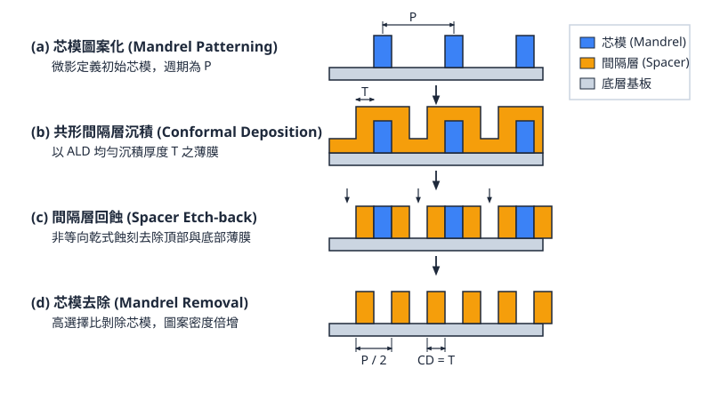
<figcaption>圖 13-2　SADP自對準圖案化流程（AI 繪製的示意圖）</figcaption>
</figure>

## 13.4 疊對預算、邊緣置放誤差與製程經濟學

在先進製程節點中，微影技術的挑戰已從單純的解析度提升，轉向極其嚴苛的幾何位置精確度要求。當特徵尺寸縮小至數十奈米甚至更小，單一製程參數的變異已不足以描述圖案化品質，必須導入「邊緣置放誤差」的概念來綜合評估。

### 邊緣置放誤差（EPE）之數學模型

邊緣置放誤差（Edge Placement Error, EPE）定義為設計圖案的理想邊緣位置與最終矽片上實際物理邊緣位置之間的偏差。在多重圖案化（Multiple Patterning）製程中，EPE 是衡量圖案保真度（Pattern Fidelity）最核心的指標。

EPE 的來源可拆解為兩大類：臨界尺寸均勻度（Critical Dimension Uniformity, CDU）的變異，以及疊對誤差（Overlay Error, OVL）。其簡化的數學描述如下：

$$EPE = \sqrt{\left( \frac{1}{2} \Delta CD \right)^2 + (\Delta Overlay)^2 + \sum \sigma_{others}^2}$$

其中：
- $\Delta CD$：代表臨界尺寸偏離設計值的程度，通常包含光阻顯影後的變異（ADI-CDU）與蝕刻後的變異（AEI-CDU）。公式中取 $1/2$ 是因為 CD 的變異是由兩側邊緣共同分擔。
- $\Delta Overlay$：代表不同層光罩之間，或同一層不同次曝光圖案之間的相對位移。
- $\sigma_{others}$：包含光學鄰近效應修正（OPC）殘餘誤差、線邊緣粗糙度（Line Edge Roughness, LER）以及量測誤差等。

在實際工程應用中，為了確保極高的良率，通常要求 $3\sigma$ 或 $6\sigma$ 的 EPE 必須小於設計規則（Design Rule）所允許的容許值（Budget）。例如，在接觸窗（Contact）與金屬線（Metal Line）的重疊定義中，若 EPE 超過容許值，將導致有效接觸面積縮小（增加電阻）甚至發生短路（Short）或斷路（Open）。

### LELE 與 SADP/SAQP 之誤差預算比較

多重圖案化技術根據其物理實現方式的不同，對 EPE 的組成成分有截然不同的敏感度。

#### 1. LELE：疊對主導型（Overlay-dominated）
在「曝光-蝕刻-曝光-蝕刻」（Litho-Etch-Litho-Etch, LELE）製程中，最終圖案的間距（Pitch）是由兩次獨立的微影曝光決定的。
- **誤差特性**：若第二次曝光相對於第一次曝光產生了位移（Overlay Error），則會直接導致圖案間距的非對稱性（Pitch Walking）。
- **挑戰**：LELE 對機台的疊對精度要求極高。典型值要求疊對誤差必須控制在最小間距的 10% 以內。由於兩次曝光是獨立的，任何掃描儀（Scanner）的對準殘餘誤差都會直接轉化為 EPE。

#### 2. SADP/SAQP：CD 主導型（CD-dominated）
「自對準多重圖案化」（Self-Aligned Double/Quadruple Patterning, SADP/SAQP）利用化學氣相沉積（CVD）或原子層沉積（ALD）形成的間隙壁（Spacer）來定義圖案。
- **誤差特性**：由於間隙壁是依附在核心圖案（Mandrel）側壁生成的，其圖案間距是由薄膜沉積厚度決定，而非由兩次曝光的對準決定。因此，SADP 對疊對誤差具有天然的免疫力（Self-aligned）。
- **挑戰**：其 EPE 主要來源於核心圖案的 CD 均勻度、間隙壁沉積厚度的精確度，以及後續多次蝕刻過程中的選擇比控制。在 SAQP 中，誤差會隨着沉積與蝕刻循環次數增加而累積，導致所謂的「四重圖案非對稱性」。

| 特性 | LELE (雙重曝光) | SADP (自對準雙重圖案) |
| :--- | :--- | :--- |
| **主要誤差來源** | 疊對誤差 (Overlay) | 臨界尺寸均勻度 (CDU) |
| **關鍵設備控制** | 微影機台對準精度 | ALD 沉積厚度與蝕刻選擇比 |
| **設計彈性** | 高（可處理複雜二維圖案） | 低（主要用於規則的一維線條） |
| **製程複雜度** | 中 | 高（涉及多層硬光罩與薄膜製程） |

### 設計與製造的連鎖影響

多重圖案化技術的導入，不僅是製程工程師的挑戰，也深刻影響了電子設計自動化（EDA）與生產管理。

#### 1. EDA 規則複雜化與圖案著色
在多重圖案化下，設計師不能隨意放置圖案。例如在 LELE 中，若兩個圖案距離太近，必須將其分配到不同的光罩上，這稱為「圖案著色」（Coloring）。
- **著色衝突**：若設計中出現「奇數環」（Odd Cycle）結構（如三個圖案彼此距離均小於單次曝光極限），則無法透過兩次曝光完成，必須增加第三片光罩（LELEL）或修改設計。
- **設計週期**：設計規則檢查（DRC）的複雜度呈幾何級數增加，導致電路布局（Layout）與布線（Routing）的運算時間大幅延長，設計週期（Design Cycle Time）隨之增加。

#### 2. 製造週期時間（Cycle Time）與缺陷累積
多重圖案化將原本「一次微影 + 一次蝕刻」的單元製程，擴張為多次循環。
- **Cycle Time 延長**：以 SAQP 為例，完成一層金屬線可能需要 4 次沉積、4 次蝕刻與 2 次微影。這使得該層在晶圓廠（Fab）內的停留時間增加為單次曝光的 3 至 4 倍。
- **缺陷密度（Defect Density）累積**：每一道製程步驟（特別是多次的化學機械研磨 CMP 與濕式清洗）都有可能引入新的隨機缺陷。根據波松分佈（Poisson Distribution），最終良率 $Y = e^{-A \cdot D_0}$，其中 $D_0$ 為各步驟缺陷密度的總和。製程步驟越多，$D_0$ 越高，維持良率的難度就越大。

### 先進節點微縮之經濟平衡點

隨著製程演進至 7 奈米以下，DUV 浸潤式微影（ArFi）的多重圖案化面臨了物理與經濟的雙重極限。

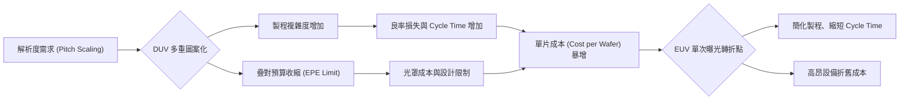

#### 1. DUV 多重圖案化之極限
當 DUV 必須使用到 SAQP 甚至更複雜的組合（如 SADP + LE）來定義關鍵層時，光罩套數（Mask Count）會顯著增加。在 7 奈米節點，若全數採用 DUV，光罩總數可能超過 80 至 90 片。這不僅增加了光罩成本，更使得 EPE 的控制幾乎達到物理極限，任何微小的製程漂移（Drift）都會導致整批晶圓報廢。

#### 2. EUV 轉折點與製程經濟學
極紫外光（EUV）微影（見第 14 章）的介入，其核心價值在於「製程簡化」。
- **經濟平衡點**：雖然 EUV 機台單價遠高於 DUV，但它可以將 3 至 4 次的 DUV 曝光步驟簡化為 1 次 EUV 曝光。
- **成本替代效應**：當「多重 DUV 步驟累積的成本 + 良率損失成本」超過「單次 EUV 曝光成本 + 設備折舊」時，產業便會發生技術轉向。

!!! note "說明"
    在 7 奈米（N7）節點，業界普遍存在兩種路徑：一種是極致利用 DUV 多重圖案化以避開早期 EUV 機台的不穩定性；另一種則是局部導入 EUV 以換取更短的製造週期與更高的設計自由度。到了 5 奈米（N5）以下，由於 EPE 預算已收縮至 2 奈米以下，DUV 多重圖案化在物理上已難以達成所需的良率，EUV 遂成為唯一可行的量產方案。

!!! warning "常見誤解"
    讀者常誤以為多重圖案化只是單純增加光罩數量。實際上，其最大的成本代價來自於「非微影步驟」的激增，包含大量的 ALD、CVD 與高選擇比蝕刻機台的資本支出，以及因製程複雜化導致的研發時間（Time-to-Market）延遲。

### 13.5 設備與廠商技術

在浸潤式微影與多重圖案化的生態系中，設備商的技術演進主要圍繞著提升生產效率（Throughput）與強化疊對精度。

!!! example "產業實例"
    - **掃描儀（Scanner）**：艾司摩爾（ASML）的 Twinscan 系列透過雙晶圓載台（Dual Stage）設計，在一個載台進行曝光的同時，另一個載台進行高精度的量測與對準，將疊對誤差控制在 1 奈米等級。
    - **薄膜與蝕刻**：應用材料（Applied Materials）與東京威力科創（TEL）開發了專為 SADP/SAQP 設計的整合型材料解決方案。例如，高度保形的 ALD 氧化矽或氮化矽薄膜，對於控制間隙壁的 CD 均勻度至關重要；而具備極高選擇比的乾式蝕刻機台，則能在移除核心圖案時而不損傷極薄的間隙壁結構。
    - **量測設備**：科磊（KLA）提供的光學疊對量測系統（Scatterometry Overlay）與電子束量測（CD-SEM），是監控 EPE 並即時回饋給微影機台進行補償（Feedback Control）的關鍵。

## 13.5 設備與廠商技術

### 13.5.1 浸潤式微影與多重圖案化之設備需求

在進入次 20 nm 與 10 nm 以下先進製程節點時，光學微影無法單靠曝光機的數值孔徑（Numerical Aperture, NA）提升來滿足單次曝光解析度極限（見第 12 章）。為了實踐浸潤式微影（Immersion Lithography）以及自對準多重圖案化（Self-Aligned Multiple Patterning, SAMP，如 SADP 與 SAQP），晶圓製造需要高度模組化且緊密協同的機台群：

1. **浸潤式深紫外光微影掃描機（ArF Immersion Scanner）**：提供波長 $\lambda = 193\text{ nm}$、透鏡組末端折射率 $n \approx 1.44$ 的超高數值孔徑（$\text{NA} = 1.35$）曝光環境，具備奈米級的對準（Alignment）與晶圓高度輪廓量測能力。
2. **共軌塗佈顯影機（Coater/Developer Track）**：與微影掃描機進行物理連線（In-line Track），負責光阻塗佈、底部抗反射層（BARC）成膜、曝光前後烘烤（PAB/PEB）及顯影，控制圖案的均勻性與線邊緣粗糙度（Line Edge Roughness, LER）。
3. **高共形薄膜沉積設備（Conformal Thin Film Deposition Systems）**：在自對準技術中沉積厚度精準至次奈米級的間隙壁（Spacer）材料，多採用原子層沉積（Atomic Layer Deposition, ALD）或低溫電漿增強型化學氣相沉積（PECVD）（薄膜技術細節見第 21 章與第 23 章）。
4. **高選擇比異方性乾式蝕刻機（Anisotropic Dry Etchers）**：進行心軸（Mandrel）圖案成形、間隙壁回蝕（Spacer Etch-back）與心軸選擇性去除，需具備垂直側壁外形控制與極高的材料蝕刻選擇比（見第 19 章）。
5. **先進製程控制量測機台（Metrology Systems）**：包含光學關鍵尺寸散射儀（Optical Critical Dimension, OCD）、繞射式疊對量測儀（Diffraction-Based Overlay, DBO）與臨界尺寸掃描電子顯微鏡（CD-SEM）。

---

### 13.5.2 浸潤式掃描機核心機構：局部水封套與雙晶圓平台

為克服浸潤式微影中超純水（Ultrapure Water, UPW）作為浸潤介質所帶來的流體缺陷與產能瓶頸，現代 ArF 浸潤式掃描機的核心機構聚焦於兩項關鍵工程設計：局部水封套模組與雙晶圓平台系統。

#### 局部水封套模組（Immersion Hood / Wet Seal）
在 $\text{NA} = 1.35$ 的光學系統中，最後一片投影透鏡元件與晶圓表面的工作距離（Working Distance）通常僅約 $1\text{ mm}$。浸潤系統採用局部浸潤技術（Local Filling），僅讓超純水充滿透鏡與晶圓曝光區域之間的局部間隙，而非將整片晶圓浸入水槽中。

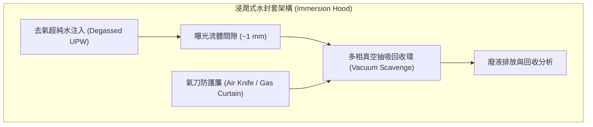

水封套機構通常包含下列關鍵次系統：
- **去氣注水環（Degassed Water Injection Ring）**：注入溶解氧與溶解氮控制在 ppb 等級的超純水，避免雷射光束照射時水中微氣泡形成散射缺陷。
- **真空抽吸回收孔道（Vacuum Scavenge Channels）**：在晶圓以高達 $1\text{ m/s}$ 的加速度高速掃描移動時，利用微米級多孔材料（Porous Media）搭配真空抽吸，將水封套邊界的水膜完整回收。
- **氣刀防護簾（Air Knife / Gas Curtain）**：於水封套最外圍向下噴射高純度乾燥氣體（如 $\text{N}_2$ 或空氣），阻絕邊界殘留微小水滴（Water Droplets）。未被回收的水滴揮發後會留下水痕（Water Marks），並引發局部光阻膨脹或折射率不均勻，造成印刷圖案缺陷。

#### 雙晶圓平台系統（Twin Stage Architecture）
在浸潤式微影中，流體注入、流場建立與水痕檢驗皆需消耗機台時間，若測量與曝光採序列運作，晶圓每小時產能（Wafers Per Hour, WPH）將大幅下滑。雙晶圓平台系統藉由兩個獨立但協同運作的超精密六自由度（6-DoF）懸浮平台，實現「測量與曝光並行（Parallel Measurement and Exposure）」的運作模式。

在典型雙平台架構中（如 ASML TWINSCAN NXT 系列）：
1. **平台 A（測量位置，Measurement Station）**：晶圓裝載後，光學對準感測器量測晶圓上所有對準標記（Alignment Marks），同步利用多光束聚焦感測器建立整片晶圓表面的奈米級三維高度地圖（Topography Height Map）。
2. **平台 B（曝光位置，Exposure Station）**：在此期間，前一片已完成量測地圖建構的晶圓正處於浸潤水封套下，依據先前測得的對準與高度數據，進行連續動態補償曝光。
3. **交換階段（Stage Swap）**：曝光完成後，兩組平台於數秒內完成位置互換，水封套模組在此切換過程中藉由自動水橋對接或封套保護機制維持水體穩定，避免流體逸散或氣泡進入光路。此架構使掃描機產能突破每小時 250 片晶圓以上。

---

### 13.5.3 自對準多重圖案化（SADP/SAQP）之沉積與蝕刻機台協同整合

在自對準多重圖案化製程中，圖案的關鍵尺寸（Critical Dimension, CD）不再完全由光學曝光決定，而是由薄膜沉積厚度與電漿蝕刻外形所支配。

$$CD_{\text{Spacer}} \approx t_{\text{ALD}} - \Delta_{\text{Etch}}$$

其中 $t_{\text{ALD}}$ 為間隙壁材料沉積厚度，$\Delta_{\text{Etch}}$ 為後續非等向性回蝕引起的尺寸損耗偏差。沉積與蝕刻的協同機制流程如下：

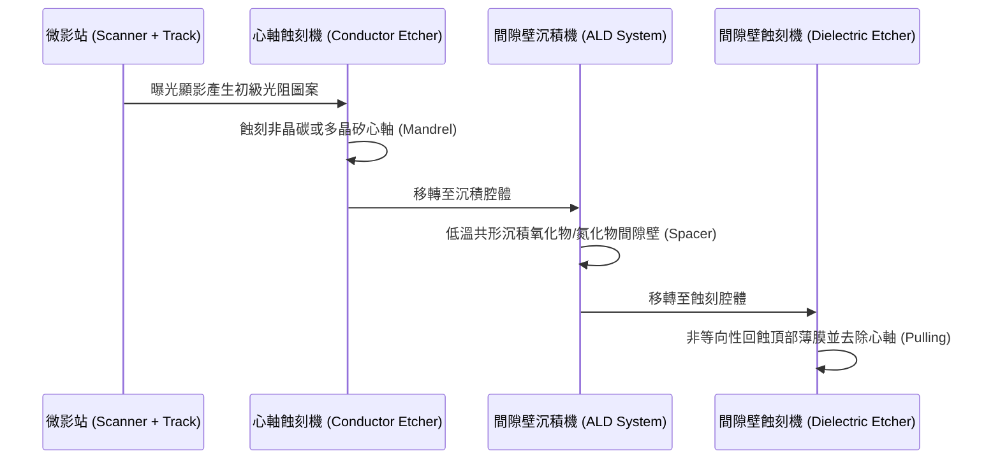

1. **心軸形成（Mandrel Formation）**：微影完成後，導體蝕刻機台（如 Lam Research Kiyo 系列或 Applied Materials Sym3 系列）需將心軸材料（通常為非晶碳膜 Spin-on Carbon 或多晶矽）蝕刻出垂直側壁。側壁垂直度（Sidewall Angle, SWA）誤差將直接放大多重圖案化後線寬的不對稱性（Pitch Walking）。
2. **間隙壁沉積（Spacer Deposition）**：間隙壁薄膜（通常為 $\text{SiO}_2$ 或 $\text{Si}_3\text{N}_4$）必須以近乎 $100\%$ 的階梯覆蓋率（Step Coverage）包覆在心軸外圍。ALD 機台（如 Applied Materials Producer 系列或 Lam Research Striker 系列）利用自限性表面反應（Self-limiting Surface Reactions），將膜厚均勻度標準差控制在數埃（Ångström）之內，確保全晶圓的線寬均勻性（CD Uniformity, CDU）。
3. **間隙壁回蝕與心軸去除（Spacer Etch-back & Mandrel Pull）**：介電質蝕刻機台（如 Lam Research Flex 系列）進行高選擇比偏壓蝕刻，垂直去除底部與心軸頂部的沉積薄膜，僅留下心軸側壁上的間隙壁。隨後透過化學乾式蝕刻或氧電漿灰化，選擇性去除中心心軸，留下間距減半的間隙壁陣列。SAQP 則需重複此沉積與蝕刻循環一次。

---

### 13.5.4 設備供應商與技術特點比較

在多重圖案化與浸潤式微影的產線建置中，不同設備廠在反應腔設計、流體控制與物理量測原理上各有著重：

| 廠商 | 代表產品系列 | 技術路線與特點 | 主要應用 |
| :--- | :--- | :--- | :--- |
| **ASML** | TWINSCAN NXT | 雙平台磁浮驅動、局部浸潤水封套、高 NA（1.35）Catadioptric 反折射光學系統 | 先進邏輯與記憶體節點 DUV 浸潤式微影曝光 |
| **Tokyo Electron** | CLEAN TRACK LITHIUS Pro Z | 晶圓邊緣浸潤防護封裝、高精準度烘烤均勻度控制、整合式晶圓背面清洗 | 浸潤微影光阻塗佈、高階顯影與顯影後檢測 |
| **Applied Materials** | Producer 平台系列 | 多腔體並行架構、低溫電漿增強原子層沉積（PEALD），高階梯覆蓋率低應力薄膜沉積 | SADP/SAQP 之氧化矽、氮化矽間隙壁與硬遮罩沉積 |
| **Applied Materials** | Sym3 系列 | 極高腔體氣流交換率、獨立副產物排氣控制、高電漿密度導體蝕刻架構 | 非晶碳層心軸圖案化、金屬閘極與矽鰭片深蝕刻 |
| **Lam Research** | Striker 系列 | 具備快速前驅物切換能力之介電質 ALD 腔體，強調奈米級結構側壁無孔洞沉積 | 先進記憶體與邏輯多重圖案化之間隙壁成膜 |
| **Lam Research** | Kiyo 系列 | 具備對稱性變壓器耦合電漿（TCP）技術，側壁外形角度與線寬精確調控 | 導體心軸圖案化、多晶矽閘極蝕刻 |
| **Lam Research** | Flex 系列 | 雙頻/多頻電容耦合電漿（CCP）架構，具備對不同材料之超高蝕刻選擇比 | 間隙壁回蝕（Spacer Etch-back）與介電質硬遮罩蝕刻 |
| **Tokyo Electron** | Tactras 系列 | 採用多腔體高密度電漿蝕刻平台，具備多溫區靜電吸盤以微調晶圓邊緣 CD | 先進圖案轉移與間隙壁非等向性蝕刻 |
| **Hitachi High-Tech** | CD-SEM（CG 系列、GT 系列） | 低著陸能量（Landing Energy）場發射電子槍，降低對敏感光阻與間隙壁之照射損傷 | 多重圖案化線寬、間距分配誤差（Pitch Walking）量測 |
| **KLA** | SpectraShape 系列 | 寬頻光學臨界尺寸（Broadband OCD）量測技術，利用光譜反射散射光進行 3D 外形重建 | 間隙壁側壁角、心軸外形三維輪廓線上監控 |
| **KLA** | Archer 系列 | 影像式疊對（Imaging-Based Overlay, IBO）量測技術，支援多層堆疊圖案對準分析 | 多重曝光光罩層間疊對誤差（Overlay Error）量測 |
| **ASML** | YieldStar 系列 | 繞射式疊對（DBO）量測，利用晶圓繞射光束強度不對稱性計算奈米級疊對偏移 | 浸潤式微影機台動態回饋修正與疊對控制 |

---

### 13.5.5 技術路線差異、選機考量與量產實例

#### 技術路線差異與選機取捨
在建立多重圖案化產線時，晶圓代工廠與記憶體廠在設備選擇上有顯著的工程取捨：

1. **ALD 沉積技術取捨（熱 ALD vs PEALD）**：
   - 熱驅動 ALD（Thermal ALD）具有近乎完美的共形性與優良階梯覆蓋率，但反應活化能需求較高，製程溫度常高於 $300^\circ\text{C}$ 至 $400^\circ\text{C}$。若底層材料包含對熱敏感的自旋塗布非晶碳（Spin-on Carbon, SOC）或已完成金屬沉積的結構，高溫會導致底層收縮或元素擴散。
   - 電漿增強型 ALD（PEALD，如 Applied Materials Producer 或 Lam Research Striker 系列）利用電漿自由基在較低溫度（$<200^\circ\text{C}$ 甚至常溫）下驅動反應，降低熱預算損耗。然而，電漿方向性可能導致三維深孔或側壁底部的沉積厚度微幅低於頂部，產生不對稱性。

2. **電漿蝕刻源選擇（ICP vs CCP）**：
   - 感應耦合電漿（ICP，如 Lam Research Kiyo）能獨立控制電漿密度與離子能量，適合心軸的高垂直度與低離子損傷刻蝕。
   - 電容耦合電漿（CCP，如 Lam Research Flex）在高偏壓與重氟碳聚合物環境下運作，能提供對下層氧化物或氮化物極高的選擇比，適合間隙壁回蝕與底層阻止層（Etch Stop Layer）的精密截斷。

!!! example "產業實例：DUV 浸潤式搭配多重圖案化之量產應用"
    - **10 nm / 7 nm 邏輯節點之矽鰭片（Fin）形成**：
      在 EUV 導入前（或初期考量生產成本時），邏輯晶圓代工廠採用 ArF 浸潤式微影機（如 ASML TWINSCAN NXT 系列）曝光第一道非晶碳心軸（Pitch 約 $80\text{ nm}$ 至 $120\text{ nm}$），接續利用 Applied Materials 或 Lam Research 的 ALD 沉積氧化矽間隙壁，經兩次循環的 SAQP 製程將節距四倍細化至 $20\text{ nm}$ 至 $30\text{ nm}$，再透過高密度電漿蝕刻機將圖案轉移至塊狀矽（Bulk Si）基板形成 FinFET 鰭片結構。此製程良率完全取決於 ALD 沉積厚度的均勻性與蝕刻側壁垂直度。
    - **先進 DRAM 電容儲存節點（Storage Node）製造**：
      現代 1x/1y/1z nm 世代的 DRAM 電容孔陣列具備極高的深寬比（Aspect Ratio $> 40:1$）。陣列圖案常利用 ArF 浸潤微影配合蜂巢狀配置的 SADP/SAQP 流程產生高密度硬遮罩。該製程對沉積膜質應力控制要求極高，任何薄膜應力引發的晶圓翹曲（Wafer Bow）都會導致浸潤微影焦深（DOF）耗盡與對準失誤。因此，製程整合需仰賴 Tokyo Electron 的塗佈顯影與蝕刻系統，搭配 KLA SpectraShape 與 ASML YieldStar 提供即時的膜厚、輪廓與繞射疊對閉迴路回授修正（Run-to-Run Control）。

## 本章重點

1. **浸潤式微影的光學突破**：ArF 浸潤式微影技術（ArFi）利用超純水（折射率 $n \approx 1.44$）取代空氣介質，縮短 $193.3\text{ nm}$ 雷射在介質中的有效波長，打破單一透鏡數值孔徑極限，將實用數值孔徑推升至 $\text{NA} = 1.35$，單次曝光最小半間距極限拓展至約 $36\text{ nm}$。
2. **流場穩定度與高精準熱光控制**：局部水封套於高速掃描（$> 500\text{ mm/s}$）下必須維持毛細數平衡以防液滴脫落形成水痕；透過多級真空脫氣可抑制微氣泡米氏散射缺陷；配合毫克耳文（$\pm 1\text{ mK}$）級的恆溫循環系統，能有效抑制因超純水負熱光效應（$dn/dT \approx -1.00 \times 10^{-4}\text{ K}^{-1}$）引發的波前像差與散焦。
3. **介面化學與光阻防護**：超純水與光阻直接接觸易導致光酸產生劑（PAG）與抑制劑溶析，污染終端透鏡鍍膜並使光阻頂部輪廓畸變。業界透過沉積頂部抗反射保護層（TARC）或導入無上塗層自疏水光阻，藉由高後退接觸角（$\theta_{\text{rec}} > 75^\circ$）消除溶析與水痕。
4. **間距分割與 LELE 限制**：LELE 藉由兩道獨立的微影與硬光罩蝕刻將空間頻率減半，但面臨圖論著色中的奇數環衝突，需藉由縫合（Stitch）或單向化佈局解決；兩次曝光間的光學疊對誤差直接導致空間間距交替變異（Space Walk），且製程歷程差異會引發臨界尺寸雙峰分佈（CD Bimodality）。
5. **自對準多重圖案化機制（SADP/SAQP）**：自對準技術將臨界尺寸決定權由光學曝光轉移至原子層沉積（ALD）的薄膜厚度與垂直非等向性回蝕，在物理幾何上完全免除光學疊對誤差；後續透過切割光罩（Cut Mask）或阻擋光罩（Block Mask）中斷連續環狀線條以定義電路圖案。
6. **自對準幾何變異與非對稱性**：SADP 與 SAQP 的主要缺陷為間距遊走（Pitch Walking），源於芯模尺寸偏差與間隔層沉積厚度不均勻導致相鄰空間寬度不對稱；此外，間隔層側壁傾角與回蝕高度損失會劣化後續圖案轉印的線寬保真度。
7. **邊緣置放誤差與製程經濟學**：先進微縮瓶頸轉向由疊對誤差與臨界尺寸均勻度（CDU）共同構成的邊緣置放誤差（EPE）。相較於 LELE 的疊對主導型誤差，SADP/SAQP 屬於 CD 主導型。隨著多重圖案化循環增加，光罩數激增、製造週期延長與隨機缺陷累積，使 7 奈米以下節點迎來向 EUV 單次曝光轉移的經濟平衡點。

---


## 重點圖卡

複習時看這幾張就能抓住本章重點；[圖卡庫](../cards.md)可以下載成圖片。

<div class="ix-cards" markdown>

<figure markdown>

<figcaption>核心概念圖卡：瑞利公式與微影世代</figcaption>
</figure>

<figure markdown>
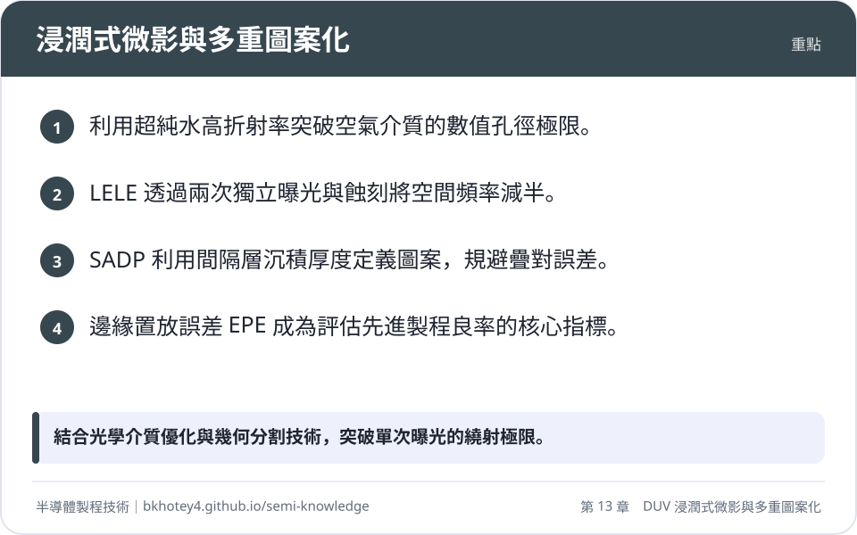
<figcaption>重點圖卡：浸潤式微影與多重圖案化</figcaption>
</figure>

<figure markdown>
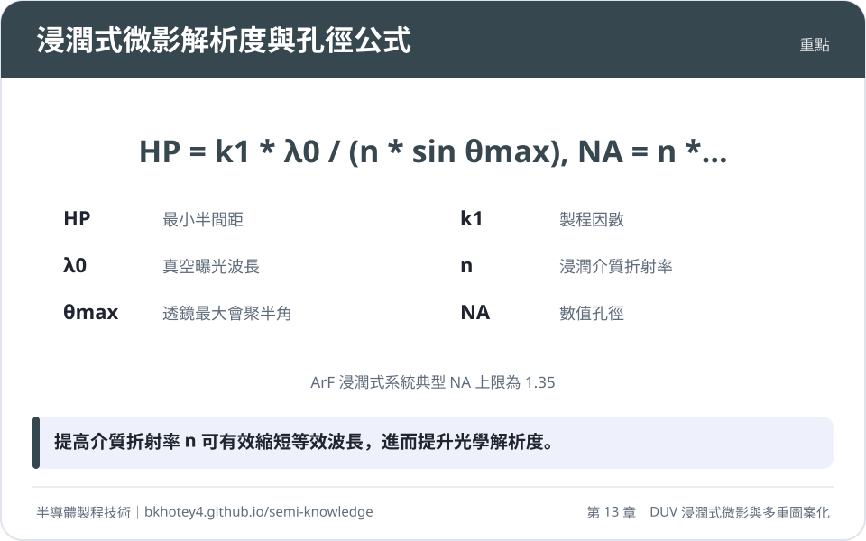
<figcaption>重點圖卡：浸潤式微影解析度與孔徑公式</figcaption>
</figure>

<figure markdown>
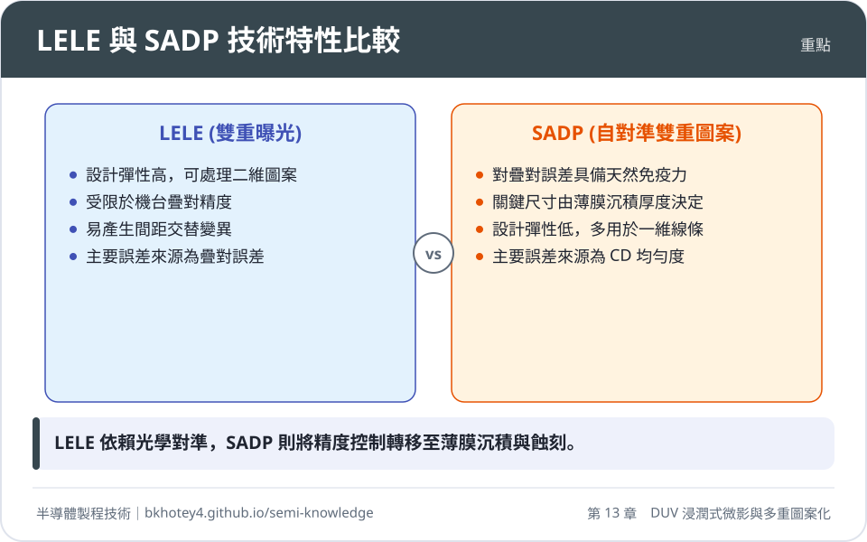
<figcaption>重點圖卡：LELE 與 SADP 技術特性比較</figcaption>
</figure>

<figure markdown>
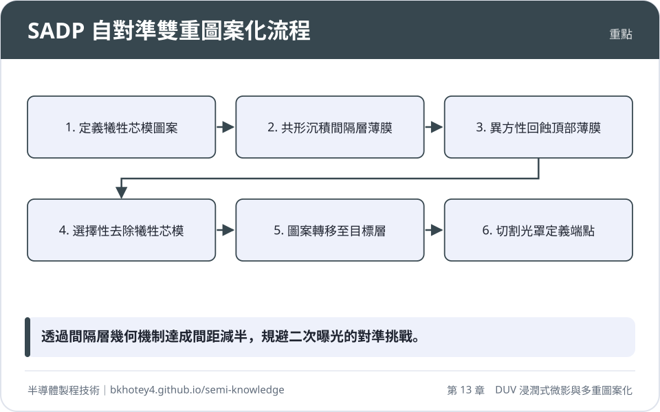
<figcaption>重點圖卡：SADP 自對準雙重圖案化流程</figcaption>
</figure>

</div>

## 習題

**1.** 在 ArF 浸潤式微影系統中，已知波長 $\lambda_0 = 193.3\text{ nm}$，物鏡與晶圓之間的超純水液膜厚度為 $d = 1.0\text{ mm}$，其熱光係數為 $dn/dT = -1.00 \times 10^{-4}\text{ K}^{-1}$。
(1) 若因晶圓載台驅動與雷射熱吸收，導致曝光場內液膜產生 $\Delta T = 5.0\text{ mK}$ 的均勻溫升，計算其引起的光程差（OPD）。
(2) 馬雷夏爾準則（Maréchal criterion）要求光學系統波前均方根誤差需滿足 $\text{RMS} < \lambda_0 / 14$。若將該溫升引起之光程差視為波前畸變上限，試問此溫升所造成的光程差是否在此臨界標準之內？

??? success "參考解答"
    (1) 光程差（$OPD$）之積分計算式為：
    $$OPD = \int_0^d \frac{dn}{dT} \Delta T \, dz = \frac{dn}{dT} \Delta T \cdot d$$
    帶入題目給定之物理參數：
    $$OPD = (-1.00 \times 10^{-4}\text{ K}^{-1}) \times (5.0 \times 10^{-3}\text{ K}) \times (1.0 \times 10^{-3}\text{ m})$$
    $$OPD = -5.0 \times 10^{-10}\text{ m} = -0.50\text{ nm}$$
    故所引起的光程差絕對值為 $0.50\text{ nm}$。

    (2) 根據馬雷夏爾準則，波前允許之容限值為：
    $$\frac{\lambda_0}{14} = \frac{193.3\text{ nm}}{14} \approx 13.81\text{ nm}$$
    計算得出的光程差絕對值 $|OPD| = 0.50\text{ nm} \ll 13.81\text{ nm}$，遠低於馬雷夏爾準則的極限閥值。然而，在實際光學微影系統中，此溫差若呈現三維空間非均勻分佈（如局部梯度），其高階像差（球差、慧差）對影像對比度（NILS）之削弱極為敏感，因此工業標準通常嚴格將動態溫控鎖定在 $\pm 1.0\text{ mK}$ 範圍內。

**2.** 某半導體廠預計利用 SADP 製程製作間距（Pitch）為 $32\text{ nm}$ 的對稱密集金屬導線陣列（即線寬與間距均為 $16\text{ nm}$）。
(1) 試計算初始微影曝光定義的心軸（Mandrel）寬度 $W_{\text{mandrel}}$、心軸間隙寬度 $\text{Gap}_{\text{mandrel}}$，以及間隔層（Spacer）沉積厚度 $T_{\text{spacer}}$ 的理想數值。
(2) 若在沉積製程中，ALD 氧化矽間隔層厚度產生系統性偏差，實際沉積厚度為 $T'_{\text{spacer}} = 18\text{ nm}$（偏差 $+2\text{ nm}$），而心軸初始微影尺寸精準維持設計值。試計算最終圖案轉印後由心軸形成之縫隙寬度（$\text{Space A}$）與非心軸形成之縫隙寬度（$\text{Space B}$），並求出兩者之間的間距偏差量（Pitch Walking, $\Delta P$）。

??? success "參考解答"
    (1) SADP 將原始節距減半，因此初始心軸之節距應為最終節距的兩倍：
    $$P_{\text{mandrel}} = 2 \times P_{\text{final}} = 2 \times 32\text{ nm} = 64\text{ nm}$$
    欲形成線寬與間距對稱（$1:1$）之結構，心軸寬度、心軸間隙與間隔層厚度必須滿足：
    $$W_{\text{mandrel}} = \text{Gap}_{\text{mandrel}} = \frac{P_{\text{mandrel}}}{2} = 32\text{ nm}$$
    間隔層厚度直接決定最終導線線寬，故：
    $$T_{\text{spacer}} = 16\text{ nm}$$
    此時心軸寬度去除兩側間隔層後的縫隙、以及間隙區保留的空間皆能符合對稱比例。若採用心軸保留（Mandrel-retained）或心軸去除（Mandrel-pulled）模式，對稱條件為：
    $$W_{\text{mandrel}} = 2 \times T_{\text{spacer}} = 16\text{ nm} \text{（此為直接定義導線模式）}$$
    本題要求「密集陣列導線寬度為 $16\text{ nm}$，空間為 $16\text{ nm}$」，在標準心軸去除流程（Mandrel-pulling）中，間隔層留存為導線，故導線寬度 $W_{\text{line}} = T_{\text{spacer}} = 16\text{ nm}$。
    心軸去除後留下的空間 $\text{Space A} = W_{\text{mandrel}} = 16\text{ nm}$；
    非心軸區之空間 $\text{Space B} = \text{Gap}_{\text{mandrel}} - 2 \times T_{\text{spacer}} = 48\text{ nm} - 32\text{ nm} = 16\text{ nm}$。
    因此初始設計值為：$W_{\text{mandrel}} = 16\text{ nm}$，$\text{Gap}_{\text{mandrel}} = 48\text{ nm}$，$T_{\text{spacer}} = 16\text{ nm}$（初始 $P_{\text{mandrel}} = 64\text{ nm}$）。

    (2) 當間隔層厚度變異為 $T'_{\text{spacer}} = 18\text{ nm}$ 時：
    - 心軸側壁向內沉積並不改變心軸實體寬度，去除心軸後形成的空間 $\text{Space A}$ 僅由心軸決定：
      $$\text{Space A} = W_{\text{mandrel}} = 16\text{ nm}$$
    - 非心軸區兩側均附著增厚的間隔層，其殘留空間 $\text{Space B}$ 為：
      $$\text{Space B} = \text{Gap}_{\text{mandrel}} - 2 \times T'_{\text{spacer}} = 48\text{ nm} - 2 \times (18\text{ nm}) = 12\text{ nm}$$
    - 最終線條間隙交替出現 $16\text{ nm}$ 與 $12\text{ nm}$。
    間距偏差（Pitch Walking）量值為兩相鄰空間之絕對差：
    $$\Delta P = |\text{Space A} - \text{Space B}| = |16\text{ nm} - 12\text{ nm}| = 4\text{ nm}$$
    此一非對稱空間分佈將使後續金屬內連線產生寄生電容不對稱變異。

**3.** 試從圖論著色問題（Graph Coloring）的觀點，說明在雙重圖案化（LELE）中何謂「奇數環衝突（Odd Cycle Conflict）」，並說明電路佈局設計中採用何種幾何規則可以根本性杜絕奇數環的產生。

??? success "參考解答"
    (1) **奇數環衝突機制**：
    在 LELE 拆圖演算法中，版圖幾何圖形被視為圖論中的節點，當兩個圖形的空間間距小於單次曝光微影極限距離 $S_{\text{min}}$ 時，節點間即存在一條邊，代表兩者必須著上相異顏色（分配至不同光罩）。若電路佈局中出現奇數個多邊形（如三個節點 $A$、$B$、$C$）兩兩互相接近且間距均小於 $S_{\text{min}}$，這三個節點將構成封閉的三角形閉環（三元環）。此時若將 $A$ 著為顏色 1（光罩 1），$B$ 必須著為顏色 2（光罩 2），則節點 $C$ 同時與 $A$、$B$ 相鄰，無法在雙色系統中被指派任何顏色而不違反微影規則，此即為奇數環衝突。
    
    (2) **杜絕衝突的設計幾何規則**：
    根本性的解決手段是導入**單向化格點佈局（1D Gridded Layout）**。在先進製程之關鍵層（如多晶矽閘極或金屬一層），強制所有導線僅能沿單一方向（如垂直方向）平行排列，完全禁止二維轉折（Jog）與交錯結構；線條的端點裁斷與隔離則交由後續的垂直切割光罩處理。平行線條之間的相鄰關係在拓撲上僅形成鏈狀或二分網格，不存在封閉的奇數環幾何，能徹底在演算法層面排除奇數環衝突。

**4.** 邊緣置放誤差（Edge Placement Error, EPE）是先進圖案化的核心監控指標。在某 10 奈米金屬層製程中，其 EPE 預算模型簡化為：
$$EPE_{3\sigma} = \sqrt{\left(\frac{1}{2} \Delta CD_{3\sigma}\right)^2 + (\Delta Overlay_{3\sigma})^2 + \sigma_{\text{LER}}^2}$$
某工廠採用 LELE 製程，量測得 $\Delta CD_{3\sigma} = 3.0\text{ nm}$，機台疊對誤差 $\Delta Overlay_{3\sigma} = 2.5\text{ nm}$，線邊緣粗糙度貢獻值 $\sigma_{\text{LER}} = 1.2\text{ nm}$。
(1) 計算該 LELE 製程之總體 $EPE_{3\sigma}$。
(2) 若改用 SADP 製程，疊對誤差對間距形成完全免疫（$\Delta Overlay \to 0$），但因兩次沉積與蝕刻循環使臨界尺寸變異放大為 $\Delta CD_{3\sigma} = 3.6\text{ nm}$，且維持相同的 $\sigma_{\text{LER}} = 1.2\text{ nm}$。計算此 SADP 製程之 $EPE_{3\sigma}$，並比較兩者之優劣。

??? success "參考解答"
    (1) 計算 LELE 之總體邊緣置放誤差：
    $$EPE_{3\sigma, \text{LELE}} = \sqrt{\left(\frac{3.0}{2}\right)^2 + 2.5^2 + 1.2^2} = \sqrt{1.5^2 + 2.5^2 + 1.2^2} = \sqrt{2.25 + 6.25 + 1.44} = \sqrt{9.94} \approx 3.15\text{ nm}$$

    (2) 計算 SADP 之總體邊緣置放誤差（疊對項為 0）：
    $$EPE_{3\sigma, \text{SADP}} = \sqrt{\left(\frac{3.6}{2}\right)^2 + 0^2 + 1.2^2} = \sqrt{1.8^2 + 0 + 1.2^2} = \sqrt{3.24 + 1.44} = \sqrt{4.68} \approx 2.16\text{ nm}$$

    (3) **比較分析**：
    SADP 的 $EPE_{3\sigma}$（$2.16\text{ nm}$）顯著低於 LELE（$3.15\text{ nm}$），其降幅超過 $31\%$。雖然 SADP 因多次化學反應使薄膜厚度變異（CD 變異）微幅上升，但由於其間隙壁形成機制擺脫了微影機台動態對準疊對誤差（Overlay）的最大貢獻項，展現了顯著的邊緣位置精確度優勢。

**5.** 在 ArF 浸潤式微影機台以高達 $600\text{ mm/s}$ 的載台掃描速度運作時，流體動力學與界面現象對圖案良率有何重大影響？試申論「微氣泡（Micro-bubbles）」與「乾燥水痕（Water Marks）」之物理成因及其在硬體與材料上的防制機制。

??? success "參考解答"
    (1) **微氣泡之物理成因與防制機制**：
    - **物理成因**：當水流高速流動時，若固-液-氣接觸線的前進接觸角過大，周邊空氣易被機械性捲入液膜（Air Entrainment）；此外，去離子水若溶有飽和氣體，在吸收高功率脈衝紫外光後局部微幅受熱，氣體溶解度驟降會析出過飽和氮氣與氧氣，形成次微米氣泡。當氣泡直徑大於光波長之十分之一時，會產生米氏散射（Mie Scattering），破壞波前相位與光強分佈，導致嚴重斷線或孔洞缺陷。
    - **防制機制**：機台硬體配置真空脫氣模組（Degasser），透過多孔薄膜將水中溶解氧、氮氣強制抽吸至 $5\text{ ppb}$ 以下；同時最佳化局部水封套的環形氣簾（Air knife）與注水壓差，使前進動態潤濕維持層流穩定，消除空氣捲入。

    (2) **乾燥水痕之物理成因與防制機制**：
    - **物理成因**：當載台掃描速度超過臨界後退毛細數時，彎月面後緣失穩拉長破裂，造成微米級液滴殘留在晶圓表面（Droplet pulling）。殘留水滴蒸發時，水中微量雜質或光阻表面溶析出的微量聚合物被濃縮析出，形成奈米級沉積斑點（水痕）；水滴亦會引發光阻局部應力釋放或阻礙曝光後烘烤（PEB）之酸催化反應，使圖案產生顯影殘留（Scum）或蝕刻硬遮罩異常。
    - **防制機制**：材料端開發高後退接觸角（$\theta_{\text{rec}} > 75^\circ$）之頂部抗反射保護層（TARC）或表面偏析自疏水光阻，促使水滴俐落抽離不留殘渣；設備端採用多相真空微孔抽吸回收環（Vacuum Scavenge Channels），並以乾燥氣刀阻絕微水滴逸出，實現零液滴脫落的完全約束。

---

## 本章術語

- **ArF Immersion Lithography**（ArF 浸潤式微影）：以波長 193 nm 之 ArF 準分子雷射為光源，並在投影物鏡最末端與晶圓之間填入高純度去離子水介質以提升數值孔徑的曝光技術。
- **Numerical Aperture**（數值孔徑, NA）：描述光學系統收集與聚焦光線角度範圍的無因次參數，數學定義為介質折射率與最大孔徑半角正弦值之乘積。
- **Ultra-Pure Water**（超純水, UPW）：經多重過濾、去離子與真空脫氣處理，在 193 nm 下折射率約為 1.44 且具備極低光吸收率的高純度液態介質。
- **Capillary Number**（毛細數, Ca）：流體力學中表徵流體黏滯力與氣液介面表面張力相對比值的無因次參數，決定浸潤彎月面在高速移動下的穩定性。
- **Thermo-optic Coefficient**（熱光係數, dn/dT）：材料折射率隨溫度變化的導數關係，超純水在 193 nm 下呈現負值，細微溫差即會引發光程差與波前畸變。
- **Top Anti-Reflective Coating**（頂部抗反射保護層, TARC）：旋塗於光阻上方之氟聚合物保護薄膜，具備破壞性干涉抑振抗反射以及隔絕水-光阻溶析反應之雙重功能。
- **Topcoatless Resist**（無上塗層自疏水光阻）：光阻配方內添加含氟疏水基團，在烘烤過程中自發性向表面偏析形成單分子阻水屏障的先進光阻材料。
- **Pitch Splitting**（間距分割）：藉由計算微影將超越單次曝光繞射極限的高密度圖案拆解為兩組或多組低密度子圖案，分次曝光成形之技術統稱。
- **Litho-Etch-Litho-Etch**（雙重微影蝕刻, LELE）：透過第一次曝光顯影與硬光罩乾蝕刻固化圖案後，再次塗佈光阻進行第二次對準曝光與蝕刻以達成圖案間距減半的製程。
- **Chemical Freezing**（化學凍結技術, LFLE）：在第一道光阻圖案顯影後利用交聯化學劑使表層硬化鈍化，省去第一次蝕刻直接塗佈第二道光阻之簡化雙重圖案化技術。
- **Odd Cycle Conflict**（奇數環衝突）：在版圖雙色拆圖過程中，出現三個或奇數個圖形互相接近且間距均小於最小微影設計規則，導致無法在雙色系統中無衝突著色的拓撲困境。
- **Stitch**（縫合處）：為化解奇數環衝突，將單一連續圖元人為裁切並分配至不同光罩，在空間中保留重疊交接區的版圖處理技術。
- **Self-Aligned Double Patterning**（自對準雙重圖案化, SADP）：利用心軸側壁共形沉積間隔層並進行垂直回蝕，再移除心軸以形成半間距間隔層硬光罩的倍頻技術。
- **Self-Aligned Quadruple Patterning**（自對準四倍圖案化, SAQP）：以第一代間隔層作為第二代微縮心軸，連續執行兩次 SADP 流程以達成初始圖案節距四倍細化之極限技術。
- **Mandrel**（心軸/芯模）：在自對準圖案化製程中預先以光學微影成形、作為間隔層沉積載體並在後續步驟中被選擇性去除的犧牲性硬光罩結構。
- **Spacer**（間隔層/間隙壁）：利用原子層沉積在心軸側壁共形生長，經異方性回蝕後殘留於垂直邊界的奈米薄膜結構，其厚度直接界定最終導線寬度。
- **Cut Mask / Block Mask**（切割光罩/阻擋光罩）：用於截斷自對準間隔層所形成的閉合環狀連續幾何線條，以定義出離散導線端點的補充微影光罩。
- **Pitch Walking**（間距遊走）：自對準多重圖案化中因心軸尺寸偏移或間隔層沉積厚度不對稱，導致相鄰空間寬度呈現一寬一窄交替漂移的幾何非對稱現象。
- **Edge Placement Error**（邊緣置放誤差, EPE）：晶圓上最終成形幾何邊界相對於原設計標稱物理邊緣位置的三維全域偏差向量，由疊對誤差、CD 均勻度與隨機粗糙度共同決定。
- **Local Immersion Hood**（局部水封套）：懸浮於終端透鏡與晶圓之間，整合注水、真空排氣與氣刀保護，維持微米級受限流體液膜動態平衡的微影機核心流體機構。
- **Twin Stage Architecture**（雙晶圓平台系統）：曝光機配置兩組可互換之超精密懸浮平台，實現「測量對準與晶圓曝光並行運作」以突破產能瓶頸的雙軌機構。


## 互動學習

!!! tip "動手試試看"
    - [互動實驗：微影解析度（瑞利公式）](../labs.md#rayleigh)
    - [設備機台圖鑑：曝光機（掃描式步進機）](../equipment.md)

<div class="quiz" data-quiz="03-03"></div>


## 產業最新進展

本節由每日產業新聞自動補充，說明本章技術在產業上的最新發展。

<!-- updates -->
（目前尚無補充。）
