# 第 14 章　EUV 微影

!!! abstract "學習目標"
    - 理解從深紫外光 (DUV) 躍遷至極紫外光 (EUV) 的物理動機，以及 13.5 nm 軟 X 射線光學所面臨之物質強烈吸收挑戰
    - 掌握雷射激發錫電漿 (LPP) 產生高功率 13.5 nm 極紫外光的微觀發光物理與雙脈衝激發機制
    - 深入分析鉬/矽 (Mo/Si) 布拉格多層膜反射鏡之干涉光學原理、衰減特性與反射式光學系統幾何限制
    - 探討超高真空環境需求、氫氣除污機制、光子散粒雜訊及隨機效應 (Stochastics) 對先進製程微縮帶來的良率瓶頸
    - 解析商用 EUV 曝光機之模組架構、即時控制與邊緣運算雙主機系統，以及與晶圓廠製造執行系統之整合

## 14.1 EUV 微影之物理挑戰與光學架構轉變

在微影技術的演進過程中，波長的縮減始終是提升解析度（Resolution）最直接且有效的手段。根據瑞利準則（Rayleigh Criterion），最小解析尺寸（Critical Dimension, CD）定義為：

$$CD = k_1 \frac{\lambda}{NA}$$

其中，$\lambda$ 為光源波長，$NA$ 為物鏡的數值孔徑（Numerical Aperture），$k_1$ 則是與製程相關的因子。在第 12 章與第 13 章中，我們探討了深紫外光（Deep Ultraviolet, DUV）微影如何從 248 nm（KrF）演進至 193 nm（ArF），並透過浸潤式微影（Immersion Lithography）技術將 $NA$ 提升至 1.35 的物理極限。然而，隨著邏輯電路節點進入 7 奈米以下，即便使用多重圖案化（Multi-patterning）技術，193 nm 波長的物理限制仍導致製程複雜度過高、良率下降且成本劇增。

極紫外光（Extreme Ultraviolet, EUV）微影的導入，是將波長由 193 nm 直接躍遷至 13.5 nm，波長縮減幅度達 14 倍以上。這一巨大的物理跨度不僅是光源能量的提升，更意味著微影系統從底層物理原理到光學架構的全面重構。

### 凝聚態物質在 EUV 波段的介電特性

在 DUV 或可見光波段，光學玻璃（如石英 $SiO_2$ 或氟化鈣 $CaF_2$）具有良好的穿透率，這是因為光子能量低於材料的能隙（見第 1 章），電子無法被輕易激發至導帶。然而，EUV 光子的能量約為 91.8 eV（由 $E = hc/\lambda$ 計算所得，其中 $h$ 為普朗克常數，$c$ 為光速），此能量遠高於幾乎所有固態材料的原子電離能。

在極紫外光波段，物質的複數折射率（Complex Refractive Index）通常表示為：

$$n(\omega) = 1 - \delta + i\beta$$

其中：
- $\delta$（Refractive Index Real Part Decrement）：折射率實部與 1 的偏差量，代表相位偏移。
- $\beta$（Extinction Coefficient）：消光係數，代表材料對光子的吸收強度。

在 13.5 nm 波長下，所有凝聚態物質（Condensed Matter）的 $\delta$ 與 $\beta$ 數值皆極小（典型值約在 $10^{-1}$ 至 $10^{-3}$ 數量級）。這導致了兩個關鍵的物理後果：

1.  **強烈吸收特性**：由於 $\beta$ 值雖小但對於高密度固體而言仍足以在極短距離內耗盡光子能量，EUV 光在任何固體材料中的穿透深度（Penetration Depth）通常僅有數十至數百奈米。這意味著傳統的穿透式折射透鏡（Transmissive Lens）在 EUV 波段完全失效，因為光線在穿過透鏡前就會被完全吸收。
2.  **折射率趨近於 1**：由於實部 $1-\delta$ 極其接近 1，光線在不同介質介面間的折射效應微乎其微。這使得利用折射原理來聚焦或改變光路的方法在實務上不可行。

因此，EUV 微影系統必須捨棄傳統的透鏡設計，轉向全反射式光學系統（All-Reflective Optical System）。

### 從折射到反射：光學架構的轉變

由於沒有任何材料能讓 EUV 光穿透，整個微影系統的光學路徑——從光源、照明系統（Illuminator）、光罩（Mask）到投影物鏡（Projection Optics, PO）——都必須由反射鏡組成。

下表對比了 DUV 與 EUV 微影系統在光學設計上的本質差異：

| 特性 | DUV 浸潤式微影 (ArFi) | EUV 微影 |
| :--- | :--- | :--- |
| **光源波長** | 193 nm | 13.5 nm |
| **光學元件** | 穿透式透鏡 (Refractive) | 反射式鏡面 (Reflective) |
| **光罩形式** | 穿透式石英光罩 | 反射式多層膜光罩 |
| **介質環境** | 高純度水 / 氮氣 | 高真空 (High Vacuum) |
| **數值孔徑 (NA)** | 1.35 (典型值) | 0.33 (典型值) |
| **反射/穿透率** | 透鏡穿透率 > 98% | 鏡面反射率 ~ 70% |

在全反射系統中，每一面反射鏡的反射率極限約為 70%（詳見 14.3 節關於多層膜反射鏡的討論）。由於一套先進的 EUV 投影系統可能包含 6 至 10 面反射鏡，光能的損耗極為驚人。若以 10 面鏡子計算，最終到達晶圓表面的能量僅剩初始能量的 $(0.7)^{10} \approx 2.8\%$。這種極低的光學效率，正是 EUV 設備需要極高功率光源的原因。

### 斜向照明與陰影效應 (Shadowing Effect)

在傳統穿透式微影中，光線可以垂直穿過光罩。但在反射式系統中，為了避免入射光與反射光在空間上重疊，光線必須以特定的角度入射光罩。這種設計稱為「離軸反射」（Off-axis Reflection）。

在標準 $NA=0.33$ 的 EUV 機台中，光線入射光罩的主光線角度（Chief Ray Angle, CRA）通常設定為 6 度。然而，EUV 光罩並非完美的平面，其構造包含底部的多層膜反射層與頂部的圖案化吸收層（Absorber，典型厚度約 50-70 nm）。當光線以非垂直角度入射時，吸收層的物理高度會阻擋部分反射光，產生所謂的「陰影效應」（Shadowing Effect）。

!!! note "陰影效應的幾何影響"
    陰影效應會導致以下問題：
    1. **臨界尺寸偏移（CD Bias）**：平行於入射平面的線條與垂直於入射平面的線條，其有效曝光寬度會不一致。
    2. **圖案位移（Pattern Shift）**：隨著焦距改變（Defocus），由於斜向入射的幾何關係，圖案在晶圓上的投影位置會發生水平位移。
    3. **對比度下降**：陰影區域邊界的不確定性會導致影像對比度（Image Contrast）受損。

陰影效應的幾何關係可簡化表示為：
$$\Delta x = h \cdot \tan(\theta)$$
其中 $\Delta x$ 為陰影寬度，$h$ 為吸收層厚度，$\theta$ 為入射角。在先進製程中，必須透過計算微影（Computational Lithography）與光學鄰近修正（OPC，見第 16 章）來補償這些幾何失真。

### 系統架構流程與環境挑戰

由於空氣（主要為氧氣與氮氣）對 EUV 光具有強烈的吸收作用，整個 EUV 曝光機內部必須維持在高真空狀態。這不僅增加了機械設計的複雜度，也改變了晶圓傳送與冷卻的機制。

以下為 EUV 微影系統的基本光路與架構流程：

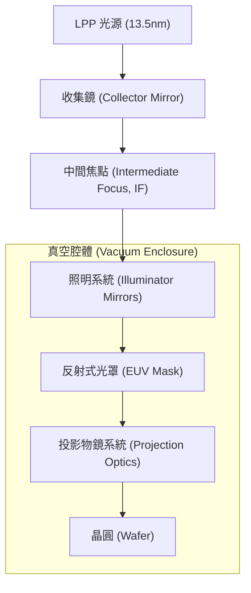

在 14.1 節的討論中，我們確立了 EUV 微影的物理基調：為了突破瑞利準則的解析度限制，我們必須接受一個「光子極易被吸收」的物理環境。這迫使半導體界放棄了使用百年的折射式光學，轉而開發極其精密的多層膜反射技術，並在真空中操作複雜的機械結構。這種從「透明」到「不透明」的轉變，是半導體製程史上最重大的技術斷層之一。在接下來的章節中，我們將詳細探討如何產生如此高能量的光源，以及如何製造出反射率接近物理極限的鏡面。

## 14.2 極紫外光源：雷射激發錫電漿 (LPP) 原理與實作

### 錫電漿原子物理與 13.5 nm 未解析躍遷陣列 (UTA)

極紫外光微影（Extreme Ultraviolet Lithography, EUV）所選用的中心波長為 $13.5\text{ nm}$，其光子能量約為 $91.8\text{ eV}$。在此波長範圍內，自然界中並無可用的固態雷射或受激發射介質，必須仰賴將物質高度游離所形成的高溫高密度電漿（High-Temperature, High-Density Plasma）。目前半導體量產微影機台全面採用雷射激發電漿（Laser-Produced Plasma, LPP），並以熔融態金屬錫（Tin, $\text{Sn}$，原子序 $Z = 50$）作為靶材。

當金屬錫受到高能脈衝雷射聚焦轟擊時，電子因強電場而迅速脫離原子核束縛，形成局部高溫電漿。當電漿的電子溫度（Electron Temperature, $T_e$）達到 $30\text{ eV}$ 至 $45\text{ eV}$（約等於 $3.5 \times 10^5\text{ K}$ 至 $5.2 \times 10^5\text{ K}$）時，錫原子外層電子大量游離，主要產生價態介於 $\text{Sn}^{8+}$ 至 $\text{Sn}^{14+}$ 的多價離子，其中以 $\text{Sn}^{11+}$、$\text{Sn}^{12+}$ 與 $\text{Sn}^{13+}$ 的激發態對 $13.5\text{ nm}$ 輻射貢獻最為顯著。

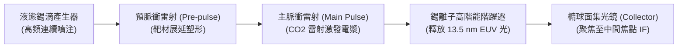

在這些高度游離的錫離子中，外層電子在 $4p^6 4d^n \to 4p^5 4d^{n+1}$ 以及 $4d^n \to 4d^{n-1} 4f$ 能階之間進行自發輻射躍遷（Spontaneous Emission Transition）。由於錫原子內部軌域角動量與自旋相互作用強烈，且多個價態離子的激發態能階極為複雜密集，數以千計重疊的次能階躍遷譜線彼此展寬堆疊，在光譜儀上無法解析為單一分立譜線，因而在原子物理學上稱為「未解析躍遷陣列」（Unresolved Transition Array, UTA）。

此 UTA 剛好形成一個半高寬約 $1\text{ nm}$ 的發射峰，其峰值中心落在 $13.5\text{ nm}$ 附近。由於多層膜反射鏡（見第 14.3 節）之反射頻寬僅有約 $2\%$（約 $13.5 \pm 0.135\text{ nm}$），此有效反射波段內的輻射被稱為「帶內輻射」（In-band Radiation），其餘無法被微影光學系統反射的能量則為「帶外輻射」（Out-of-band, OoB Radiation）。

!!! note "說明：帶外輻射的熱效應與色差問題"
    帶外輻射主要包含可見光、紅外線（IR）以及深紫外光（DUV）。這些光子若未被濾除而進入後續光學投影系統，雖然反射率極低，但累積的高能量仍會造成反射鏡嚴重的熱形變（Thermal Deformation），破壞波前精度；此外，部分 DUV 光子可能被光阻吸收而造成無聚焦的背景曝光，劣化圖形對比度。

---

### 液態錫滴產生器與微米級噴注控制

為了持續維持 LPP 光源的穩定發光，必須以極高的頻率與極小的幾何位置抖動，向真空腔體中央連續注入熔融錫滴。這項任務由液態錫滴產生器（Droplet Generator, DG）執行。

金屬錫的熔點為 $231.9\,^\circ\text{C}$。在產生器內部，高純度錫（純度通常要求達 $99.999\%$ 以上）被加熱至熔融狀態，並由超高純度惰性氣體施加數十個大氣壓的背壓，將液態錫壓入一微米級噴嘴（孔徑直徑典型值為 $3\text{ 至 }10\text{ }\mu\text{m}$），形成一條連續的微細液流（Liquid Jet）。

根據流體力學中的瑞利–普拉托不穩定性（Rayleigh-Plateau Instability），圓柱形液流在表面張力驅動下會自然分裂成離散液滴。為了精確控制液滴的分裂時序與尺寸均勻性，噴嘴旁安裝了高頻壓電致動器（Piezoelectric Actuator, PZT）。壓電晶體接收特定頻率與振幅的高頻電訊號，沿著液流方向施加週期性聲學壓力調變，強制液流在受控的固定波長下分裂：

$$\lambda_{\text{pert}} = \frac{v_{\text{jet}}}{f_{\text{PZT}}}$$

其中 $v_{\text{jet}}$ 為液流流速，$f_{\text{PZT}}$ 為壓電調變頻率，$\lambda_{\text{pert}}$ 為調變擾動波長。當 $\lambda_{\text{pert}} > \pi d_{\text{jet}}$（$d_{\text{jet}}$ 為液柱直徑）時，擾動將指數成長並截斷液流，形成高度規則的等間距液滴群。

| 參數項目 | 典型數值範圍 | 物理意義與影響 |
| :--- | :--- | :--- |
| 液滴直徑 ($d_{\text{drop}}$) | $20\text{ 至 }30\text{ }\mu\text{m}$ | 決定單一脈衝所需的錫質量負載；質量過大會增加碎屑污染 |
| 噴注頻率 ($f_{\text{rep}}$) | $50\text{ kHz}$ | 決定曝光光源之脈衝重複率與機台產出吞吐量（Throughput） |
| 液滴速度 ($v_{\text{drop}}$) | $70\text{ 至 }100\text{ m/s}$ | 確保相鄰液滴在雷射轟擊電漿膨脹區時不被回吹氣流干擾 |
| 空間位置抖動 (Spatial Jitter) | $< 3\text{ }\mu\text{m}\ (3\sigma)$ | 確保雷射能量沉積空間的一致性，防止能量波動 |
| 時間抖動 (Timing Jitter) | $< 5\text{ ns}\ (3\sigma)$ | 雷射觸發感測器同步精度，決定電漿激發的脈衝重現性 |

---

### 二氧化碳雷射與雙脈衝電漿激發技術

要將運動速度達 $100\text{ m/s}$、直徑僅數十微米的液態錫滴完全轉化為輻射 $13.5\text{ nm}$ 的高溫電漿，雷射系統的波長選擇與脈衝能量沉積方式至關重要。

#### 雷射波長選擇與臨界電子密度

脈衝雷射將能量轉移至靶材的物理機制，主要是透過自由電子與離子碰撞時發生的「逆軔致輻射吸收」（Inverse Bremsstrahlung Absorption）。電漿對特定頻率雷射的吸收截面與傳播行為，由電漿頻率（Plasma Frequency, $\omega_p$）決定。電漿所允許電磁波傳播的臨界電子密度（Critical Electron Density, $n_c$）由麥克斯威爾方程式與電漿介電常數推導為：

$$n_c = \frac{\varepsilon_0 m_e \omega_L^2}{e^2} = \frac{\pi m_e c^2}{e^2 \lambda_L^2}$$

其中 $\varepsilon_0$ 為真空電容率，$m_e$ 為電子質量，$e$ 為基本電荷，$c$ 為光速，$\omega_L$ 與 $\lambda_L$ 分別為入射雷射之角頻率與真空波長。代入物理常數後，可得近似關係式：

$$n_c \approx \frac{1.1 \times 10^{21}}{\lambda_L^2}\quad \left[\text{電子/cm}^3\text{，其中 }\lambda_L\text{ 單位為 }\mu\text{m}\right]$$

若選用固態雷射常用的釹摻雜釔鋁石榴石雷射（Nd:YAG，$\lambda_L \approx 1.06\text{ }\mu\text{m}$），臨界密度 $n_c \approx 10^{21}\text{ cm}^{-3}$；而脈衝式二氧化碳雷射（$\text{CO}_2$ 雷射，$\lambda_L \approx 10.6\text{ }\mu\text{m}$），其臨界密度大幅下降至 $n_c \approx 10^{19}\text{ cm}^{-3}$。

選擇 $\text{CO}_2$ 雷射的關鍵物理原因在於：
1. **阻斷自吸收（Self-Absorption）**：在 $10^{21}\text{ cm}^{-3}$ 的極高密度電漿區，游離錫離子發射的 $13.5\text{ nm}$ 光子會立刻被周圍密集的低能階錫離子重新吸收；而在 $\text{CO}_2$ 雷射對應的較低臨界密度區，$13.5\text{ nm}$ 光子的平均自由程遠大於電漿幾何尺寸，帶內光子能順利穿透電漿逸出。
2. **能量吸收深度適中**：長波長的 $\text{CO}_2$ 雷射在低密度外圍電漿冠層（Corona）即被強烈吸收，使光能高度集中於最佳游離態的生成區域。

#### 雙脈衝照射技術 (Dual-Pulse Technique)

單一雷射脈衝直接轟擊球形錫滴時，會因為幾何投影面積小、中心物質密度過高而導致雷射轉換效率（Conversion Efficiency, CE）極低。現代 EUV 光源全面導入「預脈衝–主脈衝」（Pre-pulse / Main-pulse）雙脈衝調控架構：

1. **預脈衝 (Pre-pulse)**：先以低能量之皮秒（ps）或奈秒（ns）雷射脈衝擊中球形錫滴。此脈衝能量不足以激發高溫電漿，但其引發的雷射燒蝕衝擊波（Ablation Shockwave）會將原本球形的微米液滴壓縮並向外拉伸，在數百奈秒至微秒的時間延遲內，使液滴展延成一個直徑擴大十倍以上、外觀類似圓盤或「薄餅狀」（Pancake shape）的低密度微霧薄膜。
2. **主脈衝 (Main Pulse)**：當靶材在幾何空間中膨脹至最佳密度分佈時，高功率脈衝式 $\text{CO}_2$ 雷射（脈衝寬度典型值為十數奈秒，尖峰功率達百萬瓦級）精準抵達並全面覆蓋此薄餅狀分佈。由於雷射與錫薄膜的截面積完全匹配，雷射能量被均勻且雪崩式地吸收，在數納秒內將整個擴展區完全游離至最佳發光價態。

雷射轉換效率定義為向半球立體角（$2\pi\text{ sr}$）內輻射的帶內 EUV 總能量與輸入主脈衝雷射能量之比值：

$$\text{CE} = \frac{E_{\text{EUV, 2\% in-band, } 2\pi}}{E_{\text{Laser}}} \times 100\%$$

透過雙脈衝技術，LPP 光源的轉換效率可由單脈衝的 $< 1.5\%$ 大幅提升至典型值 $4\%\text{ 至 }6\%$。

!!! example "產業實例：工業級數十千瓦 $\text{CO}_2$ 雷射放大系統"
    在先進製程晶圓廠的次系統配置中，EUV 光源所需的雷射並非位於微影機台腔體內部，而是由設於機台下方或公用設施層（Sub-fab）的巨大雷射機櫃提供。例如，業界廣泛採用 TRUMPF 研發的多級軸流連續放電式 $\text{CO}_2$ 雷射放大系統（MOPA 架構：主振盪放大器），包含種子雷射產生器與數個串聯的射頻激發（RF-excited）功率放大腔體，將雷射連續平均功率提升至 $20\text{ kW}$ 以上，方能驅動產生超過 $250\text{ W}$ 至 $400\text{ W}$ 的中間焦點帶內 EUV 光功率。

---

### 橢球面集光鏡幾何與碎屑防護機制

電漿向空間中各向同性（Isotropically）噴發輻射光子與物質碎屑。為了將輻射光導入微影光學系統，必須使用一面置於電漿源後方的巨大凹面鏡進行光學收集。

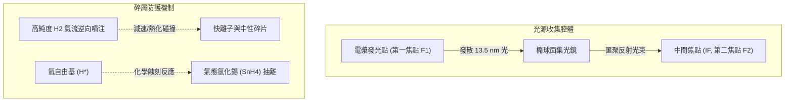

#### 橢球面集光鏡 (Collector Mirror) 幾何配置

集光鏡採用離軸旋轉橢球面（Ellipsoid of Revolution）設計，鏡體直徑典型值超過 $600\text{ mm}$。根據橢圓幾何光學定義，自橢球第一焦點（First Focal Point, $F_1$）發出的光線，經由內表面反射後，將無色差且同相地匯聚於第二焦點（Second Focal Point, $F_2$）。

在硬體配置上：
- **第一焦點 $F_1$**：精準對齊雙脈衝雷射轟擊錫滴所產生的高溫電漿發射中心。
- **第二焦點 $F_2$**：位於光源真空腔體與後續微影曝光機照明系統（Illuminator）的實體介面，此處設置一極小孔徑的光闌，稱為「中間焦點」（Intermediate Focus, IF）。

集光鏡的反射面是由數十層交替沉積的鉬/矽（$\text{Mo/Si}$）雙層膜（Bilayer）構成，最表層塗覆數奈米厚的過渡金屬保護層（如釕，$\text{Ru}$）。集光鏡需承載大立體角（通常可達約 $5\text{ 至 }5.5\text{ sr}$）的發散光錐，並具備優於 $40\%$ 至 $50\%$ 的帶內光子總收集效率。

#### 碎屑物理與破壞機制

電漿在激發時，除了產生所需的 EUV 光子外，亦會向外噴射大量的高動能副產物，統稱為碎屑（Debris）：
1. **高動能快離子 (Fast Ions)**：帶有正電荷的錫離子受到電漿雙極電場加速，動能可達數 $\text{keV}$ 至數十 $\text{keV}$。這些離子撞擊集光鏡表面會造成直接的物理濺鍍（Sputtering），打斷最外層的保護薄膜並削薄多層膜厚度，導致光學反射率永久衰退。
2. **高速中性粒子與團簇 (Fast Neutrals & Clusters)**：不帶電的高動能錫原子團，無法以靜電或磁場偏轉。
3. **慢速熱蒸發微粒 (Thermal Debris)**：熔融液態錫蒸氣或未受雷射完全蒸發的微小錫液滴群。若沉降在鏡面上，會形成單原子層以上的金屬錫沉積層。由於金屬錫對 $13.5\text{ nm}$ 光線具有強烈吸收係數，鏡面沉積僅數奈米厚的錫膜即可造成鏡面反射率產生災難性驟降。

#### 氫氣流緩衝與原位化學清洗 (In-situ Chemical Cleaning)

為了使昂貴的集光鏡能具備數千小時的工業運轉壽命，現代 EUV 機台採用氣體動力學阻絕與化學清洗複合的碎屑防護（Debris Mitigation）技術：

```
集光鏡表面 (Ru 保護層)
  │  ▲
  │  │ 逆向逆流 H2 氣流推擠
  ▼  │
高溫電漿源 (Sn) ───[ 高能 Sn 離子碰撞減速 ]───> 轉化為慢速擴散粒子
  │
  ├─ 游離產生之氫自由基 (H*) 反應：Sn(s) + 4H* -> SnH4(g) ↑
  └─ 揮發性四氫化錫氣體經高真空渦輪分子幫浦抽出
```

1. **氫氣緩衝阻絕流 (Hydrogen Buffer Flow)**：由集光鏡邊緣及鏡面噴嘴，以受控速率向第一焦點方向持續逆向噴注高純度氫氣（$\text{H}_2$），在腔體內建立數十至數百帕斯卡（$\text{Pa}$）的動態背景氣壓。高能錫離子與前進的 $\text{H}_2$ 分子發生頻繁的彈性散射碰撞，藉由動量轉移將快離子的動能熱化（Thermalization），使其能量衰減至物理濺鍍門檻能量以下。
2. **氫電漿原位蝕刻機制**：強烈的極紫外光輻射會將穿梭其間的 $\text{H}_2$ 氣體部分光游離，生成高活性的氫自由基（Hydrogen Radicals, $\text{H}^*$）及氫離子電漿。沉積在集光鏡保護層表面之固態金屬錫，會與氫自由基進行低溫表面還原化學反應，生成揮發性氣態氫化錫（四氫化錫，Stannane）：

$$\text{Sn}_{(\text{s})} + 4\text{H}^*_{(\text{g})} \to \text{SnH}_{4(\text{g})}\uparrow$$

四氫化錫常溫下為氣態，可由高真空渦輪分子幫浦（Turbomolecular Pump）自腔體中快速抽除，從而實現集光鏡在微影曝光運行期間的原位自清潔（In-situ Cleaning），大幅減緩錫沉降薄膜的累積速度，確保光源系統達到數年連續運作的量產可靠度。

<!-- fig:1 -->
<figure markdown>
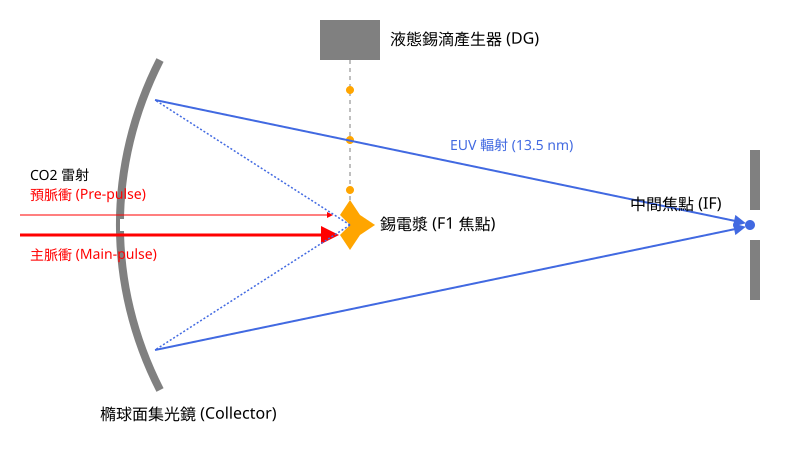
<figcaption>圖 14-1　LPP 極紫外光源架構圖（AI 繪製的示意圖）</figcaption>
</figure>

## 14.3 反射式多層膜光學與投影系統設計

在極紫外光（Extreme Ultraviolet, EUV）的波段（波長約 13.5 nm），所有固態、液態與氣態物質對光子皆具有極強的吸收能力。在第 12 章中討論的深紫外光（DUV）微影系統所使用的折射式透鏡（Refractive Lens），如合成石英（Fused Silica）或氟化鈣（$\text{CaF}_2$），在 EUV 波段下均變為不透明。此外，由於 EUV 在空氣中會迅速被氧氣與氮氣吸收，整個光路必須維持在超高真空環境中。因此，EUV 微影系統無法使用傳統的透鏡組，必須完全採用反射式光學系統（Reflective Optics）。

### 布拉格繞射原理與多層膜結構

由於單一材料界面對於 EUV 的法向入射（Normal Incidence）反射率極低（通常小於 0.1%），必須利用相干疊加（Coherent Superposition）原理，設計出由數十層高低折射率交替的薄膜所組成的布拉格反射鏡（Bragg Reflector）。

其核心物理原理為布拉格定律（Bragg's Law）：
$$m\lambda = 2d \sin \theta \sqrt{1 - \frac{2\bar{\delta}}{\sin^2 \theta}}$$
其中，$m$ 為繞射階數（通常取 $m=1$），$\lambda$ 為入射光波長（13.5 nm），$d$ 為多層膜的週期厚度（Periodicity），$\theta$ 為入射角（相對於表面的夾角）。公式中的修正項 $\bar{\delta}$ 代表多層膜材料對折射率實部的平均偏離值。在 EUV 頻譜下，材料的複數折射率（Complex Refractive Index）表示為：
$$n = 1 - \delta + i\beta$$
其中 $\delta$ 描述相位的改變（與色散有關），$\beta$ 描述振幅的衰減（與吸收有關）。為了獲得最高的反射率，必須選擇一組材料，使其 $\delta$ 差異極大化，同時維持極低的 $\beta$ 值以減少吸收損耗。

### 鉬／矽（Mo/Si）多層膜設計

經過材料篩選，鉬（Molybdenum, Mo）與矽（Silicon, Si）的組合是目前 13.5 nm 波長下的最佳選擇。在該波長下，矽的吸收邊緣（L-edge）恰好使其具有較低的吸收率，作為「空間層」（Spacer）；而鉬則作為「散射層」（Scatterer），提供較大的折射率對比。

典型的 Mo/Si 多層膜設計參數如下：
1.  **週期厚度 ($d$)**：典型值約為 6.9 nm 至 7.0 nm。根據布拉格定律，這約為波長的一半。
2.  **厚度比 ($\Gamma$)**：定義為高折射率層（Mo）厚度佔總週期的比例，即 $\Gamma = d_{Mo} / (d_{Mo} + d_{Si})$。為了平衡反射相位與吸收損耗，典型值約為 0.4。
3.  **層數 ($N$)**：典型值為 40 至 50 對雙層膜。雖然理論上增加層數可提高反射率，但由於底層光子在穿透過程中會被吸收，超過 50 層後，反射率的增益將趨於飽和。

!!! note "菲涅耳反射係數與理論極限"
    利用遞迴式的菲涅耳方程（Fresnel Equations）計算，理想狀態下（界面完全平整且無雜質）的 Mo/Si 多層膜在法向入射時，理論最高反射率可達約 75%。然而，考量到實際製程中的界面粗糙度與擴散現象，量產型機台鏡面的典型反射率約落在 68% 至 70% 之間。

### 界面互擴散與擴散阻擋層

在多層膜的沉積過程中，鉬原子與矽原子會在界面處發生物理性混合或化學反應，形成矽化鉬（$\text{MoSi}_x$）過渡層。這種界面互擴散（Interdiffusion）會導致原本銳利的折射率階躍（Step Function）變為平滑的梯度分布，進而大幅降低相干反射的效率。

此外，EUV 曝光時，高能光子轟擊鏡面會產生熱能，進一步加速原子擴散。為了維持光學系統的長期穩定性，現代 EUV 鏡面技術會在 Mo 與 Si 界面之間加入極薄（約 0.3 nm 至 0.5 nm）的擴散阻擋層（Diffusion Barrier），常見材料包括碳化硼（$\text{B}_4\text{C}$）或氮化碳（$\text{CN}_x$）。

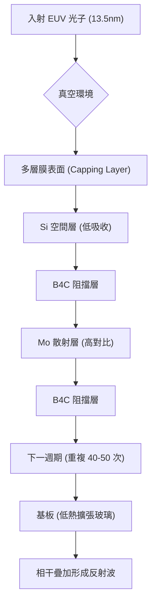

### 光學列車的能量衰減分析（Transmission Budget）

EUV 微影系統的光路極其複雜，從光源經過照明系統（Illuminator）、光罩（Mask）到投影物鏡系統（Projection Optics, PO），光束必須經過多次反射。由於每次反射都會損失約 30% 的光子能量，這對最終到達晶圓表面的光通量（Throughput）造成了極大的挑戰。

假設一個典型的 EUV 光學系統包含以下反射點：
*   收集鏡（Collector）：1 次反射
*   照明系統（Illumination Mirrors）：約 3 至 5 次反射
*   光罩（Mask）：1 次反射
*   投影物鏡（Projection Mirrors）：6 次反射（標準 NA=0.33 系統）

若單次反射率 $R = 70\%$，經過 $n$ 次反射後的總傳輸效率 $T$ 為：
$$T = R^n$$
以 11 次反射為例，$T = (0.7)^{11} \approx 0.0198$，這意味著僅有約 2% 的原始光子能抵達晶圓。若反射率僅下降 1%（即 $R = 69\%$），則總效率會降至 $(0.69)^{11} \approx 0.0156$，衰減幅度高達 21%。

這種對反射率的高度敏感性，要求鏡面鍍膜製程必須具備原子級的厚度控制精度（通常需優於 0.01 nm），且必須嚴格控制鏡面污染（見第 14.4 節）。

### 投影系統設計與非軸對稱光學

由於 EUV 必須使用反射式光學，傳統折射式系統中常見的共軸（On-axis）設計會導致光路被自身遮擋。因此，EUV 投影物鏡系統採用了複雜的離軸（Off-axis）與非球面（Aspherical）設計。

1.  **遮蔽問題與反射角**：為了避免反射光被前一級鏡面阻擋，光束必須以一定的傾斜角入射。然而，布拉格反射鏡的反射率對入射角極為敏感。為了在整個數值孔徑（Numerical Aperture, NA）範圍內維持均勻的反射率，鏡面上各點的鍍膜週期 $d$ 必須根據局部入射角進行補償設計，稱為「梯度多層膜」（Graded Multilayers）。
2.  **熱變形補償**：儘管反射率已達極限，仍有約 30% 的能量被鏡面吸收並轉化為熱能。為了防止熱膨脹導致波前畸變（Wavefront Aberration），EUV 鏡面的基板必須使用超低熱擴張材料（Ultra-Low Expansion material, ULE），其熱膨脹係數（CTE）接近於零。
3.  **光罩反射層基礎**：EUV 光罩本體本質上也是一面 Mo/Si 多層膜反射鏡。與 DUV 透射式光罩不同，EUV 光罩是在反射層上方再沉積吸收層（Absorber，如鉭系合金），並透過蝕刻定義圖案。當 EUV 光照射光罩時，未被吸收層覆蓋的區域將光線反射回投影系統，進而成像於晶圓上。

!!! warning "常見誤解：EUV 鏡面是平整的"
    許多初學者認為反射鏡就是平面鏡。事實上，為了實現高解析度成像，EUV 投影物鏡系統中的 6 面鏡子皆為極度複雜的非球面鏡。其表面平整度要求極高，若將鏡面放大至台灣島大小，其表面起伏誤差必須小於 1 毫米。這種極限加工技術是 EUV 設備最核心的技術門檻之一。

### 產業實例：蔡司（ZEISS）的光學系統

在目前的半導體產業鏈中，ASML 生產的 EUV 曝光機，其核心光學模組（包括照明系統與投影物鏡）主要由德國蔡司（ZEISS）供應。這些系統在組裝後，必須在高度受控的真空環境下進行動態對準。由於反射式系統對機械震動與熱漂移極度敏感，機台內部配備了數以百計的感測器與致動器，以皮米（Picometer, $10^{-12}$ m）等級的精度即時修正鏡面位置，確保圖案投影的精確度。

<!-- fig:2 -->
<figure markdown>
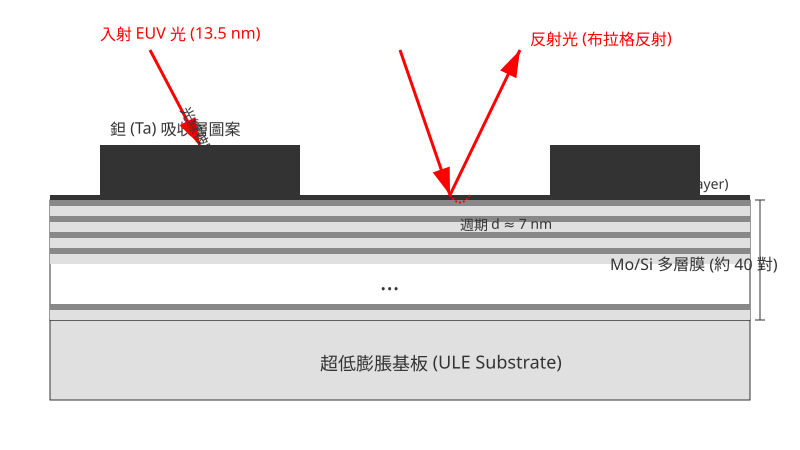
<figcaption>圖 14-2　反射式多層膜與光罩結構（AI 繪製的示意圖）</figcaption>
</figure>

## 14.4 真空環境控制、鏡面劣化與光罩防護薄膜

### 14.4 真空環境控制、鏡面劣化與光罩防護薄膜

極紫外光（EUV）微影技術與深紫外光（DUV）微影技術在物理特性上最顯著的差異之一，在於光子能量的量級。13.5 nm 的 EUV 光子能量約為 91.8 eV，此能量遠高於大多數氣體分子的電離能（Ionization Energy）。因此，EUV 光子在空氣中會被強烈吸收並導致氣體電離，這使得整個曝光系統必須在極高真空（Ultra-High Vacuum, UHV）環境下運作。此外，高能光子與物質表面的交互作用會引發複雜的光化學反應，導致光學元件劣化，這對設備的長期穩定性提出了嚴峻挑戰。

#### 14.4.1 氣體吸收與高真空需求

在 DUV 系統中，光學路徑可以填充高純度的氮氣（見第 13 章）。然而，對於 13.5 nm 的 EUV 光而言，幾乎所有物質（包括氣體）都具有極大的吸收截面（Absorption Cross-section）。根據比爾-朗伯定律（Beer-Lambert Law），光強度在介質中的衰減遵循以下公式：

$$I(x) = I_0 e^{-\sigma n x}$$

其中：
- $I(x)$ 為經過距離 $x$ 後的光強度。
- $I_0$ 為初始光強度。
- $\sigma$ 為該氣體分子在 13.5 nm 波長下的吸收截面（單位：$\text{cm}^2$）。
- $n$ 為氣體分子密度（單位：$\text{molecules/cm}^3$）。
- $x$ 為光徑長度。

典型的大氣成分如氮氣（$\text{N}_2$）、氧氣（$\text{O}_2$）與水氣（$\text{H}_2\text{O}$）在 EUV 波段的吸收極其強烈。為了確保光束在長達數公尺的光學路徑中不至於損耗殆盡，腔體內的壓力必須維持在 $10^{-7}$ 至 $10^{-9}$ torr 的範圍。若殘留氣體壓力過高，不僅會降低晶圓端的曝光能量（Throughput 損失），還會因為氣體電離產生電漿，進一步干擾精密的光學定位系統。

#### 14.4.2 鏡面劣化機制：碳沉積與氧化

EUV 系統採用多層膜反射鏡（見 14.3 節），其最外層通常覆蓋一層薄的保護層（Capping Layer，如釕 Ru）。儘管有保護層，鏡面在長期的 EUV 輻照下仍會發生兩種主要的退化機制：

1.  **光化學碳沉積（Photochemical Carbon Deposition）**：
    儘管處於高真空，腔體內仍可能殘留極微量的碳氫化合物（Hydrocarbons, $\text{C}_x\text{H}_y$），來源包括真空泵油、密封膠圈或光阻釋放出的氣體（Outgassing）。當 EUV 光子撞擊鏡面時，會激發表面產生二次電子，這些電子會解離吸附在鏡面上的碳氫化合物，留下非晶碳（Amorphous Carbon）薄層。
    - **影響**：僅數奈米的碳層就會顯著降低反射率，因為碳對 EUV 有強烈吸收。

2.  **極紫外光誘導氧化（EUV-induced Oxidation）**：
    腔體內殘留的水分子（$\text{H}_2\text{O}$）在 EUV 照射下會分解產生高活性的氧自由基（Oxygen Radicals）或臭氧。這些氧化劑會穿透保護層或直接與保護層反應，導致下方的矽（Si）或鉬（Mo）層氧化。
    - **影響**：氧化反應會改變多層膜的週期厚度與界面粗糙度，造成反射率不可逆的永久衰減。

#### 14.4.3 氫氣緩衝層與原位清潔技術

為了抑制上述劣化並冷卻光學元件，現代 EUV 設備在光學腔體中導入了低壓氫氣（$\text{H}_2$）作為緩衝氣體。氫氣是所有氣體中對 13.5 nm 吸收率最低的分子，其物理功能如下：

*   **熱散逸功能**：EUV 反射鏡會吸收約 30% 的入射能量並轉化為熱能。在真空中，熱傳導受限，導入低壓氫氣可透過微弱的對流與傳導協助鏡面散熱，維持光學系統的熱穩定性。
*   **原位（In-situ）清潔物理**：
    當 EUV 光束通過氫氣時，會將部分 $\text{H}_2$ 電離或解離成氫自由基（$\text{H}^*$）與氫離子。這些活性粒子具有還原性，能與鏡面上的污染物反應：
    *   **除碳**：$\text{C} + 4\text{H}^* \rightarrow \text{CH}_4 \uparrow$（甲烷氣體經真空泵抽走）。
    *   **除錫**：來自光源端的錫（Sn）微粒若污染鏡面，氫自由基可與其反應生成揮發性的四氫化錫（$\text{SnH}_4 \uparrow$）。

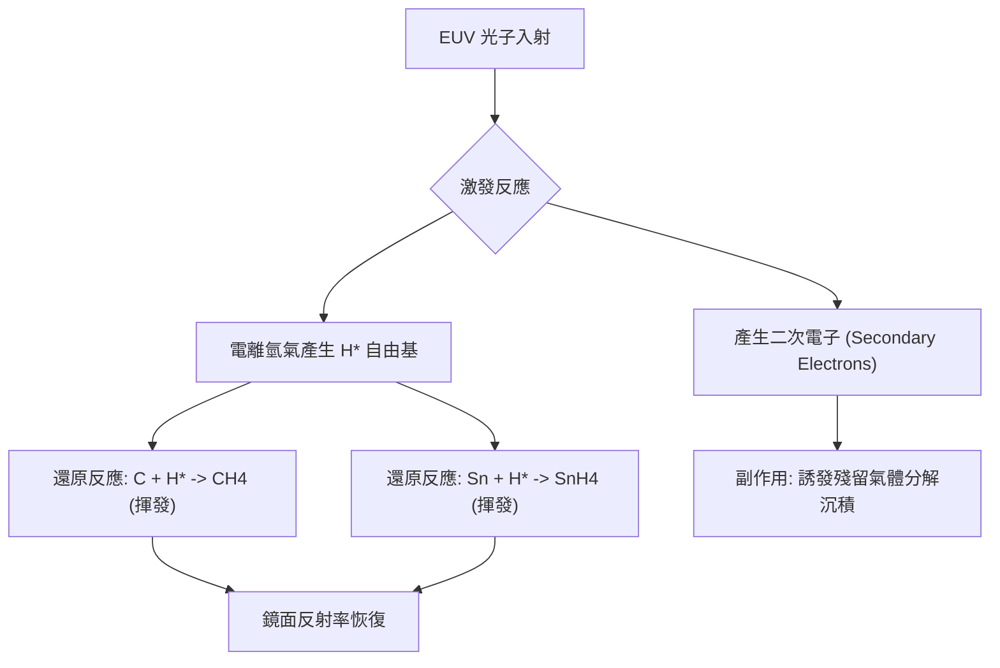

#### 14.4.4 光罩防護薄膜（Pellicle）的物理挑戰

在 DUV 微影中，光罩防護薄膜（Pellicle）用於防止微塵落在光罩圖案面上。但在 EUV 系統中，Pellicle 的設計面臨極端物理限制。

1.  **材料與穿透率的折衷**：
    由於所有固體材料對 EUV 均有強吸收，EUV Pellicle 必須極薄（典型值為 20 至 50 nm）。早期開發採用多晶矽（Polysilicon），近期則朝向碳奈米管（CNT）或金屬矽化物發展。
    - **雙程穿透損失**：EUV 為反射式系統，光束需兩次穿過 Pellicle（入射與反射）。若單程穿透率為 $T$，總穿透率則為 $T^2$。例如，若要維持 80% 的總穿透率，單程穿透率必須達到約 89.4%。

2.  **熱負載與散熱極限**：
    在掃描曝光過程中，Pellicle 會吸收約 10% 至 20% 的 EUV 能量。在高產能（High Throughput）需求下，Pellicle 的瞬時溫度可飆升至 $600^\circ\text{C}$ 以上。由於 Pellicle 極薄且處於真空環境，無法透過傳導散熱，僅能依靠輻射散熱（Radiative Cooling）。
    - **物理挑戰**：材料必須具備極高的熱穩定性與機械強度，以承受高速掃描時的加速度與熱應力循環，且不能在氫氣環境中發生化學降解。

!!! note "說明"
    由於 EUV Pellicle 的開發難度極高且會降低生產效率，部分早期的 EUV 製程選擇「無 Pellicle 曝光」，但這要求極其嚴苛的機台內部潔淨度與光罩檢查流程。隨著技術成熟，為提升良率，具備高穿透率與耐熱性的 Pellicle 已成為先進製程的標準配置。

!!! warning "常見誤解"
    工程師常誤以為真空環境是為了防止光罩被污染。事實上，真空的首要目的是防止 EUV 光子被大氣吸收。污染控制反而在真空中變得更困難，因為缺乏空氣流動來帶走微塵，且光化學反應在真空下會使污染物更牢固地附著在光學表面。

#### 14.4.5 產業實例：ASML 系統中的真空分區

在實際的 EUV 曝光機（如 ASML NXE 系列）中，真空環境並非單一整體，而是根據功能分為多個子系統：
- **光源腔體（Source Vessel）**：含有大量的錫蒸氣與電漿，壓力較高，與後端光學系統以孔徑（Aperture）與氫氣流隔離。
- **照明與投影光學腔體（Main Chamber）**：維持極高真空，並充滿低壓氫氣流以保護鏡面。
- **晶圓與光罩傳送區**：需頻繁進行真空破除與抽氣，設有複雜的氣鎖（Load-lock）機制，以防止外部大氣進入核心光學區。

這種分區控制確保了昂貴的反射鏡組（Projection Optics Box, POB）能在數年的運轉週期內，反射率衰減控制在極低範圍內。

## 14.5 光子散粒雜訊與微影隨機效應

### 14.5.1 EUV 光子能量與稀缺性物理基礎

在第 12 章與第 13 章討論的深紫外光（DUV，波長 $\lambda = 193\text{ nm}$）微影中，單一光子的能量約為：

$$E_{\text{DUV}} = \frac{hc}{\lambda} = \frac{1239.84\text{ eV}\cdot\text{nm}}{193\text{ nm}} \approx 6.42\text{ eV}$$

其中 $h$ 為普朗克常數（Planck constant），$c$ 為真空光速。當微影光源演進至極紫外光（EUV，$\lambda = 13.5\text{ nm}$）時，單一光子的能量躍升至：

$$E_{\text{EUV}} = \frac{1239.84\text{ eV}\cdot\text{nm}}{13.5\text{ nm}} \approx 91.84\text{ eV}$$

典型值約為 $91.8\text{ eV}$，相當於 DUV 光子能量的 14.3 倍。在微影製程中，晶圓表面單位面積所接收的能量稱為曝光劑量（Exposure Dose, $D$，單位為 $\text{mJ/cm}^2$）。假設兩者採用相同的曝光劑量，單位面積內抵達的 EUV 光子數量僅為 DUV 的約 7%：

$$N_{\text{photon}} = \frac{D}{E_{\text{photon}}}$$

以先進邏輯製程中常見的典型曝光劑量 $D = 45\text{ mJ/cm}^2$ 為例：
- 在 $1\text{ }\mu\text{m}^2$ 面積內，約有 $3.06 \times 10^6$ 個 EUV 光子。
- 縮小至 $10\text{ nm} \times 10\text{ nm}$（面積 $100\text{ nm}^2$）的微型接觸孔（Contact Hole）開孔區域內，平均光子數僅剩約 306 個。
- 若曝光劑量降低至 $15\text{ mJ/cm}^2$ 以提高機台產能（Throughput），則該開孔區域內平均僅接收約 102 個光子。

光子數量的劇烈減少，使微影成像從巨觀的「連續電磁波能量分佈」，轉變為微觀的「離散量子顆粒計數問題」，引發了物理極限上的隨機效應（Stochastic Effects）。

---

### 14.5.2 光子散粒雜訊之泊松統計與局部劑量起伏

光子自電漿光源發射、經過反射鏡系統傳輸至光阻吸收的過程，屬於獨立隨機事件。根據統計物理，抵達特定奈米區域內的光子數 $k$ 嚴格服從泊松分佈（Poisson Distribution）：

$$P(k; \bar{N}) = \frac{\bar{N}^k e^{-\bar{N}}}{k!}$$

其中 $\bar{N}$ 為該區域內的預期平均光子數。泊松分佈的標準差（Standard Deviation）等於平均值的平方根：

$$\sigma_N = \sqrt{\bar{N}}$$

定義光子散粒雜訊（Photon Shot Noise）引起的局部相對劑量抖動（Relative Dose Fluctuation）為變異係數（Coefficient of Variation, $CV$）：

$$\frac{\sigma_N}{\bar{N}} = \frac{\sqrt{\bar{N}}}{\bar{N}} = \frac{1}{\sqrt{\bar{N}}}$$

由此公式可知，光子計數的相對不確定性與 $\bar{N}$ 的平方根成反比。

| 曝光幾何區域 | 典型尺寸 | 預期光子數 $\bar{N}$（設 $D=30\text{ mJ/cm}^2$） | 相對標準差 $\frac{\sigma_N}{\bar{N}}$ |
| :--- | :--- | :--- | :--- |
| 晶粒層級（Die level） | $1\text{ mm} \times 1\text{ mm}$ | $\approx 2.04 \times 10^{12}$ | $\approx 0.00007\%$ |
| 傳統接點（DUV 製程） | $60\text{ nm} \times 60\text{ nm}$ | $\approx 1.05 \times 10^5$（DUV 光子） | $\approx 0.31\%$ |
| EUV 金屬線單元像素 | $15\text{ nm} \times 15\text{ nm}$ | $\approx 460$ | $\approx 4.66\%$ |
| 先進接觸孔（EUV） | $10\text{ nm} \times 10\text{ nm}$ | $\approx 204$ | $\approx 7.00\%$ |
| 接觸孔邊界局部體積 | $3\text{ nm} \times 3\text{ nm}$ | $\approx 18$ | $\approx 23.57\%$ |

在接觸孔邊緣或極細線寬的局部微觀體積（Sub-voxel）中，相對劑量起伏可超過 $20\%$。這種統計上的光子稀缺性，導致即使投影光學系統提供了完美的空中影像（Aerial Image），光阻內部實際吸收的能量分佈仍會呈現嚴重的空間顆粒化起伏。

---

### 14.5.3 隨機效應誘發之圖形缺陷

光子散粒雜訊在光阻顯影後會轉化為永久性的物理圖形畸變。隨機效應所誘發的缺陷可分為兩大類：

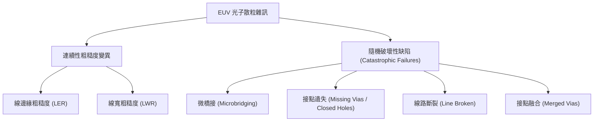

#### 1. 線邊緣粗糙度與線寬粗糙度
- **線邊緣粗糙度（Line Edge Roughness, LER）**：單一圖形邊緣相對於理想直線的偏離，通常以偏離值的三倍標準差（$3\sigma$）定義。
- **線寬粗糙度（Line Width Roughness, LWR）**：線路寬度沿線長方向的局部變異，其統計關係為：
  $$LWR \approx \sqrt{2} \times LER$$
  （當線路兩側邊緣的隨機起伏相互獨立時成立）。

在先進邏輯閘或金屬導線中，若臨界尺寸（Critical Dimension, CD）為 $12\text{ nm}$，而 LWR 達到 $3\text{ nm}$，代表線寬有高達 $25\%$ 的局部起伏，這會直接導致電晶體的次臨界擺幅（Subthreshold Swing）劣化、臨界電壓（$V_{\text{th}}$）嚴重失配，並使後續蝕刻與金屬填洞製程產生斷路或漏電。

#### 2. 隨機破壞性缺陷
當局部統計偏差落在高斯分佈或韋伯分佈（Weibull Distribution）的遠端尾部時，將引發無法容忍的災難性電氣失效：
- **微橋接（Microbridging）**：在密集的明場圖形（如相鄰平行金屬線）之間，原本應被完全曝光並顯影去除的暗區邊緣，因光子隨機偏少而未能引發足夠的光化學反應，導致顯影後兩條金屬線之間殘留奈米級光阻薄膜，引發金屬短路。
- **接點遺失（Missing Vias / Closed Holes）**：在接觸窗或介層窗微影中，原本設計開孔的位置因入射光子數隨機低於反應閥值，顯影劑完全無法溶解該處光阻，造成接觸孔完全封閉，導致電路斷路。
- **接點融合（Merged Vias）**：相鄰兩孔之間的阻隔壁，因光子隨機散射或化學擴散過量而崩塌，使兩孔相互連通短路。

在先進晶片中，單一晶片包含數百億至數千億個接觸孔。若接點遺失的機率為 $10^{-9}$（十億分之一，相當於常態分佈的約 $6\sigma$ 外），整顆晶片仍會產生數十個致命缺陷，使晶圓良率歸零。因此，隨機效應已取代光學繞射極限，成為先進製程微縮時微影良率（Stochastic Yield）的最關鍵瓶頸。

---

### 14.5.4 光阻能量沉積機制與二次電子生成路徑

EUV 光子與化學物質的作用機制與 DUV 有本質上的不同。在 DUV 微影中，能量多半直接被光酸產生劑（Photoacid Generator, PAG）吸收並產生光分解反應；然而在 EUV 微影中，單一光子的能量高達 $91.8\text{ eV}$，遠超過絕大多數有機共價鍵的游離能（Ionization Energy，約 $9 \sim 12\text{ eV}$）。

能量轉換的物理歷程如下：
1. **光電效應與歐傑電子發射**：EUV 光子主要由光阻材料基質（Matrix Polymer）的原子內層軌域吸收（如碳、氧、氟，或金屬氧化物光阻中的錫等重金屬），激發出一個具有高動能的初級光電子（Primary Photoelectron，動能約 $70 \sim 80\text{ eV}$），伴隨歐傑效應（Auger Effect）釋出歐傑電子。
2. **非彈性散射與二次電子級聯**：初級光電子在穿透光阻材料時，沿途與基質分子發生連續的非彈性散射碰撞（Inelastic Scattering），產生二次電子級聯（Secondary Electron Cascade）。單一 EUV 光子平均可生成約 2 至 4 個低能量二次電子（動能通常小於 $20\text{ eV}$）。
3. **PAG 捕捉與光酸生成**：二次電子經過多次熱化（Thermalization）後，能量降至數個電子伏特（eV），此時由 PAG 分子透過解離性電子捕捉機制（Dissociative Electron Attachment）捕獲，才完成去保護反應所需之酸（$\text{H}^+$）的產生。

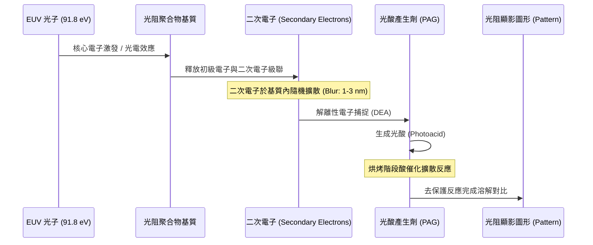

由於二次電子在其平均自由程（Mean Free Path）內會隨機擴散，這段空間位移稱為二次電子模糊（Secondary Electron Blur，典型值約為 $1 \sim 3\text{ nm}$）。這意味著酸分子生成的位置與最初光子被吸收的座標存在隨機空間位移，進一步加劇了化學潛像（Chemical Latent Image）的邊緣隨機性。

---

### 14.5.5 RLS 互鎖權衡關係 (RLS Trade-off)

在微影光阻材料設計中，隨機效應引發了一組著名的物理權衡關係，稱為 **RLS Trade-off**，即：
- **解析度（Resolution, $R$）**：光阻能成功分辨的最小半節距（Half-Pitch）。
- **線邊緣粗糙度（Line Edge Roughness / LWR, $L$）**：顯影後幾何邊緣的平整程度。
- **靈敏度（Sensitivity / Dose, $S$）**：達成目標尺寸所需的曝光劑量（劑量越低，靈敏度越高，機台產能越高）。

此三者之間的關係由經驗物理公式描述：

$$R^3 \cdot L^2 \cdot D \approx \text{Constant}$$

其中 $D$ 為曝光劑量。此方程式表明，在不改變光阻化學本質的前提下，無法同時改善這三項參數：

1. **若追求高產能而降低劑量（$D \downarrow$）**：光子數 $\bar{N}$ 減少，光子散粒雜訊顯著增加，LWR（$L$）大幅惡化，微橋接與孔遺失等缺陷率呈指數上升。
2. **若透過增加烘烤擴散長度來平滑化邊緣（$L \downarrow$）**：酸分子向未曝光區擴散，雖然抹平了隨機分佈的空間高頻雜訊，但會導致影像對比度（Image Contrast）下降，使臨界解析度（$R$）顯著退化。
3. **若強行縮減節距微縮目標（$R \downarrow$）**：若要維持相同的 LWR，必須以立方級別大幅增加曝光劑量 $D$，這會使 EUV 機台的曝光產能急遽下降，導致單位晶圓製造成本不可行。

!!! warning "常見誤解：光子雜訊可完全藉由提高雷射光源功率解決"
    工程上常有人認為，只要將光源功率提升至千瓦級並增加曝光劑量，便能完全消除隨機效應。
    
    此觀點忽略了兩大限制：
    1. **產能與熱效應限制**：過高的曝光劑量會直接降低掃描機每小時曝光晶圓數（Wafer Per Hour, WPH），同時高功率光子能量密集注入光阻，會造成晶圓局部過熱（Wafer Heating），引起熱膨脹畸變，導致疊對誤差（Overlay Error）惡化。
    2. **化學材料固有隨機性**：隨機效應不僅源自光子散粒雜訊，還包含化學增幅光阻（CAR）內部 PAG 與聚合物鏈長分佈的不均勻性、酸擴散的布朗運動隨機性，以及顯影液溶解的高分子聚合團簇現象。單純增加光子劑量無法消除材料化學隨機性。

為突破傳統化學增幅光阻（CAR）在先進節點下的 RLS 極限，半導體產業界在次 3 奈米製程節點開始積極導入新型光阻體系，例如金屬氧化物光阻（Metal Oxide Resist, MOR，以氧化錫 $\text{SnO}_x$ 奈米核心為基礎）。MOR 具備比有機基質高出數倍的 EUV 光子吸收截面（Absorption Cross Section），能更有效地捕獲有限光子，並大幅降低電子模糊半徑，從而在相同的曝光劑量下顯著抑制微影隨機缺陷。

## 14.6 設備與廠商技術

### 14.6.1 EUV 微影曝光機台模組與光程架構

商用極紫外光（EUV）微影曝光站並非單一孤立設備，而是由極紫外光微影曝光機（Scanner）與塗佈顯影機（Coater/Developer Track）以實體機械通道直接串接（In-line）組成的全自動化生產單元。在 0.33 數值孔徑（Numerical Aperture, NA）的商用機台設計中，光學系統徹底揚棄了傳統屈折透鏡，改採全反射式光學設計以克服物質對 13.5 nm 光子的強烈吸收。

以產業廣泛採用的 0.33 NA 設備為例，整機硬體通常劃分為數個高度模組化的獨立子系統：

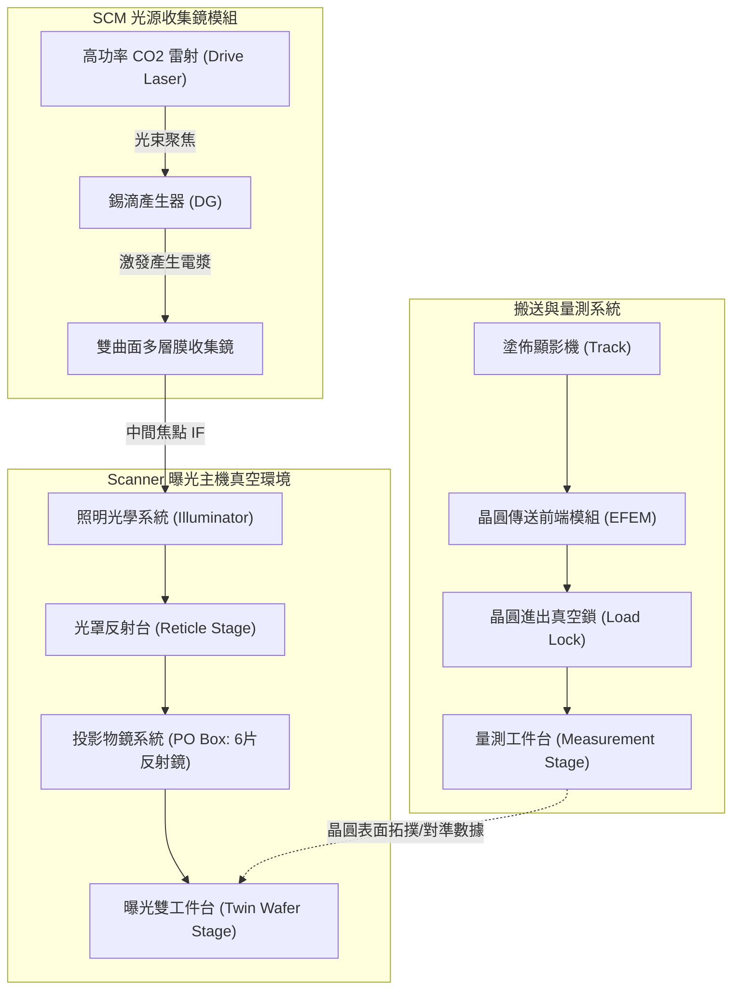

1. **光源收集鏡模組（Source Collector Module, SCM）**：
   此模組包含錫滴產生器（Droplet Generator, DG）、真空反應腔與近正常入射之鉬／矽（Mo/Si）雙曲面收集鏡。驅動雷射（Drive Laser）將脈衝聚焦於真空腔內每秒數萬次噴射的微米級液態錫滴上，激發出高溫錫電漿（見 14.2 節）。收集鏡收集電漿發出的 13.5 nm EUV 光，聚焦導引至中間焦點（Intermediate Focus, IF），該處亦設置微孔光圈（Aperture）作為光譜純化與碎屑阻擋的第一道動態氣鎖邊界。

2. **照明與投影物鏡模組（Illumination and Projection Optics）**：
   自中間焦點進入的光束，經由平場反射鏡、多重柱面鏡構成的照明系統調節後，均勻照射至反射式光罩（Reticle）。光罩安裝於真空懸浮的長程掃描台上。經過圖案調變的反射光束隨後進入投影物鏡箱（PO Box），穿過 6 片具備非球面修正與超高平坦度的 Mo/Si 多層膜反射鏡，將光罩圖案縮小 4 倍聚焦至晶圓表面。所有鏡面支架均配置奈米級微壓電致動器與動態水冷迴路，用於修正曝光熱負載引起的鏡面變形。

3. **雙晶圓工件台系統（Dual-Stage Architecture）**：
   為了維持高晶圓產出率（Wafers Per Hour, WPH），機台採用雙工件台架構。當一號工件台在曝光位置依序執行高加速度步進掃描曝光時，二號工件台已在量測位置平行完成晶圓裝載、晶圓粗對準、利用光學感測器量測晶圓上所有標記的高精度幾何對準（Alignment），以及利用水平感測器（Leveling Sensor）建立晶圓表面奈米級高程圖（Height Map）。兩台在動作完成後交換位置，此並行架構將對準量測的非生產時間從關鍵路徑中完全剔除。

---

### 14.6.2 機台分散式控制與高效能運算架構

EUV 曝光機的即時機電整合複雜度極高，真空腔體內包含數十軸高動態磁浮致動器、超高真空閥門網絡、氣體微注入系統與數百組溫度感知器。為滿足硬即時（Hard Real-Time）控制的穩定性與超大規模光學數據運算需求，機台在硬體與軟體拓撲上採取嚴格的「主控與運算分離架構」。

```mermaid
graph LR
    subgraph 晶圓廠核心網 [Fab Core Network]
        MES["製造執行系統 (MES)"]
        APC["先進製程控制 (APC)"]
    end

    subgraph 曝光機機架 [EUV Scanner Framework]
        TC["機台主控電腦 (Tool Controller / IPC)\n• 即時作業系統 (RTOS)\n• 負責真空互鎖與安全邏輯\n• 執行 SECS/GEM 介面"]
        
        CS["專用運算伺服器 (Compute Server)\n• 企業級 Linux 系統\n• 高核心數 CPU / GPU 加速卡\n• 高頻寬 NVMe RAID"]
        
        Hardware["機台實體硬體模組\n• 磁浮工件台馬達 (Stage)\n• 晶圓傳送機械手臂 (Robot)\n• 腔體壓力/溫度感測器"]
        
        Sensors["高速光學感測模組\n• 水平感測器 (Leveling Sensor)\n• 對準光學模組 (Alignment Sensor)"]
    end

    MES <-->|SECS/GEM 協定 (HSMS)| TC
    APC <-->|R2R 補正參數 (TCP/IP)| TC
    
    TC <-->|專屬內部光纖 (Dedicated LAN)| CS
    TC -->|現場匯流排 / 毫秒級確定性| Hardware
    Sensors -->|每秒數十 GB 原始感測流| CS
    CS -->|即時對準矩陣與焦點校正模型| TC
```

#### 機台主控電腦（Tool Controller / IPC）
機台主控電腦通常運行確定性極高的即時作業系統（RTOS，如 VxWorks），主要職責在於確保機台各機構動態行為的確定性（Determinism）與生命安全互鎖（Interlock）。其工作管線包含：
- **真空與氣流互鎖控制**：監控各腔體壓力計，即時調控氫氣抑制氣流（見 14.4 節）與真空低溫泵浦狀態，防止真空洩漏引發收集鏡劇烈氧化。
- **運動控制協調**：維持光罩台與晶圓台在高速逆向掃描運動時的軌跡同步，動態位置誤差需抑制於次奈米尺度。
- **廠級通訊交手**：作為機台對外的唯一合法通訊窗口，處理製程自動化事件。

#### 專用運算伺服器（Compute Server）
專用運算伺服器運行多工 Linux 作業系統，硬體配置大量處理核心、專用圖形加速晶片或現場可程式化邏輯閘陣列（FPGA），以及大容量記憶體。其職責是接收量測工件台在幾秒內掃描晶圓所產生的每秒數十 GB 原始光學干涉與反射訊號，並執行複雜的數值反演：
1. **網格非線性形變擬合**：將數百處對準標記的量測數據，透過高階多項式模型展開，分離出晶圓平移（Translation）、旋轉（Rotation）、正交誤差（Orthogonality）及非對稱熱膨脹應變量：
   $$\Delta x = T_x - \theta_y y + S_x x + D_x x^2 + \dots$$
   $$\Delta y = T_y + \theta_x x + S_y y + D_y y^2 + \dots$$
   式中 $T$ 為平移分量，$\theta$ 為旋轉角，$S$ 為晶圓尺度縮放因子（Scaling Factor），$D$ 為高階非線性畸變參數。
2. **三維表面拓撲重構**：將水平感測器讀取的高程數據，即時轉換為曝光時各曝光場（Field）在動態掃描過程中物鏡聚焦補償機構所需的軌跡微分多項式。

運算伺服器完成分析後，僅將數值矩陣透過內部隔離之專用光纖區域網路（Dedicated Private LAN）回傳給主控電腦 IPC，從而在物理層面上避免巨量資料傳輸與數值運算干擾到即時運動控制的時序迴路。

---

### 14.6.3 晶圓廠自動化與通訊協定整合

在高度自動化的先進製程晶圓廠中，EUV 機台必須無縫整合至全廠製造執行系統（Manufacturing Execution System, MES）與先進製程控制（Advanced Process Control, APC）體系中。此整合基礎依賴半導體設備與材料國際組織（SEMI）制定的標準通訊協定群。

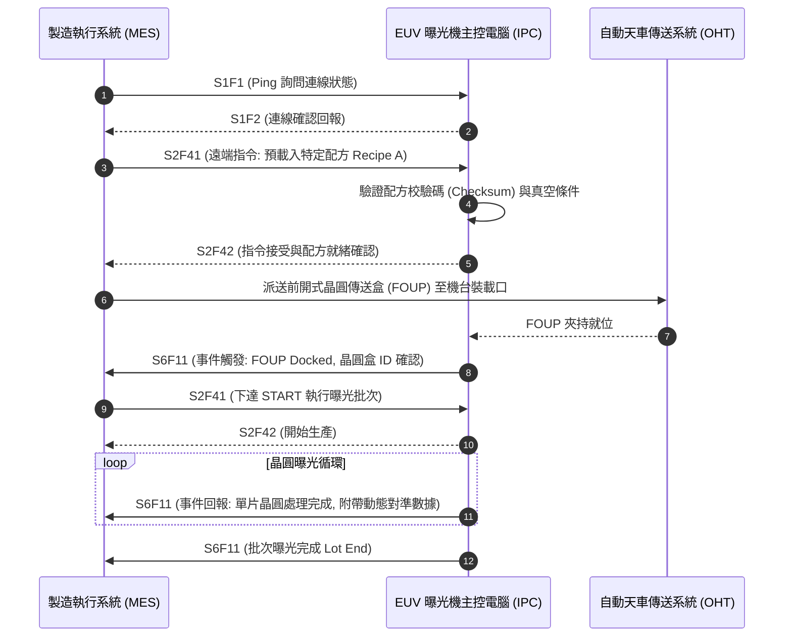

1. **通訊架構與標準協定**：
   現代設備已全面揚棄早期基於 RS-232 序列傳輸的 SECS-I，改採以 TCP/IP 為實體傳輸層的高速 SECS 訊息服務（High-Speed SECS Message Services, HSMS，即 SEMI E37）。在此傳輸架構上，透過 SEMI E5（SECS-II）定義訊息的封包結構（Stream and Function），並以 SEMI E30（Generic Equipment Model, GEM）規範曝光機的行為狀態機模型（包含離線、就緒、加工中、維護等狀態）。

2. **配方管理（Recipe Management）**：
   EUV 曝光機的製程配方內含極其龐雜的曝光參數，包括物鏡數值孔徑微調、照明光瞳極性形狀（Pupil Fill Shape）、動態劑量偏置（Dose Offset）、步進掃描軌跡分佈、光罩圖案代碼、對準標記類型及各曝光場焦點偏移量。為防止操作失誤，機台執行嚴格的配方管理：
   - 晶圓批次（Lot）抵達機台前，MES 透過 `S2F41` 指令由中央配方伺服器將經過數位簽署的配方下載至機台。
   - 機台主控電腦解析並進行內部校驗，若配方所請求的光瞳形狀與當前光學模組物理狀態不符，機台將在交手過程中回報錯誤拒絕生產。

3. **閉迴路先進製程控制（Run-to-Run Control, R2R）**：
   在產線實際運作中，前一批晶圓曝光顯影並經由繞射式疊對量測儀或光學量測機量測後，量測主機計算出的晶圓非線性網格漂移量會被傳送至 APC 系統。APC 即時推算出補正參數，並在下一批晶圓開始曝光前，透過通訊介面動態寫入 EUV 機台主控電腦的即時疊對修正變數中，達成跨批次的奈米級閉迴路動態校正。

---

### 14.6.4 EUV 微影設備廠商與技術生態系

EUV 微影技術的落地高度依賴整合性技術生態系，單一曝光機必須搭配超高感度光阻塗佈顯影機、光學與電子束檢測機台，以及光化缺陷檢驗設備方能維持良率。

| 設備類型 | 廠商 | 代表產品系列 | 技術路線與特點 | 主要應用 |
| :--- | :--- | :--- | :--- | :--- |
| **0.33 NA EUV 曝光機** | ASML | TWINSCAN NXE（如 NXE:3400B／C、NXE:3600D、NXE:3800E） | 採用雷射激發錫電漿（LPP）光源，0.33 NA 反射式投影物鏡系統，配置 TWINSCAN 雙工件台與超高真空環境控制 | 7 nm 至 3 nm 世代邏輯製程關鍵層與 1α/1β nm DRAM 之微細圖案曝光 |
| **塗佈顯影機 (Track)** | Tokyo Electron | CLEAN TRACK LITHIUS Pro Z | 與 EUV 曝光機直接硬體串接；具備極低缺陷化學藥液塗佈單元、精準熱板溫度控制場，支援金屬氧化物光阻（MOR）與化學增幅光阻（CAR）烘烤 | EUV 晶圓曝光前表面增強底塗、均勻光阻旋塗，以及曝光後之超臨界烘烤與極低缺陷顯影 |
| **EUV 光罩光化檢測** | Lasertec | ACTIS（如 ACTIS A150） | 使用與曝光機相同之 13.5 nm 極紫外光作為檢驗光源（Actinic Inspection），具備穿透光罩保護薄膜（Pellicle）進行全幅反射繞射成像能力 | 檢測光罩多層膜相位缺陷、吸收層斷線、碳沉積，以及帶有保護薄膜之光罩生產線上複查 |
| **光罩圖案幾何檢測** | KLA | Teron | 採用深紫外光（DUV）光學照明與多通道感測成像架構，結合高精密影像比對演算法 | EUV 光罩出廠圖案缺陷檢測、異物微塵顆粒監控與圖案高階輪廓校驗 |
| **繞射式量測機台** | ASML | YieldStar | 利用多波長與多偏振角度的光學繞射散射原理（YieldStar 系列），由光學繞射重構伺服器解析非對稱繞射光譜 | 曝光後晶圓疊對誤差（Overlay）、焦點偏移與微細圖案輪廓之非破壞性快速量測 |

#### 設備選型與技術取捨考量
晶圓製造廠在建立先進製程 EUV 產線時，主要評估以下工程取捨：

1. **光源功率與設備生產力（CoO, Cost of Ownership）的平衡**：
   EUV 曝光機的運作成本主要取決於光源輸出功率。提高電漿轉換效率（Conversion Efficiency, CE）與驅動雷射功率雖可直接提升晶圓產出率（WPH），但極端的高功率光子流與熱負載會加速第一片收集鏡（Collector）的錫沉積退化與多層膜熱應力疲勞，進而縮短核心光學模組的更換週期。因此，晶圓廠需在「高晶圓產出」與「真空機腔維護停機時間」之間尋求最佳操作點。

2. **化學增幅光阻與金屬氧化物光阻的製程適配性**：
   為了壓制光子散粒雜訊引發的隨機缺陷（見 14.5 節），晶圓廠在搭配塗佈顯影機（如 CLEAN TRACK LITHIUS Pro Z）時，面臨採用傳統化學增幅光阻（CAR）或新型金屬氧化物光阻（MOR）的路線抉擇。CAR 雖具備成熟的顯影與清洗供應鏈，但在極高解析度下易發生圖案倒塌；MOR 具備極高的 EUV 光子吸收截面積與極佳的蝕刻選擇比，但需要專用的乾式顯影或特殊化學溶劑處理系統，且金屬殘留對真空腔體與無塵室環境的潛在交叉污染風險亦需列入評估。

3. **光罩防護薄膜（Pellicle）與光化檢測架構**：
   由於 13.5 nm 光子在多數介質中的強烈吸收特性，晶圓廠必須決定是否在 EUV 光罩上安裝昂貴的超薄奈米碳管或矽化物保護薄膜。採用無保護薄膜（Pellicle-less）方案可獲得最高的光學穿透率與曝光產出，但必須承擔生產過程中機腔內懸浮錫微粒掉落造成整批晶圓圖案報廢的致命風險；若裝設薄膜，則必須導入具備深層穿透薄膜檢驗能力的 Lasertec ACTIS 等專用光化檢驗機台，導致設備總資本支出大幅提高。

!!! example "產業實例：工廠自動化層級之 SECS/GEM 介面佈署"
    在大型 12 吋晶圓廠中，機台內部運作軟體通常整合業界標準的中間軟體模組（例如 Cimetrix CIMConnect 或 CIMPortal）。該中介軟體常駐於主控電腦（IPC）內，負責將機台底層感測器狀態映射為標準 SEMI SECS-II 變數（Equipment Variables, ECV/SV）。當機台狀態改變時，透過預先註冊的事件識別碼（Collection Event ID, CEID）自動觸發 `S6F11` 封包發送，使得遠端 MES 能在完全不佔用機台即時運動控制運算資源的情況下，實現毫秒級的全自動化排程監控。

## 本章重點

1.  **光學架構的根本轉變**：由於所有凝聚態物質對 13.5 nm 的 EUV 光子皆有強烈吸收，且折射率趨近於 1，微影系統必須由傳統的穿透式折射鏡轉向全反射式光學系統，並在超高真空環境下運作。
2.  **雷射激發錫電漿（LPP）光源**：利用高功率 $CO_2$ 雷射轟擊熔融錫滴，產生高溫電漿並釋放 13.5 nm 的未解析躍遷陣列（UTA）輻射。透過「預脈衝–主脈衝」雙脈衝技術，可將雷射轉換效率（CE）提升至 4% 至 6%。
3.  **布拉格反射鏡技術**：利用約 40 至 50 對的鉬／矽（Mo/Si）多層膜，透過相干疊加原理實現約 70% 的反射率。由於反射次數多，系統總傳輸效率極低（典型值約 2%），對鏡面平整度與厚度控制要求達原子等級。
4.  **環境控制與碎屑防護**：導入低壓氫氣流作為緩衝氣體，利用氫自由基（$H^*$）與鏡面污染物反應生成揮發性氫化物（如 $SnH_4$、$CH_4$），實現原位化學清洗並保護昂貴的集光鏡。
5.  **隨機效應與散粒雜訊**：EUV 單一光子能量高（91.8 eV），在相同劑量下光子數遠少於 DUV。光子散粒雜訊遵循泊松分佈，導致局部劑量起伏，引發線邊緣粗糙度（LER）與隨機缺陷（如接點遺失）。
6.  **RLS 權衡關係**：解析度（R）、線邊緣粗糙度（L）與靈敏度（S）之間存在互鎖關係，無法同時優化。隨機效應已取代繞射極限，成為先進製程良率提升的主要挑戰。
7.  **高度整合的設備生態系**：EUV 曝光機需整合高功率雷射、精密真空機械、雙工件台量測系統，並透過 SECS/GEM 協定與晶圓廠 MES 及 APC 系統進行閉迴路控制。


## 重點圖卡

複習時看這幾張就能抓住本章重點；[圖卡庫](../cards.md)可以下載成圖片。

<div class="ix-cards" markdown>

<figure markdown>

<figcaption>核心概念圖卡：瑞利公式與微影世代</figcaption>
</figure>

<figure markdown>

<figcaption>核心概念圖卡：EUV 光從哪裡來：雷射激發錫電漿</figcaption>
</figure>

<figure markdown>
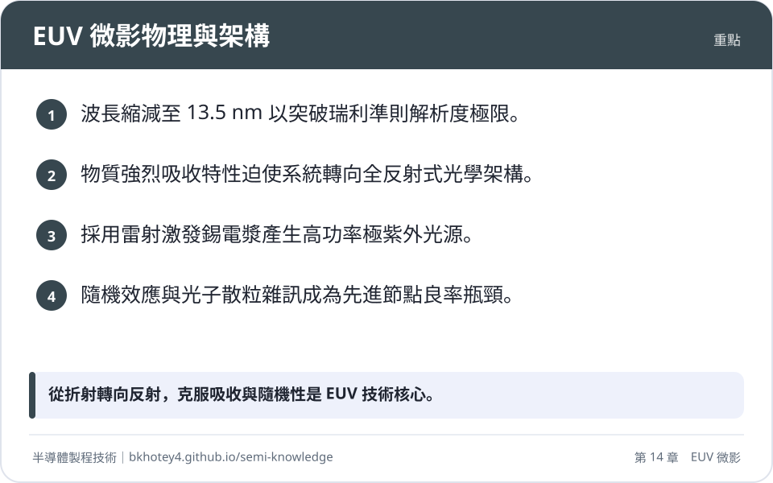
<figcaption>重點圖卡：EUV 微影物理與架構</figcaption>
</figure>

<figure markdown>
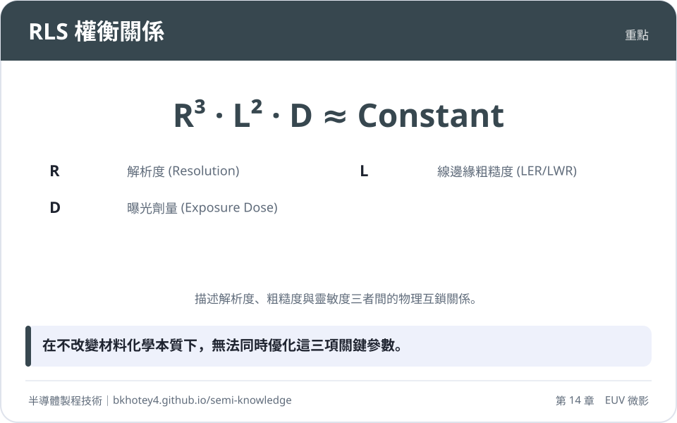
<figcaption>重點圖卡：RLS 權衡關係</figcaption>
</figure>

<figure markdown>
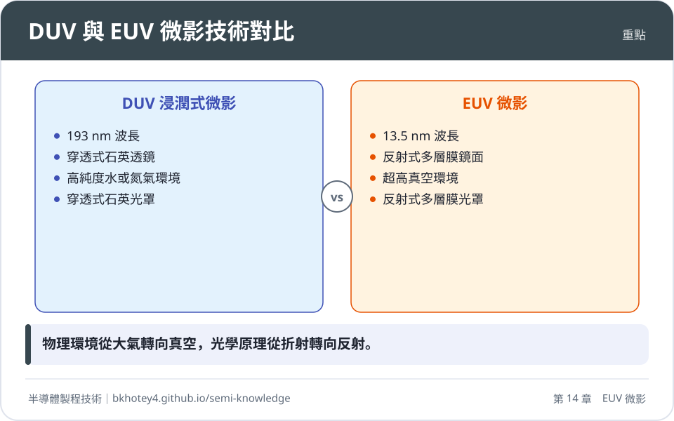
<figcaption>重點圖卡：DUV 與 EUV 微影技術對比</figcaption>
</figure>

<figure markdown>
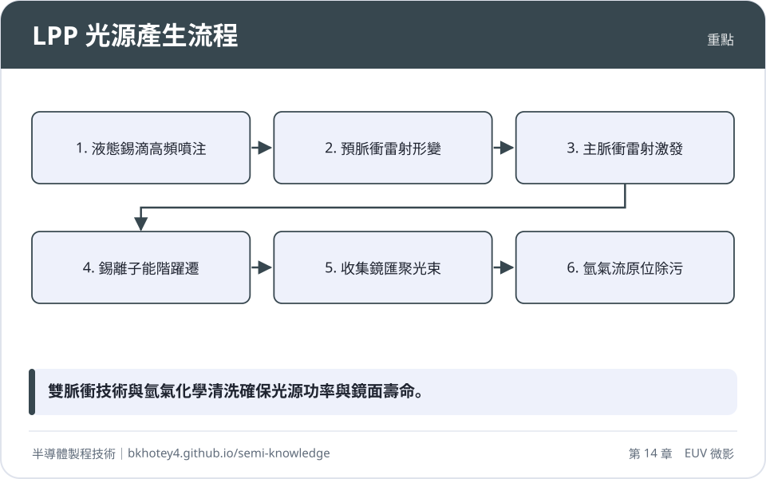
<figcaption>重點圖卡：LPP 光源產生流程</figcaption>
</figure>

</div>

## 習題

**1.** 試說明為何 EUV 微影系統必須捨棄傳統的石英透鏡，轉而使用反射式多層膜鏡面？請由物質的複數折射率 $n = 1 - \delta + i\beta$ 與光子能量的角度進行解釋。

??? success "參考解答"
    1. EUV 光子能量約 91.8 eV，遠高於固態材料的原子電離能，導致幾乎所有物質對 EUV 皆有強烈吸收（$\beta$ 值雖小但足以在奈米級距離耗盡能量），穿透式透鏡會因吸收過高而失效。
    2. 在 EUV 波段，所有材料的折射率實部 $1-\delta$ 極其接近 1，這意味著光線在介面間的折射效應微乎其微，無法利用折射原理來聚焦或改變光路。

**2.** 假設一套 EUV 投影物鏡系統包含 6 面反射鏡，每面鏡子的反射率為 69%。若光束在到達晶圓前還需經過 1 面收集鏡（反射率 45%）、4 面照明系統鏡面（反射率各 70%）以及 1 次光罩反射（反射率 65%），請計算最終抵達晶圓表面的能量佔光源初始能量的百分比。

??? success "參考解答"
    總傳輸效率 $T$ 為各反射點反射率之乘積：
    $T = R_{collector} \times (R_{illuminator})^4 \times R_{mask} \times (R_{PO})^6$
    $T = 0.45 \times (0.70)^4 \times 0.65 \times (0.69)^6$
    $T \approx 0.45 \times 0.2401 \times 0.65 \times 0.1079$
    $T \approx 0.00757$
    最終抵達晶圓表面的能量約佔初始能量的 0.757%。

**3.** 在 $NA=0.33$ 的 EUV 系統中，入射光相對於光罩法線的角度為 6 度。若光罩上的吸收層（Absorber）厚度為 60 nm，試計算其產生的幾何陰影寬度 $\Delta x$。此效應對微影圖形有何影響？

??? success "參考解答"
    根據公式 $\Delta x = h \cdot \tan(\theta)$：
    $\Delta x = 60\text{ nm} \cdot \tan(6^\circ) \approx 60 \cdot 0.1051 \approx 6.31\text{ nm}$
    影響：陰影效應會導致臨界尺寸偏移（CD Bias）、圖案隨焦距改變而位移（Pattern Shift）以及影像對比度下降。

**4.** 某先進製程需在 $10\text{ nm} \times 10\text{ nm}$ 的區域內進行曝光，設定劑量為 $20\text{ mJ/cm}^2$。
(1) 計算該區域內接收到的平均 EUV 光子數 $\bar{N}$。
(2) 計算光子散粒雜訊所引起的相對劑量抖動（變異係數 $CV$）。
（已知 $h = 6.626 \times 10^{-34}\text{ J}\cdot\text{s}$，$c = 3 \times 10^8\text{ m/s}$，$\lambda = 13.5\text{ nm}$）

??? success "參考解答"
    (1) 單一 EUV 光子能量 $E = hc/\lambda \approx 1.47 \times 10^{-17}\text{ J}$。
    區域面積 $A = 100\text{ nm}^2 = 10^{-12}\text{ cm}^2$。
    總能量 $E_{total} = \text{Dose} \times A = 20\text{ mJ/cm}^2 \times 10^{-12}\text{ cm}^2 = 2 \times 10^{-14}\text{ mJ} = 2 \times 10^{-17}\text{ J}$。
    平均光子數 $\bar{N} = E_{total} / E \approx 2 \times 10^{-17} / 1.47 \times 10^{-17} \approx 1.36$ 個。
    (註：實務上劑量通常較高，此為簡化計算。若以課本典型值 $91.8\text{ eV}$ 計算，$\bar{N} \approx 136$ 個)
    (2) 相對標準差 $CV = 1 / \sqrt{\bar{N}} = 1 / \sqrt{136} \approx 8.57\%$。

**5.** 為什麼 LPP 光源選擇使用 $CO_2$ 雷射（波長 $10.6\text{ }\mu\text{m}$）而非 Nd:YAG 雷射（波長 $1.06\text{ }\mu\text{m}$）作為主脈衝光源？請由臨界電子密度（Critical Electron Density）的角度說明。

??? success "參考解答"
    臨界電子密度 $n_c$ 與雷射波長平方成反比。$CO_2$ 雷射波長較長，對應的 $n_c$ 較低（約 $10^{19}\text{ cm}^{-3}$）。在較低密度的電漿區，游離錫離子發射的 13.5 nm 光子較不容易被周圍離子重新吸收（自吸收效應低），且雷射能量能更有效地在最佳發光區沉積，從而提升轉換效率。

## 本章術語

- **EUV**（極紫外光）：波長為 13.5 nm 的高能電磁波，用於 7 奈米以下半導體節點的微影技術。
- **LPP**（雷射激發電漿）：利用高能雷射轟擊靶材（如錫）產生高溫電漿以釋放特定波長光源的技術。
- **Mo/Si Multilayer**（鉬／矽多層膜）：由鉬與矽交替沉積而成的布拉格反射鏡，是 EUV 光學系統的核心反射元件。
- **UTA**（未解析躍遷陣列）：多價錫離子在電漿中產生的大量密集能階躍遷，在光譜上重疊形成的連續發射帶。
- **Shot Noise**（散粒雜訊）：由於光子離散量子特性引起的隨機波動，是導致微影隨機缺陷的主要物理來源。
- **LER**（線邊緣粗糙度）：微影圖形邊緣相對於理想幾何直線的隨機偏差，受光子隨機效應影響顯著。
- **Pellicle**（光罩防護薄膜）：安裝於光罩上方極薄的保護膜，用於防止微塵污染圖案面，但在 EUV 下面臨極高熱負載挑戰。
- **SECS/GEM**（半導體設備通訊標準）：用於半導體設備與工廠主機之間進行資料交換與遠端控制的標準協定。
- **RLS Trade-off**（RLS 權衡）：解析度、粗糙度與靈敏度三者之間互相制約、無法同時優化的物理關係。
- **Secondary Electron Blur**（二次電子模糊）：EUV 光子激發出的低能二次電子在光阻內隨機擴散，導致化學潛像邊緣模糊的現象。


## 互動學習

!!! tip "動手試試看"
    - [互動實驗：微影解析度（瑞利公式）](../labs.md#rayleigh)
    - [設備機台圖鑑：曝光機（掃描式步進機）](../equipment.md)

<div class="quiz" data-quiz="03-04"></div>


## 產業最新進展

本節由每日產業新聞自動補充，說明本章技術在產業上的最新發展。

<!-- updates -->
- **2026-10-21**　新聞指出特定新廠計畫引進艾司摩爾（ASML）極紫外光曝光機。這呼應了極紫外光微影製程中波長與光源系統的基礎原理，以及先進製程節點中微影設備的實際應用。（來源：[馬斯克晶圓夢跨大步，Terafab 傳 2027 年進駐首台 ASML EUV 曝光機 - TechNews 科技新報](https://news.google.com/rss/articles/CBMieEFVX3lxTE4ycGQ4S09DSXQwd2pWeHFycU1pNmZFRGhsZ3g2QUlGT0FpN0dvQzIzWW1vcW9wZmxra3NXck5LVGFtajI5Rlp1V2VrS0NERGZIeEJfSGhJTV8yTGN6QWJrTG0wc0hiQ0NVTURpMUxFZ1BCWTNSalRybQ?oc=5)）
- **2026-10-18**　上海新創廠商展出極紫外光（EUV）光源樣機，探討短波長光源的研發進展。此技術核心涉及極紫外光微影系統的光源產生機制與高能量光學系統的解析度極限挑戰。（來源：[中國工博會 上海新創廠商展出研製EUV樣機 - Newtalk新聞](https://news.google.com/rss/articles/CBMiW0FVX3lxTE1KM1JxV1FUM3dya19WRmJpdzNXNEJFQUJzeWdEdHZ3OFNTeFNYQUI1bW9jV192R2s4QXFSa2h5Vnl6VjFXTW9IRUdkQmVka1JsdWJjMlRKVlhfY0U?oc=5)）
- **2026-10-16**　此進展涉及極紫外光（EUV）曝光機的核心光源研製。EUV 微影主要依賴雷射引發電漿（LPP）技術，以脈衝雷射轟擊熔融錫滴產生波長 13.5 奈米之極紫外光，光源的轉換效率與功率穩定性直接決定了微影設備的晶圓產能與解析能力。（來源：[陸產EUV光源樣機現身了 朗道燧岩展出高端曝光機心臟 - UDN](https://news.google.com/rss/articles/CBMiUEFVX3lxTE9KSk9oZnNwN0VpNjcwdERHYzVpQ1ZFU3dVOTFMUXlYSnNyQlZvTHBKXzBxWFRjbkxReWVtWDMtMTNBMXZDOTdUejMzVW42cjNJ0gFWQVVfeXFMTVQxcmpMeDVtVlFHb1dPdklka0IzMHdsMDFGZmFBc2hLcGpTckgzdk92amx1WEx5OUltem0tVjd3cWJONk9PN0dVbk9TRmpJSU9EeEFwNVE?oc=5)）
