# 第 15 章　High-NA EUV

!!! abstract "學習目標"
    - 掌握 High-NA EUV (NA 0.55) 提升解析度的物理原理及其相較於標準 0.33 NA 的光學優劣
    - 理解變形光學系統 (Anamorphic Optics) 採非對稱放大倍率設計的物理成因與幾何成像特性
    - 分析半視場 (Half-field) 限制下光罩拼接 (Stitching) 的技術挑戰與景深壓縮對微影製程的嚴苛要求
    - 評估 High-NA EUV 設備架構、生產成本效益 (CoO) 與先進半導體製程節點的導入時程

## 15.1 從 0.33 NA 邁向 0.55 NA：微縮物理與光學瓶頸

### 瑞利微縮準則與解析度極限延伸

微影技術的幾何微縮能力在物理上受到繞射極限的嚴格約束。依據瑞利準則（Rayleigh Criterion），光學成像系統能分辨之最小半間距（Half-Pitch, HP）或臨界尺寸（Critical Dimension, $CD$）可表述為：

$$CD = k_1 \frac{\lambda}{\text{NA}}$$

其中，$\lambda$ 為微影曝光光源之真空波長，$\text{NA} = n \sin \theta_{\text{max}}$ 為光學系統像方數值孔徑（Numerical Aperture），$n$ 為成像介質折射率（在極紫外光真空環境下 $n = 1$），$\theta_{\text{max}}$ 為入射至晶圓表面的最大光束半錐角；$k_1$ 為無因次製程因子（Process Factor），反映光阻化學反應、照明調制（如離軸照明）、光學近接修正（OPC）及晶圓代工廠製程裕度之極限。在單次曝光（Single Exposure）的物理極限下，$k_1$ 之理論下限為 0.25（見第 12 章）。

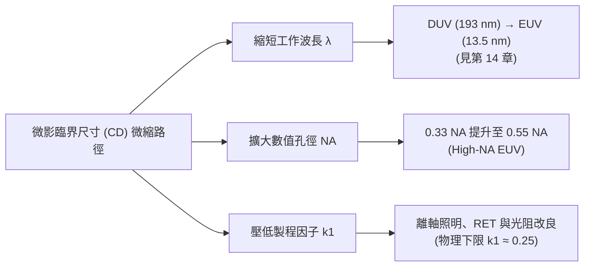

在極紫外光微影（EUVL，見第 14 章）採用波長 $\lambda = 13.5\text{ nm}$ 的架構下，第一代商用 EUV 系統將數值孔徑設定為 $\text{NA} = 0.33$。若以量產製程中穩定可靠的 $k_1 \approx 0.30$ 進行評估，其單次曝光之解析極限約為：

$$CD_{\text{NA=0.33}} \approx 0.30 \times \frac{13.5\text{ nm}}{0.33} \approx 12.27\text{ nm}$$

當半導體製程節點由 3 奈米邁向次 2 奈米（A14、A10 等埃米世代）時，後段金屬層（M0/M1）之間距（Pitch）要求縮減至 24 nm 以下（即半間距 $\le 12\text{ nm}$）。使用 0.33 NA 曝光機無法在此尺寸下維持單次曝光所需的對比度與良率，勢必得仰賴 EUV 雙重圖案化（EUV Double Patterning, EUV-DP）或自對準多重圖案化技術（SAMP，見第 13 章）。然而，多重圖案化不僅使光罩層數倍增、大幅提高生產週期與成本，亦引發極為嚴峻的層間疊對（Overlay）誤差（見第 17 章）。

因此，將投影光學系統的數值孔徑自 0.33 提升至 0.55（High-NA EUV），成為延續單次曝光圖案化能力的必然路徑。在相同 $k_1 = 0.30$ 之條件下，0.55 NA 的解析度提升至：

$$CD_{\text{NA=0.55}} \approx 0.30 \times \frac{13.5\text{ nm}}{0.55} \approx 7.36\text{ nm}$$

此數值足以支撐單次曝光達到半間距 8 nm 左右的次 10 nm 先進節點圖案化需求。然而，孔徑角 $\theta_{\text{max}}$ 的增加引發了劇烈的光學與材料物理瓶頸，使得 0.55 NA 無法透過簡單地等比例放大傳統 0.33 NA 光學架構來實現。

---

### 光罩入射角放大與幾何陰影效應

EUV 微影系統與傳統透射式 DUV 系統不同，其光學元件與光罩（Reticle）皆採用反射式架構。光學投影系統在晶圓端與光罩端遵循拉格朗日不變量（Lagrange Invariant，或稱光學延伸度守恆 Etendue Conservation）。在等方放大率（Isotropic Magnification）$M = 4$（即光罩尺寸為晶圓曝光尺寸的 4 倍）的傳統設計中，晶圓端數值孔徑 $\text{NA}_{\text{wafer}}$ 與光罩端數值孔徑 $\text{NA}_{\text{mask}}$ 滿足以下關係：

$$\text{NA}_{\text{mask}} = \frac{\text{NA}_{\text{wafer}}}{M} = \frac{\text{NA}_{\text{wafer}}}{4}$$

當 $\text{NA}_{\text{wafer}}$ 自 0.33 躍升至 0.55 時，光罩端的數值孔徑相應地由 $\text{NA}_{\text{mask}} \approx 0.0825$ 擴大至 $\text{NA}_{\text{mask}} \approx 0.1375$。此變化直接導致光罩端的光束發散半錐角（Half-angle, $\alpha$）顯著增大：

$$\alpha = \arcsin(\text{NA}_{\text{mask}})$$

在 $\text{NA}_{\text{mask}} = 0.0825$ 時，$\alpha \approx 4.73^\circ$；而在 $\text{NA}_{\text{mask}} = 0.1375$ 時，$\alpha \approx 7.90^\circ$。

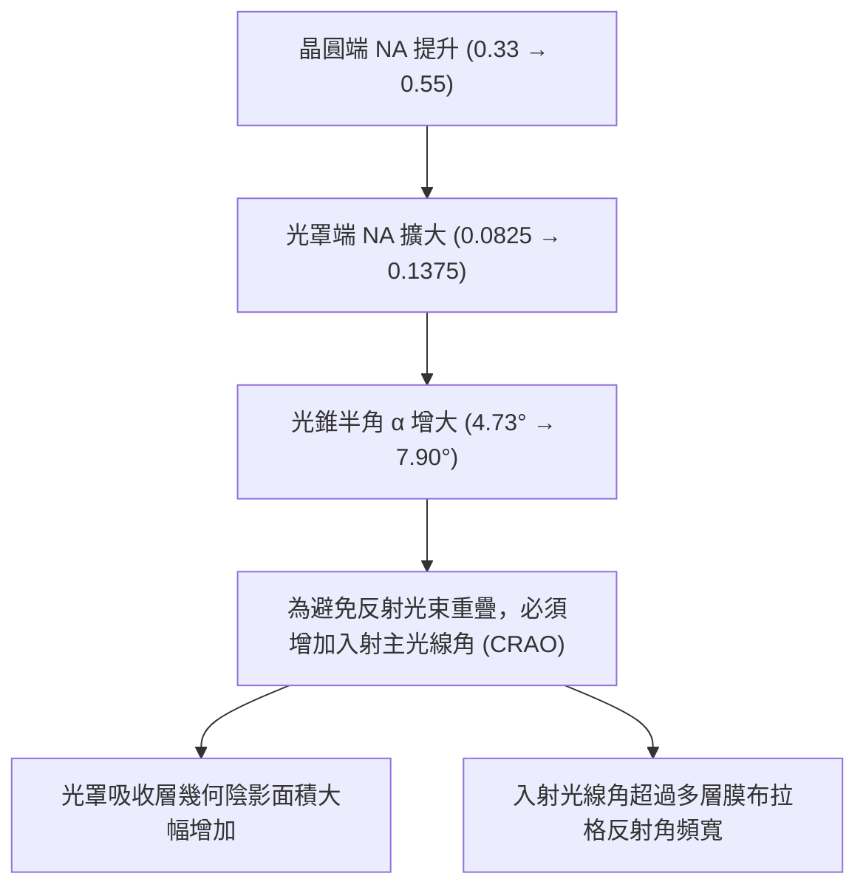

在反射式光罩架構中，照明光束必須以一定的主光線入射角（Chief Ray Angle on Object, CRAO）斜向投射至光罩表面，方能將反射的繞射光束導引至投影物鏡系統，而不與照明光學鏡組產生實體干涉重疊。主光線角 $\theta_{\text{CRAO}}$ 必須滿足：

$$\theta_{\text{CRAO}} > \alpha$$

在 0.33 NA 系統中，$\theta_{\text{CRAO}}$ 通常設定為 $6^\circ$。然而，當 $\text{NA}_{\text{mask}}$ 提升至 0.1375 時，光錐半角達到近 $8^\circ$，若繼續採用 $M = 4$，則 $\theta_{\text{CRAO}}$ 必須被迫增加至 $8.5^\circ \sim 9.5^\circ$。

CRAO 的增加導致了嚴重的幾何陰影效應（Geometric Shadowing Effect）。如圖所示，光罩表面由鉬/矽（Mo/Si）多層反射膜以及沉積於其上的圖案化吸收層（Absorber，如典型厚度約 50～70 nm 的 Ta 複合層）組成。斜向入射光照射時，吸收層的物理幾何高度會在多層膜上投射出反射盲區。

| 參數 | 0.33 NA 典型架構 | 0.55 NA 若採傳統 $M=4$ 架構 |
| :--- | :--- | :--- |
| **晶圓端數值孔徑 ($\text{NA}_{\text{wafer}}$)** | 0.33 | 0.55 |
| **光罩端數值孔徑 ($\text{NA}_{\text{mask}}$)** | 0.0825 | 0.1375 |
| **主光線入射角 ($\theta_{\text{CRAO}}$)** | $6^\circ$ | $\approx 8.5^\circ \sim 9.5^\circ$ |
| **光束發散全角 ($2\alpha$)** | $\approx 9.5^\circ$ | $\approx 15.8^\circ$ |
| **光罩幾何陰影寬度** | 基準值 ($H \cdot \tan 6^\circ$) | 增加約 $45\% \sim 60\%$ |

陰影寬度 $\Delta W$ 與吸收層高度 $H$ 及入射角 $\theta$ 成正比：

$$\Delta W = H \cdot \tan \theta$$

當 $\theta$ 由 $6^\circ$ 增加至 $9^\circ$ 時，陰影寬度增加約 52%。此效應會使平行於入射方向（垂直線條，Vertical line）與垂直於入射方向（水平線條，Horizontal line）的線條成像嚴重失對稱，產生顯著的水平-垂直尺寸偏差（H-V CD Difference），劇烈惡化曝光寬容度（Exposure Latitude, EL）。

---

### 光罩三維效應 (M3D) 的光學物理

幾何陰影效應僅是光罩三維效應（Mask 3D Effects, M3D）的簡化近似。當線條特徵尺寸縮減至與波長尺度（$\lambda = 13.5\text{ nm}$）具備可比性，且結構厚度達到數十奈米時，光波在吸收層開口深槽與多層膜結構內的傳播必須使用嚴格耦合波分析（Rigorous Coupled-Wave Analysis, RCWA）或有限差分時域法（Finite-Difference Time-Domain, FDTD）求解馬克士威方程組（Maxwell's Equations）。

M3D 效應在 High-NA 條件下呈現出更複雜的電磁傳輸特徵：

1. **波導效應（Waveguide Effect）與邊緣繞射**：
   斜向入射的高頻光波穿過吸收層微型槽溝時，光場與金屬吸收層側壁發生近場電磁耦合，產生波導截止現象（Cut-off），使得穿透槽溝的振幅產生急遽衰減與非線性相位延遲。

2. **繞射級次強度非對稱性（Diffraction Order Asymmetry）**：
   反射式微影下，吸收層幾何不對稱散射會使正負繞射級次（如 $-1$ 階與 $+1$ 階）之電場振幅與相位失去對稱：
   $$E(+1) \neq E(-1)^*$$
   非對稱繞射光束進入瞳孔（Pupil）後，在晶圓表面干涉產生的空間像（Aerial Image）不僅對比度（Normalized Image Log-Slope, NILS）顯著降低，更會隨離焦（Defocus）產生橫向位移，引發難以校正的非遠心圖案位移誤差（Telecentricity and Pattern Placement Errors）。

!!! warning "常見誤解：微影光罩可視為二維振幅薄板"
    在深紫外光（DUV）傳統微影分析中，純純量繞射理論通常將光罩假設為無限薄之二維二元穿透光罩（Kirchhoff Thin-mask Approximation）。然而在 EUV（特別是 High-NA EUV）架構下，此薄光罩近似完全失效。吸收層厚度達數十奈米，伴隨大角度斜向入射，若未在 OPC 演算法中引入嚴格三維電磁場模型，將導致數個奈米等級的輪廓預測失準。

---

### 鉬/矽多層膜之角頻寬限制與布拉格反射率衰減

除了幾何與電磁三維效應外，光罩基板之反射機制本身對入射光線角度設定了根本的物理上限。極紫外光在固態物質中的折射率 $n = 1 - \delta - i\beta$ 略小於 1，且伴隨極強烈的固有吸收，無法利用單一界面實現全反射。光罩反射基板是由 40 至 50 對交替沉積的鉬（Mo，折射率實部較低）與矽（Si，吸收損耗較低）奈米層構成的多層膜結構。

依據布拉格繞射定律（Bragg's Law），多層膜之建設性干涉反射條件為：

$$\lambda = 2 d \sqrt{1 - \frac{2\bar{\delta}}{\sin^2 \theta_{\text{inc}}}} \sin \theta_{\text{inc}} \approx 2 d \cos \theta$$

其中 $d$ 為雙層膜之週期厚度（Bilayer Periodicity，典型值 $d \approx 6.9 \sim 7.0\text{ nm}$），$\bar{\delta}$ 為雙層膜材料之平均折射率色散值，$\theta_{\text{inc}}$ 為光束相對多層膜表面之掠射角（Grazing Angle，$\theta_{\text{inc}} = 90^\circ - \theta$，$\theta$ 為光束相對於法線之入射角）。

多層膜系統本質上是一個角度帶通濾波器（Angular Bandpass Filter）。反射率達到半峰全寬（Full Width at Half Maximum, FWHM）的角度範圍稱為多層膜的角頻寬（Angular Bandwidth, $\Delta \theta$）。典型 Mo/Si 多層膜在 $\lambda = 13.5\text{ nm}$ 下的峰值反射率約為 $67\% \sim 70\%$，其高反射率之核心有效角頻寬限制在約 $\pm 2^\circ \sim \pm 3^\circ$ 之內。

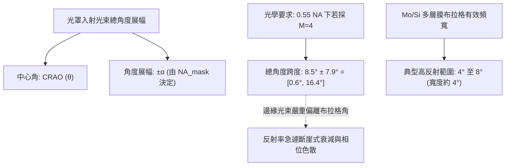

在 0.55 NA 若堅持維持傳統 $M=4$ 的假設下，光罩端數值孔徑 $\text{NA}_{\text{mask}} = 0.1375$ 意味著光束半錐角高達 $\alpha \approx 7.9^\circ$。若主光線角度 $\theta_{\text{CRAO}} = 8.5^\circ$，則入射到多層膜上的光束角度範圍將落在：

$$\theta \in [8.5^\circ - 7.9^\circ, \, 8.5^\circ + 7.9^\circ] = [0.6^\circ, \, 16.4^\circ]$$

當入射角 $\theta$ 大幅度偏離最佳布拉格角時，多層膜各層反射波的相位同調性遭受破壞：
1. **反射率崩塌（Reflectivity Roll-off）**：大於 $11^\circ$ 的外圍光線，其布拉格反射率急遽下滑至原本峰值的一半以下，而在接近 $16^\circ$ 處反射率幾乎完全喪失。這造成嚴重的瞳孔光強變跡效應（Pupil Apodization），大幅削減總通量（Throughput）。
2. **相位跳變與波前像差（Phase Aberration）**：遠離布拉格角的光線在反射時伴隨強烈的非線性相位延遲，直接轉化為投影物鏡的波前像差，破壞成像焦點並造成空間像對比度嚴重劣化。

上述物理瓶頸——包括放大倍率不變下 CRAO 增加所引發的嚴重幾何陰影、M3D 空間像扭曲，以及超出 Mo/Si 多層膜物理角頻寬導致的能量與相位衰減——證實了將晶圓端 NA 推進至 0.55 時，光罩端無法繼續維持傳統的 $4\times$ 等方放大架構。微影光學系統必須針對光罩反射物理進行結構性的革新，這催生了本章後續將探討的變形光學系統設計。

## 15.2 變形光學系統 (Anamorphic Optics) 原理

### 光罩遮蔭效應與數值孔徑的幾何衝突

在極紫外光（Extreme Ultraviolet, EUV）微影系統中，光學系統無法使用透鏡進行穿透式折射成像，所有光學元件（包含光罩與投影物鏡組）均必須採用反射式設計（見第 14 章）。在傳統 $0.33\ \text{NA}$ 的 EUV 系統中，光罩與晶圓之間的橫向縮小倍率在水平（$x$）與垂直（$y$）方向皆為對稱的 $4\times$（即 $M_x = M_y = 4$）。然而，當數值孔徑提升至 $0.55\ \text{NA}$（High-NA）時，維持等向性 $4\times$ 放大倍率將面臨根本性的光學幾何衝突。

晶圓端數值孔徑 $NA_{\text{wafer}}$ 與光罩端數值孔徑 $NA_{\text{mask}}$ 的關係由放大倍率 $M$ 決定：

$$NA_{\text{mask}} = \frac{NA_{\text{wafer}}}{M}$$

光束在光罩端的半角錐張角（Angular spread）$\theta_{\text{mask}}$ 滿足：

$$\sin \theta_{\text{mask}} = NA_{\text{mask}} = \frac{NA_{\text{wafer}}}{M}$$

在反射式光罩架構下，入射至光罩的照明光束與離開光罩進入投影光學箱（Projection Optics Box, POB）的繞射光束必須在空間上分離，否則入射光與反射繞射光會在光學元件上發生實體幾何干涉。為了實現光束分離，照明光束必須以一傾斜的主光線入射角（Chief Ray Angle of Incidence, CRAO，以下簡稱 $\theta_{\text{CRA}}$）照射光罩。為避免入射光錐與繞射光錐重疊，最小入射角必須滿足：

$$\theta_{\text{CRA}} \ge \theta_{\text{mask}} + \Delta\theta_{\text{clearance}}$$

其中 $\Delta\theta_{\text{clearance}}$ 為光學機構預留的安全餘裕角。

若在 $0.55\ \text{NA}$ 下維持 $M = 4$，光罩端的數值孔徑將高達：

$$NA_{\text{mask}} = \frac{0.55}{4} = 0.1375 \implies \theta_{\text{mask}} = \arcsin(0.1375) \approx 7.9^\circ$$

此時光罩端的主光線入射角 $\theta_{\text{CRA}}$ 必須從 $0.33\ \text{NA}$ 系統的約 $6.0^\circ$ 大幅提升至 $8.5^\circ \sim 9.0^\circ$ 以上。過大的入射角會帶來嚴重的物理限制：

1. **光罩遮蔭效應（Mask Shadowing Effect）**：EUV 光罩由多層膜（Multilayer, ML）反射基底與其上具有厚度（典型值約 $50 \sim 70\ \text{nm}$）的吸收層（Absorber）圖案組成。當光線以大角度入射時，吸收層幾何邊界會在其背光面投下陰影，遮蔽鄰近多層膜的反射光。陰影幾何長度 $L_{\text{shadow}}$ 與入射角呈正切關係：
   $$L_{\text{shadow}} = h_{\text{abs}} \cdot \tan \theta_{\text{CRA}}$$
   其中 $h_{\text{abs}}$ 為吸收層厚度。較大的 $\theta_{\text{CRA}}$ 會導致反射繞射光的能量損失、有效臨界尺寸（Critical Dimension, CD）非對稱縮小，以及水平線條與垂直線條在曝光時的顯著 CD 偏差（H-V Bias）。
2. **布拉格多層膜失諧**：鉬／矽（$\text{Mo/Si}$）多層膜反射鏡的布拉格反射條件對入射角度極度敏感。過大的入射角會使多層膜反射峰值波長漂移，急遽降低光罩反射率並引發強烈的相差與像差。

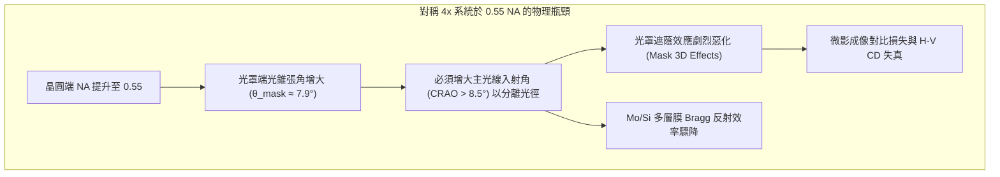

---

### 非對稱放大倍率：4x 水平與 8x 垂直之工程折衷

為克服光罩端光錐過大導致的遮蔭效應，必須降低光罩端數值孔徑 $NA_{\text{mask}}$。由公式可知，唯一手段是增大縮小倍率 $M$。若將 $M$ 在全方向等向性提升至 $8\times$（$M_x = M_y = 8$），光罩端孔徑角即可減半，$\theta_{\text{CRA}}$ 亦可維持在低角度；然而，這會導致晶圓上的曝光視場面積（Field Size）縮減為原本的四分之一（$1/4$），每片晶圓所需的曝光次數暴增四倍，系統產出量（Throughput）將遭受毀滅性衝擊。

光學工程上的關鍵突破在於觀察到**光罩遮蔭效應具有方向性**。在步進掃描式曝光機（Scanner）中，狹縫（Slit）沿掃描方向（定義為 $y$ 軸）推進，主光線傾斜角 $\theta_{\text{CRA}}$ 是被配置於子午面（Meridional Plane，即光罩的 $y$ 方向）。非掃描方向（定義為 $x$ 軸）的主光線角度並不需要為了光徑分離而傾斜。

因此，High-NA EUV 系統導入了**變形光學系統（Anamorphic Optics）**，採用非對稱的放大倍率配置：

* **水平方向（$x$ 軸，非掃描方向）**：維持 $M_x = 4\times$
* **垂直方向（$y$ 軸，掃描方向）**：提高為 $M_y = 8\times$

| 參數項目 | 0.33 NA 等向性系統 | 0.55 NA 變形光學系統 ($x$ 方向) | 0.55 NA 變形光學系統 ($y$ 方向) |
| :--- | :--- | :--- | :--- |
| **晶圓端數值孔徑 ($NA_{\text{wafer}}$)** | $0.33$ | $0.55$ | $0.55$ |
| **放大縮小倍率 ($M$)** | $4\times$ | $4\times$ | $8\times$ |
| **光罩端數值孔徑 ($NA_{\text{mask}}$)** | $0.0825$ | $0.1375$ | $0.06875$ |
| **光罩端主光線入射角 ($\theta_{\text{CRA}}$)** | 約 $6.0^\circ$ | $0^\circ$（對稱入射） | 約 $5.5^\circ \sim 6.0^\circ$ |
| **標準曝光視場尺寸（晶圓端）** | $26\ \text{mm} \times 33\ \text{mm}$ | $26\ \text{mm}$（維持全寬） | $16.5\ \text{mm}$（減半，半視場） |

藉由將 $y$ 方向倍率提升至 $8\times$，$y$ 方向光罩端數值孔徑降至 $NA_{\text{mask}, y} = 0.55 / 8 = 0.06875$，成功使 $\theta_{\text{CRA}}$ 抑制在 $6^\circ$ 以下，從根本上緩解了光罩三維效應（Mask 3D Effects, M3D）與遮蔭現象。同時，因 $x$ 方向仍為 $4\times$，晶圓曝光視場僅在 $y$ 方向折半（變為 $26\ \text{mm} \times 16.5\ \text{mm}$，稱為半視場，Half-field），相較於等向性 $8\times$ 系統，保留了兩倍的曝光面積與產能。

!!! note "說明：掃描速度的運動學匹配"
    在變形物鏡設計中，晶圓台與光罩台的移動速度比例必須與光學放大倍率嚴格同步。在 $y$ 方向掃描時，光罩移動速度 $v_{\text{mask}, y}$ 與晶圓移動速度 $v_{\text{wafer}, y}$ 之比值為：
    $$\frac{v_{\text{mask}, y}}{v_{\text{wafer}, y}} = M_y = 8$$
    這意味著晶圓台以速度 $v$ 移動時，光罩台必須以 $8v$ 的極高加速度與等速穩定度進行機械掃描，對平台控制系統的動態剛性與伺服頻寬提出了極端嚴苛的要求。

---

### 多鏡面反射物鏡組與光學像差補償

變形光學系統打破了旋轉對稱性，使得光學系統的設計、製造與調準複雜度成指數級上升。

#### 1. 散光（Astigmatism）與自由曲面反射鏡（Freeform Mirrors）
在傳統旋轉對稱物鏡中，$x$ 與 $y$ 方向的焦距完全一致。變形系統中，由於 $M_x = 4$ 而 $M_y = 8$，物鏡在兩個垂直正交方向上的光學折射能力（Optical Power）相差兩倍。若無補償機制，光學系統將產生毀滅性的原生物焦散光（Intrinsic Astigmatism），即水平焦點與垂直焦點在光軸方向上出現劇烈分離。

為抵消變形像差，物鏡群無法採用傳統的球面或旋轉對稱非球面鏡，而必須全面採用**自由曲面反射鏡（Freeform Mirrors）**與環形面鏡（Toroidal Mirrors）。面形設計的數學描述由旋轉對稱多項式轉變為雙變數高次多項式（如 XY 多項式或 Zernike 自由曲面基底），使面鏡在 $x$ 與 $y$ 方向具備非對稱的曲率半徑：

$$z(x, y) = \frac{c_x x^2 + c_y y^2}{1 + \sqrt{1 - (1+k_x)c_x^2 x^2 - (1+k_y)c_y^2 y^2}} + \sum_{i, j} A_{ij} x^i y^j$$

其中 $c_x, c_y$ 與 $k_x, k_y$ 分別表示兩軸的曲率與二次曲面常數，$A_{ij}$ 為高階非對稱校正項。

#### 2. 鏡面數量與光子傳輸效率折衷
將數值孔徑自 $0.33$ 提升至 $0.55$，為了在極度緊湊的空間內校正高階像差並維持光束孔徑角，投影物鏡組內的反射鏡數量由 $0.33\ \text{NA}$ 系統的 6 面鏡子增加至 High-NA 系統的 **8 面鏡子**。

每一面鉬／矽多層膜面鏡的理論極限反射率約為 $68\% \sim 70\%$。若以單面反射率 $R \approx 67\%$ 計算：
* 6 面鏡物鏡之光學穿透率：$T_6 = (0.67)^6 \approx 9.0\%$
* 8 面鏡物鏡之光學穿透率：$T_8 = (0.67)^8 \approx 4.0\%$

增加兩面反射鏡導致投影物鏡的光學穿透率衰減超過一半。為了在晶圓端維持足以支援商業化生產的光阻曝光劑量（Dose），光源端必須提供更高的極紫外光輸出功率，同時物鏡系統必須引入動態熱變形補償（Thermal Aberration Control），避免吸收光能造成的鏡面皮米級（picometer）形變。

#### 3. 偏振效應（Polarization Effects）與向量成像
在 $0.55\ \text{NA}$ 下，光線在晶圓表面匯聚時，邊緣光線的入射半角高達 $\alpha = \arcsin(0.55) \approx 33.4^\circ$，兩側光束匯聚時的交角接近 $70^\circ$。此時純量光學繞射理論完全失效，必須使用麥克斯威方程組的向量繞射分析（Vector Diffraction Theory）。

在垂直入射時，任意偏振方向的光束均能產生干涉；但在大角度交匯時，平行於入射面的 p-偏振（p-polarized）光向量分量會相互抵消，導致干涉條紋對比度（Image Contrast）顯著下降：

$$\text{Contrast}_p \propto \cos(2\alpha)$$

變形物鏡內部各反射鏡具有不同的空間傾角與雙折射相位差，使光束通過 8 面鏡後產生複雜的偏振態漂移（Jones Pupil Aberrations），這對光阻層內的能量沉積剖面構成了嚴重的三維衝擊。

---

### 對版圖設計規則與計算微影的衝擊

變形倍率直接打破了積體電路版圖（Layout）在光罩幾何與晶圓幾何之間的等比例投影關係，對實體設計規則（Design Rules）與計算微影（Computational Lithography）產生全面連動。

#### 1. 光罩幾何圖案的非對稱縮放
在變形系統中，設計者在晶圓端所期望的等向性幾何圖形（例如 $CD_x = CD_y = d$ 的對稱接觸孔 Contact Hole），在光罩資料（Mask Data）上呈現為非對稱的長方形：

* 光罩端 $x$ 軸尺寸：$W_{\text{mask}, x} = d \times 4$
* 光罩端 $y$ 軸尺寸：$W_{\text{mask}, y} = d \times 8$

光罩圖形在 $y$ 方向被拉伸至原來的兩倍。這改變了光罩製造（Mask Making）中電子束寫入機（e-beam Mask Writer）的位址網格（Address Grid）劃分，並對光罩製程偏差（Mask Error Enhancement Factor, MEEF）產生非對稱效應：

$$MEEF_x = \frac{\partial CD_{\text{wafer}, x}}{\partial (CD_{\text{mask}, x} / 4)}, \quad MEEF_y = \frac{\partial CD_{\text{wafer}, y}}{\partial (CD_{\text{mask}, y} / 8)}$$

實驗與模擬表明，$y$ 方向由於採用了 $8\times$ 縮小，幾何公差被放大了八倍，使得 $y$ 方向的幾何圖案相較於 $x$ 方向對光罩線寬誤差具備較高的容忍度。

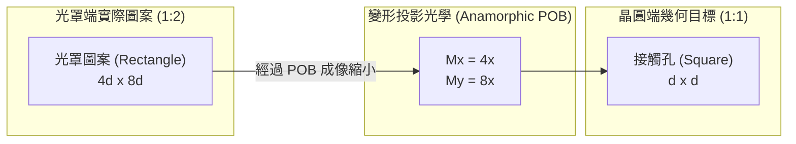

#### 2. 光學鄰近修正（OPC）與 Mask 3D 補償模型
變形光學對計算微影中的光學鄰近修正（Optical Proximity Correction, OPC）提出極高挑戰：

* **方向性幾何不對稱修正**：直角轉折圖案（L-shape 或 Corner）在經過 $4\times / 8\times$ 逆變換後，光罩端轉角處呈現嚴重的鈍化與非對稱形變，必須建立專屬的非等向性光學核（Anamorphic Optical Kernels）進行卷積運算。
* **嚴格向量電磁場（RCWA / FDTD）模擬的必要性**：傳統穿透式光學的薄光罩近似（Thin-Mask Approximation, Kirchhoff 近似）在 High-NA 完全崩潰。計算微影引擎必須在全晶片 OPC 流程中即時解算三維電磁波方程式（嚴格耦合波分析法 RCWA 或有限差分時域法 FDTD），以同時精確模擬光罩吸收層厚度在 $y$ 方向傾斜角照射下的立體陰影、相角突變以及光學干涉圖樣。

!!! warning "常見誤解：變形微影是否導致晶圓晶片長寬失真？"
    變形物鏡（$4\times / 8\times$）僅存在於光罩與晶圓之間的光學路徑上。晶片設計工程師（IC Designer）在 EDA 工具中繪製的版圖依然是正常的實體比例，微影機最終在晶圓上還原出的電路圖形亦完全維持設計的縱橫比（Aspect Ratio）。幾何非對稱性被完全封裝在光罩資料準備（Mask Data Preparation, MDP）與光學投影系統的硬體物理層中，但在繞線規則（Routing Rules）上，通常會針對 $x$ 與 $y$ 方向賦予非對稱的最小間距限制（Pitch Rules），以最大化 High-NA 在特定方向的解析度效益。

!!! example "產業實例：ASML 與 ZEISS 的 High-NA 光學系統實作"
    在工業界首款 High-NA EUV 曝光機 ASML TWINSCAN EXE:5000 / EXE:5200 系列中，Carl Zeiss 開發的 Starlith 物鏡系統即採用 8 面自由曲面反射鏡架構，實作了 $4\times / 8\times$ 變形光學規格。該系統維持了對標準 6 吋光罩規格（$6 \times 6 \times 0.25$ 吋）的物理相容性，免除了半導體產業鏈全面更換光罩基板規格的巨額資本支出。其代價則是將標準晶圓曝光視場由傳統的 $26\ \text{mm} \times 33\ \text{mm}$ 縮減為 $26\ \text{mm} \times 16.5\ \text{mm}$，促成了後續「半視場」與「光罩拼接（Stitching）」技術的導入（見第 15.3 節）。

<!-- fig:1 -->
<figure markdown>
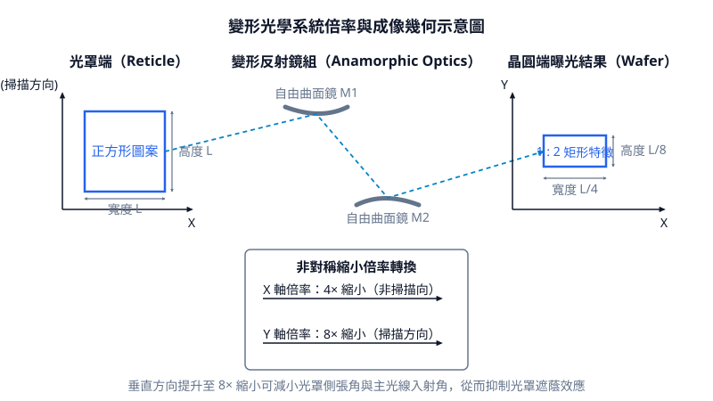
<figcaption>圖 15-1　變形光學倍率示意圖（AI 繪製的示意圖）</figcaption>
</figure>

## 15.3 半視場效應與光罩拼接 (Stitching) 技術

### 變形放大倍率與半視場限制 (Half-Field Effect)

在第 15.2 節所述之變形光學系統 (Anamorphic Optics) 中，為避免極紫外光 (EUV) 於光罩側因入射角過大而引發嚴重的遮蔽效應 (Shadowing Effect)，高數值孔徑微影系統將掃描方向 ($Y$ 方向) 的光學縮小倍率提高至 $8\times$，而跨掃描方向 ($X$ 方向) 則維持傳統的 $4\times$。此種非對稱放大倍率雖然成功將光學數值孔徑 (Numerical Aperture, NA) 推升至 0.55，卻對曝光視場大小帶來了直接的物理幾何限制。

目前半導體產業標準光罩尺寸為 6 吋基板 ($6 \times 6 \times 0.25\text{ 英吋}$)，其光罩表面上的最大有效圖案區域通常為：

$$L_{\text{mask}, X} = 104\text{ mm}, \quad L_{\text{mask}, Y} = 132\text{ mm}$$

在 0.33 NA 的對稱 $4\times$ 光學系統中，光罩圖案等比例縮小投射至晶圓表面，形成之標準曝光視場 (Full-field) 尺寸為：

$$W_{\text{field}} = \frac{104\text{ mm}}{4} = 26\text{ mm}$$

$$L_{\text{field}} = \frac{132\text{ mm}}{4} = 33\text{ mm}$$

此即產業界長期沿用的 $26\text{ mm} \times 33\text{ mm}$ 標準視場（最大面積約 $858\text{ mm}^2$）。然而，在 0.55 NA 變形光學系統中，晶圓端的曝光視場幾何尺寸受限於各向異性放大倍率 ($M_x = 4$, $M_y = 8$)：

$$W_{\text{field, High-NA}} = \frac{L_{\text{mask}, X}}{M_x} = \frac{104\text{ mm}}{4} = 26\text{ mm}$$

$$L_{\text{field, High-NA}} = \frac{L_{\text{mask}, Y}}{M_y} = \frac{132\text{ mm}}{8} = 16.5\text{ mm}$$

此時，單次曝光之最大視場面積驟降至 $26\text{ mm} \times 16.5\text{ mm} = 429\text{ mm}^2$，僅為傳統 EUV 視場的一半，故稱之為「半視場效應」(Half-field Effect)。

| 微影光學規格 | 光罩縮小倍率 ($X \times Y$) | 光罩有效尺寸 ($X \times Y$) | 晶圓曝光視場 ($X \times Y$) | 視場最大面積 |
| :--- | :--- | :--- | :--- | :--- |
| **0.33 NA 傳統 EUV** | $4\times \times 4\times$ | $104\text{ mm} \times 132\text{ mm}$ | $26.0\text{ mm} \times 33.0\text{ mm}$ | $858\text{ mm}^2$ |
| **0.55 NA High-NA EUV** | $4\times \times 8\times$ | $104\text{ mm} \times 132\text{ mm}$ | $26.0\text{ mm} \times 16.5\text{ mm}$ | $429\text{ mm}^2$ |

當積體電路設計之單一裸晶尺寸 (Die Size) 小於或等於 $26\text{ mm} \times 16.5\text{ mm}$ 時，可完整容納於單一半視場內；然而，在高效能運算 (HPC)、資料中心伺服器晶片與人工智慧加速器等應用中，旗艦級晶片的單裸晶面積經常突破 $600\text{ mm}^2$ 至 $800\text{ mm}^2$，遠超出半視場的物理極限。在此情況下，必須仰賴光罩拼接 (Stitching) 技術，將單一晶片分割於多個半視場內分別曝光並精準接合。

---

### 光罩拼接原理與分割策略 (Stitching Principles and Partitioning Strategies)

光罩拼接是指在微影製程中，將一個大於單一曝光視場的連續電路圖案，在電腦輔助設計 (CAD) 階段分割為兩個（或多個）子視場圖案，製作於不同光罩或同一光罩的不同區域上；曝光機隨後依序將這些子圖案曝光在晶圓的相鄰位置上，使圖案邊緣在奈米尺度下重疊或對接，以重構完整的晶片電路。

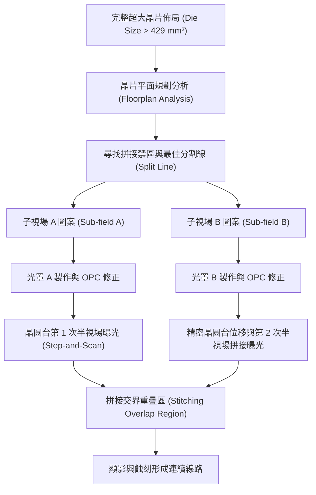

在電路分割策略上，拼接並非單純的幾何垂直切割，而必須結合電路平面規劃 (Floorplan) 採取高度感知架構（Floorplan-aware Partitioning）：

1. **模組邊界切割 (Functional Boundary Split)**：
   分割線應優先選擇通過非關鍵電路區，例如靜態隨機存取記憶體 (SRAM) 陣列之間的間隔區、解耦電容區 (Decoupling Capacitor Region) 或功能核心 (Core) 間的通訊匯流排隔離帶。絕對避免切割關鍵類比電路、感測放大器 (Sense Amplifier) 或高度匹配的差動對電晶體。
2. **多層交錯拼接 (Staggered/Interleaved Stitching)**：
   在多層金屬互連 (BEOL) 結構中，嚴禁所有金屬層在相同的三維空間垂直面上進行拼接。若每一層的拼接縫均疊合在同一位置，疊對誤差與線寬變異將產生結構性的垂直累積，大幅增加介電崩潰與結構應力斷裂的機率。因此，金屬層 $M_x$ 與 $M_{x+1}$ 的拼接邊界通常會在平面位置上錯開數微米至數十微米。
3. **邊界重疊區混合曝光 (Dose Blending / Overlap Stitching)**：
   若導線必須橫跨切割線，通常在兩側子圖案交界處設計約數十奈米至數微米的重疊過渡區 (Blending Region)。在此區域內，光罩邊界的透光度或曝光劑量會進行漸變式調配（如線性遞減與遞增），使兩次曝光的能量在空間中疊加後達到目標臨界劑量 ($E_{\text{th}}$)，藉此降低邊界機械位移對最終線寬的衝擊。

---

### 拼接邊界的疊對誤差與線寬均勻度 (CDU) 挑戰

光罩拼接技術在微影製程中面臨最嚴苛的挑戰在於邊界處的邊緣放置誤差 (Edge Placement Error, EPE) 控制。EPE 為局部臨界尺寸均勻度 (CDU) 誤差與疊對誤差 (Overlay) 的向量疊加（詳見第 17 章）。在縫合處，兩次獨立曝光的晶圓台定位誤差會直接轉化為圖案間的相對位移。

$$EPE_{\text{stitch}} = \frac{1}{2}\Delta CD_{\text{stitch}} + \Delta \text{Overlay}_{\text{stage}}$$

其中 $\Delta CD_{\text{stitch}}$ 為拼接邊界處的線寬變化，$\Delta \text{Overlay}_{\text{stage}}$ 為晶圓掃描台在兩次曝光之間的相對對準誤差。

在次 2 nm 節點下，金屬導線半間距 (Half-pitch) 縮小至 10 nm 至 12 nm，全晶片疊對容許度通常必須壓低在 1.5 nm 至 2.0 nm 以內。拼接交界面面臨的具體微影光學與化學挑戰包含：

1. **非對稱繞射與邊界光學鄰近效應 (OPC Anomaly)**：
   當連續線路在光罩邊界被截斷時，光波在圖案邊緣會產生劇烈的截斷繞射效應。截斷端點的繞射光譜與連續線路不同，會誘發顯著的線端縮短 (Line-end Shortening) 與邊角圓化現象。必須使用複雜的逆向微影技術 (ILT) 與特定次解析度輔助特徵 (SRAF) 對拼接端進行光學校正（見第 16 章）。
2. **雜散光 (Flare) 空間突變**：
   High-NA 系統的光學鏡面反射散射所導致的雜散光具備局部空間相依性。在拼接邊界處，由於相鄰子視場的光罩圖案密度可能存在劇烈落差（例如一側為密集成像區，另一側為開口或邊框），導致交界處出現劇烈的雜散光梯度，進一步劣化拼接點的對比度與曝光餘裕 (Exposure Latitude)。
3. **光阻化學放大與顯影擴散誤差**：
   化學放大光阻 (CAR) 或金屬氧化物光阻 (MOR) 中的光酸產生劑 (PAG) 在曝光後烘烤 (PEB) 過程中會產生奈米級擴散。若拼接採用劑量過渡方案，重疊區內兩次光酸擴散前鋒的交互作用非單純線性疊加，極易在交界處產生「頸縮」(Neck-down) 或「突起」(Bridging) 現象，使得局部 CDU 顯著惡化。

```
     【理想連續導線】
     ───────────────────────────────────

     【硬切拼接誤差：軸向錯位 (Misaligned Joint)】
     ──────────────┐
                   └────────────────────  ← 產生寄生電容與局部電場集中

     【邊界劑量不足：頸縮 (Neck-down)】
     ─────────╲    ╱───────────────────  ← 高電阻點與電遷移熱點 (EM Hotspot)
               └──┘
```

---

### 電氣特性影響、寄生效應與良率風險

微影拼接交界面的幾何畸變與材料介面不連續性，會轉化為顯著的電子傳輸阻抗變化與可靠度物理缺陷：

#### 1. 局部電阻突變與 RC 延遲變異
金屬互連線的電阻 $R$ 由其幾何截面與電阻率 $\rho$ 決定：

$$R = \int_{0}^{L} \frac{\rho}{W(x) \cdot H(x)} \, dx$$

若拼接交界處因微影疊對誤差或劑量重疊偏差發生線寬變窄（頸縮），導線橫截面積 $A(x) = W(x) \cdot H(x)$ 局部縮小。在奈米尺度下，由於電子受到金屬晶界散射 (Grain Boundary Scattering) 與表面散射 (Surface Scattering) 的影響（如 Mayadas-Shatzkes 模型），電阻率 $\rho$ 會隨著線寬縮減而急遽上升。此局部高電阻節點會導致長距離互連線的訊號傳輸時間（$RC$ 延遲）產生非預期的時脈偏移 (Timing Skew)，破壞高速同步邏輯電路的時序收斂 (Timing Closure)。

#### 2. 電遷移 (Electromigration, EM) 熱點
電遷移可靠度遵循布萊克方程式 (Black's Equation)：

$$\text{MTTF} = \frac{A}{J^n} \exp\left(\frac{E_a}{k_B T}\right)$$

其中 $\text{MTTF}$ 為平均失效時間，$J$ 為電流密度，$E_a$ 為活化能，$k_B$ 為波茲曼常數，$T$ 為絕對溫度。當導線在拼接接縫處產生頸縮時，局部截面積銳減使該處電流密度 $J = I / A$ 呈倍數上升。高電流密度伴隨嚴重的焦耳熱 (Joule Heating) 造成局部溫度 $T$ 攀升，使該節點之 $\text{MTTF}$ 呈指數級下降。此外，錯位邊界處原子晶格排列紊亂，提供金屬原子快速擴散通道，極易在拼接點形成空洞 (Void) 導致斷路，或擠出金屬小丘 (Hillock) 引發相鄰線路短路。

#### 3. 寄生電容與訊號完整性
若拼接處之導線向相鄰線路偏移，線間距 (Spacing) 縮小將導致線對線寄生電容 (Coupling Capacitance) 大幅增加，加劇高頻運作時的串音干擾 (Crosstalk) 與介電層應力。若偏移量超過介電層擊穿場強容限，甚至會誘發時間相依介電層崩潰 (Time-Dependent Dielectric Breakdown, TDDB) 機制。

!!! warning "拼接與晶片架構設計的取捨"
    由於光罩拼接在光學微影修正、良率控制、晶圓產出率 (Throughput) 以及電氣可靠度分析上需付出極高代價，在先進封裝技術（如矽中介層 CoWoS、高密度扇出型封裝等）快速成熟的背景下，半導體設計通常會面臨架構層面的抉擇：
    
    1. **單晶拼接 (Monolithic Stitching)**：維持超大單一裸晶，承受拼接微影造成的曝光產能減半與良率風險。
    2. **小晶片 (Chiplet) 分割**：主動將大晶片拆解為數個小於 $429\text{ mm}^2$ 的獨立裸晶，各自於單一半視場內進行常規的高良率曝光，最後透過先進微電子封裝技術在高密度互連基板上重組。

!!! example "先進運算晶片中的拼接實務策略"
    在超過網格極限 (Reticle Limit) 的巨型人工智慧處理器或資料中心晶片中，部分業者若必須採用單晶架構，微影團隊通常會在設計規則檢查 (DRC) 中定義嚴格的「拼接保護邊框」(Stitching Keep-out Zone)。在此寬度約為數微米的區域內，嚴禁布設核心運算電晶體與極細互連金屬層（如 M0、M1、M2），僅允許通過放寬線寬 (Relaxed Pitch) 的上層金屬層（如 M7、M8），並透過多重冗餘通道 (Redundant Vias / Traces) 分流電流，以徹底免疫次奈米級微影疊對誤差所引起的電迁移致命破壞。

<!-- fig:2 -->
<figure markdown>
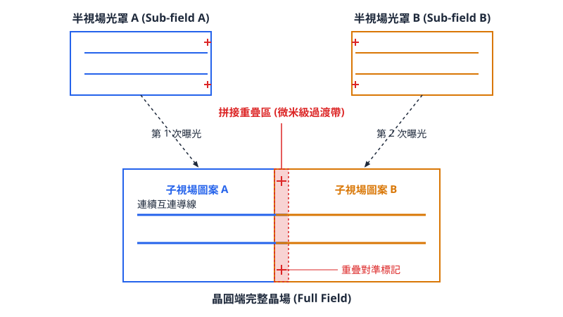
<figcaption>圖 15-2　半視場晶場拼接示意圖（AI 繪製的示意圖）</figcaption>
</figure>

## 15.4 景深極限壓縮對製程整合的衝擊

### 景深與 NA 平方的物理衰減極限

微影光學系統的解析度雖然隨著數值孔徑（Numerical Aperture, NA）的提高而改善，但成像系統的景深（Depth of Focus, DOF）卻會以更劇烈的速率急遽衰減。根據光學微影的瑞利準則（Rayleigh Criterion），極限景深可表示為：

$$\text{DOF} = k_2 \frac{\lambda}{\text{NA}^2}$$

其中，$\lambda$ 為光源波長（EUV 為 $13.5\text{ nm}$），$\text{NA}$ 為成像物鏡的數值孔徑，$k_2$ 為與光學照明模式（Illumination Mode）、光罩型式及光阻系統相關的製程因子（Process Factor），在先進製程環境中典型值約介於 $0.4$ 至 $0.6$ 之間。

從式中可清楚看出，解析度（$\text{CD} = k_1 \frac{\lambda}{\text{NA}}$）與 $\text{NA}$ 成一次方反比，而景深則與 $\text{NA}$ 的二次方成反比。當微影系統由標準 EUV 的 $\text{NA} = 0.33$ 推進至 High-NA 的 $\text{NA} = 0.55$ 時，在波長 $\lambda$ 維持 $13.5\text{ nm}$ 不變的前提下，其理論景深縮小比例為：

$$\frac{\text{DOF}_{0.55}}{\text{DOF}_{0.33}} = \left( \frac{0.33}{0.55} \right)^2 \approx 0.36$$

這意味著 High-NA 系統的光學景深縮小為傳統 0.33 NA 系統的約 $36\%$。在實際曝光條件下，0.33 NA 的有效製程景深通常落在 $80\text{ nm} \sim 100\text{ nm}$ 之間，而 0.55 NA 系統的景深僅剩下約 $20\text{ nm} \sim 35\text{ nm}$（典型值），甚至更低。此種亞數十奈米（Sub-tens-of-nanometers）等級的景深，對整個前段與中段製程整合造成了極具破壞性的工程挑戰。

| 光學參數與製程特性 | 0.33 NA EUV（標準系統） | 0.55 NA EUV（High-NA 系統） | 物理意涵與縮放比 |
| :--- | :--- | :--- | :--- |
| **數值孔徑 ($\text{NA}$)** | $0.33$ | $0.55$ | 增大約 $1.67$ 倍 |
| **極限解析度 (CD)** | $\approx 13\text{ nm}$（單次曝光極限） | $\approx 8\text{ nm}$ | 微縮至約 $60\%$ |
| **光學景深 (DOF)** | $\approx 80 \sim 100\text{ nm}$（典型值） | $\approx 20 \sim 35\text{ nm}$（典型值） | 衰減至約 $36\%$ |
| **光阻厚度上限** | $30 \sim 40\text{ nm}$ | $15 \sim 20\text{ nm}$ | 避免上下界面散焦 |
| **圖案縱橫比 (AR) 限制** | $\approx 2.0:1$ | $\le 1.5:1$ | 避免圖案崩塌 |

---

### 超薄光阻層需求與金屬氧化物光阻 (MOR) 的導入

光阻層的厚度必須被限制在有效景深範圍之內。若光阻厚度大於或接近 DOF，當光學焦點落在光阻層中心時，光阻的頂部與底部將落於焦外區域（Out-of-focus Region），造成空間像對比度（Aerial Image Contrast）嚴重劣化，使顯影後的光阻側壁呈現傾斜、底部殘渣（Scumming）或頂部圓化（Top Rounding）。

此外，隨著線寬臨界尺寸（CD）縮小至 $10\text{ nm}$ 以下，縱橫比（Aspect Ratio, $\text{AR} = \frac{\text{厚度}}{\text{CD}}$）的力學穩定性成為瓶頸。當縱橫比超過 $2:1$ 時，顯影液在乾燥過程中產生的毛細管力（Capillary Force）會引發嚴重的圖案倒塌（Pattern Collapse）。因此，在 $8\text{ nm} \sim 10\text{ nm}$ 的節點上，光阻厚度必須嚴格限制在 $15\text{ nm} \sim 20\text{ nm}$ 以下，即所謂的超薄光阻層（Ultra-thin Photoresist）。

傳統以碳氫化合物為基底的化學增幅型光阻（Chemically Amplified Resist, CAR，見第 11 章）在超薄厚度下遇到了物理極限：
1. **光子吸收效率不足**：薄膜化導致 EUV 光子在光阻層內的能量沉積過低，引發嚴重的隨機效應（Stochastic Effects）。
2. **光酸擴散模糊**：光酸分子（Photoacid）的擴散長度（典型值約 $3\sim 5\text{ nm}$）在次 $10\text{ nm}$ 線寬下佔比過大，導致解析度與線邊緣粗糙度（LER）崩潰。

為此，High-NA 世代全面推動無機與金屬氧化物光阻（Metal Oxide Resist, MOR）的導入。MOR（通常以含錫等重金屬原子之分子團簇為核心）相較於傳統 CAR 具有顯著優勢：
* **超高吸收截面**：重金屬元素對 $13.5\text{ nm}$ 光子的吸收截面顯著高於碳、氫、氧原子，即使在 $15\text{ nm}$ 的極薄厚度下，仍具備充分的光子捕獲能力。
* **分子尺寸極小且無化學增幅擴散**：MOR 藉由直接縮合反應或配位基解離形成溶解度差異，不存在光酸擴散問題，其單一團簇尺寸小於 $2\text{ nm}$，可有效抑制隨機效應並達到更高解析度。

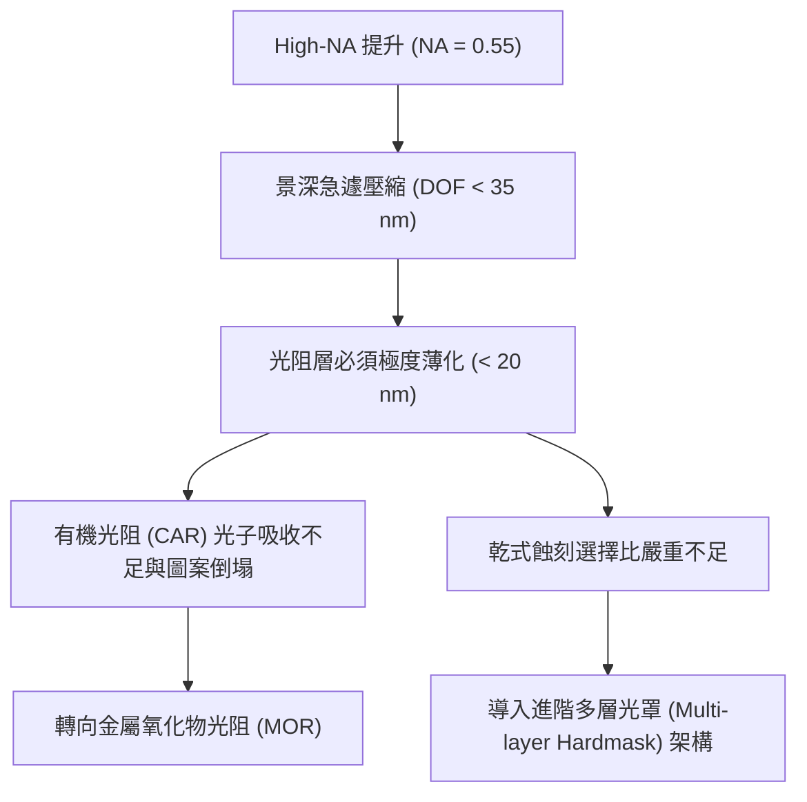

---

### 薄化光阻帶來的乾式蝕刻選擇比不足問題

超薄光阻雖然解決了景深覆蓋與毛細管力崩塌的問題，卻對下游客戶端製程——特別是乾式蝕刻（Dry Etching，銜接第 19 章）——帶來了嚴峻的阻擋層瓶頸。

在圖案轉移過程中，蝕刻選擇比（Etch Selectivity, $S$）定義為目標材料層的蝕刻速率（$R_{\text{target}}$）與光阻遮罩層的蝕刻速率（$R_{\text{mask}}$）之比值：

$$S = \frac{R_{\text{target}}}{R_{\text{mask}}}$$

當光阻層厚度僅剩 $15\text{ nm}$ 時，在電漿離子轟擊（Ion Bombardment）與自由基反應的強烈環境下，遮罩層會迅速被消耗。若選擇比不足，光阻尚未完全將圖案穿透至下層材料前即被剝蝕殆盡，導致關鍵尺寸失控（CD Blow-out）、條紋缺陷（Striation），甚至是蝕刻穿透（Punch-through）與針孔缺陷（Pinhole）。

為了解決超薄光阻的遮罩耐受性問題，製程整合必須仰賴高度最佳化的多層硬光罩堆疊架構（Multilayer Hardmask Stack）：

1. **三層光罩結構（Tri-layer Stack）**：
   * **底層（Bottom Layer）**：通常為旋塗碳層（Spin-On Carbon, SOC）或非晶碳（Amorphous Carbon Layer, ACL），厚度較厚（$50\sim 100\text{ nm}$），用以提供後續蝕刻矽基底或介電質時足夠的選擇比。
   * **中層（Middle Layer）**：通常為富含矽的抗反射塗層（Silicon-containing Anti-Reflective Coating, SiARC）或藉由原子層沉積（ALD）沉積的超薄金屬氧化物層（如 $\text{TiO}_x$、$\text{AlO}_x$），厚度約 $5\sim 10\text{ nm}$。
   * **頂層（Top Layer）**：厚度 $\le 20\text{ nm}$ 的超薄光阻（CAR 或 MOR）。

在此架構中，極薄的光阻僅需負擔蝕刻極薄中層（SiARC）的任務（利用氧電漿中矽形成的 $\text{SiO}_2$ 耐受性）；接著以中層作為硬光罩，透過高密度氧或氫電漿向下轉移至厚碳層（SOC）；最後再以具有高深寬比的厚碳層作為最終硬光罩，進行目標介電質或金屬層的圖案轉移。

!!! warning "MOR 殘渣去除與蝕刻選擇比平衡"
    金屬氧化物光阻（MOR）雖然本質上具備高於有機光阻的抗電漿轟擊能力，但由於其內含金屬成分（如錫，$\text{Sn}$），在蝕刻轉移後的灰化（Ashing）與濕式剝膜（Strip）過程中極難完全清除，容易於側壁形成難以揮發的金屬殘留物，對元件漏電流造成致命危害。

---

### 晶圓聚焦裕度 (Focus Budget) 壓縮對奈米級平整度與 CMP 的極限挑戰

當總景深縮減至 $20\sim 35\text{ nm}$ 時，整個曝光系統的聚焦裕度（Focus Budget）將被嚴重壓縮。聚焦裕度是指微影曝光過程中，允許光罩共軛像與實體晶圓表面高度偏差的容忍總合。其誤差來源（Focus Error Components）可以表示為各項變異的均方根（RMS）疊加：

$$\Delta Z_{\text{total}} = \sqrt{\sigma_{\text{wafer}}^2 + \sigma_{\text{chuck}}^2 + \sigma_{\text{AF}}^2 + \sigma_{\text{topo}}^2 + \sigma_{\text{thermal}}^2}$$

各項誤差來源包括：
* $\sigma_{\text{wafer}}$：晶圓幾何平整度偏差（Nanotopography 與厚度變異 TTV）。
* $\sigma_{\text{chuck}}$：曝光機載台靜電吸盤（Wafer Chuck）微形貌及其背面夾帶奈米微粒造成的局部隆起。
* $\sigma_{\text{AF}}$：自動對焦（Autofocus）感測系統的光學量測誤差與動態補償反應時間延遲。
* $\sigma_{\text{topo}}$：晶圓上層先前製程所殘留的圖形化表面形貌變異（Underlying Process Topography）。
* $\sigma_{\text{thermal}}$：高功率 EUV 光源照射下晶圓瞬間吸收熱量所引起的奈米級熱膨脹。

在 0.33 NA 時代，整體焦點誤差容許值約為 $\pm 30\text{ nm}$；但在 High-NA 條件下，聚焦裕度被壓縮至小於 $\pm 10\text{ nm}$。在此極端標準下，任何微小的晶圓表面起伏都將直接使曝光圖案落出焦點之外，形成線寬跳變或斷線。

這項限制直接推升了化學機械研磨（Chemical Mechanical Planarization, CMP，銜接第 24 章）的製程控制門檻。傳統 CMP 允許的微米級平坦化（Planarization）已不足以滿足需求，High-NA EUV 要求在晶粒內（Intra-die）與整個晶圓範圍內（Full-wafer scale）達到「原子級極限平整」：

1. **圖案負載效應（Pattern Loading Effect）抑制**：不同線路密度區域在 CMP 後產生的碟凹（Dishing）與腐蝕（Erosion）高度差必須嚴格抑制在 $2\text{ nm}$ 以內。
2. **奈米形貌控制（Nanotopography Control）**：空間波長在數百微米至數毫米範圍內的奈米級微波浪狀起伏，其峰谷值（Peak-to-Valley, PV）必須被壓低至 $1\text{ nm}$ 等級。
3. **背面微粒缺陷極限**：晶圓背面若存在一顆直徑僅 $100\text{ nm}$ 的微塵，在晶圓被真空吸附於曝光機載台時，會透過矽基板的彈性力學形變傳遞至晶圓正面，造成直徑數百微米、高度達數十奈米的局部駝峰（Bump），直接耗盡局部所有的聚焦裕度，導致該曝光區域全面報廢。

因此，High-NA EUV 製程不僅是光學微影機台的革新，更是強制推動前道 CMP 技術、超平坦晶圓基板規格、以及晶圓背面超清淨度控制技術進行跨領域極限升級的物理驅動力。

## 15.5 設備與廠商技術

### 設備子系統與系統架構

高數值孔徑極紫外光（High-NA EUV）微影系統是半導體製造中最複雜的微影設備。要將數值孔徑提升至 $\text{NA} = 0.55$，整座系統必須在超高真空（Ultra-high Vacuum, UHV）環境下，將高功率雷射引發電漿（LPP）光源、非球面變形反射鏡組以及奈米級運動控制載台進行次系統整合。

High-NA EUV 微影設備主要由五大關鍵子系統構成：

1. **極紫外光光源系統（EUV Source System）**：利用二氧化碳雷射撞擊高純度熔融錫滴（Tin Droplet），激發出波長 $\lambda = 13.5\text{ nm}$ 的極紫外光，並由大口徑橢球集光鏡（Collector Mirror）將 EUV 輻射聚光導入中介焦點（Intermediate Focus, IF）。
2. **照明光學系統（Illumination Optics）**：在中介焦點之後，將光束整形為預設的偏振與瞳孔光瞳形狀（Pupil Fill Shape，如偶極 Dipole 或四極 Quadrupole 照明），提供具備空間同調性調整能力的照射光場。
3. **光罩載台系統（Reticle Stage System）**：因應變形光學設計（見第 15.2 節），光罩端具備四倍（$4\times$）與八倍（$8\times$）的非對稱縮小率，光罩載台必須在長衝程真空環境下，以極高動態響應速度進行同步掃描。
4. **投影物鏡系統（Projection Optics Box, POB）**：由多塊鉬／矽（$\text{Mo/Si}$）多層膜反射鏡組成，負責將光罩圖案縮小聚焦至晶圓表面。鏡面粗糙度需控制在皮米（picometer, $\text{pm}$）等級以抑制相差與散射光（Flare）。
5. **雙晶圓載台系統（Dual-stage Wafer Stage）**：承襲雙載台並行架構，一側載台進行晶圓曝光，另一側載台同步進行晶圓對位、表面高度圖測繪（Wafer Topography Mapping）與光學對焦量測。

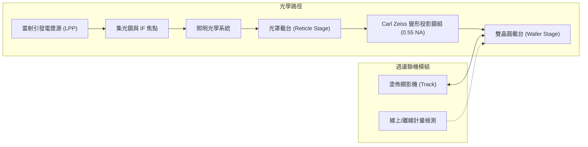

!!! example "產業實例：ASML TWINSCAN EXE 系統與鏡組整合"
    ASML 研發的 High-NA EUV 設備包括研發平台 **TWINSCAN EXE:5000** 與量產平台 **TWINSCAN EXE:5200**。其光學核心為 Carl Zeiss 設計製造之變形反射物鏡系統（Anamorphic Optics）。為了克服 NA 提升至 0.55 時光罩端入射角過大引起的遮蔽效應（3D Mask Shadowing Effect），該鏡組在 $x$ 方向維持 $4\times$ 縮小率，在 $y$ 方向（掃描方向）擴展為 $8\times$ 縮小率。此非對稱放大倍率使得原本標準的曝光視場縱向減半（Half-field，見第 15.3 節），晶圓載台與光罩載台的相對運動幾何必須重新解耦與匹配。

---

### 雙晶圓載台高加速度運動控制與產能匹配

將 NA 由 0.33 提升至 0.55，最直接的物理後果為曝光視場減半（典型全視場為 $26\text{ mm} \times 33\text{ mm}$，變形後縮小為 $26\text{ mm} \times 16.5\text{ mm}$）。在標準 $300\text{ mm}$ 晶圓上，每片晶圓所需的曝光場次（Exposure Fields）由約 90 場增加到近 200 場。

若系統的曝光產能（Throughput, 以每小時晶圓產出片數 Wafer Per Hour, $\text{WPH}$ 計）要維持在晶圓廠可接受的量產水準，曝光時間與步進時間（Stepping Time）必須急遽縮短。

晶圓掃描速度 $v_w$ 與光罩掃描速度 $v_r$ 受到放大倍率限制：
$$v_r = M_y \cdot v_w$$
其中 $M_y = 8$。當晶圓載台在掃描軸（$y$ 軸）以高達數百 $\text{mm/s}$ 速度移動時，光罩載台的瞬時線速度需達晶圓的 8 倍。

為減少兩次曝光之間減速、橫移（Step）及重新加速的無效時間（Overhead），載台必須承受極高的機械加速度 $a$。晶圓曝光掃描時的加減速距離 $s_{acc}$ 與時間 $t_{acc}$ 遵循基本運動學方程式：
$$s_{acc} = \frac{v^2}{2a}, \quad t_{acc} = \frac{v}{a}$$
若要縮短換向時間 $t_{acc}$，加速度 $a$ 必須成倍提高。在 High-NA 機台架構中，晶圓載台之峰值加速度提升至 Low-NA 系統的數倍以上（典型峰值加速度要求達數十個重力加速度 $g$）。

高加速度運動對控制架構帶來嚴苛考驗：
* **反作用力補償（Reaction Force Compensation）**：高速加減速會產生巨大的反作用力矩。載台基座設計採平衡質量塊（Balance Mass）與主動懸浮抑振系統，將動量釋放至獨立地基結構，防止機械微振（Micro-vibration）干擾奈米級鏡組對準。
* **真空熱耗散**：直驅式平面馬達與線圈於高真空環境中散熱效率低，載台內建高精度封閉式冷卻液迴路，需在動態加載下維持微開爾文（$\mu\text{K}$）等級的溫度穩定度，避免因熱應力造成干涉量測畸變。
* **產能演進**：初期研發機型 TWINSCAN EXE:5000 主要用於建立製程極限與材料評估，產能設計典型值約為 $150\text{ WPH}$；量產型機型 TWINSCAN EXE:5200 則透過更高加速度的載台運動控制與升級型光學傳輸效率，使產能推進至超過 $200\text{ WPH}$，以縮小與 0.33 NA 系統的產能落差。

---

### 微影設備與關鍵周邊系統比較

High-NA EUV 製程並非單機運作，必須與先進光阻塗佈顯影機（Coater/Developer Track）、光罩檢測機台以及線上計量設備緊密整合。下表彙整先進微影站點之主要代表設備：

| 廠商 | 代表產品系列 | 技術路線與特點 | 主要應用 |
| :--- | :--- | :--- | :--- |
| **ASML** | TWINSCAN EXE（EXE:5000、EXE:5200） | 變形反射光學鏡組（0.55 NA），雙晶圓載台架構，高加速度直線馬達驅動 | 次 2 nm 先進邏輯與次世代 DRAM 關鍵層圖案化 |
| **ASML** | TWINSCAN NXE（NXE:3400B／C、NXE:3600D、NXE:3800E） | 0.33 NA 軸對稱反射鏡組，成熟量產型 LPP 光源架構 | 7 nm 至 2 nm 節點之全視場 EUV 單重或多重微影 |
| **Tokyo Electron** | CLEAN TRACK LITHIUS Pro Z | 與 EUV 機台直接機械對接（Inline），支援薄膜光阻均勻旋塗、烘烤控制與有機金屬光阻（MOR）專用排氣處理 | EUV／High-NA EUV 光阻均勻塗佈、顯影與表面處理 |
| **Lasertec** | ACTIS（ACTIS A150） | 採用 $13.5\text{ nm}$ 光化光學檢測（Actinic Inspection），具備深穿透多層膜缺陷識別能力 | High-NA 光罩基板（Blank）與圖案化光罩缺陷檢測 |
| **KLA** | Archer | 高精度影像式疊對量測（Image-based Overlay），多波長光學演算法降低薄膜製程效應干擾 | 微影曝光後疊對誤差（Overlay Error）即時回饋 |
| **KLA** | SpectraShape | 寬頻光學臨界尺寸（OCD）量測，透過光譜橢偏術與繞射光譜重建三維圖案輪廓 | High-NA 奈米結構 CD、側壁角度（SWA）與高度量測 |

#### 設備選型與架構取捨考量
1. **塗佈顯影整合**：High-NA 的景深極限壓縮（見第 15.4 節）使光阻膜厚必須降至 $15\sim25\text{ nm}$ 以下。Tokyo Electron 的 CLEAN TRACK LITHIUS Pro Z 平台透過封閉化化學氣氛維持極佳的線邊緣粗糙度（LER），並需具備對乾式金屬光阻或非化學放大光阻（Non-CAR）的相容性。
2. **光學檢測波長選擇**：光罩缺陷檢測有光化（Actinic，使用 $13.5\text{ nm}$ 波長）與非光化（使用深紫外光或電子束）兩種取向。Lasertec ACTIS 採用同波長反射光檢測，能偵測多層膜相鄰相位缺陷（Phase defect），此為 High-NA 拼接光罩無法忽視之隱性缺陷；但設備成本極高，晶圓廠需依良率目標取捨檢測比例。

---

### 導入路徑評估與持有成本（CoO）分析

在先進積體電路製造中，是否採用 High-NA EUV 取決於微縮微物理需求與持有成本（Cost of Ownership, CoO）的平衡。

#### 1. 先進邏輯製程（次 2 nm 節點）
在次 2 nm 節點（例如 A14 或 1.4 nm 世代），奈米片電晶體（GAAFET/CFET，見第 6 章）的金屬間距（Metal Pitch, MP）微縮至 $20\sim24\text{ nm}$ 甚至更窄。
* **路徑 A（Low-NA 多重圖案化）**：沿用 0.33 NA TWINSCAN NXE 系列機台，配合自對準雙重圖案化（SADP）或極紫外光雙重曝光（EUV-EUV Double Patterning, LELE）。此舉需使用 2 套或以上的 Low-NA 光罩，製程步驟增加約 2.5 至 3 倍（包含沉積、微影、乾式蝕刻、再平坦化 CMP）。
* **路徑 B（Single High-NA EUV）**：採用 0.55 NA TWINSCAN EXE 機台進行單次曝光（Single Exposure, SE）。其具備 $8\text{ nm}$ 等級的瑞利解析度，可大幅精簡製程步驟與沉積／蝕刻反覆循環。

#### 2. 高密度動態隨機存取記憶體（DRAM）
DRAM 關鍵尺寸受限於電容器接觸窗（Storage Node Contact, SNC）與位元線（Bitline）的密集孔洞陣列。
* 記憶體單元具備高度重複性，對光罩拼接（Stitching）容忍度與晶片內部邊界配置較為嚴格。
* DRAM 製造商傾向在 0.33 NA 邊際極限耗盡前，先導入六方晶格圖案化優化與多重曝光技術；預計在 10 nm 以下世代（如 3D DRAM 或 1d、0a 節點），當 Low-NA 疊對誤差（Overlay Budget）耗盡時，才會切入 High-NA 設備。

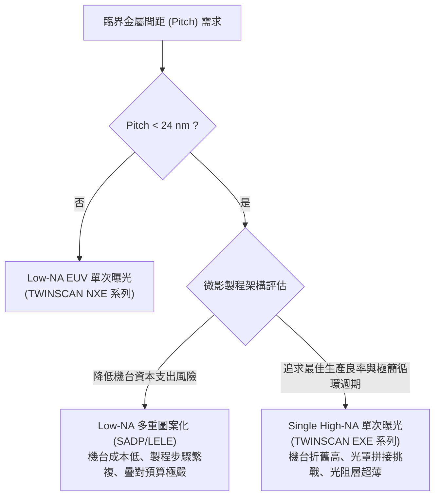

#### 3. 持有成本（Cost of Ownership, CoO）模式比對
微影站點的單片晶圓等效處理成本可簡化表述為：
$$C_{\text{wafer}} = \frac{C_{\text{capex}} + C_{\text{opex}}}{N_{\text{good}}} = \frac{\frac{\text{Depreciation} + \text{Footprint}}{T \times \text{Uptime}} + C_{\text{mask}} + C_{\text{chem}} + C_{\text{energy}}}{Y}$$
其中：
* $C_{\text{capex}}$ 為設備折舊與廠務佔地成本（見第 55 章）。
* $T$ 為曝光產能（WPH）。
* $C_{\text{mask}}$ 為分配至每片晶圓的光罩攤提成本。
* $Y$ 為綜合良率（Yield），包含疊對邊限（Overlay margin）造成的邊緣晶圓良率。

| 評估維度 | Low-NA 雙重／多重圖案化（SADP/LELE） | Single High-NA EUV 單次曝光 |
| :--- | :--- | :--- |
| **機台資本支出（CapEx）** | 較低（可沿用已折舊之 NXE:3400/3600 機群） | 極高（EXE 機台單價顯著高於 Low-NA 系統） |
| **光罩套數與成本** | 光罩數量加倍（2 套以上，光罩成本線性上升） | 單套光罩（但須承擔拼接與變形光罩製造成本） |
| **製程複雜度（Cycle Time）** | 高（微影、蝕刻、清洗反覆執行，製程循環天數長） | 低（單次曝光成形，在製品 WIP 大幅縮短） |
| **邊界疊對預算（Edge Overlay Budget）** | 極具挑戰（需要控制層間與層內的幾何對準） | 較寬鬆（免除多重曝光圖案拆解引起的疊對誤差） |
| **良率損失風險（Yield Risk）** | 缺陷密度隨製程層數累積，微微粒污染機率高 | 景深壓縮（DOF 極淺）對表面平坦度與對焦要求極高 |

綜合而言，當多重圖案化所需的光罩數、蝕刻沉積站點耗能及疊對缺陷所造成的成本，超過了 High-NA EUV 設備折舊與拼接良率損失之門檻時，單次 High-NA EUV 即展現出更優越的整體持有成本效益。晶圓代工廠與整合元件製造廠（IDM）正依據各自在邏輯標準單元高度（Standard Cell Height）與記憶體陣列微縮的物理節點，動態調整 High-NA EUV 的量產導入時程。

## 本章重點

1. **High-NA 微縮極限與繞射物理**：透過將極紫外光曝光機數值孔徑由 0.33 提升至 0.55，在相同製程因子（$k_1 \approx 0.30$）下，單次曝光之臨界尺寸（CD）解析極限由 12.3 nm 微縮至約 7.4 nm，能有效支援埃米世代（A14、A10）次 24 nm 間距的圖案化需求，免除繁瑣的多重圖案化步驟。
2. **光罩側幾何與材料物理瓶頸**：若在 0.55 NA 下維持傳統對稱 $4\times$ 放大倍率，光罩端數值孔徑與光錐半角將大幅增加，迫使主光線入射角（CRAO）由 $6^\circ$ 提升至 $8.5^\circ$ 以上，引發嚴重幾何陰影效應、複雜光罩三維效應（M3D），並使入射光超出鉬／矽（Mo/Si）多層膜之布拉格反射角頻寬，造成反射率大幅衰減與相差。
3. **變形光學系統（Anamorphic Optics）機制**：為解決光罩遮蔭與多層膜角頻寬限制，投影光學箱採用非對稱倍率設計（$x$ 方向 $4\times$，$y$ 方向 $8\times$），將光罩端主光線入射角抑制在 $6^\circ$ 內；該架構導入 8 面自由曲面反射鏡以校正原生物焦散光，但也導致光學穿透率顯著下降，並衍生向量偏振相消效應。
4. **半視場限制與光罩拼接挑戰**：變形放大倍率使晶圓端單次曝光視場在掃描方向折半，縮小至 $26\text{ mm} \times 16.5\text{ mm}$（半視場效應）。單晶面積大於 $429\text{ mm}^2$ 的超大晶片必須採用光罩拼接（Stitching）技術，但其交界面面臨嚴峻的邊緣放置誤差（EPE）、雜散光突變、局部電阻躍升與電遷移（EM）可靠度退化等物理風險。
5. **景深二次方衰減與光阻革新**：光學景深隨數值孔徑平方反比衰減（$\text{DOF} \propto \lambda / \text{NA}^2$），0.55 NA 的景深急遽壓縮至 $20 \sim 35\text{ nm}$，促使光阻厚度必須微縮至 $15 \sim 20\text{ nm}$ 以下。此轉變推動了高吸收截面且無光酸擴散模糊之金屬氧化物光阻（MOR）與三層硬光罩（Tri-layer Stack）製程的全面導入。
6. **極限聚焦裕度對前段製程平整度的要求**：sub-tens-of-nanometers 景深使聚焦裕度降至 $\pm 10\text{ nm}$ 以內，對化學機械研磨（CMP）後的晶片內部形貌變異、圖案負載碟凹、奈米波浪起伏及晶圓背面奈米微粒提出了近乎原子級平整度的極端要求。
7. **機台運動學與持有成本（CoO）權衡**：半視場使晶圓曝光場數倍增，雙晶圓載台必須以極高動態加速度（達數十個重力加速度）換向掃描以匹配產能；晶圓製造廠需在 Single High-NA 的高額設備折舊與 Low-NA 多重圖案化的製程循環天數、光罩成本及疊對良率損失之間進行精確的持有成本評估。

---


## 重點圖卡

複習時看這幾張就能抓住本章重點；[圖卡庫](../cards.md)可以下載成圖片。

<div class="ix-cards" markdown>

<figure markdown>
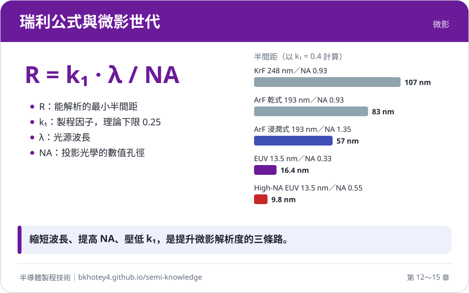
<figcaption>核心概念圖卡：瑞利公式與微影世代</figcaption>
</figure>

<figure markdown>
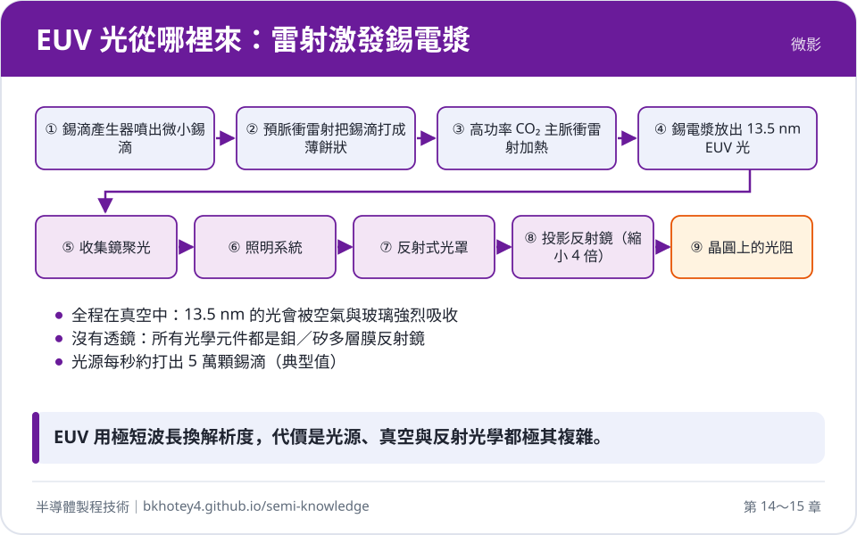
<figcaption>核心概念圖卡：EUV 光從哪裡來：雷射激發錫電漿</figcaption>
</figure>

<figure markdown>
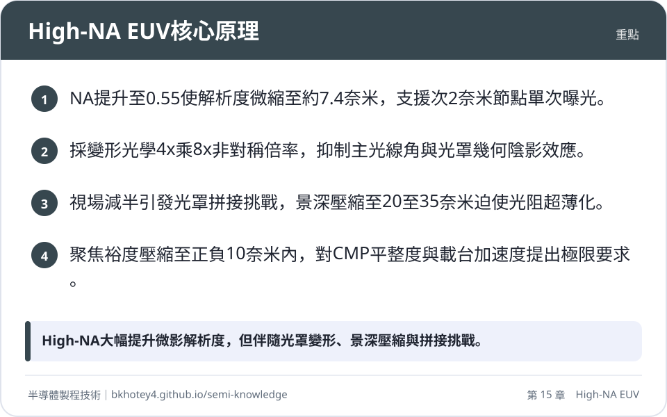
<figcaption>重點圖卡：High-NA EUV核心原理</figcaption>
</figure>

<figure markdown>
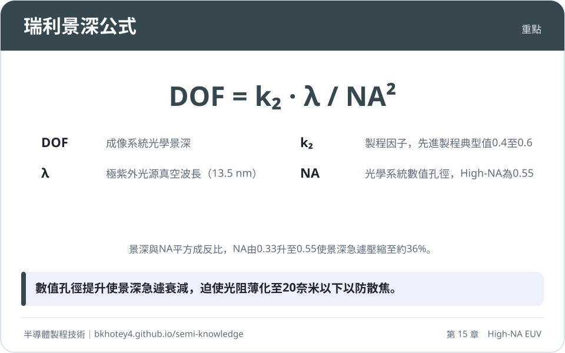
<figcaption>重點圖卡：瑞利景深公式</figcaption>
</figure>

<figure markdown>
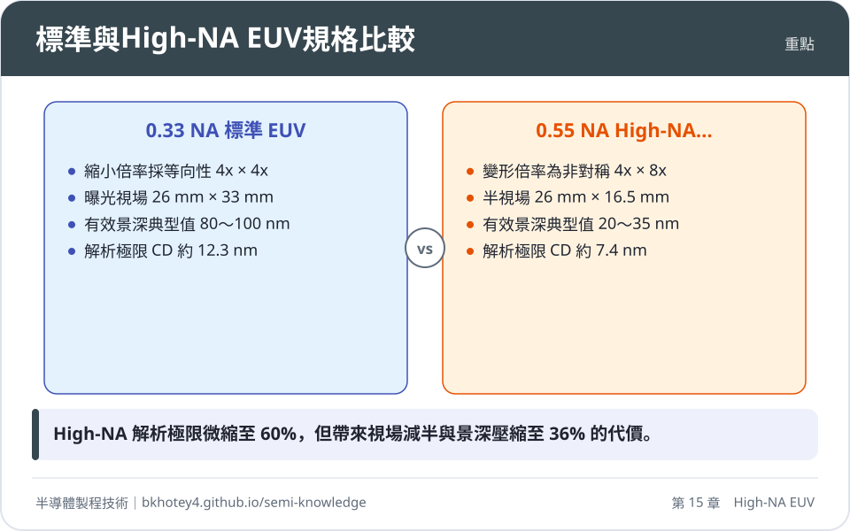
<figcaption>重點圖卡：標準與High-NA EUV規格比較</figcaption>
</figure>

<figure markdown>
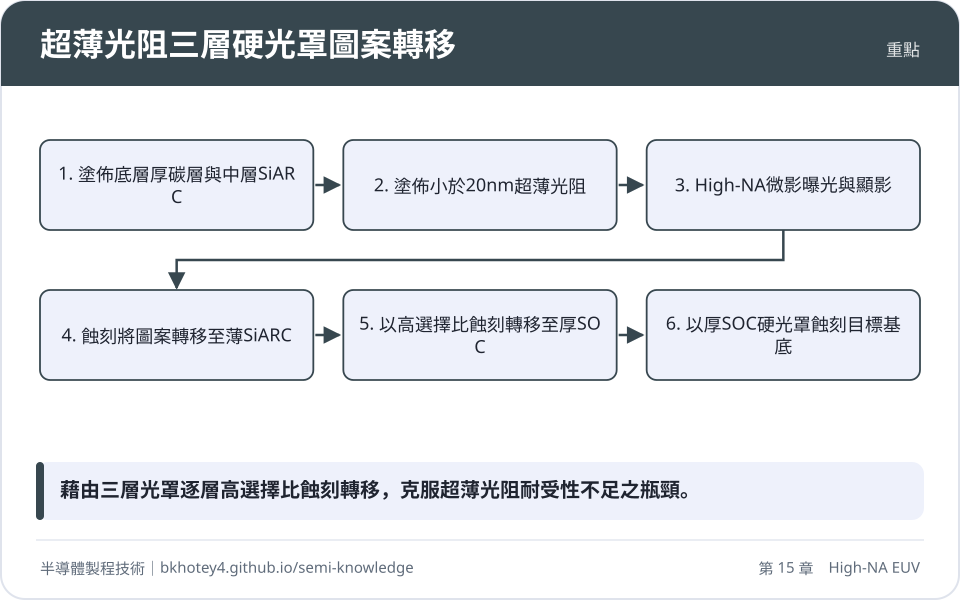
<figcaption>重點圖卡：超薄光阻三層硬光罩圖案轉移</figcaption>
</figure>

</div>

## 習題

**1.** 試依據瑞利準則（Rayleigh Criterion），在波長 $\lambda = 13.5\text{ nm}$ 且製程因子 $k_1 = 0.30$ 與 $k_2 = 0.50$ 的相同製程條件下，分別計算數值孔徑由 $\text{NA} = 0.33$ 提高至 $\text{NA} = 0.55$ 時的理論臨界尺寸（CD）與理論景深（DOF），並計算其各自的縮放比例。若某 0.33 NA 系統之實際量測景深為 $90\text{ nm}$，依此理論縮放比推算，0.55 NA 系統之景深預期為多少奈米？

??? success "參考解答"
    依據瑞利解析度公式 $CD = k_1 \frac{\lambda}{\text{NA}}$ 與景深公式 $\text{DOF} = k_2 \frac{\lambda}{\text{NA}^2}$ 進行計算：
    
    1. **理論臨界尺寸計算**：
       $$CD_{0.33} = 0.30 \times \frac{13.5\text{ nm}}{0.33} \approx 12.27\text{ nm}$$
       $$CD_{0.55} = 0.30 \times \frac{13.5\text{ nm}}{0.55} \approx 7.36\text{ nm}$$
       CD 縮放比例為：
       $$\frac{CD_{0.55}}{CD_{0.33}} = \frac{0.33}{0.55} = 0.60 \quad (\text{縮小至原本的 } 60\%)$$
    
    2. **理論景深計算**：
       $$\text{DOF}_{0.33} = 0.50 \times \frac{13.5\text{ nm}}{0.33^2} = \frac{6.75}{0.1089} \approx 61.98\text{ nm}$$
       $$\text{DOF}_{0.55} = 0.50 \times \frac{13.5\text{ nm}}{0.55^2} = \frac{6.75}{0.3025} \approx 22.31\text{ nm}$$
       景深縮放比例為：
       $$\frac{\text{DOF}_{0.55}}{\text{DOF}_{0.33}} = \left(\frac{0.33}{0.55}\right)^2 = \left(\frac{3}{5}\right)^2 = 0.36 \quad (\text{壓縮至原本的 } 36\%)$$
    
    3. **實際景深預估**：
       若 0.33 NA 下實際景深為 $90\text{ nm}$，則 0.55 NA 預期之景深為：
       $$\text{DOF}_{\text{actual, 0.55}} = 90\text{ nm} \times 0.36 = 32.4\text{ nm}$$

---

**2.** 某 High-NA EUV 曝光機採用變形光學系統，其縮小倍率配置為 $M_x = 4$、$M_y = 8$（$y$ 軸為掃描方向）。已知曝光掃描時，晶圓載台沿 $y$ 軸之等速掃描速度為 $v_{\text{wafer}} = 400\text{ mm/s}$。
(1) 求光罩載台在掃描時之物理等速運動速度 $v_{\text{mask}}$。
(2) 若曝光機設計要求晶圓載台在完成一次掃描後，必須於加減速距離 $s_{\text{acc}} \le 8\text{ mm}$ 內由等速 $400\text{ mm/s}$ 煞停至靜止，試求晶圓載台所需之最小平均加速度大小（以 $\text{m/s}^2$ 與重力加速度單位 $g$ 表示，取 $g = 9.8\text{ m/s}^2$）。

??? success "參考解答"
    (1) **光罩載台掃描速度**：
    光學投影系統在掃描軸（$y$ 軸）之縮小倍率為 $M_y = 8$。為了維持光罩與晶圓空間像的嚴格同步，光罩移動速度與晶圓移動速度滿足：
    $$v_{\text{mask}} = M_y \cdot v_{\text{wafer}} = 8 \times 400\text{ mm/s} = 3200\text{ mm/s} = 3.2\text{ m/s}$$
    
    (2) **晶圓載台最小加速度計算**：
    載台由初速 $v = 400\text{ mm/s} = 0.4\text{ m/s}$ 於位移 $s = 8\text{ mm} = 0.008\text{ m}$ 內等加速度減速至末速 $0$，利用運動學公式 $v_t^2 - v_0^2 = 2as$：
    $$0^2 - (0.4\text{ m/s})^2 = 2(-a)(0.008\text{ m})$$
    $$0.16 = 2 \times a \times 0.008 = 0.016 \cdot a$$
    $$a = \frac{0.16}{0.016} = 10\text{ m/s}^2$$
    以重力加速度 $g$ 表示：
    $$a = \frac{10}{9.8} g \approx 1.02\text{ g}$$
    故晶圓載台所需之最小平均加速度約為 $10\text{ m/s}^2$（約 $1.02\text{ g}$）。

---

**3.** 請從反射式極紫外光微影的物理機制，詳細闡述為何 0.55 NA 無法透過單純放大傳統 0.33 NA 的等向性 $4\times$（$M_x = M_y = 4$）光學架構來實現？請列舉至少三項根本性的光學與材料物理瓶頸。

??? success "參考解答"
    若在 0.55 NA 下維持等向性 $4\times$ 放大架構，將面臨以下三項根本性物理瓶頸：
    
    1. **光罩端光錐張角過大引發主光線入射角（CRAO）劇增**：
       晶圓端數值孔徑提升至 0.55 且 $M=4$ 時，光罩端孔徑角半錐角增大至 $\alpha = \arcsin(0.55/4) \approx 7.9^\circ$。為避免入射照明光束與離開光罩的反射繞射光束在物理空間上發生重疊干涉，主光線入射角（CRAO）必須由原本的 $6^\circ$ 提高至 $8.5^\circ \sim 9.5^\circ$ 以上。
    2. **幾何陰影效應與光罩三維效應（M3D）劇烈惡化**：
       EUV 光罩由吸收層（厚度約 50～70 nm）與多層膜組成。陰影幾何寬度與 $\tan\theta_{\text{CRAO}}$ 成正比，大角度入射導致反射光盲區擴大約 50%，使垂直線條與水平線條的成像產生嚴重的水平-垂直尺寸偏差（H-V Bias）。同時，斜向光波在深槽內的波導效應引發正負繞射級次強度非對稱性，造成空間像對比度崩塌與非遠心相差位移。
    3. **鉬／矽（Mo/Si）多層膜之布拉格反射角頻寬限制**：
       多層膜依據布拉格定律產生建設性干涉，其有效高反射率的角頻寬（FWHM）通常僅約 $\pm 2^\circ \sim \pm 3^\circ$。在 CRAO 為 $8.5^\circ$ 且光錐半角為 $7.9^\circ$ 時，入射角跨度達 $[0.6^\circ, 16.4^\circ]$，邊緣角度光線嚴重偏離布拉格最佳角，導致反射率斷崖式滑落（瞳孔變跡效應）並伴隨強烈非線性相位色散，產生不可逆的波前像差。

---

**4.** High-NA EUV 製程中，極淺的景深（$\text{DOF} < 35\text{ nm}$）迫使光阻厚度微縮至 $20\text{ nm}$ 以下。請說明：
(1) 傳統有機化學增幅型光阻（CAR）在超薄膜厚下的兩大物理瓶頸為何？
(2) 金屬氧化物光阻（MOR）如何克服上述瓶頸？
(3) 超薄光阻在電漿乾式蝕刻中會面臨何種困難？製程整合上如何藉由多層光罩架構（Multi-layer Mask Stack）予以解決？

??? success "參考解答"
    (1) **傳統 CAR 在超薄膜厚下的瓶頸**：
    * **光子吸收截面不足**：有機光阻主要由碳、氫、氧組成，薄化至 20 nm 以下時，對 13.5 nm EUV 光子的能量沉積量極低，引發劇烈的隨機效應（Stochastic Effects），造成微橋接（Bridging）與斷線（Line-break）缺陷。
    * **光酸擴散模糊**：曝光後烘烤（PEB）產生的光酸擴散長度（約 3～5 nm）在次 10 nm CD 下佔比過高，使影像邊界模糊，導致線邊緣粗糙度（LER）與解析度嚴重劣化。
    
    (2) **金屬氧化物光阻（MOR）的優勢**：
    * **超高吸收截面**：內含錫（Sn）等重金屬團簇，對 13.5 nm 光子的吸收效率顯著高於輕元素有機物，超薄層即可捕獲充足光子以抑制隨機缺陷。
    * **無光酸擴散問題**：MOR 藉由直接化學縮合或配位基解離轉變溶解度，其分子團簇直徑小於 2 nm 且無長程酸擴散，能實現更高的空間解析度。
    
    (3) **乾式蝕刻困難與多層光罩解決方案**：
    * **困難**：厚度僅 $15 \sim 20\text{ nm}$ 的光阻在電漿離子轟擊與自由基化學反應下極易被快速消耗殆盡，蝕刻選擇比不足會導致圖案穿透（Punch-through）與線寬變形失控。
    * **解決架構（三層光罩 Tri-layer Stack）**：
      採用「頂層超薄光阻 / 中層含矽抗反射層（SiARC，約 5～10 nm）/ 底層厚旋塗碳層（SOC，約 50～100 nm）」結構。極薄光阻先以高選擇比將圖案轉移至薄 SiARC；接著以 SiARC 抵抗富氧電漿將圖案高選擇比轉移至厚 SOC；最後以高深寬比的厚碳層作為堅固的硬遮罩，完成下層介電質或金屬材料的蝕刻。

---

**5.** 在 High-NA EUV 光罩拼接（Stitching）邊界，若微影對位誤差導致相鄰曝光視場接合處的互連導線產生局部線寬「頸縮」（Neck-down），使導線寬度由正常設計值 $W_0$ 局部縮減為 $0.80 W_0$（厚度 $H$ 維持不變）。
(1) 假設流經整條導線的總工作電流 $I$ 固定，求頸縮處之電流密度 $J_{\text{stitch}}$ 與正常處電流密度 $J_0$ 的比值。
(2) 依據布萊克方程式（Black's Equation），若電流密度指數取典型值 $n = 2$，且暫時忽略焦耳熱造成的溫度變化，試計算該拼接交界處的平均失效時間（$\text{MTTF}_{\text{stitch}}$）縮減為正常導線（$\text{MTTF}_0$）的百分之幾？

??? success "參考解答"
    (1) **電流密度比值計算**：
    電流密度公式為 $J = \frac{I}{A} = \frac{I}{W \cdot H}$。
    正常處截面積 $A_0 = W_0 \cdot H$，頸縮處截面積 $A_{\text{stitch}} = 0.80 W_0 \cdot H = 0.80 A_0$。
    因此電流密度比值為：
    $$\frac{J_{\text{stitch}}}{J_0} = \frac{I / A_{\text{stitch}}}{I / A_0} = \frac{A_0}{A_{\text{stitch}}} = \frac{1}{0.80} = 1.25$$
    頸縮處的電流密度增至正常的 1.25 倍（增加 25%）。
    
    (2) **平均失效時間（MTTF）變化計算**：
    布萊克方程式為 $\text{MTTF} = \frac{A}{J^n} \exp\left(\frac{E_a}{k_B T}\right)$。在忽略溫度變化的假設下，$\text{MTTF} \propto \frac{1}{J^n}$。
    取 $n = 2$：
    $$\frac{\text{MTTF}_{\text{stitch}}}{\text{MTTF}_0} = \left(\frac{J_0}{J_{\text{stitch}}}\right)^2 = \left(\frac{1}{1.25}\right)^2 = (0.80)^2 = 0.64$$
    這意味著該拼接處的平均失效時間縮短為正常導線的 $64\%$（可靠度壽命減少了 36%）。

---

## 本章術語

- **High-NA EUV**（高數值孔徑極紫外光微影）：指投影物鏡數值孔徑自 0.33 提升至 0.55、工作波長為 13.5 nm 的次世代微影系統。
- **Rayleigh Criterion**（瑞利準則）：規範光學微影系統極限解析度與景深之繞射理論經驗公式。
- **Anamorphic Optics**（變形光學系統）：在正交的兩個方向具備不同光學縮小放大倍率（如水平 4 倍、垂直 8 倍）的光學成像系統。
- **CRAO**（物方主光線入射角）：光束中心主光線入射至反射式光罩表面的傾斜幾何夾角。
- **Mask 3D Effects**（光罩三維效應）：入射光波在大角度照射下，與具有實體厚度之光罩吸收層深槽結構相互耦合產生的近場繞射、波導截止及相位不對稱現象。
- **Bragg's Law**（布拉格定律）：描述光波於週期性多層膜晶格介面產生同調建設性干涉反射條件的物理定律。
- **Half-field Effect**（半視場效應）：變形光學因掃描方向縮小倍率提升至 8 倍，導致晶圓端標準曝光面積減半為 $26\text{ mm} \times 16.5\text{ mm}$ 的現象。
- **Mask Stitching**（光罩拼接）：將超出單一半視場尺寸之晶片佈局分割於多個子視場分別曝光，並於邊界處奈米級對接之微影整合技術。
- **Depth of Focus**（景深）：成像系統在維持清晰解析度與空間像對比度時，允許晶圓表面縱向偏離焦平面的容許範圍。
- **Metal Oxide Resist**（金屬氧化物光阻）：以重金屬分子團簇為核心、具備超高極紫外光吸收截面且無光酸擴散效應的無機光阻材料。
- **Focus Budget**（聚焦裕度）：微影曝光系統分配給晶圓平整度、載台吸盤形貌、自動對焦誤差及熱膨脹之總縱向對焦容許公差。
- **Vector Diffraction Theory**（向量繞射理論）：計入電磁場偏振方向向量干涉與相消效應的嚴格波動光學分析模型。
- **Cost of Ownership**（持有成本）：評估機台設備資本支出、運行折舊、耗材化學品、良率及產能之單片晶圓綜合製造總成本模型。
- **Freeform Mirror**（自由曲面反射鏡）：打破旋轉對稱性、表面由非對稱雙變數高次多項式曲率描述以校正變形像差的非球面反射鏡。


## 互動學習

!!! tip "動手試試看"
    - [互動實驗：微影解析度（瑞利公式）](../labs.md#rayleigh)
    - [設備機台圖鑑：曝光機（掃描式步進機）](../equipment.md)

<div class="quiz" data-quiz="03-05"></div>


## 產業最新進展

本節由每日產業新聞自動補充，說明本章技術在產業上的最新發展。

<!-- updates -->
- **2026-10-25**　英特爾採用 High-NA EUV 曝光機進行先進製程之晶圓處理，累積處理數量達百萬片規模。此發展與高數值孔徑微影系統之解析度極限提升、曝光機台導入與量產時程安排之原理及設備實作高度相關。（來源：[英特爾High-NA EUV累計處理百萬片晶圓，台積電卻把量產時程排到2030年 - BigGo 財經](https://news.google.com/rss/articles/CBMiX0FVX3lxTE5vcnBMWFotZGJQWWNnbXJHYkU2Z2hCYkJQcmNqZEUzWjh2Z0lZaE9wZVlIUmhDZWdQX3FjR2E3dVJGc21QWXptZWZlTmFqUXRvZ0FTZGhYeTAxWi1xQlhZ?oc=5)）
- **2026-10-22**　高數值孔徑極紫外光（High-NA EUV）微影系統導入全幅視野的光罩設計與成本考量，為進入次世代微縮的主流化關鍵。這呼應了 High-NA EUV 章節中關於光學系統解析度極限與設備整合的物理與製程原理。（來源：[台積電攜ASML衝12吋光罩 High-NA全幅視野與成本決定主流化 - 聚財網](https://news.google.com/rss/articles/CBMiTEFVX3lxTE5vVDk0Yzd4UlM4VXM3OVBsRkZ2U2JvbEJ4VDR2OWk3aG1sS0QtWTJnaGlhXzF2SkZ1X2ktQ3Y4bTNEVlhJMjg5bk5pdUI?oc=5)）
- **2026-10-19**　蔡司指出 High-NA 光學系統已具備量產條件，預計於 2026 至 2027 年進入量產導入期。這呼應了高數值孔徑微影章節中，透過提升數值孔徑來改善微影解析度以延續摩爾定律的關鍵技術進展。（來源：[（專訪）蔡司SMO總裁：High-NA光學已具量產條件 2026、2027年訂單能見度明確 - DIGITIMES](https://news.google.com/rss/articles/CBMijgFBVV95cUxQd1lJaWZjVGtCMENyOW5tSnNmcWhYZVRIb3JNbWtIV19fVmdSdHRyRDJfS3dLSld2ZEhUMlZlMkJrNEdRN241OGhsdGtPTGh5TjlQUkFIbFZsLVQ2UmVHcHRXLXcxcnF0VE84SzBiT3RleVFOZ0dfaHJ1SjZ6NmdhaTVkZ0xGel9RbG9Fc1B3?oc=5)）
- **2026-10-17**　晶圓代工廠規劃於2030年導入High-NA EUV（高數值孔徑極紫外光）微影設備。此設備透過提升數值孔徑以改善光學成像解析度，用以應對未來更微小的特徵尺寸圖案化需求。（來源：[HIGH NA EUV 設備 台積電 2030 年導入 - 經濟日報](https://news.google.com/rss/articles/CBMiWkFVX3lxTE1LNm85b2p3Q0pwbVBIQUZxLTQwVkdyc1lveVI1VThGb3g3WFg0ZEdMLVp6SHNrbXFtTTJMM3VId2xmQXBiX1MyOGtaUHY5OTB0a0NkTTVNcnpBQdIBX0FVX3lxTFBOMmpNZ1pqQkVTa09ydkw4ZmVzSFV4R2pJdElaSGI3SFZuclN1X24zemNEQmt2YTZCSmVFSVNKaXZqQ2pEcDNXY05ZWkljaThBV1l5cXQ3cnpFWDFJM2Vz?oc=5)）
- **2026-10-16**　此報導探討次世代高數值孔徑極紫外光（High-NA EUV）技術在先進晶圓製造中的導入評估。根據雷利解析度公式，將數值孔徑由 0.33 提升至 0.55 能有效提高光學解析度並縮小臨界尺寸，但同時需要變形光學系統與更薄的光阻層以克服極淺的焦深限制。（來源：[HIGH NA EUV設備 台積電2030年導入 - UDN](https://news.google.com/rss/articles/CBMickFVX3lxTE1PcFB2REIxVEQ0VGg1dExjdzV1Umx2NFgtODM0WkN4SGJrUVVDNThYQW1ySW5BOWl4Vm50OXNiU0JmSjB4T2R2MlRfVnh0RGd0UXVoenl6bWhZODkwQ3ZWc24tczg4LUN1RVlqa2RpNXhWd9IBVkFVX3lxTE9BREEzRGQ1QzBSRGMxUHNjQThxeUxTN1JPYUFZWG5LaWdEeElmdWFpWWc0MWI1NkdlY2dQSGhWb3ExRUhjTEZZTDZqVzNyX3FFM3VmeVh3?oc=5)）
