# 第 16 章　光罩、Pellicle 與計算微影

!!! abstract "學習目標"
    - 理解穿透式 DUV 光罩與反射式 EUV 光罩的物理結構、材料特性與製造檢驗流程
    - 掌握 EUV 防塵保護薄膜（Pellicle）的熱機械挑戰、透光率要求與先進材料候選方案
    - 深入分析繞射與製程偏差引發之光學鄰近效應（OPE），並掌握模型型光學鄰近修正（MB-OPC）的運作機制與次解析度輔助特徵（SRAF）設計
    - 理解反向微影技術（ILT）的數學反問題求解框架、曲面光罩圖形生成及其對微影製程視窗的改善效應
    - 認識光罩直寫機、光罩檢驗修補設備及計算微影 EDA 運算平台之產業現狀與技術架構

## 16.1 穿透式光罩結構與製作流程

### 光罩基板材料物理特性與光學要求

在深紫外線（DUV, Deep Ultraviolet）穿透式微影系統中，光罩（Photomask 或 Reticle）作為圖案轉移的母模，其基板材料必須具備極為嚴苛的光學均勻性與熱機械穩定性。工業上最廣泛採用的基板為高純度合成石英玻璃（Synthetic Quartz，亦稱高純度熔融二氧化矽 Fused Silica）。

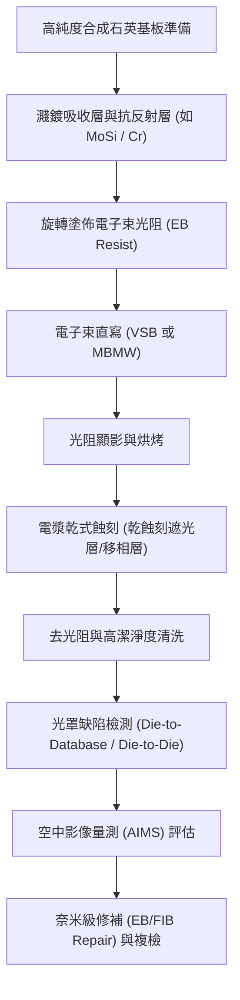

合成石英基板的關鍵物理要求包括：

1. **光學穿透率與均勻性**：在微影波長（如 KrF 的 $248\ \text{nm}$ 或 ArF 的 $193\ \text{nm}$）下，石英基板必須具備極高的穿透率（典型值大於 $90\%$）與極低的內部吸收係數。任何微量金屬雜質（如鐵、鈦）或結構缺陷（如氧缺陷中心的色心）皆會誘發光能量吸收，進而導致熱透鏡效應（Thermal lensing）或材料劣質化。
2. **極低熱膨脹係數（Coefficient of Thermal Expansion, CTE）**：微影曝光過程中，部分曝光光子能量被光罩遮光圖案吸收轉化為熱能，導致光罩產生熱膨脹變形。合成石英在室溫下的 CTE 典型值約為 $0.5 \times 10^{-6}\ \text{K}^{-1}$。若基板熱膨脹不均勻，將直接造成晶圓上幾何尺寸與疊對誤差（Overlay Error，見第 17 章）。
3. **低雙折射率（Low Birefringence）**：偏振光在通過具非等向性應力的介質時會產生雙折射現象，使入射光的偏振態發生旋轉或相移。在 ArF 浸潤式微影（ArF Immersion Lithography，見第 13 章）中，物鏡數值孔徑（NA）大於 1.0，成像高度仰賴特定偏振光（如方位角偏振）的干涉對比；光罩基板的內部殘留應力雙折射率通常必須嚴格抑制在 $1\ \text{nm/cm}$ 以下。
4. **表面平整度（Flatness）**：光罩基板典型厚度為 0.25 英吋（約 $6.35\ \text{mm}$），標準尺寸為 $6 \times 6\ \text{英吋}$。基板正面圖案面在曝光夾持狀態下的全域平整度（Peak-to-Valley, P-V 值）需控制在數十奈米以內，以避免景深（Depth of Focus, DOF）耗損。

---

### 穿透式光罩結構：二元光罩與相位移光罩

依據圖案調變光波特性的物理機制，穿透式光罩主要分為二元光罩與相位移光罩兩大類。

| 光罩類型 | 圖案材料 | 穿透率調變 | 相位位移量 ($\Delta \phi$) | 主要應用節點與微影技術 |
| :--- | :--- | :--- | :--- | :--- |
| **二元光罩 (BIM)** | $\text{Cr} + \text{CrO}_x\text{N}_y$ | $0\%$ 或 $100\%$ | $0^\circ$ | 成熟製程、非關鍵層、粗間距金屬層 |
| **衰減型相位移光罩 (att-PSM)** | $\text{MoSi}_x\text{O}_y\text{N}_z$ | $6\%$（典型）或更高 | $180^\circ$ | 先進節點接觸孔、介層孔、部分主動區 |
| **交替型相位移光罩 (alt-PSM)** | 石英基板非對稱挖深 | $100\%$ | $0^\circ$ 與 $180^\circ$ 交替 | 極限週期性線寬/線距 (Line/Space) 微縮 |

#### 1. 二元光罩（Binary Mask, BIM）
二元光罩僅調變光的振幅，其光學穿透特性為「全穿透」或「全阻擋」二元狀態。基板上沉積有總厚度約 $50 \sim 80\ \text{nm}$ 的金屬鉻（$\text{Cr}$）吸收層。為了防止微影物鏡反射回來的光在光罩表面發生多次反射而降低對比度，鉻層表面通常會藉由控制氧、氮反應氣體濺鍍形成一層厚度約 $15 \sim 25\ \text{nm}$ 的氮氧化鉻（$\text{CrO}_x\text{N}_y$）抗反射層（Anti-Reflective Coating），將其在特定曝光波長下的表面反射率壓制在 $10\%$ 以下。

#### 2. 衰減型相位移光罩（Attenuated Phase Shift Mask, att-PSM）
衰減型相位移光罩亦稱為內嵌型相位移光罩（Embedded PSM, EPSM）。其原理是將二元光罩的全遮光鉻層替換為半透明的相移吸收材料，最常見的材料為矽化鉬氮氧化物（$\text{MoSi}_x\text{O}_y\text{N}_z$，簡稱 MoSi）。

```
        入射平面波 E0 (波長 λ)
           ↓↓↓↓↓↓↓↓↓↓
   [MoSi]            [MoSi]      <- 半透明移相層 (穿透率 T ≈ 6%, 相移 180°)
  ────────   石英基板   ────────
            (透光區)
           ↓↓↓↓↓↓↓↓↓↓
    -√T·E0     E0     -√T·E0     <- 振幅分佈
               │
        相消干涉邊界極陡峭
```

此膜層之化學組分與厚度經過精確設計，使其在特定微影波長 $\lambda$ 下具備兩個特性：
1. 光強度穿透率通常控制在 $6\%$（在部分先進應用亦有 $9\%$ 或 $18\%$ 的設計）。
2. 通過 MoSi 薄膜的光與通過純石英透光區的光，兩者之間具有 $180^\circ$（即 $\pi$ 弧度）的相位差。

設材料在波長 $\lambda$ 下之折射率為 $n$，消光係數為 $k$，膜厚為 $d$。由薄膜光學相移公式：
$$\Delta \phi = \frac{2\pi}{\lambda} (n - 1) d = (2m + 1)\pi \quad (m \in \mathbb{Z})$$

取基態 $m = 0$，則最佳移相厚度為：
$$d = \frac{\lambda}{2(n - 1)}$$

在幾何邊界處，由於 $6\%$ 穿透光振幅為 $-\sqrt{0.06} E_0 \approx -0.245 E_0$，與透光區主光束振幅 $E_0$ 在圖案邊緣處因空間同調性產生相消干涉（Destructive Interference），使圖案邊界的電場強度急速穿過零點，大幅提升了投影於晶圓光阻上的空中影像對比度（Image Contrast）與正規化影像對數斜率（NILS，見第 12 章）。

#### 3. 交替型相位移光罩（Alternating Phase Shift Mask, alt-PSM）
交替型相位移光罩基於 Levenson 原理。在密集交錯的線寬/線距圖案中，鉻遮光層之間的相鄰石英開口區，交替利用乾式蝕刻將其中一個開口鑿深特定深度 $d$。

當相鄰兩開口的光學相位差為 $180^\circ$ 時，根據同調光干涉理論，兩束光在正交投射到晶圓表面交界處時互相抵消，在兩孔隙之間形成絕對的暗帶。此技術實質上將圖樣的空間頻率減半，突破了傳統阿貝解析度極限（Abbe's limit）。然而，交替型 PSM 製作工藝極度複雜，容易伴隨三維地形引發的「石英蝕刻壁陰影效應（Topography-induced Scattering/Shadowing）」與「相位衝突（Phase Conflict）」問題，限制了其在任意二維複雜電路中的廣泛應用。

---

### 光罩圖形直寫技術：VSB 與 MEBW

光罩上的幾何特徵最終會經由步進微影機縮小 4 倍投影至晶圓上（即光罩臨界尺寸 CD 通常為晶圓 CD 的 4 倍）。但在先進製程導入反向微影技術（ILT，見第 16.4 節）後，光罩必須呈現大量的曲線形狀與極微小輔助特徵，這對圖形直寫（Pattern Generation）提出了極高的產能與精度挑戰。

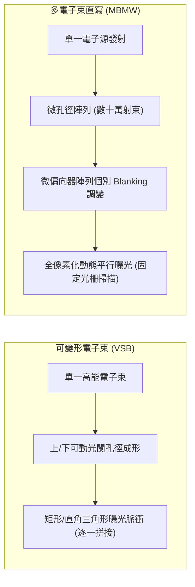

#### 1. 可變形電子束（Variable Shaped Beam, VSB）微影
長期以來，光罩製造依賴 VSB 電子束直寫系統。該系統將電子槍發射的電子束通過成形光闌（Shaping Aperture），藉由兩組偏向板的靜電場控制，將圓形電子束截面塑造成不同尺寸的矩形或直角三角形脈衝，隨後投射至光阻塗佈的光罩表面。
- **限制**：VSB 系統是以「形狀擊發（Shots）」為單位進行曝光。當電路設計導入高密度的光學鄰近修正（OPC）襯線或全晶片曲線反向微影（Curvilinear ILT）時，複雜幾何邊緣必須被切割分解成數十億個極小的矩形與三角形碎形。總曝光時間隨擊發次數呈等比膨脹，單片光罩曝光時間可能突破 30 小時，引發嚴重漂移與產能瓶頸。

#### 2. 多電子束直寫（Multi-Beam Mask Writer, MBMW / MEBW）
為了打破圖案幾何複雜度與曝光時間的耦合關係，多電子束直寫機台成為先進節點光罩製造的關鍵設備。
- **運作架構**：MBMW 利用單一電子發射源，將電子束通過一塊包含數十萬個微孔徑（Aperture Array，典型如 $512 \times 512 = 262,144$ 個小孔）的微型光闌陣列，產生密集的平行子束陣列。
- **個別獨立調變**：每個子束皆由微機電系統（MEMS）所構成的遮斷偏向器（Blanking Deflector Array）獨立控制。若要對某像素曝光，該子束保持直通；若不曝光，偏向器施加微小偏壓將該射束偏折至阻擋光闌吸收。
- **光柵化連續掃描**：光罩承載台以等速連續移動，多射束陣列在垂直方向進行高頻靜電偏向掃描。所有圖形在進入曝光管線前，先經由專用硬體進行位圖化（Rasterization）轉換。
- **物理優勢**：曝光時間僅取決於光阻所需的化學劑量（Dose）與光罩總曝光面積，**與圖形拓樸結構、曲線數量或 OPC 碎形數目完全無關**，徹底釋放了 ILT 計算微影的圖案限制。

---

### 光罩蝕刻、清洗與檢測修補技術

#### 1. 薄膜電漿蝕刻（Mask Dry Etching）
電子束直寫完成後，光阻經顯影留下圖案保護層，隨即透過感應耦合電漿（ICP，見第 18 章）進行精密乾式蝕刻：
- **鉻層蝕刻**：主要反應氣體為氯氣與氧氣的混合物（$\text{Cl}_2 + \text{O}_2$）。蝕刻機制為生成高揮發性的二氧化二氯化鉻：
  $$\text{Cr} + 2\text{O} + 2\text{Cl} \rightarrow \text{CrO}_2\text{Cl}_2 \uparrow$$
  氧氣的比例至關重要；若氧濃度不足，鉻的氯化反應產物揮發性低，會降低蝕刻速率，且容易導致側壁附著聚合物。
- **MoSi 移相層蝕刻**：通常採用氟系電漿（如 $\text{SF}_6$ 或 $\text{CF}_4$），輔以氧氣或氦氣以調控蝕刻各向異性（Anisotropy）與選擇比，防止對下方石英基板造成過度過蝕刻（Over-etching）而破壞整體相位均勻性。

#### 2. 光罩缺陷檢測（Mask Inspection）
由於微影是 1:4 甚至 1:1 的全晶圓複製過程，光罩上任何幾何缺陷都將災難性地轉印至數以萬計的晶圓上。檢測設備採用短波長深紫外光（通常為 $193\ \text{nm}$ 或更短）以透射與反射照明同步掃描光罩：
- **Die-to-Die 檢測**：在包含多個相同晶片（Die）的光罩中，比對相鄰兩 Die 之對應光學訊號。當出現局部灰階或輪廓不一致時即觸發異常警示。
- **Die-to-Database 檢測**：先進光罩多屬於單一大型 Die，此時必須藉由圖形處理管線將原始晶片設計數據（GDSII 或 OASIS 格式）即時渲染為模擬光學影像，再與高解析度顯微鏡實際擷取的影像逐像素進行比對。

#### 3. 空中影像量測系統（AIMS）
檢測系統發現缺陷後，並非所有幾何異常都會在晶圓上顯影出致命缺陷（Non-printable defect）。AIMS（Aerial Image Measurement System）是一套特製光學顯微鏡，其數值孔徑（NA）、同調因子（$\sigma$）、照明偏振態與光瞳濾波條件完全仿真目標微影曝光機（Scanner）。
工程師利用 AIMS 觀測該缺陷處所形成的晶圓空中影像強度分佈（Aerial Image Profile），判斷該缺陷是否會引起超過規格的臨界尺寸漂移（CD Variation），作為是否啟動物理修補的決策依據。

```
          [光罩微小缺陷]
                │
                ▼
        ┌───────┴───────┐
        ▼               ▼
   [凸起缺陷 / 殘留]  [凹陷缺陷 / 缺損]
        │               │
        ▼               ▼
     局部蝕刻        局部沉積
   (EBIE / FIBE)   (EBID / FIBD)
```

#### 4. 奈米級物理修補（EB/FIB Repair）
光罩缺陷依性質可分為「多餘不透明材料（凸起/橋接）」與「遮光材料缺失（針孔/凹陷）」。先進光罩大多採用奈米級局部沉積或蝕刻進行修補：
- **聚焦電子束誘導反應（EBID / EBIE）**：在超高真空腔體內，以極細的電子束聚焦於缺陷區域，並透過微細噴嘴導入前驅氣體。
  - **電子束誘導蝕刻（EBIE）**：通入蝕刻氣體（如 $\text{XeF}_2$），在受電子激發的局域點促成化學反應將多餘的鉻或 MoSi 氣化去除。
  - **電子束誘導沉積（EBID）**：通入含碳或金屬有機氣體前驅物，透過電子束裂解沉積出具備高吸收率的碳基或金屬修補層，填平針孔。電子束不會引發如離子注入基板的晶格破壞問題。
- **聚焦離子束修補（FIB Repair）**：利用鎵離子（$\text{Ga}^+$）束進行局部微濺鍍剝離，但需嚴格防範離子植入石英基板造成之「染色效應（Gallium Staining）」，該效應會嚴重吸收 DUV 光子，導致局部透光率大幅衰減。因此，在小於 $10\ \text{nm}$ 幾何等級的先進節點修補中，低能量電子束輔助反應技術已成為穿透式光罩修補的核心手段。

## 16.2 EUV 反射式光罩與先進防塵薄膜 (Pellicle)

### EUV 反射式光罩結構與布拉格反射層

極紫外光（EUV，波長 $\lambda = 13.5\text{ nm}$）的光子能量高達約 $91.8\text{ eV}$，在該波段下，所有已知凝聚態物質的複數折射率（Complex Refractive Index）均接近於 1，且伴隨極強的吸收特性。複數折射率表示為：

$$\tilde{n} = 1 - \delta + i\beta$$

其中，$\delta$ 為實部折射率對 1 的偏離量，$\beta$ 為消光係數（Extinction Coefficient）。由於光學介質對 EUV 光子的強烈吸收，傳統深紫外光（DUV）所採用的石英穿透式光罩已完全無法使用，EUV 微影系統必須全面採用反射式光罩（Reflective Photomask）。

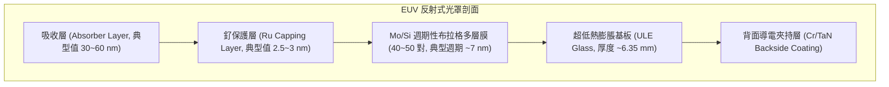

EUV 光罩的基底必須具備極端嚴苛的尺寸熱穩定性。光罩曝寫與微影曝光過程中，高達數十瓦甚至數百瓦的 EUV 輻射能量沉積在光罩表面，局部溫升會導致微米級以下的熱膨脹圖案畸變。因此，光罩基板採用超低熱膨脹玻璃（Ultra-Low Expansion Glass, ULE），其主要成分為摻雜約 $7\text{ wt}\%$ 二氧化鈦（$\text{TiO}_2$）的熔融石英。在室溫至操作溫度（典型為 $20^\circ\text{C} \sim 35^\circ\text{C}$）範圍內，其熱膨脹係數（Coefficient of Thermal Expansion, CTE）的絕對值被控制在 $|\text{CTE}| \le 5\times 10^{-9}/\text{K}$（典型值），以抑制熱致像差。

光罩表面的高反射率依賴於「分散式布拉格反射器」（Distributed Bragg Reflector, DBR）原理。DBR 由兩種具備足夠光學對比（$\Delta \delta = |\delta_1 - \delta_2|$）且吸收係數 $\beta$ 較低的材料交替沉積而成。在 $13.5\text{ nm}$ 波段，鉬（Mo）與矽（Si）構成最佳的多層膜（Multilayer, ML）組合：Si 具有較低的吸收係數與較大的 $\delta$ 值，作為低折射率間隔層；Mo 則提供較高的折射率對比。

布拉格干涉條件滿足：

$$m\lambda = 2d \cos\theta \sqrt{1 - \frac{2\bar{\delta}}{\sin^2\theta}}$$

其中，$m$ 為繞射階數（通常取主反射級數 $m=1$），$d$ 為單一週期的厚度（$d = t_{\text{Mo}} + t_{\text{Si}}$），$\theta$ 為光束相對於表面法線的入射角，$\bar{\delta}$ 為單週期材料的平均折射率偏離值。在 EUV 光罩非垂直入射角（主光線入射角 Chief Ray Angle at Object, CRAO 典型為 $6^\circ$）下，最佳週期厚度 $d$ 典型值約為 $7.0\text{ nm}$，且厚度比 $\Gamma = t_{\text{Mo}}/d \approx 0.4$。

藉由沉積 40 至 50 對 Mo/Si 雙層膜，各界面的微弱菲涅耳反射光同相相長疊加，反射率理論極限約為 $74\%$，量產光罩的實際反射率典型值落在 $66\% \sim 68\%$ 之間。其餘約 $32\% \sim 34\%$ 的能量轉化為熱量。

在 Mo/Si 多層膜的最上層，必須沉積一層厚度約 $2.5\sim 3\text{ nm}$ 的高化學惰性釕（Ru）薄膜作為保護層（Capping Layer）。Ru 保護層能在阻絕環境氧分子氧化頂層 Si 的同時，承受多次化學清洗與氫電漿除碳環境，並避免高溫微影過程中的金屬相互擴散。

---

### 吸收層材料演進與遮蔽效應

在反射多層膜之上，微影圖案是由圖案化的吸收層（Absorber Layer）所界定。吸收層的作用是完全阻擋或大幅衰減 EUV 光線，從而在光罩表面形成明暗對比。

#### 遮蔽效應（Shadowing Effect）與三維光罩效應

如第 14 章所述，為避免反射光與入射光路徑重疊而發生實體碰撞，EUV 掃描機的光學架構要求光線以傾斜角（CRAO 典型為 $6^\circ$）入射光罩。此幾何特性導致了嚴重的光罩三維效應（Mask 3D Effects, M3D），其中最具破壞性的是幾何遮蔽效應（Shadowing Effect）。

當光線入射至具備有限物理厚度 $H$ 的吸收圖案時，吸收層的側壁會阻擋部分入射光或出射反射光，在基底反射層上投影出非對稱的陰影區域：

$$\Delta W_{\text{shadow}} = H \cdot \tan\theta$$

其中，$\Delta W_{\text{shadow}}$ 為陰影增寬量，$H$ 為吸收層高度，$\theta$ 為入射角。

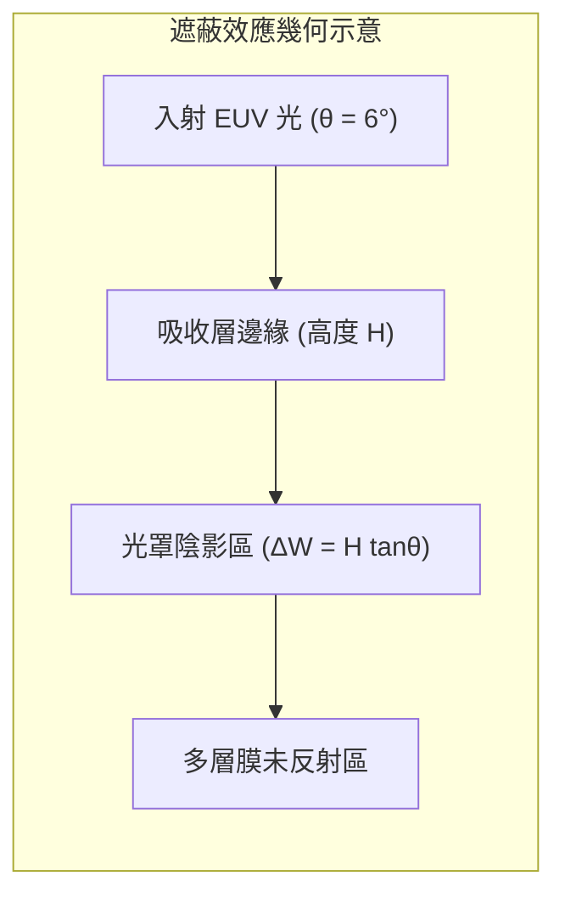

遮蔽效應使水平方向（Parallel to illumination plane）與垂直方向（Perpendicular to illumination plane）的線條呈現顯著的空間像不對稱性，引發嚴重的水平-垂直偏差（H-V Bias）、穿透焦點時的最佳焦點漂移（Focus Shift），以及繞射光譜的不對稱性，直接縮減了微影製程視窗。

#### 吸收層材料演進

傳統 EUV 光罩廣泛採用以鉭為基底（Ta-based）的吸收層，通常為雙層結構：底部為厚約 $55\sim 60\text{ nm}$ 的氮化鉭（TaN），頂部為厚約 $2\sim 5\text{ nm}$ 的硼氧化鉭（TaBO）抗反射檢驗層。Ta-based 吸收層的優點是化學穩定、蝕刻選擇比高，但其消光係數 $\beta$ 在 $13.5\text{ nm}$ 處較低（約 0.04），需要較大厚度（$>60\text{ nm}$）才能達到 $<1.5\%$ 的光學反射殘餘（光學對比需求），這導致遮蔽效應極為嚴重。

為降低吸收層厚度以減輕 M3D 效應，先進節點引入了新一代高消光係數（High-$k$ / High-$\beta$）與低折射率材料：

1. **鈷、鎳基合金（Co-, Ni-based）**：Ni 與 Co 在 $13.5\text{ nm}$ 處具有共振吸收峰，$\beta$ 值顯著高於 Ta（Ni 的 $\beta \approx 0.07\sim 0.08$）。使用 Ni 或 Co 合金可將吸收層厚度縮減至 $30\text{ nm}$ 以下，大幅降低陰影寬度 $\Delta W_{\text{shadow}}$。
2. **衰減型相移材料（Attenuated Phase Shift Mask, Att-PSM）**：選擇折射率偏離值 $\delta$ 較大的材料（例如 Ru、Pt 或 Mo 的化合物），在厚度僅 $20\sim 35\text{ nm}$ 下，使穿過吸收層的微弱殘餘光（約 $3\% \sim 8\%$）相對於多層膜反射光產生 $\pi$ 的相位差，利用破壞性干涉銳化圖案邊緣，兼具降低遮蔽效應與提升影像對比度的雙重優勢。

---

### EUV 防塵薄膜 (Pellicle) 的物理瓶頸與散熱機制

防塵薄膜（Pellicle）是懸浮固定在光罩圖案面之上（間隔距離通常為數公釐）的超薄膜結構。

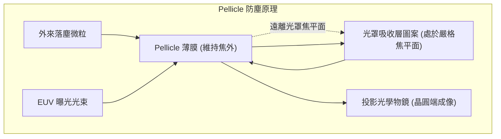

落於 Pellicle 表面上的微粒遠離微影系統的共軛物方焦平面（Focal Plane），在晶圓曝光成像時處於嚴重離焦（Defocus）狀態，其空間頻率被投影系統過濾，從而避免圖案缺陷被轉印至晶圓。

在 DUV（如 $193\text{ nm}$）系統中，Pellicle 採用穿透率 $>99\%$ 的透明氟碳聚合物薄膜（厚度微米級），且工作環境為常壓大氣，熱量可透過周圍氣體的熱對流與傳導迅速散逸。然而，EUV 微影的極端物理條件使 Pellicle 成為半導體製造中最艱鉅的材料與機械工程挑戰之一：

1. **雙程穿透率（Two-pass Transmission, TPT）限制**：EUV 為反射式照明，光束穿透薄膜到達光罩，反射後再次穿透薄膜進入光學系統。若薄膜單程穿透率為 $T_{\text{single}}$，則總穿透率為 $T_{\text{two-pass}} = T_{\text{single}}^2$。為了維持高曝光產能（Throughput），產業界嚴格要求 $T_{\text{two-pass}} \ge 90\%$，意即單程穿透率必須滿足：
   $$T_{\text{single}} \ge \sqrt{0.90} \approx 94.87\%$$
   此條件強行限制 Pellicle 的物理厚度必須在數十奈米（nm）甚至數奈米等級。
2. **超高溫熱平衡挑戰（高真空無對流環境）**：高功率 EUV 曝光機（光源功率達 $300\text{ W} \sim 500\text{ W}$，甚至朝更高發展）沉積在光罩區域的熱通量密度極高。由於 EUV 光程必須處於高真空環境，薄膜周邊無氣體可進行熱對流；且薄膜厚度極薄、橫向面積達 $110\text{ mm} \times 140\text{ mm}$，其徑向熱傳導至鋁合金支撐框的通量微乎其微。薄膜主要的散熱途徑**僅能依賴熱輻射（Thermal Radiation）**。

根據史蒂芬-波茲曼定律（Stefan-Boltzmann Law），單位面積由熱輻射散發的淨熱流密度 $q_{\text{rad}}$ 為：

$$q_{\text{rad}} = 2 \cdot \epsilon(T) \cdot \sigma \left( T^4 - T_0^4 \right)$$

其中，$\sigma \approx 5.67 \times 10^{-8}\text{ W}/(\text{m}^2\cdot\text{K}^4)$ 為史蒂芬-波茲曼常數，$\epsilon(T)$ 為薄膜的半球全發射率（Total Hemispherical Emissivity），因薄膜具上下兩個表面故計入因子 2，$T$ 為薄膜平衡溫度，$T_0$ 為腔體環境溫度。

若材料發射率 $\epsilon$ 不足，吸收的 EUV 能量會使薄膜工作溫度驟升至 $600^\circ\text{C} \sim 1000^\circ\text{C}$。在此高溫下，薄膜面臨劇烈的熱膨脹變形（熱致垂下 Sagging）、機械熱疲勞破裂，以及與腔體微量氫自由基（$\text{H}^*$，用於清潔錫污染）作用產生的化學脆化。

---

### EUV Pellicle 材料演進

為同時兼顧光學穿透率、耐極高溫熱輻射發射率以及機械結構強度，EUV Pellicle 經歷了三個主要材料發展階段：

| 特性評估指標 | 多晶矽 (Polysilicon) | 金屬矽化物 (如 $\text{MoSi}_2$, $\text{ZrSi}_2$) | 碳奈米管網絡 (CNT) |
| :--- | :--- | :--- | :--- |
| **典型薄膜結構** | $\text{Si}$ 核心膜 (~30 nm) + 抗氧化保護層 | 矽化物合金自立薄膜 (~20 nm) | 無規排列單壁/雙壁 CNT 網狀懸空結構 |
| **單程 EUV 穿透率** | $85\% \sim 88\%$（TPT 約 $72\%\sim 78\%$） | $88\% \sim 90\%$（TPT 約 $78\%\sim 81\%$） | $>97\%$（TPT 可達 $>94\%$） |
| **最高耐受功率** | $\sim 250\text{ W}$ | $\sim 350\text{ W} \sim 400\text{ W}$ | $>600\text{ W} \sim 1000\text{ W}$ |
| **熱散逸主要瓶頸** | 發射率 $\epsilon$ 低，高溫易矽化物凝集破損 | 高溫相變與界面應力破裂 | 高溫氫電漿氣化侵蝕，需抗蝕被覆保護 |
| **機械強度特性** | 脆性連續膜，對微粒與衝擊敏感 | 連續膜，熱應力容忍度中等 | 網狀多孔結構，抗撕裂與抗形變能力極高 |

#### 1. 多晶矽（p-Si）基薄膜
第一代 EUV Pellicle 由厚度約 $30\sim 50\text{ nm}$ 的多晶矽薄膜構成。由於 Si 在 $13.5\text{ nm}$ 具備極低的消光係數，可提供相對可接受的穿透率。但單純的 Si 膜在高溫下極易氧化，且常溫與中溫下的發射率極低（$\epsilon < 0.1$），散熱效率不佳。工業界透過在矽膜兩側夾覆厚度約 $2\sim 3\text{ nm}$ 的氮化矽（$\text{SiN}_x$）或 Ru 阻絕層以防止氧化並略微提高發射率，但在光源功率超過 $250\text{ W}$ 時，界面高溫擴散與矽膜起泡破裂成為致命失效模式。

#### 2. 金屬矽化物（Metal Silicides）薄膜
第二代技術改用二矽化鉬（$\text{MoSi}_2$）或二矽化鋯（$\text{ZrSi}_2$）等難熔金屬矽化物。此類材料在高溫下具備優異的金屬鍵/共價鍵混合特質，熔點極高（$\text{MoSi}_2$ 熔點達 $2030^\circ\text{C}$），在高溫下的熱發射率顯著高於純多晶矽（$\epsilon \approx 0.3\sim 0.4$），容許薄膜在承受 $350\text{ W}$ 級別的 EUV 照射下，維持於材料耐受溫度以內。

#### 3. 碳奈米管（Carbon Nanotube, CNT）網絡
為因應 High-NA EUV 與大於 $600\text{ W}$ 乃至千瓦級光源的極端熱負載，多孔型碳奈米管網狀結構（CNT Network）成為當前次世代 Pellicle 的主流解決方案。

碳奈米管 Pellicle 的物理優勢建立在以下機制：
* **超高孔隙率與光學穿透**：CNT 薄膜是由無規纏結的單壁（SWCNT）或雙壁（DWCNT）奈米管構成，孔隙率高達 $85\%$ 以上。EUV 光束大部分穿透真空微孔，使得 CNT 膜在具備宏觀力學自立強度的同時，單程 EUV 穿透率可輕易突破 $97\%$（TPT $> 94\%$），大幅抑制了雙程衰減。
* **黑體輻射等級的發射率**：CNT 網絡在紅外線長波波段具有極高的光學吸收與發射特性，其熱發射率 $\epsilon$ 接近黑體（$\epsilon > 0.8$），能夠以極高的效率將吸收的 EUV 能量轉化為熱輻射釋放，承受超過 $1000^\circ\text{C}$ 的瞬態高溫而無顯著形變。
* **高韌性網狀結構**：CNT 沿管軸方向具有高達 TPa 級的楊氏模數（Young's Modulus），網狀多孔拓撲結構使其具備極佳的應力分散能力，單一奈米管的斷裂不會引發災難性連續破膜。

然而，CNT 薄膜在 EUV 掃描機中的化學脆弱性在於其與氫電漿環境的相互作用。在曝光機腔體中，氫自由基（$\text{H}^*$）會與高溫碳原子反應生成甲烷（$\text{CH}_4$）等揮發性碳氫化合物，導致 CNT 結構逐漸變薄蝕刻。為此，先進 CNT Pellicle 必須在奈米碳管表面利用原子層沉積（ALD，見第 23 章）被覆一層均勻的氧化物或金屬保護層（如數個原子層厚度的 $\text{Al}_2\text{O}_3$ 或 Ru/Pt），在不犧牲 EUV 穿透率與散熱特性的前提下，隔絕氫自由基的化學侵蝕。

!!! warning "高能量 EUV 環境下的化學脆化"
    Pellicle 的物理失效並非單純由溫度引起。在高強度 EUV 光子照射下，高真空腔體內不可避免的痕量水分子（$\text{H}_2\text{O}$）會被光解成高活性氧自由基與羥基（$\text{OH}^*$），加速薄膜氧化變脆；同時，由光學元件清潔程序導入的氫電漿環境會對非金屬材料產生強烈的還原與氫化侵蝕。因此，Pellicle 的熱-機械壽命高度依賴其表面鈍化被覆的均勻性。

<!-- fig:1 -->
<figure markdown>
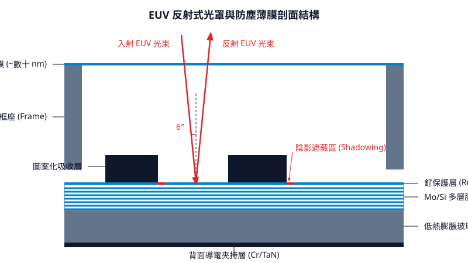
<figcaption>圖 16-1　EUV反射光罩剖面（AI 繪製的示意圖）</figcaption>
</figure>

## 16.3 光學鄰近效應修正 (OPC) 物理與演算法

### 微影圖形失真機制

在積體電路微影製程中，當特徵尺寸微縮至曝光波長（如深紫外線 DUV $193\text{ nm}$，見第 12 章與第 13 章）以下時，成像系統將面臨劇烈的繞射極限限制。投影物鏡具有有限的數值孔徑（Numerical Aperture, $\text{NA}$），本質上扮演一個空間頻域的「低通濾波器」（Low-pass Filter）。光罩上圖形之高頻空間成分（如幾何拐角、邊緣突變）在通過光學系統時被截止截斷，造成晶圓表面光強度分佈與光罩設計圖案產生嚴重偏離，此現象統稱為「光學鄰近效應」（Optical Proximity Effect, OPE）。

圖形失真的主要物理表現包括：

1. **拐角圓化（Corner Rounding）**：二維直角幾何圖形在頻域中包含無限寬廣的高頻諧波。高頻分量被透鏡孔徑截止後，轉角處的光強梯度減緩，導致光阻顯影後的直角退化為具有一定曲率半徑的圓弧。
2. **線端縮短（Line-end Shortening, LES）**：線條末端在二維空間中同時在縱向與橫向發生繞射。相較於連續長線段的中央區域，線端的光強衰減更為顯著，使得光阻在曝光與顯影後沿著長軸方向發生回縮。若未予修正，閘極線端可能無法完全覆蓋主動區（Active Area），引發汲極至源極之漏電流失效。
3. **光學鄰近與間距依賴性（Pitch-dependent CD Variation）**：隔離線（Isolated Line）與密集線（Dense Line）的繞射光譜分佈截然不同。密集線受相鄰週期的光波干涉影響，其空間光強分佈與無相鄰繞射場疊加的隔離線相異，造成在相同標稱線寬下，不同圖形密度（Pitch）印出之臨界尺寸（Critical Dimension, CD）出現顯著偏差。

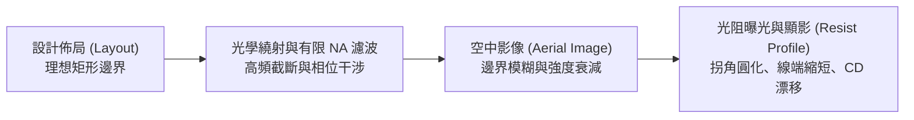

---

### 基於幾何規則之修正（Rule-based OPC）

在較早期製程節點（約 $0.18\ \mu\text{m}$ 至 $90\text{ nm}$），光學鄰近修正採用「基於規則」（Rule-based）的方法。其核心理念係透過幾何量測與經驗表格直接修改佈局邊界。

工程師在測試光罩上印製不同間距、線寬與幾何構型的測試圖樣，經由臨界尺寸掃描式電子顯微鏡（CD-SEM）量測晶圓上的實體尺寸，建立「特徵尺寸－間距－偏置量」之查表資料庫（Look-up Table）。依據規則執行之常見幾何幾何補償手段包括：
* **襯線（Serif）**：在直角拐角的外側增加微小矩形方塊（Outer Serif），或在內拐角凹槽處切削（Inner Serif），藉此補償高頻能量損失並維持銳利邊界。
* **鎚頭（Hammerhead）**：在導線末端增加橫向延伸的塊狀區域，以抵抗線端縮短效應，避免線端縮入接觸窗（Contact）之外。
* **間距偏置（Pitch Bias）**：針對不同間距的線條，依據量測數據對線寬進行均勻外擴或內縮。

!!! warning "常見誤解"
    Rule-based OPC 並非完全不需要幾何量測，而是不需要在修正時執行「即時數值模擬」。然而，隨著半導體特徵尺寸推進至非線性光學微影區間，二維幾何交互作用呈指數級複雜化，二維圖形無法再被簡化為孤立的一維間距規則；且光學同調長度（Coherence Length）涵蓋數個相鄰特徵，導致規則庫容量與例外條件呈組合爆炸，促使技術轉向「基於模型之修正」。

---

### 基於模型之修正（Model-based OPC）

當臨界特徵進入深次波長領域，幾何形貌之失真呈現高度非線性，修正流程必須仰賴數值物理模型即時預測晶圓成像邊界，並動態迭代移動光罩邊緣。為兼顧計算速度與物理真實度，Model-based OPC 將成膜過程解耦為兩大獨立模型：**光學模型（Optical Model）** 與 **光阻製程模型（Resist/Etch Process Model）**。

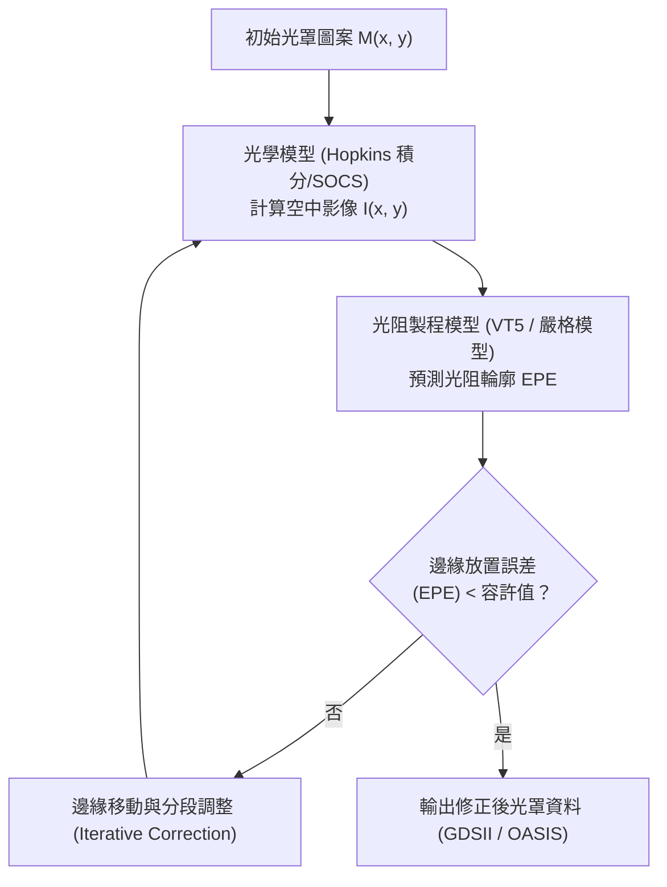

#### 1. 光學模型：Hopkins 部分同調成像

光學模型計算光線穿過光罩、投影透鏡並抵達光阻表面的光強度空間分佈，即「空中影像」（Aerial Image, $I(x,y)$）。在部分同調成像系統（Partially Coherent Imaging System）中，成像物理嚴格遵循霍普金斯（Hopkins）方程式：

$$
I(\vec{r}) = \iint TCC(\vec{f}_1, \vec{f}_2) \hat{M}(\vec{f}_1) \hat{M}^*(\vec{f}_2) \exp\left[-i 2\pi (\vec{f}_1 - \vec{f}_2)\cdot \vec{r}\right] d\vec{f}_1 d\vec{f}_2
$$

其中：
* $\vec{r} = (x, y)$ 為晶圓影像平面空間座標。
* $\hat{M}(\vec{f})$ 為光罩穿透率函數 $M(\vec{r})$ 之二維傅立葉轉換，$\vec{f}$ 為空間頻率向量。
* $TCC(\vec{f}_1, \vec{f}_2)$ 為傳輸交叉係數（Transmission Cross-Coefficient），完整描述了光源孔徑（Illumination Source）、光瞳函數（Pupil Function, 包含數值孔徑與像差）的交互積分作用。

由於雙重頻域積分之數值運算極為龐大，無法直接應用於全晶片運算，工程實作上利用奇異值分解（SVD）將四維核心 $TCC$ 展開為一系列正交特徵函數之和，稱為「同調系統之和」（Sum of Coherent Systems, SOCS）：

$$
I(\vec{r}) \approx \sum_{k=1}^{N} \lambda_k \left| \phi_k(\vec{r}) \otimes M(\vec{r}) \right|^2
$$

此處 $\lambda_k$ 為特徵值，$\phi_k(\vec{r})$ 為對應的光學卷積核心（Kernel），$\otimes$ 代表空間卷積運算。在實務上，僅需截取能量最高的前數個至十數個核心（$N \approx 8 \sim 24$），即可在保證光學精度（誤差通常 $< 0.1\%$）的同時，將運算複雜度降至二維快速傅立葉轉換（FFT）的執行極限。

#### 2. 光阻與蝕刻製程模型

空中影像計算完成後，需進一步預測光阻經過曝光、化學放大反應擴散（見第 11 章）及顯影後的實際邊界位置。

* **常數臨界值模型（Constant Threshold Resist, CTR）**：假設光阻在光強高於某一絕對固定閾值 $I_{\text{th}}$ 時完全被去除。此模型忽略了酸擴散（Acid Diffusion）與顯影非線性，僅適用於次臨界圖形。
* **可變臨界值模型（Variable Threshold Resist, 如 VT5 模型）**：屬於經驗唯象模型（Empirical Model）。製程臨界值 $I_{\text{th}}$ 被定義為局部空中影像特徵之多項式函數：

$$
I_{\text{th}}(\vec{r}) = c_0 + \sum_{m} c_m f_m\left(I_{\text{max}}, I_{\text{min}}, S_{\text{max}}, \frac{\partial I}{\partial n}\right)
$$

其中參數包含光強局部極大值 $I_{\text{max}}$、極小值 $I_{\text{min}}$、光強斜率（Image Slope）以及垂直邊界方向的空間微分。模型內部係數 $c_m$ 則利用大量 CD-SEM 量測圖形的校正數據透過迴歸演算法擬合而成。
* **嚴格物理模型（Rigorous Simulation）**：完整求解光化學反應擴散擴散微分方程與馬克士威方程組（Maxwell's Equations）。精度最高，但計算耗時數個數量級，通常僅用於前階 Calibration 與關鍵熱點（Hotspots）驗證。

---

### 次解析度輔助特徵（SRAF）之物理機制

隨著特徵尺寸接近繞射極限，除了對既有線條邊界作偏置位移，亦須在主特徵周圍配置「次解析度輔助特徵」（Sub-Resolution Assist Feature, SRAF）。

SRAF 是一類寬度極窄的輔助幾何線條（在光罩上為非透光條紋或透光細縫）。其核心物理特徵為：**尺寸小於系統之解析度極限，在曝光過程中本身不會在晶圓上累積足夠的光阻反應用光強，因而不會被顯影成實體圖案（非印出特性, Non-printing）**。

| 幾何類別 | 在晶圓上印出與否 | 主要功能 | 典型尺寸（相對於波長與 NA） |
| :--- | :--- | :--- | :--- |
| **主要特徵（Primary Feature）** | 是 | 形成電路所需之電氣元件（閘極、金屬線） | $\ge k_1 \frac{\lambda}{\text{NA}}$ |
| **次解析度輔助特徵（SRAF）** | 否（$I_{\text{peak}} < I_{\text{th}}$） | 調控干涉繞射場、擴展焦點深度與製程視窗 | 寬度典型值約為主要特徵之 $30\% \sim 50\%$ |

```
【空間光強度分佈物理示意】

光強 (Intensity)
   ^
   |        主特徵峰值 (印出)
   |           |  |
Ith| - - - - - +--+- - - - - - - 顯影光強臨界值 (I_threshold)
   |           |  |
   |   SRAF    |  |    SRAF
   |  (不印出) |  |   (不印出)
   |    /\     |  |     /\
   +---/--\----+--+----/--\----> 空間位置 (x)
      [SRAF]  [Main]  [SRAF]   (光罩對應圖形)
```

SRAF 的主要光學作用為：
1. **頻譜重組與同調調控**：隔離線缺乏相鄰圖形所產生的繞射光，導致其在空間頻率平面上的光強衰減劇烈。藉由在隔離線兩側對稱引入 SRAF，SRAF 產生的微弱繞射波與主特徵的繞射波在晶圓表面產生同調干涉，人為地將隔離線的光學環境「偽密集化」（Quasi-dense）。
2. **製程視窗（Process Window）擴展**：SRAF 能夠顯著壓抑隨離焦（Defocus）產生之相位失真，拉平穿過聚焦深度（Depth of Focus, DOF）的光強度梯度，並增大曝光寬容度（Exposure Latitude, EL），大幅增強製程對機台焦點漂移與劑量波動的容忍度。

---

### 光罩規則檢查（MRC）與圖元碎化（Fragmentation）

Model-based OPC 並非將整個多邊形作為單一物件平移，而是將佈局的邊界離散分割為數個微小線段，此過程稱為「圖元碎化」（Fragmentation）。

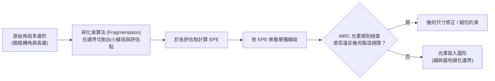

1. **評估點與邊緣放置誤差（EPE）**：
   在碎化後的每個微小線段中央定義一個量測與評估取樣點（Evaluation Point / Gauge）。演算法於該點計算空中影像與光阻模擬輪廓，並量測其與目標電路規格邊界的偏差，此偏差值定義為「邊緣放置誤差」（Edge Placement Error, EPE）：
   $$
   \text{EPE} = x_{\text{simulated}} - x_{\text{target}}
   $$
   OPC 引擎隨後依據反饋演算法，將該碎化線段沿法線方向外擴或內縮 $-\alpha \cdot \text{EPE}$，進行閉迴路迭代修正，直到全晶片之 EPE 落入預設的收斂容許範圍（Tolerance）內。

2. **光罩規則檢查（Mask Rule Check, MRC）**：
   修正後的光罩圖形最終必須由電子束光罩寫入機（Mask Writer）於光罩基板上曝光成形（見 16.1 節）。電子束寫入具有物理與製程極限，若碎化調整產生過度細微的幾何結構，將導致光罩無法被物理實現或良率低下。MRC 規範的主要參數包括：
   * **最小線寬（Minimum Feature Size）與最小間距（Minimum Space）**：光罩上相鄰 SRAF 或主線條之最小物理距離。
   * **最小線段長度（Minimum Edge Length）**：碎化時每個單獨邊緣的下限值。
   * **凹凸階差（Jog Tolerance）**：相鄰碎化線段平移後產生的台階落差上限。

3. **計算複雜度與資料膨脹之權衡**：
   圖元碎化越精細（線段長度越短），幾何邊界的控制精度越高，EPE 越趨近於零；然而，碎化線段呈倍數增加將導致：
   * **資料量膨脹（Data Volume Explosion）**：全晶片幾何頂點（Vertices）急遽增加，光罩圖形資料檔案（GDSII 或 OASIS 格式）從數百 GB 激增至數 TB 級別。
   * **寫入時間劇增（Mask Write Time）**：可變形電子束（Variable Shaped Beam, VSB）光罩機台所需之曝光發射（Shots）數量隨多邊形碎片呈線性或超線性上升，大幅增加光罩製作成本與缺陷機率。

因此，現代先進 OPC 引擎在執行碎化時，必須透過全自動最佳化機制，在保證晶圓顯影精準度（微縮 EPE）、維持光罩製造可行性（遵循 MRC）以及抑制全晶片運算與資料總量之間取得工程平衡。

## 16.4 反向微影技術 (ILT) 與全晶片計算微影

### 16.4.1 微影反問題之數學建構

傳統基於模型的光學鄰近效應修正（Model-based OPC，見 16.3 節）採用「基於邊緣（Edge-based）」的啟發式微調：演算法將電路佈局的多邊形邊界切割成數個微小線段（Segments），藉由計算各量測評估點（Evaluation Points 或 Sites）的邊緣放置誤差（Edge Placement Error, EPE），反覆推進或後退線段邊界。然而，當半導體製程推進至深次微米與次波長微影極限時，空間頻率急劇截斷導致系統呈現嚴重的非線性特徵，邊緣微調法容易陷入局部極小值（Local Minima），且無法自發生成拓撲結構複雜的次解析度輔助特徵（Sub-Resolution Assist Features, SRAF）。

反向微影技術（Inverse Lithography Technology, ILT）將微影成像視為嚴格的**數學反問題（Inverse Problem）**。在已知目標晶圓影像（Target Pattern）與微影系統傳遞函數的前提下，透過全域數值最佳化演算法，逆向求解出能夠在晶圓光阻上產生最佳成像品質的光罩穿透率分佈。

微影成像的前向物理模型（Forward Model）可表述為非線性運算子 $\mathcal{F}$。令空間座標為 $\mathbf{r} = (x, y)$，光罩連續空間穿透率分佈為 $M(\mathbf{r})$，光阻顯影後的二值化圖形為 $I_{\text{resist}}(\mathbf{r})$：

$$I_{\text{resist}}(\mathbf{r}) = \sigma \left( I_{\text{wafer}}(\mathbf{r}) - I_{\text{th}} \right)$$

其中，$I_{\text{wafer}}(\mathbf{r})$ 為晶圓表面的空間光強分佈，通常由霍普金斯部分同調成像方程式（Hopkins Abbe/TCC 模型，見第 12 章）計算求得：

$$I_{\text{wafer}}(\mathbf{r}) = \sum_{k} \alpha_k \left| M(\mathbf{r}) \otimes \phi_k(\mathbf{r}) \right|^2$$

此處 $\phi_k(\mathbf{r})$ 為經奇異值分解（SVD）或特徵值分解後的光學系統核函數（SOCS Kernels），$\alpha_k$ 為對應特徵權重；$\otimes$ 代表二維空間卷積；$\sigma(\cdot)$ 為近似光阻顯影非線性響應的連續 Sigmoid 函數；$I_{\text{th}}$ 為光阻感光閾值。

ILT 的目標是尋找最優光罩分佈 $M^*(\mathbf{r})$，使得最終光阻成像與原始設計目標圖樣 $I_{\text{target}}(\mathbf{r})$ 之間的差異最小化。該問題可表述為泛函極小化問題：

$$\min_{M(\mathbf{r})} \mathcal{J}(M) = \mathcal{D}\Big(I_{\text{resist}}(M(\mathbf{r})), \, I_{\text{target}}(\mathbf{r})\Big) + \lambda \mathcal{R}(M(\mathbf{r}))$$

式中：
- $\mathcal{D}(\cdot, \cdot)$ 為圖形保真度度量項（Fidelity Loss），典型數學形式為二階 $L_2$ 範數：
  $$\mathcal{D} = \iint \left| I_{\text{resist}}(\mathbf{r}) - I_{\text{target}}(\mathbf{r}) \right|^2 d\mathbf{r}$$
- $\mathcal{R}(M)$ 為正則化項（Regularization Term），用以約束問題的病態性（Ill-posedness）；
- $\lambda > 0$ 為調節保真度與物理製造約束的權重超參數。

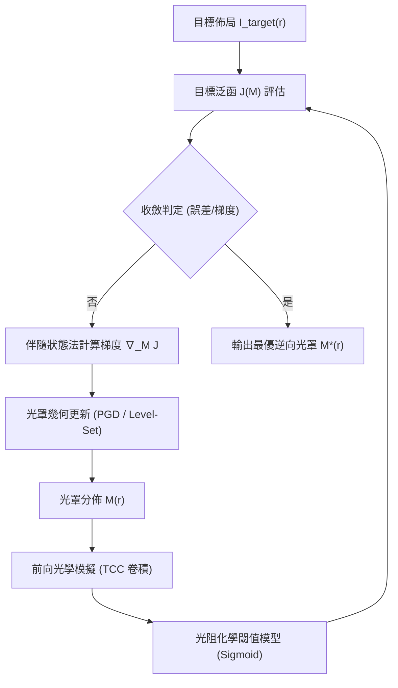

---

### 16.4.2 求解演算法：梯度下降法與水準集法

微影成像為不可逆的資訊截斷過程（高頻空間繞射光逃逸於物鏡孔徑數之外），使反向求解具備高度非凸性（Non-convexity）與非適定性。為求解該連續非線性尋優問題，產業主要採用兩種數值框架：

#### 1. 連續空間投影梯度下降法 (Projected Gradient Descent, PGD)

光罩實際穿透率在二元光罩（Binary Intensity Mask, BIM）下受限於離散二值 $\{0, 1\}$，或在衰減相移光罩（Attenuated PSM）下為有限複數集。離散最佳化屬於 NP-hard 問題，因此演算法先進行連續變數鬆弛化（Continuous Relaxation），將定義域擴展至區間 $M(\mathbf{r}) \in [0, 1]$。

利用變分法與伴隨狀態法（Adjoint State Method），目標泛函對光罩空間函數的 Frechet 導數（即梯度 $\nabla_M \mathcal{J}$）可透過前向成像場與反向誤差場的交互卷積解析求得：

$$M^{(n+1)}(\mathbf{r}) = \mathcal{P}_{[0, 1]} \left( M^{(n)}(\mathbf{r}) - \gamma_n \nabla_M \mathcal{J}(M^{(n)}) \right)$$

其中 $\gamma_n$ 為最佳化步長（Step Size），$\mathcal{P}_{[0, 1]}$ 為將數值強制截斷在 $[0, 1]$ 區間的投影運算子。為驅使最終的光罩連續分佈收斂為二值結構，正則化項 $\mathcal{R}(M)$ 常引入懲罰函數（Penalty Function）：

$$\mathcal{R}_{\text{binary}}(M) = \iint M(\mathbf{r}) \cdot (1 - M(\mathbf{r})) \, d\mathbf{r}$$

當且僅當 $M(\mathbf{r}) \in \{0, 1\}$ 時，該懲罰項數值為零。

#### 2. 水準集方法 (Level-Set Method, LSM)

傳統參數化幾何在演化過程中難以應對拓撲結構的劇烈變化（例如圖案的自然分裂、孔洞生成或邊界合併）。水準集方法將二維光罩邊界視為三維連續隱函數 $\psi(\mathbf{r}, t)$ 的零等值面（Zero Level Set）：

$$\Gamma(t) = \{ \mathbf{r} \in \mathbb{R}^2 \mid \psi(\mathbf{r}, t) = 0 \}$$

光罩的穿透分佈由海維賽德階躍函數（Heaviside Function）表徵：$M(\mathbf{r}, t) = H(\psi(\mathbf{r}, t))$。零等值面隨虛擬時間 $t$ 沿其法向速度場 $V(\mathbf{r})$ 演化，滿足漢密爾頓-雅可比偏微分方程（Hamilton-Jacobi Equation）：

$$\frac{\partial \psi}{\partial t} + V(\mathbf{r}) |\nabla \psi| = 0$$

法向速度 $V(\mathbf{r})$ 正比於目標泛函的負泛函導數 $-\frac{\delta \mathcal{J}}{\delta \psi}$。水準集法的優勢在於：在數值計算過程中無須顯式追蹤邊界網格，演算法能自發在主圖案周邊「成核（Nucleate）」並長出任意形狀的非共形輔助圖案（Free-form SRAFs），極限化補償相鄰圖形間的光學破壞性干涉。

---

### 16.4.3 幾何進化：從曼哈頓形狀到曲面光罩 (Curvilinear Mask)

在先進節點以前，光罩圖案均受到「曼哈頓幾何（Manhattan Geometry）」的嚴格限制，圖形邊界僅由相互垂直的水平與垂直線段（$90^\circ$）或輔以有限的斜角線段（$45^\circ$）組成。

曼哈頓化幾何係早期光罩資料格式與電子束寫入機之折衷產物。然而從光學物理本質分析，繞射與點擴散函數（Point Spread Function, PSF）在二維空間呈現各向同性的圓形對稱性（Bessel Function 或 Airy Disk 分佈，見第 12 章）。以曼哈頓正交階梯逼近連續曲面時，會引入人為高頻截斷噪訊，導致光波波前調控失真。

曲面光罩技術（Curvilinear ILT）移除了正交網格束縛，允許光罩邊界為完全光滑的二維任意連續曲線。

| 評估維度 | 傳統曼哈頓光罩 (Manhattan Mask) | 曲面光罩 (Curvilinear Mask) |
| :--- | :--- | :--- |
| **圖形表現形式** | 正交多邊形、直角與階梯狀邊界 | 任意連續平滑曲線、無人工折角 |
| **焦點深度 (DOF)** | 基準值 (典型製程窗口受限於轉角相鄰效應) | 提升約 $15\% \sim 30\%$（典型值） |
| **曝光寬容度 (EL)** | 基準值 | 提升約 $10\% \sim 20\%$（典型值） |
| **光罩製造容忍度 (MEEF)** | 較高（折角處對光罩蝕刻 CD 變異敏感） | 顯著降低（曲面連續能量梯度更穩定） |
| **SRAF 形態** | 離散矩形條狀或方塊狀 | 隨等相位線自然環繞的有機連續形狀 |

曲面 ILT 光罩透過全域連續相位與振幅調控，消除了正交折角處引發的高階寄生繞射波，使投影至晶圓上的光學能量集中於目標主瓣。此舉在極低 $k_1$ 因子條件下，顯著擴大了製程容許範圍（Process Window），並大幅緩解光罩誤差增強因子（Mask Error Enhancement Factor, MEEF）。

!!! note "物理機理：曲面輔助特徵對波前的連續調控"
    曼哈頓 SRAF 受到幾何寬度與放置間距的離散限制，常因尺寸過大產生晶圓端「意外印出（SRAF Printing）」的缺陷，或尺寸過小導致光學干涉補償不足。曲面 SRAF 的外觀呈現如波浪般的流線有機體（Organic Shapes），能精準吻合相移破壞性與建設性干涉的最優等高線，在達成最高對比度的同時，將輔助圖形本身的穿透強度嚴格壓抑在光阻顯影閾值以下。

---

### 16.4.4 計算複雜度瓶頸與全晶片實現

全晶片（Full-Chip）應用 ILT 的最大阻礙在於其計算複雜度。若以 $1\,\text{nm}$ 網格解析度將一片 $26\,\text{mm} \times 33\,\text{mm}$ 的曝光光場（Field）離散化，像素規模高達 $\approx 8.5 \times 10^{14}$。即使僅針對關鍵幾何圖形層，若在全晶片上執行數百次伴隨狀態前向/後向偏微分卷積迭代，傳統 CPU 運算叢集需消耗數十萬 CPU·小時，計算成本難以支撐商業化生產週期。

為實現全晶片 ILT，先進計算微影架構進行了兩大技術革新：

#### 1. 異質 GPU 平行叢集架構與領域分解
將全晶片幾何佈局利用領域分解法（Domain Decomposition Method, DDM）切割為微小單元區塊（Tiles），各區塊邊界配置足夠涵蓋光學影響半徑（Optical Interaction Radius，通常為數個微米）的重疊緩衝區（Halo/Padding Region）。藉由 GPU 的數值張量計算核心，將二維空間 FFT 卷積與 Sigmoid 運算全面矩陣化與硬體流水線化，使全晶片單層 ILT 計算時間壓縮在數小時之內。

#### 2. 機器學習與深度學習代理模型 (AI-driven ILT)
在多輪數值迭代中，高斯-牛頓或梯度演化的前向光學模擬佔據了逾 $80\%$ 的計算資源。目前業界導入深度卷積神經網路（如 U-Net 架構變體或生成對抗網路 GAN）作為代理模型（Surrogate Model）：

- **初始解預測（Hot-Start Initial Guess）：** 神經網路在推理階段直接讀入設計佈局，並輸出接近全域最佳解的光罩分佈，將後續物理梯度迭代次數減少 $70\%$ 以上。
- **神經算子逼近（Neural Operator Approximation）：** 直接替代嚴格霍普金斯積分，在保持可微分特性（Differentiable）的前提下，極速提供逆向梯度反向傳播。

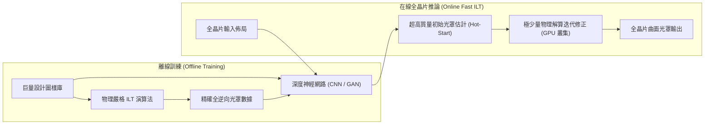

---

### 16.4.5 光罩資料處理與多電子束寫入機相容性

曲面 ILT 雖然在光學物理上展現出顯著優勢，但其推向實際製造長久以來受制於光罩製作機台（Mask Writer）的寫入物理限制與巨量資料檔案處理瓶頸。

傳統光罩製造採用**可變形狀電子束機台（Variable Shaped Beam, VSB）**（見 16.1 節）。VSB 機台將圖案分解為數以億計的微小矩形與直角三角形基元（Shots）。若強行將曲面幾何切碎（Fracturing）為正交 VSB 基元，會引發「基元爆炸（Shot Count Explosion）」：單片光罩的基元數增長兩個數量級，使得機台曝光時間長達數天，在商業量產上完全不可行。

解決該相容性瓶頸的物理關鍵在於**多電子束寫入機（Multi-Beam Mask Writer, MBMW / MEBW）**的普及。

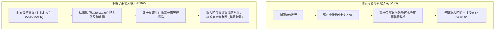

多電子束寫入機利用微機電系統（MEMS）孔徑陣列，將單一高能量電子束分割為數十萬道（例如 512 $\times$ 512 道，約 26 萬道）個別可開關調變的細微電子束。其核心特徵為：

1. **常數曝光時間（Constant Write-Time）：** MEBW 以點陣化掃描（Raster Scan）模式運作，光罩電子束曝光時間僅取決於光罩總面積與光阻所需劑量，與圖形是曼哈頓正交多邊形還是自由曲面**完全無關**。
2. **像素化資料處理（Pixel-based Data Pipeline）：** 曲面 ILT 輸出的連續幾何向量可直接在資料前處理端光柵化為灰階位元圖（Pixel Grid），透過控制各電子束的曝光時間調變劑量（Dose Modulation），實現次奈米級的邊緣放置精度。
3. **資料規格標準化演進：** 傳統 GDSII 格式無法有效支援曲面資料；業界進一步擴充 OASIS 格式（如 SEMI P44 標準針對平滑多邊形曲線的擴充，或以三次 B 樣條曲線 B-Spline 表示），大幅抑制了檔案體積膨脹，使數百吉位元組（GB）等級的曲面圖形資料能直接由 MEBW 專屬的即時光柵化硬體解碼。

由此，計算微影的演算法（全晶片曲面 ILT）、資料標準（Curvilinear OASIS）與實體曝光機台（MEBW）達成閉環整合，確立了曲面計算微影在極紫外光（EUV）與先進節點微影中的工程基礎。

## 16.5 設備與廠商技術

### 16.5.1 光罩製造與處理設備體系架構

在先進半導體製程中，光罩（Photomask 或 Reticle）不僅是單純的幾何模板，而是高階光學與電子物理交互作用的精密光學元件。光罩製造、檢測與後續維護包含四大核心設備子系統：

1. **光罩圖案化設備（Mask Pattern Generator）**：負責將電子設計自動化（EDA）輸出之微影圖形以奈米級精度寫入光罩基板上的光阻層。現代先進光罩主流採用電子束微影直寫設備。其核心子系統包含高亮度場發射電子源（Field Emission Gun）、超高精度靜電/磁性透鏡電子光學柱（Electron Optical Column）、微孔徑陣列（Aperture Array）、高偏轉頻率之電子偏轉系統，以及配合雷射干涉儀反饋之超真空連續移動載台（Stage）。
2. **光罩缺陷檢測設備（Mask Inspection System）**：用於檢驗光罩基板、多層膜以及圖案化吸收層上的奈米級缺陷。包含利用深紫外光（DUV）光學系統進行透射與反射成像之光學檢測機，以及針對極紫外光（EUV）光罩所發展之光化波長（Actinic，即 $13.5\text{ nm}$）暗視野與明視野檢測機。子系統涵蓋超短波長光源（如雷射驅動電漿光源或 EUV 放電/高次諧波光源）、大數值孔徑（NA）光學成像系統與超高速時間延遲積分（TDI, Time Delay Integration）感測器。
3. **光罩缺陷修補設備（Mask Repair Tool）**：針對檢測出的微縮圖案缺陷進行奈米級修正。主要利用聚焦電子束引發沉積（EBID）與電子束引發蝕刻（EBIE）技術，子系統包含高解析掃描電子顯微柱、精密前驅物氣體注入系統（GIS, Gas Injection System）與次奈米壓電載台。
4. **防塵薄膜安裝與檢測設備（Pellicle Mounter & Inspection Tool）**：負責在超無塵環境下，將超薄薄膜框架無應力貼合至光罩表面，並進行張力檢驗與顆粒附著監控。

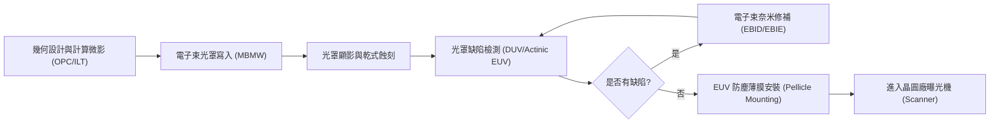

---

### 16.5.2 主要設備與材料廠商技術比較

下表彙整先進光罩製造、檢測與防塵薄膜領域之主要設備與材料供應商及其技術特點：

| 廠商 | 代表產品系列 | 技術路線與特點 | 主要應用 |
| :--- | :--- | :--- | :--- |
| **KLA** | Teron | 寬頻深紫外光（Broadband DUV）透射/反射光學檢測技術；具備晶片對晶片（Die-to-Die）與晶片對資料庫（Die-to-Database）即時演算法對比 | 先進光學光罩與 EUV 光罩圖案表面微粒、橋接、斷線等圖案缺陷檢測 |
| **Lasertec** | ACTIS | 光化 EUV（Actinic EUV）檢測技術，採用 $13.5\text{ nm}$ 雷射誘導放電或高次諧波光源，可在真空環境下檢測穿透防塵薄膜的光罩影像 | EUV 空白光罩相角缺陷、圖案光罩多層膜相位缺陷及含防塵薄膜之全圖案檢測 |
| **IMS Nanofabrication** | — | 多電子束光罩寫入（Multi-Beam Mask Writer, MBMW）架構；利用數十萬道微電子束並行曝光，曝光時間與圖案複雜度脫鉤 | 先進節點光罩、反向微影技術（ILT）曲面圖案之高產能電子束寫入 |
| **NuFlare Technology** | — | 高加速電壓（典型值 $50\text{ kV}$）多電子束微影直寫系統，搭配高速圖案生成引擎與即時鄰近效應校正（PEC）電路 | 高階 DUV 浸潤式多重圖案化光罩與 EUV 先進圖案光罩量產寫入 |
| **Carl Zeiss** | — | 聚焦電子束輔助化學沉積（EBID）與蝕刻（EBIE）技術；非破壞性修補高深寬比吸收層與相角缺陷 | EUV 與 DUV 光罩圖案多餘沉積物移除及缺失圖案之次奈米精準修補 |
| **三井化學 (Mitsui Chemicals)** | — | 碳基複合材料或矽化物基底超薄耐高溫薄膜製造技術；具備高 EUV 穿透率與高耐熱通量特性 | 整合並量產 ASML 授權之高功率 EUV 曝光機防塵薄膜組件 |

---

### 16.5.3 多電子束直寫技術與架構差異

在次 $7\text{ nm}$ 邏輯節點與先進記憶體節點，光學鄰近效應修正（OPC）由傳統曼哈頓幾何形狀（Manhattan Geometry）走向全反向微影技術（Full-chip ILT）所產生的曲線形狀（Curvilinear Shapes）。此演變使光罩圖元數量劇增數十倍至百倍。

#### 1. 可變形單電子束（VSB）面臨的限制
傳統可變形電子束（Variable Shaped Beam, VSB）微影系統係透過上下兩道光闌（Aperture）切割出不同尺寸的矩形或三角形射束。若光罩圖案充滿曲線，VSB 必須將曲線裂解為極微小的矩形碎片（Shots），導致單片光罩的總照射次數（Shot Count）從數百億次暴增至數千億次。總寫入時間 $T_{\text{write}}$ 為：
$$T_{\text{write}} = N_{\text{shot}} \times (t_{\text{settling}} + t_{\text{dwell}})$$
其中 $N_{\text{shot}}$ 為總照射次數，$t_{\text{settling}}$ 為偏轉系統電壓穩定時間，$t_{\text{dwell}}$ 為光阻曝光所需停留時間。在曲線圖案下，$N_{\text{shot}}$ 的激增會使單片光罩寫入時間由十餘小時延長至數天，嚴重喪失量產可行性。

#### 2. 多電子束光罩寫入技術（MBMW）架構
IMS Nanofabrication 與 NuFlare 所發展之 MBMW 系統將單一大電流電子束投射至具有微孔徑陣列（Aperture Plate System）的微機電系統（MEMS）晶圓上，將單一射束分割為數十萬道獨立子射束（典型值約為 26 萬至 50 萬道）。

* **射束調變機制**：各個微孔具有獨立的偏轉電極。當某個像素（Pixel）不需曝光時，微電極施加微小偏轉電壓，將該子射束偏轉至阻擋光闌；需要曝光時則讓子射束無阻礙穿透。
* **光柵掃描（Raster Scanning）**：載台維持等速連續移動，所有射束同步進行高頻光柵掃描。在此模式下，無論光罩上的幾何形狀是簡單矩形還是複雜曲線，單片光罩的像素總數固定，因此**寫入時間完全恆定**（典型量產時間約為 10 至 15 小時），徹底解決 ILT 圖案帶來的曝光時間問題。

---

### 16.5.4 光罩檢測與修補技術取捨

#### 1. 深紫外光（DUV）檢測與光化（Actinic）EUV 檢測之取捨
晶圓廠在購置光罩檢測機時，面臨光學波長與缺陷靈敏度之間的工程折衷：

* **DUV 光學檢測（以 KLA Teron 為例）**：
  採用深紫外光雷射（如 $193\text{ nm}$ 級波長）進行光罩穿透與反射式照明。優勢在於技術成熟度高、通量（Throughput）大、光源壽命長且無需極高真空系統。然而，DUV 無法偵測 EUV 鉬/矽（Mo/Si）多層膜內部的**埋入式相位缺陷**（Phase Defects，如基板表面微凹凸引起之反射波前畸變），亦無法準確重現 EUV 斜入射（典型為 $6^{\circ}$）所伴隨的吸收層陰影效應（Shadowing Effect）。
* **光化 EUV 檢測（以 Lasertec ACTIS 為例）**：
  直接採用 $13.5\text{ nm}$ 極紫外光進行檢測。光子能直接穿透多層膜結構並產生實質光學干涉，能完整重現曝光機內部的光化學環境，精準檢驗相位缺陷與光罩吸收層邊緣的三維立體遮蔽效應。此外，ACTIS 可在已安裝 EUV 防塵薄膜的光罩上進行無損檢測（Through-Pellicle Inspection）。但光化檢測機台昂貴、真空維持成本極高，且 EUV 光源功率輸出與穩定性維持難度顯著高於 DUV 系統。

#### 2. 電子束奈米修補技術
Carl Zeiss 的光罩修補機採用非聚焦離子束之電子束化學原理：
* **多餘吸收層修補（Clear defect）**：導入蝕刻前驅氣體（如含氟化合物），以聚焦電子束照射缺陷處引發化學反應，生成揮發性副產物（EBIE），避免傳統鎵離子束（FIB）造成的基底離子植入（Staining）與晶格破壞。
* **缺失吸收層修補（Opaque defect）**：導入含金屬有機前驅物氣體，透過聚焦電子束誘發局部解離，使金屬原子沉積在光罩表面（EBID），精確重構奈米級吸收層幾何邊緣。

---

### 16.5.5 EUV 防塵薄膜產業化與供應鏈實例

如 16.2 節所述，EUV 防塵薄膜（Pellicle）需在厚度低於 $50\text{ nm}$ 的條件下承受 $300\text{ W}$ 至 $500\text{ W}$ 甚至更高 EUV 光源之熱輻射，薄膜核心平衡溫度常達 $600^{\circ}\text{C}$ 至 $1000^{\circ}\text{C}$，同時 EUV 單程穿透率必須大於 $90\%$（雙程大於 $81\%$），以避免大幅犧牲曝光機產能。

!!! example "產業實例：ASML 與三井化學的 EUV Pellicle 整合"
    為解決 EUV 曝光機受顆粒污染導致良率崩跌的風險，微影設備廠 ASML 投入多晶矽矽化物（Polysilicon Silicide）與碳奈米管（Carbon Nanotube, CNT）材料之防塵薄膜研發，並確立專利技術與製造流程後，與日本三井化學（Mitsui Chemicals）建立獨家技術移轉與量產組裝合作。三井化學負責建置專屬無塵室與高溫真空製程產線，利用化學氣相沉積（CVD）與特殊脫膜轉移技術進行大面積超薄膜量產，再結合客製化張力金屬框架封裝，供應台積電、三星、英特爾等先進晶圓代工與整合元件製造廠（IDM），成為 EUV 商業化進程中的關鍵材料供應鏈節點。

---

### 16.5.6 計算微影與 OPC EDA 軟體生態系

在製程設計套件（PDK）與光罩製造之間，計算微影軟體負責執行極端運算的物理逆向求解。工業界三大主流 EDA 計算微影平台包括：
1. **Synopsys Proteus**：廣泛應用於先進節點全晶片光學鄰近效應修正、基於機器學習之 OPC 預測與製程視窗優化（Process Window Optimization, PWO）。
2. **Siemens EDA Calibre（Calibre nmOPC / Calibre pxOPC）**：半導體晶圓代工體系之標準黃金驗證工具，採用強韌的網格分散式運算架構，支援稠密型（Dense）與多邊形（Polygon-based）混合模式 OPC 以及全域 ILT。
3. **ASML Brion（Tachyon 系列）**：以微影機台硬體特徵閉迴路（Closed-loop）整合見長，將實際掃描機（Scanner）量測到的像差（Aberration）、照明光瞳形狀（Source Pupil）、雷射頻寬等物理參數直接注入光學模型，提供自光學校準至全晶片 OPC/ILT 的垂直整合方案。

#### 工業運算工作流程與硬體架構
現代計算微影流程包含：
* **模型校準（Model Calibration）**：利用測試光罩在晶圓上實際曝光後的臨界尺寸量測數據（CD-SEM），以數值最佳化校正光學模型（Hopkins 方程式）與光阻模型（Variable Threshold Resist Model, VTR 或三維光阻化學擴散模型）。
* **邊界調整與分割（Fragmentation & Edge Displacement）**：將多邊形邊緣切分為微小線段，透過反覆迭代計算各點光強度 $I(x,y)$，以反饋演算法移動線段位置，或採用基於梯度下降（Gradient Descent）與伴隨狀態法（Adjoint State Method）之 ILT 逐像素計算穿透係數。
* **分散式運算取捨**：處理單一先進節點晶片之全部光罩圖形，若使用傳統 CPU 運算叢集，需調動數千至上萬個運算核心運作數十小時。近年來，EDA 業界已轉向圖形處理器（GPU）大規模平行加速技術，利用 GPU 執行高速二維快速傅立葉變換（2D-FFT）與卷積運算，使全晶片 ILT 運算時間大幅縮短，使完全反向微影技術正式自研發階段邁向量產節點。

## 本章重點

1. **穿透式與反射式光罩架構**：DUV 微影採用高純度合成石英基板搭配鉻（Cr）或矽化鉬氮氧化物（MoSi）的穿透式架構（BIM、att-PSM、alt-PSM）；EUV 微影因材料強烈吸收特性，改採超低熱膨脹玻璃（ULE）基板搭配 40 至 50 對 Mo/Si 週期性分散式布拉格反射多層膜（DBR）之反射式架構。
2. **EUV 遮蔽效應與三維光罩效應（M3D）**：EUV 微影非垂直入射角（CRAO 典型為 $6^\circ$）結合有限厚度吸收層，會引發幾何遮蔽效應，造成晶圓曝光圖案之水平-垂直偏差（H-V Bias）與焦點漂移，促使吸收層材料由傳統 Ta-based 朝向具備更高消光係數的薄型化過渡金屬合金或衰減相移材料演進。
3. **EUV 防塵薄膜（Pellicle）熱物理極限**：EUV 薄膜必須承受數百瓦高功率照射且處於高真空環境，散熱僅能依賴熱輻射（遵循史蒂芬-波茲曼定律）。材料歷經多晶矽、金屬矽化物演進至多孔型碳奈米管（CNT）網絡，以兼顧大於 $90\%$ 的雙程穿透率（TPT）、高耐溫性與高紅外線熱發射率。
4. **光學鄰近效應修正（OPC）物理機制**：投影光學系統作為空間頻域低通濾波器，導致拐角圓化、線端縮短與間距相關 CD 變異。Model-based OPC 結合 Hopkins 部分同調成像光學模型與光阻顯影模型，配合次解析度輔助特徵（SRAF）的干涉效應，最小化邊緣放置誤差（EPE）。
5. **反向微影技術（ILT）與曲面光罩**：ILT 將微影成像轉化為全域數值尋優的非線性反問題，藉由伴隨狀態法或水準集法求解連續穿透率分佈。曲面 ILT（Curvilinear ILT）擺脫曼哈頓正交限制，大幅改善製程視窗並降低光罩誤差增強因子（MEEF）。
6. **多電子束寫入機（MBMW）打破產能瓶頸**：傳統可變形電子束（VSB）面對複雜曲面幾何與高密度碎形會引發照射次數（Shot Count）爆炸；多電子束直寫機（MBMW）利用數十萬道平行微子束進行光柵掃描曝光，曝光時間僅取決於光罩面積與所需劑量，與圖形複雜度脫鉤。
7. **光罩檢測與奈米修補技術**：EUV 光罩檢測分為成熟的大通量 DUV 光學檢測與能穿透薄膜且辨識埋入式相位缺陷的光化 EUV（Actinic EUV）檢測；缺陷修補則廣泛應用聚焦電子束引發沉積（EBID）與蝕刻（EBIE），以避免離子束注入所導致的基板染色與光學吸收缺陷。

---


## 重點圖卡

複習時看這幾張就能抓住本章重點；[圖卡庫](../cards.md)可以下載成圖片。

<div class="ix-cards" markdown>

<figure markdown>
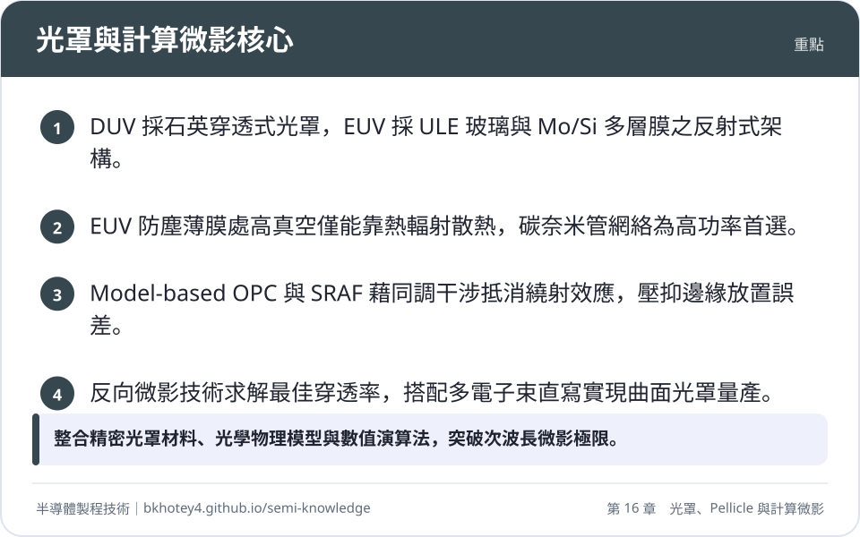
<figcaption>重點圖卡：光罩與計算微影核心</figcaption>
</figure>

<figure markdown>
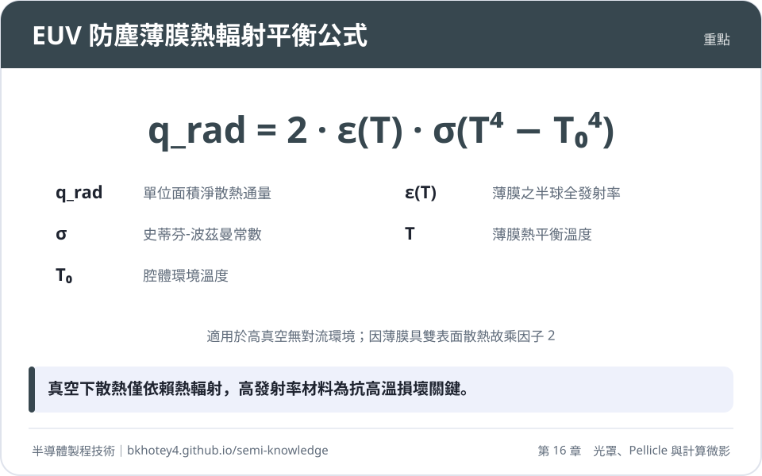
<figcaption>重點圖卡：EUV 防塵薄膜熱輻射平衡公式</figcaption>
</figure>

<figure markdown>
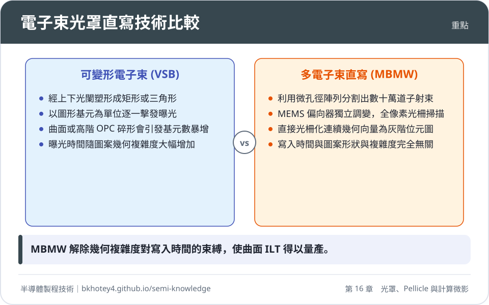
<figcaption>重點圖卡：電子束光罩直寫技術比較</figcaption>
</figure>

<figure markdown>
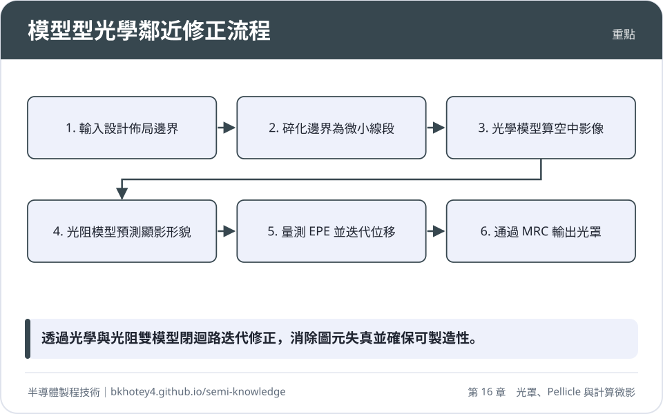
<figcaption>重點圖卡：模型型光學鄰近修正流程</figcaption>
</figure>

</div>

## 習題

**1.** 衰減型相位移光罩（att-PSM）使用矽化鉬氮氧化物（MoSi）作為移相材料。在 ArF 浸潤式微影系統中，曝光波長 $\lambda = 193.3\ \text{nm}$。若已知 MoSi 薄膜在該波長下的折射率 $n = 2.343$ 且消光係數極低，試計算：
(1) 欲使穿透光與純石英基板穿透光產生 $180^\circ$（即 $\pi\ \text{rad}$）相對相位差之最佳基態膜厚 $d$ 為多少奈米？
(2) 若薄膜製程沉積之實際厚度為 $68.5\ \text{nm}$，該誤差會造成多少度（Degree）的相位偏離？

??? success "參考解答"
    (1) 根據薄膜光學相移公式：
    $$\Delta \phi = \frac{2\pi}{\lambda}(n - 1)d = \pi$$
    解得基態最佳移相厚度 $d$ 為：
    $$d = \frac{\lambda}{2(n - 1)}$$
    代入數值：
    $$d = \frac{193.3\ \text{nm}}{2 \times (2.343 - 1)} = \frac{193.3}{2 \times 1.343} \approx 71.97\ \text{nm}$$
    最佳膜厚典型值約為 $72.0\ \text{nm}$。

    (2) 實際厚度 $d' = 68.5\ \text{nm}$ 時，實際相位差 $\Delta \phi'$ 為：
    $$\Delta \phi' = \frac{2\pi}{\lambda}(n - 1)d' = \frac{360^\circ}{193.3} \times (2.343 - 1) \times 68.5 \approx 171.33^\circ$$
    相位偏離量為：
    $$|\Delta \phi' - 180^\circ| = |171.33^\circ - 180^\circ| \approx 8.67^\circ$$
    因此會產生約 $8.67^\circ$ 的相位不足偏離。

**2.** EUV 微影系統的主光線入射角 $\text{CRAO} = 6^\circ$。在某一 EUV 反射式光罩中，吸收層圖案厚度為 $H = 58\ \text{nm}$。
(1) 試計算由吸收層高度引起之單側幾何陰影增寬量 $\Delta W_{\text{shadow}}$（以奈米為單位）。
(2) 若物鏡縮小倍率為 $4:1$（光罩對晶圓為 $4\times$ 縮小），在不考慮光學繞射模糊的前提下，該幾何陰影投影至晶圓端會造成多少奈米的尺寸偏移？並簡述先進光罩採用 High-$k$ 吸收層材料如何改善此問題。

??? success "參考解答"
    (1) 根據遮蔽效應幾何關係式：
    $$\Delta W_{\text{shadow}} = H \cdot \tan\theta$$
    代入數值：
    $$\Delta W_{\text{shadow}} = 58\ \text{nm} \times \tan(6^\circ) \approx 58 \times 0.1051 \approx 6.10\ \text{nm}$$
    光罩端的幾何陰影增寬量約為 $6.10\ \text{nm}$。

    (2) 微影光學物鏡具有 $4\times$ 縮小倍率，故晶圓端之名目幾何偏移為：
    $$\Delta W_{\text{wafer}} = \frac{\Delta W_{\text{shadow}}}{4} = \frac{6.10\ \text{nm}}{4} \approx 1.52\ \text{nm}$$
    改善機制：
    傳統 Ta-based 吸收層消光係數 $\beta$ 較低，需厚達約 $60\ \text{nm}$ 才能阻擋 EUV 光束。若導入高消光係數（High-$k$ / High-$\beta$）材料（如鈷 Co、鎳 Ni 基合金），吸收能力顯著提高，吸收層厚度 $H$ 可降低至 $30\ \text{nm}$ 以下。由公式可知陰影寬度 $\Delta W_{\text{shadow}}$ 與厚度 $H$ 成正比，薄化厚度能直接等比例減少遮蔽區域，大幅壓抑 H-V Bias 與非對稱像差。

**3.** 在高功率 EUV 曝光機中，高真空環境使防塵薄膜（Pellicle）無法進行氣體對流散熱，其徑向熱傳導至邊框之散熱量亦可忽略。設薄膜上下兩表面的半球全發射率均為 $\epsilon = 0.25$，周圍真空腔體環境溫度 $T_0 = 295\ \text{K}$，曝光時沈積於薄膜單位的淨吸收熱通量為 $q_{\text{absorbed}} = 1.25\ \text{W/cm}^2$。已知史蒂芬-波茲曼常數 $\sigma = 5.67 \times 10^{-8}\ \text{W}/(\text{m}^2\cdot\text{K}^4)$。
(1) 寫出薄膜熱輻射平衡方程式（計入薄膜雙面散熱）。
(2) 計算該薄膜在熱平衡狀態下的溫度 $T$（以攝氏度 ${}^\circ\text{C}$ 表示）。

??? success "參考解答"
    (1) 由於高真空無對流且忽略邊界徑向熱傳導，熱平衡時薄膜吸收之熱通量等於上下雙表面向環境輻射之淨熱通量：
    $$q_{\text{absorbed}} = 2 \cdot \epsilon \cdot \sigma \left( T^4 - T_0^4 \right)$$
    式中因子 2 代表薄膜正面與背面雙面熱輻射。

    (2) 將數值轉為 SI 國際標準單位：
    $$q_{\text{absorbed}} = 1.25\ \text{W/cm}^2 = 1.25 \times 10^4\ \text{W/m}^2$$
    $$\epsilon = 0.25, \quad T_0 = 295\ \text{K}$$
    代入方程式：
    $$1.25 \times 10^4 = 2 \times 0.25 \times (5.67 \times 10^{-8}) \times \left( T^4 - 295^4 \right)$$
    $$1.25 \times 10^4 = 2.835 \times 10^{-8} \times \left( T^4 - 7.57 \times 10^9 \right)$$
    $$T^4 - 7.57 \times 10^9 = \frac{1.25 \times 10^4}{2.835 \times 10^{-8}} \approx 4.409 \times 10^{11}$$
    $$T^4 \approx 4.409 \times 10^{11} + 7.57 \times 10^9 \approx 4.485 \times 10^{11}\ \text{K}^4$$
    求解絕對溫度 $T$：
    $$T = \left( 4.485 \times 10^{11} \right)^{1/4} \approx 818.1\ \text{K}$$
    轉換為攝氏度：
    $$T_{\text{Celsius}} = 818.1 - 273.15 \approx 544.95^\circ\text{C} \approx 545^\circ\text{C}$$
    薄膜在該熱負載下的熱平衡溫度約為 $545^\circ\text{C}$。

**4.** 何謂微影反向問題（Inverse Problem）？試從空間頻域濾波與微影物理極限的角度，闡明為何傳統基於邊緣的 Model-based OPC 會在次波長先進節點陷入瓶頸，而反向微影技術（ILT）能自發產生曲面次解析度輔助特徵（Curvilinear SRAF）？

??? success "參考解答"
    (1) **微影反問題之本質**：前向微影成像係光罩圖案經由有限數值孔徑（NA）的光學系統低通濾波後，照射於非線性光阻上的不可逆資訊截斷過程。微影反問題則是在給定最終晶圓目標圖形與已知系統傳輸特徵（如 TCC 矩陣與光阻化學閾值）下，逆向數值求解全域最佳光罩穿透率分佈之非線性、病態（Ill-posed）泛函尋優問題。

    (2) **Model-based OPC 的限制**：傳統 OPC 將電路邊緣分割成小線段，透過局域邊緣放置誤差（EPE）計算進行幾何外擴或內縮。當特徵尺寸遠小於曝光波長（低 $k_1$ 因子），繞射干涉極為劇烈且呈現強烈二維非線性耦合，邊緣啟發式微調極易陷入非凸空間的局部極小值（Local Minima）。此外，輔助特徵（SRAF）的擺放高度依賴人工經驗規則或離散網格約束，無法在緊湊複雜二維圖案中充分提供相位抵消。

    (3) **ILT 與曲面 SRAF 的生成原理**：ILT 透過變分法、伴隨狀態法（Adjoint State Method）或水準集法（Level-Set Method），在整個二維空間連續求解梯度。在目標函數驅動下，水準集隱式曲面能在遠離主圖案的背景區域「自發成核」並演化出任意非共形輪廓。曲面 SRAF 完美吻合波前的等相位連續分佈，消除了正交網格階梯帶來的高頻散射噪訊，在光強度不越過光阻感光閾值的前提下，達成最佳的相消干涉與製程視窗最大化。

**5.** 比較傳統可變形電子束（VSB）光罩直寫機與多電子束直寫機（MBMW）在曝光機制上的物理本質差異，並說明為何全晶片曲面反向微影技術（Curvilinear ILT）必須依賴 MBMW 才能具備半導體商業量產的可行性。

??? success "參考解答"
    (1) **VSB 與 MBMW 曝光機制差異**：
    - **VSB（可變形電子束）**：使用單一電子槍發射電子，利用兩組可動矩形光闌經偏折疊加成形為不同大小的矩形或直角三角形脈衝（Shots）。系統採向量式尋址曝光，曝光總時間與總射束擊發次數（Shot Count）成正比。
    - **MBMW（多電子束直寫機）**：將單一電子束經過 MEMS 微孔徑陣列分割為數十萬道平行子射束，每道子射束皆具備獨立的靜電 Blanker 進行開關調變。曝光採光柵掃描（Raster Scan）模式，工件台等速平移，所有射束同步逐像素調變劑量。

    (2) **曲面 ILT 量產可行性分析**：
    - 曲面 ILT 產生大量連續光滑曲線與不規則有機 SRAF。若採用 VSB 曝光，平滑曲線必須被細分成數以百億計的微小階梯矩形基元，造成基元數爆炸（Shot Count Explosion），單片光罩寫入時間可自十餘小時激增至數天，成本極高且容易發生機台熱漂移。
    - MBMW 在曝光前先將所有向量圖形點陣化（Rasterization）為像素陣列。其曝光時間僅由光罩總曝光面積、掃描速度與光阻所需劑量決定，**與幾何形貌之拓撲複雜度、曲線數量或多邊形頂點數完全無關**（維持恆定約 10 至 15 小時），因此能徹底釋放曲面 ILT 的圖形設計限制，奠定商業化量產基礎。

---

## 本章術語

- **Fused Silica / Synthetic Quartz**（合成石英玻璃）：高純度非晶態二氧化矽材料，具備高深紫外光穿透率與低熱膨脹係數，為 DUV 穿透式光罩之標準基板。
- **BIM**（二元光罩）：僅具備全透光（石英）與全遮光（鉻層）兩種狀態、僅調變光振幅之穿透式光罩。
- **att-PSM**（衰減型相位移光罩）：利用半透明材料（如 MoSi）使穿透光產生部分吸收（典型值 $6\%$）並伴隨 $180^\circ$ 相位反轉，利用破壞性干涉銳化圖案邊界的穿透式光罩。
- **alt-PSM**（交替型相位移光罩）：在相鄰石英透光區交替挖深以引入 $180^\circ$ 相位差，實質將圖樣空間頻率減半以突破阿貝極限之光罩技術。
- **DBR**（分散式布拉格反射器）：由兩種不同折射率材料（如 Mo 與 Si）交替沉積形成的多層週期性結構，利用界面菲涅耳反射光的同相疊加在 EUV 波段實現高反射率。
- **ULE Glass**（超低熱膨脹玻璃）：摻雜約 $7\text{ wt}\%$ 二氧化鈦的石英玻璃，在室溫附近熱膨脹係數趨近於零，用於 EUV 反射式光罩之基板。
- **CRAO**（物方主光線入射角）：微影曝光光線相對於光罩表面法線的傾斜入射角度，在 EUV 掃描機中典型值約為 $6^\circ$。
- **Shadowing Effect**（幾何遮蔽效應）：EUV 微影中因傾斜入射光照射具備有限厚度之吸收層側壁，在反射層上投射出非對稱陰影導致水平與垂直線寬失真的三維光罩效應。
- **Pellicle**（防塵薄膜）：懸浮安裝於光罩圖案面上方數公釐處的超薄透明薄膜，使外來沉降微粒維持於微影焦平面之外以避免缺陷轉印。
- **CNT Network Pellicle**（碳奈米管網絡防塵薄膜）：由無規纏結奈米碳管構成的多孔網狀薄膜，具備高 EUV 穿透率、耐極端高溫與黑體等級熱輻射發射率之先進防塵薄膜。
- **OPE**（光學鄰近效應）：微影中因投影物鏡有限孔徑截止高頻繞射光波，造成晶圓曝光圖形產生拐角圓化、線端縮短及線寬隨間距漂移之失真現象。
- **Rule-based OPC**（基於規則之光學鄰近修正）：依據經驗量測表格與幾何規則，對佈局直接添加襯線、鎚頭或均勻偏置的早期幾何補償技術。
- **Model-based OPC**（基於模型之光學鄰近修正）：結合 Hopkins 部分同調成像光學模型與光阻/蝕刻製程模型，透過數值迭代演算法移動碎化邊緣以消除 EPE 的修正技術。
- **Hopkins Model**（霍普金斯成像模型）：基於傳輸交叉係數（TCC）描述部分同調成像光學系統中光源孔徑、物鏡光瞳與光罩傅立葉頻譜交互作用之非線性物理積分方程。
- **SOCS**（同調系統之和）：利用奇異值分解將四維 TCC 核心分解為有限項二維特徵卷積核心線性相加之數值演算法，大幅加速空中影像模擬。
- **SRAF**（次解析度輔助特徵）：尺寸小於曝光解析極限而不被顯影印出的光罩微細輔助線條，專門用於調控干涉繞射場並擴大焦點深度與製程視窗。
- **EPE**（邊緣放置誤差）：晶圓微影模擬或實測幾何邊緣與原始晶片電路設計目標邊界之間的空間幾何偏差量。
- **MRC**（光罩規則檢查）：為確保光罩在實體製造時能被電子束光罩寫入機精準曝光並兼顧良率，針對最小線寬、間距與碎化台階所設立的幾何設計規則限制。
- **ILT**（反向微影技術）：將微影成像視為嚴格數學反問題，利用全域數值尋優（如伴隨狀態法或水準集法）直接逆向求解最佳光罩連續空間穿透率分佈之計算微影技術。
- **Curvilinear Mask**（曲面光罩）：擺脫傳統曼哈頓正交折角幾何限制，具備任意光滑流線連續邊緣之先進光罩圖案技術。
- **VSB**（可變形電子束）：利用可動光闌將單一電子束調製為不同尺寸矩形或三角形脈衝、逐一發射拼接曝光之傳統電子束直寫技術。
- **MBMW**（多電子束直寫機）：利用微孔徑陣列將單一電子源分割為數十萬道獨立調變微子束並進行連續光柵掃描曝光之光罩寫入設備，其寫入時間與幾何圖形複雜度無關。
- **AIMS**（空中影像量測系統）：光學數值孔徑、偏振與照明條件完全仿真實體微影掃描機之特製顯微光學系統，用於評估光罩微小缺陷在晶圓端的實際成像影響。
- **Actinic Inspection**（光化波長檢測）：直接採用與微影系統相同之 $13.5\text{ nm}$ EUV 光源進行光罩檢測之技術，能有效檢測出深層多層膜埋入式相位缺陷並穿透防塵薄膜進行檢視。
- **EBID / EBIE**（電子束引發沉積 / 電子束引發蝕刻）：在真空腔體中聚焦電子束激發反應前驅氣體，於光罩表面奈米區域局部沉積遮光材料或揮發蝕刻多餘圖案的非破壞性光罩修補技術。


## 互動學習

!!! tip "動手試試看"
    - [設備機台圖鑑：光罩檢測機](../equipment.md)

<div class="quiz" data-quiz="03-06"></div>


## 產業最新進展

本節由每日產業新聞自動補充，說明本章技術在產業上的最新發展。

<!-- updates -->
（目前尚無補充。）
