# 第 17 章　疊對與微影量測

!!! abstract "學習目標"
    - 理解疊對誤差（Overlay Error）的定義、物理來源與晶圓級／曝光場級誤差分解模型
    - 掌握晶圓對準原理、繞射對準標記幾何設計及製程引致不對稱性對對準訊號的影響
    - 比較影像式疊對（IBO）與繞射式疊對（DBO）的量測物理機制、標記結構與光學訊號處理特性
    - 闡明高階製程控制（APC）中動態回授與前饋補償的數學模型與控制迴路運作機制
    - 解析先進微影量測設備之控制主機與運算伺服器分離的雙主機硬體架構及即時數值重構技術

## 17.1 疊對誤差定義與物理來源

### 17.1.1 疊對誤差之數學定義

在積體電路（IC）的多層製造過程中，每一層圖案必須精確地放置在上一層圖案的預定位置上。疊對（Overlay, OVL）即是指當前製程層（Current Layer）與參考層（Reference Layer，通常為前一關鍵層）之間的橫向對準精度。

若以二維平面座標系統表示，疊對誤差是一個向量場，定義為當前層圖案中心座標 $(x_{cur}, y_{cur})$ 與參考層圖案中心座標 $(x_{ref}, y_{ref})$ 之間的位移向量 $\vec{\Delta}$：

$$\vec{\Delta} = (\Delta x, \Delta y) = (x_{cur} - x_{ref}, y_{cur} - y_{ref})$$

在理想製程下，$\vec{\Delta}$ 應趨近於零。然而，由於光學系統、機械定位與材料應力的限制，晶圓上各點均存在不同程度的偏移。疊對量測的目標即是透過量測特定位置的對準標記（Alignment Marks），推算出整片晶圓的誤差分布，並進行補償。

### 17.1.2 邊緣置放誤差（EPE）與疊對預算

隨著半導體製程進入 7 奈米及更先進節點，單純考慮關鍵尺寸（Critical Dimension, CD）或疊對誤差已不足以描述圖案失效的風險。業界引入了「邊緣置放誤差」（Edge Placement Error, EPE）作為更全面的評估指標。

EPE 定義為設計圖案邊緣與實際製造圖案邊緣之間的空間偏差。其構成要素可簡化表示為：

$$EPE = \sqrt{\left(\frac{1}{2} CD_{error}\right)^2 + (Overlay_{error})^2 + (OPC_{error})^2 + LER^2}$$

其中：
*   $CD_{error}$：關鍵尺寸均勻性誤差。
*   $Overlay_{error}$：疊對誤差。
*   $OPC_{error}$：光學鄰近修正（Optical Proximity Correction）殘差（見第 16 章）。
*   $LER$：線邊緣粗糙度（Line Edge Roughness）。

在先進製程的「疊對預算」（Overlay Budget）分配中，疊對誤差通常被要求控制在最小金屬線距（Pitch）的 10% 至 15% 以內。例如，在 5 奈米節點中，疊對誤差的典型值需控制在 1.5 nm 至 2.0 nm 以下，這對量測設備與曝光機（Scanner）的定位精度提出了極高要求。

### 17.1.3 機台端誤差來源（Scanner-Induced Errors）

曝光機作為圖案轉移的核心設備，其內部的物理限制是疊對誤差的主要來源，可分為以下三個面向：

#### 1. 晶圓載台六自由度定位誤差
晶圓載台（Wafer Stage）在曝光過程中需進行高速掃描運動。雖然採用雷射干涉儀（Laser Interferometer）或編碼器進行閉迴路控制，但仍存在六個自由度（6-DOF：$X, Y, Z, \theta_x, \theta_y, \theta_z$）的動態殘差。
*   **平移與旋轉誤差**：載台加速與減速過程中的微小震動。
*   **垂直向位移（Z-axis）**：若載台在 Z 方向偏離焦距平面，會透過光學投影系統引起橫向的圖案偏移（即 Telecentricity 誤差）。

#### 2. 光學鏡頭動態像差
如第 12 章所述，投影鏡頭（Projection Lens）並非完美。在連續曝光過程中，鏡頭會吸收紫外光能量導致熱形變，產生動態像差（Dynamic Aberration）。
*   **畸變（Distortion）**：鏡頭倍率在場域內不均勻，導致圖案產生枕形或桶形失真。
*   **加熱效應（Lens Heating）**：隨著曝光片數增加，鏡頭折射率微幅改變，造成曝光場（Field）的縮放誤差。

#### 3. 光罩傳遞形變
光罩（Reticle）端的誤差會按縮小倍率（典型值為 4:1）投影至晶圓。
*   **光罩平坦度**：光罩吸附於載台時的微小彎曲。
*   **光罩加熱**：在 EUV 微影中（見第 14 章），由於光罩反射率僅約 70%，其餘能量轉化為熱能，導致光罩產生局部熱膨脹（Thermal Expansion）。

### 17.1.4 製程端引致誤差（Process-Induced Errors）

除了曝光機本身的精度外，晶圓在經過多道化學與物理處理後，其幾何形態會發生改變，進而影響疊對。

#### 1. 薄膜應力與晶圓翹曲
在沉積（CVD/PVD，見第 21、22 章）高應力薄膜（如氮化矽或金屬層）後，晶圓會產生整體性的翹曲（Warpage）或弓曲（Bow）。當晶圓被真空吸附於曝光載台時，這些非線性的應力會轉化為面內的位移（In-plane Displacement, IPD），造成對準困難。

#### 2. 熱預算與非均勻膨脹
製程中的高溫步驟（如快速熱退火，見第 27 章）若存在溫度梯度，會導致晶圓產生永久性的塑性變形，這種變形通常是非線性的，且在晶圓邊緣尤為嚴重。

#### 3. 對準標記的不對稱形變
這是先進製程中最棘手的問題。在化學機械研磨（CMP，見第 24 章）或乾式蝕刻（見第 19 章）過程中，位於底層的對準標記可能會發生「流失」（Erosion）或「傾斜」（Tilting）。
*   **CMP 效應**：由於材料硬度差異，標記邊緣可能出現不對稱的磨損，導致量測系統偵測到的標記中心與幾何中心發生偏移（Mark Shift）。

!!! warning "常見誤解"
    工程師常認為疊對誤差僅由曝光機決定。事實上，隨著製程演進，由 CMP 與薄膜應力引起的「製程引致疊對誤差」（Process-Induced Overlay Error）已佔總誤差預算的 40% 以上，必須透過製程整合優化來解決。

### 17.1.5 誤差分量分解：晶圓級與曝光場級

為了有效修正誤差，必須將量測到的原始數據（Raw Data）透過數學模型分解為不同的物理分量。通常分為「晶圓級」（Inter-field / Grid）與「曝光場級」（Intra-field）兩類。

#### 1. 晶圓級誤差（Inter-field Errors）
描述整片晶圓在載台上放置的位置誤差，影響所有曝光場的共同位移。
*   **平移（Translation, $T_x, T_y$）**：晶圓整體的 X-Y 偏移。
*   **旋轉（Rotation, $R_z$）**：晶圓相對於載台座標系的旋轉。
*   **擴張/收縮（Expansion, $E_x, E_y$）**：晶圓因熱漲冷縮導致的整體尺寸變化。

#### 2. 曝光場級誤差（Intra-field Errors）
描述單一曝光場內部的圖案失真，通常與掃描路徑及鏡頭特性有關。
*   **場內縮放（Magnification）**：單一曝光場的大小變化。
*   **場內旋轉（Field Rotation）**：掃描過程中光罩與晶圓運動不對稱。
*   **正交偏誤（Orthogonality）**：X 軸與 Y 軸不垂直導致的平行四邊形形變。
*   **高階非線性形變（High-Order Errors）**：由局部應力或複雜像差引起，需使用高階多項式（如 3 階或 5 階）進行擬合。

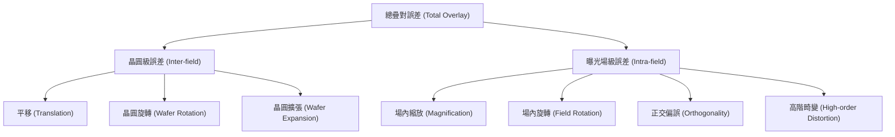

#### 3. 數學擬合模型
最基礎的線性模型（六參數模型）可表示為：
$$dx = T_x + E_x \cdot x - R_w \cdot y$$
$$dy = T_y + E_y \cdot y + (R_w + \phi) \cdot x$$

其中 $x, y$ 為晶圓座標，$T$ 為平移，$E$ 為擴張，$R_w$ 為晶圓旋轉，$\phi$ 為正交偏誤。在現代製程控制中，會使用更複雜的「進階座標修正」（Advanced Coordinate Correction, ACC）模型，納入數十個高階參數以匹配非線性形變。

!!! note "說明"
    在多重圖案化（Multiple Patterning，見第 13 章）製程中，疊對誤差的控制更為複雜。例如在 LELE（Litho-Etch-Litho-Etch）流程中，第二層光阻必須精確對準第一層蝕刻後的圖案，這涉及到不同機台之間的配對（Machine-to-Machine Matching）誤差，是良率控制的核心挑戰。

## 17.2 晶圓對準原理與對準標記

### 機台內原位對準與微影後離線量測之架構分工

在微影製程中，疊對控制（Overlay Control）分為兩大互補的階段：曝光機台內部執行的「原位對準」（In-situ Alignment），以及曝光顯影後於專用微影量測機台上進行的「離線量測」（Ex-situ Metrology）。兩者在測量原理、時間節點與控制目標上有著明確的分工。

```mermaid
flowchart TD
    A["晶圓進片至曝光機 (Scanner)"] --> B["原位對準 (In-situ Alignment)<br/>即時偵測晶圓標記相位與網格形變"]
    B --> C["即時座標轉換與動態補償<br/>(Wafer Grid & Reticle Stage Correction)"]
    C --> D["曝光與顯影製程 (Litho & Dev)"]
    D --> E["離線疊對量測 (Ex-situ Metrology)<br/>YieldStar / 影像式量測 (DBO / IBO)"]
    E --> F["高階數學模型解析與 APC 系統"]
    F -->|進階製程控制回饋 (Feedback) 更新校正參數| B
    F -->|判斷殘餘誤差 (Rework Check)| G{"殘餘誤差是否超標?"}
    G -- 是 --> H["去光阻重工 (Rework)"]
    G -- 否 --> I["進入蝕刻/離子佈植製程"]
```

原位對準是指晶圓載入微影曝光機（Scanner）之晶圓基台（Wafer Stage）後、進行圖案曝光前所執行的即時物理對焦與尋標程序。曝光機內部配置高精度的光學感測系統，透過掃描晶圓切割道（Scribe line）預留的對準標記，量測當前晶圓相對於光罩基台（Reticle Stage）的六個自由度空間座標（$X, Y, Z, \theta_x, \theta_y, \theta_z$），並補償晶圓因夾持應力或前段熱製程引起的整體網格幾何形變（Wafer Grid Distortion）。此步驟的特點是速度快（全晶圓數十至數百點對準需在數秒內完成），但其量測訊號極易受標記上方沉積的透光或半透光薄膜層干擾。

離線量測則是在光阻顯影完成後（After-Development Inspection, ADI）或蝕刻後（After-Etching Inspection, AEI），將晶圓移出微影曝光路徑，置於專屬光學疊對量測儀（如繞射式或影像式量測設備）中，專門檢測「當前光阻層」與「底層參考層」之間的真實相對位移。離線量測具備極高的光譜解析力與複雜的電磁散射重構能力，其取得的殘留誤差數據會回傳至進階製程控制系統（Advanced Process Control, APC，見第 54 章），轉化為下一批次曝光機原位對準的偏移補償係數（Offsets）。

---

### 繞射光柵標記之幾何設計

現代微影原位對準全面採用繞射光柵標記（Diffraction Grating Marks），取代了早期微影使用的幾何邊緣尋找標記（如 Chevron 或交叉十字標記）。光柵標記由週期性排列的線條與溝槽組成，其幾何配置必須兼顧繞射效率、空間佔用率以及製程抗變形能力。

#### 1. 週期性線寬結構與多節距標記
對準光柵的空間週期稱為節距（Pitch, 以 $P$ 表示）。依據繞射光學原理，特定波長之照明光入射後，各階次繞射角 $\theta_m$ 由光柵方程式決定：

$$\sin \theta_m = \sin \theta_i + m \frac{\lambda}{P}$$

其中 $\theta_i$ 為入射角，$m \in \mathbb{Z}$ 為繞射階次，$\lambda$ 為照明波長。

為了兼顧對準範圍（Capture Range）與對準精確度（Alignment Accuracy），先進標記多採用「多節距設計」（Multi-pitch Mark Design）。大節距（例如 $P = 16\ \mu\text{m}$）具有較大的光學空間擷取範圍，可容忍初期的微米級機械誤差，用於晶圓的粗對準（Coarse Alignment）；小節距（例如 $P = 0.8\ \mu\text{m} \sim 3.2\ \mu\text{m}$）則具有較高角解析度與相位靈敏度，用於奈米級的細對準（Fine Alignment）。

#### 2. 相位對稱性要求
理想光柵標記在空間幾何上必須具備嚴格的反射對稱性（Inversion Symmetry）。若以光柵中心為座標原點 $x = 0$，其空間反射率分佈 $R(x)$ 必須滿足：

$$R(x) = R(-x)$$

當照明光垂直入射時，理想標記所產生的對稱正負階次繞射光（如 $+m$ 階與 $-m$ 階），其振幅與相位應嚴格相等：

$$E_{+m} = |E_m| e^{i \phi_m}, \quad E_{-m} = |E_m| e^{-i \phi_m}$$

此對稱性是消除光學系統系統性誤差的核心假設。若製程造成標記幾何外形變形，破壞了 $R(x) = R(-x)$ 的空間對稱性，正負階次的相位平衡即被打破，進而引發對準虛假位移。

---

### 離軸光學對準系統與自參考干涉儀

為避免佔用主微影透鏡（Projection Optics Box, POB）的曝光空間與數值孔徑，現代曝光機普遍採用「離軸光學對準系統」（Off-axis Alignment System）。該系統獨立安裝於微影投影物鏡旁，其內部核心包含多波長同調照明光源與自參考干涉儀（Self-referencing Interferometer, SRI）。

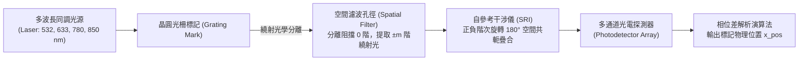

#### 1. 同調多波長照明
對準系統採用多組不同波長的同調雷射或窄頻光源（典型值包含綠光 $532\ \text{nm}$、紅光 $633\ \text{nm}$、近紅外光 $780\ \text{nm}$ 與 $850\ \text{nm}$），並支援偏振態控制（橫電波 TE 與橫磁波 TM）。多波長照明的目的在於抵抗後續章節提及的薄膜干涉消光現象；當某一波長因薄膜厚度產生破壞性干涉而訊號微弱時，其他波長仍能維持足夠的反射光強。

#### 2. 自參考干涉儀偵測原理
當同調光束垂直照射於晶圓光柵標記時，光柵產生反射繞射光束群。系統透鏡收集這些散射光，並在光瞳面（Pupil Plane）放置空間濾波器阻擋強度過大且不含位置相位資訊的零階（$0^{\text{th}}$ order）直接反射光，僅容許對稱的 $\pm m$ 階（例如 $\pm 1, \pm 3, \pm 5, \pm 7$ 階）繞射光通過。

自參考干涉儀的構造通常採用稜鏡光學系統，將入射的繞射光場複製為兩束，並將其中一束光場在空間維度旋轉 $180^\circ$，再與未旋轉的光場進行疊加干涉。設標記相對於對準系統光軸偏移了距離 $\Delta x$，則 $+m$ 階與 $-m$ 階繞射光攜帶的幾何相位差分別為：

$$\phi_{+m} = 2\pi m \frac{\Delta x}{P}, \quad \phi_{-m} = -2\pi m \frac{\Delta x}{P}$$

在干涉儀輸出端，兩束反向旋轉的光波產生干涉疊合，其合成光強 $I_m(\Delta x)$ 與標記位移呈現直接的週期餘弦函數關係：

$$I_m(\Delta x) \propto 1 + V_m \cos\left( \phi_{+m} - \phi_{-m} \right) = 1 + V_m \cos\left( \frac{4\pi m \Delta x}{P} \right)$$

其中 $V_m$ 為該階次之干涉對比度（Visibility）。

| 繞射階次 ($m$) | 相位週期變化敏感度 ($4\pi m / P$) | 主要應用效益 | 潛在物理風險 |
| :--- | :--- | :--- | :--- |
| **第 $\pm 1$ 階** | 基準靈敏度（$1\times$） | 訊號強度高、動態範圍大，能適應表面粗糙度高的金屬層 | 空間對位解析度較低，受標記邊緣磨損影響大 |
| **第 $\pm 3$ 與 $\pm 5$ 階** | 高靈敏度（$3\times$ 至 $5\times$） | 壓制長波長幾何非對稱性，訊號相位變化更劇烈，定址精確度高 | 繞射光強隨階次呈非線性衰減，訊噪比（SNR）較低 |
| **第 $\pm 7$ 階以上** | 極高靈敏度（$\ge 7\times$） | 對微小奈米級邊界位移具備最高靈敏度，適用於邏輯先進節點 | 訊號極易受金屬晶粒散射與薄膜厚度不均勻性干擾而失真 |

藉由光電探測器量測干涉光強隨機台掃描載台動態移動的強度波形，經由傅立葉轉換（Fourier Analysis）即可解讀出純淨的相位差 $\Delta \Phi = \phi_{+m} - \phi_{-m}$，進而反推出標記的絕對中心位置 $\Delta x$。透過高階繞射階次（$m \ge 3$）的解算，可顯著抑制基底表面顆粒感所造成的雜訊，達到次奈米（Sub-nanometer）等級的對準重複精度。

---

### 薄膜干涉與製程劣化效應

在理想狀態下，光學對準系統能精確求得光柵標記的中心。然而在真實積體電路製造中，標記經歷多道沉積、研磨與蝕刻步驟後，其光學反射對比度與幾何結構均會發生嚴重劣化。

#### 1. 多層薄膜干涉與消光對比衰減
標記製作完成後，上方通常會覆蓋多層介電層（如 $\text{SiO}_2$、$\text{Si}_3\text{N}_4$ 或 Low-$k$ 材料）與光阻層。依據薄膜光學原理，光束在多層介電質堆疊介面會產生多重反射與折射，反射係數由傳輸矩陣法（Transfer Matrix Method, TMM）給定。

當某一層或整體薄膜堆疊的有效光學厚度 $n d$（$n$ 為折射率，$d$ 為物理厚度）恰好滿足破壞性干涉條件：

$$2 n d \cos \theta_t = \left( k + \frac{1}{2} \right) \lambda \quad (k \in \mathbb{N}_0)$$

（其中 $\theta_t$ 為薄膜內的折射角），垂直反射率將趨近於零。此時入射照明光無法自標記表面有效反射，產生光學對比衰減（Contrast Fading）甚至消光（Extinction）現象。

!!! note "光學消光對策：多光譜加權"
    若單一波長遭遇薄膜消光，干涉訊號對比度 $V_m$ 降至雜訊邊限以下，系統便無法辨識標記位置。為此，離軸對準系統會在曝光前對多種波長與偏振態進行全面掃描，計算各通道的訊噪比與訊號強度，動態選擇或加權最佳波長組合（Color/Polarization Recipe Optimization）進行信號重構。

#### 2. 製程幾何不對稱引致之標記偏移（Mark Shift）
除了光學干涉效應，後續製程帶來的物理形變更具破壞性。前段與後段製程常見的兩大形變來源為：

1. **化學機械研磨（CMP）引起的非對稱侵蝕（Erosion）與碟陷（Dishing）**：CMP 研磨墊（Polishing Pad）在晶圓表面施加單向旋轉切線剪切力，導致光柵溝槽的前側邊緣與後側邊緣受到非對稱的應力擠壓，形成邊緣塌陷傾斜的不對稱輪廓。
2. **物理氣相沉積（PVD）的非對稱陰影效應（Shadowing Effect）**：金屬濺鍍沉積時，靶材原子入射角相對於晶圓邊緣具備幾何傾角，造成光柵溝槽左側壁與右側壁的金屬薄膜沉積厚度不一致。

```
製程不對稱導致之標記幾何中心偏移示意：

        理想對稱標記                       製程劣化標記 (CMP/PVD 不對稱)
       |---|     |---|                         /--|     /--|
       |   |     |   |                        /   |    /   |
   ____|   |_____|   |____                ___/    |___/    |____
             ^                                      ^       ^
        幾何物理中心                           幾何物理中心 光學對準中心
                                                    |<----->|
                                                 表觀量測誤差 (Mark Shift)
```

當光柵側壁輪廓發生傾斜時，左右側壁的相位分佈失去反轉對稱性，使得光柵各階次反射電場附加了非對稱相位項 $\Delta \psi_{\text{asym}}$：

$$\phi_{+m} = 2\pi m \frac{\Delta x}{P} + \Delta \psi_{\text{asym}}, \quad \phi_{-m} = -2\pi m \frac{\Delta x}{P} - \Delta \psi_{\text{asym}} + \delta_{\text{phase}}$$

此時自參考干涉儀所量測到的相位平衡中心，將偏離標記底部的真實幾何物理中心。此偏差量稱為「標記偏移」（Mark Shift）或「製程引致不對稱誤差」（Process-Induced Mark Asymmetry）。

!!! warning "常見誤解：對準訊號強度愈強，對準疊對誤差愈小"
    工程實務中常見的誤解是「對準系統讀取到的光強訊噪比（SNR）高，即代表對準結果精準」。事實上，強烈的不對稱沉積（如均勻傾斜但膜厚極厚的金屬膜）可能產生極高對比度且穩定的繞射光強，但其解算出的相位中心與元件真實關鍵圖形（Active Layout）的實際物理中心存在數奈米（nm）的系統性偏差。高訊號強度僅代表量測的「重複精度」（Precision）良好，並不代表對準的「真實準確度」（Accuracy）。

為消除製程不對稱帶來的系統性 Mark Shift，除了仰賴微影量測工程師開發具備應力釋放結構的細分標記（Segmented Marks），更必須透過第 17.3 節所述之微影後繞射式疊對量測（DBO），藉由嚴格耦合波分析（RCWA）反演不對稱輪廓模型，並透過第 17.4 節的 APC 系統進行高階閉迴路補償。

<!-- fig:1 -->
<figure markdown>
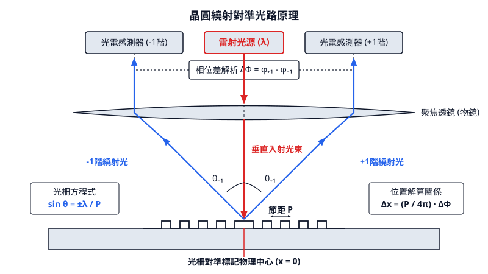
<figcaption>圖 17-1　晶圓繞射對準光路原理（AI 繪製的示意圖）</figcaption>
</figure>

## 17.3 影像式與繞射式疊對量測

在微影製程中，確保當前圖案層（Current Layer）與前置層（Previous Layer）精確對準是良率控制的核心。隨著元件特徵尺寸縮小至奈米等級，疊對（Overlay）誤差的容許值已縮減至數奈米以內。為了達成此精確度，量測技術從傳統的影像式演進至繞射式，並結合強大的運算伺服器進行即時分析。

### 17.3.1 影像式疊對量測（Image-Based Overlay, IBO）

影像式疊對量測（IBO）是利用高倍率光學顯微成像系統，直接拍攝位於晶圓切割道（Scribe line）上的特定標記，並透過影像處理演算法計算兩層圖案之間的中心偏移量。

#### 1. 標記結構：從盒中盒（BiB）到先進微影成像（AIM）
最基礎的 IBO 標記為「盒中盒」（Box-in-Box, BiB）結構。其原理是在底層（如第一層金屬層）定義一個較大的正方形（Outer Box），並在當前層（如光阻層）定義一個較小的正方形（Inner Box）。理論上，若兩層完全對準，小盒應精確位於大盒的正中央。

然而，BiB 結構在現代製程中面臨挑戰，主要在於其對化學機械研磨（CMP, 見第 24 章）導致的圖案不對稱極為敏感。為了提升信噪比（Signal-to-Noise Ratio, SNR），業界開發了「先進微影成像」（Advanced Imaging Metrology, AIM）標記。AIM 標記不再使用實心方塊，而是由多組細分的光柵條（Segmented bars）組成。這種設計能模擬實際元件的圖案密度，使其在 CMP 製程後的形貌更接近真實元件，減少量測偏差。

#### 2. 影像處理與邊緣偵測演算法
IBO 的核心在於對稱中心（Center of Symmetry）的尋找。量測設備捕捉到標記影像後，會執行以下步驟：
1. **數位化影像**：將光學影像轉換為像素矩陣。
2. **邊緣偵測**：利用梯度算子（如 Sobel 算子）或擬合函數（如 Error Function）定位標記邊緣。
3. **中心計算**：設底層標記左右邊緣座標分別為 $X_{L,1}$ 與 $X_{R,1}$，當前層標記邊緣為 $X_{L,2}$ 與 $X_{R,2}$。兩層的中心座標分別為：
   $$X_{C,1} = \frac{X_{L,1} + X_{R,1}}{2}, \quad X_{C,2} = \frac{X_{L,2} + X_{R,2}}{2}$$
   疊對偏移量（Overlay Offset）即為：
   $$\text{OVL}_x = X_{C,2} - X_{C,1}$$

#### 3. 誤差來源：TIS 與 WIS
IBO 的量測精度受限於光學系統的非理想性與晶圓本身的物理變形：
*   **機台引致誤差（Tool Induced Shift, TIS）**：源於量測設備光學路徑的不對稱或鏡頭像差（Aberration）。校準 TIS 的標準方法是將晶圓旋轉 180 度後重新量測。理論上，旋轉後的量測值應與原值互為相反數，若存在偏差，則定義為 TIS：
    $$\text{TIS} = \frac{\text{OVL}_{0^\circ} + \text{OVL}_{180^\circ}}{2}$$
*   **晶圓引致誤差（Wafer Induced Shift, WIS）**：源於製程造成標記形貌的不對稱。例如，在物理氣相沈積（PVD, 見第 22 章）過程中，金屬原子以特定角度入射，可能導致標記單側堆疊較厚；或 CMP 造成的「碟型下凹」（Dishing）效應。WIS 會導致影像邊緣偏移，產生虛假的疊對數值。

### 17.3.2 繞射式疊對量測（Diffraction-Based Overlay, DBO）

當製程節點進入 7nm 以下，IBO 受限於光學繞射極限（Diffraction Limit），其量測重複精度（Precision）已難以滿足需求。繞射式疊對量測（DBO）應運而生，它不直接成像，而是觀測標記產生的繞射光譜。

#### 1. 繞射標記與光瞳面量測
DBO 標記由兩組重疊的光柵組成：底層光柵（Bottom Grating）與頂層光柵（Top Grating）。當入射光束照射於此重疊結構時，反射光會產生干涉效應。DBO 設備（如散射儀，Scatterometer）量測的是光瞳面（Pupil Plane）上的強度分佈，而非實體空間的影像。

#### 2. 物理原理與強度差分推導
DBO 的核心物理機制是利用「不對稱性」來推算偏移。考慮一對具有預設偏移量（Pre-programmed bias）的標記。當疊對誤差為 $\epsilon$ 時，總偏移量為 $s = \text{bias} + \epsilon$。

根據繞射理論，正一階（$+1$ order）與負一階（$-1$ order）繞射光的強度差 $\Delta I = I_{+1} - I_{-1}$ 與疊對偏移量在小範圍內呈線性關係：
$$\Delta I \approx K \cdot \sin\left(\frac{2\pi \cdot \text{OVL}}{P}\right)$$
其中：
*   $K$ 為與材料、波長相關的靈敏度係數。
*   $P$ 為光柵週期（Pitch）。
*   $\text{OVL}$ 為總偏移量。

在實際應用中，通常使用「雙標記法」，即在晶圓上設計兩個預設偏移量互為正負的標記（例如 $+d$ 與 $-d$）。透過量測這兩個標記的強度差 $\Delta I_{+d}$ 與 $\Delta I_{-d}$，可以消除 $K$ 值的影響，精確解算出疊對誤差 $\epsilon$：
$$\epsilon = d \cdot \frac{\Delta I_{+d} + \Delta I_{-d}}{\Delta I_{+d} - \Delta I_{-d}}$$

#### 3. 嚴格耦合波分析（RCWA）
對於結構複雜的標記（如 3D NAND 的深孔結構），簡單的線性模型不再適用。此時需引入「嚴格耦合波分析」（Rigorous Coupled-Wave Analysis, RCWA）。RCWA 是一種數值模擬方法，透過解麥克斯威方程組（Maxwell's Equations），將量測到的繞射光譜與預先建立的理論數據庫（Library）進行比對，從而反推（Reconstruction）出精確的疊對值與關鍵尺寸（CD）。

### 17.3.3 IBO 與 DBO 之比較

IBO 與 DBO 各有優劣，先進製程通常採取兩者並行的策略。

| 特性 | 影像式疊對 (IBO) | 繞射式疊對 (DBO) |
| :--- | :--- | :--- |
| **量測原理** | 實體空間顯微成像 | 頻率空間繞射光譜分析 |
| **標記尺寸** | 較大（典型值 $10 \sim 20 \mu m$） | 較小（典型值 $< 10 \mu m$） |
| **重複精度** | 較差（奈米級） | 極佳（次奈米級，$< 0.1 nm$） |
| **量測速度** | 較快 | 較慢（需複雜運算） |
| **抗干擾能力** | 對光學像差敏感 | 對製程變異（如膜厚波動）敏感 |
| **適用節點** | 成熟製程、粗略對準 | 先進製程（7nm 以下）、精密控制 |

!!! note "說明"
    雖然 DBO 在精度上具有絕對優勢，但其對薄膜厚度與光學參數（n, k 值）的波動極為敏感。若底層薄膜厚度不均，會導致繞射效率改變，進而產生量測誤差。因此，在開發新製程時，通常先用 IBO 建立基準，再切換至 DBO 進行量產監控。

### 17.3.4 量測設備架構：控制與運算的物理分離

在先進微影量測設備中，為了處理 DBO 產生的大量光譜數據並執行 RCWA 模擬，機台架構採用了「控制」與「運算」分離的雙主機設計。

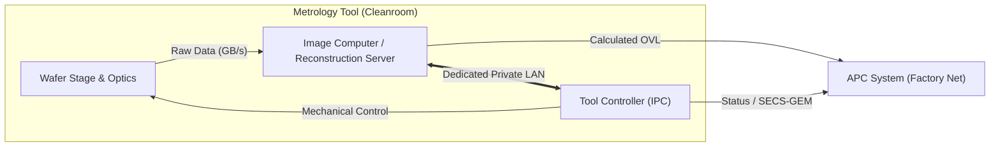

1.  **機台主控電腦 (Tool Controller/IPC)**：運行即時作業系統（RTOS，如 VxWorks），負責晶圓傳送、真空系統互鎖與精密位移控制。其核心任務是確保機台運作的穩定性與確定性。
2.  **運算伺服器 (Reconstruction Server)**：通常為外掛的高效能 Linux 伺服器，配置多核心處理器（如 AMD EPYC 或 Intel Xeon）與大量記憶體。其專門負責消化每秒數十 GB 的光學原始數據，執行 D2D（Die-to-Die）像素比對或麥克斯威方程組的數值模擬。

!!! example "產業實例"
    ASML 的 YieldStar 繞射量測機台即配備了專用的「光學繞射重構伺服器」（Reconstruction Server）。當機台光學頭掃描晶圓時，原始光譜數據透過專用的 10G/40G 光纖私有網路傳輸至伺服器。伺服器利用 RCWA 演算法在數毫秒內將光學信號轉化為奈米級的疊對偏移值，隨後回傳給機台主控電腦，並上報至工廠的自動製程控制（APC）系統。

這種分離式架構能避免高強度的數值運算佔用機台控制資源，確保在執行複雜數學模型時，機台的機械吞吐量（Throughput）不受影響。

<!-- fig:2 -->
<figure markdown>
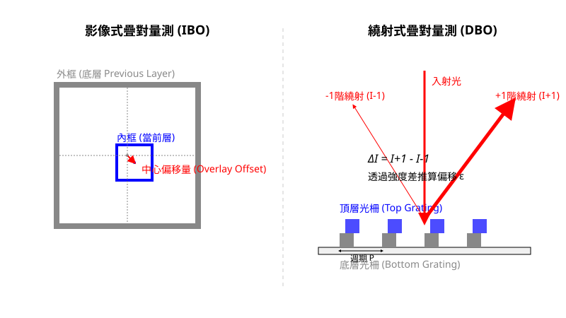
<figcaption>圖 17-2　影像與繞射疊對標記（AI 繪製的示意圖）</figcaption>
</figure>

## 17.4 疊對數學模型與先進製程控制

### 線性疊對模型與座標幾何展開

在微影製程中，疊對誤差（Overlay Error）定義為晶圓上當前曝光層圖案相對於底層既有圖案在水平面上的位置偏差向量 $(\Delta x, \Delta y)$。由於步進掃描機（Step-and-Scan System，簡稱 Scanner）的曝光行為是由「晶圓載台（Wafer Stage）之步進移動」與「光罩載台（Reticle Stage）配合投影透鏡之動態掃描」複合而成，疊對誤差在幾何上天然地被拆解為兩大尺度空間：晶圓尺度（Inter-field，場間誤差）與曝光場尺度（Intra-field，場內誤差）。

傳統的一階線性疊對多項式模型假設形變滿足微小應變條件，空間座標系統可透過泰勒級數一階展開描述。任一量測標記在晶圓絕對座標 $(X, Y)$ 以及該標記在所屬曝光場幾何中心之相對座標 $(x, y)$ 處的疊對誤差，可表述為下列聯立線性方程組：

$$
\Delta x(X, Y, x, y) = \underbrace{T_x - R_w Y + S_x X}_{\text{場間晶圓載台項 (Inter-field)}} + \underbrace{t_x - r_f y + s_x x - R_{trap\_x} x y + \cdots}_{\text{場內光罩與光學透鏡項 (Intra-field)}} + \varepsilon_x
$$

$$
\Delta y(X, Y, x, y) = \underbrace{T_y + (R_w + O_w) X + S_y Y}_{\text{場間晶圓載台項 (Inter-field)}} + \underbrace{t_y + r_f x + s_y y - R_{trap\_y} y^2 + \cdots}_{\text{場內光罩與光學透鏡項 (Intra-field)}} + \varepsilon_y
$$

式中各項幾何參數具備明確的物理成因，其定義如下表所示：

| 參數符號 | 幾何物理意義 | 典型物理來源與硬體對應 |
| :--- | :--- | :--- |
| $T_x, T_y$ | 晶圓整體平移（Wafer Translation） | 晶圓夾持時的機械定位偏差、原點校正漂移 |
| $R_w$ | 晶圓旋轉角（Wafer Rotation） | 晶圓靜電吸盤（Chuck）角度定位伺服偏差 |
| $S_x, S_y$ | 晶圓膨脹/縮放（Wafer Scaling） | 晶圓溫度變化引發之熱膨脹、整體均勻製程應力 |
| $O_w$ | 晶圓非正交度（Wafer Non-orthogonality） | 干涉儀或光學尺載台導軌 $X$ 軸與 $Y$ 軸夾角未呈嚴格 $90^\circ$ |
| $t_x, t_y$ | 曝光場平移（Field Translation） | 光罩對準（Reticle Alignment）相對於曝光狹縫的初始平移偏差 |
| $r_f$ | 曝光場旋轉（Field Rotation） | 光罩載台在掃描曝光期間的角度旋轉偏差 |
| $s_x, s_y$ | 曝光場放大率（Field Magnification） | 投影物鏡受高能雷射照射熱效應導致焦距與縮放微幅漂移 |
| $R_{trap\_x}, R_{trap\_y}$ | 梯形失真（Trapezoid Distortion） | 光罩平面與晶圓曝光平面存在微小俯仰角（Pitch）或偏擺角（Roll） |

上述線性模型的參數求解採用最小平方法（Ordinary Least Squares, OLS）。若在全晶圓分佈量測了 $N$ 個點（$N \gg$ 參數自由度），量測值組成的向量為 $\mathbf{d}$，設計矩陣為 $\mathbf{A}$，待求模型參數向量為 $\mathbf{p} = [T_x, T_y, R_w, S_x, S_y, O_w, t_x, t_y, r_f, s_x, s_y, \dots]^T$，則參數解為：

$$
\mathbf{p} = (\mathbf{A}^T \mathbf{A})^{-1} \mathbf{A}^T \mathbf{d}
$$

求得之 $\mathbf{p}$ 即為微影機台的「可修正參數」（Correctables）。機台控制器（Tool Controller）可將此參數轉換為曝光下一片晶圓時載台的平移補償、步進向量與光罩掃描傾角之補償量。

---

### 高階疊對（HOO）與高階晶圓對準（HOWA）

隨著微影節點推進至深紫外光浸潤式多重圖案化（見第 13 章）與極紫外光（EUV，見第 14 章）世代，前段製程所歷經的膜層堆疊（如高應力氮化矽沉積、化學機械研磨 CMP、快速熱退火）會在晶圓內部產生高度非均勻的面內形變（In-Plane Distortion, IPD）。此類局部形變在空間頻率上遠高於線性多項式所能描述的範疇，殘餘誤差（Residual Error）若僅以線性模型擬合將高達 3 至 5 nm 以上，無法滿足先進節點疊對小於 1.5 nm 的嚴格要求。

為修正非線性晶圓變形，高階疊對（High-Order Overlay, HOO）模型與高階晶圓對準（High-Order Wafer Alignment, HOWA）採用正交二維基底多項式進行場間與場內的局部擬合。常用的基底函數包括二維勒壤得多項式（Legendre Polynomials）與柴比雪夫多項式（Chebyshev Polynomials）。以場間 $M$ 階二維勒壤得展開為例，場間形變量可表示為：

$$
\Delta X_{\text{high}}(X, Y) = \sum_{i=0}^{M} \sum_{j=0}^{M-i} k_{i,j} P_i\left(\frac{X}{R}\right) P_j\left(\frac{Y}{R}\right)
$$

其中 $P_i$ 為 $i$ 階單變數勒壤得多項式，$R$ 為晶圓有效半徑正規化係數，$k_{i,j}$ 為待擬合的高階擴展係數。

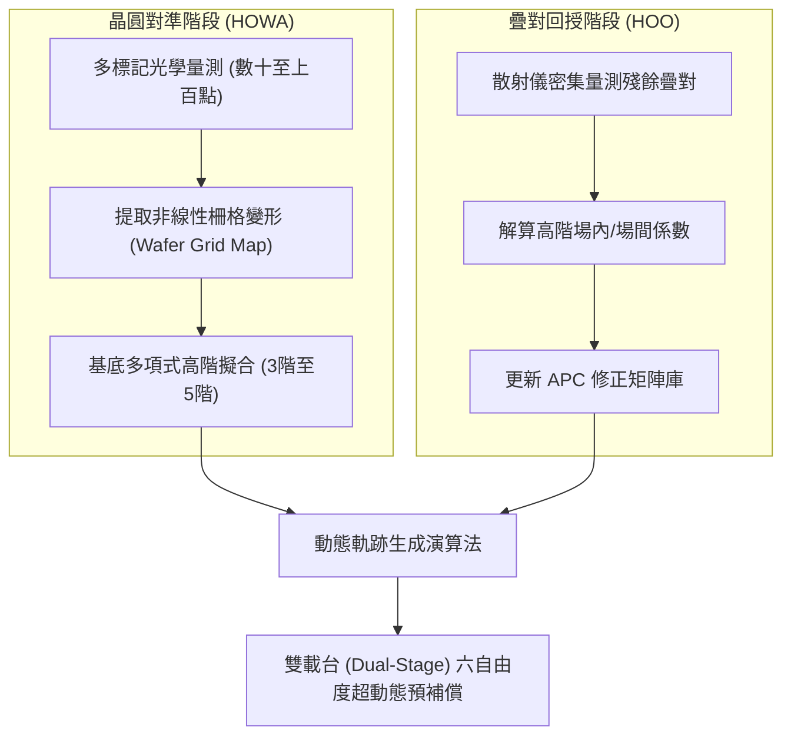

在硬體執行層面，高階擬合所求得之非線性變形場被轉換為載台即時動態軌跡。現代 Scanner 之晶圓載台與光罩載台均為具備六個自由度（$X, Y, Z, \theta_x, \theta_y, \theta_z$）的超精密磁浮平面馬達系統。當載台在長程步進並以高達 1000 mm/s 以上速度動態掃描時，控制器在微秒（$\mu\text{s}$）級的伺服取樣週期中，依據高階多項式產生的連續加速度前饋輪廓（Acceleration Feedforward Profile），在預補償軌跡上疊加極微小的微步擾動（Dither），抵消製程形變造成的非線性位移。

---

### 先進製程控制（APC）與 EWMA 濾波演算法

疊對量測數據通常在微影顯影後（After Development Inspection, ADI）由專用疊對量測儀取得。微影製程之疊對補償高度仰賴批次間（Run-to-Run, R2R）先進製程控制（APC）系統。APC 系統必須在存在量測雜訊、偶發製程擾動與長期機台熱漂移的環境下，穩定估算可修正參數。

最廣泛應用於工業界疊對 APC 的演算法為指數加權移動平均（Exponentially Weighted Moving Average, EWMA）濾波器。設第 $k$ 批晶圓實測求得的某項疊對模型參數（如晶圓旋轉角 $R_w$ 或平移 $T_x$）為 $y_k$，APC 系統內部所維持的狀態估計值為 $\hat{y}_k$，則下一批次（第 $k+1$ 批）預期套用的補償量修正模型為：

$$
\hat{y}_{k+1} = \lambda y_k + (1 - \lambda) \hat{y}_k
$$

其中 $\lambda \in (0, 1]$ 為 EWMA 權重折衷因子（Discoid/Weight Factor）。將上式遞迴展開可得：

$$
\hat{y}_{k+1} = \lambda \sum_{j=0}^{k-1} (1-\lambda)^j y_{k-j} + (1-\lambda)^k \hat{y}_1
$$

此式指出歷史量測值的權重隨著批次距離呈指數幾何衰減。參數 $\lambda$ 的選取至關重要：
1. **較高的 $\lambda$（如 $0.7 \sim 0.9$）**：系統對最近一次量測的反應敏銳，適合機台處於動態熱漂移階段，但容易放大隨機量測雜訊並引發控制震盪。
2. **較低的 $\lambda$（如 $0.2 \sim 0.4$）**：系統濾波降噪能力強，數值穩定，適合穩態量產，但面對突然發生的階躍性製程漂移（Step-drift）時會有明顯的收斂延遲。

!!! warning "常見誤解：直接以單批回歸值進行 100% 抵減"
    初學者常誤以為若第 $k$ 批晶圓測得 $T_x = +3.0\text{ nm}$，則第 $k+1$ 批曝光時機台載台只要反向補償 $-3.0\text{ nm}$ 即可歸零。這種未經過 EWMA 濾波的直接消除法稱為「死亡迴路控制（Deadbeat Control）」。在半導體廠中，量測數據含有標記不對稱性、晶圓取樣誤差與隨機微影變異；直接以 $100\%$ 單次殘差（相當於 $\lambda = 1.0$）反饋將使整體微影機台的疊對控制方差（Variance）倍增，甚至引起發散而導致批量報廢。

---

### 回授（Feedback）與前饋（Feedforward）之整合控制機制

單純依靠基於批次（Lot-based）的 Run-to-Run 疊對回授，本質上存在滯後性（Latency），無法修正同一批次內不同晶圓之間的微小變異（Wafer-to-Wafer Variation），更無法因應如退火爐管內邊緣與中心晶圓之應力差異。因此，現代先進疊對控制架構必然整合了**前饋補償（Feedforward）**與**回授修正（Feedback）**。

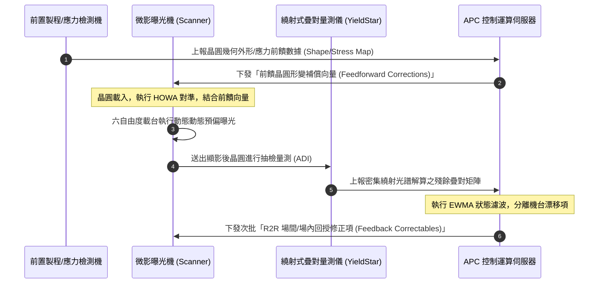

此混合控制架構之運作流程如下：

1. **應力與變形前饋路徑（Feedforward Path）**：
   在晶圓送入微影機台曝光之前，利用前置量測模組（例如晶圓幾何量測儀測得的晶圓奈米級形貌與翹曲度 Wafer Warp/Bow Map，或化學氣相沉積與退火機台的溫度分佈歷史），透過物理力學轉換模型（見第 21 章與第 27 章），推算晶圓被真空吸附至超平整靜電吸盤上所產生的面內應力釋放位移場。此位移向量在晶圓尚未曝光前，即以逐片（Per-wafer）方式前饋至微影機台控制器作為基礎網格修正。

2. **高階對準即時校準（In-situ Alignment Path）**：
   晶圓置入微影機台後，利用掃描機內建之對準感測器掃描數十至上百個全域對準標記，獲得該片晶圓真實的局部非線性晶格網格（HOWA Map）。機台動態合併前饋預測值與實測對準值，產生當前晶圓專屬的掃描補償曲面。

3. **疊對殘差回授路徑（Feedback Path）**：
   曝光並顯影後的晶圓進入疊對量測設備（如利用光學繞射重構技術的量測儀），量測全晶圓上數百至數千點殘餘疊對誤差。量測伺服器（Image Computer / Reconstruction Server）完成解算後，將純淨的幾何誤差數據透過專用區域網路（Dedicated Private LAN）回傳 APC 系統。

4. **控制器參數解耦與遞迴**：
   APC 伺服器自疊對殘差中剔除前饋已補償量，分離出「純機台漂移（Tool Drift）」與「光罩加熱累積變形（Reticle Heating Distortion）」，進行 EWMA 多變數濾波，並將更新後的穩態修正係數（場間旋轉、放大率漂移等）寫入配方數據庫（Recipe Database），供次一批次曝光使用。透過前饋抵消晶圓固有應力形變、回授鎖住機台幾何基準漂移，先進微影系統得以將全晶圓疊對誤差（3$\sigma$）嚴密收斂於次奈米尺度。

!!! example "產業實例：ASML YieldStar 與 APC 閉迴路架構"
    在先進極紫外光微影量產線上，ASML 步進掃描機與其專屬光學繞射疊對量測儀（YieldStar）配合 APC 系統形成高度客製化的自動控制網。量測機台透過嚴格耦合波分析（RCWA）反求出非對稱光譜資訊，將高階疊對誤差殘差（High-Order Overlay Residuals）以每晶圓千點以上的密度上傳至控制伺服器。APC 系統之晶圓網格修正演算法（Wafer Grid Reconstruction）利用三階至五階的正交基底多項式進行即時表面擬合，將解算出的場內與場間高階修正項直接注入雙載台（Twinscan）系統的運動控制暫存器，實現晶圓對晶圓（Wafer-to-Wafer）動態前饋補償與批次對批次（Run-to-Run）回授控制的完全閉迴路整合。

## 17.5 設備與廠商技術

### 微影疊對量測設備之系統組成與分類

在先進半導體製程中，疊對量測（Overlay Metrology）設備負責在曝光顯影後（After-Development Inspection, ADI）或蝕刻後（After-Etch Inspection, AEI）精準評估各圖案層間的對準偏移量，為先進製程控制（Advanced Process Control, APC）提供反饋與前饋修正數據。微影疊對量測站主要分為兩大光學測量技術路線：

1. **影像式疊對量測（Image-Based Overlay, IBO）**：利用明視野光學顯微系統直接擷取晶圓表面微米級疊對標記（如 Box-in-Box 或 Advanced Imaging Metrology, AIM 標記）之幾何圖像，透過邊緣偵測（Edge Detection）演算法計算內外圖案的形心幾何中心差。
2. **繞射式疊對量測（Diffraction-Based Overlay, DBO）**：利用特定波長或寬頻光源照射週期性光柵結構疊對標記，不進行實體空間成像，而是收集繞射光瞳平面（Pupil Plane）上正負一階（$\pm 1^{\text{st}}$ orders）繞射光之光強不對稱性，藉由電磁場反演演算法重構出奈米級疊對誤差。

典型疊對量測設備包含以下關鍵子系統：
- **光學照明與偵測光路模組**：包含寬頻連續光譜光源（如氙弧燈或雷射驅動光源 LDLS）或可調諧雷射、偏振控制元件、高數值孔徑（NA）顯微物鏡，以及高量子效率冷卻式感光耦合元件（CCD）或互補式金屬氧化物半導體（CMOS）感測器。
- **超精密晶圓載台（Wafer Stage）**：具備真空吸附基座、壓電致動器（PZT）以及雙頻雷射干涉儀或光學尺閉迴路回授系統，可在奈米尺度下實現六個自由度（$X, Y, Z, \theta_x, \theta_y, \theta_z$）之高速步進與精準聚焦定位。
- **晶圓傳送前端模組（Equipment Front End Module, EFEM）**：包含晶圓傳送盒（FOUP）開門機構、對位機構（Aligner）以及具備邊緣感測（Wafer Edge Detection）功能的無塵室機械手臂。
- **分散式運算架構**：為了因應龐大的原始資料處理量與實時運動控制需求，現代量測機台普遍採用控制與運算實體分離的架構。

---

### 雙主機架構：控制與運算的實體隔離

先進微影量測機台（如繞射光譜儀與高速光學檢測機台）在系統層級全面採取「機台主控電腦（Tool Controller / IPC）」與「專用重構伺服器（Reconstruction Server / Image Computer）」實體分離的雙主機架構，以兼顧控制的確定性（Determinism）與巨量數值計算的高吞吐量。

```mermaid
flowchart TD
    subgraph FabNetwork ["晶圓廠廠級網路"]
        APC["先進製程控制伺服器 (APC)"]
        MES["製造執行系統 (MES)"]
    end

    subgraph ToolControllerSubsystem ["機台主控電腦 (Tool Controller / IPC)"]
        TC["即時作業系統 (RTOS / Windows IoT)<br>運動控制、氣動互鎖、安全迴路"]
        SECS["SECS/GEM 介面模組 (見第 54 章)"]
    end

    subgraph ReconstructionSubsystem ["外掛專用重構伺服器 (Reconstruction Server)"]
        RC["高效能 Linux 運算叢集<br>RCWA 電磁場數值模擬 / GPU 加速卡"]
        NVMe["高速暫存快取 (NVMe RAID)"]
    end

    subgraph HardwareSubsystem ["機台硬體與感測元件"]
        EFEM["機械手臂 / EFEM 傳送"]
        Stage["載台運動與真空吸附"]
        Sensor["CCD / CMOS 光學光瞳偵測器"]
    end

    %% 連線關係
    MES <-->|SECS/GEM| SECS
    APC <-->|APC Feedback| SECS
    TC --- SECS
    TC -->|運動指令與互鎖訊號| Stage
    TC -->|晶圓傳輸排程| EFEM

    Sensor -->|每秒數十 GB 原始光學資料 (Raw Data)| ReconstructionSubsystem
    ToolControllerSubsystem <===>|專用隔離光纖網路 (Dedicated Private LAN 10G/40G)| ReconstructionSubsystem
    RC -->|重構之奈米級疊對數值| TC
```

#### 1. 機台主控電腦（Tool Controller / IPC）
主控電腦通常執行硬即時作業系統（Real-Time Operating System, RTOS，如 VxWorks）或經即時核心擴充之 Windows 系統。其運算資源專注於毫秒（ms）等級甚至微秒（$\mu\text{s}$）等級的確定性任務，絕不承載重型影像處理演算法，以避免系統資源耗盡導致即時控制中斷。其職責包含：
- **機械運動與定位控制**：控制載台運動路徑規劃、壓電聚焦機構動態補償及 EFEM 機械手臂運動。
- **安全互鎖機制（Safety Interlocks）**：監控機台真空度、氣壓、冷卻水流速、安全光幕及雷射安全防護蓋，具備最高硬體中斷優先權。
- **廠級通訊介面**：透過 SECS/GEM（SEMI Equipment Communications Standard / Generic Equipment Model）工業通訊協定，向晶圓廠製造執行系統（MES）上報機台狀態、警報事件，並自先進製程控制（APC）系統接收對準配方與補償參數（見第 54 章）。

#### 2. 專用重構伺服器（Reconstruction Server / Image Computer）
重構伺服器採用企業級 Linux 作業系統，硬體配置包含多路對稱多處理架構處理器（如 AMD EPYC 或 Intel Xeon 系列）、數百 GB 具備錯誤更正碼之記憶體（ECC RAM）、高速非揮發性記憶體陣列（NVMe SSD RAID），以及專屬硬體加速卡（圖形處理器 GPU 叢集或現場可程式化邏輯閘陣列 FPGA）。

偵測器擷取的光瞳影像以每秒數十 GB 的速率產生，原始資料經由光纖影像擷取卡（Frame Grabber）直接送入伺服器記憶體。重構伺服器利用嚴格耦合波分析或巨量像素比對演算法，於數十毫秒內將光譜數據反演為具體的疊對偏移奈米值。

#### 3. 隔離式專用高速網路（Dedicated Private LAN）
主控電腦與重構伺服器之間採用 10G/40G SFP+ 高速光纖專用網路點對點直連。該區域網路完全與晶圓廠內部網路（Fab Intranet）實體隔離，具備獨立子網段與固定的封包優先順序，阻斷廠級廣播封包對機台內部資料傳輸之抖動（Jitter）干擾，確保量測資料傳遞具備低延遲特性。

---

### 麥克斯威爾方程組數值反演與 RCWA 演算法

在繞射式疊對（DBO）量測中，疊對誤差並非直接由顯微幾何影像測得，而是透過解析繞射光瞳平面上的電磁波光強分佈，以逆向數值問題（Inverse Problem）求解。其核心理論基礎為求解非齊次介質中之馬克士威方程組（Maxwell's Equations）：

$$\nabla \times \mathbf{E} = -i\omega\mu_0 \mathbf{H}$$

$$\nabla \times \mathbf{H} = i\omega\varepsilon_0\varepsilon_r(\mathbf{r}) \mathbf{E}$$

其中 $\mathbf{E}$ 與 $\mathbf{H}$ 分別為電場與磁場向量，$\omega$ 為光波角頻率，$\varepsilon_0$ 與 $\mu_0$ 為真空介電常數與磁導率，$\varepsilon_r(\mathbf{r})$ 為標記材料之相對介電常數空間分佈函數。

嚴格耦合波分析（Rigorous Coupled-Wave Analysis, RCWA）是重構伺服器中最核心的頻域半解析演算法：
1. **結構切層與週期展開**：將晶圓多層膜與光柵結構沿深度方向（$z$ 軸）分割為數十至數百個均勻切片（Slices）。在每個切片層內，相對介電常數 $\varepsilon_r(x, y)$ 為 $x$ 與 $y$ 方向之週期函數，可展開為二維傅立葉級數：
   $$\varepsilon_r(x, y) = \sum_{m=-\infty}^{\infty} \sum_{n=-\infty}^{\infty} \hat{\varepsilon}_{m,n} e^{i(m K_x x + n K_y y)}$$
   其中 $K_x = \frac{2\pi}{\Lambda_x}$，$K_y = \frac{2\pi}{\Lambda_y}$，$\Lambda$ 為光柵週期，$m, n$ 為空間諧波階數。

2. **電磁場展開與特徵系統求解**：將電磁場分量同樣以空間布洛赫波（Bloch waves）展開，代入旋度方程式後，將波動方程式轉化為矩陣特徵值與特徵向量問題：
   $$\frac{d^2}{dz^2}\mathbf{S} = \mathbf{M} \mathbf{S}$$
   其中 $\mathbf{S}$ 為各階諧波電磁場分量組成的向量，$\mathbf{M}$ 為耦合係數矩陣。

3. **邊界條件匹配與散射矩陣（S-Matrix）求解**：在各切片邊界處應用電場與磁場切線分量連續之邊界條件。為防止指數增長項導致數值溢位，演算法採用散射矩陣（$S$-Matrix）演算法由底層往上遞推，求解反射區之反射係數矩陣。

4. **疊對偏移量提取**：
   在對稱光柵標記中，若上下層光柵無相對位移，其繞射光瞳之正負一階光強差為零。當存在疊對偏移 $\Delta x$ 時，結構空間反演對稱性破缺，導致正負一階繞射光強度產生不對稱性：
   $$\Delta I(x) = I_{+1}(x) - I_{-1}(x) \approx K \cdot \Delta x$$
   其中 $K$ 為靈敏度係數，與標記膜厚、光波長、偏振態及光柵幾何輪廓相關。重構伺服器透過即時多波長光瞳比對或非線性最小平方法，自微弱的光強差中反演出小於 $0.1\,\text{nm}$ 之疊對偏差。

---

### 主流廠商與技術路線比較

當前微影疊對與關鍵尺寸量測市場由少數具備極高精密光學與數值模擬能力的設備商主導。下表列出產業代表性量測機台與技術路線：

| 廠商 | 代表產品系列 | 技術路線與特點 | 主要應用 |
| :--- | :--- | :--- | :--- |
| **ASML** | YieldStar 系列 | **繞射式量測（DBO）光瞳散射光譜儀**<br>利用多波長與多重偏振之連續繞射光瞳量測；具備極高量測重現性與快速量測速度；專用伺服器即時執行電磁場數值模擬。 | 先進製程（DUV/EUV）微影機台動態回授修正、晶圓全域（On-Product Overlay）高密度疊對監控與光刻機校正。 |
| **KLA** | Archer 系列 | **影像式疊對量測（IBO）光學系統**<br>以多波長寬頻光源搭配高解析顯微物鏡直接造影；具備對位標記幾何缺陷診斷能力與可自訂影像演算法；後期機種整合繞射量測模組。 | 邏輯與記憶體製程各關鍵層別之疊對誤差檢驗、研發階段圖案轉印邊緣失真分析。 |

#### 技術路線取捨與晶圓廠選機考量

1. **影像式（IBO）與繞射式（DBO）的原理取捨**：
   - **影像式量測（如 KLA Archer）**的優勢在於直觀與對非週期性結構的相容性。工程師能直接觀察對準標記的顯微影像，輕易辨識標記是否因化學機械研磨（CMP）產生邊緣崩塌、凹陷（Dishing）或非對稱侵蝕。其缺點在於受到光學繞射極限限制，且光學系統透鏡本身的像差與焦點微飄移極易引發機台誘發誤差（Tool-Induced Shift, TIS），在極小疊對預算下校正難度顯著上升。
   - **繞射式量測（如 ASML YieldStar）**不依賴空間直接成像，避開了光學成像系統的像差極限，對聚焦漂移的容忍度高，量測再現性（Repeatability）通常優於 $0.05\,\text{nm}$。由於其量測標記為微型週期光柵，佔用晶圓切割道（Scribe Lane）或晶片內（In-Die）面積極小，能於單片晶圓上進行數千點的高密度取樣。然而，DBO 的弱點在於當底層光柵製程引發幾何傾斜（Asymmetric Grating Profile）時，該幾何不對稱將被誤讀為疊對位移，因此極為依賴演算法的精準去耦與多波長交叉校驗。

2. **微影生態系整合與閉迴路控制考量**：
   晶圓廠評估疊對機台時，除了硬體精確度（Accuracy）與每小時產出晶圓數（Throughput, WPH）外，核心考量在於機台與微影曝光設備（Scanner）的**閉迴路回授能力**。
   ASML 的 YieldStar 與其 TWINSCAN 曝光機（見第 13、14 章）深度整合，量測獲得的高密度疊對殘差數據可經由計算微影軟體即時轉換為高階晶圓載台形變校正多項式，直接在前置傳輸通道內將修正參數寫入曝光機控制器中；而 KLA 的 Archer 系統則具備廣泛的獨立診斷彈性，作為客觀第三方的品質驗證標準，廣泛應用於不同廠牌微影機台間的交叉比對監控。

## 本章重點

*   **疊對誤差與邊緣置放誤差**：疊對誤差（Overlay, OVL）定義為當前層與參考層圖案中心之位移向量。在先進製程中，需結合關鍵尺寸誤差、光學鄰近修正殘差及線邊緣粗糙度，以邊緣置放誤差（EPE）作為更全面的圖案失效評估指標。
*   **誤差來源分類**：疊對誤差源自微影機台端（如載台六自由度定位、鏡頭動態像差、光罩熱形變）與製程端（如薄膜應力引致之晶圓翹曲、CMP 造成之對準標記不對稱形變）。
*   **原位對準與離線量測**：曝光機透過離軸光學對準系統與自參考干涉儀（SRI）進行即時尋標補償；微影後則利用專用量測儀進行離線檢測，並將數據回傳至 APC 系統進行批次間修正。
*   **影像式與繞射式量測**：影像式量測（IBO）利用顯微成像計算標記形心，對標記缺陷具診斷力；繞射式量測（DBO）利用光瞳面繞射光強之不對稱性，結合 RCWA 演算法，具備次奈米級的重複精度。
*   **數學模型與高階修正**：疊對誤差可分解為晶圓級（場間）與曝光場級（場內）分量。先進製程採用高階疊對（HOO）模型與二維多項式擬合，以修正複雜的非線性形變。
*   **先進製程控制（APC）**：利用指數加權移動平均（EWMA）演算法進行回授控制，並整合前饋（Feedforward）機制，補償由製程應力引致的晶圓形變，實現閉迴路精度控制。
*   **設備運算架構**：現代量測設備採用機台主控電腦與專用重構伺服器分離的雙主機架構，確保高強度的電磁場數值運算不影響機台機械動作的即時性與穩定性。


## 重點圖卡

複習時看這幾張就能抓住本章重點；[圖卡庫](../cards.md)可以下載成圖片。

<div class="ix-cards" markdown>

<figure markdown>
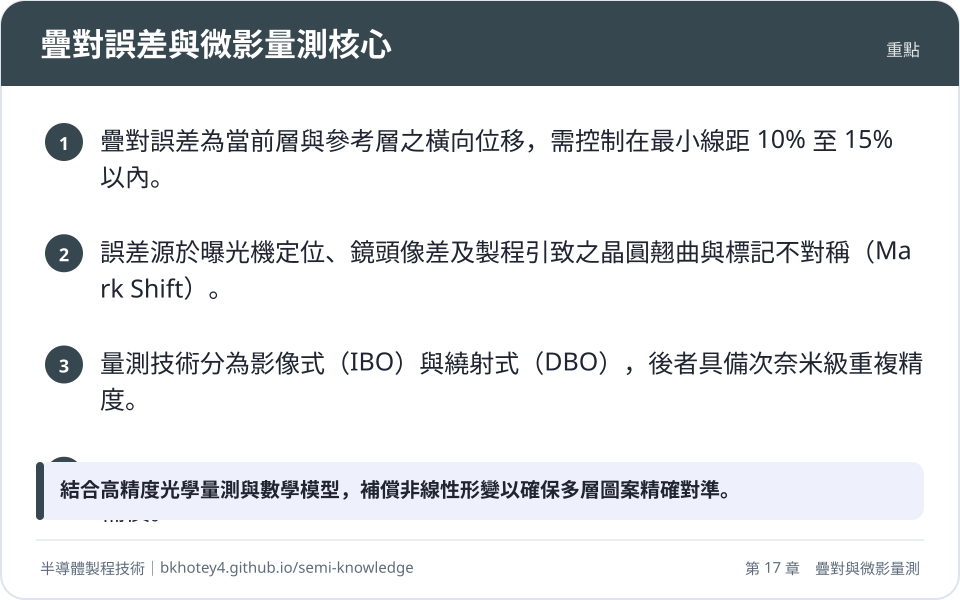
<figcaption>重點圖卡：疊對誤差與微影量測核心</figcaption>
</figure>

<figure markdown>
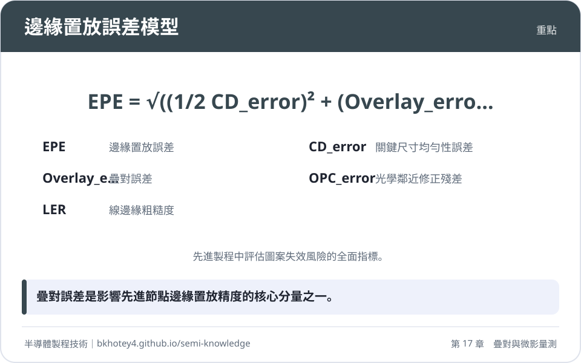
<figcaption>重點圖卡：邊緣置放誤差模型</figcaption>
</figure>

<figure markdown>
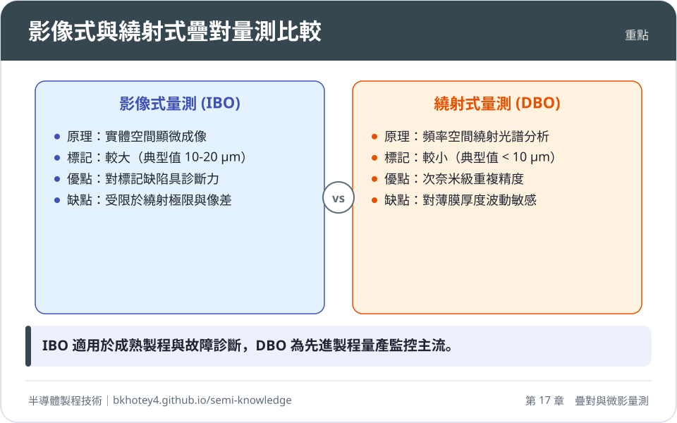
<figcaption>重點圖卡：影像式與繞射式疊對量測比較</figcaption>
</figure>

<figure markdown>
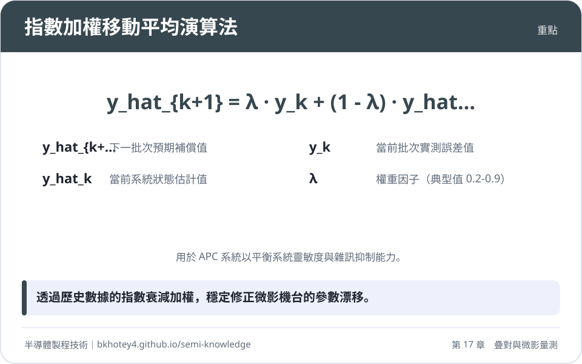
<figcaption>重點圖卡：指數加權移動平均演算法</figcaption>
</figure>

</div>

## 習題

**1. 試說明在影像式疊對量測（IBO）中，機台引致誤差（TIS）的定義及其校準方法。**

??? success "參考解答"
    TIS 是由於量測設備光學路徑不對稱或鏡頭像差所產生的系統性偏差。校準方法為將晶圓在載台上旋轉 180 度後對同一位置進行重新量測。
    計算公式為：$\text{TIS} = \frac{\text{OVL}_{0^\circ} + \text{OVL}_{180^\circ}}{2}$。
    理想狀態下，旋轉前後的量測值應互為相反數（和為零），若不為零則該平均值即為機台需扣除的系統誤差。

**2. 在繞射式疊對量測（DBO）中，若使用預設偏移量（Pre-programmed bias）為 $d = 20\text{ nm}$ 的雙標記法，量測得到標記 A 的強度差 $\Delta I_{+d} = 150$ 單位，標記 B 的強度差 $\Delta I_{-d} = -100$ 單位，試計算其實際疊對誤差 $\epsilon$。**

??? success "參考解答"
    根據 DBO 雙標記法公式：
    $\epsilon = d \cdot \frac{\Delta I_{+d} + \Delta I_{-d}}{\Delta I_{+d} - \Delta I_{-d}}$
    將數值代入：
    $\epsilon = 20 \cdot \frac{150 + (-100)}{150 - (-100)}$
    $\epsilon = 20 \cdot \frac{50}{250} = 20 \cdot 0.2 = 4.0\text{ nm}$
    故實際疊對誤差為 $4.0\text{ nm}$。

**3. 某先進製程控制（APC）系統採用 EWMA 演算法監控晶圓平移誤差 $T_x$，設定權重因子 $\lambda = 0.4$。若目前系統的狀態估計值 $\hat{y}_k = 1.2\text{ nm}$，而最新一批次實測值 $y_k = 2.0\text{ nm}$，試計算下一批次應套用的補償估計值 $\hat{y}_{k+1}$。**

??? success "參考解答"
    根據 EWMA 公式：$\hat{y}_{k+1} = \lambda y_k + (1 - \lambda) \hat{y}_k$
    代入已知參數：
    $\hat{y}_{k+1} = 0.4 \cdot (2.0) + (1 - 0.4) \cdot (1.2)$
    $\hat{y}_{k+1} = 0.8 + 0.6 \cdot 1.2$
    $\hat{y}_{k+1} = 0.8 + 0.72 = 1.52\text{ nm}$
    下一批次之補償估計值為 $1.52\text{ nm}$。

**4. 試比較「原位對準」（In-situ Alignment）與「離線量測」（Ex-situ Metrology）在微影製程中的功能差異。**

??? success "參考解答"
    1. 原位對準：在曝光機內部執行，於曝光前即時偵測晶圓標記位置，主要補償載台機械誤差與晶圓當下的幾何網格形變，速度快但易受薄膜干涉干擾。
    2. 離線量測：在顯影或蝕刻後於專用機台執行，量測兩層圖案間的真實相對位移，精度極高（次奈米級），數據用於回傳 APC 系統作為後續批次的補償基準，並判斷該批次是否需要重工（Rework）。

**5. 為何在先進製程中，不建議直接使用單次量測殘差進行 100% 的回授補償（即 $\lambda = 1$ 的 Deadbeat Control）？**

??? success "參考解答"
    因為量測數據中包含隨機雜訊、標記不對稱引致的虛假偏移（Mark Shift）以及製程變異。若進行 100% 回授，會將這些隨機誤差直接引入下一批次的曝光補償中，導致控制系統的變異數（Variance）倍增，引發控制震盪，反而降低疊對精度的穩定性。

## 本章術語

- **Overlay**（疊對）：指積體電路多層製造中，當前製程層與參考層之間的橫向對準精度。
- **EPE**（邊緣置放誤差）：綜合考慮疊對誤差、關鍵尺寸誤差與線邊緣粗糙度後，描述圖案邊緣與設計位置偏差的指標。
- **IBO**（影像式疊對量測）：利用光學顯微成像與影像處理演算法，直接計算標記中心位移的量測技術。
- **DBO**（繞射式疊對量測）：利用光柵標記產生的繞射光強度不對稱性，反演計算疊對誤差的技術。
- **TIS**（機台引致誤差）：因量測設備內部光學系統不對稱所導致的系統性量測偏差。
- **RCWA**（嚴格耦合波分析）：一種求解麥克斯威方程組的數值演算法，用於從繞射光譜中重構奈米級結構特徵。
- **APC**（先進製程控制）：利用量測數據自動調整機台參數，以維持製程穩定性的閉迴路控制系統。
- **EWMA**（指數加權移動平均）：APC 系統中常用的濾波演算法，透過權重分配平衡系統對漂移的靈敏度與對雜訊的抑制能力。
- **HOO**（高階疊對）：使用高階多項式模型修正晶圓內非線性幾何形變的技術。
- **Mark Shift**（標記偏移）：因 CMP 或 PVD 等製程造成標記幾何形狀不對稱，導致光學對準中心偏離物理中心的現象。


## 互動學習

!!! tip "動手試試看"
    - [設備機台圖鑑：CD-SEM 線寬量測機、疊對量測機](../equipment.md)

<div class="quiz" data-quiz="03-07"></div>


## 產業最新進展

本節由每日產業新聞自動補充，說明本章技術在產業上的最新發展。

<!-- updates -->
（目前尚無補充。）
