# 第 18 章　電漿物理基礎

!!! abstract "學習目標"
    - 理解低溫非平衡電漿之物理特性、產生機制與帶電粒子和活性自由基之組成分布
    - 掌握電漿鞘層 (Sheath) 形成原理、自偏壓效應及離子加速轟擊之能量與角度分布機制
    - 比較電容耦合 (CCP) 與感應耦合 (ICP) 電漿源之放電架構、電漿密度差異及離子通量與能量的獨立調控機制
    - 學習光發射光譜 (OES) 與朗繆爾探針 (Langmuir Probe) 等電漿診斷技術之物理原理與製程應用
    - 認識半導體電漿製程反應腔之核心次系統，包含真空泵浦、靜電吸盤、射頻匹配器與主流設備商架構

## 18.1 電漿基本特性與放電物理

### 18.1.1 低溫非平衡電漿與熱力學不平衡特性

電漿（Plasma）常被稱為物質的第四態，是由大量自由電子、各類帶電離子、電中性基態原子與分子、活性自由基（Radicals）以及處於激發態的粒子所組成的游離氣體。在半導體製造製程（如乾式蝕刻、電漿加強型化學氣相沉積 PECVD 等）中，所運用的電漿屬於「低溫非平衡電漿」（Low-temperature Non-equilibrium Plasma），又稱冷電漿或輝光放電（Glow Discharge）。

低溫電漿的工作壓力通常介於數個 $\text{mTorr}$ 至數十個 $\text{Torr}$ 之間，其核心特徵在於系統內不同粒子群體處於熱力學非平衡態。在外部施加的射頻（RF）或微波電磁場中，電子質量 $m_e$（約 $9.11 \times 10^{-31}\text{ kg}$）遠小於重粒子（離子與中性分子質量 $M \sim 10^4 - 10^5 m_e$）。電場對帶電粒子作功時，電子獲得的加速度遠高於離子：

$$a_e = \frac{q E}{m_e} \gg a_i = \frac{q E}{M}$$

其中 $q$ 為基本電荷，$E$ 為電場強度。電子在電場中迅速吸收能量並加速，然而當電子與質量龐大的中性氣體分子發生彈性碰撞時，每一次碰撞傳遞的動能比例極低，理論最大能量傳遞比例僅約為：

$$\Delta \eta \approx \frac{2 m_e}{M} \ll 10^{-4}$$

這種微弱的能量轉換效率導致電子系統與重粒子系統之間的熱弛豫時間極長。在低氣壓條件下，碰撞頻率不足以使兩者達到熱平衡，因而形成顯著的溫度分離現象：

1. **電子溫度（Electron Temperature, $T_e$）**：典型能量範圍為 $1 \sim 5\text{ eV}$（以等效熱力學溫度換算，$1\text{ eV} \approx 11600\text{ K}$，對應溫度約 $10^4 \sim 6 \times 10^4\text{ K}$）。高能電子的存在賦予電漿足夠的能量去引發常溫下難以發生的化學鍵斷鍵與游離反應。
2. **離子溫度（Ion Temperature, $T_i$）**：離子因與背景中性氣體碰撞頻率高且質量相近，能量迅速均分，$T_i$ 僅略高於室溫，典型值約 $0.05 \sim 0.1\text{ eV}$。
3. **中性氣體溫度（Gas Temperature, $T_g$）**：電漿整體的巨觀體積溫度由中性氣體主導，通常維持在室溫至數百攝氏度之間（典型值約 $300 \sim 500\text{ K}$，即 $0.026 \sim 0.043\text{ eV}$）。

此種 $T_e \gg T_i \approx T_g$ 的熱力學非平衡特性，是半導體製程能在熱敏材料（如光阻、低介電常數介電質及超薄奈米結構）不被高溫破壞的前提下，利用高能電子激發氣相反應物進行精密加工的物理基礎。

---

### 18.1.2 電子碰撞微觀反應機制

低溫電漿的維持與化學活性主要仰賴電子與中性氣體分子的非彈性碰撞（Inelastic Collisions）。當電子動能超過特定的化學閾值能量（Threshold Energy, $E_{th}$）時，將引發下列幾種關鍵微觀反應機制：

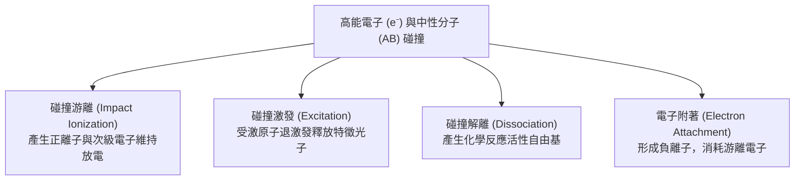

#### 1. 碰撞游離（Impact Ionization）
高能電子撞擊中性原子或分子，將其束縛電子打出，產生一對正離子與次級電子：

$$e^- + A \rightarrow A^+ + 2e^-$$

此反應的閾值能量為游離能（Ionization Potential, $E_{iz}$），氬氣（$\text{Ar}$）約為 $15.76\text{ eV}$，四氟化碳（$\text{CF}_4$）約為 $15.9\text{ eV}$。碰撞游離是電漿內部自持放電（Self-sustained Discharge）的最根本機制，增殖的電子在電場中被再度加速，形成穩態的載子雪崩維持平衡。

#### 2. 電子碰撞激發（Excitation）與發光
當入射電子動能低於游離能但高於電子的電子能階躍遷閾值時，可將原子外層電子激發至高能階：

$$e^- + A \rightarrow A^* + e^-$$

受激態原子 $A^*$ 在極短時間（典型自發輻射壽命約 $10^{-8}\text{ s}$）內躍遷回基態，並輻射出對應能階差的特定波長光子：

$$A^* \rightarrow A + h\nu$$

其中 $h$ 為普朗克常數，$\nu$ 為輻射光頻率。此現象是電漿發光（Glow）的物理根源，亦是第 18.4 節所述「光學放射光譜（Optical Emission Spectroscopy, OES）」診斷與蝕刻終點偵測的理論依據。

#### 3. 分子解離（Dissociation）
在多原子分子氣體中，電子碰撞可將分子激發至排斥性電子態或高振動能階，導致分子化學鍵斷裂形成中性碎片（即自由基）：

$$e^- + AB \rightarrow A^\bullet + B^\bullet + e^-$$

例如在蝕刻製程中，電子與 $\text{CF}_4$ 碰撞解離產生具強氧化活性的氟自由基：

$$e^- + \text{CF}_4 \rightarrow \text{CF}_3^\bullet + \text{F}^\bullet + e^-$$

解離能通常低於游離能（多介於 $3 \sim 10\text{ eV}$），因此電漿中自由基的產生速率與濃度通常遠高於帶電離子。

#### 4. 電子附著（Electron Attachment）
在具有強電負性（Electronegative）的製程氣體（如 $\text{SF}_6$、$\text{Cl}_2$、$\text{CF}_4$、$\text{O}_2$）中，低能量電子容易被分子捕獲形成負離子：

$$e^- + AB \rightarrow AB^- \quad \text{或} \quad e^- + AB \rightarrow A^\bullet + B^- \quad (\text{解離附著, Dissociative Attachment})$$

電子附著反應會大量消耗具高遷移率的自由電子，轉化為移動緩慢的負離子，劇烈改變電漿的導電度、鞘層電位分布以及阻抗匹配狀態。

---

### 18.1.3 電漿組成粒子與功能分類

電漿內部的化學與物理環境極為複雜，根據電荷特性與反應功能，可將電漿中的粒子歸納為兩大類體系：

| 粒子分類 | 代表物種 | 密度範圍（典型值） | 製程功能角色 |
| :--- | :--- | :--- | :--- |
| **帶電粒子** | 自由電子（$e^-$） | $10^9 \sim 10^{12}\text{ cm}^{-3}$ | 吸收外加電磁場能量；驅動碰撞解離與游離 |
| | 正離子（$\text{Ar}^+$, $\text{CF}_3^+$ 等） | $10^9 \sim 10^{12}\text{ cm}^{-3}$ | 受鞘層電場加速垂直轟擊晶圓，主導非等向性物理蝕刻 |
| | 負離子（$\text{F}^-$, $\text{Cl}^-$ 等） | 視電負度而定，可達 $10^{11}\text{ cm}^{-3}$ | 調節空間電荷分布；在脈衝電漿下參與表面化學反應 |
| **中性活性物種** | 活性自由基（$\text{F}^\bullet$, $\text{CF}_x^\bullet$, $\text{O}^\bullet$） | $10^{12} \sim 10^{14}\text{ cm}^{-3}$ | 化學擴散至晶圓表面進行自發化學反應，主導蝕刻選擇比與薄膜生長 |
| | 亞穩態原子（$\text{Ar}^*$, $\text{He}^*$） | $10^{10} \sim 10^{12}\text{ cm}^{-3}$ | 壽命長達毫秒級，透過彭寧游離（Penning Ionization）轉移激發能 |
| **基態中性氣體** | 反應氣體與載氣（$\text{Ar}$, $\text{N}_2$, $\text{CF}_4$） | $10^{13} \sim 10^{16}\text{ cm}^{-3}$ | 背景介質，提供解離來源，並透過氣流帶走揮發性反應產物 |

在多數半導體乾式蝕刻與沉積設備中，氣體的游離率（Ionization Fraction, $\alpha = n_e / (n_e + n_g)$）通常僅在 $10^{-6}$ 到 $10^{-2}$ 之間（屬於弱游離電漿）。雖然帶電離子密度遠低於中性自由基，但離子在電場引導下的定向動能提供了突破表面化學反應活化能的物理驅動力。

---

### 18.1.4 德拜遮蔽與準電中性

電漿作為導電流體，其最根本的物理特徵是具備**集體效應（Collective Behavior）**。當在電漿內部局部置入外來測試電荷或電極時，周圍高遷移率的電子會迅速重新分佈以屏蔽該電場，此現象稱為**德拜遮蔽（Debye Shielding）**。

#### 德拜長度（Debye Length）推導
設在均勻電漿中引入一帶正電荷 $Q$ 的點電荷，周圍空間電位 $\Phi(r)$ 遵循泊松方程式（Poisson's Equation）：

$$\nabla^2 \Phi = -\frac{\rho}{\epsilon_0} = -\frac{q}{\epsilon_0} (n_i - n_e)$$

其中 $\epsilon_0$ 為真空電容率。假設離子質量大而維持靜止背景（$n_i \approx n_0$），電子遵循馬克士威-波茲曼分布（Maxwell-Boltzmann Distribution）：

$$n_e(r) = n_0 \exp\left(\frac{q \Phi}{k_B T_e}\right)$$

在弱電位擾動極限下（$q\Phi \ll k_B T_e$），展開指數項得 $n_e(r) \approx n_0 \left(1 + \frac{q \Phi}{k_B T_e}\right)$。代入泊松方程式並寫為球座標形式：

$$\frac{1}{r^2} \frac{d}{dr}\left(r^2 \frac{d\Phi}{dr}\right) \approx \frac{n_0 q^2}{\epsilon_0 k_B T_e}\Phi = \frac{1}{\lambda_D^2}\Phi$$

定義**德拜長度 $\lambda_D$** 為：

$$\lambda_D \equiv \sqrt{\frac{\epsilon_0 k_B T_e}{n_e q^2}}$$

方程的解為具指數衰減特性的湯川勢（Yukawa Potential）：

$$\Phi(r) = \frac{Q}{4\pi \epsilon_0 r} \exp\left(-\frac{r}{\lambda_D}\right)$$

當距離 $r \gg \lambda_D$ 時，外加電荷產生的電位被電子屏蔽至近乎為零。

!!! note "實用計算公式"
    在工程計算中，德拜長度可簡化為：
    $$\lambda_D \approx 743 \times \sqrt{\frac{T_e\ (\text{eV})}{n_e\ (\text{cm}^{-3})}} \quad (\text{cm})$$
    以典型電容耦合電漿（CCP）條件為例，若 $T_e = 3\text{ eV}$、$n_e = 10^{10}\text{ cm}^{-3}$，計算可得 $\lambda_D \approx 129\ \mu\text{m}$。

#### 準電中性（Quasi-neutrality）
當製程反應腔體的幾何特徵尺寸 $L$ 遠大於德拜長度（$L \gg \lambda_D$）時，任何巨觀尺度的空間電荷分離皆會被極強的內建電場在極短時間內抹平。因此在巨觀尺度上，電漿主體（Bulk Plasma）必須嚴格維持淨電荷為零的狀態：

$$n_e + \sum n_- \approx \sum Z_i n_+$$

其中 $n_-$ 為負離子密度，$n_+$ 為帶電荷數 $Z_i$ 的正離子密度。這項特性稱為「準電中性」。

一個氣體系統要被定義為電漿，必須滿足三個物理判據：
1. **空間尺度準則**：$\lambda_D \ll L$（電漿主體具備足夠空間形成集體遮蔽）。
2. **電漿參數準則**：德拜球（以 $\lambda_D$ 為半徑的球體）內必須包含足夠多的粒子，即 $N_D = \frac{4}{3} \pi n_e \lambda_D^3 \gg 1$。此條件確保統計學上的集體連續遮蔽效應成立，而非個別雙粒子庫侖碰撞主導。
3. **時間尺度準則**：$\omega_{pe} \tau_c > 1$（電子電漿震盪頻率大於電子與中性粒子的碰撞頻率 $\tau_c^{-1}$，使電子在被碰撞中斷前能自由響應電場）。

---

### 18.1.5 電漿頻率與高頻電磁波傳播特性

當電漿內部的電子雲受到外力位移偏離離子背景時，空間電荷分離產生的庫侖回復力會使電子群體產生簡諧振盪，其固有頻率稱為**電子電漿頻率（Electron Plasma Frequency, $\omega_{pe}$）**。

#### 電漿頻率之推導
考慮一片厚度為 $x$ 的電子層偏離平衡位置，根據高斯定律，感應出的內部恢復電場為 $E = \frac{n_e q x}{\epsilon_0}$。由牛頓第二運動定律：

$$m_e \frac{d^2 x}{dt^2} = -q E = -\frac{n_e q^2}{\epsilon_0} x$$

化簡得電子簡諧振盪方程 $\frac{d^2 x}{dt^2} + \omega_{pe}^2 x = 0$，其特徵角頻率為：

$$\omega_{pe} = \sqrt{\frac{n_e q^2}{\epsilon_0 m_e}}$$

化為頻率單位 $f_{pe} = \frac{\omega_{pe}}{2\pi} \approx 8980 \sqrt{n_e\ (\text{cm}^{-3})}\text{ Hz}$。若電子密度 $n_e = 10^{10} \sim 10^{12}\text{ cm}^{-3}$，$f_{pe}$ 位於 $0.9 \sim 9\text{ GHz}$ 的微波頻段。

#### 高頻電磁波色散關係與截斷特性
電漿對外加交變電磁場的介電響應可利用冷電漿德魯德模型（Drude Model）描述。若忽略碰撞阻尼（$\nu_m \ll \omega$），無磁場電漿的相對介電常數（Relative Permittivity, $\epsilon_r$）為：

$$\epsilon_r(\omega) = 1 - \frac{\omega_{pe}^2}{\omega^2}$$

平面電磁波在無碰撞電漿中的色散關係（Dispersion Relation）為：

$$k^2 c^2 = \omega^2 \epsilon_r(\omega) = \omega^2 - \omega_{pe}^2$$

其中 $k$ 為波向量，$c$ 為真空光速。由此可推導出高頻電磁波在電漿介質中的兩種傳播極限（如圖所示截斷特性）：

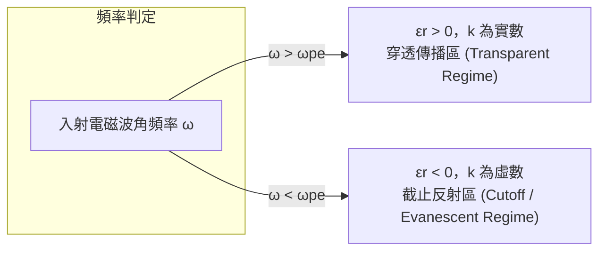

1. **傳播區（$\omega > \omega_{pe}$）**：$\epsilon_r > 0$，波向量 $k$ 為實數，電磁波可無衰減地穿透電漿介質（折射率小於 1，相速度大於光速）。
2. **截斷與衰減區（$\omega < \omega_{pe}$）**：$\epsilon_r < 0$，$k = -i\alpha$ 變為純虛數。電磁波無法在電漿內部建立行波，電磁場在電漿介面上產生強烈全反射，穿透部分呈現指數衰減：

$$E(x) = E_0 \exp\left(-\frac{x}{\delta}\right)$$

衰減特徵長度 $\delta$ 即為**集膚深度（Skin Depth）**或消逝長度：

$$\delta = \frac{c}{\sqrt{\omega_{pe}^2 - \omega^2}} \approx \frac{c}{\omega_{pe}} \quad (\text{當 } \omega \ll \omega_{pe})$$

!!! warning "半導體射頻電源頻率的物理意義"
    半導體製程中最常使用的工業射頻（RF）為 $13.56\text{ MHz}$，其角頻率 $\omega \approx 8.52 \times 10^7\text{ rad/s}$。
    相對於典型電漿的 $\omega_{pe} \sim 10^{10}\text{ rad/s}$，製程 RF 處於 $\omega \ll \omega_{pe}$ 的極限區域。
    在此頻率下，電子的響應速度遠高於外加電場的振盪速度，電漿主體展現出如同優良導體般的性質，使射頻電場無法穿透至電漿深處；電壓降主要落在電漿邊界的鞘層，或藉由感應耦合在電漿表面集膚深度內沉積能量。微波電漿源（如 $2.45\text{ GHz}$）則運行在接近臨界電漿頻率的區域，其能量傳遞機制與低頻射頻存在本質差異。

## 18.2 電漿鞘層與離子加速機制

### 空間電荷層與電漿鞘層之形成

電漿在本體區域（Bulk plasma）處於準電中性狀態，即電子數密度近似等於正離子數密度（$n_e \approx n_i = n_0$）。然而，當電漿與任何固體壁面（如金屬反應腔壁、介電質沉積表面或矽晶圓）接觸時，邊界處的電中性必然遭到破壞。

此現象的微觀物理起源在於電子與離子的質量差異。電子質量 $m_e$ 遠小於離子質量 $M$（以氬氣 $\text{Ar}^+$ 為例，$M/m_e \approx 73400$），且在非熱平衡低溫電漿中，電子溫度 $T_e$（典型值約 $2\sim 5\text{ eV}$）遠高於離子溫度 $T_i$（典型值約 $0.03\sim 0.05\text{ eV}$，接近室溫）。由馬克士威-波茲曼速率分布可知，電子的平均熱速率為：

$$v_{th,e} = \sqrt{\frac{8 k_B T_e}{\pi m_e}}$$

而離子的平均熱速率為：

$$v_{th,i} = \sqrt{\frac{8 k_B T_i}{\pi M}}$$

其中 $k_B$ 為波茲曼常數。顯然 $v_{th,e} \gg v_{th,i}$（通常相差 2 至 3 個數量級）。在電漿接觸固體表面瞬間，電子向壁面擴散的通量遠大於離子通量，導致大量電子迅速注入固體表面並被導出或積聚，使壁面累積淨負電荷。相對地，緊鄰壁面的電漿邊界區域因電子迅速流失而形成一層電子顯著耗盡、以正離子為主的空間電荷層（Space charge layer），此過渡區域即稱為**鞘層（Sheath）**。

鞘層內形成由電漿本體指向壁面的強電場，其電位隨接近壁面而單調下降。此電場產生雙重效應：
1. 將低能電子排斥回電漿本體。
2. 將正離子加速衝向固體壁面。

當電漿處於電氣浮動（Floating）狀態時，壁面電位會持續下降至某一負值，使穿透反向電位屏障的電子通量恰好等於被加速推進的正離子通量，達到穩態動態平衡。此時表面相對於電漿本體的電位差稱為**浮動電位（Floating Potential, $V_f$）**。

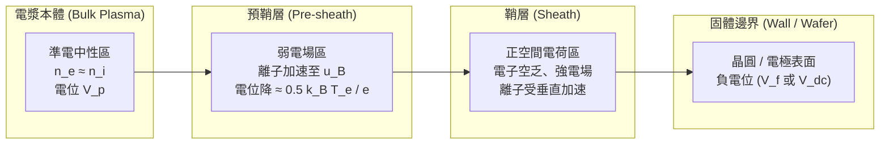

---

### 預鞘層與波姆鞘層準則

為維持穩態且不出現空間電荷發散的鞘層，離子進入鞘層邊界時必須具備一定的初速度，該條件由**波姆鞘層準則（Bohm Sheath Criterion）**界定。

考慮一維穩態無碰撞無磁場的鞘層系統。以鞘層邊界為座標原點 $x = 0$，電漿本體電位設為 $V = 0$，鞘層內電位設為 $V(x) \le 0$。假設電子遵循波茲曼分布（Boltzmann distribution）：

$$n_e(x) = n_s \exp\left(\frac{e V(x)}{k_B T_e}\right)$$

其中 $e$ 為基本電荷，$n_s$ 為鞘層邊界處的帶電粒子數密度。離子自電漿本體以初速度 $u_0$ 流入鞘層，由能量守恆定律：

$$\frac{1}{2} M u^2(x) = \frac{1}{2} M u_0^2 - e V(x)$$

由離子通量連續性方程式（$n_i(x) u(x) = n_s u_0$），離子密度分布為：

$$n_i(x) = n_s \left(1 - \frac{2 e V(x)}{M u_0^2}\right)^{-1/2}$$

將 $n_e(x)$ 與 $n_i(x)$ 代入一維卜瓦松方程式（Poisson's equation）：

$$\frac{d^2 V}{d x^2} = -\frac{\rho}{\varepsilon_0} = -\frac{e}{\varepsilon_0} \left(n_i(x) - n_e(x)\right) = -\frac{e n_s}{\varepsilon_0} \left[ \left(1 - \frac{2 e V}{M u_0^2}\right)^{-1/2} - \exp\left(\frac{e V}{k_B T_e}\right) \right]$$

其中 $\varepsilon_0$ 為真空介電常數。在鞘層邊界處，電位降極小（$|e V| \ll k_B T_e$ 且 $|e V| \ll M u_0^2$），將右側項進行泰勒展開（Taylor expansion）：

$$\frac{d^2 V}{d x^2} \approx -\frac{e n_s}{\varepsilon_0} \left[ \left(1 + \frac{e V}{M u_0^2}\right) - \left(1 + \frac{e V}{k_B T_e}\right) \right] = \frac{e^2 n_s}{\varepsilon_0} \left( \frac{1}{k_B T_e} - \frac{1}{M u_0^2} \right) (-V)$$

為了使電位在離開鞘層邊界進入鞘層時能持續向下彎曲（即負電位幅值隨 $x$ 增加，滿足 $\frac{d^2 (-V)}{d x^2} \ge 0$），括號內的係數必須大於等於零：

$$\frac{1}{M u_0^2} \le \frac{1}{k_B T_e} \implies u_0 \ge \sqrt{\frac{k_B T_e}{M}} \equiv u_B$$

此速度 $u_B$ 稱為**波姆速度（Bohm velocity）**，亦即電漿中的離子聲速（Ion acoustic speed）。波姆準則指出：**離子進入鞘層邊界時的速度，必須至少達到波姆速度。**

#### 預鞘層（Pre-sheath）的物理機制
離子在電漿本體深處的熱速度遠低於波姆速度（因 $T_i \ll T_e$），因此在電漿本體與鞘層之間必然存在一個過渡區域，稱為**預鞘層（Pre-sheath）**。
* 預鞘層實質上是準電中性的（$n_e \approx n_i$），但內部存在微弱的擴散電場。
* 預鞘層的電位降 $\Delta V_{pre}$ 恰好能將離子由靜止加速至波姆速度：
  $$\frac{1}{2} M u_B^2 = e \Delta V_{pre} \implies \Delta V_{pre} = \frac{k_B T_e}{2e}$$
* 鞘層邊界處的帶電粒子密度 $n_s$ 因而衰減為電漿本體密度 $n_0$ 的：
  $$n_s = n_0 \exp\left(-\frac{e \Delta V_{pre}}{k_B T_e}\right) = n_0 \exp\left(-\frac{1}{2}\right) \approx 0.61 n_0$$
* 進入鞘層的波姆離子通量（Bohm flux）為：
  $$\Gamma_i = n_s u_B \approx 0.61 n_0 \sqrt{\frac{k_B T_e}{M}}$$

---

### 射頻放電中的自偏壓效應 (Self-bias Effect)

半導體製程普遍採用高頻交流電場（射頻 Radio Frequency, 典型為 $13.56\text{ MHz}$）驅動電漿，而非直流放電，藉此防止絕緣介電質靶材表面電荷堆積而導致放電熄滅。在此系統中，**自偏壓（Self-bias DC Voltage, $V_{dc}$）**是建立晶圓轟擊能量的核心機制。

#### 自偏壓生成機制
在射頻驅動迴路中，通常會在射頻電源（RF Matcher 輸出端）與載台電極之間串聯一個阻斷電容（Blocking Capacitor $C_B$），或利用晶圓表面的氧化層/介電質本身作為等效電容。
1. 在 RF 週期的正半週，外加電場使電極相對於電漿呈正電位，大量高遷移率的電子湧向電極表面。
2. 在 RF 週期的負半週，電極呈負電位，較重且響應慢的正離子被吸引至電極表面。
3. 由於電子的遷移率與通量遠大於正離子，在阻斷電容的隔離下，正半週流向電極的負電荷量超過負半週流入的正電荷量。
4. 電極表面淨累積負電荷，使其直流平均電位向負向偏移，直到在整個 RF 週期內，流入電極的總電子電荷量與正離子電荷量達到動態守恆：
   $$\int_0^{T_{RF}} I_e(t) dt = \int_0^{T_{RF}} I_i(t) dt$$

此時電極表面穩態呈現相對於電漿的深負電位，該電位之時間平均值即為負自偏壓直流電壓 $V_{dc}$。

```
       電位 V
         ^
     V_p |-------  電漿電位 (最高點)
         |      \
         |       \ 鞘層電位降
       0 |--------\-------------------------> 接地腔壁 (電極 2)
         |         \
         |          \ 晶圓處強電位降
   V_dc  |           \_________ 承載台自偏壓 (電極 1)
         +-----------------------------------> 空間位置
```

#### 不等電極面積之電容分壓關係
在電容耦合電漿反應腔中，電漿分別與通電電極（Powered electrode，通常為晶圓承載台，面積 $A_1$）及接地腔壁（Grounded electrode，反應腔內壁，面積 $A_2$）形成兩個串聯的動態鞘層電容 $C_{sh1}$ 與 $C_{sh2}$。

若忽略邊緣效應，鞘層電容與電極面積 $A$ 及鞘層厚度 $d_{sh}$ 的關係為 $C_{sh} \approx \varepsilon_0 A / d_{sh}$。根據無碰撞鞘層的柴耳-朗繆爾定律（Child-Langmuir law），離子電流密度 $J_i \propto V^{3/2} / d_{sh}^2$。結合射頻電位分壓分析，可導出電極兩端鞘層電位降（$V_1, V_2$）與電極面積具備如下非對稱關係：

$$\frac{V_1}{V_2} \approx \left(\frac{A_2}{A_1}\right)^q$$

* 理論無碰撞鞘層推導下，指數 $q = 4$。
* 考慮真實電漿中存在碰撞、電漿非對稱幾何分布以及功率損耗後，實驗與模擬得到的經驗指數通常介於 $q \approx 1\sim 2.5$ 之間。

!!! note "面積效應在反應腔設計中的意義"
    半導體反應腔壁通常為接地金屬（面積 $A_2$ 涵蓋頂部天花板與腔體側壁），其表面積遠大於晶圓靜電吸盤（面積 $A_1$），即 $A_2 \gg A_1$。因此，絕大部分的射頻電壓降（以及建立的負自偏壓）集中於晶圓表面鞘層（$V_1 \gg V_2$），而接地腔壁處的鞘層電位降極小。這確保了高能離子集中轟擊晶圓以執行非等向性蝕刻，同時大幅減少對金屬腔壁的高能離子濺鍍腐蝕，降低腔體重金屬顆粒污染風險。

---

### 垂直離子定向加速與非等向性微觀基礎

鞘層在半導體圖案化製程中的關鍵功能，在於將離子無定向的熱運動轉換為高度單一方向性的動能輸出。

1. **電場法線方向性**：在低壓電漿環境下，等電位面精確平行於微觀晶圓表面。鞘層電場 $\vec{E} = -\nabla V$ 永遠垂直於晶圓幾何表面指向基板。
2. **單向加速**：正離子在預鞘層獲得指向鞘層邊界的速度後，進入強電場區，在數百伏特乃至千伏特的鞘層電位差驅動下，垂直於基板被高速拉向晶圓表面。
3. **動量優勢**：離子因鞘層電場加速獲得的垂直動量 $p_\perp = \sqrt{2 M e (V_p - V_{dc})}$ 遠大於其固有的橫向熱運動動量 $p_\parallel \approx \sqrt{2 M k_B T_i}$。離子撞擊晶圓表面的入射角度發散極小。

在反應性離子蝕刻（Reactive Ion Etching, RIE，見第 19 章）中，這種垂直入射的高能離子轟擊提供了物理層面的活化能：
* **破壞表面鍵結**：使原本難以反應的薄膜化學鍵斷裂，大幅提升中性自由基的反應機率。
* **物理濺鍍（Sputtering）與脫附**：促使反應副產物由表面解吸附。
* **側壁保護機制**：離子僅轟擊微結構的水平底部，沉積於垂直側壁上的聚合鈍化薄膜（Passivation layer）因無離子垂直撞擊而得以保留，阻止中性自由基進行橫向化學侵蝕。

藉由鞘層電場對離子的垂直加速，電漿蝕刻得以打破濕式蝕刻的等向性限制，實現高深寬比（Aspect Ratio $> 60:1$）奈米級結構的垂直側壁輪廓。

---

### 離子能量分布 (IEDF) 與離子角度分布 (IADF) 之調控

離子抵達晶圓表面的物理狀態並非單一離散數值，而是由**離子能量分布函數（Ion Energy Distribution Function, IEDF）**與**離子角度分布函數（Ion Angular Distribution Function, IADF）**共同描述。IEDF 與 IADF 的輪廓直接決定了蝕刻微結構的側壁垂直度、光阻選擇比、晶圓微負載效應（Microloading）及深孔底部損傷程度。

影響這兩個分布函數的決定性物理機制為：**射頻驅動頻率相對於離子渡越時間的比例**，以及**氣體壓力引發的鞘層碰撞效應**。

#### 1. 頻率相依性與 IEDF 形貌
定義離子穿跨鞘層所需的平均渡越時間（Sheath Transit Time）為 $\tau_i$：

$$\tau_i = \int_0^{d_{sh}} \frac{dx}{u(x)} \approx \frac{3 d_{sh}}{u_B} \sqrt{\frac{k_B T_e}{2 e V_{sh}}}$$

其中 $V_{sh}$ 為鞘層時間平均電位降。射頻電場角頻率為 $\omega_{RF} = 2\pi f_{RF}$。電漿行為由無因次參數 $\omega_{RF} \tau_i$ 決定：

| 頻率範疇 | 物理條件 | 離子響應特性 | IEDF 特徵曲線 | 製程應用特性 |
| :--- | :--- | :--- | :--- | :--- |
| **低頻極限 (LF)** | $\omega_{RF} \tau_i \ll 1$<br>(通常 $f < 2\text{ MHz}$) | 離子極輕易跟隨射頻電場瞬間變化。離子在電場峰值進入鞘層即獲得最大動能；在谷值進入則獲得最小動能。 | **顯著寬雙峰分布 (Bimodal)**<br>能量峰谷分別對應最小與最大暫態鞘層電壓，中間能量離子少。 | 能量上限極高，易造成光阻碳化與基板底層晶格穿透損傷。 |
| **高頻極限 (HF)** | $\omega_{RF} \tau_i \gg 1$<br>(通常 $f > 27\text{ MHz}$) | 離子渡越鞘層需經歷多個 RF 週期，離子因質量慣性無法跟隨暫態交變電場，僅響應時間平均電位降。 | **單一窄峰分布**<br>能量集中於平均鞘層電位降附近：$\langle E_i \rangle \approx e (\bar{V}_p - V_{dc})$。 | 提供溫和、均一的能量分布，有助於高選擇比極薄閘極氧化層之蝕刻。 |

IEDF 雙峰結構的能量分裂寬度 $\Delta E$ 與射頻頻率 $f$ 呈反比關係（$\Delta E \propto 1/f$）。現代先進電漿蝕刻機台多採用**雙頻（Dual Frequency）**或三頻架構：高頻源（如 $60\text{ MHz}$ 或 $100\text{ MHz}$）專注於高效率解離氣體以獨立控制電漿密度（離子通量 $\Gamma_i$）；低頻偏壓源（如 $2\text{ MHz}$ 或 $400\text{ kHz}$）則專責調控鞘層電壓降，以獨立控制離子撞擊能量（IEDF），達成通量與能量的解耦（Decoupling）。

#### 2. 氣壓調控：無碰撞鞘層與碰撞鞘層之轉變
氣體反應腔的運作壓力決定了離子在鞘層中的平均自由程（Mean Free Path, $\lambda_i$）與鞘層厚度 $d_{sh}$ 的比值：

```mermaid
flowchart TD
    Press[氣體壓力 P 調控] -->|低壓狀態 P < 20 mTorr| LowP[λ_i >> d_sh : 無碰撞鞘層]
    Press -->|高壓狀態 P > 100 mTorr| HighP[λ_i << d_sh : 碰撞頻繁鞘層]
    
    LowP --> ColFree[幾乎無氣相碰撞<br>離子垂直落下]
    ColFree --> IEDF_Sharp[IEDF 維持銳利 RF 特徵峰]
    ColFree --> IADF_Narrow[IADF 極度狹窄 (接近 90° 垂直)<br>非等向性極佳]
    
    HighP --> Collisions[電荷交換反應 Charge Exchange<br>彈性碰撞 Elastic Scattering]
    Collisions --> IEDF_Tail[IEDF 產生低能尾端連續分布]
    Collisions --> IADF_Broad[IADF 角度橫向發散<br>易造成微結構側壁底切與刻蝕損傷]
```

在先進高深寬比接觸窗蝕刻製程中，通常將反應壓力壓低在數個至數十個 $\text{mTorr}$ 範圍內。此舉旨在使離子在穿越鞘層加速時維持無碰撞傳輸（Collisionless transport），進而獲得半高全寬（FWHM）極窄的 IADF，確保數十億個微型奈米孔洞底部的離子轟擊均勻垂直，避免高深寬比孔壁發生彎曲（Bowing）或扭曲（Tilting）缺陷。

<!-- fig:1 -->
<figure markdown>
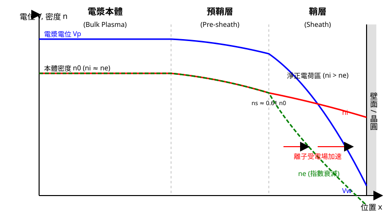
<figcaption>圖 18-1　電漿鞘層電位與密度分佈（AI 繪製的示意圖）</figcaption>
</figure>

## 18.3 電漿源放電架構：CCP 與 ICP

### 18.3.1 電容耦合電漿 (CCP) 的架構與物理機制

電容耦合電漿（Capacitively Coupled Plasma, CCP）是半導體製程中最傳統且廣泛應用的放電架構。其幾何結構本質上為一組平行平板電極（Parallel-Plate Electrodes），電極間距通常介於數公分之內，外加一組射頻（Radio Frequency, RF，工業標準頻率通常為 13.56 MHz 或更高頻率）交流電源驅動。

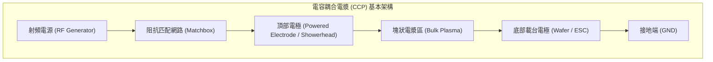

在典型的驅動配置中，RF 功率透過阻抗匹配網路（Impedance Matching Network）傳輸至其中一個電極（通常為頂部氣體噴灑頭 Showerhead，或是置放晶圓的下部靜電吸盤 Electrostatic Chuck, ESC），另一電極與反應腔壁則接地。

#### 放電機制與加熱模式
在 CCP 中，電子能量的獲取主要依賴於極板間電場的加速。根據操作壓力與功率條件，CCP 的放電可分為兩種主要物理模式：
1. **$\alpha$ 模式（無碰撞或波包反衝加熱，Stochastic Heating / Sheath Heating）**：在低氣壓（數十至數百 mTorr）下，電子被快速移動且震盪的鞘層邊界（Oscillating Sheath Boundary）推擠反彈。電子在與前進的鞘層碰撞時獲取大量動能，並將能量傳入電漿主體引發游離。此過程不需要頻繁的氣體分子碰撞，能量傳遞效率取決於鞘層運動速度。
2. **$\gamma$ 模式（二次電子發射引發崩潰，Secondary Electron Emission Mode）**：在高功率或高氣壓下，高能離子轟擊陰極表面，釋放出二次電子（Secondary Electrons，發射係數記為 $\gamma_{se}$）。這些電子受到鞘層強大靜電場的猛烈加速，以極高能量射入塊狀電漿區（Bulk Plasma），引發一連串雪崩式的電子碰撞游離（Avalanche Ionization）。

#### 電壓降分配與面積效應
在實際非對稱反應腔設計中，主動電極（Powered Electrode）的面積通常小於接地電極與導電金屬腔壁面積的總和。若以電容模型分析兩側鞘層，施加於兩電極的射頻電壓降分配比與電極表面積成反比。根據簡化的無碰撞解析模型（Lieberman Analytical Model），高壓鞘層電壓降 $V_1$ 與低壓鞘層電壓降 $V_2$ 的比例滿足：

$$
\frac{V_1}{V_2} = \left( \frac{A_2}{A_1} \right)^q
$$

式中 $A_1$ 與 $A_2$ 分別為兩電極的有效表面積；指數 $q$ 在理想無碰撞鞘層中理論極限為 4，但在實際考量碰撞效應、空間幾何非對稱性及電漿密度分佈後，實務觀測之 $q$ 值通常介於 1 到 2 之間。由於面積較小的電極（通常為晶圓載台）會建立極大的自偏壓（Self-bias Voltage, $V_{dc}$），這使得離子在穿越該側鞘層時能獲得強大的定向動能，驅動高度非等向性的物理濺擊。

#### 等效阻抗電路模型
為了進行機台阻抗匹配設計與電力監控，CCP 系統常被抽象化為集總參數電路（Lumped Parameter Circuit）。塊狀電漿本身具備導電性，等效為電阻 $R_p$（代表電子與中性粒子的碰撞歐姆耗散）串聯電感 $L_p$（代表電子的慣性，Inertial Inductance）：

$$
L_p = \frac{m_e d_p}{n_e e^2 A} = \frac{1}{\omega_{pe}^2 C_0}
$$

式中 $m_e$ 為電子質量，$d_p$ 為電漿塊厚度，$n_e$ 為電漿電子密度，$e$ 為基本電荷，$A$ 為截面積，$\omega_{pe}$ 為電子電漿頻率。

電漿與電極之間的空間電荷鞘層則等效為無碰撞電容 $C_{sh}$ 並聯一個由離子流傳導的非線性電阻以及代表鞘層位移電流的非線性阻抗。在 RF 頻率下，阻抗主要由鞘層電容所主導，系統呈現強烈容抗特性，因此需要高感抗的自動匹配箱（Auto-Matcher）進行共振調諧，以消除反射功率。

---

### 18.3.2 感應耦合電漿 (ICP) 的架構與渦電流加熱

感應耦合電漿（Inductively Coupled Plasma, ICP）屬於高密度電漿（High-Density Plasma, HDP）源的一種。其核心架構是藉由線圈（平面螺線形或圓柱螺旋形）通入高頻交流電流，穿透介電窗（Dielectric Window，常見材質為石英 $\text{SiO}_2$ 或高純度氧化鋁 $\text{Al}_2\text{O}_3$）在反應腔內建立時變磁場，再由時變磁場感應出封閉的同心圓形渦電流電場（Induced Azimuthal Electric Field, $E_\theta$）。

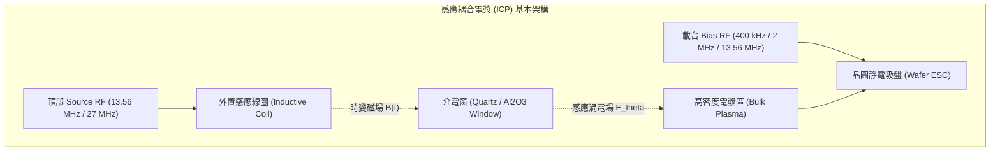

#### 電磁感應加熱物理原理
根據法拉第電磁感應定律（Faraday's Law of Induction）：

$$
\nabla \times \mathbf{E} = -\frac{\partial \mathbf{B}}{\partial t}
$$

當 RF 電流通過天線線圈時，產生垂直於電流方向的震盪磁場 $\mathbf{B}$，該磁場進而在電漿表面感應出平行於電極表面（與管壁或介電窗平行）的電場 $\mathbf{E}_\theta$。此電場不會垂直穿過電極建立厚重的空間電荷鞘層，而是驅使電漿內部的電子在腔體周向進行高速環形運動。

電子在運動路徑中透過頻繁的碰撞（碰撞歐姆加熱）或反衝（非碰撞反衝加熱）將動能傳遞給中性氣體分子，產生極高效率的連鎖游離。

#### 集膚效應與穿透深度
感應電磁波無法無限穿透高導電性的電漿，而是會在表面發生集膚效應（Skin Effect）。電磁場隨深度呈指數衰減，其感應電場特徵穿透深度稱為無碰撞集膚深度（Collisionless Skin Depth, $\delta_p$）：

$$
\delta_p = \frac{c}{\omega_{pe}} = \sqrt{\frac{m_e}{\mu_0 n_e e^2}}
$$

式中 $c$ 為光速，$\mu_0$ 為真空導磁率。當電漿密度達到 $n_e \sim 10^{11} \text{ cm}^{-3}$ 時，集膚深度約為數公分（典型值約 1 至 3 cm）。因此，ICP 的高密度游離主要集中在介電窗正下方的淺表集膚層區域內，隨後藉由雙極擴散（Ambipolar Diffusion）均勻化至整片晶圓表面。

#### E 模式至 H 模式躍遷
ICP 放電具備兩種相異的運作態樣：
1. **E 模式（靜電電容模式，Electrostatic Mode）**：在極低 RF 輸入功率下，線圈端點存在的高交流電壓直接透過介電窗形成寄生電容耦合（Capacitive Coupling）。此時電漿發光暗淡、電子密度較低（約 $10^9 \sim 10^{10} \text{ cm}^{-3}$），放電機制本質上與 CCP 相同。
2. **H 模式（感應電磁模式，Electromagnetic Mode）**：當輸入功率提升突破臨界臨界值（Threshold Power）時，感應電場強度足以克服能量損失，系統會瞬間「點火」轉入以渦電流為主的感應耦合狀態。此時電漿發出強烈輝光，電子密度猛增一至兩個數量級（躍升至 $10^{11} \sim 10^{12} \text{ cm}^{-3}$），阻抗呈現急遽變化。

在先進製程機台設計中，為了防止介電窗因 E 模式的寄生靜電電容產生高壓鞘層，造成高能離子濺蝕介電窗表面而污染晶圓（例如造成石英釋出氧雜質或氧化鋁顆粒污染），工程上常在線圈與介電窗之間插入一組開槽的金屬屏蔽板，稱為法拉第屏蔽（Faraday Shield）。此金屬結構允許時變磁場穿透，但將靜電場短路導地，徹底消除 E 模式耦合。

---

### 18.3.3 CCP 與 ICP 之物理特性與製程操作區間比較

兩種電漿源由於能量耦合途徑的本質差異，其操作壓力範圍、電漿密度分佈及離子能量分佈函數（IEDF）具備截然不同的物理特徵。

| 比較維度 | 電容耦合電漿 (CCP) | 感應耦合電漿 (ICP) |
| :--- | :--- | :--- |
| **主要能量耦合形式** | 靜電場 / 空間電荷鞘層震盪 | 時變磁場誘發之感應渦電場 |
| **典型電漿密度 ($n_e$)** | 典型值 $10^{9} \sim 10^{10} \text{ cm}^{-3}$ | 典型值 $10^{11} \sim 10^{12} \text{ cm}^{-3}$（高密度電漿） |
| **典型游離率 (Ionization Degree)** | 極低（典型值 $< 0.01\%$ 至 $0.1\%$） | 較高（典型值 $0.1\%$ 至數 $\%$） |
| **操作壓力區間** | 廣域，數十 mTorr 至數個 Torr（甚至常壓） | 極低壓，典型值約 1 至 50 mTorr |
| **鞘層厚度 ($s$)** | 較厚（受高 RF 偏壓影響，約數百 $\mu\text{m}$ 至數 mm） | 較薄（由於密度極高，德拜長度極短，約數十至數百 $\mu\text{m}$） |
| **主要解離特性** | 分子碎裂程度較低，可保留特定聚合自由基 | 高游離率與深度分子碎裂（高度解離） |
| **主要製程應用** | 介電質蝕刻（HARC oxide/nitride）、PECVD | 導體蝕刻（多晶矽閘極、金屬層、STI 淺溝槽） |

!!! note "壓力與平均自由徑的權衡"
    CCP 之所以能在較高氣壓（Torr 級）下穩定放電，是因為其極板間距小，不需要極長平均自由徑（Mean Free Path）即可透過鞘層能量注入維繫碰撞鏈；這使得 CCP 特別適用於需要藉由高氣壓聚合反應保護側壁的二氧化矽垂直深孔蝕刻（見第 19 章）。相反地，ICP 的渦電流在低壓下（數 mTorr）運作最佳，由於中性碰撞少，離子在鞘層內部不易發生碰撞散射，能維持近乎垂直入射的單峰高指向性入射。

---

### 18.3.4 離子通量與離子能量的獨立調控機制

在先進非等向性乾蝕刻製程中，工程師追求的終極控制目標為：**獨立調節離子通量（Ion Flux, $J_i$）與離子轟擊動能（Ion Energy, $E_i$）**。
- 離子通量 $J_i = n_s u_B$（其中 $n_s$ 為鞘層邊界電漿密度，$u_B$ 為波姆速度）決定反應速率（Etch Rate）。
- 離子轟擊動能 $E_i \approx e(V_p - V_{dc})$ 決定化學鍵斷鍵能力、光阻選擇比（Selectivity）與晶格物理損傷（Damage）。

#### ICP 的源/載台解耦（Source-Bias Decoupling）架構
ICP 在架構上天然具備了通量與能量解耦的優勢。
- **頂部 Source RF**：功率施加於感應線圈，專門負責將能量耦合進渦電流，直接決定中性氣體的游離速率，從而精準掌控電漿主體密度 $n_e$（即離子通量 $J_i$）。
- **底座 Bias RF**：功率獨立施加於承載晶圓的下部電極（ESC）。透過調控載台的 RF 偏壓振幅與自偏壓 $V_{dc}$，專門決定吸引正離子衝向晶圓的鞘層靜電位差，進而獨立設定離子的平均轟擊能量 $E_i$。

在此架構下，工程師可將 Source RF 功率推至數千瓦以獲得龐大的離子流，同時將 Bias RF 控制在低偏壓，實現「高通量、低損傷」的精密淺溝槽蝕刻（如 GAAFET 奈米片修飾）；或維持極高 Bias RF 以實施垂直物理重轟擊。

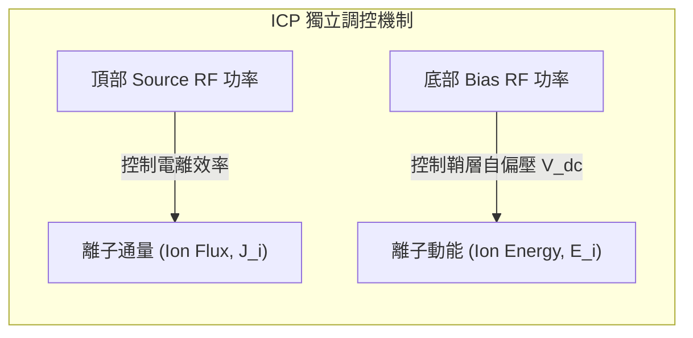

#### 雙頻與多頻 CCP (Dual-Frequency CCP, DF-CCP) 的折衷與限制
傳統單頻 CCP 無法實現通量與能量的解耦：提高單一 RF 功率會同時增加電漿密度與極板間的自偏壓。為了克服此瓶頸，現代先進介電質蝕刻機台發展出雙頻電容耦合（Dual-Frequency CCP, DF-CCP）技術。

DF-CCP 通常由一個高頻源（VHF，例如 60 MHz、100 MHz 或 162 MHz）與一個低頻源（LF，例如 400 kHz、2 MHz 或 13.56 MHz）混合驅動：
1. **高頻源 (VHF) 的角色**：高頻電場交變極快，電子在鞘層震盪中可進行高頻次反衝加熱，高頻位移電流可大幅提升歐姆耗散，因此 **VHF 主要扮演電漿密度的調節者（控制通量）**。此外，由於 VHF 頻率遠高於離子電漿頻率（$\omega_{pi}$），離子無法跟隨交變電場加速，鞘層電壓降較小。
2. **低頻源 (LF) 的角色**：低頻週期極長，離子能夠即時響應低頻電場的瞬時變化，並建立極高的自偏壓。因此 **LF 主要扮演鞘層電壓調變者（控制離子能量）**。

!!! warning "DF-CCP 的非線性頻率耦合效應（Frequency Coupling Effect）"
    雖然理論上 DF-CCP 意圖將通量（VHF）與能量（LF）解耦，但在實際物理操作中，解耦具有根本的局限性：
    - **鞘層調變交互作用**：當施加龐大 LF 偏壓以提高離子能量時，LF 會劇烈改變瞬時鞘層厚度 $s(t)$。鞘層的大幅度擴張與壓縮會動態調製 VHF 的有效阻抗與位移電流通道，進而導致高頻電漿密度發生非預期的擾動。
    - **非線性交調失真（Intermodulation）**：電漿鞘層為強烈的非線性電容，VHF（$\omega_H$）與 LF（$\omega_L$）在非對稱鞘層混合時，會產生大量的混合頻率諧波（$n\omega_H \pm m\omega_L$）。這些交調信號會在阻抗匹配箱與供電線路中產生反饋反射，削弱控制閉環的穩定度。
    
    因此，DF-CCP 僅能在特定的功率與頻率視窗內實現「準解耦（Quasi-decoupling）」，在製程最佳化時必須透過脈衝電漿技術（Pulsed Plasma）等外加手段作進一步的時域解耦補償。

!!! example "產業實例：雙頻 CCP 與高密度 ICP 在先進邏輯節點的應用分工"
    在先進晶圓廠的蝕刻製程模組中（見第 19 章）：
    - **導體與閘極蝕刻機台**：如應用材料（Applied Materials）的 Centris Sym3 或科林研發（Lam Research）的 Kiyo 系列，核心均採用 **ICP 架構**。其優勢在於 1 至 10 mTorr 極低壓下運作，使金屬閘極與極細多晶矽側壁不易發生碰撞扭曲，且高解離率有利於快速將蝕刻鹵素前驅氣體（如 $\text{Cl}_2$、$\text{HBr}$）充分分解。
    - **後段金屬介電質與 3D NAND 高深寬比接觸孔（HARC）蝕刻**：主要採用如東京威力科創（Tokyo Electron Limited, TEL）的 Tactras 系列或 Lam Research 的 Flex 系列等 **雙頻/多頻 CCP 機台**。高氣壓（數十至數百 mTorr）下的 CCP 能夠維持穩定的碳氟聚合物（Fluorocarbon Polymers, 如 $\text{C}_4\text{F}_6$、$\text{C}_4\text{F}_8$）化學沉積鏈，在數十微米深的奈米孔穴側壁形成保角防護膜，防止深孔側壁掏空（Bow Profile），展現了 CCP 獨特的聚合物調控優勢。

<!-- fig:2 -->
<figure markdown>
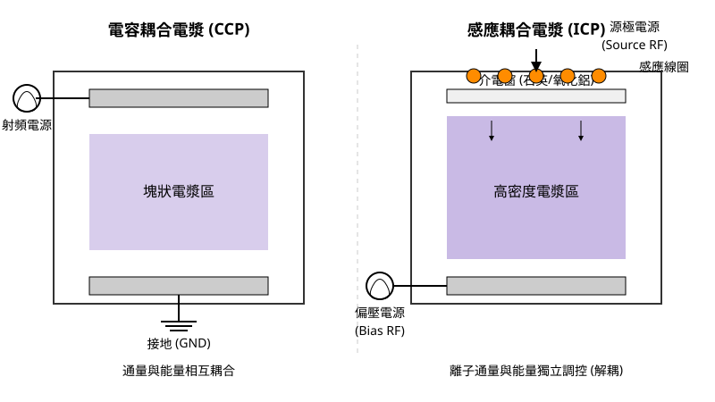
<figcaption>圖 18-2　CCP 與 ICP 放電架構比較（AI 繪製的示意圖）</figcaption>
</figure>

## 18.4 電漿即時診斷技術

### 18.4.1 光發射光譜（OES）原理與化學物種監測

光發射光譜（Optical Emission Spectroscopy, OES）是半導體電漿製程中最廣泛採用的非侵入式（Non-intrusive）原位（*in-situ*）即時診斷技術。其基本物理機制建立在電漿內部高能電子與中性氣體原子、分子或自由基（Radicals）之間的非彈性碰撞激發，以及隨後發生的自發輻射躍遷（Spontaneous Emission）。

當低壓電漿中的自由電子經電場加速獲得足夠動能時，與基態粒子 $X$ 發生碰撞，將能量轉移給粒子外層電子，使其躍遷至較高的受激能階 $X^*$：

$$e^- + X \rightarrow X^* + e^-$$

處於激發態的粒子壽命極短（典型值約為 $10^{-8}\text{ s}$），電子會自發性地躍遷回基態或較低的激發態，並釋放出具有特定離散波長的光子：

$$X^* \rightarrow X + h\nu$$

其中 $h$ 為普朗克常數（Planck constant，典型值 $6.626 \times 10^{-34}\text{ J}\cdot\text{s}$），$\nu$ 為發射光頻率。躍遷前後兩能階的能量差 $\Delta E = E_2 - E_1$ 與發射光波長 $\lambda$ 滿足普朗克-愛因斯坦關係式：

$$\lambda = \frac{hc}{\Delta E}$$

其中 $c$ 為真空光速。由於每種化學元素的量子化電子能階結構皆為獨一無二，輻射出的光子波長即構成該物種的「指紋光譜」。例如，在氟碳電漿蝕刻矽的過程中，常監測的特徵譜線包括氟原子 $\text{F}^*$（$703.7\text{ nm}$）、氧原子 $\text{O}^*$（$777.4\text{ nm}$）、碳氟自由基 $\text{CF}_2^*$（帶狀光譜，約 $240\sim 320\text{ nm}$）以及反應生成物 $\text{SiF}^*$（約 $440\text{ nm}$）。

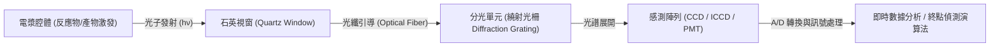

在量測架構中，反應腔側壁安裝有光學級石英視窗，電漿輻射光透過石英光纖聚焦鏡組引導至分光儀內部，經由凹面反射鏡與繞射光柵（Diffraction Grating）將多波長光束依角度色散展開，最後投射至感光耦合元件（Charge-Coupled Device, CCD）陣列或光電倍增管（Photomultiplier Tube, PMT）進行光電轉換與數位化採集，其光譜解析度通常可達 $0.1\sim 1\text{ nm}$。

---

### 18.4.2 終點偵測（EPD）之物理演算法基礎

在乾式蝕刻製程中（詳見第 19 章），若蝕刻時間不足會導致未完全穿透薄膜（Under-etch），若時間過長則會侵蝕下方材料層或破壞遮罩，造成嚴重的過蝕刻（Over-etch）。因此，必須在被蝕刻薄膜完全被移除、下層材料剛暴露的瞬間精準停止製程，此機制稱為終點偵測（Endpoint Detection, EPD）。

OES 進行終點偵測的物理基礎是反應腔內特定反應物（Reactants）與副產物（By-products）濃度的相態轉變：
1. **反應物耗損與回升**：在蝕刻進行時，通入的蝕刻反應氣體（如 $\text{F}$ 自由基）大量消耗於固相化學反應；當薄膜耗盡時，化學反應驟停，未反應的自由基濃度迅速攀升，對應的光發射強度 $I_{\text{reactant}}(t)$ 產生突波性上升。
2. **反應產物生成與消退**：薄膜正在被蝕刻時，揮發性副產物（如 $\text{SiF}_x$）在電漿中持續被激發發光；當薄膜蝕刻完畢，副產物來源消失，其特徵光譜強度 $I_{\text{product}}(t)$ 會陡峭下滑。

為了避免人為觀察的延遲並克服電漿輝光雜訊，控制伺服器採用即時數值演算法判定終點。

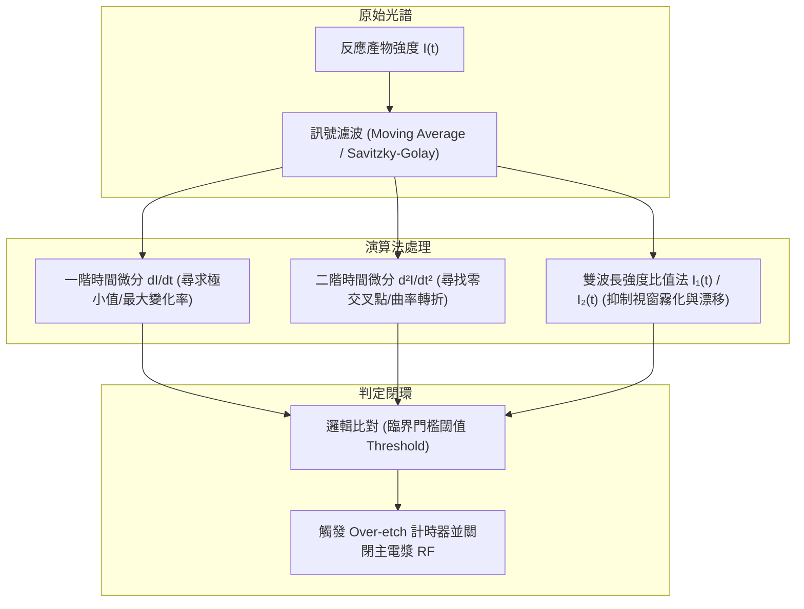

#### 1. 微分臨界法（Differential Threshold Method）
利用強度訊號對時間的一階微分 $\frac{dI(t)}{dt}$ 與二階微分 $\frac{d^2I(t)}{dt^2}$ 消除直流偏移（DC Drift）。當薄膜即將穿透時，斜率 $\left|\frac{dI(t)}{dt}\right|$ 出現極值；二階微分通過零軸（Zero-crossing）的點即定義為轉折拐點（Inflection Point），此特徵不受全域發光絕對強度的漂移干擾。

#### 2. 強度比值法（Ratio Metric Method）
反應腔石英視窗會隨製程次數增加而沉積聚合物薄膜，導致整體透光率衰減（視窗霧化效應）。單一波長的絕對強度 $I(t)$ 會隨機台運作時間而下降。此時可選取一個對蝕刻不敏感的背景譜線（如惰性氣體氬氣 $\text{Ar}^*$，$750.4\text{ nm}$）或取反應物與生成物的比值：

$$R(t) = \frac{I_{\text{product}}(t)}{I_{\text{reactant}}(t)} \quad \text{或} \quad R(t) = \frac{I_{\text{product}}(t)}{I_{\text{background}}(t)}$$

比值法能抵消全域光強度的物理波動，大幅提高訊號雜訊比（Signal-to-Noise Ratio, SNR）。

#### 3. 主成分分析法（Principal Component Analysis, PCA）
在先進微縮節點中，晶圓表面開孔率（Open Area Ratio）往往低於 $1\%$，化學物種發光強度的變化極微弱，單一波長常被雜訊淹沒。多通道 OES 同時採集數百個波長的時序資料矩陣 $\mathbf{X}$，經由共變異數矩陣之特徵值分解：

$$\mathbf{X} = \mathbf{T}\mathbf{P}^T + \mathbf{E}$$

將原始光譜投影至前幾項方差最大的正交主成分分數向量（Scores $\mathbf{T}$），利用降維後的主成分投影軌跡進行多元統計製程管制，即使在開孔率極低的情況下，仍能捕捉相變化特徵。

---

### 18.4.3 朗繆爾探針（Langmuir Probe）診斷機制

朗繆爾探針是一種侵入式（Intrusive）靜電診斷工具，由耐高溫的高熔點金屬細絲（如鎢或鉑，直徑通常為數十微米至數毫米）封裝於陶瓷絕緣管中構成。將探針針尖裸露並直接伸入電漿核心，對其外加一可變的直流偏壓 $V_B$，並量測流經探針的淨電流 $I$，所測得之 $I-V$ 特性曲線是提取電漿微觀熱力學參數的標準方法。

```
     電流 I
       ^
       |                                     電子飽和區
       |                                  /----------------
       |                             /'''
       |                         /'''
       |                     /''' (電子過渡區)
       |                 /''' 
  I=0 -+---------------/---------------------------------> 探針偏壓 V_B
       |              ^         ^
       |            V_f        V_p
       |-------------/ 離子飽和區 (I_i,sat)
       |
```

#### 1. $I-V$ 特性曲線的三大物理區域
*   **離子飽和區（Ion Saturation Region, $V_B \ll V_f$）**：
    當施加的偏壓遠低於浮動電位（Floating Potential, $V_f$）時，探針表面建立強排斥電場，電漿中所有電子皆無法克服位障抵達探針；相反地，正離子被吸引至探針表面。進入探針鞘層邊界的離子通量受到波姆判據（Bohm Criterion）限制，其收集的離子飽和電流 $I_{i,\text{sat}}$ 為：

    $$I_{i,\text{sat}} = \exp\left(-\frac{1}{2}\right) e n_i A_p \sqrt{\frac{k_B T_e}{M_i}} \approx 0.61\, e n_i A_p u_B$$

    其中 $e$ 為基本電荷，$n_i$ 為無擾動電漿離子密度，$A_p$ 為探針表面積，$k_B$ 為波茲曼常數，$T_e$ 為電子溫度，$M_i$ 為離子質量，$u_B = \sqrt{k_B T_e / M_i}$ 為波姆速度。在此區域，電流大小主要由離子密度與電子溫度決定。

*   **電子過渡區（Electron Retarding Region, $V_f < V_B < V_p$）**：
    當電壓逐漸升高但仍低於電漿電位（Plasma Potential, $V_p$）時，探針周圍仍存在排斥電子的減速鞘層。若假設電子速度分佈符合馬克士威-波茲曼分佈（Maxwell-Boltzmann Distribution），僅有動能大於位能障壁 $e(V_p - V_B)$ 的高能電子才能穿透鞘層到達探針表面。此時電子電流 $I_e$ 隨偏壓呈指數關係增長：

    $$I_e(V_B) = I_{e,\text{sat}} \exp\left[ -\frac{e(V_p - V_B)}{k_B T_e} \right]$$

    淨探針電流為電子電流與離子電流之代數和：$I(V_B) = I_e(V_B) - |I_{i,\text{sat}}|$。當 $I(V_B) = 0$ 時，抵達探針的電子通量與離子通量相等，此時的電壓即定義為浮動電位 $V_f$。

*   **電子飽和區（Electron Saturation Region, $V_B \ge V_p$）**：
    當偏壓等於或大於電漿電位時，探針相對於電漿呈正電位，鞘層內的減速位障消失。電漿中的所有熱運動電子皆無阻礙地被探針收集，此時電子電流達到飽和：

    $$I_{e,\text{sat}} = \frac{1}{4} e n_e A_p \bar{v}_e = e n_e A_p \sqrt{\frac{k_B T_e}{2\pi m_e}}$$

    其中 $m_e$ 為電子質量，$\bar{v}_e = \sqrt{\frac{8 k_B T_e}{\pi m_e}}$ 為電子平均熱運動速度。

#### 2. 電漿參數之數學提取方法
利用朗繆爾探針實測曲線，可依循標準數值流程提取電漿參數：

1.  **電漿電位 $V_p$**：在電子過渡區轉入飽和區時，電流變化率急劇反轉。對 $I-V$ 曲線取一階導數 $\frac{dI}{dV_B}$ 達極大值處，或取二階導數過零點 $\frac{d^2I}{dV_B^2} = 0$，即對應電漿電位 $V_p$。
2.  **電子溫度 $T_e$**：自淨電流中扣除離子飽和電流背景值後，對純電子電流取自然對數：
    $$\ln I_e(V_B) = \ln I_{e,\text{sat}} - \frac{e(V_p - V_B)}{k_B T_e}$$
    在過渡區內，$\ln I_e$ 對 $V_B$ 的作圖呈現直線，該直線的斜率 $S$ 與電子溫度成反比：
    $$T_e = \frac{e}{k_B} \left( \frac{d \ln I_e}{d V_B} \right)^{-1}$$
    若以電子伏特（$\text{eV}$）為單位表示溫度（即 $T_{e,\text{eV}} = k_B T_e / e$），則數值直接等於斜率的倒數 $1/S$。
3.  **電漿密度 $n_e$ 與 $n_i$**：求得 $T_e$ 與 $V_p$ 後，可將 $I_{e,\text{sat}}$ 代入電子飽和電流公式計算 $n_e$；或將 $T_e$ 代入波姆電流公式計算 $n_i$。在準電中性假設下，$n_e \approx n_i$。

!!! warning "射頻（RF）補償與探針沉積限制"
    在工業用 RF 電漿（如 13.56 MHz CCP 或 ICP）中，電漿電位 $V_p(t)$ 存在極大的高頻交流振盪。若直接量測，探針電壓差會被時間調變，導致 $I-V$ 曲線發生失真性平滑（Distortion），大幅高估電子溫度。因此，工業級朗繆爾探針必須在針尖後方串聯一組諧振微型電感線圈（RF Choke Filters）並配合補償電極（Compensation Electrode），使探針本體電位隨 RF 電漿電位同步浮動，以維持探針鞘層兩端的高頻靜壓差穩定。此外，在含有沉積性氣體（如 $\text{C}_4\text{F}_8$、$\text{CH}_4$）的電漿中，探針表面易被聚合物包覆鈍化而失效，需週期性施加高偏壓以電子轟擊熱清理探針。

---

### 18.4.4 前瞻電漿診斷技術：微波干涉儀與四極柱質譜儀

在量產機台與先進製程研發中，朗繆爾探針常因侵入性干擾流場且造成金屬污染而受限，因此需仰賴其他非接觸式或互補性的先進診斷技術。

#### 1. 微波干涉儀（Microwave Interferometry）
微波干涉儀利用無害的高頻電磁波穿透電漿，藉由電波相位延遲以絕對精度量測電子密度。電漿在電磁學中可視為色散介質，其未受磁化時的等效介電常數 $\varepsilon_r$ 與電漿頻率（Plasma Frequency）$\omega_{pe}$ 有關：

$$\varepsilon_r = 1 - \frac{\omega_{pe}^2}{\omega^2} = 1 - \frac{n_e e^2}{\varepsilon_0 m_e \omega^2}$$

其中 $\omega$ 為微波探測角頻率，$\varepsilon_0$ 為真空電容率。當微波角頻率大於電漿頻率（$\omega > \omega_{pe}$）時，微波可穿透電漿。微波在真空與在電漿中的折射率不同，穿過長度為 $L$ 的電漿路徑後，所產生的相對相位差 $\Delta \phi$ 可透過與參考路徑信號干涉求得：

$$\Delta \phi = \int_0^L \left( k_0 - k_p \right) dx \approx \frac{e^2}{2 \varepsilon_0 m_e c \omega} \int_0^L n_e(x) dx$$

微波干涉儀的輸出訊號直接反映了探測路徑上的線積分電子密度（Line-averaged Electron Density），完全不破壞電漿狀態，亦不受腔壁聚合物污染的影響。

#### 2. 四極柱質譜儀（Quadrupole Mass Spectrometry, QMS）
OES 僅能監測發光之激發態物種，無法得知處於基態的中性分子、大分子聚合物基團或未發光的帶電離子真實濃度。四極柱質譜儀透過在腔壁開孔，經由微米級微孔孔徑結合多級渦輪分子泵（Turbo Molecular Pump）進行差分抽氣（Differential Pumping），將樣品氣體自 mTorr 級的製程環境抽入至小於 $10^{-6}\text{ Torr}$ 的高真空質譜室中。

QMS 內部配置離子化腔、由四根平行金屬電極柱構成的四極場質量分析器（Quadrupole Mass Filter）以及二次電子倍增管（Secondary Electron Multiplier, SEM）：
*   **中性基團分析（Residual Gas Analysis, RGA）**：利用內部鎢絲發射電子轟擊中性氣體分子使其離子化，隨後透過由直流電壓 $U$ 與射頻電壓 $V\cos(\omega t)$ 疊加產生的雙曲電場，僅允許特定荷質比（Mass-to-Charge Ratio, $m/z$）的離子穩定通過四極柱並被偵測。
*   **離子能量與角度分析（IEDF Analysis）**：若關閉內部游離源，直接引導從電漿鞘層穿透微孔射出的原生離子，並在四極柱前端串聯靜電能量分析器（Electrostatic Energy Analyzer, EEA），即可直接量測到達晶圓表面的離子能量分佈函數（Ion Energy Distribution Function, IEDF），此為研究離子轟擊物理機制最關鍵的定量量測方法。

| 診斷技術 | 侵入性 | 主要量測物理量 | 空間解析度 | 工業實作主要限制 |
| :--- | :--- | :--- | :--- | :--- |
| **光發射光譜 (OES)** | 完全非侵入 | 受激化學物種相對強度、電子能態分佈 | 視線積分（低空間解析，除非採斷層掃描） | 視窗霧化、難以直接定量中性基態物種濃度 |
| **朗繆爾探針 (Langmuir Probe)** | 高度侵入 | 電子密度 $n_e$、電子溫度 $T_e$、電漿電位 $V_p$ | 高（毫米級局部量測） | 沉積污染短路、金屬污染風險、高頻 RF 干擾補償困難 |
| **微波干涉儀** | 完全非侵入 | 路徑平均電子密度 $\bar{n}_e$ | 視線積分（無局部解析度） | 硬體空間配置大、微波繞射效應限制最小光束束徑 |
| **四極柱質譜儀 (QMS)** | 低侵入（孔徑採樣）| 中性基態粒子、解離碎片分子量、離子能量分佈 (IEDF) | 邊界採樣（反映電極壁面通量） | 需多級差分真空抽氣泵浦、採樣孔孔徑易受聚合物沉積堵塞 |

## 18.5 設備與廠商技術

在半導體製程中，電漿物理的理論必須透過極其精密的機械與電子系統才能轉化為可控的工藝。本節將探討實現電漿製程（如蝕刻與沉積）的硬體架構，從真空環境的建立、晶圓的精密夾持與溫控，到高頻電源的阻抗匹配，最後介紹產業中主流的設備實務。

### 18.5.1 真空傳送系統與環境控制

電漿製程必須在低壓環境下進行，以確保平均自由徑（Mean Free Path）足以讓離子獲得加速動能，並維持化學反應氣體的純度。現代半導體設備多採模組化設計，其晶圓傳輸路徑如下：

1.  **設備前端模組 (Equipment Front End Module, EFEM)**：
    此區域處於大氣壓力下，內部配置大氣機械手（Atmospheric Robot），負責從晶圓傳送盒（FOUP）中抓取晶圓。EFEM 內通常維持極高的潔淨度（見第 55 章），並設有晶圓對準器（Aligner）以確定晶圓的缺口（Notch）位置。
2.  **負載鎖定室 (Load Lock)**：
    這是連接大氣與高真空環境的緩衝區。晶圓進入後，門戶關閉，系統先啟動機械泵（Mechanical Pump）進行「粗抽」（Roughing），將壓力降至約 $10^{-1}$ 至 $10^{-3}$ Torr。
3.  **真空傳輸腔 (Transfer Chamber)**：
    當負載鎖定室壓力降至預設值後，與傳輸腔之間的閥門開啟。真空機械手將晶圓送入維持在高真空狀態的傳輸腔。
4.  **製程反應腔 (Process Chamber)**：
    這是電漿產生的核心區域。為了達到製程所需的 mTorr 級真空度，反應腔通常配備**渦輪分子泵 (Turbo Molecular Pump, TMP)**。TMP 利用高速旋轉的葉片（轉速通常達每分鐘數萬轉）物理性地將氣體分子撞擊排出，能提供極高的抽氣速率與極低的極限壓力。

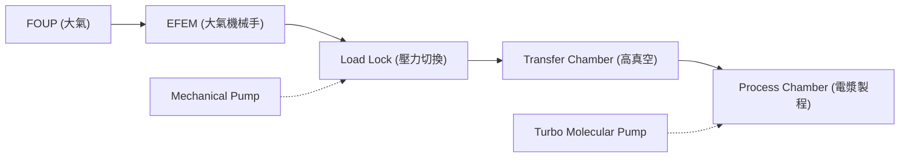

### 18.5.2 晶圓夾持與熱管理技術

在電漿製程中，離子轟擊會產生大量的熱能。若無法有效散熱，光阻可能熔化，或導致化學反應速率不均勻。

#### 靜電吸盤 (Electrostatic Chuck, ESC)
為了在真空環境下固定晶圓並導熱，現代設備普遍使用靜電吸盤。其原理是利用庫倫力（Coulombic Force）或約翰遜-拉別克效應（Johnsen-Rahbek Effect）來吸附晶圓。
其吸附力 $F$ 可簡化表示為：
$$F = \frac{1}{2} \epsilon_0 \epsilon_r A \left( \frac{V}{d} \right)^2$$
其中 $\epsilon_0$ 為真空電容率，$\epsilon_r$ 為介電層的相對電容率，$A$ 為接觸面積，$V$ 為施加的直流高壓（典型值為數百至數千伏特），$d$ 為介電層厚度。

#### 背面氦氣冷卻 (He Backside Cooling)
由於真空環境下熱傳導效率極差，ESC 的表面會加工出微細溝槽，並通入**氦氣 (Helium)** 作為熱傳導介質。氦氣具有極佳的導熱係數且化學性質穩定。透過控制背面氦氣的壓力（典型值為 5 至 20 Torr），可以精確調節晶圓與冷卻基座（Pedestal）之間的熱交換效率，確保晶圓表面溫度均勻性。

### 18.5.3 高頻電源與自動阻抗匹配網路

電漿的產生依賴射頻（Radio Frequency, RF）電源，最常用的頻率為 13.56 MHz。然而，電漿本身的阻抗會隨著氣體成分、壓力與功率的改變而動態變化。為了確保 RF 功率能完全耦合至電漿中而非反射回產生器，必須使用**自動阻抗匹配器 (Auto-Matcher)**。

#### 阻抗匹配原理
RF 產生器的輸出阻抗通常固定為 $50 \, \Omega$。匹配網路的作用是透過可變電容（Tune 與 Load）將反應腔的複雜阻抗 $Z_L = R + jX$ 轉換為 $50 \, \Omega$。常見的電路拓撲包括：
*   **L 型網路**：結構簡單，適用於大多數阻抗範圍。
*   **$\pi$ 型網路**：提供更寬的匹配範圍與更好的諧波過濾。

匹配器內部的控制器會即時偵測反射功率（Reflected Power），並驅動伺服馬達調整電容值，使反射功率最小化，達成最大功率傳輸。

!!! note "反射功率的危害"
    若阻抗不匹配，反射功率會導致傳輸線發熱、損壞 RF 產生器，並造成電漿放電不穩定，直接影響蝕刻率或薄膜沉積的均勻性。

### 18.5.4 產業主流蝕刻與沉積機台架構實例

在先進製程中，電漿源的設計是各設備供應商的核心競爭力。主要分為電容耦合電漿 (CCP) 與感應耦合電漿 (ICP) 兩大技術路線（見 18.3 節）。

#### 主要廠商與產品技術比較

| 廠商 | 代表產品系列 | 技術路線與特點 | 主要應用 |
| :--- | :--- | :--- | :--- |
| **Lam Research** | Kiyo 系列 | ICP 電漿源，具備高度對稱的腔體設計，強調離子能量控制。 | 導體蝕刻（多晶矽、金屬閘極） |
| **Lam Research** | Flex 系列 | CCP 電漿源，採用多頻（Multi-frequency）設計，可獨立調控離子密度與能量。 | 介電質蝕刻（接觸孔、溝槽） |
| **Applied Materials** | Sym3 系列 | 強調對稱性與副產物控制，具備極高的抽氣效率以減少重新沉積。 | 先進導體蝕刻 |
| **Tokyo Electron** | Tactras 系列 | 模組化平台設計，支援高產出比，其電漿源具備優異的邊緣均勻性補償。 | 介電質與導體蝕刻 |
| **Lam Research** | VECTOR 系列 | PECVD 平台，利用電漿強化化學反應，降低製程溫度。 | 介電質薄膜沉積 |

#### 技術路線差異與選機考量
晶圓廠在選擇設備時，主要考量以下物理指標：
1.  **離子能量分佈 (IEDF)**：CCP 較擅長產生高能量離子以進行深孔蝕刻；ICP 則能產生高密度電漿且離子能量較低，適用於對損傷敏感的閘極蝕刻。
2.  **均勻性控制 (Uniformity)**：隨著晶圓邊緣效應（Edge Effect）日益嚴重，機台是否具備多區溫控（Multi-zone Heater）與邊緣環（Edge Ring）電位補償技術至關重要。
3.  **產出率 (Throughput)**：如 Tokyo Electron 的 Tactras 系列採用的多腔體並行架構，能在有限的無塵室空間內極大化產出。
4.  **製程窗口 (Process Window)**：機台對於壓力與功率調節的靈敏度，決定了其在不同技術節點間的通用性。

!!! example "產業實例：雙頻 CCP 的應用"
    在介電質蝕刻中，通常會使用高頻（如 60 MHz）來產生高密度的電漿（控制離子濃度），同時施加低頻（如 2 MHz）於基座以增加偏壓（控制離子轟擊能量）。這種解耦控制（Decoupled Control）是 Lam Research Flex 系列與 Tokyo Electron 蝕刻機台常見的設計邏輯。

### 18.5.5 設備監控與資料閉環

現代電漿設備已不再是孤立的加工單元。透過感測器，如**電漿發射光譜 (OES)** 監測化學物種變化，或透過 RF 感測器監測電壓與電流相位，資料會即時回傳至廠務端的進階製程控制（APC）系統。這種即時控制閉環（Real-time Control Loop）能補償腔體老化（Chamber Aging）帶來的漂移，確保每一片晶圓在電漿環境中經歷完全相同的物理過程。

## 本章重點

*   **熱力學非平衡特性**：低溫電漿的核心特徵為電子溫度遠高於離子與中性氣體溫度（$T_e \gg T_i \approx T_g$），這使得製程能在維持低環境溫度的同時，利用高能電子驅動複雜的化學反應。
*   **微觀碰撞機制**：電子與中性分子的非彈性碰撞產生了游離（維持放電）、激發（產生輝光）、解離（產生化學活性自由基）與附著（形成負離子）等關鍵物理化學過程。
*   **集體遮蔽與準電中性**：電漿具備集體效應，德拜長度（Debye Length）定義了電場被屏蔽的特徵距離；在巨觀尺度下，電漿主體維持電荷平衡的準電中性狀態。
*   **電漿頻率與電磁響應**：電子電漿頻率 $\omega_{pe}$ 決定了電磁波能否穿透電漿。當射頻頻率 $\omega < \omega_{pe}$ 時，電漿展現導體特性，電磁場僅能存在於集膚深度（Skin Depth）內。
*   **鞘層物理與波姆準則**：由於電子與離子遷移率差異，邊界會形成帶正電的鞘層。離子必須達到波姆速度（Bohm Velocity）才能進入鞘層，並受鞘層電場加速進行非等向性轟擊。
*   **電漿源架構差異**：電容耦合電漿（CCP）透過極板電場驅動，適合高壓介電質蝕刻；感應耦合電漿（ICP）透過時變磁場感應渦電流，能產生高密度電漿並實現離子通量與能量的獨立調控。
*   **即時診斷技術**：光發射光譜（OES）利用特徵譜線進行非侵入式終點偵測；朗繆爾探針（Langmuir Probe）則透過 $I-V$ 曲線提取電子溫度與電漿密度等關鍵熱力學參數。
*   **設備實務與熱管理**：真空系統（如渦輪分子泵）提供低壓環境，靜電吸盤（ESC）結合背面氦氣冷卻技術，確保晶圓在強烈離子轟擊下的溫度穩定性。


## 重點圖卡

複習時看這幾張就能抓住本章重點；[圖卡庫](../cards.md)可以下載成圖片。

<div class="ix-cards" markdown>

<figure markdown>
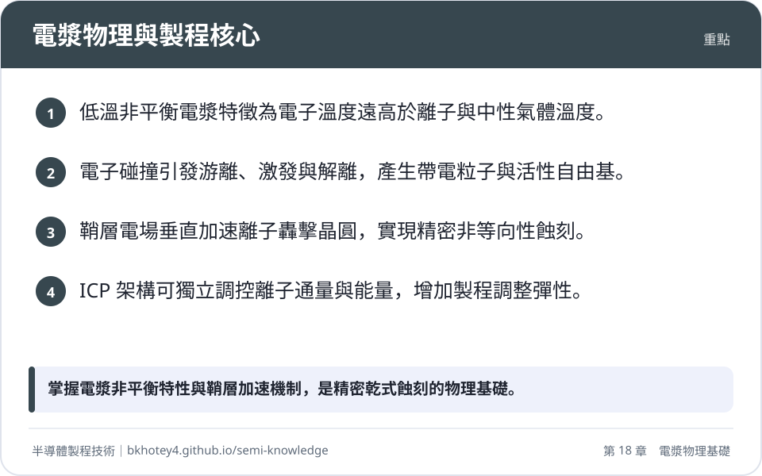
<figcaption>重點圖卡：電漿物理與製程核心</figcaption>
</figure>

<figure markdown>
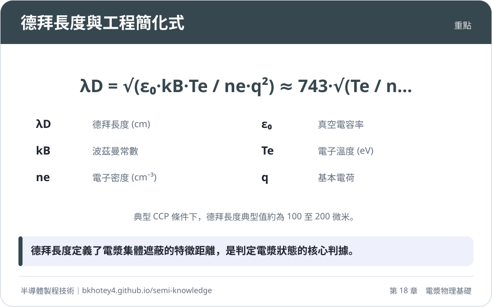
<figcaption>重點圖卡：德拜長度與工程簡化式</figcaption>
</figure>

<figure markdown>
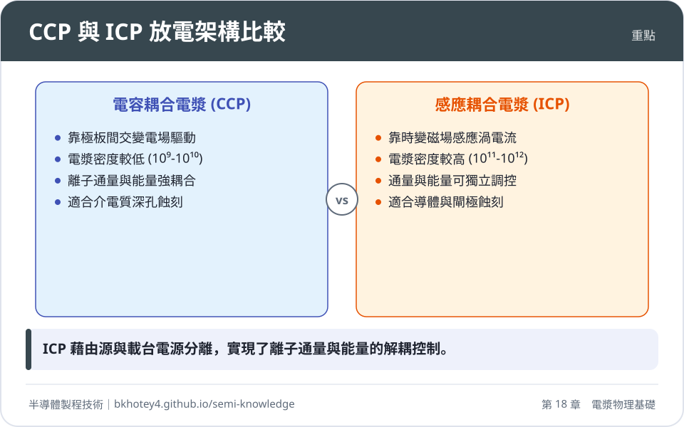
<figcaption>重點圖卡：CCP 與 ICP 放電架構比較</figcaption>
</figure>

<figure markdown>
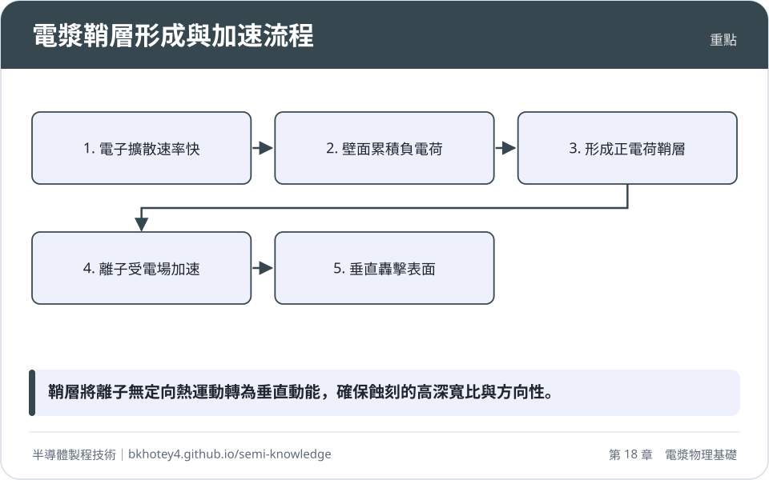
<figcaption>重點圖卡：電漿鞘層形成與加速流程</figcaption>
</figure>

</div>

## 習題

**1.** 試說明為何在低氣壓電漿中，電子溫度 $T_e$ 可以維持在數萬度（數個 eV），而中性氣體溫度 $T_g$ 卻能保持在近乎室溫？

??? success "參考解答"
    這源於電子與重粒子（離子、分子）之間的質量極度不對稱。當電子在電場中獲得能量後，與質量大其數萬倍的中性分子發生彈性碰撞時，單次碰撞的能量傳遞效率極低（$\Delta \eta \approx 2m_e/M \ll 10^{-4}$）。在低氣壓下，碰撞頻率不足以在有限的時間內讓電子將能量傳遞給重粒子達到熱平衡，因此形成了 $T_e \gg T_g$ 的熱力學非平衡態。

**2.** 已知某電漿反應腔內的電子密度 $n_e = 10^{10} \text{ cm}^{-3}$，電子溫度 $T_e = 4 \text{ eV}$。試計算其德拜長度 $\lambda_D$（單位：$\mu\text{m}$）。

??? success "參考解答"
    使用工程簡化公式：
    $\lambda_D \approx 743 \times \sqrt{\frac{T_e (\text{eV})}{n_e (\text{cm}^{-3})}} \text{ cm}$
    $\lambda_D \approx 743 \times \sqrt{\frac{4}{10^{10}}} = 743 \times \sqrt{4 \times 10^{-10}} = 743 \times 2 \times 10^{-5} \text{ cm}$
    $\lambda_D \approx 1486 \times 10^{-5} \text{ cm} = 1.486 \times 10^{-2} \text{ cm} = 148.6\ \mu\text{m}$

**3.** 考慮一個氬氣（Ar）電漿，離子質量 $M \approx 6.63 \times 10^{-26} \text{ kg}$，電子溫度 $T_e = 3 \text{ eV}$。
(1) 計算波姆速度 $u_B$。
(2) 若電漿本體密度 $n_0 = 10^{11} \text{ cm}^{-3}$，求進入鞘層邊界的離子通量 $\Gamma_i$。

??? success "參考解答"
    (1) 波姆速度 $u_B = \sqrt{\frac{k_B T_e}{M}}$。注意 $3 \text{ eV}$ 對應能量為 $3 \times 1.6 \times 10^{-19} \text{ J}$。
    $u_B = \sqrt{\frac{3 \times 1.6 \times 10^{-19}}{6.63 \times 10^{-26}}} \approx \sqrt{7.24 \times 10^6} \approx 2690 \text{ m/s}$。
    (2) 鞘層邊界密度 $n_s \approx 0.61 n_0 = 0.61 \times 10^{11} \text{ cm}^{-3} = 6.1 \times 10^{16} \text{ m}^{-3}$。
    離子通量 $\Gamma_i = n_s u_B = 6.1 \times 10^{16} \times 2690 \approx 1.64 \times 10^{20} \text{ ions}/(\text{m}^2 \cdot \text{s})$。

**4.** 在一個非對稱 CCP 反應腔中，通電電極（載台）面積 $A_1 = 300 \text{ cm}^2$，接地腔壁面積 $A_2 = 1200 \text{ cm}^2$。若假設面積效應指數 $q = 2$，當施加的射頻電壓振幅導致兩端總電位降為 $500 \text{ V}$ 時，試估算晶圓側鞘層的電位降 $V_1$。

??? success "參考解答"
    根據面積比公式：$\frac{V_1}{V_2} = (\frac{A_2}{A_1})^q = (\frac{1200}{300})^2 = 4^2 = 16$。
    已知 $V_1 + V_2 = 500 \text{ V}$。
    代入得 $16V_2 + V_2 = 500 \implies 17V_2 = 500 \implies V_2 \approx 29.4 \text{ V}$。
    則 $V_1 = 500 - 29.4 = 470.6 \text{ V}$。
    由此可見，絕大部分電壓降集中在面積較小的晶圓載台側。

**5.** 試比較 ICP 與 CCP 在「離子通量」與「離子能量」調控上的物理機制差異。

??? success "參考解答"
    在單頻 CCP 中，通量與能量是耦合的，增加 RF 功率會同時提升電漿密度與鞘層電位。在 ICP 中，頂部 Source RF 透過感應耦合控制電漿產生率（決定通量 $J_i$），而底部 Bias RF 則獨立控制晶圓表面的自偏壓（決定離子能量 $E_i$），從而實現兩者的解耦控制，提供更寬的製程視窗。

## 本章術語

- **Plasma**（電漿）：由電子、離子與中性粒子組成且具備集體效應的游離氣體，呈準電中性。
- **Non-equilibrium Plasma**（非平衡電漿）：電子溫度遠高於離子溫度的電漿狀態，常見於低壓半導體製程。
- **Debye Shielding**（德拜遮蔽）：電漿內電荷自動重新分佈以屏蔽外加電場的現象。
- **Sheath**（鞘層）：緊鄰固體表面形成的帶正電空間電荷層，負責加速離子轟擊基板。
- **Bohm Criterion**（波姆準則）：離子進入鞘層時必須達到大於或等於離子聲速（波姆速度）的物理條件。
- **Self-bias**（自偏壓）：射頻放電中，由於電子與離子遷移率差異，在阻塞電容上建立的直流負電位。
- **CCP**（電容耦合電漿）：利用兩極板間的交變電場驅動放電的電漿源架構。
- **ICP**（感應耦合電漿）：利用射頻線圈產生的時變磁場感應出渦電流來驅動放電的電漿源架構。
- **OES**（光發射光譜）：藉由量測電漿中受激物種輻射出的特徵波長，進行化學成分監測與終點偵測的技術。
- **Langmuir Probe**（朗繆爾探針）：插入電漿中的金屬電極，藉由量測 $I-V$ 曲線來診斷電漿局部參數的工具。
- **ESC**（靜電吸盤）：利用靜電力在真空下固定晶圓，並透過背面氦氣進行熱傳導的載台裝置。


## 互動學習

!!! tip "動手試試看"
    - [設備機台圖鑑：導體蝕刻機](../equipment.md)

<div class="quiz" data-quiz="04-01"></div>


## 產業最新進展

本節由每日產業新聞自動補充，說明本章技術在產業上的最新發展。

<!-- updates -->
（目前尚無補充。）
