# 第 19 章　乾式蝕刻

!!! abstract "學習目標"
    - 理解反應性離子蝕刻（RIE）中物理轟擊與化學反應之協同機制及鈍化層作用原理。
    - 掌握非等向性、選擇比、深寬比相依蝕刻（ARDE）與微負載效應等關鍵品質指標之物理機制。
    - 分析 3D NAND 超高深寬比接觸孔（HARC）蝕刻之製程瓶頸與先進低溫蝕刻解決方案。
    - 理解以光學發射光譜（OES）為核心之蝕刻終點偵測（EPD）原理與過蝕刻控制技術。
    - 比較電容耦合電漿（CCP）與感應耦合電漿（ICP）設備架構，並掌握主流半導體設備商之技術特點。

## 19.1 乾式蝕刻基本原理與反應性離子蝕刻機制

在半導體製程中，蝕刻（Etching）係指將晶圓表面未受遮罩（Mask）保護的區域移除，以定義出精細圖案的技術。相對於使用化學藥液的濕式蝕刻（見第 20 章），乾式蝕刻（Dry Etching）主要利用電漿（Plasma）環境下的氣相化學反應與物理轟擊來達成物質移除。隨著元件特徵尺寸微縮至奈米尺度，乾式蝕刻因其優異的圖案轉移保真度（Fidelity）與非等向性（Anisotropic）控制能力，已成為先進製程中不可或缺的核心技術。

### 19.1.1 純物理濺鍍與純化學蝕刻

乾式蝕刻的機制可依其物理與化學參與程度，區分為兩個極端：純物理性的「離子銑削」（Ion Milling）或「濺鍍」（Sputtering），以及純化學性的「電漿蝕刻」（Plasma Etching）。

#### 1. 純物理濺鍍（Physical Sputtering）
純物理濺鍍係利用高能惰性氣體離子（如 $Ar^+$）在電場加速下，直接轟擊固體表面。當入射離子的動能超過固體原子的表面結合能（Surface Binding Energy）時，透過動量傳遞（Momentum Transfer）引發碰撞級聯（Collision Cascade），使表面原子脫離。

其蝕刻速率（Etch Rate, $R$）與濺鍍產額（Sputtering Yield, $Y$）密切相關：
$$Y = \frac{\text{平均脫離原子數}}{\text{入射離子數}}$$
$$R = \frac{J \cdot Y}{n}$$
其中 $J$ 為離子通量（Ion Flux），$n$ 為材料的原子密度。

*   **特徵**：具有極強的方向性，因為離子受鞘層（Sheath）電場加速（見第 18 章），垂直入射表面。
*   **局限性**：
    *   **選擇比極低**：物理轟擊對所有材料（包括光阻與底材）的移除速率差異不大。
    *   **輻射損傷**：高能離子會導致晶格缺陷與表面粗糙化。
    *   **產物堆積**：濺鍍出的原子多為非揮發性，容易重新沉積（Re-deposition）在側壁上。

#### 2. 純化學蝕刻（Pure Chemical Etching）
純化學蝕刻係利用電漿產生的中性活性自由基（Radicals）與表面材料發生自發性化學反應。例如，利用含氟氣體（如 $CF_4$）產生的 $F$ 自由基蝕刻矽（$Si$）：
$$Si(s) + 4F(g) \rightarrow SiF_4(g) \uparrow$$

*   **特徵**：
    *   **高選擇比**：化學反應具有高度專一性，可精準蝕刻目標層而不傷及遮罩或停止層。
    *   **等向性（Isotropic）**：自由基不受電場引導，其運動遵循熱擴散，會向各個方向反應，導致嚴重的側向蝕刻（Undercut）。
*   **局限性**：無法定義高深寬比（High Aspect Ratio, HAR）的垂直結構，不適用於先進邏輯與記憶體元件的圖案轉移。

---

### 19.1.2 反應性離子蝕刻（RIE）之協同效應

反應性離子蝕刻（Reactive Ion Etching, RIE）結合了上述兩者的優點，是目前產業最廣泛應用的機制。其核心在於「離子輔助化學反應」（Ion-assisted Chemical Reaction），即離子轟擊與化學自由基之間產生的**協同效應（Synergistic Effect）**。

1979 年，Coburn 與 Winters 透過著名的實驗證實了此效應：當單獨通入 $XeF_2$ 氣體（化學）或單獨以 $Ar^+$ 離子轟擊（物理）矽表面時，蝕刻速率均極低；但當兩者同時作用時，蝕刻速率會遠大於兩者之和（$R_{RIE} \gg R_{chem} + R_{phys}$）。

!!! note "協同效應的物理意義"
    離子轟擊並非直接移除所有材料，而是扮演「催化劑」的角色：
    1.  **破壞化學鍵**：轟擊表面使晶格產生缺陷，增加自由基的吸附位點。
    2.  **促進產物脫附**：提供能量使非自發性揮發的反應副產物獲得動能脫離表面。
    3.  **移除鈍化層**：垂直入射的離子能清除水平面上的鈍化層，而保留側壁保護層，達成非等向性。

---

### 19.1.3 蝕刻過程的四步驟動態平衡

一個完整的 RIE 反應循環可拆解為以下四個連續步驟，製程工程師必須微調氣體流量、壓力與功率，以達成這四個步驟的動態平衡：

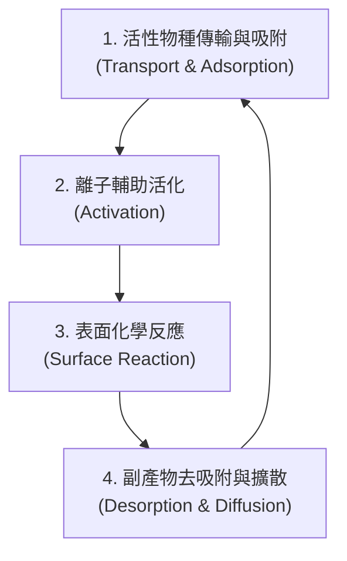

1.  **吸附（Adsorption）**：
    電漿中的中性自由基擴散穿過邊界層，吸附在晶圓表面。吸附量遵循蘭米爾吸附等溫線（Langmuir Adsorption Isotherm），受表面覆蓋率（Coverage, $\theta$）限制。
2.  **活化（Activation）**：
    受鞘層電場加速的正離子垂直撞擊表面。此步驟提供活化能，使原本在低溫下穩定的表面結構進入激發態。
3.  **化學反應（Chemical Reaction）**：
    吸附的自由基與受激發的表面原子結合，形成揮發性副產物（如 $SiF_4$、$AlCl_3$、$WF_6$）。
4.  **去吸附（Desorption）**：
    副產物從表面脫離進入氣相，並由抽氣系統排出。若副產物揮發性不足，會殘留在表面阻礙後續反應，導致蝕刻停止（Etch Stop）。

---

### 19.1.4 側壁抑制劑與輪廓控制機制

為了在 RIE 中獲得完美的垂直側壁（Vertical Profile），必須抑制側向蝕刻。這主要透過**側壁抑制劑（Inhibitor）**，亦稱為**鈍化層（Passivation Layer）**的形成來達成。

#### 1. 抑制劑的來源
*   **氣體添加物**：例如在 $SF_6$ 蝕刻矽時添加 $O_2$，會形成 $SiO_xF_y$ 類玻璃物質；或添加含碳氣體（如 $CHF_3$、$C_4F_8$）產生氟碳聚合物（Fluorocarbon Polymer）。
*   **遮罩侵蝕產物**：光阻被離子轟擊後產生的碳鏈碎片重新沉積於側壁。
*   **底材反應副產物**：蝕刻產物在離開反應腔前，部分冷凝於低溫側壁。

#### 2. 非等向性達成機制
離子轟擊具有高度的方向性（垂直），而自由基則是等向性擴散。
*   **水平面（底面）**：受到高通量離子直接轟擊，鈍化層不斷被物理性移除，使化學反應能持續向深處進行。
*   **垂直面（側壁）**：幾乎不受離子轟擊（或僅受極少量的散射離子影響），鈍化層得以累積並覆蓋表面，阻斷了自由基與側壁材料的化學反應。

此機制可用非等向性因子（Anisotropy Factor, $A_f$）來量化：
$$A_f = 1 - \frac{R_l}{R_v}$$
其中 $R_l$ 為橫向蝕刻速率（Lateral Rate），$R_v$ 為垂直蝕刻速率（Vertical Rate）。理想的乾式蝕刻 $A_f = 1$（即 $R_l = 0$）。

!!! warning "常見誤解：離子能量越高越好？"
    增加偏壓（Bias Power）雖能提高離子能量並增強非等向性，但過高的能量會導致：
    1.  **選擇比下降**：物理濺鍍效應增強，會加速消耗光阻遮罩。
    2.  **離子偏轉（Ion Bowing）**：離子在深孔內受電荷累積影響而偏轉，撞擊側壁導致輪廓呈「大肚狀」（Bowing）。
    3.  **晶格損傷**：對主動區（Active Area）造成不可逆的電性破壞。

!!! example "產業實例：氟碳比例（C/F Ratio）的調控"
    在蝕刻二氧化矽（$SiO_2$）時，產業界常使用 $CF_4 / H_2$ 或 $C_4F_8 / Ar$ 混合氣體。
    *   當 **F 自由基過多**時：蝕刻速率快，但聚合物薄，側壁保護弱，容易產生 Undercut。
    *   當 **C 含量增加**（或加入 $H_2$ 消耗 $F$）時：$C/F$ 比例上升，促進聚合物生成。這能大幅提高對矽（$Si$）或氮化矽（$Si_3N_4$）的選擇比，因為聚合物在這些表面更容易堆積。這是實現「自我對準接觸窗」（Self-Aligned Contact, SAC）製程的技術關鍵。

透過精確控制電漿中的化學組成與離子動能，RIE 能夠在奈米尺度下實現近乎垂直的圖案轉移，這為後續章節討論的高深寬比蝕刻（第 19.3 節）奠定了物理基礎。

<!-- fig:1 -->
<figure markdown>
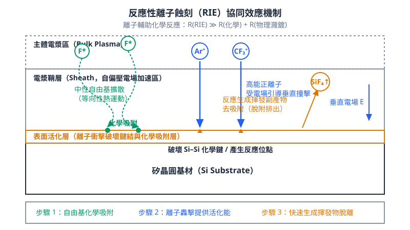
<figcaption>圖 19-1　RIE 協同效應機制圖（AI 繪製的示意圖）</figcaption>
</figure>

## 19.2 關鍵蝕刻指標：非等向性、選擇比與負載效應

### 非等向性度與側壁輪廓控制

在反應性離子蝕刻（Reactive Ion Etching, RIE）製程中，材料移除兼具物理濺擊與化學反應兩種機制（相關電漿物理原理見第 18 章）。為了定量描述圖案轉移後側向尺寸收縮程度，定義「非等向性度」（Degree of Anisotropy, 記為 $A$）：

$$A = 1 - \frac{R_L}{R_V}$$

其中，$R_L$ 為橫向（側向）蝕刻速率（Lateral Etching Rate），$R_V$ 為垂直蝕刻速率（Vertical Etching Rate）。若蝕刻過程為純等向性（Isotropic，例如典型的濕式化學蝕刻，見第 20 章），各向同性導致 $R_L = R_V$，則 $A = 0$；若完全無側向侵蝕（$R_L = 0$），則 $A = 1$，稱為完全非等向性蝕刻（Anisotropic Etching）。

若圖案邊緣產生 $R_L > 0$ 的非預期橫向擴蝕，將導致光罩下方材料被掏空，此現象稱為「底切」（Undercut）。底切主要源於電漿中未受電場方向約束的中性自由基（Radicals）擴散至側壁，並與基板發生自發性熱化學反應。

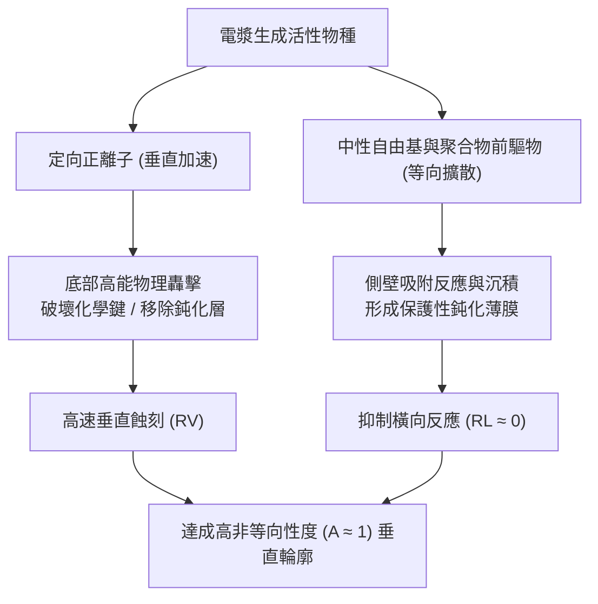

側壁輪廓控制的關鍵在於建立「離子轟擊」與「側壁鈍化」（Sidewall Passivation）的動態平衡。其物理與化學調控機制包含：

1. **離子引導之表面活化（Ion-induced Surface Activation）**：高能入射正離子沿鞘層垂直入射，衝擊底部水平表面並打斷材料晶格共價鍵，使其反應活性大幅提高；而側壁未受足夠通量之正離子法向撞擊，反應活化能維持在較高水準，反應速率受抑。
2. **沉積型抑制劑保護（Passivation Film Deposition）**：在製程氣體中加入特定聚合前驅物（例如矽蝕刻中添加氟碳氣體 $CF_4$、$CHF_3$ 或含溴、氯氣體 $HBr$、$Cl_2$）。解離後的自由基會在孔洞內部所有表面沉積數奈米厚度的富碳聚合物或金屬鹵化物／氧鹵化物薄膜（如 $SiO_xCl_y$ 或 $SiBr_x$）。孔底的沉積層會被持續垂直入射的離子瞬間濺擊清除；側壁因缺乏法向高能離子轟擊，鈍化薄膜得以留存並阻絕自發性自由基反應，進而消除底切，形成垂直側壁輪廓。
3. **離子入射角分佈（Ion Angular Distribution Function, IADF）**：若電漿鞘層內碰撞頻率過高（壓力過高）或電極邊界效應明顯，離子將產生角度散射。偏折的離子會直接打擊側壁，導致側壁鈍化層破壞，引發側壁傾斜、下寬上窄（Tapered profile）或腰縮、凹弧（Bowing）等輪廓缺陷。

---

### 材料選擇比之熱力學與動力學機制

選擇比（Selectivity, $S$）為目標蝕刻材料與非目標材料在相同製程條件下的蝕刻速率比值。針對遮罩層（Mask）與底層停止層（Stop layer），其定義分別為：

$$S_{\text{mask}} = \frac{R_{\text{target}}}{R_{\text{mask}}}, \quad S_{\text{stop}} = \frac{R_{\text{target}}}{R_{\text{stop}}}$$

高選擇比可確保在目標層完全蝕刻穿透時，遮罩層不被耗盡，且底層材料受損降至最低。選擇比的控制本質上由熱力學與化學反應動力學共同主導：

#### 熱力學驅動：生成自由能與反應副產物蒸汽壓
蝕刻反應產物能否順利揮發並被真空系統抽除，取決於副產物的飽和蒸汽壓（Vapor Pressure）以及反應的吉布斯自由能變（$\Delta G^\circ$）。
以矽（$Si$）與二氧化矽（$SiO_2$）在氟系電漿中的化學反應為例：

$$\begin{aligned}
Si + 4F_{(g)} &\rightarrow SiF_{4(g)} \quad (\Delta G^\circ \ll 0) \\
SiO_2 + 4F_{(g)} &\rightarrow SiF_{4(g)} + O_{2(g)}
\end{aligned}$$

純矽與氟自由基的化學自發反應能障極低，即使在無離子轟擊下亦能自發進行；而 $SiO_2$ 中強固的 $Si-O$ 鍵（鍵能約 $460\text{ kJ/mol}$，高於 $Si-Si$ 鍵能約 $327\text{ kJ/mol}$）不易被純氟自由基熱裂解，需要離子轟擊提供活化能破壞鍵結。因此，在高自發性反應條件下，$Si$ 對 $SiO_2$ 的等向蝕刻具有天然的高選擇比。

#### 反應動力學調控：氟碳比與離子能量閾值
在進行介電質（如 $SiO_2$ 或 Low-$k$ 材料）對底層 $Si$ 或 $Si_3N_4$ 的非等向性蝕刻時，必須使用含碳氟氣體（如 $CF_4$、$C_4F_8$、$C_4F_6$）。利用氣體中的「碳／氟比」（C/F Ratio）調控表面的聚合物聚合／沉積與蝕刻反應速率：

* **沉積-蝕刻平衡（Coburn-Winter 模型）**：高 C/F 比氣體解離產生較多 $CF_2$ 自由基，促使材料表面生成氟碳聚合物層（$(CF_2)_n$）。
* **含氧材料之自清除機制**：在 $SiO_2$ 表面，晶格內的氧原子於離子撞擊下會與聚合物中的碳結合，生成揮發性的 $CO$ 或 $CO_2$ 逸出，此機制大幅降低了 $SiO_2$ 表面的聚合物厚度，使蝕刻反應持續進行；相反地，在純矽或氮化矽表面，缺乏晶格氧的輔助清除機制，厚層聚合物阻礙了反應物擴散與離子轟擊能量傳遞，使蝕刻速率趨近於零，從而實現介電質對基板的高選擇比。

#### 硬遮罩（Hardmask）之工程應用
隨先進製程微影節點微縮，193 nm 浸潤式微影（ArFi）與極紫外光（EUV）微影光阻層厚度顯著變薄（通常小於 $50\text{ nm}$，見第 13 與 14 章），傳統有機光阻無法承受深溝槽或高深寬比蝕刻時的電漿物理轟擊。工程上需將微影圖案先轉印至耐蝕刻硬遮罩材料上，常見材料體系與選擇機制包括：

1. **旋塗碳層與非晶碳硬遮罩（Spin-on Carbon, SOC / Amorphous Carbon Layer, ACL）**：富含高鍵能的 $sp^2$ 碳結構，在氟系電漿中具備極低消耗速率。
2. **無機介電質硬遮罩（$SiON$、$Si_3N_4$、$SiO_2$）**：常藉由低壓化學氣相沉積（LPCVD）或電漿輔助化學氣相沉積（PECVD）生成（見第 21 章），在氧氣或氫基灰化製程中完全不被消耗。
3. **金屬硬遮罩（如 $TiN$）**：在鹵素電漿中由於金屬鍵結合力強，金屬鹵化物揮發溫度較高，提供對介電質極高的物理抗濺擊選擇比。

---

### 負載效應：巨負載與微負載物理模型

電漿蝕刻受反應腔體內中性活性物種（Neutral Active Species）的質傳與表面反應動力學牽制。當蝕刻表面消耗反應物的速率接近或超過腔室進氣供應與電漿解離生成速率時，即產生「負載效應」（Loading Effect）。

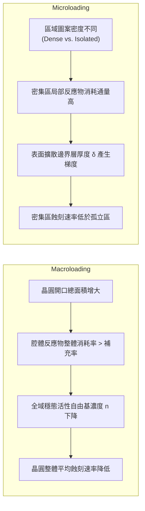

#### 巨負載效應（Macroloading Effect）
巨負載效應是指整個蝕刻反應腔內，晶圓總暴露蝕刻面積（Open Area）增加時，所導致的晶圓整體平均蝕刻速率下降現象。
以連續攪拌槽反應器（CSTR）模型為基礎，氣相活性自由基之質量平衡方程式可表述為：

$$V \frac{dn}{dt} = G - \frac{S_{\text{pump}}}{V} n - k_{\text{rec}} n - k_{\text{etch}} A_{\text{open}} n$$

其中：
* $V$ 為腔室有效體積，
* $n$ 為反應自由基濃度，
* $G$ 為電漿解離生成反應物的速率，
* $S_{\text{pump}}$ 為真空幫浦抽速，
* $k_{\text{rec}}$ 為腔壁重組反應常數，
* $k_{\text{etch}}$ 為晶圓表面的非均相蝕刻反應常數，
* $A_{\text{open}}$ 為晶圓上暴露之待蝕刻材料總面積。

在穩態條件下（$\frac{dn}{dt} = 0$），自由基濃度為：

$$n = \frac{G}{\frac{S_{\text{pump}}}{V} + k_{\text{rec}} + k_{\text{etch}} A_{\text{open}}}$$

由於蝕刻速率 $R \propto k_{\text{etch}} n$，當晶圓上暴露面積 $A_{\text{open}}$ 增加時，穩態自由基濃度 $n$ 隨之下降，導致蝕刻速率 $R$ 呈現非線性衰減。

#### 微負載效應（Microloading Effect）
微負載效應指在同一晶圓上，因微觀區域圖案密度（Pattern Density）的差異，造成局部蝕刻速率不均勻。通常表現為圖案密集區（Dense area）的蝕刻速率明顯低於孤立圖案區（Isolated area）。

微負載的本質源於中性自由基在晶圓表面停滯邊界層（Boundary layer）內的局域擴散梯度。在圖案密集區域，單位晶圓投影面積內的真實微觀反應表面積顯著擴大，反應物消耗通量高於垂直擴散補充通量，導致密集區表面局域的自由基濃度實質低於孤立區：

$$J_{\text{diff}} = -D \frac{\partial n}{\partial z} = k_{\text{local}} n_{\text{surface}}$$

若化學反應速率極快（$k_{\text{local}}$ 較大），傳輸過程受擴散限制支配，局部反應物濃度貧化加劇；相反地，若製程偏向強離子轟擊主導（反應受表面物理活化能限制），微負載效應將大幅減緩。

!!! warning "常見誤解"
    工程上常將「微負載效應（Microloading）」與「深寬比相依蝕刻（ARDE）」混淆。微負載效應取決於**局部水平圖案密度（Pattern Density）**，其受限尺度通常在數十微米至毫米級的氣相擴散長度範圍；而 ARDE 則是發生在**單一立體結構特徵尺寸內部（Feature Scale）**，其物理驅動源自奈米級結構內部深寬比造成的局部質傳與充電阻礙。

---

### 深寬比相依蝕刻（ARDE）與 RIE 延遲機制

在先進立體元件（如 FinFET/GAA 閘極溝槽、3D NAND 通孔）蝕刻中，圖案縱向尺度與橫向開口寬度的比例稱為深寬比（Aspect Ratio, $AR$）：

$$AR = \frac{H}{W}$$

其中 $H$ 為蝕刻深度，$W$ 為開口關鍵尺寸（Critical Dimension, CD）。
當蝕刻持續進行、$AR$ 提高時，通常會觀察到溝槽或接觸孔底部的蝕刻速率隨時間減慢；同時，在同一製程配方下，較小線寬（高 $AR$）結構的蝕刻深度小於大開口（低 $AR$）結構，此現象統稱為「深寬比相依蝕刻」（Aspect Ratio Dependent Etching, ARDE），在傳統文獻中常稱為「RIE 延遲」（RIE Lag）。

造成 ARDE / RIE Lag 的四項微觀物理限制機制如下：

| 機制分類 | 物理現象與驅動因子 | 傳輸限制對孔底之影響 | 製程特徵與影響範圍 |
| :--- | :--- | :--- | :--- |
| **中性物種克努森擴散限制** *(Knudsen Diffusion Limit)* | 當氣體平均自由徑（$\lambda$）遠大於孔徑（$W$），克努森數 $Kn = \lambda/W \gg 1$。中性粒子在結構內部與側壁頻繁碰撞，擴散係數 $D_K \propto W \sqrt{T/M}$。 | 到達孔底的反應物通量隨深寬比呈指數或反比衰減：$$\Gamma_{\text{bottom}} \approx \Gamma_0 \frac{1}{1 + \frac{3}{8}\frac{H}{W}}$$ | 影響化學反應主導型蝕刻；開口越小，底部越缺乏活性自由基。 |
| **離子角分佈與側壁陰影效應** *(Ion Shadowing Effect)* | 離子通過鞘層時受到微弱散射，入射角具有特定高斯分佈。具有微小傾角（$\theta > \arctan(W/H)$）的離子無法直達孔底，而是撞擊側壁。 | 直達孔底的高能垂直離子通量 $\Gamma_{i,\text{bottom}}$ 隨深度增加而急劇下降。 | 影響離子輔助化學蝕刻中的晶格活化速率與聚合物清除速率。 |
| **微觀結構靜電充電效應** *(Microstructure Charging)* | 電子因熱運動具有等向性角分佈，容易被孔口頂部截留；質量較大的正離子主要沿法向垂直入射沉積於孔底，使介電結構頂部帶負電、孔底帶正電。 | 結構內部建立縱向逆向自建電場與側向偏折電場，使入射正離子減速，甚至偏折撞擊孔壁。 | 導致高深寬比結構底部的離子轟擊能量不足（蝕刻停滯，Etch Stop），或引起側壁異常扭曲。 |
| **副產物自孔底排出阻力** *(By-product Transport Limit)* | 底部蝕刻生成的大分子量揮發性副產物（如 $SiF_4$、$SiBr_x$）無法及時擴散排出孔外。 | 孔底局部副產物分壓過高，抑制正向脫附化學反應平衡，同時加劇孔內反應物再吸附與聚合物堆積。 | 造成蝕刻前緣材料轉化受阻，易引發非預期沉積或微遮罩（Micromasking）效應。 |

!!! example "產業實例"
    在先進金屬閘極替代製程（Replacement Metal Gate, RMG）中，需要對高深寬比的虛擬閘極（Dummy Polysilicon Gate）進行完全清除而不傷及底部極薄的閘極介電層（見第 28 章）。若使用強離子轟擊配方，會引發嚴重的 ARDE 導致中央深窄處殘留，且易轟擊穿透基底；工程上常導入多段式動態調節配方：初期利用微弱側壁鈍化的高反應活性電漿高速挖槽，末期切換至極高選擇比、近等向性低離子能量的純化學反應氣體，配合精確終點控制，以完全消除高深寬比帶來的輪廓形變。

## 19.3 高深寬比蝕刻技術與 3D NAND 製程挑戰

在先進半導體元件製造中，高深寬比（High Aspect Ratio, HAR）結構的蝕刻技術是決定元件集成度的關鍵。特別是在 3D NAND 快閃記憶體（3D NAND Flash）進入 128 層、232 層甚至更高堆疊層數的製程中，蝕刻技術面臨著前所未有的物理與化學挑戰。

### 3D NAND 垂直結構與 HARC 挑戰

3D NAND 的核心結構在於將數百層的氧化矽（$SiO_2$）與氮化矽（$Si_3N_4$）交替堆疊（稱為 ONO 堆疊），並透過一次性的深孔蝕刻形成垂直通道孔（Channel Hole）。這些孔洞的直徑通常僅約 100 奈米（nm），而深度則需達到數微米（$\mu m$），其深寬比（Aspect Ratio, AR）定義如下：

$$AR = \frac{H}{W}$$

其中 $H$ 為蝕刻深度，$W$ 為開口寬度。在當前技術節點下，深寬比已普遍超過 40:1，甚至向 100:1 挑戰。除了通道孔外，為了形成階梯狀的電極接觸區，還需蝕刻深長的狹縫（Slit）結構。

在高深寬比蝕刻（High Aspect Ratio Etching, HARC）中，最主要的物理限制在於反應物輸送（Transport Limited）與離子通量衰減。隨著孔洞變深，電漿中的活性自由基（Radicals）與正離子進入孔底的機率大幅下降，這種現象稱為深寬比相關蝕刻（Aspect Ratio Dependent Etching, ARDE），或稱為 RIE 延遲（RIE Lag）。

### 電荷累積效應與離子軌道偏折

在反應性離子蝕刻（RIE）過程中（見第 18 章電漿物理），電漿中的電子與正離子具有不同的運動特性。電子質量極小，呈等向性分佈，容易被孔洞上方的側壁捕獲；而正離子受到鞘層（Sheath）電場加速，具有高度方向性，傾向於垂直射入孔底。

這種電荷分離現象會導致孔洞內部產生局部電荷累積（Charging Effect）：
1. **頂部負電荷**：電子在孔口邊緣累積。
2. **底部正電荷**：正離子在孔底累積。

當孔底累積過多正電荷時，會產生一個向上的排斥電場，導致後續射入的正離子動能降低，甚至發生軌道偏折。這種偏折會引發「扭曲」（Twisting）缺陷，即孔洞在向下延伸的過程中偏離垂直軸心，造成相鄰通道孔之間的短路或接觸不良。

### 形貌缺陷：擴徑、頸縮與底部不完全開啟

在 HARC 製程中，側壁控制與底部開啟是兩大技術難題。常見的形貌缺陷包括：

1. **孔洞擴徑（Bowing）**：
   當正離子射入孔洞後，部分離子會以微小角度撞擊側壁並發生反射。這些反射離子與側壁的化學反應會導致孔洞中部過度蝕刻，形成向外凸出的弓形（Bowing）。擴徑會限制通道孔的排列密度，若擴徑過於嚴重，相鄰孔洞會發生合併（Merging）。

2. **頸縮（Neck Formation）**：
   為了保護側壁，製程中通常會加入氟碳聚合物（Fluorocarbon Polymer）作為保護層。然而，若聚合物在孔口處堆積過快，會導致開口縮小，形成頸縮。頸縮會進一步阻礙反應氣體進入與副產物排出，加劇 ARDE 效應。

3. **底部不完全開啟（Incomplete Etch / Etch Stop）**：
   當深寬比達到臨界值，進入孔底的離子能量不足以克服電荷排斥力，或者反應副產物（如 $SiF_4$）無法有效擴散出孔洞時，蝕刻反應會完全停止，導致底部無法貫穿至底層的源極線（Source Line）。

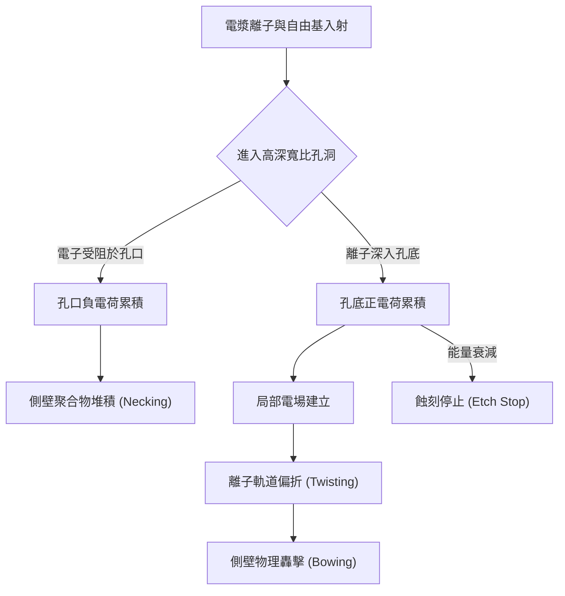

### 先進抑制機制：脈衝電漿與極低溫蝕刻

為了克服上述 HARC 挑戰，設備商與製程工程師開發了多種先進技術：

#### 脈衝射頻電漿（Pulsed RF Plasma）
傳統的連續波（Continuous Wave）電漿會導致持續的電荷累積。脈衝電漿技術透過快速切換射頻電源（RF Power）的開啟（On-state）與關閉（Off-state），實現電荷中和。
- **On-state**：進行正常的離子轟擊與化學蝕刻。
- **Off-state**：電漿中的鞘層消失，電子得以擴散進入孔底，與累積的正電荷中和，消除局部電場，從而減少扭曲現象並提升離子入射能量。

#### 極低溫蝕刻（Cryogenic Etching）
傳統蝕刻機台的靜電吸盤（ESC）溫度通常維持在 $20^\circ C$ 至 $60^\circ C$。極低溫蝕刻技術將晶圓溫度降低至 $-70^\circ C$ 甚至 $-100^\circ C$ 以下。
- **物理機制**：在極低溫下，側壁上形成的保護膜（如 $SF_6/O_2$ 產生的 $SiO_xF_y$ 或氟碳聚合物）會變得更加堅硬且穩定，大幅增強了對化學自發性蝕刻的抵抗力。
- **優勢**：由於側壁保護增強，可以減少對聚合物沉積的依賴，從而擴大孔徑（避免頸縮），並容許使用更高能量的離子進行蝕刻，有效解決底部不完全開啟的問題。

!!! note "高深寬比蝕刻的化學平衡"
    在 HARC 製程中，必須精確平衡「蝕刻（Etching）」與「鈍化（Passivation）」。通常使用 $C_4F_6$、$C_4F_8$ 等氣體，利用其產生的 $CF_x$ 自由基在側壁形成聚合物保護層。若 $C/F$ 比例過高，會發生蝕刻停止；若過低，則會產生嚴重的擴徑現象。

### 產業實例

在 3D NAND 的量產中，**科林研發（Lam Research）** 的 Vantex 系列與 **東京威力科創（Tokyo Electron, TEL）** 的 Tactras 系列是市場主流的高深寬比蝕刻設備。

以 TEL 開發的極低溫蝕刻技術為例，其利用極低溫環境下的高選擇比特性，能夠在短短 30 分鐘內完成 10 微米深度的通道孔蝕刻，且側壁垂直度極佳。這類設備通常配備高功率的雙頻或三頻射頻產生器，以獨立控制電漿密度與離子能量。

!!! warning "常見誤解：增加功率即可解決深寬比問題"
    初學者常認為若蝕刻不到底部，只需增加射頻功率（RF Bias）即可。然而，過高的功率會導致光阻（Photoresist）或硬遮罩（Hard Mask）的選擇比大幅下降（見第 19.2 節），在蝕刻到底部之前，遮罩可能已經損耗殆盡，導致圖案失真。因此，HARC 的核心在於「能量」與「物質輸送」的精細平衡，而非單純的暴力轟擊。

### 終極解決方案：原子層蝕刻（ALE）的引入
雖然 RIE 仍是目前 HARC 的主流，但隨著結構微縮至 10 奈米以下，傳統 RIE 造成的電漿損傷（Plasma Damage）與隨機效應（Stochastic Effects）已不可忽視。原子層蝕刻（Atomic Layer Etching, ALE）透過自限性（Self-limiting）反應，逐層移除原子，預計將在未來極高層數的 3D NAND 關鍵步驟中扮演重要角色（詳見第 23 章）。

<!-- fig:2 -->
<figure markdown>
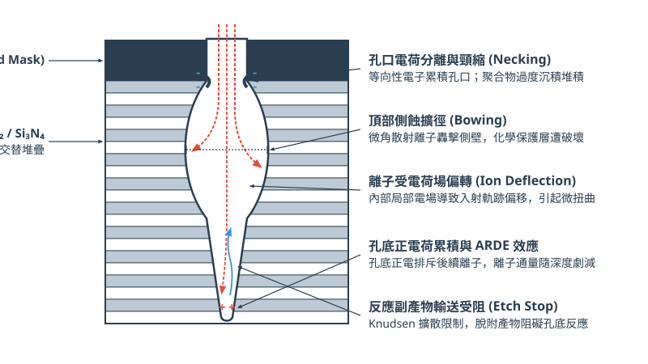
<figcaption>圖 19-2　HAR 蝕刻物理限制圖（AI 繪製的示意圖）</figcaption>
</figure>

## 19.4 終點偵測技術與即時製程控制

在半導體蝕刻製程中，精確控制蝕刻停止的時間點是確保元件良率與性能的關鍵。隨著元件特徵尺寸微縮至奈米尺度，傳統的「定時蝕刻」（Timed Etch）已無法滿足現代製程對垂直深度與殘餘膜厚精度的嚴苛要求。本節將探討終點偵測（Endpoint Detection, EPD）的物理原理、常用技術及其在即時製程控制中的應用。

### 19.4.1 終點偵測的重要性與過蝕刻控制

在理想的蝕刻製程中，當蝕刻氣體完全移除目標薄膜並接觸到下方停止層（Stop Layer）時，反應應立即停止。然而，由於晶圓表面薄膜厚度的不均勻性（Uniformity）以及電漿反應爐內蝕刻速率的空間差異（例如邊緣效應），晶圓上各區域達到界面的時間並不一致。

若蝕刻時間不足，會導致「蝕刻不足」（Under-etch），造成電路斷路；若蝕刻時間過長，則會進入「過蝕刻」（Over-etch, OE）階段。過蝕刻雖然能確保所有區域的目標物皆被移除，但會帶來以下風險：
1. **選擇比挑戰**：若對下方停止層的選擇比較低，過蝕刻會損壞底層結構或造成主動區（Active Area）的物理損傷。
2. **側向蝕刻**：在過蝕刻期間，垂直方向的蝕刻速率雖受阻，但化學反應可能導致側壁保護層受損，進而引發橫向蝕刻，損害臨界尺寸（Critical Dimension, CD）。
3. **負載效應加劇**：過蝕刻階段反應物濃度會發生劇烈變化，可能導致微負載效應（Micro-loading Effect）惡化。

因此，過蝕刻預算（Over-etch Budget）通常以百分比表示：
$$OE\% = \frac{t_{total} - t_{EPD}}{t_{EPD}} \times 100\%$$
其中 $t_{EPD}$ 為偵測到終點的時間，$t_{total}$ 為總蝕刻時間。精確的 EPD 技術能將 $t_{EPD}$ 鎖定在界面轉換的瞬間，從而最小化過蝕刻需求。

### 19.4.2 光學發射光譜法 (OES)

光學發射光譜法（Optical Emission Spectroscopy, OES）是目前乾式蝕刻機台最普遍採用的非侵入式（Non-intrusive）偵測技術。其物理基礎建立在電漿中激發態物種的能階躍遷。

#### 1. 物理原理
在電漿反應室中（見第 18 章），高能電子與氣體分子或原子碰撞，使其躍遷至激發態。當這些不穩定的激發態物種回歸基態或較低能階時，會釋放出特定波長的光子：
$$\Delta E = E_2 - E_1 = h\nu = \frac{hc}{\lambda}$$
其中 $h$ 為普朗克常數，$c$ 為光速，$\lambda$ 為特徵波長。每一種化學物種（如反應物 $F, Cl_2$ 或反應產物 $SiF_4, AlCl_3$）都有其獨特的光譜指紋。

#### 2. 監測機制
OES 透過光纖收集電漿發出的光，經由單光儀（Monochromator）或光譜儀分光後，由光電倍增管（PMT）或電荷耦合元件（CCD）轉換為電訊號。偵測方式分為兩類：
*   **反應物監測**：監測參與反應的自由基強度。當蝕刻接近終點，目標薄膜耗盡，反應物不再被消耗，其光譜強度會上升。
*   **產物監測**：監測反應生成的揮發性產物。當蝕刻到達界面，反應產物減少，其光譜強度會下降。

下表列出常見蝕刻製程中的 OES 監測波長（典型值）：

| 蝕刻材料 | 監測物種 | 波長 (nm) | 訊號變化（到達終點時） |
| :--- | :--- | :--- | :--- |
| 多晶矽 (Poly-Si) | $SiF_x$ | 440 | 下降 |
| 氧化矽 ($SiO_2$) | $CO$ | 219 / 483 | 下降 |
| 氮化矽 ($Si_3N_4$) | $N_2$ | 337 | 下降 |
| 鋁 (Al) | $AlCl$ | 261 | 下降 |
| 鎢 (W) | $F$ | 704 | 上升 |

#### 3. 訊號處理與演算法
由於電漿雜訊與背景光的干擾，原始 OES 訊號需經過平滑處理（Smoothing）與微分計算。常用的演算法包括一階微分（尋找斜率變化最大點）或二階微分（尋找曲率變化點）。

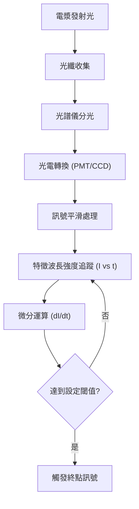

!!! note "說明"
    在先進製程中，單一波長的監測往往不足以應對複雜的化學環境。現代機台常採用「全光譜分析」，利用主成分分析（PCA）等統計方法，同時監控數十個波長，以提高終點判斷的魯棒性（Robustness）。

### 19.4.3 雷射干涉量測法 (Laser Interferometry)

與 OES 監測整體電漿環境不同，雷射干涉法（Laser Interferometry）是一種直接針對晶圓表面薄膜厚度進行「原位」（In-situ）量測的技術。

#### 1. 干涉原理
當一束單色雷射（通常為 633 nm 的 He-Ne 雷射）垂直入射至晶圓表面時，光線會在薄膜表面與薄膜/底層界面分別產生反射。這兩束反射光之間存在相位差 $\Delta \phi$：
$$\Delta \phi = \frac{4\pi n d \cos \theta}{\lambda}$$
其中 $n$ 為薄膜折射率，$d$ 為即時厚度，$\theta$ 為折射角（垂直入射時為 0）。

隨著蝕刻進行，厚度 $d$ 持續減少，反射光的干涉狀態會在「相長干涉」（Constructive Interference）與「相消干涉」（Destructive Interference）之間週期性切換，形成正弦波狀的強度變化，稱為「干涉條紋」（Interference Fringes）。

#### 2. 應用優勢
*   **絕對深度偵測**：透過計算干涉條紋的數量，可以精確得知已蝕刻的深度。每經過一個完整的正弦週期，代表蝕刻掉的厚度為 $\Delta d = \lambda / 2n$。
*   **蝕刻速率監控**：條紋的頻率直接反映了即時蝕刻速率。
*   **殘餘膜厚控制**：在需要保留特定厚度薄膜的製程（如凹槽蝕刻）中，雷射干涉法是唯一能提供精確剩餘厚度資訊的手段。

!!! warning "常見誤解"
    雷射干涉法並非萬能。其光斑尺寸（Spot Size）通常在百微米等級，遠大於單個電晶體。因此，它量測的是光斑範圍內圖案的平均反射性質。若晶圓表面的露出率（Open Area）極低，反射訊號會被光阻或遮罩的背景反射淹沒，導致條紋對比度極低。

### 19.4.4 質譜儀 (Mass Spectrometry) 與低露出率偵測

隨著製程演進，接觸孔（Contact Hole）或通孔（Via）的開口率越來越低（有時低於 1%）。在這種情況下，參與反應產生的化學物種極少，OES 產生的光訊號變化極微弱，難以從背景雜訊中提取有效資訊。此時需採用殘餘氣體分析儀（Residual Gas Analyzer, RGA），即質譜儀偵測法。

#### 1. 工作原理
質譜儀透過取樣系統將反應室中的少量氣體引入分析室，利用電子轟擊使其離子化，隨後根據質荷比（Mass-to-charge ratio, $m/z$）進行分離與偵測。
*   **高靈敏度**：質譜儀能偵測到百萬分之一（ppm）等級的濃度變化。
*   **直接量測**：它直接測量反應產物的分子量，不受電漿發光效率或背景光干擾。

#### 2. 應用實例
在 3D NAND 的高深寬比（High Aspect Ratio, HAR）蝕刻中（見 19.3 節），蝕刻反應發生在深孔底部，產物擴散至電漿主體的速度較慢且量少。質譜儀可針對特定的副產物（如 $SiF_3^+$，$m/z=85$）進行連續監測，在接觸到底層氮化矽或氧化矽界面時，捕捉到微弱的產物成分變化，實現精確停機。

### 19.4.5 即時製程控制 (APC) 與數據整合

終點偵測不僅是為了停止蝕刻，更是即時製程控制（Real-time Process Control）的核心輸入。

1. **多步驟切換**：在複雜的閘極蝕刻中，通常分為突破氧化層（Breakthrough, BT）、主蝕刻（Main Etch, ME）與過蝕刻（Over-etch, OE）。EPD 訊號會觸發機台自動切換氣體配方、壓力與偏壓功率，以在 ME 階段追求高速率，在 OE 階段追求高選擇比。
2. **機台健康監測 (FDC)**：EPD 時間的波動常被視為機台狀態變化的指標。例如，若 $t_{EPD}$ 逐漸增加，可能暗示反應室內壁產生聚合物堆積（Chamber Seasoning），需進行清洗（見第 54 章關於 FDC 的討論）。
3. **進階製程控制 (APC)**：透過 SECS/GEM 協定（見第 54 章），EPD 數據會上傳至工廠端伺服器。若前段微影製程的光阻 CD 偏大，APC 系統可根據歷史數據自動調增蝕刻階段的過蝕刻時間，以補償 CD 偏差，達成跨製程的精確控制。

!!! example "產業實例"
    在先進邏輯製程（如 5nm 以下）中，蝕刻機台如應用材料（Applied Materials）或科林研發（Lam Research）的設備，常整合多模組偵測系統。例如，同時使用 OES 監控電漿化學，並搭配多波長雷射干涉儀監控晶圓邊緣與中心的蝕刻速率差異，實現「多區獨立控制」（Multi-zone Control），以補償晶圓內的不均勻性（WIW Non-uniformity）。

## 19.5 設備與廠商技術

### 蝕刻機台核心架構與關鍵子系統

乾式蝕刻設備為高度整合之真空電漿處理系統，其核心目的在於受控環境下將反應氣體游離轉化為電漿，並精確引導活性自由基與具定向能量的離子撞擊晶圓表面。典型的乾式蝕刻機台主要由以下關鍵子系統構成：

1. **製程真空腔體（Process Chamber）**：提供維持高真空或中低真空（約 $0.1\text{ Pa}$ 至數十 $\text{Pa}$）之封閉環境，腔壁通常覆蓋抗電漿腐蝕的介電材料塗層（如氧化釔 $\text{Y}_2\text{O}_3$），以減少金屬微粒生成並抑制內壁副產物沉積。
2. **射頻功率源與匹配網路（RF Power Sources and Matching Networks）**：包含負責游離氣體生成電漿的主功率源，以及施加於晶圓載台以控制離子入射能量的偏壓功率源。射頻匹配網路（RF Matching Network）由可變電容與電感組成，動態調整負載阻抗以匹配傳輸線特徵阻抗（通常為 $50\ \Omega$），最小化反射功率。
3. **氣體輸送系統（Gas Delivery System）**：透過多通道質流控制器（Mass Flow Controller, MFC）精準調配蝕刻氣體、沉積性氣體與稀釋氣體，經由腔體上方的氣體噴淋頭（Showerhead）均勻注入反應區。
4. **真空與排氣控制系統（Vacuum and Pumping System）**：由乾式真空泵（Dry Pump）與渦輪分子泵（Turbomolecular Pump, TMP）組成，搭配自動壓力控制器（Automatic Pressure Controller, APC）擺動閥（Pendulum Valve），即時微調腔體工作壓力。
5. **晶圓載台與靜電吸盤（Electrostatic Chuck, ESC）**：負責固定晶圓、耦合射頻偏壓，並執行高精度的晶圓熱交換管理。

---

### 電漿源架構比較：CCP 與 ICP

在反應性離子蝕刻（Reactive Ion Etching, RIE）中，電漿源的電磁能量耦合方式決定了腔體內電漿密度、電子溫度以及製程可調控空間。半導體製程最廣泛應用的兩大架構為電容耦合電漿（Capacitively Coupled Plasma, CCP）與感應耦合電漿（Inductively Coupled Plasma, ICP）。

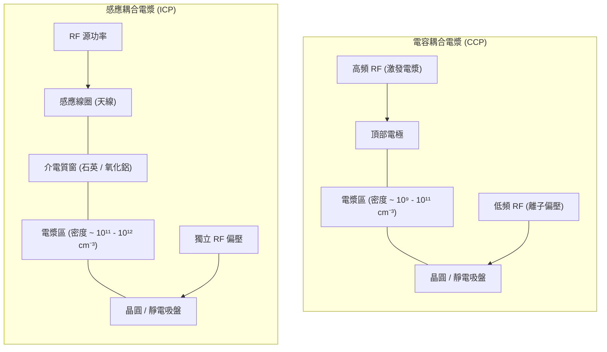

#### 1. 硬體架構與放電機制
* **CCP 架構**：利用兩片相對的平行板電極構成電容結構。射頻電場直接橫跨於電極之間，藉由時變電場加速鞘層（Sheath）內的電子，引發雪崩撞擊游離（Electron Impact Ionization）來維持放電。
* **ICP 架構**：射頻功率施加於腔體外部或頂部的感應線圈（天線），時變電流在腔內介電質窗下方感應出交變磁場，進而誘發環向感應電場加速電子。此閉合感應電場不終止於電極表面，電子不易碰撞電極而損失。

#### 2. 電漿密度與偏壓去耦合（Decoupling）特性
兩者之物理特性與控制機制存在本質差異，整理如下：

| 特性比較指標 | 電容耦合電漿（CCP） | 感應耦合電漿（ICP） |
| :--- | :--- | :--- |
| **典型電漿密度（$n_e$）** | $10^9 \sim 10^{11}\text{ cm}^{-3}$（較低） | $10^{11} \sim 10^{12}\text{ cm}^{-3}$（較高） |
| **操作壓力範圍** | 數十至數百 $\text{mTorr}$（約 $1 \sim 100\text{ Pa}$） | 數至數十 $\text{mTorr}$（約 $0.1 \sim 5\text{ Pa}$） |
| **電子溫度（$T_e$）** | 較高（約 $3 \sim 5\text{ eV}$） | 較低（約 $2 \sim 4\text{ eV}$） |
| **解離率（Dissociation Rate）** | 適中，可維持特定前驅物分子碎片聚合 | 極高，多數分子易被完全解離為原子態 |
| **離子通量與能量去耦合度** | 差至中等（源功率變化強烈牽動鞘層電壓） | 優良（天線控制電漿密度，下電極獨立控制偏壓） |
| **主要製程應用** | 介電質蝕刻（$\text{SiO}_2$、$\text{SiN}_x$、低介電材料） | 導體與矽蝕刻（多晶矽、金屬閘極、STI） |

在先進雙頻或三頻 CCP 腔體中，工程上常使用高頻射頻（如 $60\text{ MHz}$ 或更高等級）提供電漿解離，搭配低頻射頻（如 $2\text{ MHz}$ 或 $400\text{ kHz}$）施加於底電極以調整離子偏壓，以達成部分去耦合的效果；而在 ICP 系統中，電漿源功率與載台偏壓功率本質上物理分離，使製程工程師能在固定離子通量（Ion Flux）下獨立調整入射離子能量（Ion Energy），對於淺溝槽隔離（STI）與微細多晶矽閘極等極需精確側壁輪廓控制的製程尤為關鍵。

---

### 靜電吸盤（ESC）與晶圓溫度控制架構

在乾式蝕刻過程中，電漿離子以數百至上千電子伏特能量轟擊晶圓表面，加上中性自由基反應熱，晶圓表面單位面積所承受的熱通量相當龐大。若無有效冷卻散熱，光阻將發生變質、焦化甚至流動，導致蝕刻選擇比與臨界尺寸（Critical Dimension, CD）嚴重劣化。

#### 1. 吸附原理：庫侖型與 Johnsen-Rahbek（J-R）型
靜電吸盤利用高壓直流電（High-Voltage DC, HVDC）在基板內部電極與晶圓背側之間建立靜電吸附力：
* **庫侖型（Coulombic Type）**：吸盤介電層具有極高電阻率（$> 10^{14}\ \Omega\cdot\text{cm}$），電荷累積於介電層表面與晶圓背面，吸附力純粹源自介電質兩端之庫侖靜電力，其夾持力隨間隙距離平方反比衰減。
* **Johnsen-Rahbek（J-R）型**：介電層採用微導電陶瓷（電阻率約 $10^9 \sim 10^{12}\ \Omega\cdot\text{cm}$），在電場作用下微量漏電流穿過介電體，使微觀接觸突起處積累大量電荷。此型吸盤在相同施加電壓下具備大幅提高之吸附力，但在晶圓除電脫附（De-chucking）時需施加特定反向電壓波形以快速釋放殘留電荷。

#### 2. 分區背壓氦氣傳熱機制
由於真空中微觀粗糙接觸面的熱阻極大，ESC 表面加工有微流道系統，並注入氦氣（Helium）作為導熱介質。當氦氣分子平均自由程（Mean Free Path, $\lambda_{\text{mfp}}$）大於晶圓與吸盤間隙 $d_{\text{gap}}$ 時，傳熱處於自由分子流態（Free Molecular Flow Regime）。此狀態下的熱導係數 $h$ 與氦氣壓力 $P_{\text{He}}$ 成正比，而與間隙寬度幾乎無關：

$$q = h (T_{\text{wafer}} - T_{\text{chuck}}) \propto \alpha \cdot P_{\text{He}} \cdot \sqrt{\frac{M}{T_{\text{He}}}} (T_{\text{wafer}} - T_{\text{chuck}})$$

其中 $q$ 為熱通量，$\alpha$ 為熱適應係數（Thermal Accommodation Coefficient），$M$ 為氦氣分子量。

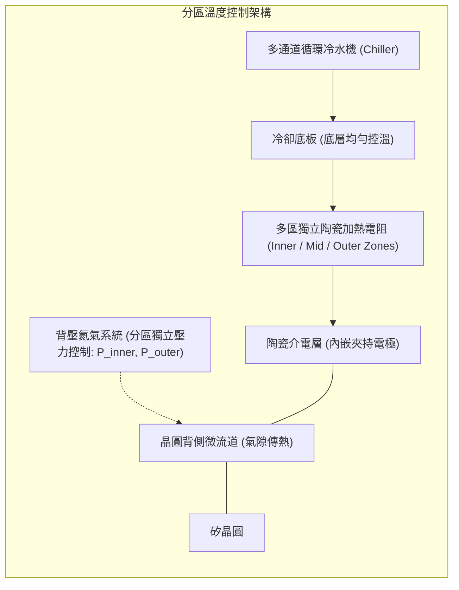

先進 ESC 採用**多區獨立溫控系統**（Multi-zone Temperature Control），透過數十個至上百個獨立可調的微型加熱單元（Heater Zones），結合雙區或多區背壓氦氣壓力調節（典型背壓範圍約 $5 \sim 35\text{ Torr}$）。此設計能動態補償電漿放電時晶圓邊緣的電場畸變與熱輻射散失，精確修正晶圓邊緣向下滾降（Edge Roll-Off）效應，維持晶圓全域 CD 均勻性於次奈米等級。

---

### 腔體潔淨管理與先進製程控制（APC）整合

#### 1. 腔體潔淨週期（Dry Clean Recipe）
在含碳氟（$\text{C}_x\text{F}_y$）氣體之介電質蝕刻過程中，側壁聚合物（Polymer）副產物不可避免地累積於電極、屏蔽罩與腔壁上。隨累積厚度增加，薄膜內應力會引發剝落，形成微粒缺陷（Particles）；聚合物厚度的變異亦會改變腔壁的自由基復合係數（Recombination Coefficient），造成製程漂移。

為此，現代機台導入**無晶圓自動乾洗（Waferless Auto Clean, WAC）**機制：
* **原位電漿清潔（In-Situ Dry Clean）**：每片晶圓蝕刻完畢並移出腔體後，通入高純度氧氣（$\text{O}_2$）或含氟電漿（如 $\text{NF}_3/\text{O}_2$），激發高密度氧自由基將碳氟沉積物氧化轉化為揮發性氣體（$\text{CO}_2$、$\text{CO}$、$\text{SiF}_4$）迅速抽離：

$$\text{CF}_x\text{ (solid)} + \text{O}^* \rightarrow \text{COF}_2\text{ (gas)} \uparrow + \text{CO}\text{ (gas)} \uparrow$$

* **腔體狀態鈍化（Seasoning）**：清潔結束後，執行短暫預處理條件沉積一層厚度均勻受控的新鮮保護膜，使腔壁表面特性在處理下一個批次晶圓前迅速回復至穩定平衡態。

#### 2. 先進製程控制（APC）系統整合
蝕刻機台透過半導體設備通訊介面（SEMI E5/E30 SECS/GEM 與 E164/Interface A 高頻寬資料介面）將即時感測數據回傳至廠級先進製程控制系統（Advanced Process Control, APC）（詳細架構見第 54 章）。

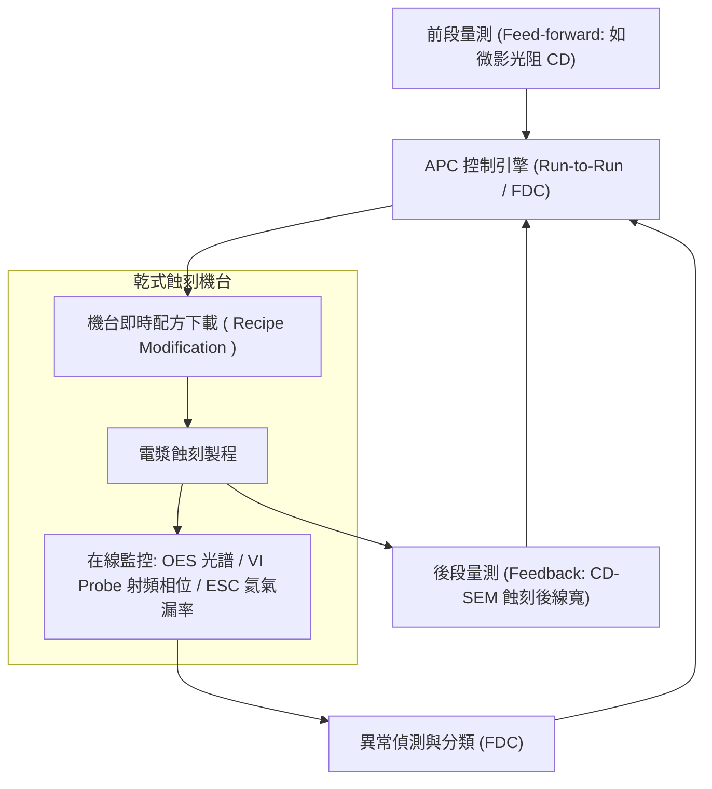

* **即時故障偵測與分類（Fault Detection and Classification, FDC）**：收集匹配器電容位置、電壓-電流探針（VI Probe）監控之高階諧波阻抗、光學發射光譜（OES）訊號強度及氦氣背面洩漏率。一旦訊號偏移臨界閥值（代表電弧放電 Arc 或吸盤微漏），機台即時暫停並警示。
* **批次至批次製程控制（Run-to-Run Control, R2R）**：結合前饋（Feed-Forward）資訊（如微影站 CD-SEM 量測之光阻線寬）動態微調蝕刻時間或 ESC 邊緣區溫度；同時接收後饋（Feed-Back）數據，自動補償因電極老化或腔體累積效應引發的漂移，確保全生命週期之 CD 與深寬比一致性。

---

### 主流設備廠商技術比較與產業實例

在高深寬比接觸窗（High Aspect Ratio Contact, HARC）及先進邏輯奈米片（Nanosheet）元件的關鍵蝕刻應用中，全球乾式蝕刻設備市場主要由應用材料（Applied Materials）、科林研發（Lam Research）與東京威力科創（Tokyo Electron, TEL）三家設備商主導。各家針對極限非等向性、晶圓邊緣傾斜度控制與極高選擇比提出了不同的電漿源與腔體工程方案。

| 設備廠商 | 代表產品系列 | 技術路線與硬體特點 | 主要應用領域 |
| :--- | :--- | :--- | :--- |
| **Applied Materials** | Sym3 系列 | 導體與介電蝕刻平台；採用高真空、大抽速排氣腔體架構與局部對稱氣流場設計，能極速排出反應副產物，大幅縮短氣體滯留時間，抑制非預期沉積。 | 先進邏輯多晶矽閘極、金屬硬光罩、FinFET/GAA 隔絕層與圖案化蝕刻。 |
| **Lam Research** | Flex 系列 | 介電質蝕刻平台；採用多頻電容耦合電漿（CCP）源技術，支援多重可調式脈衝射頻（Pulsed RF）系統，藉由精確控制離子撞擊與沉積保護膜之佔空比（Duty Cycle）實現極高選擇比。 | 3D NAND 高深寬比通道孔（Channel Hole）、字元線狹縫、先進金屬層間介電質（ILD）蝕刻。 |
| **Lam Research** | Kiyo 系列 | 導體蝕刻平台；採用感應耦合電漿（ICP）架構，具備高對稱性天線設計與獨立偏壓調節功能，在低壓高解離環境下維持極佳的均勻性與線形垂直度。 | 邏輯前段淺溝槽隔離（STI）、先進閘極成型、自對齊多重圖案化（SADP/SAQP）間隔層回蝕。 |
| **Lam Research** | Syndion 系列 | 針對微機電（MEMS）及三維封裝所開發之深矽蝕刻（Deep Reactive Ion Etching, DRIE）系統；整合高速氣體切換閥，最佳化 Bosch 製程中蝕刻與鈍化循環。 | 晶圓級封裝矽穿孔（TSV）、微機電系統（MEMS）高深寬比深矽蝕刻。 |
| **Tokyo Electron** | Tactras 系列 | 多反應腔平台架構；介電蝕刻採用高頻雙頻 CCP 電漿源，具備多軸磁場輔助調控（Dipole Ring Magnet）或極低溫晶圓載台（Cryogenic ESC）技術，以低溫抑制側壁反應擴散。 | 3D NAND 垂直通道孔蝕刻、深溝槽電容（DRAM Capacitor）、邏輯層通孔（Via）蝕刻。 |

#### 1. 高深寬比（HARC）技術解決方案之工程取捨
隨 3D NAND 垂直堆疊超過數百層，蝕刻通道孔之深寬比（Aspect Ratio）已突破 $70:1$ 甚至更高。離子射入孔底時極易受側壁靜電偏折，造成扭曲（Twisting）、頸縮（Neck Clogging）或底部縮減（Bottom Striation）：

* **低溫蝕刻（Cryogenic Etching）路線**：將晶圓載台操作溫度降至零下數十度甚至更低（如 $-60^\circ\text{C}$ 以下）。在極低溫下，反應自由基與孔側壁的熱化學反應速率呈指數級衰減，中性氣體僅在受高能離子垂直碰撞的孔底引發反應，從而大幅降低對側壁鈍化聚合物的依賴，大幅改善深孔變形並顯著提升蝕刻速率。
* **高階射頻同步脈衝（Synchronized Pulsed Plasma）路線**：主電漿源與載台偏壓射頻以千赫茲（$\text{kHz}$）頻率進行同步脈衝調變。在偏壓關閉（Pulse-off）階段，電漿鞘層消失，正負離子均勻進入深孔中和側壁表面積累的局部正電荷，消弭孔內微觀電場畸變，隨後在脈衝開啟（Pulse-on）瞬間施加高能量離子束精準轟擊孔底。

#### 2. 晶圓廠選機工程考量
半導體製造廠在評估乾式蝕刻設備導入時，涉及多維度指標的權衡：
1. **製程窗裕度（Process Window）與選擇比**：在孔徑微縮下能否達到光阻零消耗或超高硬光罩選擇比。
2. **晶圓面內均勻度（Within-Wafer Non-Uniformity, WIWNU）**：載台分區熱管理系統是否具備足夠區域密度以修正晶圓邊緣極限微縮偏差。
3. **機台平均故障間隔時間（Mean Time Between Failures, MTBF）與潔淨腔體維持**：抗電漿侵蝕材料塗層壽命，以及乾洗配方能否縮短晶圓在機時間（Wafer Overhead Time），最大化產出效率（Wafer Per Hour, WPH）。

## 本章重點

1.  **反應性離子蝕刻（RIE）機制**：乾式蝕刻的核心在於離子轟擊（物理）與活性自由基（化學）的協同效應，其蝕刻速率遠高於單純物理濺鍍或純化學蝕刻之總和。
2.  **非等向性控制**：透過側壁鈍化層（如氟碳聚合物）的形成，結合垂直入射離子的物理移除，可達成高非等向性度（$A \approx 1$）的垂直輪廓。
3.  **選擇比調控**：選擇比受熱力學（產物蒸汽壓）與動力學（離子能量、C/F 比例）影響；在介電質蝕刻中，利用含氧材料與聚合物的自清除機制可達成對矽基底的高選擇比。
4.  **負載效應與 ARDE**：巨負載效應源於反應物全局消耗，微負載效應源於局部圖案密度差異；深寬比相依蝕刻（ARDE）則受限於克努森擴散、離子陰影效應與微觀充電效應。
5.  **高深寬比（HAR）挑戰**：3D NAND 等結構面臨孔洞擴徑（Bowing）、扭曲（Twisting）與蝕刻停滯，需導入脈衝電漿與極低溫蝕刻技術以改善離子軌道與側壁穩定性。
6.  **終點偵測（EPD）技術**：光學發射光譜法（OES）監測特定化學物種能階躍遷發光，雷射干涉法則利用反射光相位差監測即時膜厚變化。
7.  **電漿源設備架構**：CCP 適用於高能離子轟擊的介電質蝕刻，ICP 具備高電漿密度與離子能量去耦合特性，適用於導體與矽蝕刻。
8.  **靜電吸盤（ESC）熱管理**：利用庫侖力或 J-R 力夾持晶圓，並透過分區背壓氦氣作為傳熱介質，確保蝕刻過程中晶圓溫度的全域均勻性。

## 重點圖卡

複習時看這幾張就能抓住本章重點；[圖卡庫](../cards.md)可以下載成圖片。

<figure markdown>
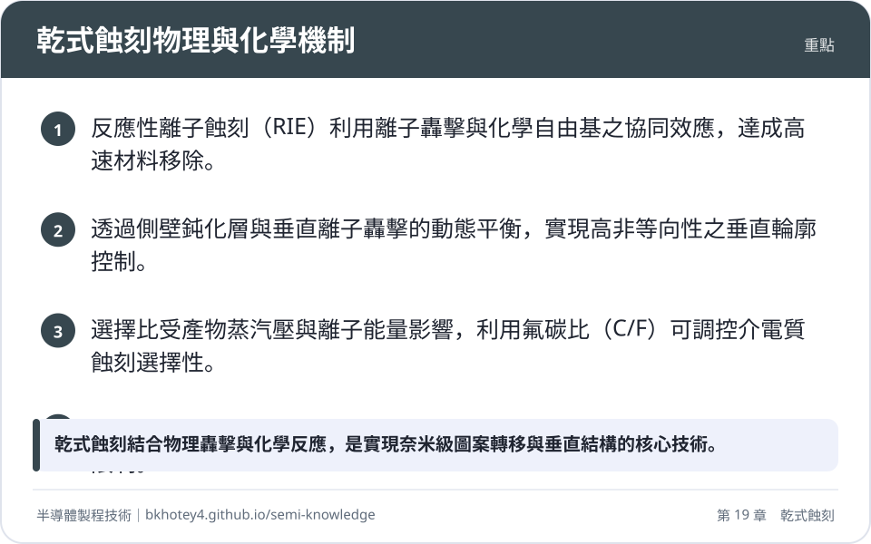
<figcaption>重點圖卡：乾式蝕刻物理與化學機制</figcaption>
</figure>

<figure markdown>
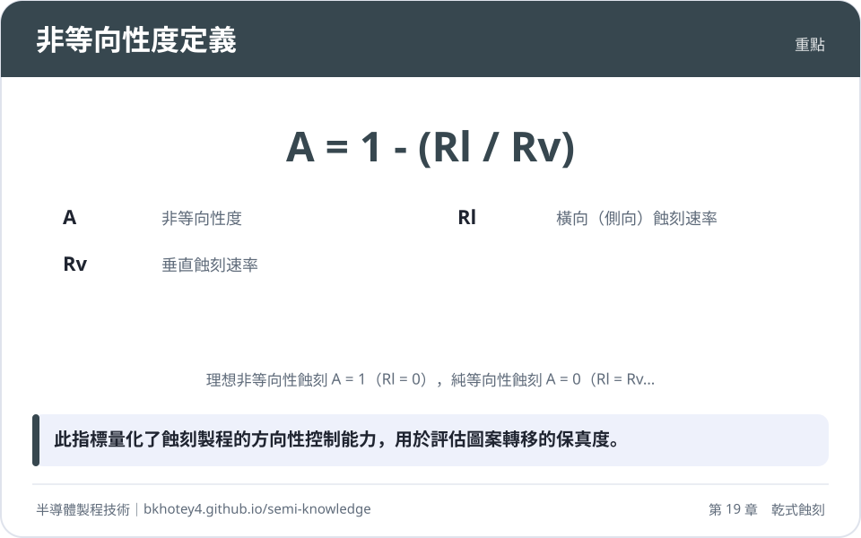
<figcaption>重點圖卡：非等向性度定義</figcaption>
</figure>

<figure markdown>
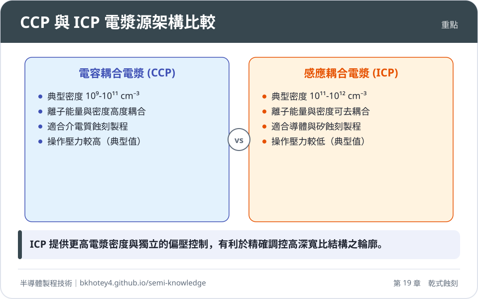
<figcaption>重點圖卡：CCP 與 ICP 電漿源架構比較</figcaption>
</figure>

<figure markdown>
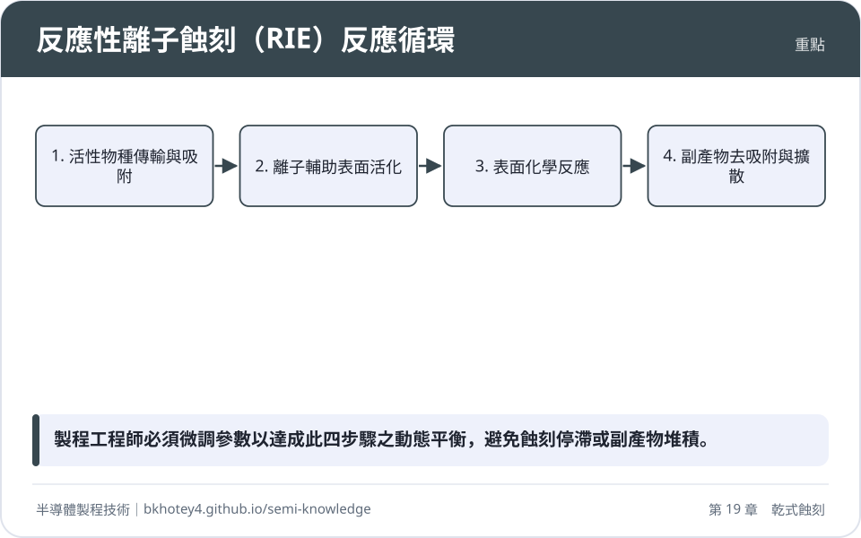
<figcaption>重點圖卡：反應性離子蝕刻（RIE）反應循環</figcaption>
</figure>

## 習題

**1.** 某製程工程師進行多晶矽蝕刻，測得垂直蝕刻速率 $R_V = 400\text{ nm/min}$，而光罩下方的側向底切速率 $R_L = 20\text{ nm/min}$。請計算其非等向性度（Degree of Anisotropy, $A$）。

??? success "參考解答"
    依據非等向性度公式：
    $$A = 1 - \frac{R_L}{R_V}$$
    將數值代入：
    $$A = 1 - \frac{20}{400} = 1 - 0.05 = 0.95$$
    該製程具有高度非等向性。

**2.** 試說明在 $SiO_2$ 蝕刻製程中，為何增加氣體中的碳氟比（C/F Ratio）可以提高對底部 $Si$ 基板的選擇比？

??? success "參考解答"
    1. 增加 C/F 比例會促進氟碳聚合物（$(CF_2)_n$）在所有表面的生成。
    2. 在 $SiO_2$ 表面，離子轟擊會釋放晶格中的氧，氧與聚合物反應生成揮發性的 $CO$ 或 $CO_2$ 逸出，使聚合物層保持極薄，蝕刻持續進行。
    3. 在 $Si$ 基板表面，缺乏晶格氧輔助清除聚合物，導致厚層聚合物堆積並阻絕離子轟擊與化學反應，從而使 $Si$ 蝕刻速率大幅降低，提升選擇比。

**3.** 考慮一巨負載效應模型。若腔室內反應物生成速率 $G$ 為定值，且蝕刻反應受反應物供應限制。當晶圓上的暴露蝕刻面積 $A_{\text{open}}$ 從 $10\text{ cm}^2$ 增加至 $50\text{ cm}^2$ 時，假設抽氣速率與重組常數遠小於蝕刻消耗項，試定性描述蝕刻速率的變化趨勢並說明物理原因。

??? success "參考解答"
    1. 變化趨勢：蝕刻速率將顯著下降。
    2. 物理原因：根據穩態自由基濃度公式 $n = \frac{G}{\dots + k_{\text{etch}} A_{\text{open}}}$，當 $A_{\text{open}}$ 增加時，單位時間內消耗的活性自由基數量大幅上升。在供應速率 $G$ 固定下，腔體內的穩態反應物濃度 $n$ 會隨之稀釋，導致每一單位面積分配到的反應物減少，進而降低蝕刻速率。

**4.** 比較感應耦合電漿（ICP）與電容耦合電漿（CCP）在離子能量控制上的差異。

??? success "參考解答"
    1. CCP 系統中，電漿密度與離子能量（偏壓）高度耦合，調整源功率時會同時影響兩者，控制靈活性較低。
    2. ICP 系統具備優良的去耦合特性。頂部感應線圈（源功率）主要控制電漿解離度與離子通量，而底部電極（偏壓功率）則獨立控制離子入射能量。這使製程能精確調控物理轟擊強度而不影響化學自由基濃度。

**5.** 在高深寬比（HAR）蝕刻中，何謂「離子陰影效應」（Ion Shadowing）？它對孔底蝕刻速率有何影響？

??? success "參考解答"
    1. 離子陰影效應是指受鞘層加速的離子並非完全垂直，而是具有微小的角度分佈（IADF）。
    2. 當孔洞深寬比增加時，具有傾斜角度的離子會撞擊側壁而非孔底。
    3. 結果導致到達孔底的有效離子通量隨深度增加而急劇下降，減緩了孔底的物理活化與聚合物清除速率，是造成 RIE 延遲（RIE Lag）的主要原因之一。

## 本章術語

- **Dry Etching**（乾式蝕刻）：利用電漿環境下的氣相化學反應與物理轟擊移除物質的技術。
- **Reactive Ion Etching, RIE**（反應性離子蝕刻）：結合化學自由基與定向離子轟擊，利用協同效應達成高速且非等向性蝕刻的機制。
- **Anisotropy**（非等向性）：蝕刻在垂直方向速率遠大於橫向速率的特性，用於定義精細垂直輪廓。
- **Selectivity**（選擇比）：目標材料與非目標材料（如遮罩或停止層）蝕刻速率的比值。
- **Loading Effect**（負載效應）：蝕刻速率隨待蝕刻面積增加（巨負載）或圖案密度差異（微負載）而變化的現象。
- **Aspect Ratio Dependent Etching, ARDE**（深寬比相依蝕刻）：蝕刻速率隨結構深寬比增加而減慢的現象，又稱 RIE 延遲。
- **Bowing**（擴徑/弓形缺陷）：高深寬比蝕刻中，離子偏轉撞擊側壁導致孔洞中部過度向外擴張的形貌缺陷。
- **Electrostatic Chuck, ESC**（靜電吸盤）：利用靜電力夾持晶圓，並透過背壓氦氣進行溫度控制的載台組件。
- **Optical Emission Spectroscopy, OES**（光學發射光譜法）：透過監測電漿中特定物種發射的光譜強度變化，來判定蝕刻終點的技術。
- **Inductively Coupled Plasma, ICP**（感應耦合電漿）：透過感應線圈產生變磁場以激發高密度電漿的架構，具備離子能量去耦合優點。

## 互動學習

!!! tip "動手試試看"
    - [設備機台圖鑑：導體蝕刻機、介電質蝕刻機](../equipment.md)

## 產業最新進展

本節由每日產業新聞自動補充，說明本章技術在產業上的最新發展。

<!-- updates -->
- **2026-10-24**　中微交付高選擇比蝕刻設備以應用於先進3D元件製程。這與乾式蝕刻章節中探討的電漿蝕刻技術、蝕刻速率與材料間的高選擇比控制原理直接相關。（來源：[中微首台高選擇比蝕刻設備交付 跨入先進3D元件製程 - DIGITIMES](https://news.google.com/rss/articles/CBMijgFBVV95cUxOSUlwUFVFQ0JkUDlzLVJ5MFZCS3k4Y0E3Q0tUWVJmLS1GcV9uTUVsUXRUSnR6NTRhUUpzcnNqdmR1Sm1rdTJRN0I4R2h3eTUwczEzNFBSTUVsdDhEaXN6dTVBalVJSWZiQThoWlBVVWcwQ3lMQ1RobFFxbGk1cU1oUUFBbmdWbXhTSnhPNldR?oc=5)）
