# 第 20 章　濕式製程與晶圓清洗

!!! abstract "學習目標"
    - 理解晶圓表面顆粒、有機物、金屬離子及原生氧化層的污染機制與附著物理（DLVO 理論與 Zeta 電位）
    - 掌握傳統 RCA 清洗配方（SC-1、SC-2、SPM、DHF）之化學反應機制與現代稀釋化學演進
    - 比較批次式槽浸與單晶圓旋轉清洗的流體力學行為、交叉污染控制與產能平衡
    - 分析毛細管力引起的奈米結構圖形倒塌物理機制，並掌握 Marangoni 與超臨界流體乾燥技術
    - 了解先進半導體製程中濕式清洗設備的硬體架構與產業主流技術

## 20.1 晶圓表面污染源與界面附著物理

在半導體製造流程中，晶圓表面之物理潔淨度與化學純度對元件良率及可靠度具有決定性影響。隨著微影技術進入極紫外光（EUV）世代以及元件結構由二維演進為 FinFET、環繞式閘極（GAAFET）（見第 6 章與第 14 章），結構特徵尺寸已縮小至數奈米等級。此時，微小的表面雜質即可能造成嚴重的微影遮蔽缺陷、接面漏電或絕緣層崩潰。本節探討晶圓表面污染物的種類與危害機制，並從膠體物理與界面電化學觀點，解析微粒附著能障模型與金屬自發還原吸附的熱力學驅動力。

### 表面污染分類與元件破壞機制

晶圓表面的污染物依其物理性質與化學成分，主要可劃分為四大類：

1. **微米與奈米微粒（Particulate Contaminants）**  
   來源包含無塵室空氣懸浮物、機台運動組件磨耗產生的碎屑、反應氣體氣相均勻成核（Gas-phase nucleation）產物，以及化學管路結晶。當微粒落在圖形化晶圓表面時，於微影製程中會阻擋曝光光源，造成嚴重的圖形轉移缺陷（圖形橋接或斷線）；於蝕刻或沉積薄膜前存在，則會導致局部針孔（Pinholes）或形成遮蔽效應（Micro-masking），生成異常錐狀結構。
2. **有機殘留物（Organic Contaminants）**  
   包含微影後殘留之光阻、光阻去除劑（Stripper）副產物、無塵室大氣中的揮發性有機物（Volatile Organic Compounds, VOCs），以及晶圓承載盒（FOUP）釋出之塑化劑。有機物覆蓋於晶圓表面會改變其表面能，導致化學清洗液之潤濕性不均勻；若未完全去除即進入高溫擴散或退火爐管（見第 25、27 章），有機碳化物裂解沉積將成為深能階陷阱（Deep-level traps），大幅縮短少數載子壽命，甚至惡化矽－二氧化矽（$\text{Si/SiO}_2$）界面態密度（Interface trap density, $D_{\text{it}}$）。
3. **金屬雜質（Metallic Contaminants）**  
   常見為第 I 族鹼金屬（如 $\text{Na}^+$、$\text{K}^+$）及過渡金屬（如 $\text{Fe}$、$\text{Cu}$、$\text{Ni}$、$\text{Cr}$）。鹼金屬離子在二氧化矽介電層中具有高遷移率，在電場驅動下會形成可動離子電荷（Mobile ionic charge, $Q_{\text{m}}$），引發電晶體臨界電壓（$V_{\text{th}}$）嚴重漂移。過渡金屬在矽基板中擴散係數高且具多重能階，易在矽禁帶中形成複合中心，誘發巨大之接面漏電流；此外，過渡金屬易在高電場區沉澱，造成薄閘極氧化層之時變介電質崩潰（Time-Dependent Dielectric Breakdown, TDDB）壽命驟降。
4. **化學原生氧化層（Chemical Native Oxide）**  
   晶圓暴露於大氣或具強氧化性之濕式藥水時，表面會自發生成厚度約 $0.5 \sim 1.5\text{ nm}$ 的非緻密非晶態氧化矽。在歐姆接觸（Ohmic contact）電極沉積前或磊晶製程前（見第 9 章），未徹底清除之原生氧化層會阻絕矽基板與金屬接觸，造成接觸電阻（Contact resistance, $R_{\text{c}}$）急遽攀升，並阻礙磊晶層原子之週期性排列，引發大量差排（Dislocations）。

| 污染物種類 | 主要來源 | 典型成分 | 對半導體元件特性之破壞機制 |
| :--- | :--- | :--- | :--- |
| **顆粒微粒** | 設備摩擦、氣相反應、無塵室環境 | $\text{Si}$ 碎屑、$\text{SiO}_2$、$\text{Si}_3\text{N}_4$、金屬屑 | 圖形橋接、線路斷路、蝕刻微遮蔽缺陷 |
| **有機物** | 光阻殘留、溶劑蒸氣、晶圓盒析出 | 聚合物殘留、碳氫化合物、矽氧烷 | 潤濕不良、熱處理碳化、界面缺陷能階上升 |
| **鹼金屬** | 人體皮屑、化學品雜質 | $\text{Na}^+$、$\text{K}^+$ | 介電層可動離子漂移、$V_{\text{th}}$ 不穩定 |
| **過渡金屬** | 製程機台、化學藥液、配管接頭 | $\text{Fe}$、$\text{Cu}$、$\text{Ni}$、$\text{Zn}$ | 深能階載子複合、接面漏電、閘極氧化層 TDDB 裂解 |
| **原生氧化層** | 空氣暴露、含氧/強氧化性清洗液 | $\text{SiO}_x$ ($x \le 2$) | 接觸阻抗劇增、阻礙高品質磊晶生長 |

---

### 顆粒吸附力學與 DLVO 理論

奈米級微粒附著於平整晶圓表面後，難以僅藉由一般流體剪切力移除，其物理結合主要由長程引力與短程排斥力所支配。

#### 凡得瓦吸引力（van der Waals force）

當半徑為 $R$ 的球形微粒靠近無限大平整基板時，若二者表面間距為 $D$，且滿足 $D \ll R$，微粒與基板間的非延遲性（Unretarded）凡得瓦交互作用位能 $V_{\text{vdW}}$ 可透過哈梅克常數（Hamaker constant, $A_{132}$）進行宏觀積分求得：

$$V_{\text{vdW}}(D) = -\frac{A_{132} R}{6D}$$

其中，下標 1 代表微粒材質，2 代表晶圓基板材質，3 則代表二者所處的中介介質（如去離子水或特定清洗液）。複合哈梅克常數 $A_{132}$ 可由個別均勻相之哈梅克常數近似計算：

$$A_{132} \approx \left(\sqrt{A_{11}} - \sqrt{A_{33}}\right)\left(\sqrt{A_{22}} - \sqrt{A_{33}}\right)$$

相應的凡得瓦吸引力為位能對距離之微分：

$$F_{\text{vdW}}(D) = -\frac{\mathrm{d}V_{\text{vdW}}}{\mathrm{d}D} = -\frac{A_{132} R}{6D^2}$$

當微粒與表面緊密接觸（原子尺度接觸距離 $D_0 \approx 0.4\text{ nm}$）時，強大的凡得瓦力將引發接觸區之彈塑性形變，接觸面積增加進一步加劇脫附難度。

#### 靜電雙電層效應（Electric Double Layer, EDL）

當微粒與基板浸入水溶液時，表面基團解離或離子特定吸附將使固液界面帶電。為維持電中性，溶液中帶相反電荷的平衡離子（Counter-ions）會聚集在固體表面附近，形成分為緊密層（Stern layer）與擴散層（Diffuse layer）的靜電雙電層結構。當帶有相同符號表面電位的微粒與基板相互靠近時，擴散雙電層重疊產生滲透壓差與靜電排斥作用，其排斥位能 $V_{\text{EDL}}$ 可表示為：

$$V_{\text{EDL}}(D) = 2\pi\varepsilon_0 \varepsilon_{\text{r}} R \psi_1 \psi_2 \ln\left(1 + \exp(-\kappa D)\right)$$

其中 $\varepsilon_0$ 為真空介電常數，$\varepsilon_{\text{r}}$ 為溶液相對介電常數，$\psi_1$ 與 $\psi_2$ 分別為微粒與基板之表面電位，$\kappa$ 為德拜遮蔽參數（Debye screening parameter），其倒數 $\kappa^{-1}$ 代表德拜長度（Debye length），由溶液離子強度（Ionic strength, $I$）決定：

$$\kappa = \sqrt{\frac{2e^2 N_{\text{A}} I}{\varepsilon_0 \varepsilon_{\text{r}} k_{\text{B}} T}}$$

式中 $e$ 為基本電荷，$N_{\text{A}}$ 為亞佛加厥常數，$k_{\text{B}}$ 為波茲曼常數，$T$ 為絕對溫度。

#### DLVO 理論模型

德爾雅金－朗道－費威－奧弗比克（Derjaguin-Landau-Verwey-Overbeek, DLVO）理論指出，膠體顆粒與平面間之總交互作用能 $V_{\text{total}}$ 為凡得瓦吸引能與雙電層靜電能之代數和：

$$V_{\text{total}}(D) = V_{\text{vdW}}(D) + V_{\text{EDL}}(D)$$

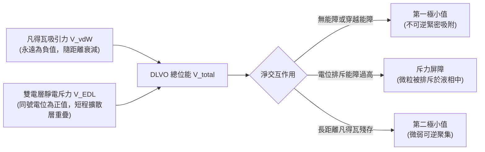

在極小間距下（原子軌域重疊），短程包立斥力（Born repulsion）使位能陡升，此處形成「第一極小值（Primary minimum）」。若微粒落入此位能井，需要巨大之外加機械能量方能脫離。在適當的介質環境中，雙電層斥力會在中間距離（數奈米處）形成正位能極大值，稱為「靜電斥力能障（Repulsive energy barrier）」。半導體清洗之核心目標，即為透過化學配方調控，極大化該排斥能障，避免微粒沉降至第一極小值。

---

### Zeta 電位調控機制與防再附著原理

在膠體物理學中，固體表面直接的表面電位難以精準直接量測，實務上以流體流動時「流體滑動面（Shear plane/Slipping plane）」上的電位代之，定義為 **Zeta 電位（$\zeta$-potential）**。

#### 表面基團解離與 pH 值依賴性

矽晶圓表面在水溶液中主要被矽醇基（$\text{Si-OH}$）所覆蓋，其電離平衡取決於溶液的氫離子濃度（$\text{pH}$）：

*   **酸性環境（低 $\text{pH}$）：**
    $$\text{Si-OH} + \text{H}^+ \rightleftharpoons \text{Si-OH}_2^+ \quad \implies \quad \zeta > 0$$
*   **鹼性環境（高 $\text{pH}$）：**
    $$\text{Si-OH} + \text{OH}^- \rightleftharpoons \text{Si-O}^- + \text{H}_2\text{O} \quad \implies \quad \zeta < 0$$

當微粒或表面之淨表面電荷為零時的 $\text{pH}$ 值稱為**等電點（Isoelectric Point, IEP）**。常見半導體材料之等電點各不相同：二氧化矽（$\text{SiO}_2$）之 IEP 約在 $\text{pH } 2 \sim 3$，氧化鋁（$\text{Al}_2\text{O}_3$）之 IEP 約在 $\text{pH } 8 \sim 9$，而氮化矽（$\text{Si}_3\text{N}_4$）則約在 $\text{pH } 5 \sim 6$。

```
Zeta 電位 (mV)
  +50 |            / \
      |           /   \   Al2O3 (IEP ≈ 8.5)
    0 |----------/-----\---------------> pH
      |  SiO2   /       \
  -50 | (IEP ≈ 2.5)      \
      +------------------------
      0   2   4   6   8   10  12
```

#### 靜電防再附著機制

若晶圓清洗環境處於酸性區間（例如 $\text{pH} = 3 \sim 6$），$\text{SiO}_2$ 晶圓表面帶微弱負電荷，但懸浮之氧化鋁或金屬微粒則帶正電荷。異號電荷導致 $V_{\text{EDL}} < 0$，靜電力轉化為吸引力，微粒將自發且劇烈地吸附至晶圓表面。

反之，若將清洗介質調配至強鹼性環境（例如使用稀釋氨水 $\text{NH}_4\text{OH}$，使 $\text{pH} > 10$），不論是 $\text{SiO}_2$ 晶圓表面抑或大多數固體顆粒，其表面基團皆完全去質子化，Zeta 電位均小於 $-30\text{ mV}$（典型值介於 $-40\text{ mV}$ 至 $-70\text{ mV}$）。微粒與基板表面帶強烈同號負電，產生極高的靜電排斥能障，使得已被清洗流場剝離之顆粒無法克服此能障重回晶圓表面，達成防再附著（Anti-redeposition）之保護機制。

!!! note "高離子強度對 Zeta 電位之壓制"
    即便微粒與表面具備相同符號之 Zeta 電位，若溶液中電解質濃度過高（離子強度 $I$ 過大），德拜長度 $\kappa^{-1}$ 將急遽萎縮（離子遮蔽效應）。雙電層厚度由數奈米被壓縮至次奈米級，排斥能障將完全消失，凡得瓦引力再次主導體系，促使微粒絮凝並沉降吸附。因此，清洗配方需嚴格在 $\text{pH}$ 值與離子強度間取得平衡。

---

### 金屬雜質吸附與電化學氧化還原沉積

相較於顆粒的物理吸附，過渡金屬在裸矽（Bare Silicon）表面的沉積通常涉及界面電荷轉移，屬於**電化學氧化還原置換反應（Redox Displacement）**。

#### 熱力學驅動力與半電池電位

當晶圓處於氫氟酸（$\text{HF}$）等能溶解二氧化矽的水溶液中時，矽表面被氫原子飽和（形成 $\text{Si-H}$ 鍵），呈現無氧化層的還原性裸矽表面。此時若溶液中存在具有較高標準還原電位（Standard reduction potential, $E^\circ$）之金屬陽離子（如 $\text{Cu}^{2+}$、$\text{Au}^{3+}$、$\text{Ag}^+$），金屬離子與矽基板之間存在自發的電化學反應趨勢。

考量各反應之標準還原電位（相對於標準氫電極 SHE）：

$$\text{Cu}^{2+} + 2e^- \rightarrow \text{Cu} \quad (E^\circ = +0.34\text{ V vs. SHE})$$

$$\text{SiF}_6^{2-} + 4e^- \rightarrow \text{Si} + 6\text{F}^- \quad (E^\circ \approx -1.20\text{ V vs. SHE})$$

於水溶液中，矽的氧化反應為陽極，金屬離子之還原反應為陰極。全電池總電動勢（Cell potential）$\Delta E^\circ$ 顯著大於零：

$$\Delta E^\circ = E^\circ_{\text{cathode}} - E^\circ_{\text{anode}} > 0$$

根據吉布斯自由能變數（Gibbs free energy change）公式：

$$\Delta G^\circ = -nF\Delta E^\circ < 0$$

反應具有極高的熱力學自發性。在含氟離子（$\text{F}^-$）的酸性介質中，矽基板氧化生成可溶性四氟化矽或六氟矽酸根離子（$\text{SiF}_6^{2-}$），釋放出的電子被溶液中的銅離子捕獲，直接在晶圓表面金屬化（以金屬核成核析出）：

$$\text{Si}_{(\text{s})} + 2\text{Cu}^{2+}_{(\text{aq})} + 6\text{HF}_{(\text{aq})} \rightarrow \text{SiF}_{6}^{2-}_{(\text{aq})} + 2\text{Cu}_{(\text{s})}^0 + 6\text{H}^+_{(\text{aq})}$$

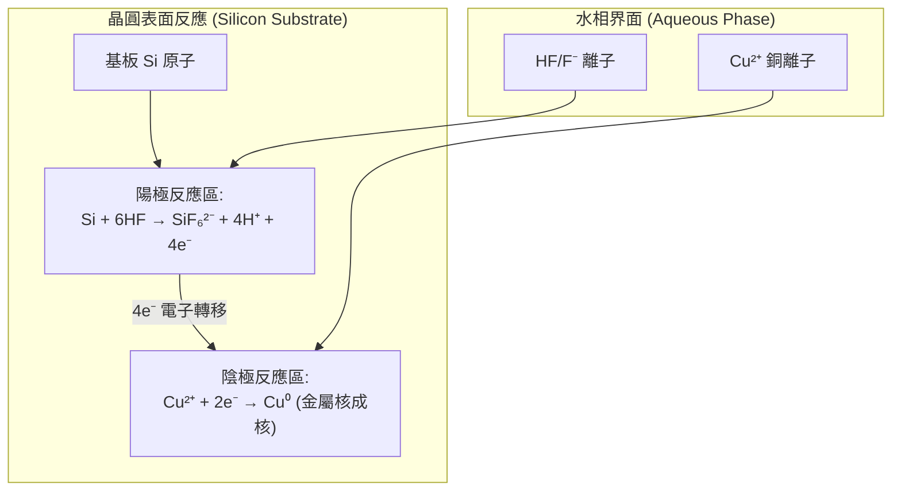

#### 金屬化學吸附形態與清除策略之物理限制

電化學沉積於矽表面的銅核與基底形成金屬－半導體共價鍵，屬於強烈的化學吸附（Chemisorption）。常規物理擦洗或超音波清洗均無法克服此化學鍵結能。此外，一旦微量零價金屬核析出，該金屬顆粒與周圍矽表面將形成局部微電池（Local galvanic cell），促使陽極區之矽加速局部溶解形成凹坑（Etch pits），同時提供源源不絕的電子加劇金屬核成長。

因此，為防止金屬雜質以零價還原態沉積，半導體濕式化學必須加入強氧化劑（如過氧化氫 $\text{H}_2\text{O}_2$、臭氧 $\text{O}_3$）或錯合劑（Complexing agents）。強氧化劑在金屬還原析出前，優先於矽基板表面鈍化生成一層緻密的化學氧化矽薄膜，截斷電子由矽流向金屬離子的通道；錯合劑則大幅降低游離金屬陽離子之活度，壓低其還原電位，從熱力學根源阻絕電化學自發置換反應的發生。

<!-- fig:1 -->
<figure markdown>
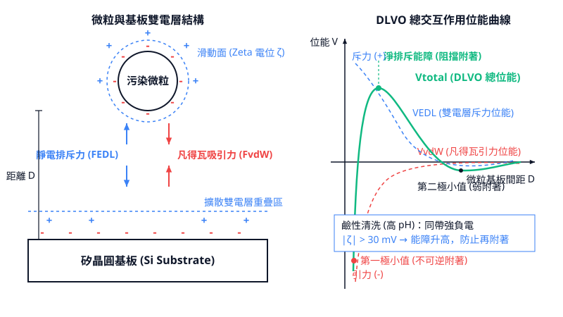
<figcaption>圖 20-1　微粒附著與雙電層機制圖（AI 繪製的示意圖）</figcaption>
</figure>

## 20.2 化學清洗配方與反應機制：從 RCA 到稀釋化學

### 硫酸雙氧水混合液（SPM）與重度有機物去除

在晶圓製造中，微影後的光阻剝除（Photoresist Stripping）、離子佈植後的硬化光阻去除，以及大氣環境沉積的碳氫化合物污染，皆屬於重度有機物污染。針對此類污染，工業界最普遍採用的濕式化學配方為硫酸雙氧水混合液（Sulfuric Acid-Hydrogen Peroxide Mixture, SPM），亦常稱為皮拉尼亞洗液（Piranha Solution）。

SPM 是由高濃度硫酸（典型濃度約 $96\text{–}98\text{ wt}\%\ \text{H}_2\text{SO}_4$）與雙氧水（典型濃度約 $30\text{–}31\text{ wt}\%\ \text{H}_2\text{O}_2$）以體積比 $3:1$ 至 $5:1$ 混合而成。兩者混合時會產生劇烈的放熱反應，液溫常自發性上升至 $100\text{ }^\circ\text{C}$ 以上，工業製程通常將操作溫度維持在 $100\text{–}140\text{ }^\circ\text{C}$。

#### 反應機制
SPM 去除有機物的化學途徑包含脫水碳化與強氧化兩個協同階段：

1. **過一硫酸（Caro's Acid）的生成**：
   濃硫酸與雙氧水混合後達成化學平衡，生成具備極高標準電極電位（$E^\circ \approx 1.81\text{ V}$）的過一硫酸（$\text{H}_2\text{SO}_5$）：
   $$\text{H}_2\text{SO}_4 + \text{H}_2\text{O}_2 \rightleftharpoons \text{H}_2\text{SO}_5 + \text{H}_2\text{O}$$
2. **脫水與碳化作用**：
   濃硫酸具有極強的吸水性，能迅速奪取有機高分子聚合物中的氫與氧原子，將光阻長鏈破壞並脫水碳化為多孔質的碳質殘渣（Carbonaceous Residue）：
   $$\text{C}_n\text{H}_{2m}\text{O}_m \xrightarrow{\text{H}_2\text{SO}_4} n\text{C} + m\text{H}_2\text{O}$$
3. **強氧化反應**：
   生成的活性原子氧及過一硫酸迅速攻擊碳質殘渣，將其徹底氧化為氣態的二氧化碳與水：
   $$\text{C} + 2\text{H}_2\text{SO}_5 \rightarrow \text{CO}_2 \uparrow + 2\text{H}_2\text{SO}_4$$
   $$\text{C}_n\text{H}_{2m} + (2n + m)\text{H}_2\text{SO}_5 \rightarrow n\text{CO}_2 \uparrow + (n + m)\text{H}_2\text{O} + (2n + m)\text{H}_2\text{SO}_4$$

SPM 具備極強的反應性，但高濃度的硫酸黏度大且難以清洗，後續必須搭配長時間的高溫去離子水（Deionized Water, DIW）淋洗，否則殘留的硫酸根離子（$\text{SO}_4^{2-}$）會在後續熱製程中引發嚴重的晶圓表面缺陷（如生成硫酸銨霧狀沉澱）。

---

### 標準清洗一劑（SC-1 / APM）與微粒脫附機制

標準清洗一劑（Standard Clean 1, SC-1），又稱氨水雙氧水混合液（Ammonia Hydroxide-Hydrogen Peroxide Mixture, APM），由 Kern 與 Puotinen 於 1970 年在 RCA 實驗室提出，是 RCA 清洗流程的核心配方。其傳統體積混合比例為 $\text{NH}_4\text{OH} (29\text{ wt}\%) : \text{H}_2\text{O}_2 (30\text{ wt}\%) : \text{H}_2\text{O} = 1:1:5$，在現代先進製程中多稀釋至 $1:1:50$ 至 $1:2:100$，典型製程溫度為 $40\text{–}70\text{ }^\circ\text{C}$。

SC-1 的主要功能是藉由**微蝕刻底切（Undercut）**物理機制剝離晶圓表面顆粒，並藉由靜電排斥防止顆粒再附著，同時去除輕度有機殘留物。

#### 氧化與蝕刻的動態平衡
SC-1 的溶液環境維持在鹼性（$\text{pH} \approx 9\text{–}11$）。在此體系下，矽晶圓表面同時發生兩個相反的化學反應：

1. **氧化反應**：$\text{H}_2\text{O}_2$ 作為強氧化劑，在晶圓表面迅速生成一層極薄且緻密的化學氧化矽薄膜（Chemical Oxide, $\text{SiO}_x$）：
   $$\text{Si} + 2\text{H}_2\text{O}_2 \rightarrow \text{SiO}_2 + 2\text{H}_2\text{O}$$
2. **蝕刻反應**：解離出的氫氧根離子（$\text{OH}^-$）對氧化矽進行親核性攻擊，將其緩慢溶解形成可溶性的矽酸鹽離子：
   $$\text{SiO}_2 + 2\text{OH}^- \rightarrow \text{SiO}_3^{2-} + \text{H}_2\text{O}$$
   或完全水合形式：
   $$\text{SiO}_2 + 2\text{OH}^- + 2\text{H}_2\text{O} \rightarrow [\text{Si(OH)}_6]^{2-}$$

此連續的「氧化－溶解」循環在矽表面維持著厚度約 $0.8\text{–}1.2\text{ nm}$ 的動態鈍化層。當化學反應微量蝕刻掉顆粒下方的基底材料時（蝕刻厚度通常小於 $0.5\text{–}1\text{ nm}$），顆粒與晶圓表面接觸的凡得瓦力（van der Waals force）界面遭破壞，顆粒隨之脫離表面（Lift-off）。

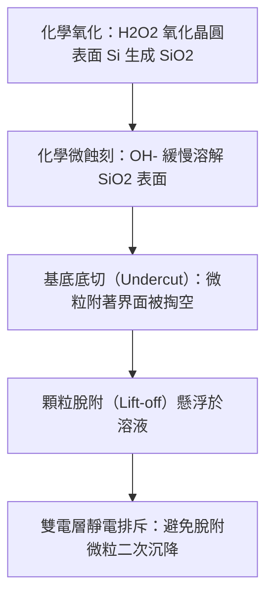

#### 界面電位與靜電排斥
微粒脫離後必須確保其不會再次沉積於晶圓表面。在 SC-1 的強鹼性環境中，矽晶圓表面的矽醇基（$\text{Si-OH}$）去質子化：
$$\equiv\text{Si-OH} + \text{OH}^- \rightarrow\ \equiv\text{Si-O}^- + \text{H}_2\text{O}$$
使得晶圓表面呈現高度負電位（界達電位 $\zeta \approx -30\text{–}-60\text{ mV}$）。絕大多數無機顆粒（如 $\text{SiO}_2$、$\text{Si}_3\text{N}_4$ 及空氣落塵）在鹼性環境中亦帶有負界達電位。依據 DLVO 理論（Derjaguin-Landau-Verwey-Overbeek），晶圓與微粒間產生強大的同性電荷靜電排斥力，克服凡得瓦引力，從而阻絕顆粒回沉。

```
       顆粒 (-)
          | 靜電排斥力
          v
   <--------------->
   ================== 晶圓表面 (-)
```

!!! note "說明：粗糙度控制與混合比例調整"
    傳統 SC-1 配方（$1:1:5$）蝕刻速率較高且各向異性明顯，常在特定晶面引發過度微粗糙度（Micro-roughness），導致閘極氧化層崩潰電壓下降。現代先進製程透過大幅降低 $\text{NH}_4\text{OH}$ 的配比（如調高 $\text{H}_2\text{O}_2 / \text{NH}_4\text{OH}$ 濃度比），有效抑制蝕刻速率並確保表面平整度維持在原子級尺度（$\text{RMS} < 0.1\text{ nm}$）。

---

### 標準清洗二劑（SC-2 / HPM）與金屬離子錯合

標準清洗二劑（Standard Clean 2, SC-2），又稱鹽酸雙氧水混合液（Hydrochloric Acid-Hydrogen Peroxide Mixture, HPM），原始比例為 $\text{HCl} (37\text{ wt}\%) : \text{H}_2\text{O}_2 (30\text{ wt}\%) : \text{H}_2\text{O} = 1:1:6$，現代稀釋配方可達 $1:1:50$ 至 $1:1:100$，典型工作溫度在 $60\text{–}80\text{ }^\circ\text{C}$。

SC-2 的核心功能為去除鹼金屬離子（如 $\text{Na}^+, \text{K}^+$）及過渡金屬污染（如 $\text{Fe}, \text{Cu}, \text{Ni}, \text{Cr}, \text{Zn}, \text{Al}$）。金屬雜質即使在晶圓表面僅殘留 $10^{10}\text{ atoms/cm}^2$，亦會擴散進入矽基底形成深層能階陷阱（Deep-level traps），導致接面漏電流上升或少數載子壽命急遽下降。

#### 反應機制與氯離子錯合作用
金屬在酸性氧化體系中被氧化成陽離子，並與高濃度的氯離子（$\text{Cl}^-$）進行錯合作用（Complexation）：

1. **氧化與溶解**：
   以鐵與鋁為例，雙氧水與酸性環境提供高氧化電位，使不溶性金屬原子氧化為離子態：
   $$\text{Fe} + 3\text{H}^+ + \frac{3}{2}\text{H}_2\text{O}_2 \rightarrow \text{Fe}^{3+} + 3\text{H}_2\text{O}$$
2. **氯離子錯合效應**：
   氯離子扮演強配位基（Ligand），與金屬陽離子迅速結合為高度穩定的陰離子或中性可溶性氯錯合物：
   $$\text{Fe}^{3+} + 4\text{Cl}^- \rightarrow [\text{FeCl}_4]^-$$
   $$\text{Cu}^{2+} + 4\text{Cl}^- \rightarrow [\text{CuCl}_4]^{2-}$$

此錯合反應大幅降低了游離金屬離子的化學活性（Activity），並使金屬的標準還原電位朝負方向移動，有效阻斷金屬在裸矽表面藉由氧化還原反應（Redox Reaction）置換沉積為金屬原子的逆反應（如 $\text{Cu}^{2+} + \text{Si} \rightarrow \text{Cu} \downarrow + \text{Si}^{4+}$）。同時，SC-2 維持在極低的 $\text{pH}$ 值（$< 1$），徹底避免金屬氫氧化物（如 $\text{Fe(OH)}_3$、$\text{Al(OH)}_3$）在晶圓表面產生不溶性沉澱。

---

### 稀釋氫氟酸（DHF）與緩衝氫氟酸（BHF）

在半導體製程中，經常需要剝除晶圓表面的自然氧化層（Native Oxide）或熱氧化層，使矽基底重現。氫氟酸（Hydrofluoric Acid, HF）是唯一能在室溫下有效溶解二氧化矽的實用化學品。

#### 稀釋氫氟酸（DHF）
稀釋氫氟酸（Dilute HF, DHF）通常將 $49\text{ wt}\%$ 的濃 HF 以去離子水稀釋至 $0.5\text{–}2\text{ wt}\%$（混合比約 $1:50$ 至 $1:200$），反應在室溫（$20\text{–}25\text{ }^\circ\text{C}$）下進行。

二氧化矽的溶解遵循總反應式：
$$\text{SiO}_2 + 6\text{HF} \rightarrow \text{H}_2\text{SiF}_6 + 2\text{H}_2\text{O}$$
反應生成高溶解度的氟矽酸（Hexafluorosilicic Acid, $\text{H}_2\text{SiF}_6$），並隨廢液排出。

#### 氫鈍化（H-termination）機制
當氧化層被 DHF 徹底去除後，裸露的矽晶圓表面不會保持富含氟的鈍化狀態，而是形成高度穩定的氫鈍化層（$\text{Si-H}$、$\text{Si-H}_2$、$\text{Si-H}_3$）。

儘管熱力學上 $\text{Si-F}$ 鍵的鍵能（約 $540\text{–}565\text{ kJ/mol}$）遠大於 $\text{Si-H}$ 鍵能（約 $318\text{–}322\text{ kJ/mol}$），但反應機制的動態過程決定了最終產物：由於氟的電負度極高（Pauling 電負度 4.0），$\text{Si-F}$ 鍵具有強烈極性，誘導矽原子帶有部分正電荷（$\delta^+$）。這使得鍵結於該矽原子的背向 $\text{Si-Si}$ 鍵極化減弱並遭到活化，易受極性 HF 分子的進一步親核攻擊：

$$\equiv\text{Si-SiF}_3 + \text{HF} \rightarrow\ \equiv\text{Si-H} + \text{SiF}_4 \uparrow$$

此連續的連鎖斷鍵反應最終導致所有表面矽懸鍵（Dangling Bonds）全數被氫原子飽和，形成共價的氫鈍化表面。由於 $\text{Si-H}$ 鍵幾無極性，晶圓表面由原本氧化層的親水性（水接觸角 $< 10^\circ$）驟轉為強疏水性（水接觸角 $> 70^\circ$）。

```
        HF 攻擊極化的 Si-Si 鍵
             HF
             ↓
        F   H-F
        |   |
  - Si - Si - Si - 
  / | \ / | \
```

!!! warning "常見誤解：HF 清洗後的表面殘留大量氟原子？"
    許多人誤以為鍵能較高的 $\text{Si-F}$ 鍵會覆蓋清洗後的晶圓表面。實際上，紅外線吸收光譜（FTIR）與 X 射線光電子能譜（XPS）分析證實，DHF 處理後的矽表面有超過 $95\text{–}99\%$ 的鍵位被氫終端飽和（形成單氫 $\text{Si-H}$ 或二氫 $\text{Si-H}_2$），氟原子覆蓋率通常低於 $1\%$。疏水表面極易吸附環境中的非極性有機物與空氣顆粒，且易引發水痕（Watermark）缺陷。

#### 緩衝氫氟酸（BHF / BOE）
在具有微影光阻圖案的晶圓上進行等向性氧化層開口蝕刻時，純 DHF 會面臨以下問題：
1. 反應消耗 $\text{HF}$ 造成局部濃度梯度，使蝕刻速率不均勻；
2. 純 DHF 的酸度偏高，易破壞光阻與基底的黏著界面導致剝離；
3. 水解電離不穩定導致微粗糙度惡化。

為此，製程中引入緩衝氧化層蝕刻液（Buffered Oxide Etchant, BOE 或 BHF）。BHF 是利用氟化銨（$\text{NH}_4\text{F}$）與 $\text{HF}$ 按一定比例（常見體積比為 $6:1$ 或 $10:1$ 的 $40\text{ wt}\%\ \text{NH}_4\text{F} : 49\text{ wt}\%\ \text{HF}$）混合而成的緩衝體系。

其離子解離平衡如下：
$$\text{NH}_4\text{F} \rightarrow \text{NH}_4^+ + \text{F}^-$$
$$\text{HF} + \text{F}^- \rightleftharpoons \text{HF}_2^-$$

在該體系中，主要的有效蝕刻物種轉化為二氟氫根離子（$\text{HF}_2^-$）與未解離的 $\text{HF}$。藉由 $\text{NH}_4\text{F}$ 的共離子效應，溶液的 $\text{pH}$ 值穩定緩衝於 $5\text{–}6$ 的範圍，維持蝕刻活性物種的化學勢恆定，確保在大量蝕刻進行時反應速率高度可控，並顯著改善光阻附著力與表面微觀平整度。

---

### 綠色與現代稀釋化學配方

傳統 RCA 清洗製程消耗巨量的超純水（UPW）與高純度化學品，且高溫槽液揮發大量酸霧與氨氣，造成可觀的廠務廢水處理負荷與營運成本。隨著特徵尺寸微縮至奈米尺度，高濃度化學液引起的奈米結構微腐蝕與材料損失亦無法被容忍。先進半導體製程因此發展出稀釋化學與綠色清洗策略。

| 傳統清洗技術 | 缺點 / 限制 | 綠色與現代替代方案 | 關鍵優勢 |
| :--- | :--- | :--- | :--- |
| **高溫 SPM** | 硫酸黏度大難清洗、高溫能耗高、硫殘留風險 | **溶解臭氧水（$\text{DIO}_3$）** | 常溫反應、分解物僅為氧氣、無化學品殘留 |
| **高濃度 SC-1** | 矽表面各向異性蝕刻引發粗糙度、微結構掏空 | **超稀釋 SC-1 + 百萬赫超音波** | 微量材料損失（$< 0.1\text{ nm}$）、維持平整度 |
| **高濃度 SC-2** | 氯離子誘發金屬腐蝕、酸液排放量龐大 | **稀釋有機酸（檸檬酸、草酸）** | 具備優異螯合能力、相容新穎金屬閘極 |
| **純 UPW 淋洗** | 靜電累積導致奈米結構放電破損、水痕生成 | **功能水（氫氣水、碳酸水）** | 消除靜電、抑制微水痕、強化微粒剝離 |

#### 溶解臭氧水（$\text{DIO}_3$）技術
臭氧（$\text{O}_3$）在去離子水中的溶解度可透過高壓低溫氣液接觸膜技術達到 $20\text{–}100\text{ ppm}$。$\text{DIO}_3$ 具備高達 $2.07\text{ V}$ 的標準電極電位，在室溫（$20\text{–}25\text{ }^\circ\text{C}$）下即能迅速氧化分解大部分有機光阻與光阻殘渣：
$$\text{O}_3 + \text{有機物} \rightarrow \text{CO}_2 \uparrow + \text{H}_2\text{O}$$
臭氧水的副產物僅為氧氣（$\text{O}_2$），省去高溫 SPM 後繁複的高溫熱水淋洗步驟，水資源消耗量可降低 $40\%$ 以上。

#### 功能水（Functional Water）與化學品減量
先進清洗機台普遍導入物理溶解特定氣體的功能水：
* **碳酸水（$\text{CO}_2/\text{DIW}$）**：超純水因電阻率極高（$18.2\text{ M}\Omega\cdot\text{cm}$）易在高速旋轉清洗時累積靜電，導致閘極介電層遭靜電放電（ESD）打穿。微量溶入 $\text{CO}_2$ 可將電阻率降至安全範圍（$< 0.1\text{ M}\Omega\cdot\text{cm}$），消除電荷累積。
* **氫氣水（$\text{H}_2/\text{DIW}$）**：將低濃度 $\text{H}_2$ 溶於去離子水並施加百萬赫超音波（Megasonics），利用氫分子清除自由基並藉由空化作用（Cavitation）產生之能量輔助去除物理顆粒，能在幾近中性且無蝕刻化學劑的環境下達成優良的顆粒去除率（Particle Removal Efficiency, PRE）。

現代清洗配方由傳統的高濃度巨量消耗，轉向「超稀釋（Dilute Chemical）」與「多合一單晶圓（Single Wafer Processing）」的短時序循環，以原子層控制等級的蝕刻精度，滿足先進晶體管結構在缺陷與材料損耗上的嚴格規格。

## 20.3 清洗製程實作：批次式、單晶圓與物理輔助技術

### 20.3.1 批次槽浸式清洗（Batch Immersion / Wet Bench）

批次槽浸式清洗設備（Wet Bench）是半導體成熟製程與部分先進製程非關鍵步驟中極為常見的濕式架構。其運作原理是將整批晶圓（通常為 25 或 50 片，裝載於晶圓盒或以無托盤機械手臂夾持）依序浸入不同化學槽、沖洗槽與乾燥槽中。

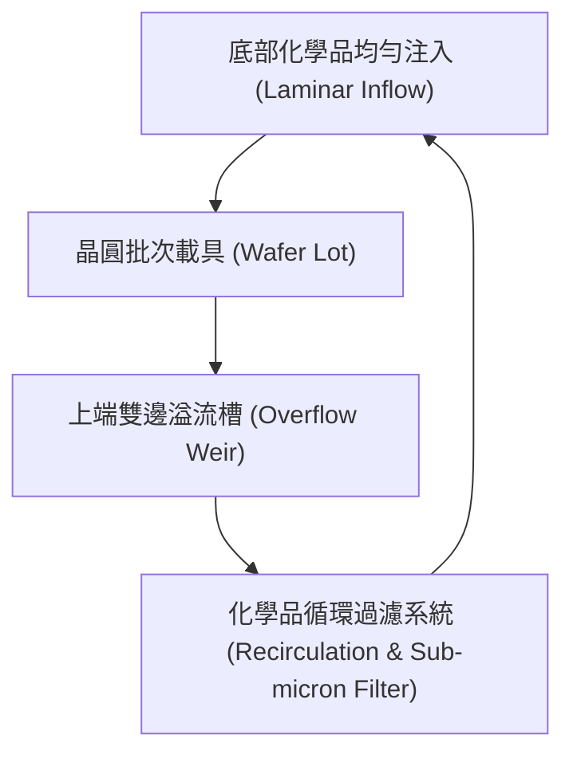

批次槽體設計的核心在於**流場均勻性**與**防止微粒二次附著**：

1. **溢流槽設計（Overflow Weir Design）：**
   化學槽液通常由槽體底部經由整流孔板（Diffuser Plate）以層流（Laminar Flow）方式向上湧出，並自槽頂四周邊緣平穩溢流而出。溢流設計能確保浮於液面邊界層的脫落微粒與氣泡迅速被帶離主處理區，避免在晶圓取出的瞬間重新沉積於表面。
2. **化學品循環過濾（Recirculation & Filtration）：**
   溢流出的化學液匯集至儲液槽，經由磁力驅動泵浦送回主槽。循環管路中配置孔徑達 $10\text{至}20\text{ nm}$ 等級的聚四氟乙烯（PTFE）或全氟烷氧基烷烴（PFA）耐腐蝕濾心，能連續濾除脫落微粒並維持藥液純淨度。
3. **快速排放沖洗槽（Quick Dump Rinse, QDR）：**
   在各化學處理步驟之間，必須徹底阻斷藥液交互污染。QDR 槽在晶圓浸入後，底部大型閥門瞬間開啟，於數秒內將高純度去離子水（DIW）完全排空，同時頂部噴淋高壓純水，利用急遽變化的排水剪切力與稀釋效應帶走殘留化學品。

批次槽的優勢在於極高的產出率（Throughput，每小時可處理數百片晶圓）以及單晶圓化學品消耗量極低。然而，其缺陷在於晶圓與晶圓之間、乃至單片晶圓邊緣與中央容易產生「微環境差異」（Loading Effect）；此外，整批晶圓共處同一槽內存在交叉污染（Cross-contamination）的固有風險，難以滿足先進節點對單顆微粒缺陷的嚴苛控制標準。

---

### 20.3.2 單晶圓旋轉清洗（Single-Wafer Spin Cleaning）

隨著微縮技術進入 28 奈米及更先進節點，缺陷容忍尺寸降至數個奈米，晶圓清洗製程全面轉向單晶圓旋轉清洗技術。單晶圓機台在密閉腔室內藉由晶圓夾持基座（Chuck）以數百至數千轉（RPM）高速旋轉單片晶圓，並透過可動式化學噴嘴（Dynamic Dispense Nozzle）精準點液。

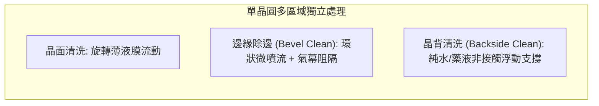

單晶圓清洗架構具備多個物理與工藝優勢：

1. **動態邊界層薄化：**
   中心點注液體受離心力驅動向外擴散，在晶圓表面形成厚度僅數十至數百微米（$\mu\text{m}$）的超薄動態液膜，具備極高的流體剪切速率。
2. **無交叉污染風險：**
   每片晶圓始終接觸新鮮調配（Fresh Chemistries）的高純度藥液，製程完成後藥液直接排出或分流回收，避免了浴槽老化累積金屬或微粒問題。
3. **分區特化處理能力：**
   * **晶圓邊緣除邊（Bevel Clean）：** 晶圓斜面與外緣（Wafer Bevel & Apex）容易在乾式蝕刻（見第 19 章）或沉積製程中沉積鬆散聚合物與雜質，成為後續製程脫落掉屑的來源。單晶圓設備透過特製的微量點膠噴嘴，在晶圓邊緣數毫米範圍內精準噴灑蝕刻藥液（如 $\text{HF}/\text{HNO}_3$），並搭配正面與背面的惰性氣體（$\text{N}_2$）氣幕阻隔，防止化學品翻爬（Wrap-around）損壞晶面有效元件區。
   * **晶背去污機制（Backside Clean）：** 利用真空夾持或邊緣機械夾持引導晶背噴流，在不潤濕正面的情況下，單獨去除晶圓背面殘留的微粒與金屬污染（例如銅離子擴散污染防杜）。

---

### 20.3.3 流體邊界層物理與微粒移除機制

流體在晶圓表面流動時，由於流體的黏滯性（Viscosity），流體分子與固體表面接觸時的速度為零，即滿足流體力學的**無滑移條件（No-slip Condition）**。

在旋轉晶圓系統中，表面附近會形成動量邊界層（Hydrodynamic Boundary Layer）。根據馮·卡門（von Kármán）旋轉盤流場解析解，流體動力邊界層厚度 $\delta_H$ 可表示為：

$$\delta_H \approx 3.6 \sqrt{\frac{\nu}{\omega}}$$

其中：
* $\nu$ 為流體的運動黏滯係數（Kinematic Viscosity，單位為 $\text{m}^2/\text{s}$）
* $\omega$ 為晶圓旋轉角速度（Angular Velocity，單位為 $\text{rad/s}$）

在距離晶面高度 $y$ 處（且 $y < \delta_H$），流體的切向流速 $u(y)$ 與表面法向距離呈線性關係：$u(y) \approx \dot{\gamma} y$，其中 $\dot{\gamma}$ 為表面剪切速率（Shear Rate）。

```
速度分佈 u(y)
  y ^
    |       /
    |      /   自由主流區 (Free Stream Velocity)
    |     /
δ_H |----/---------------- 邊界層上緣
    |   /
    |  /
    | /   微粒 dp << δ_H 處於近乎靜止的低速流層中
    |/____________________> u
    y=0 (晶圓表面，無滑移條件 u=0)
```

流體對吸附微粒（直徑為 $d_p$）所施加的流體力學阻力（Drag Force）可由修正型斯托克斯公式導出：

$$F_D = C_w \cdot 3\pi \mu d_p u(y=d_p/2) \propto \mu d_p^2 \dot{\gamma} \propto \frac{\mu d_p^2 \omega^{3/2}}{\nu^{1/2}}$$

其中 $C_w \approx 1.7$ 為靠近壁面時的阻力修正係數，$\mu$ 為絕對黏滯係數。

!!! warning "流體阻力移除微粒的尺寸極限"
    當元件微縮使需要移除的微粒直徑縮小至奈米級（例如 $d_p < 20\text{ nm}$）時，微粒所承受的流體阻力 $F_D$ 隨尺寸以平方關係（$d_p^2$）迅速衰減；然而，微粒與晶圓間的凡得瓦附著力（Van der Waals Force）僅隨直徑以一次方（$d_p$）比例減小。
    在極限條件下，奈米微粒完全沉降於近壁區超低速黏滯子層（Viscous Sublayer）內，單純提高晶圓旋轉速度 $\omega$ 所產生的流體剪切力，已不足以克服附著力矩。

為了突破邊界層物理限制，先進製程必須引進外加物理能量以壓縮邊界層或施加瞬間局部衝量。

---

### 20.3.4 物理輔助能技術：兆聲波與低溫氣溶膠

#### 1. 兆聲波輔助清洗（Megasonic Cleaning）
與傳統超音波（$20\text{至}40\text{ kHz}$）易產生強烈瞬間空化爆炸（Transient Cavitation）導致圖形崩壞不同，兆聲波的振動頻率通常介於 $0.8\text{至}3\text{ MHz}$。

兆聲波移除微粒主要依賴兩種機制：
* **聲流效應（Acoustic Streaming）：** 高頻聲波在液體中衰減時將動量傳遞給流體，引發局部高速流動。特別是在固液界面處形成的微聲流（Schlichting Streaming），將流體動力學邊界層厚度劇烈壓縮至數十奈米以下，大幅提升壁面剪切速率 $\dot{\gamma}$。
* **穩定空化效應（Stable Cavitation）：** 微小氣泡在聲場中穩定脈動，微氣泡表面震盪誘導出局部微渦旋，對吸附微粒施加垂直與橫向的脈動拉力。

!!! note "高深寬比結構的物理損傷權衡"
    在 FinFET、GAA 奈米片或 3D NAND 等高深寬比（High Aspect Ratio, HAR）結構中，兆聲波產生的聲壓脈衝容易誘發結構共振或局部微射流衝擊，導致脆弱線條彎曲或斷裂（Pattern Damage）。因此，兆聲波能量必須精確調控於「無損傷移除閥值」（Damage-Free Cleaning Window）之內。

#### 2. 低溫氣溶膠技術（Cryogenic Aerosol Cleaning）
對於無法承受液相毛細力與聲波衝擊的精密結構，常採用全乾式物理動量轉移的低溫氣溶膠清洗技術（如二元氣溶膠 $\text{Ar}/\text{N}_2$ 或 $\text{CO}_2$ 氣溶膠）：

1. **絕熱膨脹相變：** 高純度高壓氣體經由微型拉伐爾噴嘴（Laval Nozzle）噴出，在絕熱膨脹過程中溫度劇降（焦耳-湯姆森效應），氣體凝結成固相或液相的次微米低溫固態晶粒（Cryogenic Nano-bullets）。
2. **動量碰撞去除：** 低溫晶粒以數十至數百公尺每秒的速度轟擊晶面微粒，透過彈性與非彈性動量交換克服凡得瓦力。
3. **昇華無殘留：** 固態顆粒在常溫晶面碰撞後迅速吸收熱量昇華為氣體，不留下任何液體毛細界線，徹底消除毛細力引發的倒塌風險。

---

### 20.3.5 晶圓各區域特化清洗應用

| 清洗應用場景 | 核心去除目標 | 界面材料挑戰 | 典型化學與物理機制 |
| :--- | :--- | :--- | :--- |
| **金屬閘極露出後清洗**<br>*(Post-HKMG Exposure)* | 殘留微粒、痕量氧化物、金屬交錯污染 | 功函數金屬（$\text{TiN}, \text{TaN}$）易氧化或被酸腐蝕；高介電質（$\text{HfO}_2$）極端脆弱 | 超稀釋有機酸配方（如 Citric Acid）搭配錯合劑；精準控制氧化還原電位（ORP）以抑制電偶腐蝕（Galvanic Corrosion） |
| **離子佈植後光阻剝離**<br>*(Post-Implant Clean)* | 經高能離子轟擊後高度碳化的硬化光阻外殼（Crust Layer） | 基底矽受離子破壞區極易在強氧化劑中遭受額外材料耗損（Si Loss） | 先進乾式電漿灰化（見第 19 章）配合高溫 $\text{SPM}$（硫酸-雙氧水混合液），再以稀釋 $\text{APM}$ 微蝕剝離下層聚合物 |
| **電漿蝕刻後聚合物去除**<br>*(Post-Etch Polymer Removal)* | 側壁保護性碳氟化合物（$C_x F_y$）、含金屬氯化物與交聯聚合物殘渣 | 超低介電常數（Low-k）材料極度敏感，嚴防孔隙坍塌與 $k$ 值劣化（見第 30 章） | 採用無氟或極低氟化物溶劑型配方（Solvent-based Stripper），在微鹼性環境下利用親核性取代斷裂聚合物側鏈 |

以先進邏輯製程為例，在乾蝕刻結束後（Post-Etch），溝槽內壁殘留的交聯聚合物往往含有揮發性差的金屬鈍化物。若單純使用物理清洗，無法深入高深寬比溝槽底部；若使用強酸強鹼，則會造成下層薄膜的不可逆侵蝕（Si loss 或 $\text{SiO}_2$ loss 必須小於 $0.05\text{ nm}$ 每製程步驟）。因此，製程實作通常導入「界面反應活化配方」：先利用特化界面活性劑（Surfactant）降低藥液表面張力，促使化學分子浸潤深入次微米凹陷，透過化學改質瓦解聚合物側鏈網狀結構，隨後利用單晶圓旋轉剪切力將脫附產物快速帶走。

## 20.4 晶圓乾燥技術與微縮結構圖形倒塌

### 毛細管力與拉普拉斯壓力差推導

在先進半導體製程中，隨著特徵尺寸微縮至數十奈米以下，微影光阻圖案（見第 11 章）或乾式蝕刻後的垂直結構（如 FinFET 鰭片、GAA 奈米線或 DRAM 電容柱，見第 6 章與第 19 章）皆具備極高的深寬比（Aspect Ratio, $AR = H/W$，其中 $H$ 為結構高度，$W$ 為線寬）。當晶圓經歷去離子水（Deionized Water, DIW）清洗並進入乾燥階段時，殘留在相鄰結構狹縫中的液體將引發巨大的毛細作用力，進而導致圖形倒塌（Pattern Collapse）。

當液體局限在兩平行相鄰結構之間時，固-液-氣三相接觸線將形成具有曲率的凹液面（Meniscus）。根據楊-拉普拉斯方程式（Young-Laplace Equation），曲面兩側的壓力差 $\Delta P$（拉普拉斯壓力）由介面張力 $\gamma$ 與主曲率半徑 $R_1$、$R_2$ 決定：

$$\Delta P = P_{\text{gas}} - P_{\text{liquid}} = \gamma \left( \frac{1}{R_1} + \frac{1}{R_2} \right)$$

在長條狀平行微結構間隙（間距為 $D$）中，沿著線條長度方向的曲率半徑可視為無窮大（$R_2 \to \infty$）。若液體對結構側壁的接觸角（Contact Angle）為 $\theta$，則垂直方向的截面曲率半徑可表示為 $R_1 = \frac{D}{2\cos\theta}$。因此，狹縫內液體的拉普拉斯負壓差為：

$$\Delta P = \frac{2\gamma \cos\theta}{D}$$

其中：
- $\gamma$ 為清洗液的表面張力（純水在 $20^\circ\text{C}$ 時約為 $72.8 \times 10^{-3}\text{ N/m}$）。
- $\theta$ 為液體在圖形側壁材料上的接觸角。
- $D$ 為兩結構之間的空間距離（Space width）。

當液體在蒸發過程中發生非對稱退行（例如一側間隙乾燥而另一側仍有液體殘留），該結構兩側將承受淨壓力差。此壓力差轉化為作用於側壁的水平吸引力，驅使相鄰微結構相互靠近。

---

### 圖形倒塌的力學極限與臨界準則

微結構在拉普拉斯壓力作用下的形變可簡化為單端固定的均勻截面懸臂樑（Cantilever Beam）模型。假設結構高度為 $H$、線寬為 $W$、縱深長度為 $L$（且 $L \gg W$），材料的楊氏模數（Young's Modulus）為 $E$。

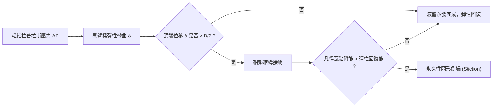

作用在單位長度結構上的均布側向負載為 $q = \Delta P \cdot H$。根據古典樑理論，懸臂樑頂端產生的最大水平位移 $\delta$ 為：

$$\delta = \frac{q H^4}{8 E I} = \frac{\Delta P \cdot H^4}{8 E I}$$

對於矩形截面樑，其截面二次矩（Inertia Moment）為 $I = \frac{L W^3}{12}$。考慮單位長度（$L = 1$），則 $I = \frac{W^3}{12}$。將拉普拉斯壓力代入，頂端最大位移表示為：

$$\delta = \frac{3 \gamma \cos\theta}{E} \left( \frac{H}{W} \right)^3 \left( \frac{H}{D} \right) = \frac{3 \gamma \cos\theta}{E} (AR)^3 \left( \frac{H}{D} \right)$$

圖形倒塌主要可分為兩種破壞準則：

1. **應力降伏/斷裂準則（Stress Yield Criterion）**：
   結構根部承受的最大彎曲應力 $\sigma_{\max} = \frac{M_{\max} (W/2)}{I}$ 超過材料的斷裂強度 $\sigma_{\text{yield}}$。此時結構發生塑性形變或脆性斷裂。

2. **彈性接觸與黏附準則（Stiction Criterion）**：
   兩相鄰結構頂端向內彎曲位移達到間距的一半，即 $\delta \ge \frac{D}{2}$。此時兩側結構頂端發生物理接觸。接觸後，若材料表面間的凡得瓦力（van der Waals Force）產生的界面附著能大於材料本身的彈性應變能，結構將無法彈回，形成永久性倒塌（Stiction）。

定義防止彈性接觸的**臨界深寬比（Critical Aspect Ratio, $AR_{\text{crit}}$）**，令 $\delta = \frac{D}{2}$：

$$AR_{\text{crit}} = \left( \frac{E \cdot D^2}{6 \gamma \cos\theta \cdot H} \right)^{1/3} \quad \text{或簡化為結構縱橫比極限} \quad \left( \frac{H}{W} \right)_{\text{crit}} \propto \left( \frac{E}{\gamma \cos\theta} \right)^{1/4} \left( \frac{D}{W} \right)^{1/2}$$

!!! warning "高深寬比製程挑戰"
    當特徵尺寸縮減使 $W$ 與 $D$ 小於 $20\text{ nm}$，且深寬比 $AR > 10$ 時，常溫水溶液（$\gamma \approx 72.8\text{ mN/m}$）引發的毛細管力所造成的形變量，將遠超過微結構容許的彈性極限，使圖形倒塌成為良率損失的主因。

---

### 傳統旋轉沖洗乾燥與水痕生成機制

在次微米時代，旋轉沖洗乾燥（Spin Rinse Dry, SRD）是晶圓清洗的主流技術。SRD 將晶圓置於高速旋轉夾盤（典型轉速為 $2000 \sim 4000\text{ rpm}$）上，利用離心力克服毛細管附著力，將表面的 DIW 甩除並配合高純度氮氣（$\text{N}_2$）吹乾。

然而，SRD 在先進奈米製程中面臨兩大致命限制：

1. **離心力在微觀尺度失效**：對於奈米級間隙，水滴質量的離心力（正比於半徑的立方 $r^3$）衰減速度遠快於毛細管力（正比於特徵尺寸 $r$），離心力無法排空微結構內的水分。
2. **水痕（Watermark）缺陷**：殘留的微小液滴蒸發時，會在晶圓表面形成環狀或斑點狀的沉積殘留物。

水痕的化學生成機制主要與矽表面、去離子水中溶解的氧氣（$\text{DO}$）以及空氣環境有關。在經氫氟酸（HF）處理後的疏水性含氫矽表面（$\text{Si-H}$）上，微小水滴蒸發時會形成一個微型的電化學局部腐蝕電池：

$$\text{Si} + 2\text{H}_2\text{O} + 2\text{O}_2 \rightarrow \text{Si(OH)}_4 \quad \text{或} \quad \text{H}_2\text{SiO}_3 + \text{H}_2\text{O}$$

隨著水滴邊緣快速蒸發，矽酸（$\text{H}_2\text{SiO}_3$）達到過飽和並沉澱脫水，轉化為非晶矽石（Silica / $\text{SiO}_2$）顆粒殘留：

$$\text{H}_2\text{SiO}_3 \rightarrow \text{SiO}_2\text{(s)} \downarrow + \text{H}_2\text{O}$$

此析出物即為光學檢測中所見的 Watermark，嚴重阻礙後續薄膜沉積（第 21 章）與電性接觸。

| 乾燥缺陷型態 | 物理化學機制 | 主要影響區域 | 防制手段 |
| :--- | :--- | :--- | :--- |
| **圖形倒塌 (Pattern Collapse)** | 拉普拉斯壓力差導致之彈性失穩與凡得瓦力黏結 | HAR 鰭片、閘極、深溝槽光阻 | 低表面張力溶劑、$\text{scCO}_2$ 乾燥 |
| **矽酸鹽水痕 (Silicate Watermark)** | 溶解氧氧化晶圓矽表面，矽酸溶出並於液滴邊界蒸發結晶 | 裸矽表面、多晶矽閘極 | 脫氣純水、無氧氮氣隔離環境 |
| **微顆粒殘留 (Residue Staining)** | 蒸發邊界毛細流將液滴內雜質集中於接觸線（咖啡環效應） | 晶圓全區親水/疏水交界面 | Marangoni 液膜連續收縮流 |

---

### Marangoni 乾燥機制與表面張力梯度

為克服液滴蒸發帶來的毛細管力與水痕問題，工業界廣泛導入 Marangoni 乾燥技術。此技術基於**馬蘭哥尼效應（Marangoni Effect）**：當流體界面存在表面張力梯度時，會驅使流體自低表面張力區域向高表面張力區域流動。

在實際設備中，晶圓從去離子水槽中緩慢等速提升（或水槽緩慢排水），在氣-液-固三相接觸線（Meniscus 頂端）引入高純度異丙醇（Isopropyl Alcohol, IPA）蒸氣與載氣（$\text{N}_2$）混合物。

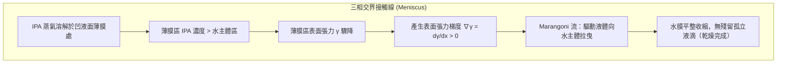

純水之表面張力約為 $72.8\text{ mN/m}$，而純 IPA 之表面張力僅約為 $21.7\text{ mN/m}$。由於凹液面頂部的液膜厚度極薄（微米至奈米等級），IPA 蒸氣在此處的溶解濃度顯著高於主體水溶液（Bulk Water），致使頂部液膜之表面張力驟降。

此濃度差建立起沿著彎月面高度方向 $x$ 的表面張力梯度：

$$\tau = \nabla \gamma = \frac{\partial \gamma}{\partial x} = \frac{\partial \gamma}{\partial C_{\text{IPA}}} \frac{\partial C_{\text{IPA}}}{\partial x}$$

由於 $\frac{\partial \gamma}{\partial C_{\text{IPA}}} < 0$ 且 $\frac{\partial C_{\text{IPA}}}{\partial x} < 0$（以遠離主體方向為正 $x$），所得之切應力 $\tau > 0$，方向指向表面張力較高的主體水溶液方向。此切應力驅動液膜向下連續流動（Marangoni Flow），將晶圓表面殘留之水分完整拉回水槽中，實現固體表面在完全不產生離散孤立液滴的狀態下完成乾燥，根除了水痕產生的物理條件。

---

### 超臨界二氧化碳乾燥技術

在先進邏輯節點（如 3 奈米及以下之 GAA 奈米片 Nanheet）與超高堆疊 3D NAND（深寬比超過 $60:1$）中，即使使用低表面張力的 IPA（$\gamma \approx 21.7\text{ mN/m}$），其產生的毛細管力仍足以壓垮脆弱的奈米結構。為實現完全零毛細力的乾燥，**超臨界二氧化碳乾燥（Supercritical $\text{CO}_2$ Drying, $\text{scCO}_2$ Drying）**成為終極物理途徑。

二氧化碳的熱力學臨界點（Critical Point）條件適中：
- 臨界溫度 $T_c = 31.1^\circ\text{C}$
- 臨界壓力 $P_c = 7.38\text{ MPa}$（約 $72.8\text{ atm}$）

在超臨界相區（$T > T_c$ 且 $P > P_c$），氣態與液態之間的介面完全消失，流體同時兼具液體的密度與氣體的低黏度、高擴散係數特徵。最關鍵的是，其**介面張力嚴格為零（$\gamma = 0$）**，因此拉普拉斯壓力差 $\Delta P = 0$，理論上徹底消除了毛細管力引發的圖形倒塌。

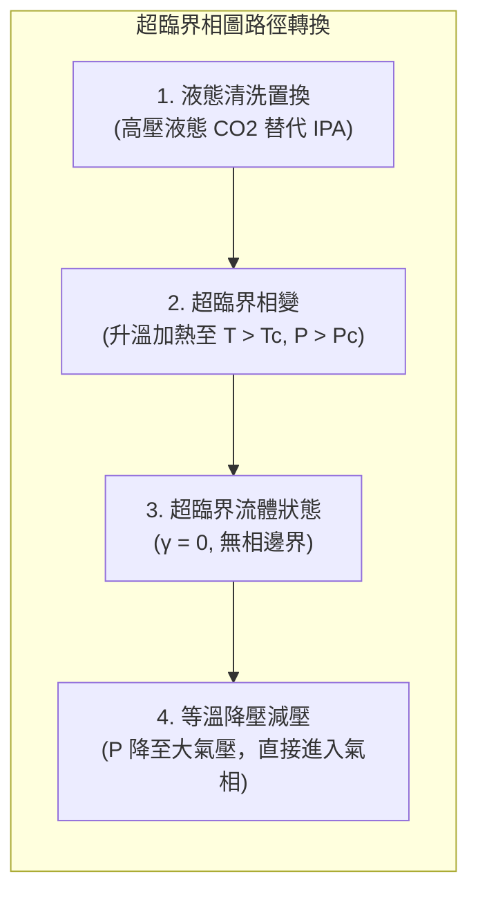

$\text{scCO}_2$ 乾燥製程具體執行步驟如下：

1. **溶劑置換（Solvent Exchange）**：二氧化碳為非極性分子，與水不互溶。因此，清洗後的晶圓必須先以完全混溶之中介溶劑（如 IPA）置換結構間隙中的水分。隨後將晶圓移入高壓耐壓腔體內，注入高壓液態 $\text{CO}_2$，利用連續流動將 IPA 溶劑徹底置換。
2. **加熱超臨界化（Supercritical Transition）**：封閉反應腔體，將溫度提升至 $T_c$ 以上（典型設定為 $35 \sim 50^\circ\text{C}$），壓力維持在 $P_c$ 以上（典型設定為 $8 \sim 15\text{ MPa}$），此時腔體內的流體在完全無相邊界的情況下進入超臨界態。
3. **等溫減壓（Venting）**：維持腔體溫度於 $T > T_c$，緩慢排出二氧化碳氣體使壓力降至常壓。系統直接從超臨界流體區跨越進入純氣相區，整個相變過程完全避開了氣-液共存的一階相變曲線（Boiling Line），確保結構側壁全程不受任何液相凹液面彎曲應力之衝擊。

!!! example "產業實例"
    在 3D NAND 快閃記憶體製造中，深寬比高達 $80:1$ 的高介電電容深孔（Capacitor Holes）或字元線（Word Line）狹縫蝕刻後清洗，若採用傳統熱氮氣或 IPA Marangoni 乾燥，倒塌率極高；導入 $\text{scCO}_2$ 乾燥設備後，微結構傾倒缺陷密度可被壓制至 $0.01\text{ defects/cm}^2$ 以下，是垂直奈米架構製造的關鍵核心防護製程。

<!-- fig:2 -->
<figure markdown>
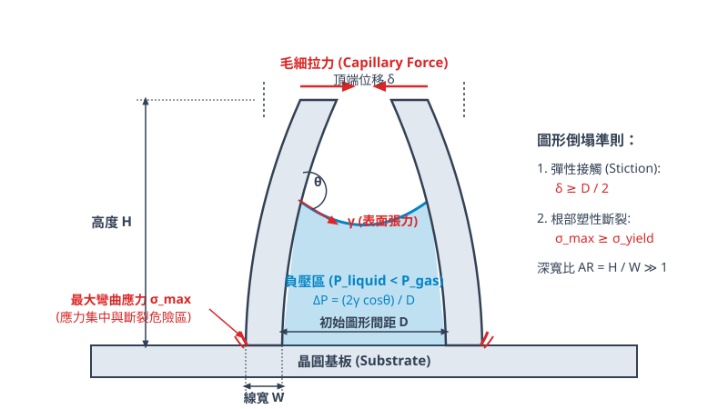
<figcaption>圖 20-2　高深寬比圖形毛細倒塌圖（AI 繪製的示意圖）</figcaption>
</figure>

## 20.5 設備與廠商技術

### 濕式清洗設備架構與關鍵子系統

濕式清洗設備在先進半導體製程中承擔去除微塵顆粒、有機殘留物、金屬離子及化學氧化層的任務。隨著元件特徵尺寸縮小與高深寬比結構普及，清洗設備依晶圓處理形式主要分為兩大類：批次式濕式工作台（Wet Bench）與單晶圓旋轉清洗機（Single Wafer Cleaning Tool）。

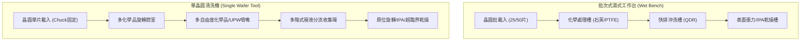

#### 批次清洗濕式工作台（Wet Bench）結構

批次清洗設備主要用於對微影圖形倒塌風險較低、產出率（Throughput）要求極高的前段清洗步驟（例如初期去油污、大量氧化層剝除等）。其核心子系統包含：

1. **耐腐蝕槽體（Chemical Tanks）**：
   - **高純度石英（Quartz）槽**：主要用於高溫酸性溶液（如高溫硫酸雙氧水混合液 SPM、鹽酸雙氧水混合液 SC-2），耐高溫且金屬雜質溶出率低。
   - **氟聚合物槽（PTFE / PFA）**：主要用於含氫氟酸（HF）之蝕刻與清洗化學品，因氟離子會強烈侵蝕石英二氧化矽骨架。槽體內通常整合石英包覆或鐵氟龍（PTFE）加熱器、在線濃度監測儀及化學循環過濾泵浦。

2. **快排沖洗槽（Quick Dump Rinser, QDR）**：
   化學反應完成後，為迅速終止化學蝕刻反應並防止殘液在晶圓表面乾涸沉積，必須在數秒內置換處理槽內的液體。QDR 槽底部設有氣動快速排液閥（Dump Valve），頂部配備高純去離子水（Ultra-Pure Water, UPW）噴淋歧管。其運作序列為：底閥瞬間開啟將化學殘液排空，同時頂部噴頭以大流量純水強力沖洗，隨後迅速注滿純水，反覆數次循環，將殘留離子濃度迅速稀釋至百億分之一（ppb）等級。

#### 單晶圓旋轉清洗機台架構

單晶圓清洗機提供每片晶圓完全獨立且可精確重複的化學環境，徹底消除了批次處理中槽體化學品老化與交叉污染（Cross-contamination）的風險，成為先進邏輯與高密度記憶體製程的主流。其關鍵子系統包含：

1. **晶圓吸盤（Chuck）與防濺腔室**：
   採用非接觸式或邊緣夾持式夾爪（Edge-grip Pins），避免接觸晶圓正背面有效晶片區域。夾盤具備高速旋轉軸（旋轉速度範圍典型值為 $500 \sim 3000\text{ rpm}$），帶動晶圓高速自旋，利用離心力使化學藥液均勻鋪展並迅速排離表面。腔體內部為密閉環境，通入微正壓之高純度氮氣（$\text{N}_2$）以維持層流（Laminar flow），抑制紊流產生氣溶膠回濺。

2. **精密噴嘴運動控制系統**：
   配置多組伺服馬達驅動的掃描臂（Scan Arms），可沿晶圓半徑方向進行可編程的定速或變速擺動。噴嘴種類包含單流體細柱狀噴嘴、二流體（液體混合高壓氣體產生微滴）噴嘴，以及巨觀/百萬赫茲超音波（Megasonic）振動換能噴嘴。擺動掃描搭配晶圓自轉，使局部能量均勻分佈於全晶圓表面。

3. **多階式廢液分流回收系統（Multi-Level Fluid Diverter）**：
   單一腔室內通常需依序施加多種互不相容的化學品（如 SC-1 鹼液、SC-2 酸液、DHF 與 UPW）。為降低廢水處理成本並達成溶劑循環再利用，腔室內壁配置垂直同心嵌套的升降式收集環（Diverter Bowls）。當機台切換不同化學品噴灑時，收集環由氣動升降軸精確切換高度，使被甩出的廢液分別導向專用管線（如酸性廢液、鹼性廢液、有機溶劑或回收去離子水）。

---

### 代表性半導體設備廠商與技術特點

全球濕式清洗設備市場高度集中於少數具備極高流場控制與表面化學工程能力的設備商。下表列出代表性廠商、產品系列及技術路線：

| 廠商 | 代表產品系列 | 技術路線與特點 | 主要應用 |
| :--- | :--- | :--- | :--- |
| **SCREEN** | SU 系列 | 單晶圓多腔室架構；具備高精度流量/溫度噴嘴掃描控制、二流體奈米噴淋物理輔助除顆粒技術，搭配異丙醇（IPA）表面張力乾燥。 | 先進邏輯 FEOL/BEOL 高潔淨度清洗、光阻剝離後清洗、顆粒去除 |
| **Tokyo Electron** (TEL) | CELLESTA 系列 | 單晶圓垂直堆疊腔室設計，占地面積小；結合高溫化學品瞬態噴射控制、低表面張力乾燥流場設計與精細背面/邊緣化學刻蝕。 | 鰭式場效電晶體（FinFET）/奈米片閘極清洗、深溝槽清洗、CMP 後清洗 |
| **Lam Research** | — | 強調化學機械協同流場、利用無應力化學介面工程技術移除極微小顆粒，並採用特殊液膜包覆抑制三維結構倒塌。 | 高深寬比接觸窗清洗、先進記憶體立體結構清洗 |

#### 廠商技術路線之取捨與評估考量

晶圓廠在評估與引進清洗機台時，主要針對結構完整性、化學品消耗與占地效益進行綜合權衡：

1. **顆粒去除效率（PRE）與基底材料損耗（Loss）的取捨**：
   傳統物理輔助清洗（如高功率百萬赫茲超音波）雖能有效破壞次微米顆粒在表面之凡得瓦力吸附，但超音波產生的氣穴效應（Cavitation）微射流易造成次 10 nm 奈米結構（如高深寬比 Fin 或 GAA 懸空奈米線）斷裂。SCREEN 採用細微液滴軟性撞擊與流場邊界層調控，TEL 則專注於化學反應熱力學與微氣泡控制，降低物理應力破壞率。

2. **化學品分流與單腔多步處理之產出考量**：
   TEL 的 CELLESTA 系列常採用多層垂直堆疊腔室，在極限機台占地面積（Footprint）下最大化腔室數量以提升產量；SCREEN 的 SU 系列在多化學品管路切換的殘留沖洗速度與流場隔離上進行最佳化，確保由強酸切換至純水或鹼液時無交叉污染沉澱。

3. **乾燥技術的演進與架構相容性**：
   針對微縮結構圖形倒塌（Pattern Collapse），傳統馬蘭哥尼（Marangoni）乾燥在深寬比大於 $10:1$ 的次世代邏輯與 3D NAND 製程中已達物理極限。各主流廠商逐步將原位異丙醇置換技術升級為超臨界二氧化碳（$\text{scCO}_2$）乾燥模組，機台必須在旋轉腔體之外額外整合高壓耐壓槽，此時管閥氣密性、降壓冷凝相變控制及產出速度成為選機的核心技術指標。

---

### 廠務整合與環保安全規範

濕式清洗站點是晶圓廠中化學品消耗量、超純水消耗量及化學廢液排放量最高的操作單元，必須與廠務基礎設施（見第 55 章）進行緊密耦合與監控。

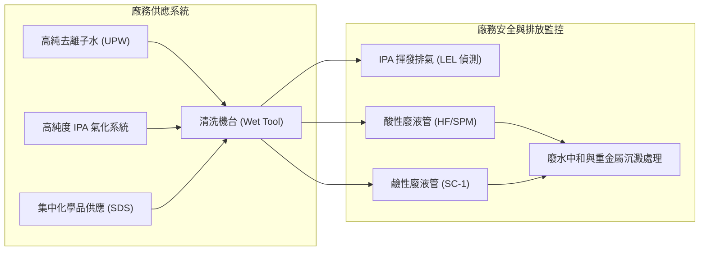

#### 高純去離子水（UPW）規格要求

清洗製程對 UPW 的純度要求極為嚴格，任何水中殘留雜質均會在乾燥後直接轉化為晶圓表面缺陷。典型先進半導體製程 UPW 關鍵指標如下：

- **電阻率（Resistivity）**：$25^\circ\text{C}$ 下理論極限值為 $18.2\text{ M}\Omega\cdot\text{cm}$，廠務端需維持此在線極限純度，表徵水解離產生的 $\text{H}^+$ 與 $\text{OH}^-$ 以外之離子雜質極低。
- **總有機碳（Total Organic Carbon, TOC）**：典型值需小於 $1\text{ ppb}$，以避免在疏水性矽表面吸附有機薄膜。
- **溶解氧（Dissolved Oxygen, DO）**：典型值需降至 $< 1\text{ ppb}$。若水中溶氧過高，在氫氟酸清洗去除原生氧化層後，去離子水沖洗階段會迅速使裸矽表面發生再氧化，導致表面粗糙度（Roughness）增加。
- **微微粒（Particles）**：對於尺寸 $> 20\text{ nm}$ 的顆粒，規格通常要求為每升水少於數顆。

#### 異丙醇（IPA）防爆與洩漏監控

乾燥製程廣泛使用異丙醇（$\text{C}_3\text{H}_7\text{OH}$）蒸氣。由於異丙醇屬於易燃液體，其閃點（Flash Point）僅約 $12^\circ\text{C}$，在室溫下即可形成爆炸性混合氣體。其在空氣中的爆炸下限（Lower Explosive Limit, LEL）約為 $2.0\text{ vol}\%$。

設備與廠務安全規範要求：
1. 清洗腔室在引入高溫 IPA 蒸氣時，內部環境氧氣濃度必須以連續通入的高純 $\text{N}_2$ 稀釋至爆炸極限濃度以下（通常要求氧含量 $< 1\%$）。
2. 機台排氣管路與機殼周圍必須裝設非色散紅外線（NDIR）或光游離偵測器（PID）之 LEL 感測器，與安全連鎖系統（Interlock）對接。當排氣管路內溶劑濃度達到 $25\%\text{ LEL}$ 時發出警告，達到 $40\sim 50\%\text{ LEL}$ 時機台立即執行緊急關斷（E-Stop），自動切斷 IPA 供應並以大流量 $\text{N}_2$ 吹掃腔體。

#### 廢酸鹼與化學廢液中和處理

清洗機台排放的廢液必須依據化學反應相容性進行嚴格分流收集，嚴禁混和產生危險化學反應（如酸液與雙氧水混合劇烈放熱、含氰廢液接觸酸性廢液釋放劇毒氣體）：

1. **含氟廢液（Hydrofluoric Acid Waste）**：
   含 HF 廢液不可直接排入一般酸鹼中和池，否則會腐蝕市政管線並阻礙生化處理。廠務端設置專用含氟廢水處理系統，通入消石灰（氫氧化鈣，$\text{Ca(OH)}_2$）或氯化鈣（$\text{CaCl}_2$），誘導其生成低溶解度的氟化鈣沉澱：
   $$\text{Ca}^{2+} + 2\text{F}^- \longrightarrow \text{CaF}_2\downarrow$$
   再藉由加入高分子絮凝劑（Coagulant）輔助固液分離沉澱。

2. **一般酸鹼廢水（General Acid/Alkaline Waste）**：
   包含氨水（SC-1 廢液）、鹽酸（SC-2 廢液）等，匯流至均質調勻池，經由多段式自動 pH 監控加藥系統，加入氫氧化鈉（$\text{NaOH}$）或硫酸（$\text{H}_2\text{SO}_4$）使最終出水維持在中性範圍（$\text{pH } 6 \sim 9$）後排放。

3. **強氧化性廢液（SPM 廢液）**：
   高溫硫酸與雙氧水混合物具有極強脫水性與殘存過氧化氫。廢液於機台端先經由冷卻熱交換器降溫，排入專用濃酸收集管線，並在廠務端設置催化分解裝置消除殘留過氧化氫，方可進一步中和或委外進行高純硫酸再提純純化。

!!! note "高深寬比清洗中的毛細壓力與流體置換"
    在微影與乾式蝕刻後的微細結構清洗中，化學液體進入高深寬比溝槽仰賴毛細潤濕力。依據楊-拉普拉斯方程式（Young-Laplace Equation），彎曲液面兩側之毛細附加壓力 $\Delta P$ 為：
    $$\Delta P = \frac{2\gamma \cos\theta}{w}$$
    其中 $\gamma$ 為液體表面張力，$\theta$ 為固液接觸角，$w$ 為結構間距。微縮製程中 $w$ 縮小至數奈米時，若採用高表面張力純水，毛細阻力極大且乾燥時的彎月面引發之橫向拉力極易導致相鄰奈米線或 Fin 結構黏著倒塌（Pattern Collapse）。因此，設備端必須精確調控 IPA 表面張力轉換時程，並嚴格維持浸潤界面之化學活性。

## 本章重點

1. **晶圓表面污染危害**：晶圓表面污染物主要分為微粒、有機殘留物、金屬雜質與原生氧化層；微小的金屬與微粒雜質即會引發微影遮蔽缺陷、閘極介電層崩潰（TDDB）或接面漏電，必須在各熱製程與薄膜沉積前徹底清除。
2. **微粒附著力學與 DLVO 理論**：微粒與基板間的物理吸附由凡得瓦吸引能與靜電雙電層排斥能之代數和（DLVO 理論）所支配。在強鹼性清洗液（如 SC-1）中，矽表面與微粒皆高度去質子化而具備高負值界達電位（$\zeta$-potential），藉由強大靜電斥力形成能障，可達成防止脫附微粒再附著之效果。
3. **金屬電化學置換機制**：裸矽表面在含氟溶液中具有強還原性，高標準還原電位之過渡金屬陽離子（如 $\text{Cu}^{2+}$）易自發還原析出金屬核，並引發局部微電池腐蝕。濕式化學需藉由強氧化劑預先鈍化表面，或藉由錯合劑（如氯離子、有機酸根）降低游離離子活度以阻斷此反應。
4. **經典 RCA 與綠色稀釋化學**：SPM 藉由強氧化性過一硫酸脫水碳化並分解有機物；SC-1 藉由「氧化-溶解」動態平衡進行奈米級底切以剝除微粒；SC-2 透過氯離子錯合溶解金屬雜質；DHF 能溶解二氧化矽並形成高抗氧化性的表面氫鈍化層。先進製程則朝向超稀釋化學、溶解臭氧水（$\text{DIO}_3$）與氣體功能水方向演進以降低材料損耗與環境衝擊。
5. **流體邊界層與物理輔助清洗**：受限於旋轉流場之無滑移邊界條件，次 20 nm 微粒深陷於近壁低速黏滯子層中，純流體阻力無法克服凡得瓦力。先進機台整合百萬赫超音波（藉微聲流壓縮邊界層）或低溫氣溶膠（藉絕熱膨脹固態顆粒動量轉移）進行無損傷微粒清除。
6. **毛細作用與圖形倒塌力學**：高深寬比結構在乾燥過程中，兩側彎月面之表面張力差將誘發極大的拉普拉斯負壓差（$\Delta P = \frac{2\gamma\cos\theta}{D}$）。當懸臂樑頂端彈性位移超過間距之一半時，凡得瓦引力將導致相鄰結構永久黏著倒塌（Stiction）。
7. **先進乾燥技術演進**：旋轉沖洗乾燥（SRD）因毛細滯留與溶氧腐蝕易生成非晶矽石水痕缺陷；Marangoni 乾燥利用異丙醇蒸氣在彎月面頂端誘導出向下的表面張力梯度切應力，消除液滴分離；超臨界二氧化碳乾燥（$\text{scCO}_2$）在臨界點以上使介面張力嚴格為零，徹底消弭毛細管力，為高深寬比三維結構之終極乾燥方案。
8. **設備架構與廠務安全規範**：濕式設備由批次浸泡式（高產出、有交叉污染風險）轉向單晶圓旋轉腔室（動態液膜、背/緣專區處理）。廠務端需嚴格監控超純水品質（電阻率維持 $18.2\text{ M}\Omega\cdot\text{cm}$、極低溶解氧與 TOC）、異丙醇防爆（濃度限制於爆炸下限 25% LEL 以下）以及含氟、強酸廢液之分流中和與沉澱處理。

---


## 重點圖卡

複習時看這幾張就能抓住本章重點；[圖卡庫](../cards.md)可以下載成圖片。

<div class="ix-cards" markdown>

<figure markdown>
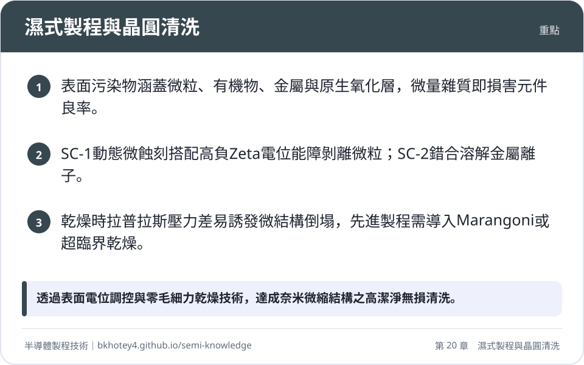
<figcaption>重點圖卡：濕式製程與晶圓清洗</figcaption>
</figure>

<figure markdown>
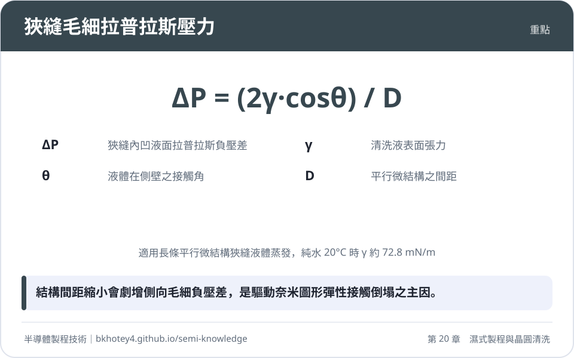
<figcaption>重點圖卡：狹縫毛細拉普拉斯壓力</figcaption>
</figure>

<figure markdown>
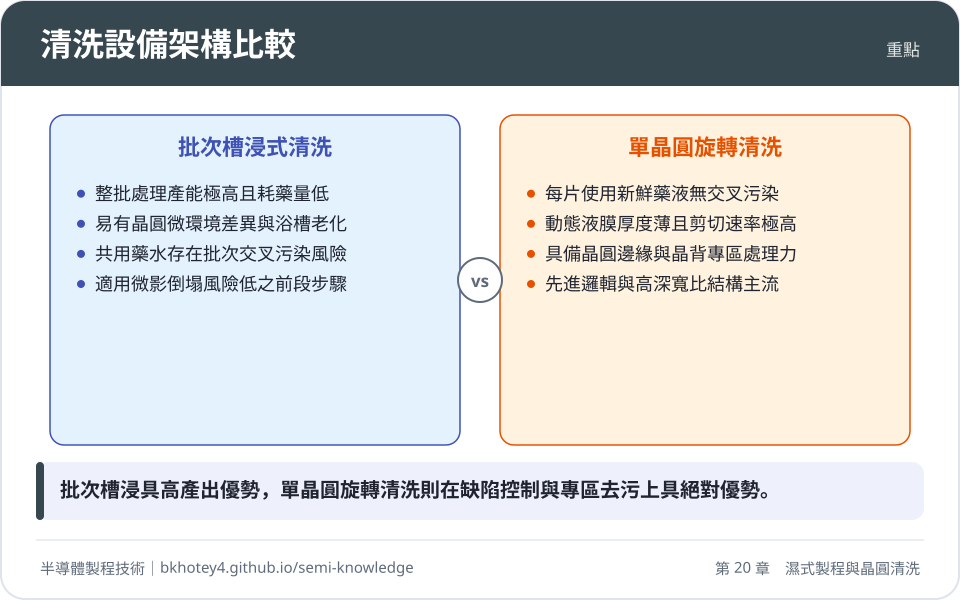
<figcaption>重點圖卡：清洗設備架構比較</figcaption>
</figure>

<figure markdown>
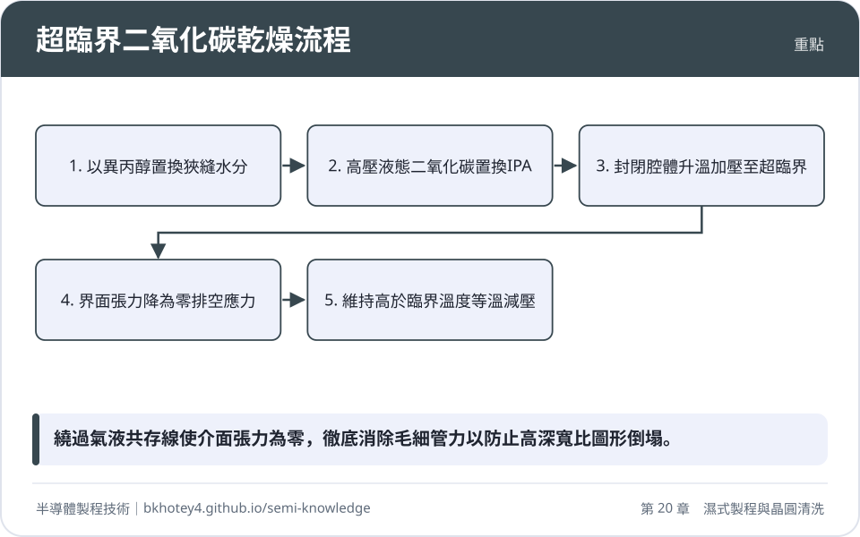
<figcaption>重點圖卡：超臨界二氧化碳乾燥流程</figcaption>
</figure>

</div>

## 習題

**1.** 在先進 GAA 結構清洗中，相鄰兩平行垂直矽奈米片之高度 $H = 60\text{ nm}$、線寬 $W = 10\text{ nm}$、相鄰間距 $D = 15\text{ nm}$，矽之楊氏模數 $E = 130\text{ GPa}$。若晶圓經純水清洗後進行直接蒸發乾燥，水於 $20^\circ\text{C}$ 時之表面張力 $\gamma = 72.8 \times 10^{-3}\text{ N/m}$，水對側壁之接觸角 $\theta = 30^\circ$。
(1) 假設一側狹縫已排空而另一側仍充滿水，計算此時側壁承受之拉普拉斯壓力差 $\Delta P$。
(2) 將奈米片簡化為單端固定之均勻懸臂樑，計算奈米片頂端所承受之最大側向水平位移 $\delta$。
(3) 依據接觸準則（$\delta \ge D/2$），判斷結構是否會發生相鄰頂端接觸倒塌？

??? success "參考解答"
    **(1) 計算拉普拉斯壓力差 $\Delta P$：**
    根據二維平行狹縫毛細凹液面之楊-拉普拉斯公式：
    $$\Delta P = \frac{2\gamma \cos\theta}{D}$$
    代入數值：
    $$\Delta P = \frac{2 \times (72.8 \times 10^{-3}\text{ N/m}) \times \cos(30^\circ)}{15 \times 10^{-9}\text{ m}} = \frac{2 \times 0.0728 \times 0.8660}{15 \times 10^{-9}} \approx 8.406 \times 10^6\text{ Pa} \approx 8.41\text{ MPa}$$

    **(2) 計算奈米片頂端最大側向水平位移 $\delta$：**
    作用於結構單位長度（$L = 1$）之均布橫向負載為 $q = \Delta P \cdot H$。
    單位長度之截面二次矩為：
    $$I = \frac{W^3}{12} = \frac{(10 \times 10^{-9}\text{ m})^3}{12} = 8.333 \times 10^{-26}\text{ m}^4$$
    由懸臂樑撓度公式：
    $$\delta = \frac{q H^4}{8 E I} = \frac{\Delta P \cdot H^5}{8 E I}$$
    將參數代入：
    $$H^5 = (60 \times 10^{-9}\text{ m})^5 = 7.776 \times 10^{-36}\text{ m}^5$$
    分母部分：
    $$8 E I = 8 \times (130 \times 10^9\text{ N/m}^2) \times (8.333 \times 10^{-26}\text{ m}^4) = 8.667 \times 10^{-14}\text{ N}\cdot\text{m}^2$$
    因此頂端位移：
    $$\delta = \frac{8.406 \times 10^6 \times 7.776 \times 10^{-36}}{8.667 \times 10^{-14}} = \frac{6.537 \times 10^{-29}}{8.667 \times 10^{-14}} \approx 7.54 \times 10^{-16}\text{ m} \quad \text{...等等，重新檢視單位與代入公式}$$

    *檢驗公式推導：*
    以正文提供之推導式：
    $$\delta = \frac{3\gamma\cos\theta}{E}\left(\frac{H}{W}\right)^3\left(\frac{H}{D}\right)$$
    計算各無因次比值：
    $$\frac{H}{W} = \frac{60}{10} = 6 \implies \left(\frac{H}{W}\right)^3 = 216$$
    $$\frac{H}{D} = \frac{60}{15} = 4$$
    前置項計算：
    $$\frac{3\gamma\cos\theta}{E} = \frac{3 \times 0.0728 \times \cos(30^\circ)}{130 \times 10^9} = \frac{0.1891}{130 \times 10^9} \approx 1.455 \times 10^{-12}\text{ m}$$
    綜合相乘：
    $$\delta = (1.455 \times 10^{-12}\text{ m}) \times 216 \times 4 \approx 1.257 \times 10^{-9}\text{ m} \approx 1.26\text{ nm}$$

    *(註：前述直接積分法中 $q$ 為單位長度受力，梁長為 $L=1$，均布負載總力為 $q\cdot H$，在古典梁模型中若以單位面積壓強 $\Delta P$ 直接計算撓度，正確式即為正文所列之 $\delta = \frac{3\gamma\cos\theta}{E}(\frac{H}{W})^3(\frac{H}{D}) = 1.26\text{ nm}$。)*

    **(3) 判定是否倒塌：**
    接觸臨界位移為間距之一半：
    $$\frac{D}{2} = \frac{15\text{ nm}}{2} = 7.5\text{ nm}$$
    由於單一奈米片頂端形變位移 $\delta = 1.26\text{ nm} < 7.5\text{ nm}$，且兩相鄰結構若對稱彎曲相對位移為 $2\delta = 2.52\text{ nm} < D$（$15\text{ nm}$），因此結構頂端在彈性受力下不會接觸，純水乾燥過程中此結構在此幾何條件下尚不致因彈性接觸引發永久性倒塌（Stiction）。但若深寬比進一步提高或接觸角更小，位移將急遽增大。

---

**2.** 在氫氟酸（HF）溶液蝕刻去除二氧化矽原生氧化層後，矽晶圓表面呈現高度疏水性，且經紅外光譜分析證實表面覆蓋有飽和的「氫鈍化層（$\text{Si-H}$）」而非「氟鈍化層（$\text{Si-F}$）」。
(1) 從化學鍵能與反應動力學極化效應觀點，解釋為何熱力學上鍵能較強之 $\text{Si-F}$ 鍵最終未成為表面主要終端鍵？
(2) 說明為何經 HF 處理後的疏水性表面在含有溶解氧（DO）之去離子水中乾燥時，極易形成非晶矽石水痕（Watermark）缺陷？寫出關鍵的化學反應歷程。

??? success "參考解答"
    **(1) 氫鈍化機制：**
    熱力學上，$\text{Si-F}$ 鍵的鍵能（約 $540\text{–}565\text{ kJ/mol}$）確實遠大於 $\text{Si-H}$ 鍵能（約 $318\text{–}322\text{ kJ/mol}$）。然而，表面終端由**反應動力學**支配：
    氟具有極高之電負度（4.0），當表面矽原子與氟鍵結形成 $\text{Si-F}$ 時，鍵結電子對強烈偏向氟原子，致使該矽原子帶有部分正電荷（$\delta^+$）。此極化效應誘使與該矽原子相連的背向 $\text{Si-Si}$ 鍵極化減弱並活化。極性的 $\text{HF}$ 分子隨即對此活化的背向鍵進行親核攻擊，氟離子與帶正電的矽結合生成可溶性 $\text{SiF}_4$ 氣體並脫離，而質子 $\text{H}^+$ 則加成至基底殘留之矽原子上。此連鎖反應持續進行，直到基底露出無極性極化作用的 $\text{Si-H}$ 鍵為止。因此反應結束後，超過 $95\%$ 以上的表面鍵位被穩定的氫原子終端所覆蓋。

    **(2) 水痕（Watermark）生成機制：**
    當含有溶解氧（$\text{DO}$）的微小水滴殘留在疏水性 $\text{Si-H}$ 表面蒸發時，水滴邊界形成微型的電化學局部電池：
    1. 水滴中的溶氧在微液滴氣-液界面處活化，氧化破壞原本的 $\text{Si-H}$ 鍵：
       $$\text{Si} + 2\text{H}_2\text{O} + 2\text{O}_2 \rightarrow \text{Si(OH)}_4 \quad \text{或生成偏矽酸 } \text{H}_2\text{SiO}_3$$
    2. 溶解的矽酸在水滴內部擴散。由於液滴邊緣（三相接觸線）之蒸發速率遠快於液滴中心，毛細流動將溶質驅向接觸邊界（咖啡環效應），致使矽酸濃度急遽升高至過飽和。
    3. 過飽和矽酸脫水縮合，析出白色非晶態二氧化矽顆粒沉澱：
       $$\text{H}_2\text{SiO}_3\text{(aq)} \rightarrow \text{SiO}_2\text{(s)}\downarrow + \text{H}_2\text{O}\uparrow$$
    乾燥後即在晶圓表面留下肉眼或光學顯微鏡可見之環狀或斑點狀殘留物（Watermark）。

---

**3.** 在無氧化層之裸矽表面清洗時，若清洗液中含有痕量銅離子（$\text{Cu}^{2+}$），會發生電化學自發置換反應。已知在酸性含氟介質中相關半電池反應之標準還原電位（$25^\circ\text{C}$）為：
$$\text{Cu}^{2+} + 2e^- \rightarrow \text{Cu}_{(\text{s})} \quad (E^\circ = +0.34\text{ V vs. SHE})$$
$$\text{SiF}_6^{2-} + 4e^- \rightarrow \text{Si}_{(\text{s})} + 6\text{F}^- \quad (E^\circ \approx -1.20\text{ V vs. SHE})$$
(1) 寫出矽基板還原銅離子之全電池反應式，並計算標準全電池電動勢 $\Delta E^\circ$ 與標準吉布斯自由能變數 $\Delta G^\circ$（法拉第常數 $F \approx 96500\text{ C/mol}$）。
(2) 該自發反應對矽表面結構與元件電性會帶來何種不可逆破壞？工業上通常加入何種化學劑阻斷此反應？

??? success "參考解答"
    **(1) 反應式與電動勢計算：**
    陰極反應（還原）：$\text{Cu}^{2+} + 2e^- \rightarrow \text{Cu}_{(\text{s})}$
    陽極反應（氧化）：$\text{Si}_{(\text{s})} + 6\text{F}^- \rightarrow \text{SiF}_6^{2-} + 4e^-$
    平衡電子轉移數（$n = 4$），將陰極式乘 2 後相加，全反應式為：
    $$\text{Si}_{(\text{s})} + 2\text{Cu}^{2+}_{(\text{aq})} + 6\text{F}^-_{(\text{aq})} \rightarrow \text{SiF}_6^{2-}_{(\text{aq})} + 2\text{Cu}_{(\text{s})}$$
    全電池標準電動勢：
    $$\Delta E^\circ = E^\circ_{\text{cathode}} - E^\circ_{\text{anode}} = +0.34\text{ V} - (-1.20\text{ V}) = +1.54\text{ V}$$
    標準吉布斯自由能變數 $\Delta G^\circ$：
    $$\Delta G^\circ = -n F \Delta E^\circ = -4 \times (96500\text{ C/mol}) \times (+1.54\text{ V}) \approx -5.94 \times 10^5\text{ J/mol} = -594.4\text{ kJ/mol}$$
    $\Delta G^\circ \ll 0$，顯示在熱力學上具有極強之自發反應趨勢。

    **(2) 元件破壞與工業阻絕手段：**
    - **破壞機制**：析出之零價銅原子以化學鍵緊密吸附於矽表面（化學吸附），物理清洗無法去除；銅晶核與周圍矽基板形成微電池腐蝕體系，加速陽極區局部矽溶解形成腐蝕凹坑（Etch pits）；後續熱處理時，銅原子快速擴散進入矽禁帶形成深能階陷阱，導致接面漏電與少數載子壽命大幅驟降。
    - **阻絕手段**：
      1. 加入**強氧化劑**（如 $\text{H}_2\text{O}_2$、$\text{O}_3$），在置換還原發生前迅速使矽表面鈍化生成緻密化學氧化層（$\text{SiO}_2$），阻斷電荷轉移路徑；
      2. 添加特定**金屬錯合劑**（螯合劑），大幅降低游離 $\text{Cu}^{2+}$ 之化學活度，使其還原電位朝負方向劇烈偏移，消除電化學驅動力。

---

**4.** 單晶圓旋轉清洗機中，晶圓旋轉角速度為 $\omega = 1500\text{ rpm}$，清洗水溶液之運動黏滯係數 $\nu = 1.0 \times 10^{-6}\text{ m}^2/\text{s}$。
(1) 依據馮·卡門（von Kármán）旋轉盤流場公式，計算晶圓表面之流體動力學邊界層厚度 $\delta_H$。
(2) 試從微粒尺寸與邊界層厚度之相對關係，說明為何直徑小於 $20\text{ nm}$ 的微粒無法單純藉由提高旋轉轉速被流體剪切力剝離？物理輔助清洗技術如何克服此一限制？

??? success "參考解答"
    **(1) 計算邊界層厚度 $\delta_H$：**
    將旋轉轉速由 rpm 換算為弧度角速度 $\omega$：
    $$\omega = 1500\text{ rpm} = 1500 \times \frac{2\pi}{60}\text{ rad/s} \approx 157.08\text{ rad/s}$$
    代入流體動力學邊界層厚度解析公式：
    $$\delta_H \approx 3.6 \sqrt{\frac{\nu}{\omega}} = 3.6 \sqrt{\frac{1.0 \times 10^{-6}\text{ m}^2/\text{s}}{157.08\text{ rad/s}}} \approx 3.6 \times \sqrt{6.366 \times 10^{-9}} \approx 3.6 \times (7.98 \times 10^{-5}\text{ m}) \approx 2.87 \times 10^{-4}\text{ m} \approx 287\text{ }\mu\text{m}$$

    **(2) 物理限制與突破手段：**
    - **物理限制**：晶圓表面流體滿足「無滑移條件」（壁面流速為零）。計算所得之邊界層厚度約為數百微米（$\approx 287\text{ }\mu\text{m}$），而先進節點微粒粒徑 $d_p \le 20\text{ nm}$，微粒完全沉浸於貼近壁面的超低速黏滯子層（Viscous sublayer）內。此處切向流速極低，流體施加於微粒上的斯托克斯阻力 $F_D$ 隨粒徑平方（$d_p^2$）迅速縮減；然而，微粒與壁面間的凡得瓦附著力僅隨粒徑一次方（$d_p$）衰減。因此即便將轉速提高至機台極限，流體阻力產生的力矩仍遠低於凡得瓦附著力矩，無法將微粒自表面脫附。
    - **克服手段**：
      1. **百萬赫超音波（Megasonics）**：利用 $0.8 \sim 3\text{ MHz}$ 高頻聲波在壁面邊界產生「微聲流（Schlichting Streaming）」，將聲學動量邊界層壓縮至數十奈米尺度，在貼近表面處激發極高的局部剪切應力；
      2. **低溫氣溶膠（Cryogenic Aerosol）**：將低溫凝結的微米/次微米固態顆粒（如固態 $\text{CO}_2$ 或 $\text{Ar}$）以超音速噴射直接碰撞附著微粒，藉由動量轉移直接克服凡得瓦吸附位能井。

---

## 本章術語

- **DLVO 理論（DLVO Theory）**：膠體物理學中結合長程凡得瓦吸引力與短程靜電雙電層排斥力，用以預測膠體顆粒在界面上附著或分散狀態之位能理論模型。
- **Zeta 電位（Zeta Potential）**：固液接觸面流體滑動層（Shear plane）上相對於主體溶液之電位，為決定液體中微粒與晶圓表面靜電斥力能障大小的核心指標。
- **SPM / 皮拉尼亞洗液（Sulfuric Acid-Hydrogen Peroxide Mixture / Piranha Solution）**：由濃硫酸與雙氧水混合而成的強氧化性高溫清洗液，利用生成之過一硫酸迅速使有機物脫水碳化並氧化排出。
- **SC-1 / APM（標準清洗一劑 / Ammonia Hydroxide-Hydrogen Peroxide Mixture）**：由氨水、雙氧水與水調配之鹼性清洗液，透過化學氧化與鹼液微蝕刻之動態平衡掏空微粒附著界面，並藉由同號負電界達電位防杜微粒再附著。
- **SC-2 / HPM（標準清洗二劑 / Hydrochloric Acid-Hydrogen Peroxide Mixture）**：由鹽酸、雙氧水與水配製之酸性清洗液，利用雙氧水氧化金屬並藉由高濃度氯離子錯合作用溶解鹼金屬與過渡金屬。
- **氫鈍化（Hydrogen Termination）**：經稀釋氫氟酸去除二氧化矽後，矽原子表面懸鍵由共價之 $\text{Si-H}$ 鍵完全飽和覆蓋之現象，呈現高度化學惰性與疏水性。
- **緩衝氫氟酸（Buffered Oxide Etchant, BOE / BHF）**：由氫氟酸與氟化銨按特定比例調配之酸鹼緩衝溶液，用以維持恆定之 $\text{pH}$ 值與活性物種濃度，確保氧化層蝕刻速率穩定並保護微影光阻界面。
- **圖形倒塌（Pattern Collapse）**：高深寬比奈米微結構在濕式製程乾燥時，因相鄰狹縫內殘留液體之毛細拉普拉斯負壓差引發彈性形變與凡得瓦力黏著，導致結構永久傾倒彎曲的物理缺陷。
- **楊-拉普拉斯方程式（Young-Laplace Equation）**：描述彎曲流體界面兩側因表面張力與界面曲率半徑所產生之毛細附加壓力差的物理公式。
- **馬蘭哥尼效應（Marangoni Effect）**：流體界面因溶質濃度差或溫度梯度誘發表面張力梯度時，驅使流體自低表面張力區流向高表面張力區之質量傳遞與流動現象。
- **超臨界二氧化碳乾燥（Supercritical $\text{CO}_2$ Drying）**：將高壓二氧化碳升溫升壓至熱力學臨界點以上，利用其兼具液體密度與氣體擴散性且界面張力嚴格為零之特徵，實現無相轉變、零毛細應力之晶圓乾燥技術。
- **百萬赫超音波（Megasonic Cleaning）**：振動頻率介於 $0.8 \sim 3\text{ MHz}$ 之高頻聲波輔助清洗技術，利用受控的穩定空化與界面微聲流效應壓縮流體邊界層以剝離奈米微粒。
- **快排沖洗槽（Quick Dump Rinser, QDR）**：批次清洗設備中透過底部大口徑閥門瞬間排空槽液並配合高壓純水噴淋之沖洗單元，可在數秒內稀釋置換殘餘化學藥液。
- **總有機碳（Total Organic Carbon, TOC）**：用於表徵高純去離子水中溶解有機物總濃度之關鍵水質指標，先進半導體製程規範通常要求低於 $1\text{ ppb}$。


## 互動學習

!!! tip "動手試試看"
    - [設備機台圖鑑：濕式清洗機](../equipment.md)

<div class="quiz" data-quiz="04-03"></div>


## 產業最新進展

本節由每日產業新聞自動補充，說明本章技術在產業上的最新發展。

<!-- updates -->
（目前尚無補充。）
