# 第 21 章　化學氣相沉積 (CVD)

!!! abstract "學習目標"
    - 理解化學氣相沉積的熱力學與反應動力學，掌握邊界層傳輸與表面反應速率控制機制
    - 比較 LPCVD、PECVD 與 HDPCVD 之激發能量來源、製程溫度範圍與薄膜微觀結構特性
    - 分析高深寬比幾何結構下的階梯覆蓋率與填洞機制，理解懸垂效應與孔洞缺陷之物理成因
    - 熟悉半導體主流介電質與金屬 CVD 薄膜（多晶矽、氧化矽、氮化矽與金屬鎢）之前驅物化學反應路徑
    - 認識主流 CVD 設備架構、前驅物傳輸系統與先進製程中的工程實作技術

## 21.1 CVD 基本原理與傳輸動力學

### 21.1.1 CVD 基本反應機制與熱力學驅動力

化學氣相沉積（Chemical Vapor Deposition, CVD）係指將一種或多種氣態前驅物（Precursors）導入反應腔體中，藉由熱能、電漿或光輻射等外界能量激發，在加熱的晶圓基板表面發生受控的化學反應，進而析出並堆積成固態薄膜，同時產生揮發性反應副產物並隨氣流排出的薄膜沉積技術。

從熱力學觀點分析，任何 CVD 反應得以自發進行的先決條件，為反應系統的吉布斯自由能變量（Gibbs Free Energy Change, $\Delta G$）必須小於零：

$$\Delta G = \Delta H - T\Delta S < 0$$

其中，$\Delta H$ 為反應焓變（Enthalpy change），$T$ 為絕對溫度（K），$\Delta S$ 為反應熵變（Entropy change）。然而，熱力學僅界定反應在平衡態下的可行性與理論極限產率，無法決定薄膜成長的實際速率與微觀微結構；製程的沉積速率、薄膜純度與微觀形貌，完全取決於傳輸現象與化學反應動力學（Chemical Kinetics）。

CVD 製程中的化學反應依發生空間可分為兩大類：

1. **異相表面反應（Heterogeneous Surface Reaction）**：氣態前驅物分子抵達高溫晶圓表面，吸附於表面活性晶格點（Active sites）後發生熱解或交互還原反應，生成吸附態固態原子並嵌入晶格，最後脫附氣態副產物。此為 CVD 薄膜成長所期望的機制，能提供均勻緻密的薄膜結構與優良的基板附著力。
2. **均相氣相反應（Homogeneous Gas-phase Reaction）**：前驅物在尚未接觸基板表面前，即在氣相主體中因碰撞能量過高直接受熱分解或相互碰撞反應。此反應往往導致氣相成核（Gas-phase nucleation），在氣流中凝聚形成幾何尺寸數奈米至數十微米的固態微粒子（Particles/Dust）。這些微粒沉降至晶圓表面會產生不可逆的嚴重顆粒缺陷（Defectivity），導致元件斷路或微影對準失效，因此在先進半導體製程中必須嚴格抑制均相反應的發生。

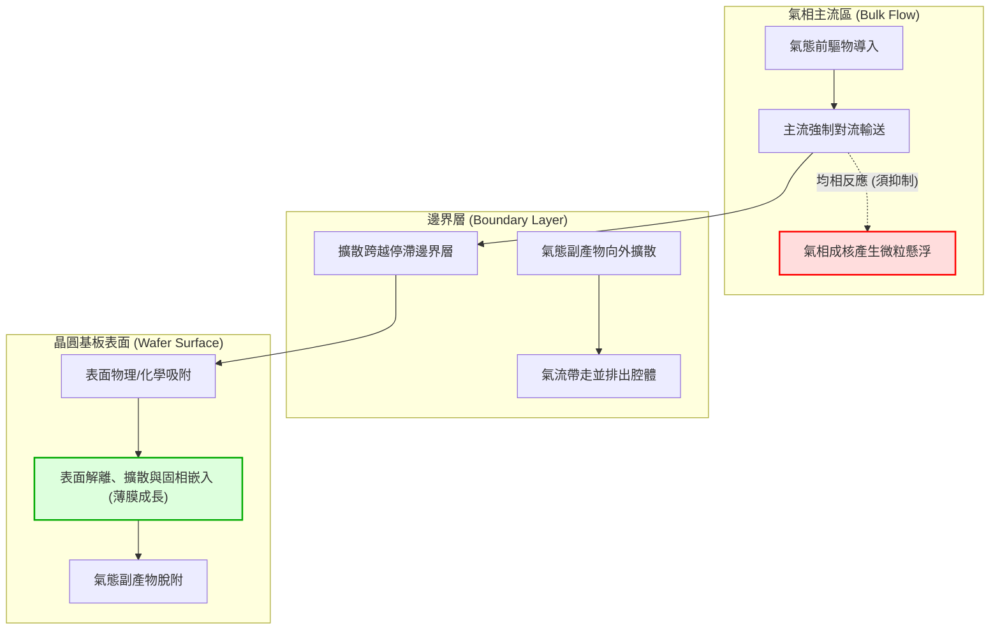

---

### 21.1.2 流體力學邊界層理論與前驅物質傳機制

在 CVD 反應腔內，製程氣體以特定的流速流經靜止的晶圓表面時，由於流體的黏滯性（Viscosity），流體在固態晶圓表面滿足無滑移條件（No-slip condition，表面流速為零）。因此，在緊貼晶圓表面處會形成速度梯度顯著的「流體力學邊界層」（Hydrodynamic boundary layer）。在該區域內，流體流速遠低於主流氣速，常以「滯留層」（Stagnant layer）模型進行理論簡化。

根據普朗特（Prandtl）邊界層理論，沿著平板流動的流體，其邊界層厚度 $\delta(x)$ 隨流經距離 $x$ 的增加而逐漸增厚，其典型關聯式為：

$$\delta(x) \propto \sqrt{\frac{\mu x}{\rho u_\infty}} = \sqrt{\frac{\nu x}{u_\infty}} = \frac{x}{\sqrt{Re_x}}$$

其中，$\mu$ 為流體動力黏度（Dynamic viscosity），$\rho$ 為氣體密度，$\nu = \mu / \rho$ 為運動黏度（Kinematic viscosity），$u_\infty$ 為主流氣體流速，$Re_x = \rho u_\infty x / \mu$ 為局部雷諾數（Reynolds number）。

在濃度分佈上，前驅物自主流區輸運至晶圓表面時，同樣存在「濃度邊界層」（Concentration boundary layer，其厚度記為 $\delta_c$）。前驅物氣體在主流區的莫耳濃度為 $C_g$，而在基板表面反應處的濃度降為 $C_s$。前驅物由主流區跨越邊界層抵達晶圓表面的質傳通量（Mass transport flux）$J_g$（單位：$\text{atoms}/(\text{cm}^2\cdot\text{s})$ 或 $\text{mol}/(\text{cm}^2\cdot\text{s})$），可由菲克第一定律（Fick's first law）推導之質傳方程式表示：

$$J_g = h_g (C_g - C_s) = \frac{D_{AB}}{\delta_c} (C_g - C_s)$$

其中：
*   $h_g$ 為氣相質傳係數（Gas-phase mass transfer coefficient，單位：$\text{cm/s}$）。
*   $D_{AB}$ 為前驅物 $A$ 在載氣 $B$ 中的雙元擴散係數（Binary diffusion coefficient，單位：$\text{cm}^2/\text{s}$）。
*   $\delta_c$ 為濃度邊界層的有效厚度（通常近似於速度邊界層厚度 $\delta$）。

由氣體動力論可知，氣體擴散係數 $D_{AB}$ 隨絕對溫度 $T$ 與總壓力 $P$ 變化，其比例關係為 $D_{AB} \propto T^{3/2} / P$。此特性揭示了調控腔體壓力與氣流速度能實質改變邊界層內的質傳阻力。

---

### 21.1.3 表面微觀反應歷程

前驅物到達晶圓表面後，轉化為沉積薄膜並釋放副產物的微觀動力學過程，由以下五個連續的異相表面反應步驟所構成：

1. **表面吸附（Adsorption）**：氣態前驅物撞擊晶圓表面。初期受弱凡德瓦力束縛進行物理吸附（Physisorption），隨後越過活化能障形成具備共享電子對或共價鍵結的化學吸附（Chemisorption）。化學吸附程度常以表面覆蓋率（Surface coverage, $\theta$）描述，服從朗繆爾（Langmuir）吸附等溫模型。
2. **化學解離（Dissociation）**：化學吸附的前驅物分子在基板熱能誘導下，分子內部化學鍵斷裂，裂解出活性反應基元（Adatoms/Radicals）及配體碎片（Ligand fragments）。
3. **表面擴散與遷移（Surface Diffusion/Migration）**：未完全鍵結的吸附原子藉由晶面熱振動，在表面活性位點間跳躍遷移。擴散長度 $\lambda_s$ 與表面擴散係數 $D_s$ 及吸附壽命 $\tau$ 相關（$\lambda_s = \sqrt{D_s \tau}$）。
4. **固相成核與併入晶格（Incorporation）**：反應基元遷移至表面能量最低點（如微觀台階 Step、扭折 Kink 或晶界處），與基板原子成鍵並併入晶格或非晶連續網絡，完成固態薄膜的堆疊。
5. **副產物脫附與排淨（Desorption and Out-diffusion）**：殘留的揮發性化學配體或反應副產物（如 $\text{HCl}$、$\text{HF}$、$\text{H}_2$ 等）吸收熱能克服吸附勢井，從表面脫附回到氣相，逆向擴散跨越邊界層並隨主氣流排出腔體。

上述任何一步驟若受阻（例如副產物脫附能障過高），將導致活性位點被毒化（Surface poisoning），使得沉積反應中止或將雜質（如碳、氯）大量包覆於薄膜內部。

---

### 21.1.4 反應速率控制機制：Grove 模型與 Arrhenius 關係式

CVD 成長速率受邊界層「氣相質傳」與晶圓表面「化學反應」兩個串聯（Series）步驟的共同限制。在穩態沉積（Steady-state deposition）條件下，抵達表面的質傳通量 $J_g$ 必須等於表面化學反應所消耗的反應通量 $J_s$。

假定表面反應為一級化學反應（First-order reaction），反應通量 $J_s$ 與表面前驅物濃度 $C_s$ 成正比：

$$J_s = k_s C_s$$

其中 $k_s$ 為表面化學反應速率常數（Surface reaction rate constant，單位：$\text{cm/s}$）。

根據質量守恆定律，在介面處 $J_g = J_s = J$：

$$h_g (C_g - C_s) = k_s C_s$$

解出表面前驅物濃度 $C_s$：

$$C_s = \frac{h_g}{h_g + k_s} C_g$$

將 $C_s$ 代回通量表示式，可得穩態沉積通量 $J$，薄膜沉積速率 $R_{\text{dep}}$（單位：$\text{cm/s}$ 或 $\text{nm/min}$）則為沉積通量除以固態薄膜單位體積內的原子密度 $N_v$（Number density of atoms in the solid film）：

$$R_{\text{dep}} = \frac{J}{N_v} = \frac{1}{N_v} \left( \frac{k_s h_g}{k_s + h_g} \right) C_g = \frac{1}{N_v} \left( \frac{1}{k_s} + \frac{1}{h_g} \right)^{-1} C_g$$

此式即為著名的 Grove CVD 速率方程式，明確展現出總沉積阻力為表面反應阻力（$1/k_s$）與質傳阻力（$1/h_g$）的串聯疊加。根據溫度對各參數的敏感程度差異，CVD 反應表現出兩個截然不同的速率控制機制（Rate-limiting regimes）：

```
ln(R_dep)
   ^
   |       質量傳輸限制區 (Mass Transport-Limited)
   |       斜率 = -E_a/(k_B) ~ 0 (弱依賴溫度，活化能極低)
   |       -------------------
   |                          \
   |                           \  表面反應限制區 (Surface Reaction-Limited)
   |                            \ 斜率 = -E_a/(k_B) (強依賴溫度，活化能高)
   |                             \
   +-----------------------------------> 1000 / T (1/K)
  (高溫) <---------------------------- (低溫)
```

#### 1. 表面反應限制區（Surface Reaction-Limited Regime）
在較低反應溫度下，表面反應速率常數遠小於質傳係數（$k_s \ll h_g$）。此時表面阻力居主導地位，$h_g + k_s \approx h_g$，$C_s \approx C_g$，沉積速率簡化為：

$$R_{\text{dep}} \approx \frac{k_s C_g}{N_v}$$

表面反應速率常數 $k_s$ 與絕對溫度遵循阿瑞尼斯方程式（Arrhenius equation）：

$$k_s = k_0 \exp\left( -\frac{E_a}{k_B T} \right)$$

其中，$k_0$ 為指前因子（Pre-exponential factor），$E_a$ 為表面反應表觀活化能（Apparent activation energy，典型值約在 $1.0\sim 2.5\text{ eV}$ 間），$k_B$ 為波茲曼常數（Boltzmann constant）。

在此區域內：
* 沉積速率對溫度極度敏感（呈現指數增長關係），因此晶圓全區的溫度均勻性（Temperature uniformity）是決定膜厚均勻性的關鍵。
* 反應速率對氣體流速、流場分佈及晶圓擺放幾何形狀相對不敏感。
* 前驅物在微觀深窄孔隙結構內部有足夠時間均勻擴散至各角落才發生反應，因此能獲得極佳的階梯覆蓋能力（Step coverage）。低壓化學氣相沉積（LPCVD）通常操作於此控制區。

#### 2. 質量傳輸限制區（Mass Transport-Limited Regime）
當基板溫度升高至一定程度後，表面化學反應速率極快，消耗反應物的速度遠大於氣相傳輸速度（$k_s \gg h_g$）。此時質傳阻力成為瓶頸，$h_g + k_s \approx k_s$，$C_s \approx 0$（基板表面前驅物一抵達即被消耗殆盡），沉積速率轉為由氣相質傳係數控制：

$$R_{\text{dep}} \approx \frac{h_g C_g}{N_v} = \frac{D_{AB}}{\delta_c N_v} C_g$$

由於氣體擴散係數 $D_{AB}$ 對溫度的依賴性較弱（$D_{AB} \propto T^{3/2}$，表觀活化能通常僅約 $0.1\sim 0.2\text{ eV}$），在此區域內：
* 沉積速率隨溫度上升的趨勢極為平緩。
* 沉積速率與反應腔體內部的流體動力學狀態、前驅物分壓、氣體流速及邊界層厚度 $\delta_c$ 高度相關。任何流場的擾動皆會劇烈影響局部沉積速率。
* 在三維深孔或微溝槽中，前驅物尚未擴散至結構底部即於結構開口頂端被反應消耗，極易引發懸垂效應（Overhang）與孔隙空洞（Void），導致階梯覆蓋能力劣化。

| 比較維度 | 表面反應限制區 (Surface Reaction-Limited) | 質量傳輸限制區 (Mass Transport-Limited) |
| :--- | :--- | :--- |
| **操作溫度區間** | 相對低溫 | 相對高溫 |
| **速率瓶頸** | 晶圓表面化學反應速率（$k_s$） | 跨越邊界層之氣相質傳擴散（$h_g$） |
| **溫度敏感度** | 極高（阿瑞尼斯指數依賴，典型 $E_a > 1\text{ eV}$） | 極低（微弱冪次依賴，$T^{1.5}\sim T^{2.0}$） |
| **流場幾何依賴** | 低（對腔體流速分佈不敏感） | 極高（受邊界層厚度 $\delta$ 與流場均勻度主導） |
| **圖形階梯覆蓋率** | 優異（反應前驅物能充分擴散滲透） | 較差（開口處易產生質傳耗盡與空隙） |
| **典型應用實例** | 批次型 LPCVD（多晶矽、氮化矽沉積） | 單晶圓高溫磊晶（Si/SiGe 成長）、常壓 CVD |

---

### 21.1.5 均相成核副反應的抑制熱力學與動力學途徑

為了避免均相反應引發的微粒污染，製程工程師與設備設計者需從熱力學能障與分子動力學途徑切入，將反應完全鎖定在異相表面反應區間。

氣相反應的碰撞頻率可由氣體動力論推導。在氣相主體中，分子平均自由徑（Mean free path, $\lambda$）與系統壓力 $P$ 成反比：

$$\lambda = \frac{k_B T}{\sqrt{2} \pi d_m^2 P}$$

其中 $d_m$ 為氣體分子的有效碰撞直徑。

當操作壓力降低（例如從常壓 $10^5\text{ Pa}$ 降至低壓 CVD 的 $10\sim 100\text{ Pa}$）時：
1. 平均自由徑 $\lambda$ 大幅擴大達數百至數千倍，氣相分子間的碰撞機率劇烈下降，使得均相熱碰撞分解的動力學反應速率下降數個數量級。
2. 擴散係數 $D_{AB}$ 隨壓力降低而成反比顯著提高（$D_{AB} \propto 1/P$），有效降低了邊界層的質傳擴散阻力，擴展了表面反應限制的操作窗口。

抑制均相成核的具體工程手段包含：

*   **冷壁式反應器設計（Cold-Wall Reactor）**：利用高頻射頻感應或紅外線輻射燈管僅對晶圓及其承載盤（Susceptor）實施局部直接加熱，反應腔金屬壁面則維持水冷降溫狀態。此佈局確保反應所需的活化能僅在晶圓表面附近被提供，遠離基板的氣體主流區因處於低溫狀態，均相反應無法克服反應活化能障。
*   **氣體滯留時間（Residence Time）最佳化**：縮短氣體分子自噴嘴（Showerhead）進入至抽氣管線排出的停留時間 $\tau_{\text{res}} = V / Q$（$V$ 為腔體有效體積，$Q$ 為體積流率）。將滯留時間壓縮至均相化學反應誘發期（Induction time）以內，使反應物尚未在氣相中形成臨界晶核即被抽出腔體外。
*   **反應物分離注入與化學稀釋**：採用高化學穩定性的載氣（如高純度 $\text{N}_2$、$\text{Ar}$ 或 $\text{He}$）大幅稀釋活性前驅物分壓，拉長分子碰撞間距，同時避免在管線中提早混合具高自燃性或高反應性的互補前驅物（例如矽烷 $\text{SiH}_4$ 與氧氣 $\text{O}_2$）。

!!! note "說明：低壓化學氣相沉積（LPCVD）的均勻性優勢根源"
    在工業實踐中，垂直式管狀爐 LPCVD 能達成一次堆疊沉積 100 至 150 片晶圓且片內均勻度（Within-wafer uniformity）極佳，其核心物理機制即在於將腔體壓力降至數十帕斯卡。擴散係數 $D_{AB}$ 的劇增使得質傳係數 $h_g$ 遠大於表面反應常數 $k_s$（$h_g \gg k_s$），迫使製程完全落在「表面反應限制區」。在此機制下，晶圓間極度窄縮的間距（數公釐）不會形成致命的質傳擴散瓶頸，只要爐管具備極高精度的多區加熱溫控（溫度梯度控制在 $\pm 0.5^\circ\text{C}$ 以內），即可獲得厚度高度一致的優質薄膜。

<!-- fig:1 -->
<figure markdown>
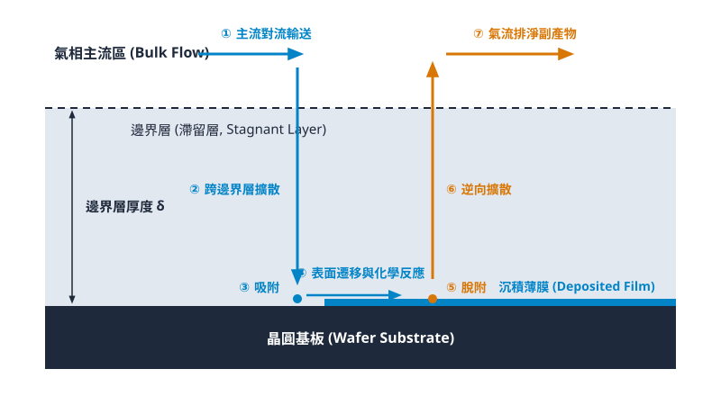
<figcaption>圖 21-1　CVD反應傳輸步驟圖（AI 繪製的示意圖）</figcaption>
</figure>

## 21.2 主要 CVD 製程類別與能量驅動機制

### 熱激發型 CVD：APCVD 與 LPCVD 之傳輸與動能對比

熱激發化學氣相沉積仰賴熱能克服化學反應的活化能障礙（Activation Energy, $E_a$）。前驅物分子在加熱的基板表面發生熱裂解或相互反應，進而析出固態薄膜。依據腔體操作壓力的差異，熱激發製程主要分為常壓化學氣相沉積（Atmospheric Pressure CVD, APCVD）與低壓化學氣相沉積（Low Pressure CVD, LPCVD）。兩者在氣相傳輸動力學、沉積速率決定機制以及階梯覆蓋率（Step Coverage）上呈現本質性的差異。

氣體分子之平均自由程（Mean Free Path, $\lambda$）可由馬克士威-波茲曼分佈（Maxwell-Boltzmann Distribution）導出：

$$\lambda = \frac{k_B T}{\sqrt{2} \pi d_m^2 P}$$

其中 $k_B$ 為波茲曼常數，$T$ 為絕對溫度，$d_m$ 為氣體分子的有效碰撞直徑，$P$ 為腔體總壓力。氣體擴散係數 $D$ 則正比於 $T^{3/2} / P$。

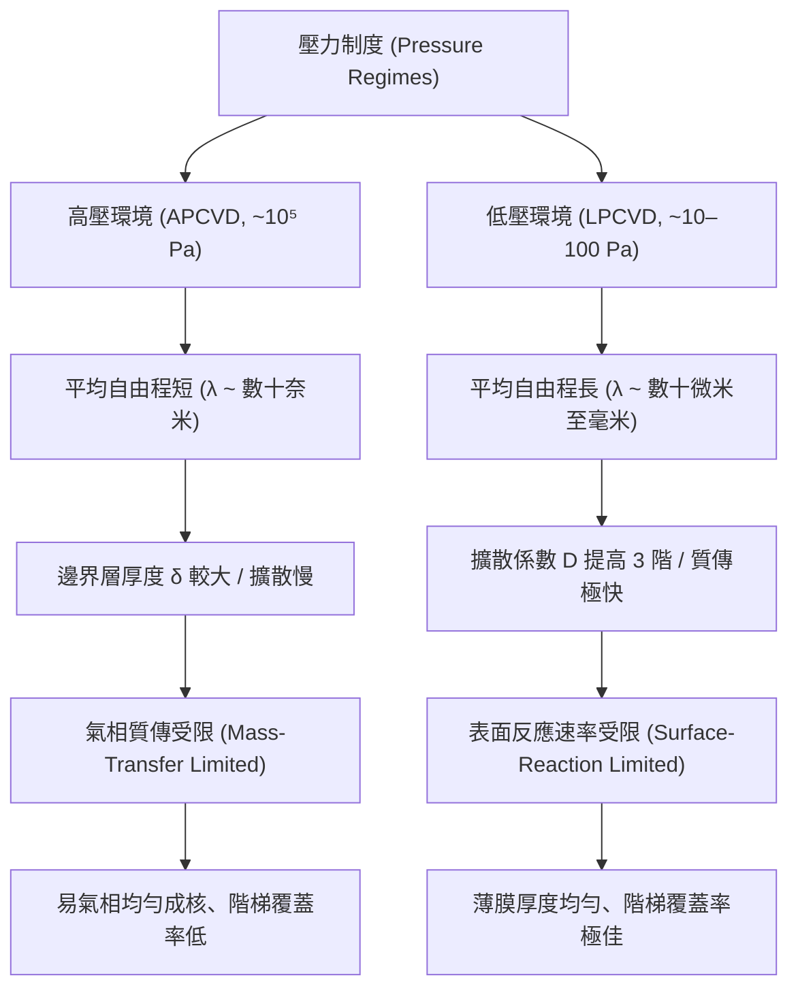

在 APCVD 中，腔體壓力約為大氣壓（$P \approx 10^5\text{ Pa}$），平均自由程 $\lambda$ 僅約數十奈米，氣體分子間碰撞極為頻繁，氣體擴散係數相對較小。此時氣相邊界層（Boundary Layer）厚度 $\delta$ 較大，前驅物自氣相主體傳輸至晶圓表面的通量（Flux）受到顯著阻礙，反應多落於「氣相質傳受限區」（Mass-Transfer Limited Regime）。由於質傳速率強烈依賴流場動態與幾何外觀，晶圓表面之局部結構容易因氣相耗乏效應（Gas-phase Depletion）導致沉積不均勻。此外，高壓高溫環境極易誘發氣相均勻成核（Gas-phase Homogeneous Nucleation），形成氣相粉塵顆粒（Gas-phase Particles），嚴重降低元件良率。

相對地，LPCVD 將操作壓力降至低壓範圍（典型值為 $10 \sim 100\text{ Pa}$，約 $0.1 \sim 1\text{ Torr}$）。由平均自由程公式可知，當壓力降低三個數量級時，$\lambda$ 劇增至數十微米至數毫米，氣相擴散係數 $D$ 隨之增加近千倍。此時反應物質自氣流主體擴散至晶圓表面的速率遠高於表面化學吸附與反應速率，製程機制平移至「表面反應速率受限區」（Surface-Reaction Limited Regime）。

在表面反應受限條件下，沉積速率不再受制於氣體流場的不均勻性，而完全取決於基板溫度與活化能，呈現阿瑞尼斯行為（Arrhenius Behavior）：

$$R_{dep} = R_0 \exp\left(-\frac{E_a}{k_B T}\right)$$

其中 $R_0$ 為前因子（Pre-exponential factor）。由於表面擴散速度極快，前驅物分子得以在複雜的微觀圖形（如溝槽深處）內多次脫附與再吸附，從而賦予 LPCVD 極高的階梯覆蓋率。此外，LPCVD 允許晶圓以密集的垂直或水平垂直站立方式置於石英爐管（Furnace）中，達成單批次數百片的高產能產出。然而，其主要限制在於高溫需求（典型值 $550^\circ\text{C} \sim 900^\circ\text{C}$），對整體熱預算構成了嚴峻挑戰。

---

### 電漿輔助化學氣相沉積 (PECVD)：非熱平衡電漿與活化能旁路

隨著半導體微縮推進至後段製程（BEOL），金屬導線（如銅或鋁）與低介電常數（Low-$k$）材料無法承受 LPCVD 的高溫環境。電漿輔助化學氣相沉積（Plasma-Enhanced CVD, PECVD）透過將能量來源由純熱能轉換為高頻電磁場，實現在極低基板溫度（典型值 $200^\circ\text{C} \sim 400^\circ\text{C}$）下進行薄膜沉積。

PECVD 的物理核心在於利用輝光放電（Glow Discharge）產生「非熱平衡電漿」（Non-Equilibrium Plasma，或稱冷電漿，見第 18 章）。在典型 $13.56\text{ MHz}$ 射頻（Radio Frequency, RF）電場激發下，質輕的電子能迅速跟隨交變電場加速，獲得極高的動能；而質量較重的離子與中性分子因慣性無法同步響應。系統中之電子溫度 $T_e$ 與重粒子溫度（離子溫度 $T_i$ 及氣體分子溫度 $T_g$）高度解耦：

$$T_e \gg T_i \approx T_g$$

其中電子溫度 $T_e$ 典型值達 $1 \sim 5\text{ eV}$（相當於 $10^4 \sim 5 \times 10^4\text{ K}$），而基板與腔體氣體溫度 $T_g$ 則維持在室溫至數百攝氏度之間（$0.025 \sim 0.06\text{ eV}$）。

高能量電子藉由非彈性碰撞（Inelastic Collisions）使前驅物氣體分子解離，產生高反應活性的自由基（Radicals）、離子與激發態分子：

$$e^- + \text{SiH}_4 \longrightarrow \text{SiH}_x^* + (4-x)\text{H}^* + e^- \quad (x \le 3)$$

$$e^- + \text{N}_2\text{O} \longrightarrow \text{N}_2 + \text{O}^* + e^-$$

這些自由基具有未配對電子，化學穩定性極低，其吸附與反應所需之活化能極小。因此，傳統熱化學中必須藉由高溫供給的活化能門檻，在 PECVD 中被高能電子驅動的解離路徑完全繞過（Bypassed）。反應物得以在較低的基板溫度下完成表面化學鍵結，大幅減緩了基板原子的熱擴散效應。

!!! note "PECVD 薄膜化學計量比與殘留物"
    由於 PECVD 屬於非熱力學平衡反應，生成的薄膜往往為非化學計量比（Non-stoichiometric），且前驅物未完全裂解的氫基團易被捕獲包埋。例如沉積的氮化矽並非純淨的 $\text{Si}_3\text{N}_4$，通常記為 $\text{SiN}_x:\text{H}$，其內含氫濃度典型值達 $10 \sim 30\text{ at}\%$。這些殘留的 $\text{Si-H}$ 與 $\text{N-H}$ 鍵會對介電常數、內部機械應力（Mechanical Stress）及絕緣破壞電壓產生直接影響。工程上常藉由調控雙頻射頻（Dual-frequency RF：高頻提供解離度，低頻加強離子轟擊）來調整薄膜的應力（從張應力至壓應力）。

---

### 高密度電漿化學氣相沉積 (HDPCVD)：沉積與濺擊蝕刻的動態競爭

在微影臨界尺寸（CD）縮小而溝槽深寬比（Aspect Ratio, AR）持續攀升的節點中，傳統 PECVD 會面臨沉積輪廓的幾何限制。前驅物分子抵達圖形頂端轉角處（Corner）的立體角（Solid Angle）遠大於抵達溝槽側壁與底部的立體角，導致轉角處生長速率過快，形成顯著的懸突（Overhang / Bread-loafing）結構。懸突在微觀結構填滿前便會彼此接觸並提前封閉入口，在特徵內部形成未被填充的中空空洞（Keyhole Void）。

高密度電漿化學氣相沉積（High-Density Plasma CVD, HDPCVD）透過引入「沉積-濺擊蝕刻同步競爭機制」（Simultaneous Deposition-Etch Process），有效解決了高深寬比結構的填洞瓶頸。

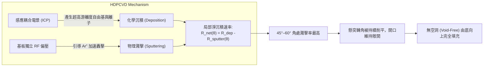

HDPCVD 的物理硬體架構將電漿產生源與基板偏壓解耦。電漿源通常採用感應耦合電漿（Inductively Coupled Plasma, ICP）或電子迴旋共振（Electron Cyclotron Resonance, ECR），工作於極低氣壓環境（典型值 $0.1 \sim 1\text{ Pa}$）。其產生的電漿密度高達 $10^{11} \sim 10^{12}\text{ cm}^{-3}$，較傳統 PECVD 提高約兩至三個數量級，電漿游離度顯著提升。

製程中，晶圓基座被施加獨立的低頻射頻偏壓（Bias RF），在晶圓表面誘發高自偏壓（Self-bias DC Voltage）。電漿中的惰性氣體離子（通常為 $\text{Ar}^+$）被電場加速朝晶圓表面垂直射入，產生物理性濺擊蝕刻（Physical Sputtering）。晶圓表面任意特定斜率 $\theta$（入射離子與表面法線之夾角）位置的淨沉積速率 $R_{net}(\theta)$ 定義為化學沉積速率與濺擊蝕刻速率之差：

$$R_{net}(\theta) = R_{dep} - R_{sputter}(\theta)$$

由離子濺擊理論可知，固體材料之濺擊產額（Sputter Yield）強烈依賴離子入射角。當入射角 $\theta = 0^\circ$（垂直表面）時，濺擊產額相對中等；隨著 $\theta$ 增加，能量轉移幾何效率提升，在典型角度 $\theta \approx 45^\circ \sim 60^\circ$ 附近，濺擊產額達到峰值最大值；而當 $\theta \to 90^\circ$（平行表面）時，離子發生表面反射，濺擊產額急遽下降至零。

在凹陷溝槽邊緣，懸突結構初期形成的幾何轉角恰好呈現接近 $45^\circ$ 的傾角。因此，在溝槽開口轉角處，$R_{sputter}(\theta)$ 極大，致使該處的淨沉積速率顯著受到抑制甚至出現淨材料移除。這種機制持續將原本欲向內延伸生長、封閉孔徑的懸突削平，使溝槽開口在沉積過程中全程保持敞開，促成薄膜以由底向上的形式完成緻密、無空洞（Void-Free）的高深寬比圖形填充。

!!! warning "重新沉積效應與 D/E 比控制"
    在 HDPCVD 中，被物理濺擊轟擊出來的物質若未被真空系統抽除，會以餘弦分佈重新沉積（Re-deposition）於對側溝槽側壁，可能破壞深寬比廓形。因此，沉積蝕刻比（Deposition-to-Etch ratio, D/E ratio）必須嚴格最佳化：
    $$\text{D/E Ratio} = \frac{R_{dep}}{R_{dep} - R_{net}(0^\circ)}$$
    若 D/E 比過高，濺擊效應不足，開口將因懸突而提前閉合；若 D/E 比過低，濺擊過度會導致下層結構轉角處遭受過度物理損傷（Facet Clipping）。

---

### 熱預算限制下的技術選型準則

在半導體製造整合流程中，薄膜沉積技術的選型並非僅考量沉積速率或填洞能力，最核心的物理限制來自於熱預算（Thermal Budget）。熱預算本質上為溫度對製程時間之積分效應：

$$\text{Thermal Budget} \propto \int \exp\left(-\frac{E_a}{k_B T(t)}\right) dt$$

高溫會誘發摻雜載子之非期望熱擴散、淺接面（Shallow Junction）退化、金屬矽化物（Silicide）相變以及金屬導線（Cu、Al）原子遷移或介電層開裂。

| CVD 製程類別 | 典型操作壓力 | 典型製程溫度 | 活化能提供機制 | 階梯覆蓋 / 填洞能力 | 熱預算容許度 | 主要薄膜與應用範例 |
| :--- | :--- | :--- | :--- | :--- | :--- | :--- |
| **APCVD** | $\sim 10^5\text{ Pa}$ ($1\text{ atm}$) | $350^\circ\text{C} \sim 450^\circ\text{C}$ | 純熱能（質傳受限） | 較差（易懸突） | 中度 | 早期層間介電層（如未摻雜/摻雜磷矽玻璃 PSG） |
| **LPCVD** | $10 \sim 100\text{ Pa}$ | $550^\circ\text{C} \sim 900^\circ\text{C}$ | 純熱能（表面反應受限） | 優良（共形覆蓋佳） | 極低（需前段高熱預算階段） | 多晶矽閘極、STI 氮化矽硬光罩（$\text{Si}_3\text{N}_4$）、高溫氧化層（HTO） |
| **PECVD** | $100 \sim 500\text{ Pa}$ | $200^\circ\text{C} \sim 400^\circ\text{C}$ | 非熱平衡電漿（電子撞擊解離） | 中等至良好 | 高（相容於後段金屬化） | BEOL 金屬間介電層（IMD）、鈍化層（Passivation）、低介電材料擴散阻擋層 |
| **HDPCVD** | $0.1 \sim 1\text{ Pa}$ | $300^\circ\text{C} \sim 450^\circ\text{C}$ | 高密度電漿 + 基板偏壓物理濺擊 | 極佳（沉積蝕刻同步，高 AR 填洞） | 中高 | 淺溝槽隔離（STI）介電質填充、前段接觸孔前金屬介電層（PMD） |

根據製造模組所處之階段，CVD 選型準則遵循以下工程邊界：

1. **前段製程（Front-End of Line, FEOL）**：
   在閘極結構建立以前（如淺溝槽隔離 STI 蝕刻後填充），基板尚未形成超淺接面（見第 26 章），熱預算容許度極高（可達 $900^\circ\text{C} \sim 1050^\circ\text{C}$）。為追求高薄膜緻密度、極低缺陷率與近乎理想的化學計量比，首選技術為高溫 LPCVD 或無空洞填充能力極佳的 HDPCVD。
2. **接觸孔與中間段製程（Middle of Line, MOL）**：
   自高介電常數金屬閘極（HKMG，見第 28 章）與鎳鉑矽化物（NiPtSi）接面形成之後，溫度臨界門檻通常驟降至 $450^\circ\text{C} \sim 500^\circ\text{C}$，防止矽化物凝聚與界面偶極退化。此階段之介電質沉積需逐步由 LPCVD 移轉至 HDPCVD 或特殊開發之低溫電漿製程。
3. **後段製程（Back-End of Line, BEOL）**：
   銅導線互連與超低介電常數（Ultra Low-$k$, ULK）材料（見第 29、30 章）的製程溫度上限被嚴格鎖死在 $400^\circ\text{C}$ 以下。多數熱激發反應在此溫度範圍均處於停滯狀態，因此 PECVD 成為後段沉積氧化矽、低介電碳摻雜氧化矽（SiCOH）以及氮碳化矽（SiCN）阻擋層的唯一可行方案。

!!! example "產業實例：應用材料 (Applied Materials) Ultima HDP-CVD"
    在 65 至 28 奈米節點的邏輯與記憶體製造中，應用材料公司的 Ultima HDPCVD 機台曾被廣泛採用於淺溝槽隔離（STI）與預金屬介電層（PMD）的無空洞二氧化矽填充。該機台結合誘導耦合電漿（ICP）源與低頻靜電吸盤偏壓（RF Bias Chuck），透過精密控制 $\text{SiH}_4 / \text{O}_2 / \text{Ar}$ 的氣體比例，即時調整沉積與濺擊蝕刻的動態平衡，成功克服了深寬比超過 6:1 且開口低於 50 奈米之溝槽填充限制。

## 21.3 微觀圖形輪廓演化與填洞能力

### 階梯覆蓋率之定義與量化指標

在超大型積體電路（VLSI）向深次微米與奈米節點演進的過程中，晶圓表面存在大量高深寬比（High Aspect Ratio, HAR）的幾何結構，例如淺溝槽隔離（Shallow Trench Isolation, STI，見第 28 章）、金屬接觸孔（Contact Hole）與雙鑲嵌導線溝槽（見第 29 章）。薄膜在這些起伏非平坦結構上的成膜幾何外觀，直接決定了元件的電氣隔離特性與互連可靠度。

評估沉積薄膜在微觀三維結構上覆蓋能力的關鍵指標為「階梯覆蓋率」（Step Coverage, SC）。設一深寬比結構如圖所示，定義水平頂部（平坦表面）沉積厚度為 $t_{\text{top}}$，溝槽垂直側壁薄膜厚度為 $t_{\text{side}}$，溝槽底部中心薄膜厚度為 $t_{\text{bot}}$。

```
        分子通量 (Flux) ↓↓↓↓↓
             │            │
  t_top ┌────┘            └────┐ t_top
        │   ┌──┐        ┌──┐   │
        │   │  │        │  │   │
        │   │  │ 側壁   │  │   │
        │   │  │ t_side │  │   │
        │   │  │        │  │   │
        └───┘  └────────┘  └───┘
                 底部 t_bot
```

階梯覆蓋率通常分為側壁覆蓋率與底部覆蓋率：

$$SC_{\text{side}} = \frac{t_{\text{side}}}{t_{\text{top}}} \times 100\%$$

$$SC_{\text{bot}} = \frac{t_{\text{bot}}}{t_{\text{top}}} \times 100\%$$

由於側壁不同深度處的成膜厚度通常呈現漸縮梯度，實務分析時常進一步細分為頂部側壁厚度 $t_{\text{side, top}}$ 與底部側壁轉角厚度 $t_{\text{side, bot}}$。若在結構內部任意點的厚度皆與平坦表面厚度嚴格一致，即 $SC_{\text{side}} = SC_{\text{bot}} = 100\%$，此薄膜狀態稱為理想的「共形覆蓋」（Conformal Coating）。

| 覆蓋特徵類型 | 膜厚關係 | 典型製程對應 | 適用之結構需求 |
| :--- | :--- | :--- | :--- |
| **共形沉積 (Conformal)** | $t_{\text{side}} \approx t_{\text{bot}} \approx t_{\text{top}}$ | LPCVD、ALD | 閘極側壁間隔層、穿孔阻障層 |
| **定向沉積 (Directional)** | $t_{\text{bot}} \approx t_{\text{top}} \gg t_{\text{side}}$ | 高真空 PVD、離子束沉積 | 平面互連導線、剝離 (Lift-off) 製程 |
| **非共形覆蓋 (Non-conformal)** | $t_{\text{top}} > t_{\text{bot}} > t_{\text{side}}$ | PECVD、大氣壓 CVD (APCVD) | 層間介電層表面厚鈍化、頂部保護 |

---

### 幾何抵達角與前驅物黏著係數之物理機制

微觀輪廓的演化本質上是氣相分子質量傳輸與表面化學反應速率競爭的結果。影響局部成長速率的微觀變數主要有二：幾何抵達角（Arrival Angle）與前驅物之黏著係數（Sticking Coefficient）。

#### 幾何抵達角限制
在微米或次微米溝槽內部，氣體平均自由徑（Mean Free Path, $\lambda_{\text{mfp}}$）往往大於特徵開口尺寸 $W$。此時孔內的氣體傳輸處於分子流（Molecular Flow）機制（克紐森數 $\text{Kn} = \lambda_{\text{mfp}} / W \gg 1$），氣體分子之間的氣相碰撞可忽略不計，分子主要循直線軌跡運動。

平坦表面暴露於上方半球空間，其接受氣相分子的二維投影抵達角為 $\theta = \pi$（立體角為 $2\pi\text{ sr}$）。深入溝槽內部某深度 $z$ 處的側壁或底部時，開口對該點所形成的幾何視角（View Angle）受到周圍結構遮蔽而劇烈縮小。若溝槽深度為 $H$、寬度為 $W$，則位於溝槽底部中心點的有效抵達角 $\theta_{\text{bot}}$ 為：

$$\theta_{\text{bot}} = 2 \arctan\left( \frac{W}{2H} \right) = 2 \arctan\left( \frac{1}{2 \cdot AR} \right)$$

其中 $AR = H/W$ 為深寬比。當深寬比極高（$AR \gg 1$）時，展開可近似為：

$$\theta_{\text{bot}} \approx \frac{W}{H} = \frac{1}{AR}$$

此幾何遮蔽效應（Shadowing Effect）使得直接來自氣相通量（Direct Flux）的沉積速率隨深度呈現指數或倒數級衰減。

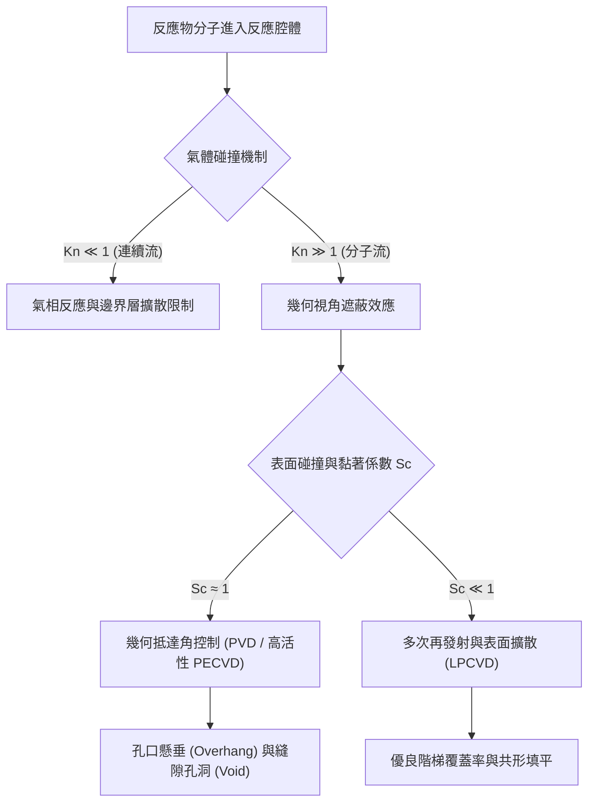

#### 黏著係數對巨觀輪廓的調控
分子撞擊固體表面時，被化學吸附並轉化為沉積固相的機率稱為黏著係數 $S_c$（或反應幾率 $\gamma$）：

$$S_c = \frac{\text{轉化為薄膜的分子數}}{\text{碰撞到表面的總分子數}}$$

1. **高黏著係數極限（$S_c \to 1$）**：
   分子與結構表面發生首次碰撞即發生反應沉積。局部沉積速率嚴格正比於該點的幾何抵達角 $\theta(z)$。頂部拐角處因抵達角最大（二維視角達 $3\pi/2$），沉積厚度增長最快；而深孔內部由於幾何遮蔽，分子抵達率極低。這導致嚴重的輪廓不均勻性。
2. **低黏著係數極限（$S_c \ll 1$，如典型 LPCVD 系統中 $S_c \sim 10^{-3} - 10^{-5}$）**：
   前驅物分子撞擊表面後，绝大部分未反應的分子會依餘弦定律（Cosine Law）向孔內其他方向發生物理反彈或脫附（Desorption），此物理過程稱為「再發射」（Re-emission）。多次再發射使前驅物分子在深孔內反覆反射，在孔內建立起均勻的分子分壓梯度，大幅削弱了幾何遮蔽效應，形成近乎等厚的共形沉積。

---

### 孔口懸垂效應與微孔洞成因

當沉積條件偏向質量傳輸受限（Mass-transport-limited）或電漿輔助化學氣相沉積（PECVD）中自由基的高活性反應時，幾何遮蔽效應在幾何轉折邊界被放大，形成典型的形態缺陷。

#### 懸垂效應（Overhang Effect）
在圖形邊緣的凸角（Convex Corner），表面對外部空間的幾何抵達角顯著大於平坦面。因此，孔口拐角處的生長速率高於垂直側壁與鄰近表面。隨著沉積時間推移，此拐角厚度向孔洞中心呈弧狀凸出，外觀類似麵包冠頂，故又稱「麵包頂效應」（Bread-loafing）。

懸垂結構一旦形成，會進一步加劇對下方側壁與底部的視線阻隔，使得進入孔洞下方的分子通量呈非線性驟減：

$$J(z) \propto \exp\left( -k \cdot \frac{z}{W_{\text{eff}}(t)} \right)$$

其中 $W_{\text{eff}}(t)$ 為隨時間推移因懸垂向內生長而縮小的有效開口寬度。

```
     懸垂凸起 (Overhang)          懸垂凸起 (Overhang)
          ┌───┐                  ┌───┐
          │   ▼                  ▼   │
     ─────┘    ╲                ╱    └─────
                │  掐縮 (Pinch-off)  │
                └───┐        ┌───┘
                    │        │
                    │ 空洞   │
                    │ (Void) │
                    │        │
                    └────────┘
```

#### 微孔洞（Void）與接縫（Seam）之形成機制
孔口懸垂厚度的水平生長速度通常維持定值。若薄膜無法在開口閉合前自底向上填滿結構，相對生長的兩側懸垂薄膜將在開口處提前物理接觸並熔合，此現象稱為「掐縮」（Pinch-off）。

掐縮發生瞬間，外界氣相前驅物分子無法再進入封閉空間，致使深孔內部形成未被填實的永久性中空空腔，稱為微孔洞（Keyhole Void 或 Envelope Void）。若側壁薄膜具有共形性但於中心軸線相遇，中心界面會產生微觀密度較低或原子鍵結不完整的縫隙，稱為「接縫」（Seam）。在後續的高溫退火或化學機械研磨（CMP，見第 24 章）製程中，接縫與微孔洞可能因應力集中誘發膜層剝離，或是成為濕式清洗液（見第 20 章）滯留滲透的通道，造成嚴重的可靠度失效。

!!! warning "高深寬比填充中的負斜率錐角效應"
    溝槽或通孔的側壁剖面若呈現負斜率錐角（Re-entrant Angle / Retrograde Profile，即開口窄而內部寬），其孔口對底部的幾何遮蔽程度遠甚於垂直側壁。在此類結構中即使採用低黏著係數製程，微孔洞的產生幾率亦呈現倍數增長。因此，蝕刻製程（見第 19 章）必須將側壁輪廓嚴格控制為正斜率（開口略寬於底部的梯形，典型側壁傾角在 $87^\circ \sim 89^\circ$）。

---

### 表面擴散長度與再發射機制

為在高深寬比結構中消除孔口懸垂並避免微孔洞，現代沉積理論著重利用「氣相再發射」與「表面擴散」兩大傳輸機制來補償深部的通量不足。

#### 表面擴散長度（Surface Diffusion Length）
吸附於基板表面的前驅物分子在被固定納入晶格或完全熱裂解前，會在表面勢能井之間進行隨機跳躍。在脫附或反應之前，分子沿表面遷移的平均二維距離定義為表面擴散長度 $\lambda_s$：

$$\lambda_s = \sqrt{D_s \cdot \tau_s}$$

其中 $D_s$ 為表面擴散係數，$\tau_s$ 為吸附分子在表面的平均滯留時間（Residence Time）。兩者遵循阿瑞尼斯（Arrhenius）熱激發關係：

$$D_s = D_0 \exp\left( -\frac{E_{\text{diff}}}{k_B T} \right)$$

$$\tau_s = \frac{1}{\nu_0} \exp\left( \frac{E_{\text{des}}}{k_B T} \right)$$

式中 $E_{\text{diff}}$ 為表面擴散活化能，$E_{\text{des}}$ 為吸附分子的脫附活化能（通常 $E_{\text{des}} > E_{\text{diff}}$），$k_B$ 為波茲曼常數，$T$ 為熱力學溫度，$\nu_0$ 為分子振動頻率因子。代入可得表面擴散長度的溫度依賴性：

$$\lambda_s = \sqrt{\frac{D_0}{\nu_0}} \exp\left( \frac{E_{\text{des}} - E_{\text{diff}}}{2 k_B T} \right)$$

由於分子脫附活化能普遍高於表面擴散能障（即 $E_{\text{des}} - E_{\text{diff}} > 0$），在較低溫度區間，分子在脫附前於表面的滯留時間大幅延長，使得表面擴散長度顯著增加。然而，過低的溫度亦會抑制化學反應速率常數，因此需在表面化學反應速率與表面擴散傳輸之間取得熱力學平衡。

#### 再發射物理模型
相較於表面擴散的有限位移（通常小於數十奈米），在深孔（深度大於數百奈米至數微米）內部，分子再發射是決定階梯覆蓋率的主導機制。基於克紐森擴散（Knudsen Diffusion）模型，深孔內部的氣相前驅物濃度梯度可藉由一維質量守恆微分方程式描述：

$$D_K \frac{d^2 C(z)}{dz^2} - \frac{4}{W} k_s C(z) = 0$$

其中 $C(z)$ 為深度 $z$ 處的前驅物濃度，$D_K = \frac{W}{3} \bar{v}$ 為克紐森擴散係數（$\bar{v} = \sqrt{8k_B T / \pi M}$ 為分子平均熱速度），$k_s$ 為表面一級化學反應速率常數（與黏著係數呈正比：$k_s = \frac{1}{4} S_c \bar{v}$）。

定義無因次模數希勒模數（Thiele Modulus）$\phi$：

$$\phi = H \sqrt{\frac{4 k_s}{W D_K}} = H \sqrt{\frac{4 \cdot (\frac{1}{4} S_c \bar{v})}{W \cdot (\frac{1}{3} W \bar{v})}} = AR \cdot \sqrt{3 S_c}$$

溝槽底部的相對前驅物濃度（即決定底部沉積速率的關鍵值）與希勒模數的關係為：

$$\frac{C(H)}{C(0)} = \frac{1}{\cosh(\phi)}$$

由上式可知：
- 當 $\phi \ll 1$（要求 $S_c \ll \frac{1}{3 AR^2}$）時，$\cosh(\phi) \to 1$，$C(H) \approx C(0)$，孔內反應物濃度均勻分佈，底部的沉積速率接近開口處，薄膜呈完全共形覆蓋。
- 當 $\phi \gg 1$ 時，$\cosh(\phi)$ 呈指數增長，反應物在進入深孔前即被孔口消耗殆盡，導致嚴重懸垂與空洞缺陷。

因此，為在高深寬比結構中達成無孔洞填充（Void-free Filling），必須透過調控反應物化學特性（如採用高熱穩定性、低自發反應性之前驅物）大幅壓低黏著係數 $S_c$，使得再發射碰撞次數達到 $1/S_c \sim 10^3 - 10^5$ 次，以確保分子在發生永久沉積前充分穿透至高深寬比幾何的最深處。

!!! example "產業實例：TEOS 氧化矽沉積之階梯覆蓋優勢"
    在沉積層間介電層（ILD）的二氧化矽薄膜時，早期使用矽甲烷與氧氣（$\text{SiH}_4 + \text{O}_2$）進行常壓或低溫沉積，其矽烷自由基中間產物的黏著係數極高（$S_c \approx 0.1 \sim 1$），階梯覆蓋率通常低於 $50\%$，極易於微米級金屬導線間形成孔洞。半導體產業隨後廣泛採用四乙氧基矽烷（Tetraethyl Orthosilicate, $\text{Si(OC}_2\text{H}_5)_4$，簡稱 TEOS）作為前驅物。TEOS 熱裂解產生之中間體具有高度穩定的官能基，其黏著係數極低（典型值 $S_c \sim 10^{-3} - 10^{-4}$），藉由強烈的再發射效應，使 TEOS 基二氧化矽薄膜在深寬比達 $3:1$ 以上的結構中仍能維持 $80\%$ 以上的優異階梯覆蓋率。

<!-- fig:2 -->
<figure markdown>
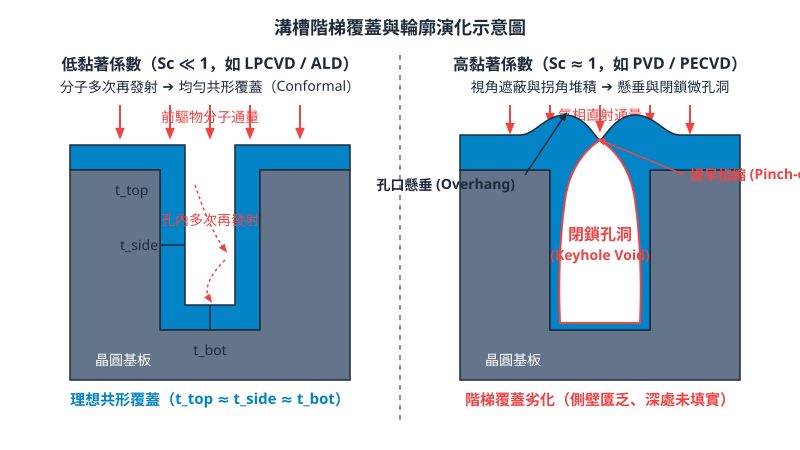
<figcaption>圖 21-2　溝槽階梯覆蓋演化圖（AI 繪製的示意圖）</figcaption>
</figure>

## 21.4 半導體常見 CVD 薄膜與前驅物反應化學

### 多晶矽與非晶矽薄膜

多晶矽（Polycrystalline Silicon, Poly-Si）與非晶矽（Amorphous Silicon, $\alpha\text{-Si}$）在積體電路中廣泛應用於閘極電極、薄膜電晶體通道層、電阻器以及快閃記憶體之浮動閘極。此類矽薄膜主要透過低壓化學氣相沉積（LPCVD）系統，以矽甲烷（Silane, $\text{SiH}_4$）氣體進行熱裂解反應製備。

#### 熱解反應與相態轉變

矽甲烷的熱分解總反應式如下：

$$\text{SiH}_4\text{(g)} \longrightarrow \text{Si(s)} + 2\text{H}_2\text{(g)}$$

反應過程中，氣相中的 $\text{SiH}_4$ 分子擴散至晶圓表面並發生化學吸附，解離為矽氫中間基團（如 $\text{SiH}_2\text{}^*$），隨後脫除氫氣並將矽原子併入固相晶格中。

沉積薄膜的微觀結構強烈依賴沉積溫度與沉積速率：
1. **非晶矽沉積（典型溫度 $< 560^\circ\text{C}$）**：在較低溫度下，表面吸附原子的擴散遷移率（Surface mobility）不足，沉積的矽原子無法在能量最低的晶格位置排列，因而形成長程無序的非晶相結構。非晶矽在後續熱退火處理中可再結晶形成晶粒尺寸較大且表面平整度優於直接沉積的多晶矽薄膜。
2. **多晶矽沉積（典型溫度 $580^\circ\text{C} \sim 650^\circ\text{C}$）**：在此溫度區間，沉積反應處於表面化學反應速率受限區（Surface reaction rate-limited regime），晶圓表面吸附的矽原子具備足夠熱動能進行重排，形成柱狀晶（Columnar grains）結構的多晶型態。典型操作壓力維持在 $10 \sim 100\text{ Pa}$。

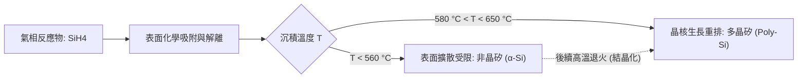

#### 原位摻雜反應動力學

為賦予多晶矽適當的導電性，通常在沉積過程中直接通入摻雜前驅物氣體，進行**原位摻雜**（In-situ Doping）：
- **n 型摻雜**：導入膦（Phosphine, $\text{PH}_3$）或胂（Arsine, $\text{AsH}_3$）。
- **p 型摻雜**：導入乙硼烷（Diborane, $\text{B}_2\text{H}_6$）。

原位摻雜氣體會劇烈改變矽薄膜的沉積動力學：

1. **$\text{PH}_3$ 或 $\text{AsH}_3$ 的沉積抑制效應**：
   磷與砷原子具有未配對孤對電子，對矽表面具有極強的化學吸附能力。吸附後的含磷或含砷基團會佔據（毒化）晶圓表面活性反應點（Active sites），大幅阻礙 $\text{SiH}_4$ 分子的化學吸附，使得沉積速率顯著下降（在典型製程中甚至下降至原本的數分之一至數十分之一），且膜厚均勻度極易受局部氣流分佈影響。

2. **$\text{B}_2\text{H}_6$ 的沉積催化效應**：
   乙硼烷屬於缺電子化合物，吸附於矽表面後充當路易斯酸（Lewis acid），降低了矽烷分子裂解脫氫的活化能，從而加速表面吸附反應，導致多晶矽的沉積速率顯著增加（典型增幅可達數倍）。

---

### 二氧化矽介電薄膜

二氧化矽（$\text{SiO}_2$）主要用作內層介電質（ILD）、金屬層間介電質（IMD）、側壁間隙壁（Spacer）以及淺溝槽隔離（STI）填孔材料。依據不同熱預算（Thermal budget）與階梯覆蓋率要求，工業界採用多種前驅物配方：

| 製程方法 | 前驅物組合 | 典型沉積溫度 | 階梯覆蓋率 | 主要應用領域 |
| :--- | :--- | :--- | :--- | :--- |
| **低溫常壓/低壓 CVD (LTO)** | $\text{SiH}_4 + \text{O}_2$ | $350^\circ\text{C} \sim 450^\circ\text{C}$ | 差（$\sim 50\%$） | 後段金屬層熱預算受限層 |
| **高溫低壓 CVD (HTO)** | $\text{SiH}_2\text{Cl}_2 + \text{N}_2\text{O}$ | $800^\circ\text{C} \sim 900^\circ\text{C}$ | 優良（$> 85\%$） | 元件間隔壁、前段穿透介電層 |
| **TEOS 熱解 LPCVD** | $\text{Si(OC}_2\text{H}_5)_4$ | $650^\circ\text{C} \sim 750^\circ\text{C}$ | 優良（$\sim 80\text{--}90\%$） | 記憶體高深寬比深孔、側壁間隙壁 |
| **次常壓臭氧 TEOS (SACVD)** | $\text{TEOS} + \text{O}_3$ | $400^\circ\text{C} \sim 500^\circ\text{C}$ | 極佳（流動填充特性） | STI 溝槽隔離、前金屬介電質（PMD） |
| **電漿加強型 (PECVD)** | $\text{SiH}_4 + \text{N}_2\text{O}$ 或 $\text{TEOS} + \text{O}_2$ | $300^\circ\text{C} \sim 400^\circ\text{C}$ | 中等（$\sim 60\text{--}70\%$） | 導線層間介電質、平坦化覆蓋層 |

#### 矽烷系統（$\text{SiH}_4 + \text{O}_2 / \text{N}_2\text{O}$）

在低溫（$300 \sim 450^\circ\text{C}$）下，矽烷與氧氣發生劇烈自燃性氣相反應：

$$\text{SiH}_4\text{(g)} + \text{O}_2\text{(g)} \longrightarrow \text{SiO}_2\text{(s)} + 2\text{H}_2\text{(g)}$$

此反應活化能極低，氣相均相反應（Homogeneous reaction）顯著，容易在氣相中形成微粒粉塵（Gas-phase nucleation），且前驅物表面吸附附著係數（Sticking coefficient）偏高，導致深寬比圖案上的階梯覆蓋率不佳。

為改善均勻度與抑制氣相粉塵，高溫製程（HTO）通常改用二氯矽烷（Dichlorosilane, $\text{SiH}_2\text{Cl}_2$, 簡稱 DCS）與笑氣（$\text{N}_2\text{O}$）：

$$\text{SiH}_2\text{Cl}_2\text{(g)} + 2\text{N}_2\text{O(g)} \longrightarrow \text{SiO}_2\text{(s)} + 2\text{N}_2\text{(g)} + 2\text{HCl(g)}$$

高沉積溫度（$> 800^\circ\text{C}$）促使表面反應佔主導地位，薄膜緻密性高，抗蝕刻速率與絕緣崩潰電場（Breakdown field）表現接近熱氧化層（見第 25 章）。

#### TEOS 熱解與 $\text{O}_3\text{-TEOS}$ 反應機制

正矽酸乙酯（Tetraethyl Orthosilicate, 簡稱 TEOS，化學式 $\text{Si(OC}_2\text{H}_5)_4$）常溫下為液態，分子結構中心為矽原子，外圍由四個乙氧基包圍，本身已具備 $\text{Si-O}$ 鍵結。

1. **高溫 LPCVD 熱解**（無外加氧化劑）：
   在 $650 \sim 750^\circ\text{C}$ 條件下，TEOS 分子裂解，副產物包含乙烯（$\text{C}_2\text{H}_4$）與水或乙醇：
   
   $$\text{Si(OC}_2\text{H}_5)_4\text{(g)} \longrightarrow \text{SiO}_2\text{(s)} + 4\text{C}_2\text{H}_4\text{(g)} + 2\text{H}_2\text{O(g)}$$
   
   TEOS 分子吸附係數低，表面擴散距離長，能夠提供優異的階梯覆蓋率。

2. **次常壓 TEOS/$\text{O}_3$ 活化反應（SACVD）**：
   在次常壓環境（$8 \times 10^3 \sim 8 \times 10^4\text{ Pa}$）與較低溫度（約 $400^\circ\text{C}$）下，臭氧分子熱解產生高活性的單原子氧自由基 $\text{O}^*$：
   
   $$\text{O}_3 \longrightarrow \text{O}_2 + \text{O}^*$$
   
   活性氧自由基攻擊 TEOS 分子的乙氧基鏈，在沉積表面形成高流動性的矽烷醇（Silanol, $\text{Si-OH}$）寡聚物中間體。這些前驅物在微結構角落處能產生類似液體的表面張力流動特性，達成無空洞（Void-free）的高深寬比填塞。

!!! warning "基板表面敏感效應（Substrate Sensitivity）"
    $\text{TEOS/O}_3$ 反應對基板表面化學狀態極度敏感。沉積於親水性表面（如熱氧化矽）時，薄膜成長速率快且表面緻密；沉積於疏水性表面（如裸矽基板或電漿處理後的氮化矽）時，核化延遲顯著，沉積膜呈現多孔粗糙結構。製程整合上通常先沉積一層超薄的 PECVD 氧化物作為襯底（Liner），以消除基板敏感效應。

---

### 氮化矽與氮氧化矽

氮化矽（$\text{Si}_3\text{N}_4$）具有優異的耐化學腐蝕性、高介電常數（$k \approx 7.0$）與高機械強度，常用於化學機械研磨（CMP）停止層、濕式蝕刻阻擋層、STI 襯墊及元件應力工程。

#### DCS/$\text{NH}_3$ 與 $\text{SiH}_4/\text{NH}_3$ 反應

1. **LPCVD 高溫氮化矽**：
   通常以二氯矽烷（$\text{SiH}_2\text{Cl}_2$, DCS）與過量氨氣（$\text{NH}_3$）在 $700 \sim 800^\circ\text{C}$ 下沉積：
   
   $$3\text{SiH}_2\text{Cl}_2\text{(g)} + 4\text{NH}_3\text{(g)} \longrightarrow \text{Si}_3\text{N}_4\text{(s)} + 6\text{HCl(g)} + 6\text{H}_2\text{(g)}$$
   
   為抑制矽晶核析出與氣相粉塵，氨氣與 DCS 的流量比通常設定為 $3:1$ 至 $10:1$。所得薄膜接近化學計量比（Stoichiometric $\text{Si}_3\text{N}_4$），氫含量低（$< 8\text{ at}\%$），化學緻密性與階梯覆蓋能力極佳，但薄膜內部存在高達 $1 \sim 1.5\text{ GPa}$ 的熱內在**張應力**（Tensile stress）。

2. **PECVD 低溫氮化矽**：
   在後段製程（BEOL）因熱預算限制（$< 400^\circ\text{C}$），改用電漿輔助 $\text{SiH}_4$ 與 $\text{NH}_3$（或 $\text{N}_2$）進行非平衡沉積。反應膜為非化學計量比的非晶矽氮氫化合物（寫作 $\text{SiN}_x\text{H}_y$），其中含有大量的 $\text{Si-H}$ 與 $\text{N-H}$ 鍵結，總氫含量可高達 $15 \sim 30\text{ at}\%$。

#### 薄膜應力調控機制

在先進電晶體技術中，覆蓋在電晶體上方的接觸孔蝕刻停止層（Contact Etch Stop Layer, CESL）利用氮化矽的高內應力，在 MOSFET 通道區域引入機械形變，透過壓阻效應提高載子遷移率（見第 6 章）。

雙頻 PECVD（高頻射頻 $13.56\text{ MHz}$ 與低頻射頻 $100 \sim 400\text{ kHz}$）可調控氮化矽薄膜應力：
- **張應力膜（Tensile film）**：透過降低離子轟擊能量，薄膜生長時晶界處釋放揮發性副產物（如 $\text{H}_2$），網狀結構收縮，產生拉伸應力（應用於 NMOS 通道以提高電子遷移率）。
- **壓應力膜（Compressive film）**：利用低頻電漿的高能量離子轟擊表面（Ion peening effect），將原子強行撞入近表面晶格間隙（Interstitials），產生體積膨脹傾向的壓應力（最高可達 $-3\text{ GPa}$，應用於 PMOS 通道以提高電洞遷移率）。

#### 氮氧化矽（$\text{SiO}_x\text{N}_y$）

在 PECVD 系統中藉由連續調變反應氣體配比（$\text{SiH}_4 + \text{N}_2\text{O} + \text{NH}_3$），可精準調控薄膜的氧氮比例。$\text{SiO}_x\text{N}_y$ 薄膜的光學折射率（$n$）可在氧化矽（$n \approx 1.46$）至氮化矽（$n \approx 2.05$）之間連續調整，被廣泛作為深紫外光（DUV）微影製程中的底部抗反射層（Dielectric BARC，見第 11 章）。

---

### 接觸窗插塞鎢沉積（W-CVD）

鎢（Tungsten, W）具備高熔點、抗電遷移（Electromigration）能力強以及與矽熱膨脹係數匹配等特點，是前段接觸窗（Contact via / Plug）主要的金屬填充材料。

CVD 沉積金屬鎢主要前驅物為六氟化鎢（$\text{WF}_6$）。$\text{WF}_6$ 的化學反應包含多步還原機制，製程劃分為**成核晶種層**與**主體填充層**（Bulk deposition）兩階段。

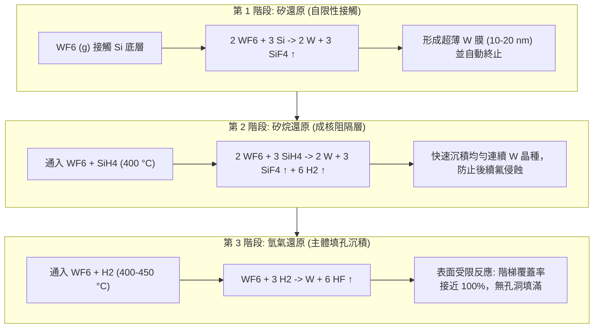

#### 反應動力學與多步還原機制

1. **矽還原反應（Silicon Reduction）**：
   當 $\text{WF}_6$ 初次進入含有暴露矽的接觸窗底時，矽基板本身即作為還原劑：
   
   $$2\text{WF}_6\text{(g)} + 3\text{Si(s)} \longrightarrow 2\text{W(s)} + 3\text{SiF}_4\text{(g)}$$
   
   此反應為自限性（Self-limiting），沉積出 $10 \sim 20\text{ nm}$ 鎢薄膜後，沉積層阻隔了 $\text{WF}_6$ 與下層矽的接觸，反應隨即停止。然而，此反應會消耗基底的單晶矽或多晶矽，可能導致接面漏電。

2. **矽烷還原反應（Silane Reduction, $\text{SiH}_4$ 成核層）**：
   為避免矽還原過度侵蝕基板，在鎢主體沉積前，先通入 $\text{WF}_6$ 與 $\text{SiH}_4$ 氣體混合物：
   
   $$2\text{WF}_6\text{(g)} + 3\text{SiH}_4\text{(g)} \longrightarrow 2\text{W(s)} + 3\text{SiF}_4\text{(g)} + 6\text{H}_2\text{(g)}$$
   
   此反應沉積速率極快，活化能極低，能在阻障層（如 Ti/TiN）表面迅速形成緻密的鎢成核晶種層，有效防止後續製程中的氟自由基擴散。

3. **氫氣還原反應（Hydrogen Reduction, 主體沉積）**：
   成核完成後，通入高比例的 $\text{H}_2$ 與 $\text{WF}_6$ 進行主體高深寬比填孔：
   
   $$\text{WF}_6\text{(g)} + 3\text{H}_2\text{(g)} \longrightarrow \text{W(s)} + 6\text{HF(g)}$$
   
   此反應屬於表面吸附解離受限反應，反應速率方程符合半級數關係：
   
   $$R_{\text{dep}} = k_0 \cdot \exp\left(-\frac{E_a}{k_B T}\right) \cdot P_{\text{H}_2}^{1/2} \cdot P_{\text{WF}_6}^0$$
   
   其中 $R_{\text{dep}}$ 為沉積速率，$k_0$ 為頻率因子，$E_a$ 為表面解離活化能（約 $0.7\text{ eV}$），$k_B$ 為波茲曼常數，$T$ 為絕對溫度，$P_{\text{H}_2}$ 與 $P_{\text{WF}_6}$ 分別代表氫氣與六氟化鎢的分壓。
   
   沉積速率對 $\text{WF}_6$ 分壓呈零級反應（Zero-order），意即只要反應物充足，反應速率完全由解離氫原子覆蓋度與晶圓溫度決定。此動力學特徵賦予 $\text{H}_2$ 還原法接近 $100\%$ 的極高階梯覆蓋率，使金屬鎢能完全填滿微縮接觸窗。

!!! example "火山效應（Volcano Effect）與蟲蝕現象（Encroachment）"
    若接觸窗底部的阻障層（TiN）覆蓋不良或存在針孔缺陷，在進行高溫 $\text{H}_2/\text{WF}_6$ 沉積時，未被阻擋的 $\text{WF}_6$ 分子會沿著晶界滲透至底層的鈦（Ti）或矽基板。$\text{WF}_6$ 與金屬鈦劇烈反應生成高蒸氣壓的揮發性氟化物（如 $\text{TiF}_4$）：
    
    $$3\text{Ti} + 4\text{WF}_6 \longrightarrow 4\text{W} + 3\text{TiF}_4\uparrow$$
    
    反應氣體快速逸散將上層薄膜頂破，於接觸窗周圍形成火山口狀的爆裂孔洞，此缺陷稱為「火山效應」；而 $\text{WF}_6$ 沿著介電層與矽接面橫向侵蝕矽基板所形成的空洞，則稱為「蟲蝕現象」。工業實務上必須以極致密的 ALD-TiN（見第 23 章）或無氟鎢（Fluorine-Free Tungsten, FFW）作為成核防護層。

## 21.5 設備與廠商技術

### 機台架構與反應腔分類

化學氣相沉積（CVD）設備的核心任務，是在受控的真空度、溫度與氣流流場下，將氣態前驅物（Precursors）均勻輸送至晶圓表面並誘發化學反應。依據晶圓處理容量與熱場分布型式，工業級 CVD 機台主要劃分為「批次型垂直爐管」與「單晶圓反應腔」兩大類。

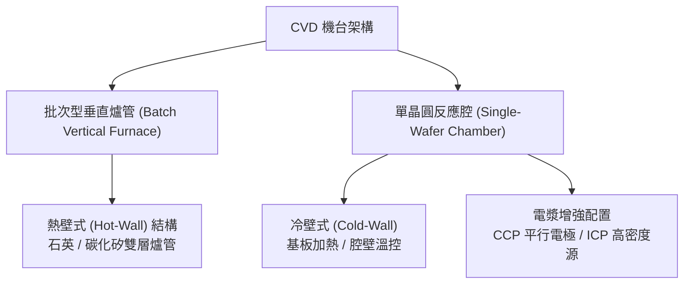

#### 批次型垂直爐管（Batch Vertical Furnace）
批次型垂直爐管通常用於低壓化學氣相沉積（LPCVD，見第 21.2 節）。爐體呈垂直圓柱狀，內部由高純度石英（Quartz）或碳化矽（SiC）製成的內外雙層管構成，外部環繞多段獨立溫控的電阻加熱線圈（Resistive Heaters）。
* **熱壁式（Hot-Wall）設計**：整個爐管內部均處於製程溫度（典型範圍約 $500^\circ\text{C}$ 至 $900^\circ\text{C}$）。其優勢為熱均勻性極高，多段加熱單元可補償爐口與爐底的熱輻射散失，使數十至上百片晶圓維持在 $\pm 1^\circ\text{C}$ 內的溫度公差。
* **氣流配置**：反應氣體通常由底部或頂部注入，或透過具備微孔的多孔注氣管（Injector）沿垂直方向分段給氣，廢氣則經由內外管夾層由真空泵抽除。
* **特點與限制**：垂直爐管單批次可處理 50 至 150 片晶圓，產能（Throughput）極高，沉積薄膜（如多晶矽、氮化矽、高溫氧化矽 HTO）的緻密度與階梯覆蓋率極佳。然而，熱壁特性導致反應氣體在爐壁亦會同時沉積，需要定期化學清洗以防微粒（Particles）剝落；此外，龐大的熱容積造成升降溫速率緩慢（典型約 $5\text{--}10^\circ\text{C/min}$），對先進製程嚴格的熱預算（Thermal Budget）形成顯著限制。

#### 單晶圓反應腔（Single-Wafer Reactor）
面對 300 mm 晶圓及先進邏輯與記憶體節點，為縮減熱預算並達成單片獨立精確控制，單晶圓反應腔成為 PECVD、高密度電漿 CVD（HDPCVD）與金屬 CVD 的主流架構。
* **冷壁式（Cold-Wall）或溫壁式（Warm-Wall）設計**：晶圓置於內部埋有電阻加熱器或射頻電極的晶圓承載座（Susceptor/Pedestal）上，腔體外壁則透過冷卻水路或加熱帶維持在較低溫度（典型約 $60^\circ\text{C}\text{--}150^\circ\text{C}$）。此設計確保化學反應專一性地發生於受熱的晶圓表面，大幅減少腔壁沉積與雜質殘留。
* **氣體分配系統**：多數單晶圓系統採用噴淋頭（Showerhead）配置，氣體經由數千個微孔垂直噴灑於晶圓表面，建立滯留邊界層（Stagnant Boundary Layer）厚度均勻的滯流場（Stagnation Flow），實現晶圓面內反應物通量的高度均勻性。

---

### 電漿源配置：CCP 與 ICP 在沉積設備的取捨

在低溫介電質沉積與高深寬比填洞製程中，電漿輔助能量扮演決定性角色（電漿物理基礎見第 18 章）。CVD 機台依據沉積速率、離子轟擊能量及解離效率的需求，主要配置電容耦合電漿（CCP）或電感耦合電漿（ICP）。

| 電漿源類型 | 電極配置與耦合機制 | 電漿密度與游離度 | 離子轟擊控制能力 | 在 CVD 機台之主要應用 |
| :--- | :--- | :--- | :--- | :--- |
| **電容耦合電漿 (CCP)** | 上下平行平板電極；高頻電場透過位移電流穿透鞘層耦合能量。 | 較低：典型電子密度 $n_e \approx 10^9\text{--}10^{10}\text{ cm}^{-3}$；游離度 $< 0.01\%$。 | 離子密度與離子能量高度相依；常藉由雙頻 RF（如 13.56 MHz 混頻 400 kHz）調節薄膜應力。 | 標準 PECVD 沉積氧化矽、氮化矽、非晶碳硬光罩（APF）。 |
| **電感耦合電漿 (ICP)** | 腔體外部或頂部設置感應線圈；時變磁場誘發方位角感應電場加速電子。 | 高：典型電子密度 $n_e \approx 10^{11}\text{--}10^{12}\text{ cm}^{-3}$；游離度可達 $1\%$ 以上。 | 密度（由線圈 RF 決定）與能量（由底座 Bias RF 決定）具備高度獨立解離調控度。 | HDPCVD 淺溝槽隔離（STI）或層間介電質之「沉積-濺鍍」同步填洞。 |

在傳統 PECVD 中，平行平板 CCP 系統透過在承載座施加低頻偏壓，調控入射離子的能量，利用適度的離子轟擊將薄膜殘餘應力從張應力（Tensile Stress）轉變為壓應力（Compressive Stress）。

而在 HDPCVD 機台中，ICP 源負責高效率解離前驅物氣體（如 $\text{SiH}_4 + \text{O}_2 + \text{Ar}$），形成高濃度的反應基與氬離子（$\text{Ar}^+$）。基板承載座則施加獨立的射頻偏壓，驅使 $\text{Ar}^+$ 進行定向物理濺鍍。當溝槽開口處因沉積產生懸垂（Overhang）時，濺鍍效應優先將凸角切削（Facet），維持溝槽開放，使沉積物由底部向上生長以實現無孔洞填補（Void-free Gap Fill）。

---

### 前驅物輸送與排氣處理子系統

CVD 製程的化學反應依賴穩定的氣態前驅物供給，而許多先進薄膜材料（如金屬烷氧化物、有機矽化合物、金屬鹵化物）在常溫常壓下呈液態或固態，必須經過相態轉換後方能送入反應腔。

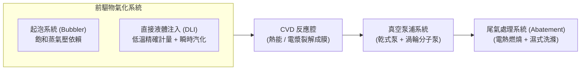

#### 起泡輸送（Bubbler）與直接液體注入（DLI）
1. **起泡輸送系統（Bubbler）**：
   液態前驅物置於控溫恆溫槽內的密閉金屬罐中。將惰性載氣（如高純度 $\text{He}$ 或 $\text{N}_2$）注入液面下方起泡，逸出的飽和蒸氣由載氣夾帶輸出。前驅物的莫耳輸送流率 $\dot{n}_{\text{precursor}}$ 可由道耳吞分壓定律計算：
   $$\dot{n}_{\text{precursor}} = \dot{n}_{\text{carrier}} \cdot \frac{P_{\text{vap}}(T)}{P_{\text{total}} - P_{\text{vap}}(T)}$$
   其中 $P_{\text{vap}}(T)$ 為該溫度下的液體飽和蒸氣壓，$P_{\text{total}}$ 為起泡罐內總壓。此系統之限制在於若前驅物蒸氣壓低，管路必須全程加熱保溫以防冷凝結露（Condensation）；且長期處於高溫環境易導致前驅物預先熱裂解變質。
2. **直接液體注入系統（Direct Liquid Injection, DLI）**：
   針對低揮發性或具熱敏性的前驅物，DLI 採用高壓惰性氣體將液態源壓送至液體質量流量計（Liquid Mass Flow Meter, LFM）進行常溫精確計量。液體在進入汽化室（Vaporizer）時經由微米級噴嘴霧化，隨即接觸加熱表面瞬間閃蒸（Flash Vaporization）為氣態，再由載氣導入腔體。DLI 避免了前驅物長時間處於受熱狀態，顯著提高了化學計量穩定度與再現性。

#### 排氣處理與尾氣洗滌（Effluent Abatement）
CVD 製程排放的未反應廢氣多具自燃性（Pyrophoric，如 $\text{SiH}_4$）、劇毒性（Toxic，如 $\text{AsH}_3$、$\text{WF}_6$）或高溫室效應潛勢（如沉積清洗所用的全氟碳化物 PFCs）。排氣處理架構分為兩階段：
* **前級真空系統**：反應腔排氣首先經過耐腐蝕乾式真空泵（Dry Vacuum Pump）。部分需要高真空的低壓製程會在乾泵前端配置渦輪分子泵（Turbomolecular Pump, TMP）或魯式鼓風機（Roots Blower）。為防止固態副產物（如 $\text{NH}_4\text{Cl}$）在低溫管壁沉澱造成管路堵塞，泵浦排氣前級管路通常配置外加熱套管（Heat Jacket）維持在 $80^\circ\text{C}\text{--}150^\circ\text{C}$。
* **廠務端尾氣洗滌器（Point-of-Use Scrubber）**：廢氣經乾泵排出後直接進入 POU 局部處理裝置。主流技術為燃燒式加濕式洗滌器（Burn-Wet Scrubber）或電漿電熱式洗滌器（Plasma-Thermal Scrubber）。廢氣經極高溫火炬（約 $1200^\circ\text{C}\text{--}1600^\circ\text{C}$）氧化分解後，進入水淋塔進行冷卻並中和酸性氣體（如 $\text{HF}$、$\text{HCl}$），最終達到符合環保法規之排放標準。

---

### 產業主流機台架構與廠商技術分析

在現代晶圓製造廠內，單晶圓製程設備多採行集群式多腔體架構（Cluster Tool）。此架構包含中央大氣傳輸模組（EFEM）、負載互鎖腔（Load-lock）與中央真空傳輸室（Transfer Chamber），周圍掛載數個獨立製程反應腔，兼顧良率防護與設備產能。

#### 主要設備廠商技術路線比較

| 廠商 | 代表產品系列 | 技術路線與特點 | 主要應用 |
| :--- | :--- | :--- | :--- |
| **Applied Materials** | **Producer** 系列 | 雙晶圓（Twin-Chamber）平行處理架構。單一模組共用氣流分流與真空抽氣，單一平台可掛載多達三個雙腔模組（同時處理六片晶圓）。配置電容耦合高頻/低頻雙頻 RF 電漿源。 | 介電質 PECVD、硬光罩層沉積（如非晶碳 APF）、低介電常數（Low-k）材料成膜。 |
| **Lam Research** | **VECTOR** 系列 | 多站序向沉積（Multi-Station Sequential Deposition, MSSD）架構。晶圓在單一真空腔體內的多個製程站（Stations）間依序旋轉定位，分站沉積微量厚度以平均化膜厚與應力。 | 先進邏輯與記憶體之介電質 PECVD、應力調控薄膜、間距倍增（Spacer）沉積。 |
| **Lam Research** | **ALTUS** 系列 | 整合脈衝成核層沉積與連續 CVD 成長腔體。採用低電阻鎢化學氣相技術，結合快速氣體切換與邊界層氣流優化。 | 接觸窗（Contact）、金屬通孔（Via）鎢插塞（Tungsten Plug）及字元線金屬化填充。 |
| **Tokyo Electron** | **TELINDY** 系列 | 批次型垂直微壓爐管架構。具備多區精確電阻加熱與磁流體軸承密封，優化反應氣體分流注氣孔分佈，兼具超大產能與極佳的膜厚均勻性控制。 | 批次 LPCVD 氮化矽（$\text{Si}_3\text{N}_4$）、多晶矽、高溫氧化層（HTO）沉積。 |
| **Tokyo Electron** | **Trias** 系列 | 單晶圓高真空金屬/介電質成膜平台。採用低容積單晶圓腔體設計搭配溫壁式控制，能精準調控快速熱升溫與表面吸附反應。 | 先進節點金屬閘極介面、矽化物前驅金屬薄膜沉積。 |
| **ASM International** | **A400／A412** 系列 | 大型批次垂直爐管系統（A412 為雙反應管設計）。採用直立式熱反應管設計，具備高階溫度梯度模型校正與專用多點氣體進樣系統。 | 邏輯與記憶體前段製程之深溝槽絕緣介電質、高溫摻雜退火及厚介電層 LPCVD。 |

!!! example "產業實例：雙晶圓處理與多站序向沉積架構的取捨"
    在沉積設備的架構設計上，Applied Materials 的 **Producer** 平台與 Lam Research 的 **VECTOR** 平台展現了不同的工程思維：
    
    * **Producer** 採用雙晶圓反應模組設計，每兩片晶圓共享同一個腔體環境、氣體噴淋分配系統與排氣通道，在最小化機台佔地面積（Footprint）的同時使產能加倍。其關鍵在於噴淋頭與加熱承載座的機械對稱性，確保雙邊腔室內的氣體流場完全一致。
    * **VECTOR** 則採用多站序向沉積（MSSD）技術。晶圓進入反應腔後，依次在四個或多個站點完成部分沉積（例如目標厚度為 $100\text{ nm}$，每站沉積 $25\text{ nm}$ 後轉位至下一站）。此架構的物理優勢在於：面內厚度變異可因分站旋轉而相互抵消，同時能在各站動態調整射頻功率與偏壓，有效平滑化整片晶圓的應力分佈，特別適用於極度敏感的超厚硬光罩與高深寬比圖案化覆蓋層。

#### 晶圓廠機台選型之技術考量
半導體製程整合工程師與設備工程師在選擇 CVD 機台時，需權衡下列關鍵指標：
1. **熱預算相容性（Thermal Budget Compatibility）**：前段（FEOL）高介電閘極或金屬閘極完成後，後續沉積製程溫度通常限制在 $400^\circ\text{C}$ 以下以避免摻雜物擴散或介面退化，此時單晶圓 PECVD 成為唯一選擇；而在淺溝槽隔離或閘極氧化層等初始製程，高溫批次型垂直爐管（LPCVD）則能提供缺陷密度最低且化學計量比最優異的緻密薄膜。
2. **應力管理與晶圓彎曲（Stress & Wafer Bowing）**：當沉積微米級厚度的非晶碳硬光罩或低介電層時，薄膜沉積所誘發的應力可能使 300 mm 晶圓產生數百微米的翹曲，導致後續微影製程對焦失敗或傳送破片。具備雙頻 RF 調諧能力（透過高/低頻功率配比切換壓應力與張應力）的 CCP 單晶圓機台在應力調控上具有優勢。
3. **缺陷控制與維護週期（Defectivity & MTBC）**：單晶圓冷壁機台能減少自殘留微粒脫落，但在高深寬比結構填補時，沉積速率與產能相對受限。設備是否支援乾式腔體自清洗（In-situ Chamber Clean，利用微波遠端電漿源將 $\text{NF}_3$ 解離為活性氟自由基進行電漿蝕刻清洗），直接決定了機台的平均預防維修間隔時間（Mean Time Between Cleans, MTBC）與整體設備生產效率。

## 本章重點

*   **CVD 反應機制**：化學氣相沉積涉及氣相質傳與表面異相反應。熱力學決定反應自發性（$\Delta G < 0$），而動力學決定沉積速率與薄膜品質。應嚴格抑制均相氣相反應以避免微粒污染。
*   **Grove 速率模型**：沉積速率受氣相質傳係數（$h_g$）與表面反應速率常數（$k_s$）共同控制。低溫區為表面反應限制區，對溫度極度敏感，具備優異階梯覆蓋率；高溫區為質量傳輸限制區，受流場與邊界層厚度主導。
*   **壓力與平均自由徑**：降低操作壓力（如 LPCVD）可顯著增加氣體平均自由徑與擴散係數，使製程進入表面反應限制區，達成高產能與高均勻度的批次處理。
*   **能量驅動機制**：PECVD 利用非熱平衡電漿的高能電子解離前驅物，大幅降低基板所需熱預算；HDPCVD 結合高密度電漿與物理濺擊，實現高深寬比結構的無空洞填充。
*   **微觀輪廓演化**：階梯覆蓋率受幾何抵達角（遮蔽效應）與前驅物黏著係數（$S_c$）影響。低黏著係數（如 TEOS）有利於分子多次再發射，補償深孔底部的通量不足。
*   **關鍵薄膜化學**：多晶矽沉積受原位摻雜氣體影響速率（$\text{PH}_3$ 抑制，$\text{B}_2\text{H}_6$ 催化）；鎢 CVD 採多步還原法以兼顧成核保護與填孔能力。
*   **設備架構**：批次型垂直爐管適用於高熱預算、高產能製程；單晶圓集群式平台則提供精確的單片溫控與電漿輔助，滿足先進節點的嚴苛要求。


## 重點圖卡

複習時看這幾張就能抓住本章重點；[圖卡庫](../cards.md)可以下載成圖片。

<div class="ix-cards" markdown>

<figure markdown>
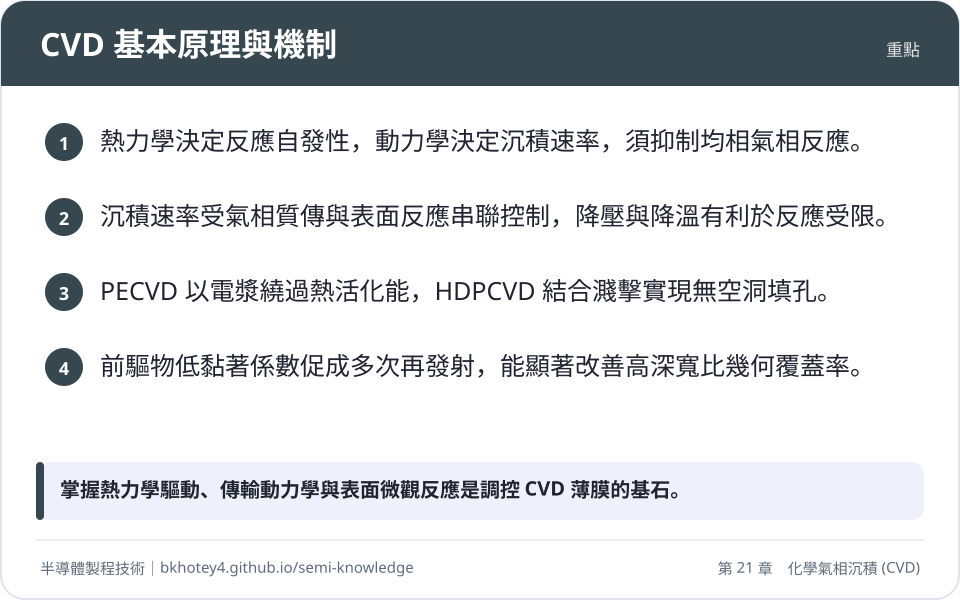
<figcaption>重點圖卡：CVD 基本原理與機制</figcaption>
</figure>

<figure markdown>
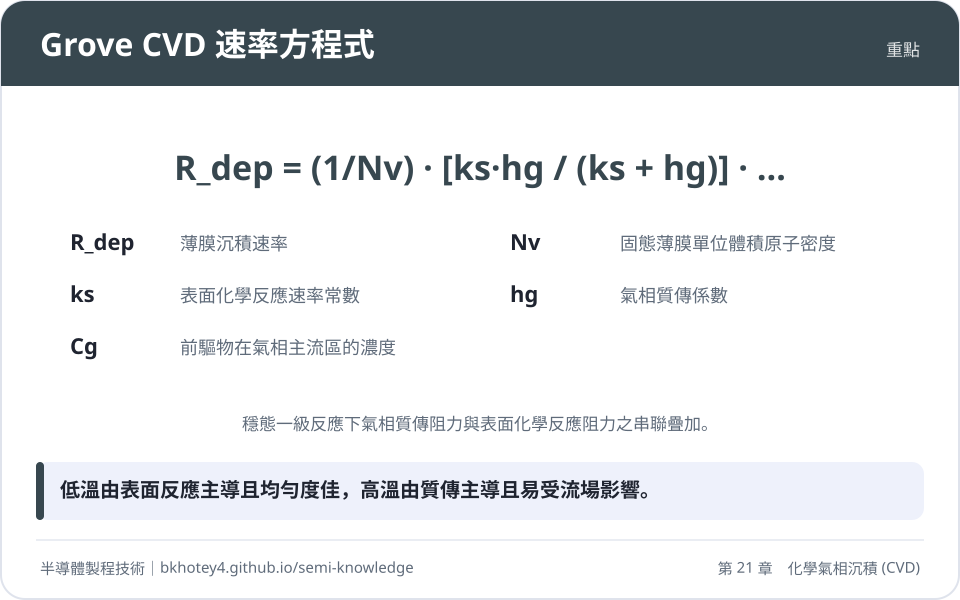
<figcaption>重點圖卡：Grove CVD 速率方程式</figcaption>
</figure>

<figure markdown>
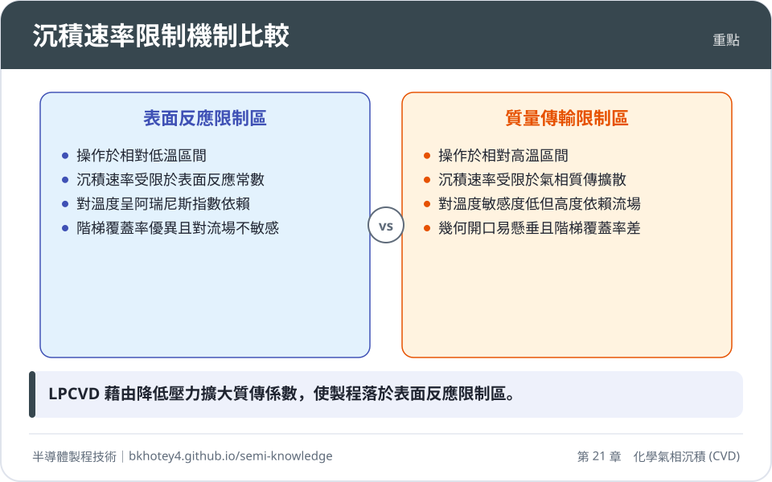
<figcaption>重點圖卡：沉積速率限制機制比較</figcaption>
</figure>

<figure markdown>
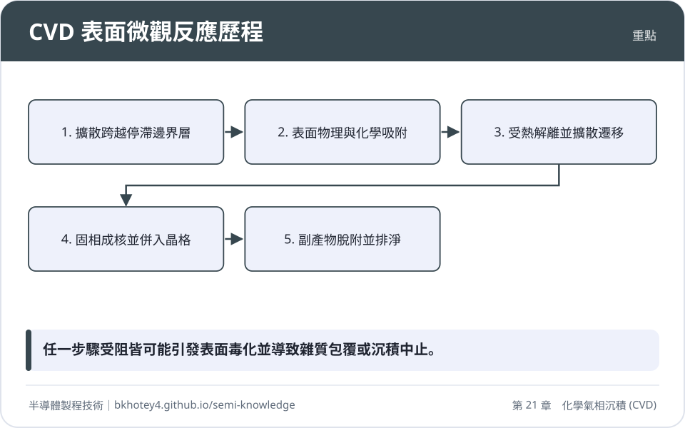
<figcaption>重點圖卡：CVD 表面微觀反應歷程</figcaption>
</figure>

</div>

## 習題

**1.** 試比較「表面反應限制區」（Surface Reaction-Limited）與「質量傳輸限制區」（Mass Transport-Limited）在 CVD 製程中的特性差異。為何低壓化學氣相沉積（LPCVD）通常選擇操作於表面反應限制區？

??? success "參考解答"
    *   **特性差異**：
        1.  **溫度敏感度**：表面反應限制區遵循阿瑞尼斯關係，速率隨溫度呈指數變化（活化能高）；質量傳輸限制區對溫度不敏感（活化能低）。
        2.  **流場依賴性**：表面反應限制區對氣體流速與腔體幾何不敏感；質量傳輸限制區高度依賴邊界層厚度與流場均勻性。
        3.  **階梯覆蓋率**：表面反應限制區因反應物有足夠時間擴散，階梯覆蓋率較佳；質量傳輸限制區易產生懸垂與空洞。
    *   **LPCVD 選擇原因**：在低壓下，氣體擴散係數 $D_{AB}$ 大幅增加，使得質傳速率 $h_g$ 遠大於表面反應速率 $k_s$。這使得製程穩定落在表面反應限制區，即使在晶圓間距極小的批次爐管中，也能藉由精確控溫達成極佳的膜厚均勻度。

**2.** 設一 CVD 反應為一級反應，在 $700^\circ\text{C}$ 時其表面反應速率常數 $k_s = 10\text{ cm/s}$，質傳係數 $h_g = 2\text{ cm/s}$。若前驅物在氣相主流區的濃度 $C_g = 1 \times 10^{15}\text{ molecules/cm}^3$，薄膜之固態原子密度 $N_v = 5 \times 10^{22}\text{ atoms/cm}^3$。請計算此條件下的沉積速率（以 $\text{nm/min}$ 表示），並判斷此反應屬於何種控制機制？

??? success "參考解答"
    1.  根據 Grove 模型公式：$R_{\text{dep}} = \frac{1}{N_v} \left( \frac{k_s h_g}{k_s + h_g} \right) C_g$
    2.  代入數值：
        $R_{\text{dep}} = \frac{1}{5 \times 10^{22}} \left( \frac{10 \times 2}{10 + 2} \right) \times 10^{15} \text{ cm/s}$
        $R_{\text{dep}} = \frac{1}{5 \times 10^{22}} \times 1.667 \times 10^{15} = 3.334 \times 10^{-8} \text{ cm/s}$
    3.  單位換算：
        $3.334 \times 10^{-8} \text{ cm/s} \times (10^7 \text{ nm/cm}) \times (60 \text{ s/min}) = 20.0 \text{ nm/min}$
    4.  **機制判斷**：由於 $k_s (10) > h_g (2)$，且總速率受較小的 $h_g$ 限制較多（$h_g$ 佔主導阻力），此反應屬於「質量傳輸限制區」。

**3.** 解釋何謂「黏著係數」（Sticking Coefficient），並說明其數值大小如何影響高深寬比溝槽的填充品質。

??? success "參考解答"
    *   **定義**：黏著係數 $S_c$ 是指撞擊到基板表面的反應分子中，發生化學反應並永久併入薄膜固相的機率（範圍為 0 到 1）。
    *   **對填充品質的影響**：
        1.  **高 $S_c$（接近 1）**：分子一接觸表面即反應，沉積速率受幾何抵達角（視線）控制。溝槽開口處因抵達角大而生長最快，易形成「懸垂效應」並在結構內部留下「空洞」。
        2.  **低 $S_c$（如 $10^{-3}$ 以下）**：分子撞擊表面後極大機率會發生脫附再發射。分子在深孔內經過多次反彈，能均勻分佈於側壁與底部，抵消遮蔽效應，從而獲得優異的「階梯覆蓋率」與「共形性」。

**4.** 在金屬鎢 CVD 製程中，為何不能直接使用 $\text{H}_2$ 還原 $\text{WF}_6$ 來起始沉積，而必須先進行 $\text{SiH}_4$ 還原步驟？若 TiN 阻障層品質不佳，會引發何種失效現象？

??? success "參考解答"
    *   **原因**：$\text{H}_2$ 還原 $\text{WF}_6$ 的反應在介電質或阻障層表面成核困難（誘導期長）。使用 $\text{SiH}_4$ 還原法能迅速在表面形成一層緻密的鎢成核晶種層，且其反應速率快、不依賴底材特性。
    *   **失效現象**：若 TiN 阻障層有針孔或覆蓋不足，$\text{WF}_6$ 會滲透並與底層的矽或鈦反應。與矽反應會造成「蟲蝕現象」（Encroachment）；與鈦反應生成揮發性 $\text{TiF}_4$ 氣體，壓力積聚會頂破上層薄膜，形成「火山效應」（Volcano Effect），導致接觸電阻飆升或元件失效。

## 本章術語

- **CVD**（化學氣相沉積）：利用氣態前驅物在基板表面發生化學反應以生長固態薄膜的技術。
- **Precursor**（前驅物）：參與 CVD 反應並提供薄膜組成元素的原始氣態化學物質。
- **Boundary Layer**（邊界層）：緊貼晶圓表面、流速與濃度發生劇烈變化的流體滯留層。
- **Surface Reaction-Limited**（表面反應限制）：沉積速率由基板表面化學反應速度決定的機制，通常發生於低溫。
- **Mass Transport-Limited**（質量傳輸限制）：沉積速率由反應物跨越邊界層的擴散速度決定的機制，通常發生於高溫。
- **PECVD**（電漿輔助化學氣相沉積）：利用電漿能量解離前驅物，以降低薄膜沉積所需溫度的製程。
- **HDPCVD**（高密度電漿化學氣相沉積）：結合高密度電漿與連續濺擊蝕刻，用於高深寬比結構無空洞填充的技術。
- **Step Coverage**（階梯覆蓋率）：薄膜在垂直側壁或底部沉積厚度與水平頂部厚度的比值。
- **Sticking Coefficient**（黏著係數）：反應分子撞擊表面後被吸附並發生反應的機率。
- **TEOS**（正矽酸乙酯）：一種常用的液態矽源前驅物，因黏著係數低而具備優異的階梯覆蓋率。
- **Volcano Effect**（火山效應）：鎢 CVD 中因 $\text{WF}_6$ 侵蝕底層材料產生氣體壓力，導致薄膜爆裂的缺陷。
- **Showerhead**（噴淋頭）：單晶圓反應腔中用於均勻分配製程氣體的孔洞狀金屬板。


## 互動學習

!!! tip "動手試試看"
    - [設備機台圖鑑：化學氣相沉積機](../equipment.md)

<div class="quiz" data-quiz="04-04"></div>


## 產業最新進展

本節由每日產業新聞自動補充，說明本章技術在產業上的最新發展。

<!-- updates -->
（目前尚無補充。）
