# 第 22 章　物理氣相沉積 (PVD)

!!! abstract "學習目標"
    - 掌握物理氣相沉積（PVD）中氣相動態碰撞與濺鍍產額（Sputter Yield）之物理機制
    - 理解磁控濺鍍（Magnetron Sputtering）與離子化 PVD（iPVD）如何改善高深寬比結構之階梯覆蓋率
    - 深入分析金屬阻障層與晶種層（Seed Layer）在先進導線結構中的材料選擇與沉積要求
    - 熟悉 PVD 靶材微結構控制、腔體防污染設計與產業主流沉積設備之技術架構

## 22.1 物理氣相沉積與濺鍍物理機制

物理氣相沉積（Physical Vapor Deposition, PVD）是半導體製造中用於沉積金屬、合金及部分化合物薄膜的核心技術。與化學氣相沉積（CVD，見第 21 章）不同，PVD 主要透過物理過程將固態源材料（稱為靶材，Target）轉化為氣態原子或分子，隨後在晶圓表面凝結成膜。在積體電路製程中，PVD 廣泛應用於金屬內連線（Interconnect）、阻障層（Barrier Layer）以及歐姆接觸（Ohmic Contact）的製作。

### 熱蒸鍍與物理濺鍍之比較

PVD 技術主要分為熱蒸鍍（Thermal Evaporation）與物理濺鍍（Physical Sputtering）兩大類。兩者在熱力學與動力學機制上存在顯著差異。

#### 1. 熱蒸鍍（Thermal Evaporation）
熱蒸鍍屬於熱力學驅動過程。透過電阻加熱或電子束（E-beam）撞擊，使靶材溫度升高至熔點或昇華點以上，增加其飽和蒸氣壓。當環境壓力低於蒸氣壓時，原子脫離固體表面進入氣相。
*   **能量狀態**：蒸發原子的平均動能極低，典型值約為 $0.1$ 至 $0.3 \text{ eV}$，相當於 $k_B T$ 的熱能能階。
*   **動力學特性**：原子以直線運動（Line-of-sight）方式抵達晶圓，由於能量低，原子在表面的遷移率（Surface Mobility）較差，導致階梯覆蓋率（Step Coverage）不佳，且薄膜與基板的附著力（Adhesion）較弱。

#### 2. 物理濺鍍（Physical Sputtering）
濺鍍則是動量轉移（Momentum Transfer）驅動的非熱過程。利用高能離子（通常為氬離子 $Ar^+$）轟擊靶材表面，透過原子間的碰撞級聯（Collision Cascade）將動能傳遞給表面原子，使其克服表面束縛能（Surface Binding Energy）而逸出。
*   **能量狀態**：濺鍍原子的平均動能較高，典型值分布在 $1$ 至 $10 \text{ eV}$ 之間，高能尾端甚至可達 $100 \text{ eV}$。
*   **動力學特性**：高能原子撞擊晶圓表面時，具有較高的表面遷移率，且能產生微弱的離子植入效應，顯著提升薄膜附著力與緻密度。

| 特性 | 熱蒸鍍 (Evaporation) | 物理濺鍍 (Sputtering) |
| :--- | :--- | :--- |
| **驅動機制** | 熱能（相變） | 動量轉移（機械碰撞） |
| **原子能量** | 低 ($< 0.5 \text{ eV}$) | 高 ($1 \sim 10 \text{ eV}$) |
| **沉積速率** | 極高 | 中等 |
| **附著力** | 較弱 | 強 |
| **階梯覆蓋率** | 差 | 較佳 |
| **成分控制** | 合金比例難控制（蒸氣壓差異） | 易於維持合金比例 |
| **真空要求** | 極高 ($10^{-6} \sim 10^{-7} \text{ torr}$) | 中等 ($10^{-3} \text{ torr}$ 級別) |

### 濺鍍物理機制與動量轉移

濺鍍過程可類比為「撞球」模型。當入射離子（Incident Ion）撞擊靶材表面時，其動能透過一系列彈性碰撞在固體原子間傳遞。

#### 碰撞級聯（Collision Cascade）
入射離子進入固體後，若其能量足夠高，會連續撞擊多個晶格原子。這些被撞擊的原子若獲得足夠能量，會進一步撞擊其他原子，形成級聯效應。若此級聯反應發生在靠近表面的區域，且最終傳遞回表層原子的動能分量大於表面束縛能，該原子即被濺鍍出來。

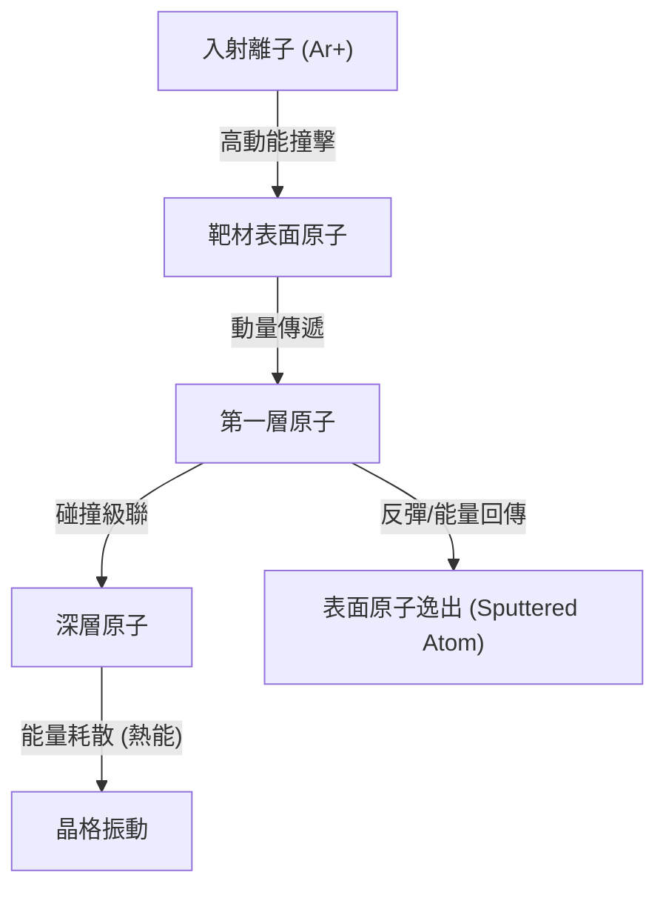

#### 濺鍍產額（Sputter Yield, $Y$）
濺鍍產額是衡量濺鍍效率的核心參數，定義為平均每個入射離子所能濺鍍出的靶材原子數：
$$Y = \frac{\text{濺鍍出的原子數}}{\text{入射的離子數}}$$

根據 Sigmund 的線性級聯理論（Linear Cascade Theory），對於能量在數百 $\text{eV}$ 至數 $\text{keV}$ 範圍內的離子，濺鍍產額 $Y$ 可近似表示為：
$$Y(E) = \frac{3}{4\pi^2} \frac{\alpha(M_t/M_i) S_n(E)}{U_s}$$
其中：
*   $E$：入射離子能量。
*   $U_s$：靶材表面束縛能（典型值接近該元素的昇華熱）。
*   $S_n(E)$：核阻止本領（Nuclear Stopping Power），描述離子與原子核間的能量傳遞效率。
*   $\alpha$：與離子與靶原子質量比（$M_t/M_i$）相關的無因次參數。

**影響產額的主要因素：**
1.  **離子能量**：在低能量區，產額隨能量增加而上升；當能量極高時（$> 10 \text{ keV}$），離子會深入靶材內部，能量耗散在深層，產額反而下降。
2.  **質量匹配**：當入射離子質量 $M_i$ 與靶材原子質量 $M_t$ 接近時，動量轉移效率最高。這也是半導體製程普遍採用氬氣（$Ar, \text{amu} \approx 40$）作為濺鍍氣體的原因，因為其質量與常見金屬（如 $Al, Ti, Cu$）相對匹配且化學性質穩定。
3.  **表面束縛能**：$U_s$ 愈高的材料（如鎢 $W$），愈難被濺鍍。

### 入射能量閾值與角度影響

#### 能量閾值（Threshold Energy, $E_{th}$）
並非所有碰撞都能導致原子逸出。入射離子必須具備最低能量以克服表面束縛能。對於大多數金屬，濺鍍閾值 $E_{th}$ 典型值在 $10$ 至 $30 \text{ eV}$ 之間。若離子能量低於此值，僅會造成靶材表面加熱或離子嵌入，而無原子濺鍍。

#### 入射角度（Angle of Incidence）
入射離子相對於靶材表面法線的角度 $\theta$ 會顯著影響產額。
*   **垂直入射 ($\theta = 0^\circ$)**：離子易深入靶材，能量傳遞至深層。
*   **斜向入射**：隨著 $\theta$ 增加，碰撞級聯更靠近表面，產額隨之上升。
*   **極大角度 ($\theta > 70^\circ \sim 80^\circ$)**：離子容易發生鏡面反射（Specular Reflection）而直接彈離表面，導致產額急劇下降。
因此，產額通常在 $\theta \approx 60^\circ$ 至 $70^\circ$ 時達到最大值。

### 濺鍍原子之物理特性

#### 1. 能量分佈（Energy Distribution）
濺鍍原子的能量分佈遵循 Thompson 分佈。與熱蒸發原子的 Maxwell-Boltzmann 分佈不同，濺鍍原子具有顯著的高能尾部：
$$f(E) \propto \frac{E}{(E + U_s)^3}$$
此公式顯示，分佈的最大值出現在 $E = U_s / 2$。由於 $U_s$ 通常為數 $\text{eV}$，這解釋了為何濺鍍原子的平均能量遠高於熱蒸發。

#### 2. 角度分佈（Angular Distribution）
在低壓環境下，濺鍍原子從靶材表面逸出的角度分佈近似於餘弦定律（Cosine Law）：
$$I(\phi) = I_0 \cos \phi$$
其中 $\phi$ 為脫離表面法線的角度。在實際製程中，根據靶材形狀與離子能量的不同，分佈可能呈現「過餘弦」（Over-cosine，集中於法線方向）或「欠餘弦」（Under-cosine，向兩側擴散）的特徵。

#### 3. 氣相平均自由徑（Mean Free Path, MFP）
濺鍍原子離開靶材後，在到達晶圓前會與背景氣體（$Ar$）發生碰撞。平均自由徑 $\lambda$ 決定了沉積過程的動力學模式：
$$\lambda = \frac{k_B T}{\sqrt{2} \pi d^2 P}$$
其中：
*   $k_B$：波茲曼常數。
*   $T$：絕對溫度。
*   $d$：氣體分子直徑。
*   $P$：腔體壓力。

!!! note "壓力與沉積特性的關係"
    *   **低壓力（$< 1 \text{ mTorr}$）**：$\lambda$ 較長（典型值約數公分），接近或大於靶材至晶圓的距離（Target-to-Substrate Distance）。原子以「彈道傳輸」（Ballistic Transport）為主，保持高能量與方向性。
    *   **高壓力（$> 10 \text{ mTorr}$）**：$\lambda$ 縮短，原子頻繁碰撞而失去方向性與能量，此現象稱為「熱演化」（Thermalization）。這會導致薄膜變得疏鬆，但有利於改善某些複雜形貌的覆蓋。

截至撰寫時，先進邏輯製程（如 $3\text{nm}$ 節點以下）為了確保極高深寬比（High Aspect Ratio）孔洞的底部覆蓋率，製程壓力通常控制在極低範圍，並結合長距離濺鍍（Long Throw Sputtering）技術，以利用長 $\lambda$ 帶來的方向性優勢。

!!! warning "常見誤解：濺鍍是熱熔化過程"
    工程師常誤以為靶材在濺鍍過程中必須熔化。事實上，濺鍍是純粹的動量傳遞。雖然靶材會因為離子轟擊的能量耗散而升溫，但必須透過強力的冷卻水系統將溫度維持在熔點以下，以防止靶材熔毀或蒸氣壓失控導致沉積速率不穩定。

## 22.2 磁控濺鍍與反應式濺鍍技術

在傳統的二極濺鍍（Diode Sputtering）系統中，電漿的維持高度依賴二次電子（Secondary Electrons）與中性氣體分子的碰撞電離。然而，由於電子質量極小，在電場加速下會迅速脫離電漿區並撞擊陽極（或晶圓），導致電離效率低下，且必須在較高的氣體壓力（典型值為 $10^{-2}$ 至 $10^{-1}$ Torr）下才能維持電漿。這不僅限制了薄膜的純度，也因高壓下的散射效應降低了沉積速率。為了克服此限制，現代製程普遍採用磁控濺鍍（Magnetron Sputtering）技術。

### 22.2.1 磁控濺鍍之物理機制：勞侖茲力與電子約束

磁控濺鍍的核心原理是在陰極（靶材）後方設置永久磁鐵或電磁鐵，使靶材表面形成一個與電場方向正交或傾斜的磁場。當電子在電場 $\mathbf{E}$ 中加速時，會受到磁場 $\mathbf{B}$ 產生的勞侖茲力（Lorentz Force）作用：

$$\mathbf{F} = q(\mathbf{E} + \mathbf{v} \times \mathbf{B})$$

其中：
- $q$ 為電子電荷。
- $\mathbf{v}$ 為電子速度向量。
- $\mathbf{E}$ 為電場強度。
- $\mathbf{B}$ 為磁場強度。

在正交電磁場（$\mathbf{E} \perp \mathbf{B}$）的配置下，電子的運動軌跡不再是直線，而是繞著磁力線做螺旋運動（Helical Motion），其迴旋半徑（Larmor Radius）$r_L$ 為：

$$r_L = \frac{m v_{\perp}}{|q| B}$$

其中 $m$ 為電子質量，$v_{\perp}$ 為垂直於磁場的速度分量。這種磁約束機制將電子限制在靶材表面的特定區域內，大幅增加了電子與氬氣（Ar）原子碰撞的平均路徑長度（Mean Free Path）。

!!! note "電漿密度提升機制"
    由於電子被有效約束在靶材附近，電離機率顯著提高，使得電漿密度（Plasma Density）較傳統二極濺鍍提升了 2 至 3 個數量級。這使得製程能在更低的壓力（典型值為 $10^{-3}$ Torr 等級）下維持穩定的電漿，減少了濺鍍原子與背景氣體的碰撞，進而提高薄膜的緻密度與沉積速率。

### 22.2.2 磁場配置與靶材侵蝕區控制

磁控濺鍍的磁場配置直接決定了電漿的分布，進而影響靶材的利用率與薄膜的均勻性。

#### 平面磁控靶材（Planar Magnetron）
在平面磁控系統中，磁鐵通常排列成內外兩圈，極性相反（例如中心為 N 極，外環為 S 極）。磁力線從中心出發，呈拱形彎曲回到外環。在磁力線與靶材表面平行的區域，電子受到的約束最強，電漿密度最高，導致該區域的離子轟擊最為劇烈，形成明顯的環狀凹槽，稱為「侵蝕區」或「跑道」（Erosion Track / Race Track）。

#### 侵蝕區與靶材利用率
平面磁控靶材的主要缺點是侵蝕不均勻。隨著製程進行，侵蝕區會不斷加深，當該處厚度耗盡時，即使其他區域仍有大量材料，靶材也必須報廢。
- **典型值**：傳統靜止式平面靶材的利用率僅約 20% 至 30%。
- **控制策略**：為了改善此問題，現代機台常採用「旋轉磁場」或「移動磁鐵組」設計，透過機械結構讓磁鐵在靶材後方旋轉或往復移動，使侵蝕區在空間上平均化，將利用率提升至 40% 以上。

#### 旋轉磁控靶材（Rotary Magnetron）
在顯示器製程或大面積鍍膜中，常使用圓柱狀的旋轉靶材。靶材本身繞著軸心旋轉，而磁鐵組固定在內部。這種設計使整個圓柱表面輪流進入侵蝕區，靶材利用率可達 70% 至 80% 以上，且能有效減少因局部過熱導致的靶材開裂。

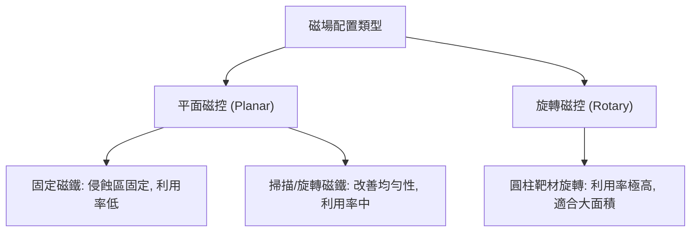

### 22.2.3 反應式濺鍍與薄膜化學計量比控制

反應式濺鍍（Reactive Sputtering）是指在濺鍍氣體（如 Ar）中加入反應性氣體（如 $N_2$、$O_2$、$CH_4$），利用濺鍍出來的金屬原子與反應氣體在基板表面發生化學反應，生成化合物薄膜（如 TiN、$Al_2O_3$、SiC）。

其反應過程可簡化為：
$$M_{(g)} + R_{(g)} \rightarrow MR_{(s)}$$
其中 $M$ 為金屬原子，$R$ 為反應氣體分子。

實現高質量薄膜的關鍵在於控制「化學計量比」（Stoichiometry）。若反應氣體流量不足，薄膜會富含金屬成分，導致電阻率或光學特性偏離預期；若流量過大，則會引發嚴重的「靶材毒化」問題。

### 22.2.4 靶材毒化與遲滯迴路現象

當反應氣體分壓增加到一定程度時，反應氣體不僅與基板反應，也會與靶材表面反應，生成一層薄薄的化合物層（例如在濺鍍鋁時通入氧氣，靶材表面會形成 $Al_2O_3$）。這種現象稱為「靶材毒化」（Target Poisoning）。

#### 毒化後的物理變化
1. **濺鍍產率下降**：化合物（如氧化物）的濺鍍產率（Sputter Yield）通常遠低於純金屬。
2. **二次電子發射係數改變**：化合物表面通常具有較高的二次電子發射率，會改變電漿的阻抗與電壓。
3. **絕緣層電荷累積**：若使用直流（DC）濺鍍，毒化層產生的絕緣膜會導致電荷累積，引發電弧（Arcing）放電，損壞靶材並產生微塵顆粒（Particles）。

#### 遲滯迴路（Hysteresis Loop）
反應式濺鍍存在顯著的遲滯現象。當增加反應氣體流量時，系統會從「金屬模式」（Metallic Mode）突然跳變至「毒化模式」（Poisoned Mode）；而要從毒化模式恢復，必須將流量降低到遠低於跳變點的數值。

!!! warning "常見誤解"
    工程師常認為只要固定氣體流量就能得到穩定的薄膜成分。實際上，在遲滯迴路的過渡區（Transition Region），系統狀態是不穩定的，微小的壓力波動就會導致沉積速率與薄膜性質的劇烈震盪。

#### 閉迴路控制策略
為了在穩定的過渡區內運作（以獲得兼具高沉積速率與正確化學計量比的薄膜），截至撰寫時，先進製程設備通常採用以下閉迴路控制技術：
1. **電漿發射光譜監控（Plasma Emission Monitoring, PEM）**：監控電漿中特定金屬原子的特徵譜線強度。若強度下降，代表靶材開始毒化，系統自動調降反應氣體流量。
2. **靶材電壓監控**：利用金屬與化合物在相同功率下電壓不同的特性，作為反饋訊號。
3. **Lambda 感測器/質譜儀**：直接監測反應氣體的分壓。

### 22.2.5 產業實例：先進 PVD 設備技術

在半導體量產線中，PVD 機台必須具備極高的穩定性與自動化程度。

!!! example "產業實例"
    - **Applied Materials (應用材料)** 的 **Endura** 平台是業界廣泛使用的 PVD 系統。其採用多腔體（Multi-chamber）設計，能在不破壞真空的情況下連續進行預清洗（Pre-clean）、阻障層沉積與金屬填充。其磁控設計包含可程式化移動的磁鐵組，以確保 12 吋晶圓的高度均勻性。
    - **Evatec** 與 **ULVAC** 則在功率元件（如 GaN、SiC）與光電元件領域提供專門的磁控濺鍍解決方案，特別強調對反應式濺鍍中遲滯效應的精密控制，以確保氮化物或氧化物薄膜的折射率與應力穩定。

截至撰寫時，隨著元件特徵尺寸縮小至 3 奈米節點以下，傳統磁控濺鍍在深孔（High Aspect Ratio, HAR）結構中的覆蓋能力已面臨挑戰。這促使了離子化 PVD（Ionized PVD）與高功率脈衝磁控濺鍍（HiPIMS）的發展，透過提高濺鍍粒子的離子化率，利用電場引導粒子進入深孔底部，相關技術將在第 22.3 節詳細討論。

<!-- fig:1 -->
<figure markdown>
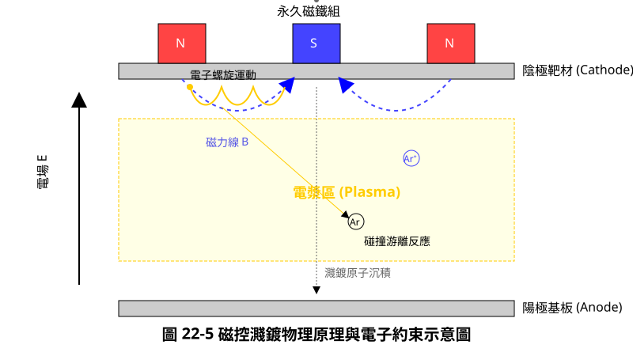
<figcaption>圖 22-1　磁控濺鍍原理示意圖（AI 繪製的示意圖）</figcaption>
</figure>

## 22.3 離子化 PVD 與高方向性沉積技術

在先進製程的導線與接觸孔（Contact）填充中，隨著元件特徵尺寸縮小至奈米等級，深寬比（Aspect Ratio, AR）顯著增加。傳統的物理氣相沉積（PVD）技術面臨嚴峻的幾何限制，導致薄膜在微細孔洞內的覆蓋品質下降。本節將探討如何透過電漿離子化技術，賦予中性金屬原子方向性，以解決高深寬比結構（High Aspect Ratio, HAR）的沉積難題。

### 22.3.1 傳統 PVD 於高深寬比結構之物理限制

傳統的直流磁控濺鍍（DC Magnetron Sputtering）中，靶材表面濺鍍出的金屬原子主要以中性狀態存在，其射出角度遵循餘弦分佈（Cosine Distribution）。當這些原子穿過真空腔體抵達基板時，其運動方向具有高度的隨機性。

對於一個深寬比定義為 $AR = H/W$（其中 $H$ 為孔洞深度，$W$ 為孔洞寬度）的結構，傳統 PVD 會產生以下問題：

1.  **陰影效應（Shadowing Effect）**：由於金屬原子以不同角度入射，孔洞頂部的邊緣會優先截取斜向入射的原子，導致開口處沉積速率高於孔底。
2.  **懸角（Overhang）形成**：隨著沉積進行，孔洞開口處堆積的金屬會向中心延伸，形成「懸角」。這會進一步遮蔽進入孔洞內部的原子路徑。
3.  **階梯覆蓋率（Step Coverage）劣化**：階梯覆蓋率定義為側壁或底部薄膜厚度與頂部平面厚度之比。在 HAR 結構中，傳統 PVD 的底部覆蓋率（Bottom Coverage）往往極低，甚至導致後續電鍍製程出現空洞（Void）。

根據幾何模型，若不考慮散射，進入孔底的通量比例與深寬比成反比。當 $AR > 3:1$ 時，傳統 PVD 已難以提供連續且均勻的阻障層（Barrier Layer）。

### 22.3.2 感應偶合電漿離子化 PVD (ICP-iPVD)

為了克服中性原子的隨機方向性，離子化 PVD（Ionized PVD, iPVD）技術的核心思想是將濺鍍出的金屬原子在抵達基板前轉化為正離子。一旦金屬原子帶電，即可透過在基板施加負偏壓（Substrate Bias），利用電場力引導離子垂直加速進入孔洞深處。

感應偶合電漿離子化 PVD（ICP-iPVD）是實現此目標的常見方式。其結構是在濺鍍靶材與基板之間設置一組感應線圈（RF Coil）。

#### 物理機制與過程

1.  **一級電漿產生**：靶材端的 DC 磁控濺鍍產生高能氬離子（$Ar^+$）轟擊靶材，濺鍍出金屬原子（$M^0$）。
2.  **二級電漿離子化**：金屬原子穿過由 RF 線圈產生的二次高密度電漿區。在此區域，金屬原子與高能電子發生碰撞電離：
    $$M^0 + e^- \rightarrow M^+ + 2e^-$$
    由於金屬原子的電離能（Ionization Potential，如 Cu 為 7.72 eV）通常低於氬氣（15.76 eV），因此在二次電漿中金屬原子極易被離子化。
3.  **基板偏壓導向**：基板被施加射頻偏壓，在基板表面形成鞘層（Sheath）。金屬離子 $M^+$ 進入鞘層後，受垂直向下的電場 $E$ 加速，獲得垂直動能：
    $$E_{ion} = q(V_p - V_{dc})$$
    其中 $V_p$ 為電漿電位，$V_{dc}$ 為基板偏壓。

透過調整 RF 線圈功率與基板偏壓，可以精確控制離子化率（Ionization Fraction）與入射能量，從而顯著提升底部覆蓋率。

### 22.3.3 高功率脈衝磁控濺鍍 (HiPIMS)

截至撰寫時，高功率脈衝磁控濺鍍（High Power Impulse Magnetron Sputtering, HiPIMS）已成為先進邏輯製程中提升薄膜品質的重要技術。與傳統 DC 濺鍍持續施加功率不同，HiPIMS 將能量集中在極短的脈衝時間內（典型值為 $10 \mu s$ 至 $500 \mu s$），並維持較低的脈衝頻率。

#### HiPIMS 的技術優勢

*   **極高的峰值功率與電子密度**：HiPIMS 的峰值功率密度可達 $kW/cm^2$ 等級，比傳統 DC 濺鍍高出兩個數量級。這導致靶材前方產生極高密度的電漿（$n_e \approx 10^{18} - 10^{19} m^{-3}$）。
*   **超高離子化率**：在如此高的電子密度下，濺鍍出的金屬原子離子化比例極高（典型值可達 $50\%$ 至 $90\%$ 以上），而傳統磁控濺鍍僅約 $1\% - 5\%$。
*   **薄膜緻密性改善**：由於入射粒子主要是高能離子，離子轟擊效應（Ion Bombardment）能增加表面擴散能，消除柱狀晶結構，形成極其緻密且平滑的薄膜，這對於擴散阻障層（如 Ta/TaN）的性能至關重要。

!!! note "HiPIMS 的沉積速率挑戰"
    儘管 HiPIMS 提供優異的方向性與薄膜品質，但其平均沉積速率通常低於傳統 DC 濺鍍。這是因為大量金屬離子在電場作用下會被吸回靶材表面（即「離子回流」現象），導致淨產出減少。工程上需透過脈衝波形最佳化來平衡速率與品質。

### 22.3.4 原位再濺鍍 (In-situ Resputtering) 與自濺鍍 (Self-Sputtering)

在極高深寬比（如 $AR > 10:1$）的結構中，僅靠離子導向仍可能在開口處產生懸角。為了進一步修飾薄膜輪廓，先進 PVD 設備引入了原位再濺鍍機制。

#### 原位再濺鍍 (In-situ Resputtering)
當金屬離子或氬離子以高能量轟擊基板時，除了沉積作用外，還會對已沉積的薄膜產生物理蝕刻效果。
*   **懸角修飾**：孔洞開口處的懸角最容易受到離子轟擊而被磨平（Sputter-off）。
*   **物質再分佈**：被再濺鍍下來的金屬原子會重新沉積到孔洞側壁或底部。這種「沉積－蝕刻－再沉積」的動態平衡，能有效改善側壁連續性。

#### 持續自濺鍍 (Sustained Self-Sputtering, SSS)
當金屬離子化率極高且靶材功率足夠大時，濺鍍過程可以脫離氬氣，僅靠金屬離子自身轟擊靶材來維持電漿。
*   **物理原理**：金屬離子 $M^+$ 被加速回靶材，濺鍍出更多 $M^0$，隨後 $M^0$ 再被離子化。
*   **優點**：消除氬氣帶來的散射效應與氣體夾雜問題，進一步提升薄膜純度與方向性。

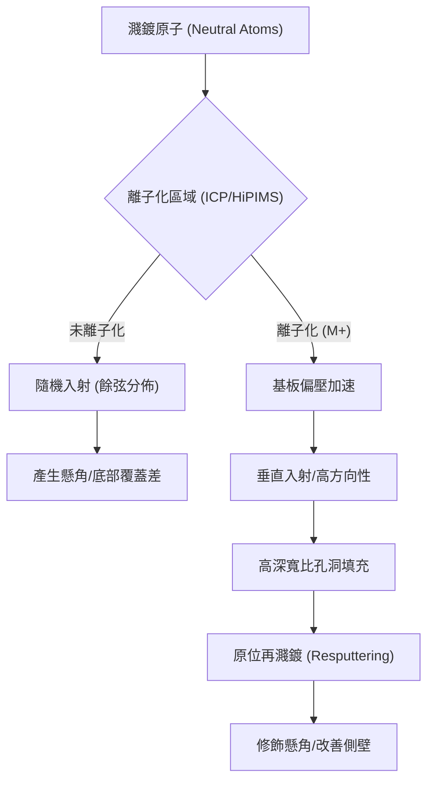

### 22.3.5 三種 PVD 技術的比較

!!! warning "常見誤解：iPVD 與 CVD 的競爭"
    雖然 iPVD 改善了方向性，但在極端深寬比（如 3D NAND 的通道孔）中，其階梯覆蓋率仍遜於化學氣相沉積（CVD）或原子層沉積（ALD）。iPVD 的優勢在於其能提供極高純度的金屬薄膜且介面電阻較低，因此在金屬導線層（Interconnects）仍具備不可替代性。

| 技術特性 | 傳統磁控濺鍍 | ICP-iPVD | HiPIMS |
| :--- | :--- | :--- | :--- |
| **離子化率** | 極低 (< 5%) | 中至高 (10-50%) | 極高 (> 50%) |
| **方向性控制** | 差 (幾何限制) | 優 (藉由偏壓控制) | 極優 |
| **薄膜密度** | 一般 | 高 | 極高 |
| **熱負荷** | 低 | 中 | 高 (需冷卻最佳化) |
| **主要應用** | 粗大尺寸導線、封裝 | 先進製程阻障層 | 奈米級接觸孔、硬掩模 |

透過離子化技術的引入，PVD 從傳統的「視線沉積」（Line-of-sight deposition）演進為受電場調控的精密加工技術，這使得物理氣相沉積在摩爾定律延伸至埃米（Angstrom）尺度時，依然是不可或缺的薄膜製程手段。

<!-- fig:2 -->
<figure markdown>
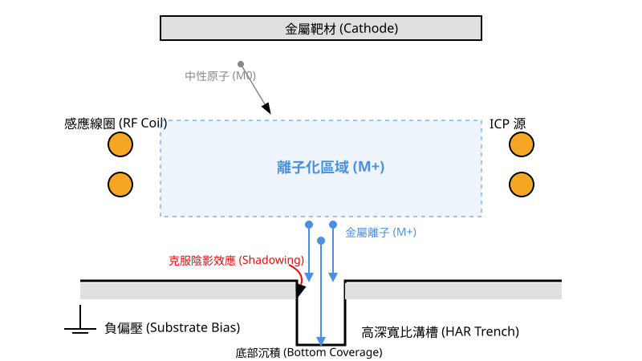
<figcaption>圖 22-2　離子化 PVD 沉積機制（AI 繪製的示意圖）</figcaption>
</figure>

## 22.4 阻障層與晶種層沉積應用

在積體電路後段製程（BEOL）中，物理氣相沉積（PVD）最核心的應用在於導線系統的「阻障層」（Barrier Layer）與「晶種層」（Seed Layer）。隨著元件特徵尺寸微縮至亞 5 奈米節點，導線寬度已縮減至數十奈米以下，這使得薄膜的連續性、結晶取向以及介面附著力成為決定導線電性可靠度與延遲（RC Delay）的關鍵因素。

### 22.4.1 傳統金屬阻障層：Ti/TiN 與 Ta/TaN

阻障層的主要功能是防止金屬原子（如鋁或銅）擴散進入介電層（如二氧化矽或 Low-k 材料）中，同時避免金屬與矽發生反應形成矽化物。此外，阻障層還必須兼具附著層（Adhesion Layer）的功能，確保金屬導線與介電層之間具備足夠的機械強度。

#### Ti/TiN 阻障層系統
在傳統的鋁（Al）導線製程或鎢栓塞（W-plug）製程中，通常採用 Ti/TiN 雙層結構。
- **鈦（Ti）層**：主要作為附著層，並能還原介電層表面的殘留氧化物，形成良好的歐姆接觸。
- **氮化鈦（TiN）層**：作為擴散阻障。TiN 具有高熔點與高化學穩定性。

#### Ta/TaN 阻障層系統
在銅（Cu）鑲嵌製程（Damascene Process）中，由於銅原子在二氧化矽中的擴散係數極高，且會造成矽元件的深能階污染，因此需要更強大的阻障層。鉭（Ta）與氮化鉭（TaN）是截至撰寫時最主流的選擇。

1.  **TaN 的阻絕機制**：TaN 通常以非晶質（Amorphous）或微晶質（Nanocrystalline）狀態存在。由於非晶質結構缺乏長程有序的晶界（Grain Boundary），能有效阻斷原子沿著晶界擴散的「高速公路」路徑。
2.  **Ta 的結晶相控制**：Ta 層沉積於 TaN 之上，其主要目的是作為銅晶種層的過渡層。Ta 存在兩種主要的結晶相：
    - **$\alpha$-Ta（體心立方，BCC）**：電阻率較低（約 15–30 $\mu\Omega\cdot\text{cm}$），且與銅的晶格匹配較佳。
    - **$\beta$-Ta（四方晶系，Tetragonal）**：電阻率極高（約 150–200 $\mu\Omega\cdot\text{cm}$），且性質脆硬。
    在 PVD 製程中，透過調整基板偏壓與反應氣體比例，優先生成 $\alpha$-Ta 是降低導線總電阻的關鍵。

### 22.4.2 銅晶種層（Cu Seed）之沉積技術

在進行電化學沉積（ECD, 見第 29 章）填滿溝槽之前，必須先以 PVD 沉積一層連續且高導電性的銅晶種層。

#### 連續性與步階覆蓋率
隨著溝槽寬度變窄、深寬比（Aspect Ratio）增加，PVD 沉積面臨嚴峻挑戰。若晶種層在溝槽側壁出現不連續（Discontinuity）或「懸垂」（Overhang）現象，將導致後續電鍍製程產生空洞（Void）。
- **解決方案**：利用離子化 PVD（iPVD）技術，增加銅離子的方向性，並配合原位（In-situ）重流（Reslow）或偏壓濺鍍，使銅原子能更均勻地分佈於側壁。

#### 結晶擇優取向（Texture）
銅導線的抗電遷移（Electromigration, EM）能力與其結晶取向高度相關。實驗證實，具有 (111) 擇優取向的銅薄膜具備最佳的原子堆積密度，能有效抑制原子在電場驅動下的遷移。
PVD 沉積銅晶種層時，下方 Ta 層的表面能與晶格常數會誘導銅的成核方向。透過最佳化 PVD 參數，可使銅晶種層呈現強烈的 (111) 取向，其擇優取向程度通常以 X 光繞射（XRD）的強度比值來定義：
$$TC(hkl) = \frac{I(hkl) / I_0(hkl)}{\frac{1}{N}\sum_{N} I(hkl) / I_0(hkl)}$$
其中 $I(hkl)$ 為實測強度，$I_0(hkl)$ 為標準粉末繞射強度，$N$ 為納入計算的繞射峰數目。無擇優取向時 $TC = 1$，數值大於 1 表示該取向較強。

### 22.4.3 新一代阻障層與無晶種層技術

當製程節點進入 3 奈米以下，傳統 Ta/TaN 阻障層的厚度（典型值 2–3 nm）佔據了過多的溝槽空間，導致有效導電截面積縮減，電阻急劇上升。

#### 鈷（Co）與釕（Ru）阻障層
截至撰寫時，業界正積極導入鈷（Co）或釕（Ru）作為新型阻障層或襯墊層（Liner）。
- **鈷（Co）**：具備良好的濕潤性（Wetting），能讓銅在較高溫度下重流，填滿極細微的孔洞。
- **釕（Ru）**：具有極高的熔點與優異的抗擴散能力。最重要的是，Ru 與 Cu 的介面結合力極強。

#### 直接電鍍（Direct Plating）
釕（Ru）具備足夠的導電性，且不易在空氣中形成厚重的絕緣氧化層。這使得製程可以跳過 PVD 銅晶種層，直接在 Ru 阻障層上進行電鍍，即「無晶種層電鍍」。
- **優點**：節省空間、簡化製程、減少介面電阻。
- **挑戰**：Ru 膜的均勻性必須極高，以確保全片晶圓的電位分佈一致。

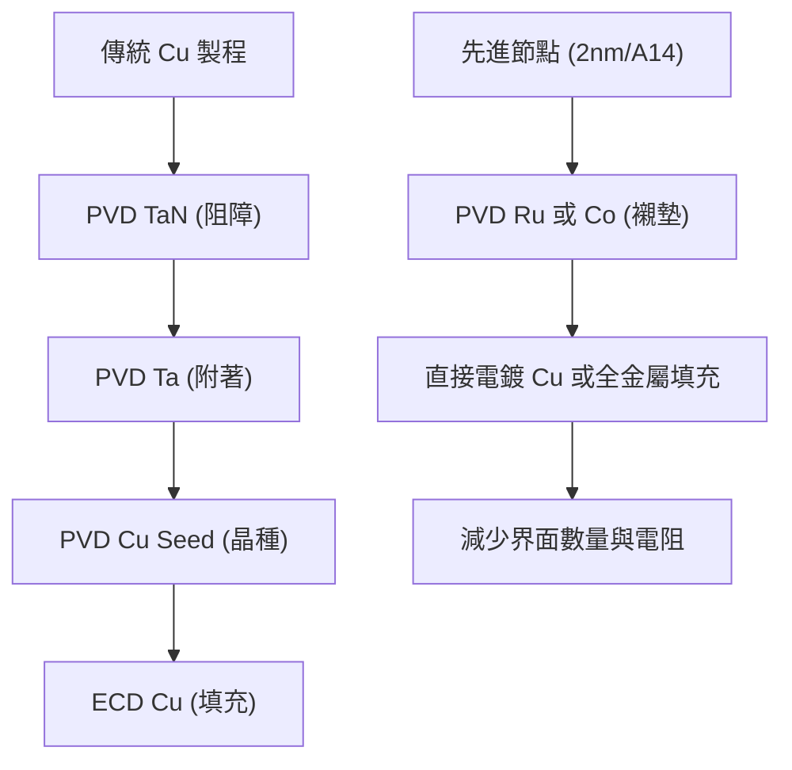

### 22.4.4 薄膜殘留應力與附著力優化

PVD 屬於高能粒子撞擊過程，沉積出的薄膜通常帶有顯著的殘留應力（Residual Stress），這會影響晶圓的平坦度（Warp/Bow）及介面可靠度。

#### 殘留應力控制
薄膜總應力 $\sigma_{total}$ 由內應力（Intrinsic Stress）與熱應力（Thermal Stress）組成：
$$\sigma_{total} = \sigma_{i} + \sigma_{th}$$
- **內應力**：源於 PVD 過程中的原子撞擊（Atomic Peening）。高能離子撞擊會將原子擠入晶格間隙，產生壓應力（Compressive Stress）；若沉積能量較低，原子排列疏鬆，則可能產生張應力（Tensile Stress）。
- **熱應力**：源於薄膜與基板間熱膨脹係數（CTE）的差異：
$$\sigma_{th} = \frac{E_f}{1-\nu_f} \int_{T_1}^{T_2} (\alpha_s - \alpha_f) dT$$
其中 $E_f$ 為薄膜楊氏模數，$\nu_f$ 為帕松比，$\alpha_s$ 與 $\alpha_f$ 分別為基板與薄膜的 CTE。

#### 附著力（Adhesion）優化
異質介面的附著力決定了元件在後續化學機械研磨（CMP）製程中是否會發生剝落（Peeling）。
- **物理錨定**：透過濺鍍前的等離子體清洗（Pre-clean），去除表面氧化物並增加微觀粗糙度。
- **化學鍵結**：如 Ti 或 Ta 能與介電層中的氧原子形成強大的金屬-氧鍵結。
- **應力匹配**：若阻障層應力過大，會在介面處產生剪切力，導致分層。因此，製程中常透過調整濺鍍壓力（Pressure）來平衡應力。一般而言，提高氣體壓力會增加碰撞頻率，降低到達基板的粒子能量，使應力由壓應力轉向張應力。

!!! note "製程實務：應力與壓力的關係"
    在 PVD 設備調校中，存在一個「零應力轉換壓力」（Zero-stress Transition Pressure）。工程師通常會尋找此壓力點，以確保在大面積沉積時，薄膜不會導致晶圓過度彎曲，進而影響後續微影對準。

## 22.5 設備與廠商技術

在物理氣相沉積（PVD）製程中，設備的設計與材料的選用直接決定了薄膜的純度、均勻性以及缺陷密度。本節將探討高純度靶材的冶金要求、反應腔體的關鍵子系統，以及當前先進製程中所採用的叢集式系統架構。

### 22.5.1 高純度 PVD 靶材冶金技術

靶材（Target）是 PVD 製程的物質來源，其物理特性與冶金品質對沉積薄膜的電學性能與可靠度至關重要。

**1. 純度要求**
半導體級靶材的純度通常要求在 99.999%（5N）至 99.9999%（6N）以上。雜質元素（如鹼金屬 Na、K 或放射性元素 U、Th）必須嚴格控制在 ppb（十億分之一）等級，以避免造成元件的電性漂移或軟錯誤（Soft Error）。

**2. 晶粒尺寸（Grain Size）與均勻性**
靶材是由多晶金屬組成，其晶粒尺寸會影響濺鍍速率與薄膜的均勻性。
- **典型值**：先進製程靶材的平均晶粒尺寸通常控制在 100 $\mu m$ 以下。
- **物理機制**：若晶粒尺寸過大或分佈不均，濺鍍過程中不同晶向的濺鍍產率（Sputtering Yield）差異會導致靶材表面出現不規則沖蝕（Erosion），進而產生微細顆粒（Particles）並降低薄膜的厚度均勻性。

**3. 晶向分佈（Crystallographic Orientation）**
金屬原子的濺鍍產率與其晶體結構的取向密切相關。例如，對於面心立方（FCC）結構的金屬（如鋁、銅），其 $<111>$ 晶向通常具有較高的濺鍍效率。透過冶金壓延與熱處理製程，使靶材具備高度一致的織構（Texture），可確保在整個靶材壽命週期內，濺鍍速率保持穩定。

### 22.5.2 反應腔體設計與顆粒控制

PVD 反應腔體（Chamber）必須在極高真空環境下運作，並具備精密的機械結構以減少污染。

**1. 防污染遮罩（Shield）系統**
在濺鍍過程中，並非所有被擊出的原子都會沉積在晶圓上，大量金屬會散佈在腔體內壁。
- **功能**：遮罩系統用於保護腔體主體不被金屬污染。遮罩表面通常經過噴砂或特殊粗糙化處理，以增加金屬薄膜的附著力。
- **顆粒控制**：隨著沉積厚度增加，遮罩上的薄膜可能因熱應力而剝落（Flaking），形成顆粒污染。因此，遮罩屬於耗材，需定期更換。

**2. 磁鐵陣列（Magnet Array）**
磁控濺鍍（見第 22.2 節）依賴磁場束縛電子。
- **設計**：為了提高靶材利用率（Utilization Rate）並確保沉積均勻性，現代 PVD 設備採用旋轉式磁鐵陣列（Rotating Magnet）或掃描式磁鐵，透過動態改變磁場分佈，使靶材表面受到的沖蝕更加均勻。

**3. 超高真空（UHV）維持機制**
PVD 製程對殘餘氣體（如氧、水氣）極為敏感，因為這些氣體會與金屬反應形成高電阻的氧化物。
- **真空度**：本底壓力（Base Pressure）通常需達到 $10^{-8}$ 至 $10^{-9}$ Torr。
- **設備實作**：系統配備低溫幫浦（Cryopump）以有效抽除水氣與空氣成分。在晶圓進入沉積腔體前，會先經過脫氣（Degas）腔體，利用加熱方式去除晶圓表面吸附的水分子。

### 22.5.3 叢集式系統（Cluster Tool）架構

為了維持介面潔淨並提高產能，PVD 設備採用叢集式架構，將多個製程模組整合在同一個真空傳送平台下。

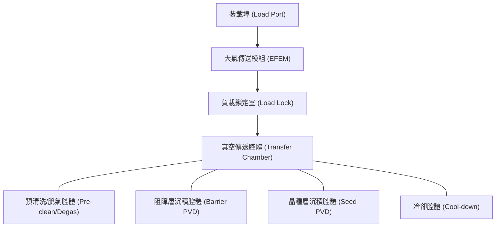

在先進導線製程中，晶圓在不接觸大氣的情況下，依序完成表面氧化物去除（Pre-clean）、阻障層沉積（如 Ta/TaN）與晶種層沉積（如 Cu Seed），這對於確保金屬層間的接觸電阻（Contact Resistance）至關重要。

### 22.5.4 廠商技術比較

截至撰寫時，全球 PVD 設備市場由少數領導廠商佔據，其技術核心在於如何在高深寬比（High Aspect Ratio）結構中實現優異的覆蓋率（Coverage）。

| 廠商 | 代表產品系列 | 技術路線與特點 | 主要應用 |
| :--- | :--- | :--- | :--- |
| Applied Materials | Endura 平台系列 | 採用多腔體叢集設計，具備高度靈活的配置能力。其離子化 PVD 技術能有效控制金屬離子入射角度。 | 邏輯與記憶體元件之阻障層、晶種層、鋁導線與矽化物製程。 |
| Tokyo Electron | Trias 系列 | 專注於單晶圓成膜技術，強調腔體內的熱場與流場均勻性控制。 | 先進金屬化製程、特定金屬氮化物沉積。 |
| Lam Research | — | PVD 並非其主力產品線；在金屬化流程中主要提供銅電鍍（SABRE）與鎢化學氣相沉積（ALTUS），與 PVD 阻障層、晶種層搭配完成導線與插塞的填充。 | 銅導線電鍍填充、鎢接觸插塞。 |

!!! note "產業實例：Applied Materials Endura 平台"
    Endura 平台是半導體工業界極為成功的 PVD 設備之一。截至撰寫時，該平台透過整合離子化物理氣相沉積（iPVD）技術，解決了 7 奈米以下節點中，銅導線通孔（Via）底部的覆蓋率問題。其設計允許在同一個真空環境下完成原位（In-situ）預清洗與連續金屬薄膜沉積，極大地降低了介面電阻。

### 22.5.5 選機考量與技術演進

晶圓廠在選擇 PVD 設備時，主要考量以下技術指標：

1.  **階梯覆蓋率（Step Coverage）與底部覆蓋率（Bottom Coverage）**：在深孔結構中，底部薄膜厚度與場區（Field）厚度的比值。
2.  **顆粒水平（Particle Performance）**：設備在連續運行數千片晶圓後，產生的微米級顆粒數量是否符合良率要求。
3.  **產出量（Throughput）**：每小時處理的晶圓數量（WPH），這取決於沉積速率與傳送機構的效率。
4.  **維護週期（MTBC）**：靶材與遮罩更換的頻率，直接影響工廠的營運成本。

隨著元件微縮至 3 奈米節點以下，傳統 PVD 面臨嚴峻挑戰。由於物理限制，PVD 在極窄溝槽中的懸垂（Overhang）效應會導致後續電鍍製程產生空洞（Void）。因此，技術演進方向正朝向「PVD 與 ALD 混成製程」發展，利用 ALD（見第 23 章）的高共形性（Conformality）來補足 PVD 的不足。

## 本章重點

*   物理氣相沉積（PVD）主要分為熱蒸鍍與物理濺鍍。濺鍍是基於動量轉移的非熱過程，其產生的原子動能（典型值 $1 \sim 10 \text{ eV}$）遠高於熱蒸鍍，有利於提升薄膜附著力與緻密度。
*   濺鍍產額（Sputter Yield）受入射離子能量、離子與靶材之質量匹配、以及入射角度影響。當離子與靶材原子質量接近時，動量轉移效率最高，故製程常採用氬氣作為濺鍍氣體。
*   磁控濺鍍利用勞侖茲力產生的電子約束效應，大幅提升電漿密度，使製程能在較低壓力（典型值 $10^{-3} \text{ Torr}$ 級別）下維持穩定，並提高沉積速率與薄膜純度。
*   反應式濺鍍用於製備化合物薄膜，但需嚴格控制反應氣體流量以避免「靶材毒化」與遲滯迴路現象，現代設備多採用閉迴路控制系統監控電漿光譜或靶材電壓。
*   離子化 PVD（iPVD）與高功率脈衝磁控濺鍍（HiPIMS）透過提高金屬原子的離子化率，配合基板偏壓引導離子垂直入射，解決高深寬比結構中的階梯覆蓋率與懸角問題。
*   在銅導線製程中，PVD 用於沉積 Ta/TaN 阻障層與 Cu 晶種層。薄膜的結晶取向（如 Cu (111)）與殘留應力控制對元件的抗電遷移能力與介面可靠度至關重要。
*   高純度靶材（5N 以上）的晶粒尺寸與織構均勻性是確保濺鍍速率穩定與減少微細顆粒污染的關鍵冶金指標。

## 重點圖卡

複習時看這幾張就能抓住本章重點；[圖卡庫](../cards.md)可以下載成圖片。

<figure markdown>
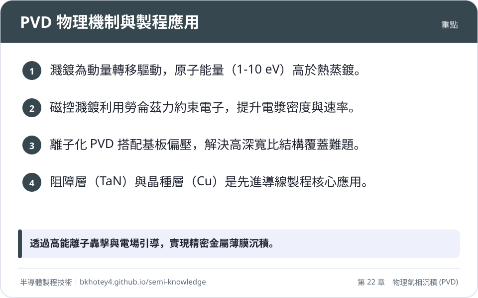
<figcaption>重點圖卡：PVD 物理機制與製程應用</figcaption>
</figure>

<figure markdown>
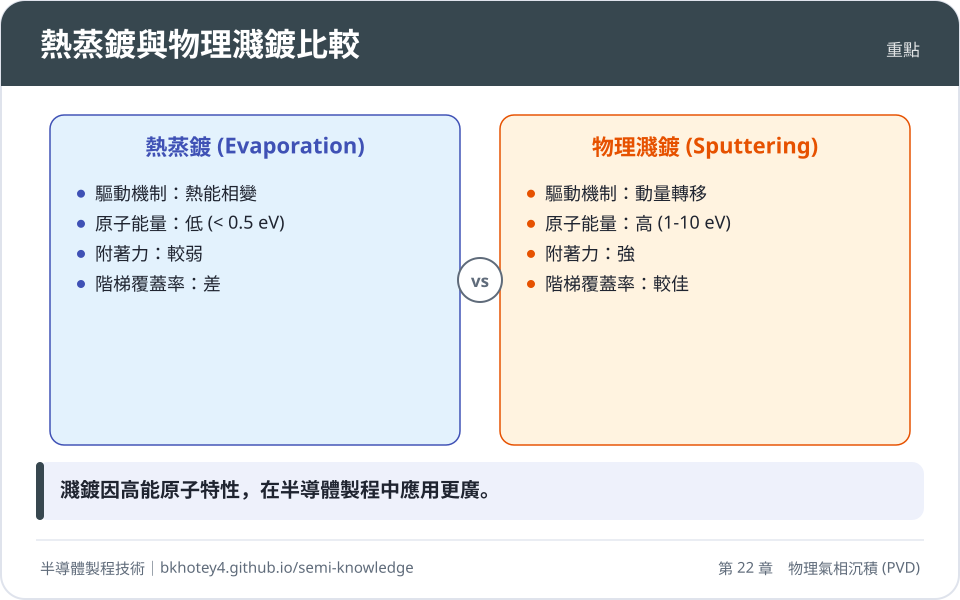
<figcaption>重點圖卡：熱蒸鍍與物理濺鍍比較</figcaption>
</figure>

<figure markdown>
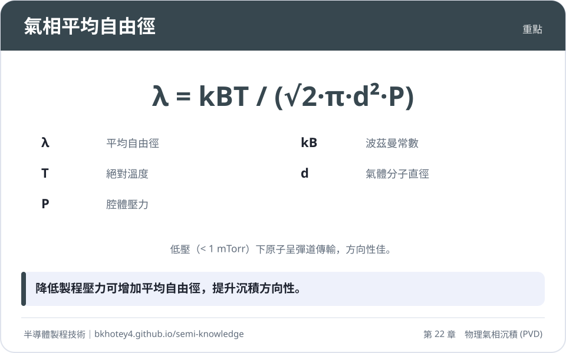
<figcaption>重點圖卡：氣相平均自由徑</figcaption>
</figure>

<figure markdown>
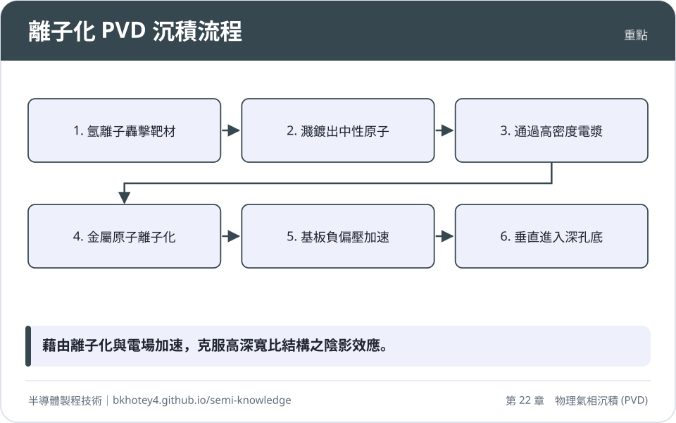
<figcaption>重點圖卡：離子化 PVD 沉積流程</figcaption>
</figure>

## 習題

**1.** 試比較熱蒸鍍（Thermal Evaporation）與物理濺鍍（Physical Sputtering）在原子能量、薄膜附著力以及合金成分控制能力上的差異，並說明其物理原因。

??? success "參考解答"
    *   **原子能量**：熱蒸鍍原子能量極低（典型值 $< 0.5 \text{ eV}$），僅具備熱能；濺鍍原子能量較高（典型值 $1 \sim 10 \text{ eV}$），源於高能離子的動量轉移。
    *   **附著力**：濺鍍薄膜附著力較強。原因在於高能原子撞擊表面時具有較高表面遷移率，且能產生微弱的離子植入效應（Atomic Peening）。
    *   **成分控制**：濺鍍易於維持合金比例；熱蒸鍍難以控制。原因在於不同金屬的蒸氣壓隨溫度變化差異巨大，導致蒸發速率不一，而濺鍍是物理碰撞，產額相對穩定。

**2.** 已知在 $25^\circ\text{C}$ 下，氬氣分子的直徑 $d \approx 0.36 \text{ nm}$。若 PVD 腔體壓力分別為 $1 \text{ mTorr}$ 與 $10 \text{ mTorr}$，試計算其平均自由徑（Mean Free Path, $\lambda$）。（波茲曼常數 $k_B = 1.38 \times 10^{-23} \text{ J/K}$，$1 \text{ Torr} = 133.3 \text{ Pa}$）

??? success "參考解答"
    根據公式 $\lambda = \frac{k_B T}{\sqrt{2} \pi d^2 P}$：
    1.  將溫度轉換為絕對溫度：$T = 25 + 273.15 = 298.15 \text{ K}$。
    2.  當 $P = 1 \text{ mTorr} = 0.1333 \text{ Pa}$：
        $\lambda = \frac{1.38 \times 10^{-23} \times 298.15}{\sqrt{2} \times \pi \times (0.36 \times 10^{-9})^2 \times 0.1333} \approx 0.053 \text{ m} = 5.3 \text{ cm}$。
    3.  當 $P = 10 \text{ mTorr} = 1.333 \text{ Pa}$：
        由於 $\lambda \propto 1/P$，故 $\lambda = 5.3 \text{ cm} / 10 = 0.53 \text{ cm}$。
    此計算顯示低壓下原子呈彈道傳輸，高壓下則頻繁碰撞。

**3.** 說明磁控濺鍍（Magnetron Sputtering）中，磁場配置如何影響靶材的「侵蝕區」（Erosion Track）分佈，並解釋為何傳統平面磁控靶材的利用率較低。

??? success "參考解答"
    在磁控濺鍍中，電子受勞侖茲力作用繞磁力線做螺旋運動，被約束在磁力線與靶材表面平行的區域。此區域的電漿密度最高，導致離子轟擊最劇烈，形成環狀的侵蝕區（跑道）。由於電漿分佈不均勻，沖蝕僅集中在特定環帶，當該處靶材厚度耗盡時，其他區域仍有大量材料殘留，故傳統靜止式靶材利用率僅約 20%~30%。

**4.** 何謂反應式濺鍍中的「靶材毒化」（Target Poisoning）？其對沉積速率與製程穩定性有何影響？

??? success "參考解答"
    靶材毒化是指反應氣體（如 $O_2, N_2$）流量過大時，在靶材表面生成化合物層（如氧化鋁、氮化鈦）的現象。
    *   **沉積速率**：由於化合物的濺鍍產額通常遠低於純金屬，導致沉積速率劇烈下降。
    *   **穩定性**：毒化會引發遲滯迴路現象，使系統在金屬模式與毒化模式間跳變，導致薄膜成分與厚度難以精確控制，且絕緣毒化層易引發電弧放電。

**5.** 在先進銅導線製程中，為何需要使用離子化 PVD（iPVD）或 HiPIMS 技術？其與基板偏壓（Substrate Bias）的配合原理為何？

??? success "參考解答"
    隨著深寬比（AR）增加，中性原子的隨機入射會導致孔洞開口形成懸角並遮蔽孔底。iPVD 或 HiPIMS 透過高密度電漿將金屬原子離子化。當基板施加負偏壓時，會在表面形成垂直向下的電場，引導帶正電的金屬離子垂直加速進入深孔底部，從而大幅提升底部覆蓋率並消除空洞。

## 本章術語

- **PVD**（物理氣相沉積）：透過物理過程（如加熱或離子轟擊）將固態材料轉化為氣態並沉積於基板成膜的技術。
- **Sputter Yield**（濺鍍產額）：平均每個入射離子從靶材表面濺鍍出的原子數量。
- **Collision Cascade**（碰撞級聯）：高能離子撞擊固體時，動能在晶格原子間連續傳遞的一系列碰撞過程。
- **Magnetron Sputtering**（磁控濺鍍）：利用正交電磁場約束電子以提高電漿密度與沉積速率的濺鍍技術。
- **Target Poisoning**（靶材毒化）：反應式濺鍍中，反應氣體與靶材表面結合形成化合物層，導致產額下降的現象。
- **HiPIMS**（高功率脈衝磁控濺鍍）：利用極高功率脈衝產生高密度電漿，以實現高金屬離子化率的先進濺鍍技術。
- **Step Coverage**（階梯覆蓋率）：薄膜在階梯側壁或孔洞底部的厚度與頂部平面厚度的比值。
- **Barrier Layer**（阻障層）：用於防止金屬原子擴散至介電層或矽基材中的功能薄膜層（如 TiN, TaN）。
- **Seed Layer**（晶種層）：在電鍍前預先沉積的薄金屬層，用以提供導電路徑與誘導結晶生長。
- **Mean Free Path**（平均自由徑）：氣體分子或原子在兩次連續碰撞之間所行經的平均距離。

## 互動學習

!!! tip "動手試試看"
    - [設備機台圖鑑：物理氣相沉積機（濺鍍）](../equipment.md)

## 產業最新進展

本節由每日產業新聞自動補充，說明本章技術在產業上的最新發展。

<!-- updates -->
（目前尚無補充。）
