# 第 23 章　原子層沉積 (ALD) 與原子層蝕刻 (ALE)

!!! abstract "學習目標"
    - 理解原子層沉積 (ALD) 的自限性表面吸附反應熱力學與沉積動力學原理
    - 比較熱 ALD (Thermal ALD) 與電漿輔助 ALD (PEALD) 在反應能量、製程溫度及薄膜特性之差異
    - 掌握原子層蝕刻 (ALE) 表面化學修飾與粒子輔助脫附的循環機制與自限特性
    - 分析 ALD 與 ALE 在全環繞閘極電晶體 (GAAFET) 與高介電常數閘極結構中的關鍵整合挑戰
    - 認識時間型、空間型 ALD 反應器與原子級製程機台設計原則及產業實例

## 23.1 原子層沉積基本原理與自限性反應機制

### 23.1.1 ALD 技術定位與 CVD 之本質區別

在半導體元件微縮至奈米尺度後，薄膜沉積的均勻性（Uniformity）與階梯覆蓋率（Step Coverage）成為製程成敗的關鍵。原子層沉積（Atomic Layer Deposition, ALD）技術被視為化學氣相沉積（Chemical Vapor Deposition, CVD，見第 21 章）的一種特殊變體，但其物理化學機制與傳統 CVD 有著本質上的差異。

傳統 CVD 是將多種反應氣體同時通入反應腔體，在加熱的基板表面發生連續的化學反應。其成長速率受限於氣體擴散速率（Mass-transport limited）或表面反應動力學（Surface-kinetics limited）。相較之下，ALD 則是將反應過程拆解為數個連續且交替的自限性表面反應步驟。

兩者之核心差異彙整如下：

1.  **反應物接觸方式**：CVD 的前驅物（Precursors）與共反應物（Co-reactants）在氣相中混合並同時到達基板；ALD 則透過時間上的隔離，確保不同反應物在氣相中不相遇。
2.  **成長控制機制**：CVD 的膜厚由沉積時間與氣體流量精確控制，通常具有較高的成長速率；ALD 的膜厚則由「循環次數」決定，具有原子級的精確度。
3.  **階梯覆蓋率**：在高深寬比（Aspect Ratio）的溝槽結構中，CVD 易因氣體擴散限制導致開口處沉積較厚、底部較薄（見第 21.3 節）；ALD 則因表面飽和吸附特性，能在複雜的三維結構上實現近乎 100% 的保形性（Conformality）。

### 23.1.2 表面化學吸附熱力學與自限性反應

ALD 的核心物理機制在於「自限性表面反應」（Self-Limiting Surface Reaction）。當前驅物分子接觸基板表面時，會發生吸附現象。吸附可分為物理吸附（Physisorption）與化學吸附（Chemisorption）：

*   **物理吸附**：由凡德瓦力（van der Waals force）引起，結合能較弱（典型值小於 0.5 eV），且通常為多層吸附，不具備自限性。
*   **化學吸附**：前驅物分子與表面活性位（Active Sites）形成強大的化學鍵，結合能較高（典型值 1 至 3 eV）。

ALD 仰賴的是化學吸附中的「飽和現象」。當表面所有的活性位（如 $-\text{OH}$ 基團）皆與前驅物分子反應並被佔據後，後續到達表面的前驅物分子將無法再找到反應位點，反應隨即停止。這種機制確保了每個循環沉積的物質量是固定的，與前驅物的通入量或時間無線性正相關，此即為「自限性」。

從熱力學角度看，化學吸附能壘（Adsorption Energy Barrier, $E_a$）決定了反應發生的難易度。反應速率方程式可表述為：

$$
R = \nu \cdot \exp\left(-\frac{E_a}{k_B T}\right) \cdot f(\theta)
$$

其中：
*   $R$ 為反應速率。
*   $\nu$ 為頻率因子（Frequency factor）。
*   $k_B$ 為波茲曼常數（Boltzmann constant）。
*   $T$ 為絕對溫度。
*   $f(\theta)$ 為表面覆蓋率 $\theta$ 的函數。在 ALD 中，當 $\theta \to 1$ 時，$f(\theta) \to 0$，反應自動停止。

### 23.1.3 標準 ALD 四步循環

一個典型的 ALD 循環由四個連續步驟組成，以沉積二氧化鋁（$\text{Al}_2\text{O}_3$）為例，其前驅物為三甲基鋁（Trimethylaluminum, $\text{TMA, Al(CH}_3)_3$），共反應物為水蒸氣（$\text{H}_2\text{O}$）：

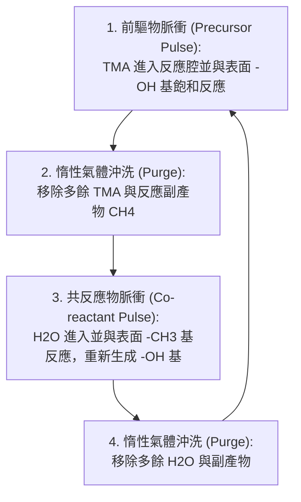

1.  **前驅物脈衝 (Precursor Pulse)**：將第一種反應物（如 TMA）引入腔體，與基板表面的活性位發生化學吸附。
2.  **第一階段沖洗 (Purge)**：利用惰性氣體（如 $\text{N}_2$ 或 $\text{Ar}$）將殘餘的前驅物分子及氣相副產物（如甲烷 $\text{CH}_4$）排出腔體，防止後續發生非自限性的氣相反應。
3.  **共反應物脈衝 (Co-reactant Pulse)**：引入第二種反應物（如 $\text{H}_2\text{O}$），與第一階段吸附在表面的分子發生反應，形成目標薄膜（如 $\text{Al}_2\text{O}_3$），並恢復表面的活性位。
4.  **第二階段沖洗 (Purge)**：再次利用惰性氣體清除剩餘的共反應物與副產物。

完成上述四個步驟稱為一個「循環」（Cycle）。重複此循環 $N$ 次，即可獲得預定厚度的薄膜。

### 23.1.4 ALD 製程溫度窗口

ALD 的自限性特徵僅在特定的溫度範圍內成立，此範圍稱為「ALD 溫度窗口」（ALD Temperature Window）。若操作溫度偏離此窗口，沉積機制將會失效，導致薄膜品質下降或失去厚度控制能力。

影響溫度窗口界定的因素包含：

1.  **低溫區限制**：
    *   **凝結（Condensation）**：溫度過低時，前驅物可能以物理吸附方式大量凝結在基板表面，導致非自限性成長，成長速率異常升高。
    *   **反應活化能不足（Incomplete Reaction）**：溫度不足以克服化學吸附所需的能壘，導致反應不完全，成長速率降低且薄膜雜質含量高。

2.  **高溫區限制**：
    *   **熱分解（Thermal Decomposition）**：溫度過高導致前驅物分子在到達表面前或表面上直接分解，演變為類似 CVD 的連續成長模式，失去自限性，成長速率大幅增加。
    *   **脫附（Desorption）**：已吸附在表面的分子因熱能過高而脫離表面，導致有效沉積量減少，成長速率下降。

!!! note "說明"
    理想的 ALD 溫度窗口內，每循環成長厚度（GPC）應保持恆定，不隨溫度微幅波動而改變。這使得 ALD 製程在大面積晶圓上具有極佳的厚度均勻性，因為它對反應爐內的溫度梯度（Temperature Gradient）不敏感。

### 23.1.5 每循環成長厚度 (GPC) 與飽和現象

定量表徵 ALD 製程效率的核心指標是「每循環成長厚度」（Growth Per Cycle, GPC），單位通常為 $\text{Å/cycle}$ 或 $\text{nm/cycle}$。

$$
d_{total} = \text{GPC} \times N
$$

其中 $d_{total}$ 為總膜厚，$N$ 為循環次數。

值得注意的是，ALD 的 GPC 通常小於該物質單層原子（Monolayer）的厚度。例如，$\text{Al}_2\text{O}_3$ 的單層厚度約為 $3\text{ Å}$，但典型的 ALD GPC 僅約 $0.9 \sim 1.2\text{ Å/cycle}$。這種現象主要歸因於**立體障礙（Steric Hindrance）**：前驅物分子（如 TMA）體積較大，當其吸附在表面活性位時，會遮蔽鄰近的活性位，使得在單次脈衝中無法填滿所有理論位點。

!!! warning "常見誤解"
    初學者常認為增加前驅物脈衝時間（Pulse Time）可以無限增加膜厚。事實上，一旦達到「飽和點」（Saturation Point），即表面覆蓋率 $\theta \approx 1$（受限於立體障礙），延長脈衝時間只會浪費氣體，GPC 將保持不變。這是判斷一個製程是否符合 ALD 特性的重要實驗依據。

#### 表面活性位置覆蓋率飽和現象
在製程開發階段，工程師必須進行「飽和曲線」（Saturation Curve）測試。分別固定其他參數，改變前驅物脈衝時間與沖洗時間：

*   若脈衝時間過短，表面反應未達飽和，GPC 會隨時間增加而上升。
*   若沖洗時間過短，殘留的前驅物會與下一步驟的反應物在氣相反應，產生類似 CVD 的效應，導致 GPC 異常升高且均勻性變差。

!!! example "產業實例"
    在截至撰寫時的尖端邏輯製程（如 3 奈米節點）中，高介電常數（High-k）金屬閘極（HKMG）結構中的二氧化鉿（$\text{HfO}_2$）薄膜幾乎全數採用 ALD 沉積。由於閘極氧化層厚度僅約 $1 \sim 2\text{ nm}$，ALD 提供的原子級精確度與極低的缺陷密度，是維持電晶體漏電控制與可靠性的必要條件（見第 28 章關於 HKMG 的整合細節）。

<!-- fig:1 -->
<figure markdown>
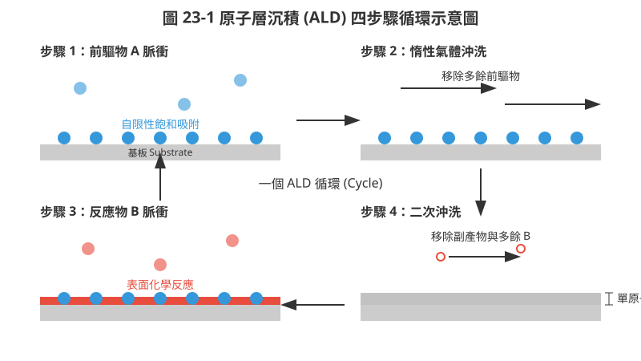
<figcaption>圖 23-1　ALD 四步驟循環示意圖（AI 繪製的示意圖）</figcaption>
</figure>

## 23.2 熱 ALD 與電漿輔助 ALD 製程

### 23.2 熱 ALD 與電漿輔助 ALD 製程

在原子層沉積（ALD）的技術分類中，依據驅動表面化學反應的能量來源不同，主要可分為熱原子層沉積（Thermal ALD）與電漿輔助原子層沉積（Plasma-Enhanced ALD, PEALD）。兩者雖皆遵循自限性（Self-limiting）反應機制，但在製程溫度、薄膜性質以及對高深寬比結構的覆蓋能力上存在顯著差異。

#### 23.2.1 熱 ALD 反應途徑：以三甲基鋁與水氣為例

熱 ALD 依賴基板的熱能來克服化學反應的活化能。最經典且研究最透徹的案例為利用三甲基鋁（Trimethylaluminum, TMA, $Al(CH_3)_3$）與水氣（$H_2O$）沉積氧化鋁（$Al_2O_3$）的製程。此反應具有極佳的自限性與熱穩定性，常作為 ALD 設備效能評估的基準（Baseline）。

一個完整的 $Al_2O_3$ ALD 循環可拆解為以下兩個半反應（Half-reactions）：

**反應 A：TMA 脈衝與化學吸附**
當 TMA 蒸氣進入反應室，其與基板表面既存的羥基（Hydroxyl groups, $-OH$）發生配位基交換反應（Ligand exchange）：
$$S-OH_{(s)} + Al(CH_3)_{3(g)} \rightarrow S-O-Al(CH_3)_{2(s)} + CH_{4(g)}$$
其中 $S$ 代表基板表面。TMA 分子中的一個甲基（$-CH_3$）與表面的氫結合形成甲烷（$CH_4$）逸散，而鋁原子則與表面的氧原子共價結合。由於表面羥基數量有限，一旦所有活性位點皆被佔據，反應即停止，達成自限性吸附。

**反應 B：水氣脈衝與表面還原**
在吹淨（Purge）餘後的 TMA 與產物甲烷後，通入水氣：
$$S-O-Al(CH_3)_{2(s)} + 2H_2O_{(g)} \rightarrow S-O-Al(OH)_{2(s)} + 2CH_{4(g)}$$
水氣與殘留的甲基反應，再次產生甲烷，並使表面重新覆蓋羥基，為下一個循環的 TMA 吸附做好準備。

!!! note "反應動力學觀察"
    在典型的熱 ALD 製程中，反應溫度通常設定在 $200^\circ C$ 至 $300^\circ C$ 之間。若溫度過低，反應活化能不足，會導致沉積速率下降或前驅物物理吸附（Physisorption）過多；若溫度過高，前驅物可能發生熱分解（Thermal decomposition），破壞自限性機制，使其行為趨向化學氣相沉積（CVD）。

#### 23.2.2 電漿輔助 ALD (PEALD) 原理

電漿輔助 ALD 引入了高能態的自由基（Radicals）作為反應物，取代了熱 ALD 中的熱能驅動分子。通常在反應循環的第二步（反應 B），利用遠端電漿（Remote Plasma）或直接電漿產生如氧自由基（$O^*$）、氮自由基（$N^*$）或氫自由基（$H^*$）。

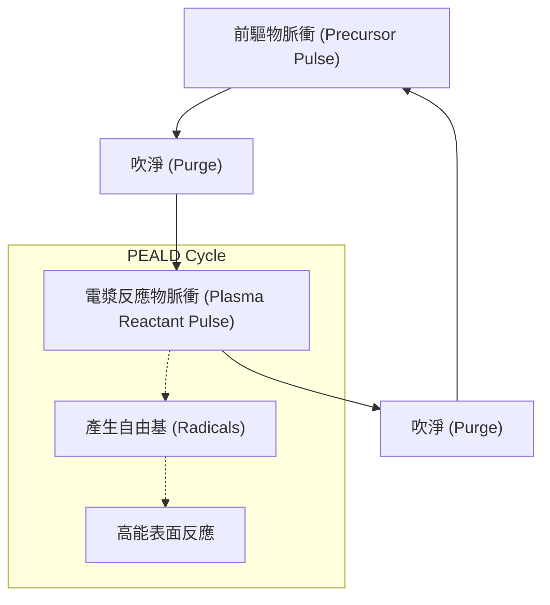

**PEALD 的核心優勢：**
1. **低溫製程能力**：由於自由基具有極高的化學活性，反應不需依賴基板熱能即可發生。這使得 PEALD 可以在低於 $100^\circ C$ 甚至室溫下進行，對於熱預算（Thermal budget）極低或含有光阻、有機材料的基板至關重要。
2. **膜質優化**：電漿中的離子轟擊（Ion bombardment）效應能增加薄膜的緻密度，減少雜質含量（如碳、氫含量），從而提升介電強度與折射率。
3. **材料多樣性**：許多金屬氮化物（如 $TiN$, $TaN$）在熱 ALD 下需要極高溫且反應緩慢，使用氮或氨電漿可顯著提升沉積效率與品質。

#### 23.2.3 PEALD 之潛在缺點與挑戰

儘管 PEALD 提供更高的能量調控手段，但在先進邏輯元件製程中仍面臨技術挑戰：

1. **深寬比孔底之自由基去活化**：
   自由基在進入高深寬比（High Aspect Ratio, HAR）結構（如鰭式電晶體 FinFET 的溝槽或 3D NAND 的深孔）時，極易與孔壁發生多次碰撞。每一次碰撞都有機率導致自由基重新結合（Recombination）成穩定分子（如 $O^* + O^* \rightarrow O_2$），失去活性。這導致孔洞底部的反應物濃度遠低於頂部，造成厚度不均。

2. **電漿損傷（Plasma Damage）**：
   電漿產生的真空紫外光（VUV）與低能離子可能穿透薄膜，在基板介面產生陷阱位點（Interface traps）或電荷累積，損害電晶體的可靠性（如負偏壓溫度不穩定性, NBTI）。

#### 23.2.4 高深寬比結構中之傳輸模型與共形性

ALD 最引以為傲的特性是極佳的共形性（Conformality）。在極限高深寬比結構中，前驅物分子的傳輸遵循克努森擴散（Knudsen Diffusion）模型，其特徵長度遠小於分子的平均自由徑（Mean Free Path）。

為了達成 $100\%$ 的階梯覆蓋率（Step Coverage），必須給予足夠的飽和時間（Saturation time）。所需時間 $t$ 與溝槽深度 $L$ 及寬度 $W$ 的關係大致遵循：
$$t \propto \frac{L^2}{W} \cdot \frac{1}{\sqrt{T}} \cdot \frac{1}{P}$$
其中 $T$ 為溫度，$P$ 為分壓。隨深寬比（$AR = L/W$）增加，所需的脈衝時間呈平方級數增長。

!!! example "產業實例"
    在截至撰寫時的 3nm 以下節點 GAAFET（環繞閘極電晶體）製程中，內部間隔層（Inner Spacer）的沉積必須在極窄的空間內達成完全共形。研發實務上常採用「超循環」（Super-cycle）策略，結合熱 ALD 的高穿透力與 PEALD 的膜質強化，以平衡覆蓋率與電學性能。

#### 23.2.5 成核延遲現象與表面調控

在 ALD 製程初期，常觀察到「成核延遲」（Incubation Delay）現象，即前幾個循環的沉積速率遠低於穩定後的生長速率（Growth Per Cycle, GPC）。

**成核延遲的物理機制：**
當前驅物分子（如 TMA）與基板（如氫鈍化的矽表面 $Si-H$）的化學親和力較弱時，分子難以形成穩定的化學吸附。必須等待表面出現零星的成核點，再由這些點向外擴張，最終形成連續薄膜。這會導致薄膜在極薄階段（$< 2 nm$）出現不連續的島狀生長（Island growth）或較高的表面粗糙度。

**表面官能基處理（Surface Functionalization）：**
為了消除成核延遲，製程中常引入預處理步驟：
*   **化學處理**：使用稀釋氫氟酸（DHF）或臭氧（$O_3$）調整表面為 $-H$ 或 $-OH$ 終端。
*   **電漿預處理**：利用氧或氫電漿清除表面有機汙染物並活化化學鍵。

下表總結了熱 ALD 與 PEALD 的關鍵特性比較：

| 特性項目 | 熱 ALD (Thermal ALD) | 電漿輔助 ALD (PEALD) |
| :--- | :--- | :--- |
| **能量來源** | 基板熱能 | 電漿自由基與離子 |
| **典型溫度範圍** | $150^\circ C - 400^\circ C$ | 室溫 $- 250^\circ C$ |
| **薄膜緻密度** | 一般 | 較高（受離子輔助） |
| **雜質含量** | 較高（配位基殘留） | 較低 |
| **高深寬比覆蓋力** | 極佳（分子擴散力強） | 較差（受自由基去活化限制） |
| **設備複雜度** | 較低 | 較高（需電漿源與阻抗匹配） |
| **典型應用** | $Al_2O_3$ 鈍化層、$HfO_2$ 閘極介電層 | 金屬氮化物、低溫封裝薄膜 |

在先進邏輯製程中，選擇何種 ALD 模式取決於底層材料的耐熱性與結構的幾何複雜度。隨著元件尺寸持續微縮至原子尺度，如何精準控制成核初期的單原子層排列，已成為提升良率的關鍵技術節點。

## 23.3 原子層蝕刻機制與循環控制

隨著半導體元件微縮至 3 奈米（3 nm）節點以下，傳統的反應離子蝕刻（Reactive Ion Etching, RIE，詳見第 19 章）面臨極大的挑戰。在極小尺度下，傳統蝕刻製程中離子與中性自由基同時到達表面，容易導致微載負效應（Microloading Effect）、縱橫比相關蝕刻（Aspect Ratio Dependent Etching, ARDE）以及嚴重的晶格損傷。原子層蝕刻（Atomic Layer Etching, ALE）作為一種新興技術，透過將蝕刻反應分解為多個自限性的循環步驟，實現了原子級的厚度控制與極高的選擇比，成為延續摩爾定律的關鍵技術之一。

### 23.3.1 原子層蝕刻之物理概念與循環機制

原子層蝕刻的核心概念是將連續的化學反應解構為數個獨立且自限（Self-limiting）的子步驟。其基本操作邏輯與原子層沉積（ALD）互為鏡像：ALD 是「逐層增加」材料，而 ALE 則是「逐層移除」材料。

典型的 ALE 循環由以下四個階段組成：

1.  **表面修飾（Surface Modification, Step A）**：將反應氣體通入反應室，使其在晶圓表面發生化學吸附或反應，形成一層性質與基材不同的「修飾層」。此步驟必須具有自限性，即一旦表面活性位點被佔滿，反應即停止。
2.  **清洗/吹淨（Purge A）**：利用惰性氣體（如 Ar 或 $N_2$）移除反應室內剩餘的化學氣體與物理吸附的副產物，確保下一步驟不會發生非受控的氣相反應。
3.  **選擇性移除（Removal/Desorption, Step B）**：施加能量（如低能量離子打擊或加熱），使修飾層發生脫附或與第二種反應物反應生成揮發性產物，而未受修飾的基材則保持完好。
4.  **清洗/吹淨（Purge B）**：移除反應產物，恢復初始表面狀態，準備進入下一個循環。

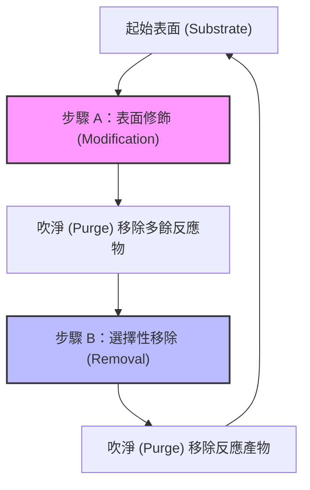

### 23.3.2 定向原子層蝕刻（Directional/Plasma ALE）

定向 ALE 主要利用電漿產生的離子來驅動移除步驟。其物理原理基於「能量窗口（Energy Window）」的精確控制。

#### 能量窗口與自限性
在定向 ALE 中，表面修飾層（如氯化的矽表面 $SiCl_x$）的鍵結能通常低於基材（如矽塊材 $Si-Si$）的鍵結能。因此存在一個能量區間，使得離子能量足以擊碎修飾層的鍵結並使其脫附，但不足以造成基材的物理濺鍍（Sputtering）。

定義離子能量為 $E_{ion}$，基材濺鍍閾值能量為 $E_{th,bulk}$，修飾層移除閾值能量為 $E_{th,mod}$，理想的 ALE 能量窗口需滿足：
$$E_{th,mod} < E_{ion} < E_{th,bulk}$$

典型值方面，對於矽（Si）的氯化 ALE 製程，$E_{th,mod}$ 約在 10 至 20 eV 之間，而 $E_{th,bulk}$ 約在 40 至 50 eV 之間。若離子能量控制在此範圍內，蝕刻反應將在修飾層耗盡後自動停止，展現出完美的自限性飽和曲線。

#### 定向 ALE 的飽和曲線
在實驗上，ALE 的成功與否取決於「每循環蝕刻量」（Etch Per Cycle, EPC）是否隨時間或劑量達到飽和。
*   **修飾飽和**：當反應氣體（如 $Cl_2$）的暴露量（Exposure）增加，EPC 應趨於穩定常數。
*   **移除飽和**：當離子打擊時間或能量增加，EPC 在跨過 $E_{th,mod}$ 後應進入一個平台區（Plateau），直到接近 $E_{th,bulk}$ 時才再次上升。

!!! note "說明"
    定向 ALE 的優點在於其高度的方向性，能夠在溝槽底部實現精確蝕刻而不影響側壁，這對於高縱橫比（High Aspect Ratio, HAR）結構的底部清理至關重要。

### 23.3.3 等向性熱原子層蝕刻（Isotropic/Thermal ALE）

對於某些複雜的三維結構（如 GAAFET 的內間隔層蝕刻），需要的是全方位的等向性蝕刻，此時熱 ALE（Thermal ALE）成為首選。熱 ALE 不依賴離子打擊，而是利用純化學反應，通常涉及「配位化學轉移」與「配位基交換」（Ligand Exchange）。

#### 配位基交換反應機制
熱 ALE 最常見的機制是透過兩個化學半反應來實現。以氧化鋁（$Al_2O_3$）的熱 ALE 為例：

1.  **氟化反應（Fluorination）**：通入 $HF$ 氣體，將表面層轉化為金屬氟化物（如 $AlF_3$）。
    $$Al_2O_3(s) + 6HF(g) \rightarrow 2AlF_3(s) + 3H_2O(g)$$
2.  **配位基交換（Ligand Exchange）**：通入金屬有機前驅物（如 $Sn(acac)_2$ 或 $Al(CH_3)_3$），前驅物上的配位基與表面的氟原子交換，生成具有揮發性的金屬複合物。
    $$AlF_3(s) + Sn(acac)_2(g) \rightarrow Al(acac)_3(g) + SnF_2(g) \text{ (簡化示意)}$$

#### 熱 ALE 的優勢
*   **極高選擇比**：由於不同材料的化學性質差異巨大，熱 ALE 可以輕易實現對特定材料（如 $SiN$）蝕刻而對另一材料（如 $SiO_2$）完全不反應。
*   **無電漿損傷**：不涉及高能離子，不會產生晶格缺陷或電荷累積效應。
*   **等向性**：反應物以氣態擴散，能均勻作用於所有暴露表面。

### 23.3.4 ALE 協同效應與 EPC 精確控制

為了量化 ALE 製程偏離理想狀態的程度，學界定義了「協同效應」（Synergy, $S$）。

#### 協同效應定義
協同效應是指 ALE 循環產生的蝕刻量相對於單獨步驟加總的增益比例。定義如下：
$$S = \frac{EPC - (\alpha + \beta)}{EPC} \times 100\%$$
其中：
*   $EPC$：原子層蝕刻循環的總量。
*   $\alpha$：僅進行步驟 A（修飾）而不進行步驟 B 時的蝕刻量（通常為 0 或負值，代表沉積）。
*   $\beta$：僅進行步驟 B（移除）而不進行步驟 A 時的蝕刻量（代表物理濺鍍或熱蒸發）。

理想的 ALE 製程中，$\alpha$ 與 $\beta$ 應趨近於零，此時 $S = 100\%$。截至撰寫時，工業界量產製程的協同效應通常需維持在 90% 以上，以確保原子級的精確度。

#### 影響 EPC 的關鍵因素
1.  **溫度**：在熱 ALE 中，溫度決定了配位基交換的反應速率與產物的揮發性。溫度過低會導致產物殘留，溫度過高則可能誘發非自限性的熱分解。
2.  **吹淨時間**：若吹淨不足，殘留的反應物會導致類 CVD 或類 RIE 反應，使 EPC 異常升高並失去自限性。
3.  **離子通量與能量分佈（IEDF）**：在電漿 ALE 中，離子能量分佈的寬度直接影響能量窗口的有效性。

### 23.3.5 產業實例與技術挑戰

截至撰寫時，ALE 已在先進邏輯與記憶體製程中扮演不可或缺的角色。

| 應用領域 | 蝕刻類型 | 關鍵材料 | 目的 |
| :--- | :--- | :--- | :--- |
| **GAAFET** | 等向性熱 ALE | $SiGe$ / $Si$ | 選擇性移除 $SiGe$ 犧牲層以釋放奈米片（見第 6 章） |
| **Self-Aligned Contact** | 定向電漿 ALE | $SiO_2$ / $SiN$ | 在極小空間內精確蝕刻接觸孔而不損壞側壁保護層 |
| **3D NAND** | 定向電漿 ALE | 多層膜結構 | 解決高縱橫比通道孔底部的蝕刻停止問題 |

!!! example "產業實例"
    科林研發（Lam Research）與應用材料（Applied Materials）均推出了專用的 ALE 機台。例如，Lam Research 的潘朵拉（Pandora）平台利用快速氣體切換系統，將循環時間縮短至秒級，克服了 ALE 產出率（Throughput）較低的傳統弊端。

#### 技術挑戰
儘管 ALE 提供了極致的精度，但其面臨的主要挑戰在於：
1.  **產出率**：由於需要多次吹淨與循環，其每小時晶圓產出量（WPH）遠低於傳統 RIE。
2.  **前驅物開發**：特別是針對金屬與新型半導體材料（如 $GaN$），尋找合適的自限性修飾反應與揮發性副產物仍是研發重點。
3.  **整合複雜度**：在同一個反應腔室內切換多種氣體與電漿條件，對設備的氣流控制與壓力穩定性提出了極高要求。

ALE 標誌著蝕刻技術從「宏觀統計控制」轉向「微觀原子控制」。隨著製程節點向 2 奈米及更深處邁進，ALE 與 ALD 的結合（即原子層製程，ALP）將成為建構複雜奈米元件的標準工具。

<!-- fig:2 -->
<figure markdown>
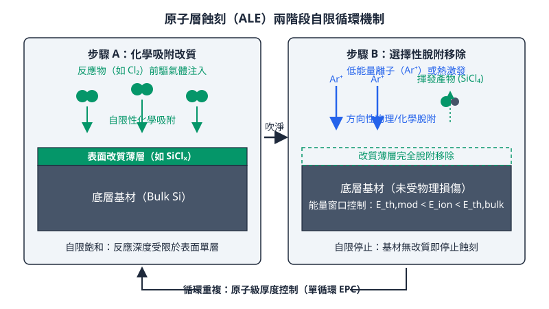
<figcaption>圖 23-2　ALE 原子層蝕刻機制圖（AI 繪製的示意圖）</figcaption>
</figure>

## 23.4 在 GAAFET 與高介電材料中之應用

隨著半導體元件微縮至 3 奈米（nm）節點以下，傳統的化學氣相沉積（CVD）與反應離子蝕刻（RIE）在面對複雜的三維結構時，已面臨物理極限。原子層沉積（ALD）與原子層蝕刻（ALE）憑藉其原子級的自限性（Self-limiting）反應特性，成為全環繞閘極場效應電晶體（Gate-All-Around FET, GAAFET）得以量產的關鍵技術。本節將探討這些技術在高介電常數（High-k）材料沉積、奈米片（Nanosheet）結構加工以及內部間隔層（Inner Spacer）工程中的具體應用。

### 高介電常數閘極介電層之次奈米厚度控制

在 MOSFET 的微縮過程中，為了抑制量子穿隧效應並維持對通道的控制力，必須在降低等效氧化層厚度（Equivalent Oxide Thickness, EOT）的同時，保持物理厚度以減少漏電流。如第 5 章所述，EOT 的計算公式為：

$$EOT = t_{IL} + t_{high-k} \left( \frac{\epsilon_{SiO_2}}{\epsilon_{high-k}} \right)$$

其中，$t_{IL}$ 為界面層（Interface Layer，通常為 $SiO_x$）的厚度，$t_{high-k}$ 與 $\epsilon_{high-k}$ 分別為高介電材料的物理厚度與介電常數，$\epsilon_{SiO_2}$ 則為二氧化矽的介電常數（約 3.9）。

截至撰寫時，主流製程採用二氧化鉿（$HfO_2$）或其摻雜衍生物（如 $HfZrO_x$）作為 High-k 材料。ALD 技術在其中的應用重點如下：

1.  **次奈米級厚度精準度**：ALD 透過循環次數精確控制薄膜厚度。在 2 奈米節點下，$HfO_2$ 的物理厚度通常需精確控制在 1.5 至 2.5 奈米之間，誤差必須小於一個原子層（約 0.1 奈米）。
2.  **界面層工程**：為了獲得極低的 EOT（典型值小於 0.8 奈米），必須在沉積 High-k 之前，利用原位（In-situ）處理形成極薄且高品質的 $SiO_2$ 或 $SiON$ 界面層。ALD 的前驅物（Precursor）選擇（如四(乙基甲基氨基)鉿, TEMAH）與氧化劑（水氣或臭氧）的反應動力學，直接影響了界面態密度（Interface State Density, $D_{it}$）。
3.  **結晶相控制**：$HfO_2$ 的介電常數與其晶相結構密切相關。單斜晶相（Monoclinic）的 $\epsilon$ 約為 16-20，而四方晶相（Tetragonal）或立方晶相（Cubic）可達 30 以上。透過 ALD 過程中引入鋁（Al）或鋯（Zr）的原子層摻雜（Atomic Layer Doping），可有效調控薄膜在後續熱退火過程中的相變。

### GAAFET 奈米片結構中的超高保形性填充

GAAFET（見第 6 章）與 FinFET 最大的不同在於其閘極完全包覆奈米片通道。在多層奈米片堆疊結構中，片與片之間的水平間隙（Suspended Gap）通常僅有 5 至 10 奈米。

!!! note "保形性（Conformality）的挑戰"
    在如此狹窄的水平溝槽中，傳統 PVD 技術會產生嚴重的遮蔽效應（Shadowing Effect），導致溝槽開口過早封閉而形成孔洞（Void）。CVD 雖然保形性較佳，但在次 10 奈米尺度下，反應物濃度的微小梯度仍會導致薄膜厚度不均。

ALD 由於其表面飽和反應特性，能夠在奈米片的頂部、底部及側面沉積出厚度完全一致的薄膜。這在功函數金屬（Work Function Metal, WFM）的填充中至關重要。為了調整 N-型與 P-型電晶體的閾值電壓（Threshold Voltage, $V_{th}$），製程中需沉積多層不同的金屬薄膜（如 $TiN$、$TaN$、$TiAlC$）。ALD 技術確保了這些金屬層在狹窄的奈米片間隙內能均勻分布，避免了因電場不均導致的元件性能劣化。

### 內部間隔層（Inner Spacer）形成中的 ALE 應用

在 GAAFET 的製造流程中，內部間隔層（Inner Spacer）的建構是難度最高的一環。其目的是在源極/汲極（S/D）與金屬閘極之間提供物理隔離，以降低寄生電容。

這部分的製程涉及對矽鍺/矽（$SiGe/Si$）超晶格結構的選擇性橫向蝕刻。製程步驟如下：

1.  **腔體凹槽蝕刻（Cavity Recess）**：需將 $SiGe$ 層相對於 $Si$ 層進行選擇性橫向蝕刻。傳統的乾式蝕刻難以精確控制蝕刻深度，且易造成 $Si$ 通道的損傷。
2.  **等向性熱 ALE（Isotropic Thermal ALE）**：利用氣態化學物質（如 $ClF_3$ 或 $NF_3$ 電漿產生的自由基）與 $SiGe$ 表面反應形成修飾層，再透過熱脫附（Thermal Desorption）將其移除。由於 ALE 具有自限性，可以精確控制橫向蝕刻的深度（例如精確蝕刻 5.0 奈米），並達成極高的選擇比（$SiGe:Si > 150:1$）。
3.  **間隔層沉積與回蝕**：在形成的凹槽內利用 ALD 沉積低介電常數（Low-k）材料（如 $SiN$、$SiBCN$），隨後再利用 ALE 或高度方向性蝕刻將多餘材料移除。

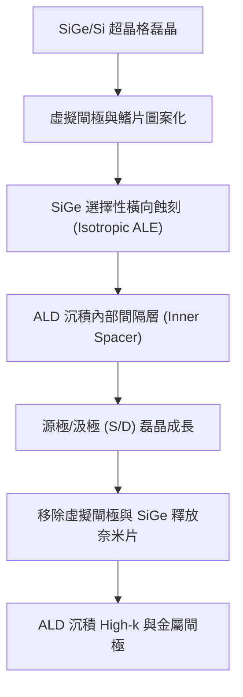

### 極致尺寸微縮下的介面缺陷與應力工程

隨著薄膜厚度縮減至數個原子層，介面（Interface）的物理性質開始主導元件表現。

#### 1. 偶極矩層（Dipole Layer）調控
在 High-k 介電層與界面層之間，或者不同金屬層之間，會因為電荷轉移形成偶極矩（Dipole）。利用 ALD 插入極薄的氧化鋁（$Al_2O_3$）或氧化鑭（$La_2O_3$）原子層，可以人為誘導偶極矩方向，進而精確微調 $V_{th}$。這在 GAAFET 這種缺乏體偏壓（Body Bias）調控手段的結構中尤為重要。

#### 2. 三維幾何形貌下的應力工程
ALD 沉積的薄膜通常具有內建應力（Intrinsic Stress）。在平面結構中，這種應力主要影響載子遷移率；但在三維奈米片結構中，不均勻的應力分佈會導致奈米片發生物理形變（如彎曲或扭曲）。
*   **熱收縮應力**：ALD 沉積溫度（典型值 250°C - 350°C）與元件運作溫度的差異會產生熱應力。
*   **ALE 表面修飾應力**：在 ALE 的化學修飾階段，表面原子的鍵結改變會產生短暫的表面張力。

製程工程師必須透過調整 ALD 循環中的脈衝時間（Pulse Time）與吹掃時間（Purge Time），以及選擇合適的電漿功率（在 PE-ALD 中），來平衡這些應力，確保奈米片在釋放（Release）後仍能保持結構穩定。

!!! example "產業實例：2 奈米節點的關鍵路徑"
    截至撰寫時，全球領先的晶圓代工廠（如台積電、三星、英特爾）在 2 奈米（N2/18A）製程中，均全面導入了基於 ALD 的 High-k 最後製程（Gate-Last Process）。其中，針對奈米片間隙填充的「無縫沉積技術」是各家競爭的核心。例如，透過引入抑制劑（Inhibitor）進行選擇性區域 ALD（Area-Selective ALD, AS-ALD），可以在特定表面生長薄膜，進一步降低寄生電容並優化元件速度。

### 介面缺陷與可靠性（HCI/NBTI）
最後，ALD 薄膜中的殘留雜質（如來自前驅物的碳、氯或氫）會形成陷阱能階（Traps）。在極高電場下，這些陷阱會捕獲載子，導致熱載子注入（HCI）或負偏壓溫度不穩定性（NBTI）惡化。因此，在 ALD 沉積後，通常需要進行高壓氫氣退火（High-Pressure Hydrogen Anneal）或甲醯胺處理，以鈍化（Passivate）介面處的懸鍵（Dangling Bonds），這在 GAAFET 的全環繞界面上比 FinFET 更加困難且關鍵。

## 23.5 設備與廠商技術

在原子層沉積（ALD）與原子層蝕刻（ALE）製程中，設備的設計核心在於如何精確控制「自限性表面反應」。不同於傳統 CVD 或 RIE 著重於穩態下的反應速率，ALD 與 ALE 設備必須在非穩態的循環切換中，確保氣體脈衝的純淨度、表面吸附的飽和度以及副產物的排除效率。

### 23.5.1 反應腔體架構：時間隔離與空間隔離

根據前導體（Precursor）與反應物（Reactant）隔離方式的不同，ALD 設備主要分為時間隔離型（Temporal ALD）與空間隔離型（Spatial ALD）兩大類。

#### 時間隔離型 ALD (Temporal ALD)
這是最常見的單晶圓（Single Wafer）或批次（Batch）機台架構。其運作邏輯是在同一個反應腔體內，依序通入不同的氣體，並在步驟之間以惰性氣體（如 $N_2$ 或 $Ar$）進行沖洗（Purge）。

*   **優點**：薄膜均勻度與階梯覆蓋率（Step Coverage）極佳，適合處理高深寬比（High Aspect Ratio, HAR）結構。
*   **缺點**：產能（Throughput）受限於沖洗時間。若沖洗不完全，會導致氣相反應，使 ALD 模式退化為 CVD 模式，進而產生顆粒（Particle）污染。

#### 空間隔離型 ALD (Spatial ALD)
此架構將不同的反應區段在空間上隔開。晶圓在不同氣體區之間連續移動，或由噴頭在晶圓上方移動。各反應區之間利用氣簾（Gas Curtain）或真空隔離。

*   **優點**：無需等待沖洗時間，產能較時間隔離型高出 1 至 2 個數量級，適合大面積或對產能要求極高的製程。
*   **缺點**：機械結構複雜，且對於極高深寬比的溝槽，前導體在空間移動過程中可能無法充分擴散至底部。

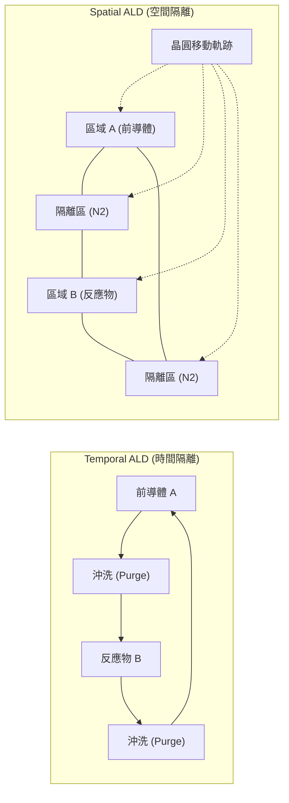

### 23.5.2 關鍵子系統與動力學設計

#### 高速氣體注入閥門 (Fast-switching Valves)
ALD 製程需要極短的脈衝時間（典型值為 10 ms 至 100 ms）。因此，閥門必須具備極高的反應速度與重複性，且需承受數億次的開關循環而不產生金屬磨耗顆粒。現代機台常採用氣動或電磁驅動的原子層專用閥門，並將閥門盡可能靠近反應腔體（Point-of-use），以減少死體積（Dead Volume）。

#### 腔體流場與沖洗動力學
沖洗效率決定了 ALD 的循環時間（Cycle Time）。沖洗時間 $\tau$ 與腔體體積 $V$ 及抽氣速率 $S$ 相關，理想化模型為：
$$\tau \propto \frac{V}{S} \cdot \ln\left(\frac{C_0}{C_t}\right)$$
其中 $C_0$ 為前導體初始濃度，$C_t$ 為目標殘餘濃度。為了縮短 $\tau$，設備設計趨向於縮小腔體體積（如採用 Cross-flow 或 Showerhead 設計），並優化流場以消除渦流（Eddy current）死角。

### 23.5.3 原子層蝕刻 (ALE) 專用控制系統

ALE 設備通常由傳統乾式蝕刻機台演進而來，但需針對單原子層精度進行大幅改裝。

1.  **低能量離子源**：ALE 的脫附步驟（Desorption）必須精確控制離子能量，使其高於表面修飾層的脫附閾值，但低於底材的濺鍍（Sputtering）閾值。
2.  **脈衝電漿 (Pulsed Plasma)**：透過同步脈衝電漿技術，可以獨立調控離子通量（Flux）與離子能量分佈（IEDF），減少電荷累積效應（Charging Effect）對精細圖案的破壞。
3.  **精確偏壓控制 (Precision Bias Control)**：截至撰寫時，最先進的 ALE 設備採用快速切換的 RF 偏壓系統，能在毫秒等級內將偏壓調整至目標值，確保每一循環的蝕刻量（Etch per cycle, EPC）穩定。

### 23.5.4 原子尺度即時原位監控技術

由於 ALD 與 ALE 的反應發生在原子層級，傳統的離線量測無法提供足夠的製程回饋。

*   **原位橢偏儀 (In-situ Spectroscopic Ellipsometry)**：利用偏振光反射原理，即時監測薄膜厚度的增長或減少。在 ALE 製程中，這對於確認修飾層是否飽和至關重要。
*   **四極柱質譜儀 (Quadrupole Mass Spectrometer, QMS)**：安裝於排氣端，監測反應副產物（如 $HCl$、$CH_4$ 等）的濃度變化。當副產物訊號降至背景值時，代表表面反應已達飽和，系統可自動觸發下一階段的沖洗，從而優化循環時間。

### 23.5.5 產業實例與廠商技術比較

在先進邏輯製程（如 3nm 以下節點）與 3D NAND 製造中，ALD 與 ALE 設備的選型取決於薄膜品質、階梯覆蓋率與生產成本的權衡。

| 廠商 | 代表產品系列 | 技術路線與特點 | 主要應用 |
| :--- | :--- | :--- | :--- |
| **ASM International** | Pulsar 系列 | 專精於熱 ALD (Thermal ALD)，具備優異的氣體流場控制，強調高介電常數材料的緻密性。 | 高介電金屬閘極 (HKMG) 之氧化鋁、氧化鉿沉積。 |
| **Lam Research** | Striker 系列 | 採用單晶圓 ALD 平台，強調快速循環切換技術與電漿輔助 ALD (PEALD) 的整合。 | 間隔層 (Spacer) 沉積、多重圖案化 (Multi-patterning)。 |
| **Lam Research** | Kiyo / Flex / Akara | 具備高度精確的脈衝電漿與低偏壓控制技術，支援導體與介電質 ALE。 | 自對準接觸孔 (SAC)、GAAFET 內間隔層蝕刻。 |
| **Applied Materials** | Producer 平台系列 | 採用多腔體並行處理架構，將 ALD 與 CVD 整合在同一平台上，提升產能。 | 阻障層 (Barrier)、種子層 (Seed Layer) 與介電薄膜。 |
| **Applied Materials** | Sym3 系列 | 針對極高深寬比結構設計的蝕刻腔體，支援數位化蝕刻（ALE 模式）。 | 先進邏輯元件之鰭片 (Fin) 與閘極蝕刻。 |
| **Tokyo Electron** | Trias 系列 | 單晶圓成膜平台，強調高溫 ALD 與金屬氮化物薄膜的均勻性。 | 鎢 (W) 阻障層、電極材料沉積。 |

#### 廠商技術取捨與選機考量

*   **ASM International**：在 HKMG 領域具備深厚的材料基礎。其 Pulsar 系列機台在處理如 $HfO_2$ 等高介電材料時，能精確控制界面層（Interfacial Layer）的厚度，這對於維持電晶體的等效氧化層厚度（EOT）微縮至關重要。
*   **Lam Research**：在蝕刻領域佔有領導地位。其 ALE 技術（如 Kiyo 與 Akara 系列）特別強調對側壁損傷的控制。在 GAAFET 結構中，內間隔層（Inner Spacer）的蝕刻需要極高的選擇比，Lam 的 ALE 方案透過精確的離子能量調控，能避免對矽鍺（SiGe）犧牲層的過度侵蝕。
*   **Applied Materials**：其優勢在於平台整合能力。Producer 平台能將多個製程步驟（如清洗、ALD、CVD）整合在同一個真空環境下（Integrated Materials Solution, IMS），減少晶圓暴露於大氣中產生的原生氧化層或污染物，這對於 3nm 以下節點的接觸阻值（Contact Resistance）控制非常有益。

!!! note "製程整合考量"
    晶圓廠在選擇 ALD 設備時，除了考慮單一薄膜的品質，更看重「熱預算」（Thermal Budget）。例如，在後段製程（BEOL）中，必須選擇電漿輔助 ALD（PEALD），以在低於 400°C 的環境下完成沉積，避免破壞低介電常數（Low-k）材料。而在前段製程（FEOL）中，為了追求最佳的晶體結構與電性，則傾向使用熱 ALD。

截至撰寫時，隨著 High-NA EUV 進入量產階段（見第 15 章），光阻的厚度進一步微縮，ALE 技術被廣泛用於提升微影圖案的轉移保真度，減少邊緣粗糙度（LER），這已成為設備商競爭的新戰場。

## 本章重點

*   **自限性反應機制**：原子層沉積（ALD）與原子層蝕刻（ALE）的核心在於化學吸附的飽和現象，確保反應在表面活性位點佔滿後自動停止，實現原子級的厚度控制。
*   **ALD 四步循環**：典型的 ALD 循環包含前驅物脈衝、惰性氣體沖洗、共反應物脈衝、以及第二次沖洗。此循環確保反應物在氣相中隔離，僅在基板表面發生反應。
*   **ALD 溫度窗口**：製程需維持在特定溫度區間，以避免低溫下的前驅物凝結或反應活化能不足，以及高溫下的前驅物熱分解或脫附。
*   **熱 ALD 與 PEALD 之差異**：熱 ALD 依賴熱能驅動，具備極佳的保形性；電漿輔助 ALD（PEALD）利用高能自由基，可在低溫下沉積高品質薄膜，但在高深寬比結構中易受自由基去活化影響。
*   **ALE 能量窗口**：定向原子層蝕刻利用離子能量差異，使其足以移除表面修飾層，但低於基材的物理濺鍍閾值，從而達成自限性蝕刻。
*   **等向性熱 ALE**：透過配位基交換反應實現無損傷、高選擇比的蝕刻，是 GAAFET 內部間隔層（Inner Spacer）加工的關鍵技術。
*   **GAAFET 整合應用**：ALD 提供高介電常數（High-k）閘極介電層與功函數金屬的精確填充；ALE 則用於奈米片釋放與精細結構的尺寸控制。
*   **設備架構演進**：ALD 設備依隔離方式分為時間隔離型與空間隔離型，前者強調保形性，後者則著重於提升生產產出率。

## 重點圖卡

複習時看這幾張就能抓住本章重點；[圖卡庫](../cards.md)可以下載成圖片。

<figure markdown>
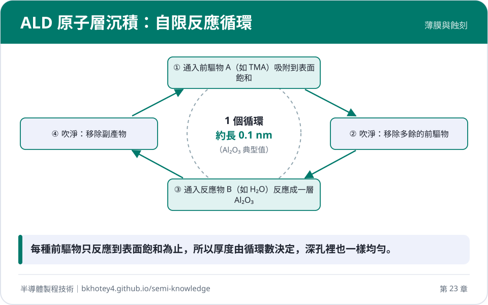
<figcaption>核心概念圖卡：ALD 原子層沉積：自限反應循環</figcaption>
</figure>

<figure markdown>
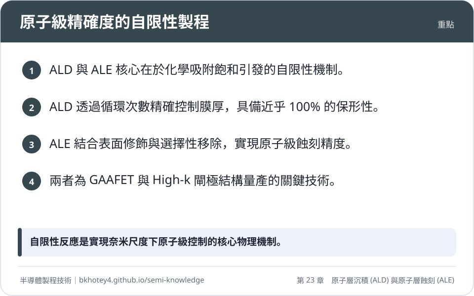
<figcaption>重點圖卡：原子級精確度的自限性製程</figcaption>
</figure>

<figure markdown>
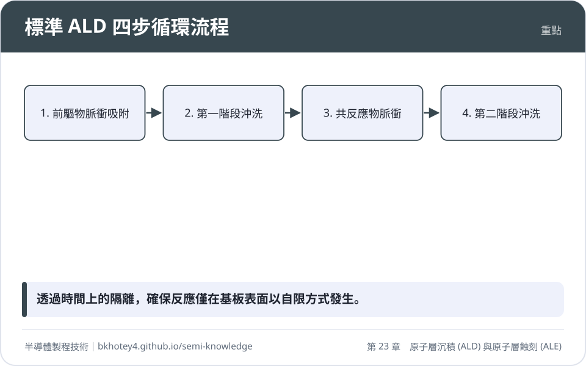
<figcaption>重點圖卡：標準 ALD 四步循環流程</figcaption>
</figure>

<figure markdown>
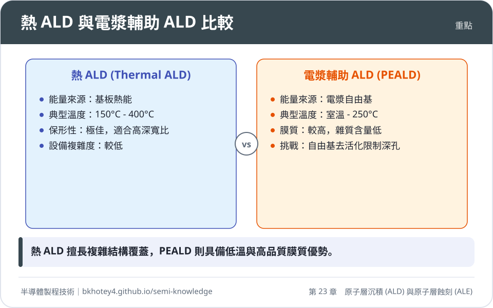
<figcaption>重點圖卡：熱 ALD 與電漿輔助 ALD 比較</figcaption>
</figure>

<figure markdown>
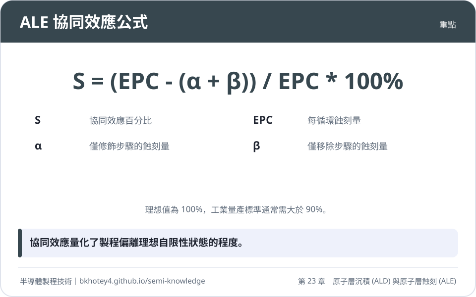
<figcaption>重點圖卡：ALE 協同效應公式</figcaption>
</figure>

## 習題

**1.** 試說明為何 ALD 的每循環成長厚度（GPC）通常小於該材料單層原子的理論厚度？
??? success "參考解答"
    這主要是由於「立體障礙」（Steric Hindrance）效應。前驅物分子（如三甲基鋁 TMA）通常帶有體積較大的配位基（如甲基 -CH3），當其吸附在表面活性位時，會物理性地遮蔽鄰近的活性位點，導致單次脈衝中無法填滿所有理論上的原子位點。

**2.** 假設一個二氧化鉿（$HfO_2$）的 ALD 製程，其 GPC 為 $1.1 \text{ Å/cycle}$。若要在 GAAFET 的奈米片上沉積 $2.2 \text{ nm}$ 的閘極介電層，且已知製程初期的成核延遲（Incubation Delay）約為 5 個循環（即前 5 循環不計入厚度），試計算總共需要執行多少個循環？
??? success "參考解答"
    1. 首先將目標厚度換算為相同單位：$2.2 \text{ nm} = 22 \text{ Å}$。
    2. 計算穩定生長所需的循環數：$22 \text{ Å} / 1.1 \text{ Å/cycle} = 20 \text{ cycles}$。
    3. 加上成核延遲的循環數：$20 + 5 = 25 \text{ cycles}$。
    答：總共需要 25 個循環。

**3.** 在原子層蝕刻（ALE）實驗中，若單獨進行表面修飾步驟（Step A）的蝕刻量 $\alpha = 0 \text{ nm}$，單獨進行離子移除步驟（Step B）的物理濺鍍量 $\beta = 0.05 \text{ nm/cycle}$，而完整的 ALE 循環量 $EPC = 0.5 \text{ nm/cycle}$。試計算此製程的協同效應（Synergy）百分比，並判斷其是否符合工業量產標準（通常需 $> 90\%$）？
??? success "參考解答"
    根據協同效應公式：$S = \frac{EPC - (\alpha + \beta)}{EPC} \times 100\%$
    1. 代入數值：$S = \frac{0.5 - (0 + 0.05)}{0.5} \times 100\% = \frac{0.45}{0.5} \times 100\% = 90\%$。
    2. 判斷：該數值剛好達到 90%，符合工業量產的基本精確度要求。

**4.** 試比較熱 ALD 與 PEALD 在處理高深寬比（High Aspect Ratio）溝槽時的表現，並解釋其物理原因。
??? success "參考解答"
    熱 ALD 的表現優於 PEALD。原因在於：
    1. 熱 ALD 使用性質穩定的中性分子，能透過克努森擴散（Knudsen Diffusion）深入溝槽底部而不失去活性。
    2. PEALD 依賴化學活性極高的自由基（Radicals），自由基在進入深孔時會與孔壁頻繁碰撞，極易發生重新結合（Recombination）而轉化為穩定分子，導致溝槽底部的反應物濃度大幅下降，造成厚度不均。

## 本章術語

- **ALD**（原子層沉積）：一種基於連續且交替的自限性表面化學反應，實現原子級厚度控制的薄膜沉積技術。
- **ALE**（原子層蝕刻）：將蝕刻反應分解為自限性表面修飾與選擇性移除兩個步驟，實現原子級精度與高選擇比的移除技術。
- **Self-limiting Reaction**（自限性反應）：當表面所有活性位點被佔據後，反應自動停止的特性，是 ALD 與 ALE 的核心。
- **GPC**（每循環成長厚度）：ALD 製程中，每一個完整循環所增加的薄膜厚度，是衡量沉積效率的指標。
- **EPC**（每循環蝕刻量）：ALE 製程中，每一個完整循環所移除的材料厚度。
- **Steric Hindrance**（立體障礙）：前驅物分子因自身體積限制，遮蔽鄰近反應位點而導致無法達成單層原子覆蓋的現象。
- **Energy Window**（能量窗口）：在定向 ALE 中，離子能量需介於修飾層脫附閾值與基材濺鍍閾值之間的特定區間。
- **Synergy**（協同效應）：衡量 ALE 製程自限性程度的指標，定義為循環蝕刻量相對於單獨步驟加總的增益比例。
- **Inner Spacer**（內部間隔層）：GAAFET 結構中，用於隔離源/汲極與金屬閘極、降低寄生電容的關鍵絕緣結構。
- **PEALD**（電漿輔助原子層沉積）：利用電漿產生的自由基取代熱能，以降低製程溫度並提升薄膜緻密度的 ALD 技術。

## 互動學習

!!! tip "動手試試看"
    - [設備機台圖鑑：原子層沉積機](../equipment.md)

## 產業最新進展

本節由每日產業新聞自動補充，說明本章技術在產業上的最新發展。

<!-- updates -->
- **2026-10-26**　ASM 於先進製程中採用原子層沉積（ALD）技術，透過自我限制的表面化學吸附反應，實現次奈米至埃米級的超薄均勻薄膜沉積。此技術能有效克服高深寬比結構的覆蓋率問題，為先進電晶體結構製造的關鍵成膜手段。（來源：[曲博科技教室｜先進製程不能沒有他！從奈米到埃米，ASM如何用原子層沉積(ALD)引領先進製程！ - 科技島](https://news.google.com/rss/articles/CBMicEFVX3lxTE10eUFaQkNfZEktMi1iRTNfNV8xMVNJVnlyTmVpMXRfbnRwdW80Q0hxSWw2c01rUmUwZjJISkJZLUNoSEdqZDUwQ0JsenFhVzl6NkV1ejNRR0FJTWRBTXExM21hZGxxVHlYS013OTNfYS0?oc=5)）
