# 第 24 章　化學機械研磨 (CMP)

!!! abstract "學習目標"
    - 理解化學機械研磨（CMP）結合化學反應與機械摩擦實現全域平坦化的物理化學機制
    - 掌握 Preston 方程式及其在材料去除率（MRR）預測與製程控制中的應用
    - 分析研磨液（Slurry）與研磨墊（Pad）的組成成分及其對拋光品質的影響
    - 辨析碟形凹陷（Dishing）與侵蝕（Erosion）的成因及其在電路設計與製程上的補償策略
    - 學習 CMP 後清洗（Post-CMP Cleaning）的原理與去除微粒及金屬污染的技術

## 24.1 化學機械研磨原理與 Preston 方程式

在積體電路製造進入次微米（Sub-micron）乃至奈米尺度後，晶圓表面的平坦度（Topography）成為決定製程良率的關鍵因素。化學機械研磨（Chemical Mechanical Planarization, CMP）是目前半導體製程中唯一能達成「全域平坦化」的技術，其重要性隨著多層導線結構（Multilevel Interconnects）的增加而日益顯著。

### 24.1.1 平坦化的定義與層次

在進行薄膜沉積（見第 21、22 章）或蝕刻（見第 19 章）後，晶圓表面會產生高低起伏。若不進行平坦化處理，這些起伏將隨層數增加而累積，最終導致後續製程失效。平坦化依其影響範圍可分為兩類：

1.  **局部平坦化（Local Planarization）**：
    指在微米尺度（通常為 $1 \sim 10\,\mu\text{m}$）內的表面平滑化。早期製程使用的熱流法（Reflow）或旋塗式玻璃（Spin-on Glass, SOG）僅能填補特徵尺寸間的縫隙，使尖銳的轉角變得圓滑，但無法消除大範圍的高度差。
2.  **全域平坦化（Global Planarization）**：
    指在整個晶片（Die）尺度甚至整片晶圓（Wafer）範圍內達成奈米級的平坦度。隨著微影技術進入高數值孔徑（High-NA）時代（見第 12、15 章），光學系統的焦深（Depth of Focus, DOF）極度縮減。截至撰寫時，先進節點的 DOF 往往小於 $50\,\text{nm}$，若晶圓表面起伏超過此範圍，微影成像將發生失焦，導致圖案解析度下降。CMP 是達成全域平坦化以符合 DOF 要求的唯一手段。

### 24.1.2 CMP 的物理化學機制

CMP 的核心原理在於「化學作用」與「機械磨除」的協同效應（Synergy）。若單純使用機械研磨，會造成嚴重的表面損傷與刮痕；若單純使用化學蝕刻，則會因等向性反應導致特徵邊緣被掏空，無法達成平坦化。

其動態平衡過程如下：

1.  **化學軟化層形成**：研磨液（Slurry）中的化學成分與晶圓表面材料反應，生成一層極薄且結構較鬆散的反應層（如金屬氧化物或氫氧化物）。
2.  **機械磨除**：研磨墊（Pad）上的微小凸起（Asperities）帶動研磨液中的奈米級磨料（Abrasives），對晶圓表面的高處進行物理摩擦。由於高處承受的局部壓力較大，該處的化學反應層會優先被磨除，露出新鮮的表面再次進行化學反應。
3.  **動態循環**：此過程在研磨過程中不斷循環。位於低窪處的材料因接觸不到研磨墊或受壓較小，反應層移除速率極慢，最終達成高低差的消除。

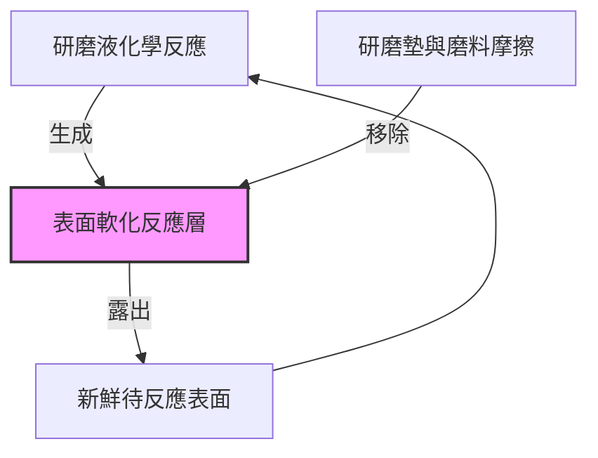

### 24.1.3 Preston 方程式

為了定量描述材料去除率（Material Removal Rate, MRR），1927 年由 Preston 提出的經驗公式至今仍是 CMP 理論的基礎。Preston 方程式假設材料移除速率與施加的壓力及相對運動速度成正比：

$$MRR = \frac{\Delta H}{\Delta t} = K_p \cdot P \cdot V$$

其中：
*   $MRR$：材料去除率，單位通常為 $\text{nm/min}$ 或 $\text{\AA/min}$。
*   $P$：施加於晶圓背面的下壓力（Down Force 或 Pressure），典型值範圍為 $1 \sim 5\,\text{psi}$。
*   $V$：晶圓與研磨墊之間的相對線速度（Relative Velocity），典型值為 $0.5 \sim 2\,\text{m/s}$。
*   $K_p$：Preston 比例常數（Preston Coefficient），是一個綜合性參數，反映了研磨液化學性質、磨料硬度、研磨墊彈性模數以及環境溫度等影響。

#### Preston 方程式的物理推導簡述
從能量守恆的角度來看，材料移除所需的功（Work, $W$）正比於摩擦力（$F_f$）與滑動距離（$s$）的乘積：
$$W \propto F_f \cdot s$$
摩擦力 $F_f = \mu \cdot L$，其中 $\mu$ 為摩擦係數，$L$ 為正向負載（$L = P \cdot A$，$A$ 為接觸面積）。滑動距離 $s = V \cdot \Delta t$。
將體積移除量 $V_{removed}$ 視為與功成正比，則有：
$$V_{removed} \propto \mu \cdot (P \cdot A) \cdot (V \cdot \Delta t)$$
因 $MRR$ 定義為單位面積的高度變化率（$\Delta H / \Delta t = V_{removed} / (A \cdot \Delta t)$），整理後即可得到 $MRR \propto P \cdot V$。

!!! note "說明"
    Preston 方程式雖然簡潔，但它隱含了一個前提：研磨過程處於「邊界潤滑（Boundary Lubrication）」狀態，即研磨墊、磨料與晶圓表面有直接的機械接觸。若轉速過高導致產生流體動力潤滑（Hydrodynamic Lubrication），晶圓會浮在研磨液薄膜上，此時 $MRR$ 將不再符合 Preston 方程式。

### 24.1.4 Preston 方程式的侷限性與修正模型

在現代先進製程中，實驗觀測到的 $MRR$ 往往與 Preston 方程式預測的線性關係有所偏差。主要存在以下幾種修正方向：

#### 1. 閾值壓力（Threshold Pressure）
對於某些硬度較高的材料（如氮化矽），必須施加超過一定程度的壓力才能啟動機械磨除。修正後的公式為：
$$MRR = K_p \cdot (P - P_0) \cdot V$$
其中 $P_0$ 為閾值壓力。若 $P < P_0$，則 $MRR$ 趨近於零或僅有極慢的純化學蝕刻速率。

#### 2. 非線性速度效應
當相對速度 $V$ 極高時，研磨液的供給可能成為瓶頸，或者摩擦產生的熱量改變了化學反應速率，導致 $MRR$ 呈現亞線性（Sub-linear）增長。常見的修正形式為：
$$MRR = K \cdot P^a \cdot V^b$$
其中指數 $a, b$ 通常小於 1。

#### 3. 朗繆爾-欣謝爾伍德模型（Langmuir-Hinshelwood Model）
為了更精確描述化學與機械的耦合，部分學者引入化學動力學模型。該模型認為 $MRR$ 受限於兩個步驟：化學反應生成軟化層的速率（$R_{chem}$）與機械磨除該層的速率（$R_{mech}$）。
$$MRR = \frac{R_{chem} \cdot R_{mech}}{R_{chem} + R_{mech}}$$
*   當壓力與速度極大時，$R_{mech} \gg R_{chem}$，去除率受限於化學反應速率（化學受限區）。
*   當壓力與速度極小時，$R_{chem} \gg R_{mech}$，去除率受限於機械磨除速率（機械受限區）。

!!! example "產業實例"
    在銅製程（見第 29 章）中，由於銅極易被研磨液中的氧化劑（如 $H_2O_2$）氧化，其 $R_{chem}$ 通常很高。工程師在調整製程參數時，主要透過控制壓力 $P$ 來精確微調 $MRR$，以避免過度研磨導致的導線損耗。

### 24.1.5 平坦化效率（Planarization Efficiency）

評估 CMP 製程優劣的另一個重要指標是平坦化效率（Planarization Efficiency, PE），定義如下：
$$PE = 1 - \frac{H_{final}}{H_{initial}}$$
其中 $H_{initial}$ 為研磨前的表面高低差，$H_{final}$ 為研磨後殘餘的高低差。理想的 CMP 應具備接近 1（或 100%）的 PE 值，這意味著研磨墊僅移除高處材料而完全不觸及低處。然而，由於研磨墊具有一定的彈性，在研磨過程中會發生微小的形變並下陷至低窪處，這導致了「碟形凹陷（Dishing）」等缺陷的產生，具體機制將在 24.3 節詳細討論。

<!-- fig:1 -->
<figure markdown>
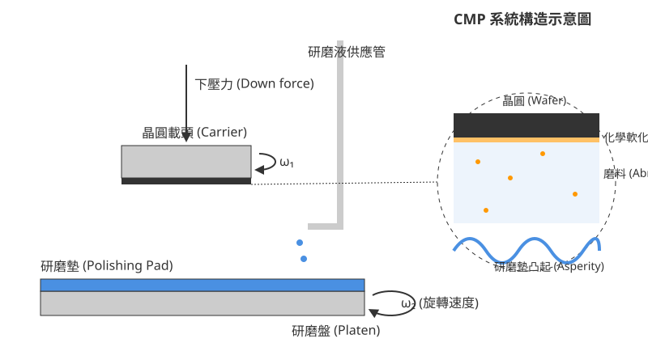
<figcaption>圖 24-1　CMP 系統構造示意圖（AI 繪製的示意圖）</figcaption>
</figure>

## 24.2 研磨液與研磨墊之材料特性

### 24.2.1 研磨液的化學組成與作用機制

化學機械研磨（CMP）的核心在於化學腐蝕與機械磨耗的協同作用。研磨液（Slurry）並非單純的懸浮液，而是一種經過高度精密配方的化學試劑，其組成直接決定了材料移除速率（Removal Rate, RR）、表面粗糙度以及製程選擇比。

#### 1. 磨料（Abrasives）
磨料是提供機械磨耗能（Mechanical Energy）的主要載體。其物理特性（如粒徑分佈、硬度、形狀）與化學活性對研磨品質至關重要。
*   **二氧化矽（$\text{SiO}_2$）**：最常見的磨料，主要用於層間介電層（ILD）與淺溝槽隔離（STI）製程。其硬度適中，能提供良好的表面平整度。
*   **氧化鋁（$\text{Al}_2\text{O}_3$）**：硬度較高，主要應用於金屬研磨（如鎢、銅）。氧化鋁顆粒通常帶正電荷（在酸性環境下），有利於吸附在帶負電的金屬氧化層表面。
*   **氧化鈰（$\text{CeO}_2$）**：具有獨特的「化學牙齒」（Chemical Tooth）效應。氧化鈰顆粒表面的 $\text{Ce}^{3+}$ 與矽酸鹽分子具有強烈的化學親和力，能顯著提高對二氧化矽的研磨速率，且對氮化矽（$\text{Si}_3\text{N}_4$）具有極高的選擇比，是先進 STI 製程的首選。

#### 2. 氧化劑（Oxidizers）
在金屬 CMP 中，氧化劑的作用是將疏水性的金屬表面（如 $\text{Cu}$ 或 $\text{W}$）轉化為親水性的金屬氧化物薄層。這層氧化層通常較軟，易於被磨料移除。
*   **過氧化氫（$\text{H}_2\text{O}_2$）**：最廣泛使用的氧化劑，因其分解產物僅為水與氧氣，不會引入金屬離子污染。
*   **典型值**：在銅研磨液中，$\text{H}_2\text{O}_2$ 的濃度通常控制在 $0.5\% \sim 5\%$ 之間。濃度過高會導致嚴重的靜態蝕刻（Static Etching），造成碟形凹陷。

#### 3. 錯合物配位基（Complexing Agents / Ligands）
金屬被氧化後產生的離子若直接進入溶液，可能會重新沈積或造成污染。配位基（如檸檬酸、甘胺酸）能與金屬離子結合形成穩定的水溶性錯合物，防止金屬離子在晶圓表面二次沈積，並協助維持研磨速率。

#### 4. 抑制劑（Inhibitors）
為了控制研磨的各向異性（Anisotropy），抑制劑會吸附在金屬表面的凹陷處，形成一層保護膜，防止化學蝕刻在非接觸區域發生。
*   **苯駢三氮唑（Benzotriazole, BTA）**：銅 CMP 中最關鍵的抑制劑。BTA 會與銅原子形成 $\text{Cu-BTA}$ 聚合物膜，有效阻止化學腐蝕，僅在研磨墊凸起處施加機械壓力時，該膜才會被磨除，從而實現平坦化。

#### 5. pH 緩衝劑與界面活性劑
研磨液的 pH 值決定了顆粒的表面電位（Zeta Potential），這關係到磨料的懸浮穩定性（防止團聚）以及與晶圓表面的靜電作用。界面活性劑則用於調節潤濕性，並輔助降低表面缺陷。

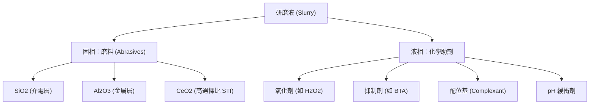

### 24.2.2 研磨墊的微觀結構與流體動力學

研磨墊（Polishing Pad）是 CMP 製程中傳遞機械能與輸送化學試劑的物理介質。其材料特性與表面幾何構造直接影響研磨的均勻性（Uniformity）與平坦化效率。

#### 1. 聚氨酯（Polyurethane）特性
大多數研磨墊採用發泡聚氨酯製成。其物理性質需在「硬度」與「彈性」之間取得平衡：
*   **硬度（Hardness）**：硬質研磨墊（如典型邵氏硬度 Shore D 50-70）具有較佳的階梯高度消除能力（Step Height Reduction），能產生優異的全域平坦化（Global Planarization），但容易造成刮傷（Scratches）。
*   **多孔性（Porosity）**：研磨墊表面分佈著微米級的孔洞（Pores），其作用是儲存研磨液並捕捉磨料顆粒，確保研磨介面有充足的反應物。

#### 2. 溝槽設計（Groove Design）
研磨墊表面通常加工有特定幾何形狀的溝槽，其功能包括：
*   **流體輸送**：將新鮮研磨液均勻分配至晶圓中心，並排出反應副產物與磨屑。
*   **散熱**：CMP 摩擦會產生大量熱能，溝槽有助於流體循環以冷卻介面。
*   **防止浮離（Hydroplaning）**：當轉速極高時，研磨液可能形成連續流體膜將晶圓撐起，導致研磨速率驟降。溝槽能破壞流體壓力分佈，維持固-固接觸。

常見溝槽形式包括：
*   **同心圓（Concentric Circles）**：最常見，利於維持徑向研磨均勻性。
*   **格子型（XY Grid）**：提供最強的流體交換效率。
*   **螺旋型（Spiral）**：有助於將研磨液由中心向外推送。

### 24.2.3 研磨墊修整（Pad Conditioning）

在研磨過程中，研磨墊會因機械擠壓與化學殘留導致表面孔洞閉合、纖維倒伏，這種現象稱為「釉化」（Glazing）。釉化會導致研磨速率隨時間大幅衰減。

#### 1. 金剛石修整盤（Diamond Disk）
修整技術利用鑲嵌有金剛石顆粒的圓盤，在研磨過程中或研磨間隙對研磨墊表面進行微量切削。其目的在於：
*   **粗糙度再生**：切除老化的聚氨酯層，重新露出具備粗糙度與孔洞的新鮮表面。
*   **維持開孔率**：確保研磨液能有效儲存於微孔中。

#### 2. 修整模式
*   **原位修整（In-situ Conditioning）**：研磨與修整同時進行。優點是能維持極為穩定的研磨速率，是目前主流量產製程（如 5nm、3nm 節點）的標準配置。
*   **非原位修整（Ex-situ Conditioning）**：在研磨兩片晶圓的間隙進行修整。

!!! note "說明"
    研磨墊的壽命通常由修整盤的切削速率決定。當研磨墊厚度消耗至極限（典型初始厚度約 $2 \sim 3 \text{ mm}$，消耗至 $1 \text{ mm}$ 以下可能需更換），或表面物理性質不可逆改變時，即需更換研磨墊。

### 24.2.4 材料選擇比（Selectivity）的工程調控

選擇比是指在相同研磨條件下，兩種不同材料移除速率的比值：
$$S_{A/B} = \frac{RR_A}{RR_B}$$
在複雜的積體電路結構中，CMP 往往需要在磨除目標材料後，精確停止在下方或側邊的停止層（Stop Layer）上。

#### 1. STI 製程中的選擇比
在淺溝槽隔離（STI）製程中，目標是移除多餘的二氧化矽（Oxide）並停在氮化矽（Nitride）上。
*   **傳統研磨液**：對 Oxide 與 Nitride 的選擇比約為 $4:1$，容易造成氮化矽損耗。
*   **氧化鈰研磨液**：透過添加特定的表面活性劑（如聚丙烯酸），可將選擇比提升至 $30:1$ 以上。這是因為活性劑會選擇性吸附在氮化矽表面形成保護層，而氧化鈰對二氧化矽具備強烈的化學活性。

#### 2. 金屬雙鑲嵌（Dual Damascene）中的選擇比
在銅導線製程中，涉及銅（Cu）、阻障層（Barrier, 如 Ta/TaN）與低介電常數材料（Low-k Dielectric）。
*   **第一階段（Bulk Cu CMP）**：追求極高的 Cu RR，並停在 Barrier 層。
*   **第二階段（Barrier CMP）**：需同時移除 Ta/TaN 與部分介電層，此時要求 $RR_{\text{Cu}} \approx RR_{\text{Barrier}} \approx RR_{\text{Dielectric}}$，以修正第一階段產生的碟形凹陷。

| 研磨對象 | 典型磨料 | 關鍵化學品 | 選擇比要求 (典型值) |
| :--- | :--- | :--- | :--- |
| **ILD (Oxide)** | $\text{SiO}_2$ | $\text{KOH}$ 或 $\text{NH}_4\text{OH}$ | $RR_{\text{Oxide}}$ 高，無特定停止層 |
| **STI (Oxide/Nitride)** | $\text{CeO}_2$ | 聚電解質抑制劑 | $\text{Oxide:Nitride} > 30:1$ |
| **Tungsten (W/TiN)** | $\text{Al}_2\text{O}_3$ | $\text{Fe(NO}_3)_3$ 或 $\text{H}_2\text{O}_2$ | $\text{W:TiN} \approx 1:1$ |
| **Copper (Cu/Barrier)** | $\text{SiO}_2$ / $\text{Al}_2\text{O}_3$ | $\text{BTA, H}_2\text{O}_2$ | $\text{Cu:Barrier} > 100:1$ (第一階段) |

!!! example "產業實例"
    截至撰寫時，在 3 奈米以下節點的環繞閘極電極（GAAFET）製程中，由於結構極度微小且複雜，研磨液供應商如 **Entegris (原 Cabot Microelectronics)** 與 **Fujifilm** 致力於開發「極低磨料濃度」（Low Solids Slurry）技術，以減少研磨產生的微小刮傷（Micro-scratch），並利用高度專一性的化學添加劑來精確控制奈米級的選擇比。

### 24.2.5 研磨終點偵測技術（Endpoint Detection, EPD）

由於研磨液與研磨墊的特性會隨時間微幅漂移，僅憑時間控制（Timed Polish）無法滿足先進製程的良率要求。

1.  **光學終點偵測（Optical EPD）**：在研磨墊上開一個透明窗口，利用雷射干涉或光譜反射原理，即時量測晶圓表面薄膜厚度。當反射光譜特徵發生突變時（如金屬磨盡露出介電層），即判定為終點。
2.  **馬達電流偵測（Motor Current EPD）**：利用摩擦力的變化。不同材料與研磨墊之間的摩擦係數（Coefficient of Friction, CoF）不同，當磨到不同材料介面時，旋轉馬達的負載電流會發生變化。

研磨液的化學配方與研磨墊的機械特性必須與 EPD 系統緊密配合，才能在確保平坦化的同時，避免過度研磨（Over-polishing）導致的元件失效。

## 24.3 表面缺陷與平坦化失效：碟形凹陷與侵蝕

在理想的化學機械研磨（CMP）過程中，製程目標是移除多餘的材料並達到完全平坦的表面（Global Planarization）。然而，由於研磨墊（Polishing Pad）具有有限的彈性模數（Elastic Modulus），且晶圓表面由不同硬度、不同化學特性的材料（如銅導線與二氧化矽介電層）交錯組成，這使得研磨過程表現出強烈的圖案依賴性（Pattern Dependency）。當研磨進入終點並進行過度研磨（Over-polishing）以確保殘留金屬完全清除時，便會產生碟形凹陷（Dishing）與侵蝕（Erosion）等表面缺陷。

### 碟形凹陷（Dishing）的物理機制

碟形凹陷是指在寬金屬線區域，金屬中心被過度研磨而導致表面低於周遭介電層平面的現象。其產生的核心原因在於研磨墊的黏彈性（Viscoelasticity）形變。

當研磨進行到金屬與介電層同時暴露的階段時，雖然研磨液（Slurry）的化學配方通常設計為對介電層有極低的研磨速率（高選擇比），但研磨墊在壓力下會發生局部形變，並「下陷」至寬導線的溝槽中。這使得研磨墊上的磨料（Abrasives）能夠接觸到溝槽內部的金屬表面，持續進行機械磨耗。

碟形凹陷的深度（$D_{dishing}$）通常與導線寬度（Line Width, $W$）呈正相關。根據接觸力學模型，碟形凹陷的演進可簡化表示為：

$$D_{dishing} \propto \frac{P \cdot W^4}{E \cdot t^3}$$

其中：
- $P$ 為施加之研磨壓力（Down Force）。
- $W$ 為金屬線寬度。
- $E$ 為研磨墊的彈性模數。
- $t$ 為研磨墊的有效厚度（或與表面粗糙層相關之參數）。

當導線寬度增加時，研磨墊中心失去周遭硬質介電層（如 $SiO_2$ 或 $Si_3N_4$）支撐的面積增大，導致形變量劇增。截至撰寫時，在先進製程的銅雙鑲嵌（Copper Dual Damascene）結構中（見第 29 章），寬導線（如電源線或電感）的碟形凹陷是影響導線電阻（Resistance）均勻性的主要因素。

### 侵蝕（Erosion）與局部壓力分佈

侵蝕是指在高密度細線區域（Dense Area），介電層的厚度損失量大於低密度區域（Sparse Area）或大面積介電層區域的現象。與碟形凹陷不同，侵蝕關注的是介電層本身的厚度減少。

侵蝕的成因源於局部壓力（Local Pressure）的重新分佈。在研磨過程中，研磨壓力 $P$ 會集中在表面突出的結構上。在導線密度（Pattern Density, $\rho$）較高的區域，雖然單條導線很細，不足以引起嚴重的碟形凹陷，但由於該區域內軟質金屬佔比較高，硬質介電層所構成的「支撐結構」相對薄弱。

根據 Preston 方程式（見 24.1 節），移除速率 $R$ 正比於壓力 $P$。在平衡狀態下，局部壓力 $P_{local}$ 與圖案密度 $\rho$ 的關係可表示為：

$$P_{local} = \frac{P_{nominal}}{\rho}$$

其中 $P_{nominal}$ 為機台設定的標稱壓力。當圖案密度 $\rho$ 增加時，支撐結構承受的局部壓力上升，導致該區域的介電層移除速率加快，最終造成整體的表面高度下降。

!!! warning "常見誤解"
    工程師常誤以為提高研磨液對介電層的選擇比（Selectivity）就能完全消除侵蝕。事實上，侵蝕是由於局部壓力過大導致的物理性損耗，即使選擇比極高，只要過度研磨時間過長，高密度區的介電層仍會因機械磨耗而變薄。

### 圖案密度效應（Pattern Density Effect）

圖案密度（Pattern Density, $\rho$）定義為單位面積內金屬所佔的比例：

$$\rho = \frac{A_{metal}}{A_{total}}$$

圖案密度效應是決定 CMP 平坦化效率（Planarization Efficiency, $PE$）的關鍵。在非均勻的佈局（Layout）中，高密度區與低密度區的研磨速率差異會導致晶圓表面產生長程（Long-range）的高度起伏。

1. **低密度區域**：介電層支撐力強，研磨速率較接近塊材（Bulk）速率，容易產生金屬殘留（Residue）。
2. **高密度區域**：介電層支撐力弱，容易發生侵蝕，導致導線厚度不足，增加電阻並影響後續微影製程的焦深（Depth of Focus, DOF）裕度。

下表總結了碟形凹陷與侵蝕的差異：

| 特性 | 碟形凹陷 (Dishing) | 侵蝕 (Erosion) |
| :--- | :--- | :--- |
| **主要受影響對象** | 寬金屬線中心 | 高密度區域的介電層與金屬 |
| **主導因素** | 線寬 ($W$)、研磨墊彈性 | 圖案密度 ($\rho$)、過度研磨時間 |
| **物理機制** | 研磨墊彎曲進入溝槽 | 局部壓力集中導致支撐結構損耗 |
| **對電性的影響** | 增加導線電阻、降低可靠度 | 減小層間介電層厚度、增加寄生電容 |

### 設計補償策略：虛擬填補（Dummy Fill）與插槽化（Slotting）

為了減輕圖案密度效應對 CMP 產生的負面影響，積體電路設計必須在自動化佈局階段引入補償機制。

#### 1. 虛擬填補（Dummy Fill）
在金屬密度過低的區域，人為地加入不具備電路功能的金屬圖案（Dummy Features）。其目的在於將全域的圖案密度調整至一個相對均勻的範圍（典型值為 30% 至 50%）。
- **優點**：平衡研磨壓力，減少高密度區與低密度區的移除速率差，有效抑制侵蝕。
- **缺點**：會引入額外的寄生電容（Parasitic Capacitance），可能影響高速訊號的傳輸延遲（RC Delay）。

#### 2. 插槽化（Slotting）
針對極寬的金屬導線（例如電源匯流排），在導線內部挖出長條狀或矩形的小孔，並填入介電材料。
- **原理**：將寬線「分割」成多條較窄的線段，利用中間的介電層作為支撐柱（Pillars），防止研磨墊下陷。
- **效果**：顯著降低寬線區域的碟形凹陷深度。

```mermaid
graph TD
    "佈局設計 (Layout Design)" --> "密度分析 (Density Analysis)"
    "密度分析 (Density Analysis)" -- "密度過低" --> "加入虛擬填補 (Dummy Fill)"
    "密度分析 (Density Analysis)" -- "線寬過大" --> "執行插槽化 (Slotting)"
    "加入虛擬填補 (Dummy Fill)" --> "CMP 模擬與驗證"
    "執行插槽化 (Slotting)" --> "CMP 模擬與驗證"
    "CMP 模擬與驗證" --> "光罩製作"
```

!!! note "說明"
    截至撰寫時，先進製程（如 3nm 以下節點）已廣泛採用「基於模型之虛擬填補」（Model-based Dummy Fill）。這種技術不再只是簡單地填滿空隙，而是利用 CMP 模擬軟體預測研磨後的形貌，動態調整虛擬圖案的大小與位置，以在平坦化與電性干擾之間取得最佳平衡。

### 碟形凹陷與侵蝕的量測

在製程監控中，通常使用原子筆觸式輪廓儀（Stylus Profiler）或原子筆力顯微鏡（AFM）來量測碟形凹陷與侵蝕的數值。
- **碟形凹陷量測**：掃描跨越寬導線的剖面，計算金屬最低點與兩側介電層平面的高度差。
- **侵蝕量測**：比較高密度陣列區與鄰近大面積介電層區（Field Area）的絕對高度差。

隨著元件尺寸微縮，光學散射儀（Scatterometry, 或稱 OCD）也成為線上（In-line）監控的重要工具，能快速提供大面積的形貌統計數據（見第 33 章）。

<!-- fig:2 -->
<figure markdown>
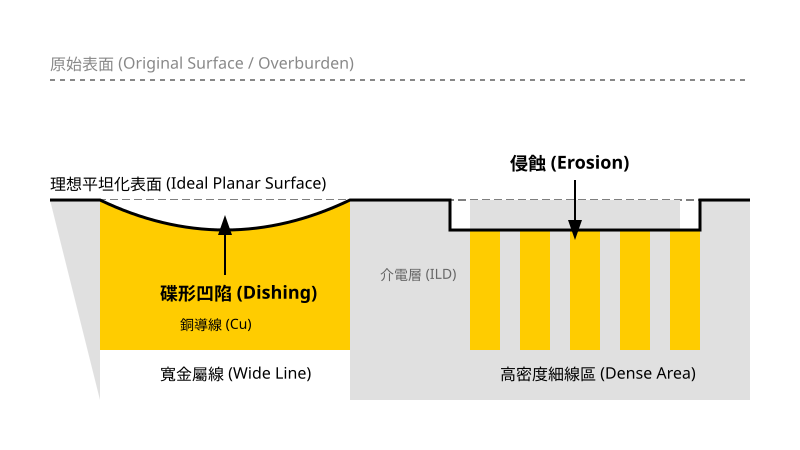
<figcaption>圖 24-2　碟形凹陷與侵蝕示意圖（AI 繪製的示意圖）</figcaption>
</figure>

## 24.4 CMP 後清洗與表面完整性

### 24.4.1 CMP 後污染物的物理化學特性

化學機械研磨（CMP）被公認為半導體製程中最「髒」的步驟。在研磨過程中，晶圓表面直接接觸含有高濃度磨料微粒、化學添加劑以及金屬離子的研磨液（Slurry），並與聚氨酯研磨墊進行劇烈摩擦。若研磨後的殘留物未能徹底清除，將直接導致後續薄膜沉積的附著力不良、微影成像缺陷，甚至引發金屬連線的電性短路或可靠度失效。

CMP 後的污染物主要可分為以下四類：

1.  **磨料微粒（Abrasive Particles）**：
    研磨液中常見的磨料包括二氧化矽（$SiO_2$）、氧化鋁（$Al_2O_3$）或二氧化鈰（$CeO_2$）。這些微粒的粒徑通常在 10 nm 至 200 nm 之間。由於研磨過程中的機械嵌入作用或凡得瓦力（Van der Waals force）吸引，微粒極易附著在晶圓表面。
2.  **金屬離子（Metal Ions）**：
    在金屬 CMP（如銅、鎢製程）中，研磨產生的金屬副產物會以離子或氧化物微粒形式存在。特別是銅離子（$Cu^{2+}$），其在矽與二氧化矽中具有極高的擴散係數，若未清除，會滲透至介電層或主動元件區，造成元件漏電流增加（見第 2 章與第 29 章）。
3.  **有機聚合物與研磨墊碎屑（Organic Residues and Pad Debris）**：
    研磨墊在修整（Conditioning）過程中會產生微小的聚氨酯碎屑；此外，研磨液中為了控制流變特性或保護金屬表面而加入的界面活性劑（Surfactants）與腐蝕抑制劑（如苯駢三氮唑，BTA），也會在表面形成難以去除的有機薄膜。
4.  **化學副產物（Chemical By-products）**：
    研磨過程中的化學反應產物，如金屬錯合物或不溶性的氫氧化物。

### 24.4.2 物理清洗機制：雙面刷洗與巨聲波清洗

為了克服微粒與表面之間強大的附著力，CMP 後清洗必須結合物理能量與化學藥劑。主要的物理清洗技術包括雙面刷洗與巨聲波清洗。

#### 雙面刷洗（Double-sided Brush Scrubbing）
截至撰寫時，雙面刷洗是 300 mm 晶圓量產線中最主流的清洗方式。其設備通常使用圓柱狀或圓盤狀的聚乙烯醇（Polyvinyl Alcohol, PVA）海綿刷材。PVA 刷材具有高度多孔性且質地柔軟，在吸水飽和後能降低對晶圓表面的機械損傷。

其物理機制包含以下三種作用：
*   **流體動力舉升（Hydrodynamic Lift）**：當刷子旋轉並與晶圓表面保持極微小間隙時，清洗液在間隙中產生的流體壓力會將微粒從表面抬升。
*   **機械接觸（Mechanical Contact）**：刷子的多孔結構能直接捕捉並帶走微粒。
*   **擴散與對流（Diffusion and Convection）**：透過刷洗過程中的流體交換，降低表面污染物的濃度梯度。

!!! note "雙面清洗的重要性"
    在先進製程中，晶圓背面（Backside）的清潔度與正面同樣重要。背面殘留的微粒會導致晶圓在後續微影曝光機的真空吸盤（Chuck）上產生平坦度偏差（Focus Spot），進而造成曝光失焦。因此，雙面同時刷洗是確保全域平坦化品質的必要手段。

#### 巨聲波清洗（Megasonic Cleaning）
巨聲波清洗使用的頻率通常在 0.8 MHz 至 2 MHz 之間。與低頻的超音波（Ultrasonic, 20-40 kHz）不同，巨聲波產生的空化現象（Cavitation）較為溫和，能避免損壞細微的圖形結構（如 FinFET 鰭片）。

其物理效應主要來自：
*   **聲流作用（Acoustic Streaming）**：高頻聲波在液體中產生的壓力梯度會引發高速流體微噴射，能有效減薄晶圓表面的邊界層（Boundary Layer），使清洗藥劑更容易滲透至深孔或溝槽底部。
*   **震盪推力**：直接給予微粒足夠的動能以克服凡得瓦力。

### 24.4.3 化學清洗藥劑與 Zeta 電位控制

單靠物理能量不足以防止微粒重新附著（Re-deposition）。在 CMP 後清洗中，化學藥劑的核心任務是調整系統的 Zeta 電位（Zeta Potential, $\zeta$），利用靜電斥力實現微粒的穩定懸浮。

#### Zeta 電位與靜電斥力原理
當固體浸入電解質溶液時，其表面會因為離子吸附或解離而帶電。根據電雙層（Electrical Double Layer）理論，緊貼表面的離子層稱為緊密層（Stern Layer），而外圍電荷分佈較鬆散的區域稱為擴散層（Diffuse Layer）。Zeta 電位即為擴散層邊界處的電位。

根據 DLVO 理論（Derjaguin-Landau-Verwey-Overbeek theory），微粒與表面間的總作用力 $V_{total}$ 為凡得瓦引力 $V_{A}$ 與靜電斥力 $V_{R}$ 的加總：
$$V_{total} = V_{A} + V_{R}$$

為了防止微粒回附，必須使 $V_{R}$ 遠大於 $V_{A}$。這通常透過調節清洗液的 pH 值來達成。每一種材料都有其等電點（Isoelectric Point, IEP），即 Zeta 電位為零時的 pH 值。

| 材料 | 典型等電點 (IEP) |
| :--- | :--- |
| 二氧化矽 ($SiO_2$) | pH 2.0 - 3.0 |
| 氧化鋁 ($Al_2O_3$) | pH 8.0 - 9.0 |
| 鈰土 ($CeO_2$) | pH 6.0 - 8.0 |
| 銅 ($Cu / CuO_x$) | pH 7.0 - 9.5 |
| 氮化矽 ($Si_3N_4$) | pH 4.0 - 6.0 |

在實際操作中，若要清洗 $SiO_2$ 介電層上的 $SiO_2$ 磨料，通常使用鹼性清洗液（如稀釋氫氧化銨，$NH_4OH$）。在 pH > 10 的環境下，兩者表面皆帶強負電，產生強大的靜電斥力，使微粒脫離後不再回附。

#### 金屬清洗化學
針對銅 CMP 後清洗，化學藥劑需具備以下功能：
1.  **錯合作用（Complexation）**：加入錯合劑（如檸檬酸或有機胺），與表面殘留的銅離子結合形成穩定的水溶性錯合物，防止銅離子在鹼性環境下產生氫氧化銅沉澱。
2.  **表面鈍化**：在清洗過程中微量去除受損的銅表面（微蝕刻），同時形成一層極薄且緻密的保護膜，防止銅線在清洗液中發生電化學腐蝕。

### 24.4.4 乾燥技術：馬蘭哥尼效應（Marangoni Effect）

清洗後的最後一個關鍵步驟是乾燥。若乾燥不完全，殘留的水滴在揮發過程中會濃縮雜質，形成所謂的「水痕」（Water Marks），這在疏水性表面（如裸矽或低介電常數材料）尤為嚴重。

截至撰寫時，先進製程普遍採用基於馬蘭哥尼效應的乾燥技術。其物理原理如下：

當晶圓從去離子水（DIW）槽中緩慢升起，或是在旋轉乾燥時，於水膜表面引入異丙醇（IPA）蒸氣。由於 IPA 的表面張力（約 $22 \, mN/m$）遠低於水（約 $72 \, mN/m$），在水膜邊緣會產生表面張力梯度（Surface Tension Gradient）。

根據流體力學，流體會從低表面張力區域流向高表面張力區域。這種由張力梯度驅動的流動即為馬蘭哥尼流（Marangoni Flow）。此力量會將晶圓表面的水膜迅速「拉」回液體主體中，實現瞬間乾燥，且不會留下任何殘餘微滴。

$$ \gamma_{gradient} = \frac{d\gamma}{dx} $$
其中 $\gamma$ 為表面張力。較大的張力梯度能提供更強的乾燥動力。

### 24.4.5 表面完整性與清洗流程整合

CMP 後清洗的成效評估不僅在於微粒數量（Light Point Defects, LPD），還包括表面粗糙度（Roughness）與化學狀態。過強的化學清洗可能導致介電層表面粗糙化，或造成金屬線的凹陷加劇。

典型的 CMP 後清洗流程如下：

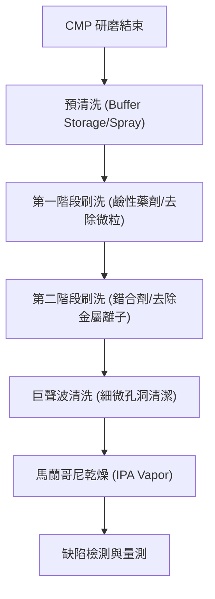

!!! warning "常見誤解：清洗壓力越大越好"
    工程實務中常誤認為增加 PVA 刷子的下壓力能提升清洗效率。事實上，過高的壓力會導致刷材變形，減少有效接觸面積，並可能將微粒更深地壓入軟質材料（如銅或 Low-k 介電層）中，造成不可逆的刮傷（Scratches）。最佳化清洗條件通常是在低壓力下維持穩定的流體動力薄膜。

截至撰寫時，隨著電晶體架構進入 GAAFET（見第 6 章）以及導線間距微縮至 20 nm 以下，CMP 後清洗面臨的主要挑戰在於如何去除高深寬比結構內部的殘留物，以及如何在不傷害極薄奈米片（Nanosheets）的前提下提供足夠的物理能量。這促使了新型化學藥劑（如功能性表面活性劑）與原子層清洗（Atomic Layer Cleaning）概念的發展。

## 24.5 設備與廠商技術

化學機械研磨（CMP）設備的設計核心在於如何精確控制研磨壓力、相對速度以及化學環境，以達成奈米級的平坦化要求。隨著半導體製程進入 3 奈米（nm）以下節點，設備的穩定性、均勻性控制（Uniformity Control）以及終點偵測（Endpoint Detection, EPD）的靈敏度成為技術發展的關鍵。

### 24.5.1 研磨系統架構：旋轉式與直線式

目前產業中主要的研磨系統架構可分為旋轉式（Rotary）與直線式（Linear）兩大類，兩者在物理機制與製程特性上各有取捨。

#### 旋轉式研磨系統 (Rotary CMP System)
旋轉式是目前應用最廣泛的架構。其構造包含一個大尺寸的旋轉研磨盤（Platen）以及一個承載晶圓的旋轉研磨頭（Wafer Carrier/Head）。研磨墊（Polishing Pad）貼附於研磨盤上，研磨頭則將晶圓下壓至研磨墊表面。

*   **運動學特性**：研磨盤以角速度 $\omega_p$ 旋轉，研磨頭以角速度 $\omega_h$ 旋轉。為了達成晶圓表面各點的研磨速率一致，通常設定 $\omega_p \approx \omega_h$，使晶圓表面每一點相對於研磨墊的線速度趨於一致。
*   **優點**：機械構造相對簡單且穩定，研磨墊的翻修（Conditioning）技術成熟，易於整合多個研磨盤以提升產出。
*   **挑戰**：由於旋轉運動，晶圓邊緣與中心的相對速度仍可能存在微小差異，需透過多區壓力控制（Multi-zone Pressure Control）研磨頭來補償。

#### 直線式研磨系統 (Linear CMP System)
直線式架構使用一條長形的連續研磨帶（Polishing Belt），研磨帶以恆定的直線速度 $v$ 移動，晶圓則壓在研磨帶上並進行旋轉。

*   **運動學特性**：相對於旋轉式，直線式系統在晶圓接觸面上的相對速度向量在空間分佈上更為均勻，因為研磨帶的基礎速度是單向直線運動。
*   **優點**：由於線速度恆定且不依賴於研磨盤直徑，在處理大尺寸晶圓時，邊緣效應（Edge Effect）較易控制。此外，直線式系統通常具有較小的設備佔地面積（Footprint）。
*   **挑戰**：研磨帶的張力控制較旋轉式研磨盤複雜，且研磨帶的更換與翻修成本較高。

### 24.5.2 終點偵測技術 (Endpoint Detection, EPD)

在 CMP 製程中，精確停止研磨以避免過度研磨（Over-polishing）或研磨不足（Under-polishing）至關重要。終點偵測技術根據物理原理可分為以下幾類：

#### 1. 馬達電流轉矩法 (Motor Current/Torque Method)
這是最基礎的偵測方式。當研磨介面由一種材料轉換至另一種材料時（例如從銅導線研磨至阻障層或介電層），介面間的摩擦係數（Coefficient of Friction）會發生改變。
*   **原理**：摩擦力的變化會導致研磨盤或研磨頭馬達所需的轉矩（Torque）改變，進而反映在馬達電流的波動上。
*   **應用**：常用於金屬 CMP 製程的粗研磨階段，但對於摩擦係數差異較小的材料組合，其靈敏度不足。

#### 2. 光學干涉法 (Optical Interference Method)
光學法透過研磨墊上的透明窗口（Window），利用雷射或寬頻光源照射晶圓表面，並接收反射光。
*   **原理**：利用薄膜干涉原理，反射光的強度會隨薄膜厚度的減少而呈現週期性震盪。透過計算震盪次數或光譜分析，可即時得知剩餘膜厚。
*   **應用**：廣泛應用於層間介電質（ILD）或淺溝槽隔離（STI）等透明或半透明薄膜的研磨監控，可達成奈米級的厚度控制。

#### 3. 渦電流法 (Eddy Current Method)
針對導電材料（如銅、鎢），渦電流法是極為有效的非接觸式偵測技術。
*   **原理**：感測器線圈產生高頻交變磁場，在晶圓表面的金屬層感應出渦電流。渦電流產生的反向磁場會影響線圈的阻抗（Impedance）。
*   **物理關係**：感應強度與金屬層的薄層電阻（Sheet Resistance）成正比，進而與金屬厚度 $d$ 相關：
    $$V_{signal} \propto \sigma \cdot d$$
    其中 $\sigma$ 為材料電導率。
*   **應用**：截至撰寫時，渦電流偵測已成為先進銅雙鑲嵌（Copper Damascene）製程的標準配置，能在不停止研磨的情況下精確量測金屬殘留厚度。

### 24.5.3 高產出設計：多研磨頭與多研磨盤

為了滿足量產的高產出（Throughput）需求，現代 CMP 設備普遍採用模組化與並行處理設計。

*   **多研磨盤 (Multi-platen)**：一台機台通常配置 3 到 4 個研磨盤。這允許製程進行分段處理，例如：Platen 1 進行粗研磨（Bulk Polish），Platen 2 進行精研磨（Fine Polish/Stop-on-layer），Platen 3 進行緩衝研磨（Buff Polish）以消除微刮傷。
*   **多研磨頭 (Multi-head)**：在同一個研磨盤上同時使用多個研磨頭，或是在多個研磨盤間快速切換傳送。
*   **整合式清洗 (Integrated Cleaning)**：為了防止研磨液乾涸導致的顆粒污染，現代設備將 CMP 研磨單元與後清洗單元（見第 20 章與第 24.4 節）整合在同一自動化平台內，實現「乾進乾出」（Dry-in, Dry-out）的作業模式。

### 24.5.4 產業實例與廠商技術對比

在先進邏輯與記憶體製程中，CMP 設備市場主要由少數幾家技術領先的廠商佔據。各家廠商在研磨頭壓力控制機制、終點偵測演算法以及清洗模組的整合上各有特色。

下表彙整了截至撰寫時，產業中具代表性的 CMP 設備廠商及其技術特點：

| 廠商 | 代表產品系列 | 技術路線與特點 | 主要應用 |
| :--- | :--- | :--- | :--- |
| Applied Materials | Reflexion LK Prime | 採用旋轉式三研磨盤架構，配備多區獨立壓力控制研磨頭，整合光學與渦電流即時監控系統。 | 先進邏輯製程、3D NAND、DRAM 金屬與介電質平坦化。 |
| Ebara | F-REX 系列 | 獨特的線性排列多研磨盤設計，強調高產出與優異的晶圓清洗整合技術，具備高精度的終點偵測。 | 先進節點銅導線、鎢栓塞及氧化層研磨。 |
| Lam Research | — | 專注於高均勻性研磨與後清洗技術的整合，強調在極薄膜層研磨時的低壓力控制能力。 | 先進封裝與特定金屬層研磨。 |

#### 廠商技術取捨分析
晶圓廠在選擇 CMP 設備時，核心考量在於「製程窗口（Process Window）」與「持有成本（Cost of Ownership, CoO）」。

1.  **壓力控制精細度**：Applied Materials 的 Reflexion LK Prime 透過增加研磨頭內的氣囊分區（Zones），能針對晶圓徑向的研磨速率進行微調，這對於解決邊緣研磨速率過快或過慢的問題至關重要。
2.  **清洗效率與缺陷率**：Ebara 的 F-REX 系列在研磨後的刷洗（Scrubbing）與乾燥技術上具有優勢，能有效降低因研磨液殘留導致的缺陷，這在先進節點對缺陷極度敏感的情況下尤為重要。
3.  **終點偵測的整合**：各家廠商皆致力於開發更複雜的演算法，以過濾研磨過程中的機械雜訊，提升光學或渦電流訊號的信噪比（SNR）。例如，在處理極薄的殘留金屬時，如何精確判定停止點以避免碟形凹陷（Dishing），是各家技術競爭的焦點。

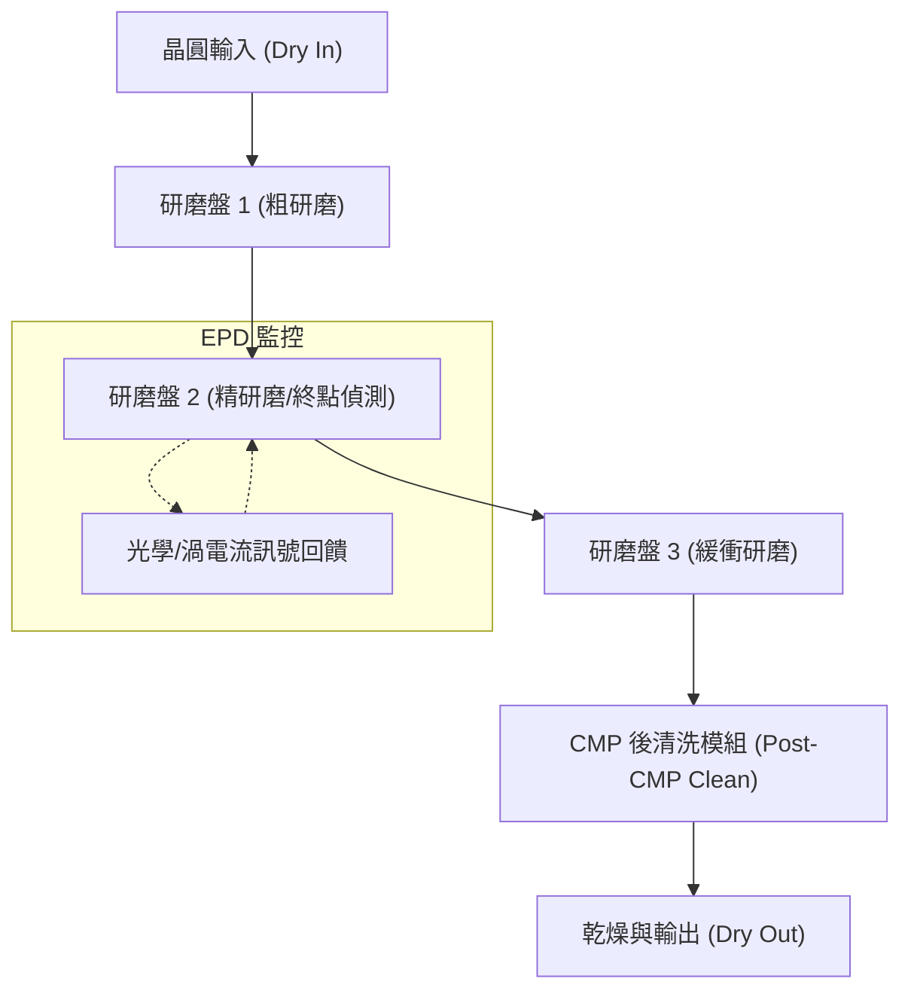

!!! note "設備選型考量"
    在先進製程中，CMP 設備不再僅是單純的研磨機，而是整合了「量測-研磨-清洗」的閉迴路控制系統。工程師在選機時，除了考量產出速率（WPH, Wafers Per Hour），更需評估設備對於不同研磨液（Slurry）的相容性，以及在長時間連續運作下，研磨墊翻修器（Disk Dresser）對研磨墊表面粗糙度維持的一致性。

截至撰寫時，隨著環繞式閘極電晶體（GAAFET）與背面供電（Backside Power Delivery Network, BSPDN）技術的導入（見第 6 章與第 32 章），CMP 設備正朝向極薄晶圓處理與更高選擇比（Selectivity）的研磨技術演進，以應對日益複雜的 3D 結構平坦化需求。

## 本章重點

*   化學機械研磨（CMP）是目前半導體製程中唯一能達成全域平坦化（Global Planarization）的技術，對於克服高數值孔徑微影技術中焦深（DOF）不足的問題至關重要。
*   CMP 的移除機制結合了化學反應生成的軟化層與磨料的機械磨除，Preston 方程式（$MRR = K_p \cdot P \cdot V$）是描述材料去除率的基礎經驗公式。
*   研磨液（Slurry）由磨料、氧化劑、錯合物配位基、抑制劑與 pH 緩衝劑組成，其中氧化鈰（$\text{CeO}_2$）磨料因其「化學牙齒」效應，在淺溝槽隔離（STI）製程中具備極高的二氧化矽對氮化矽選擇比。
*   研磨墊通常由聚氨酯製成，其硬度與溝槽設計影響平坦化效率與流體輸送；研磨墊修整（Conditioning）是維持穩定研磨速率的必要程序。
*   碟形凹陷（Dishing）與侵蝕（Erosion）是 CMP 常見的表面缺陷，主要受圖案密度（Pattern Density）與導線寬度影響，可透過設計端的虛擬填補（Dummy Fill）與插槽化（Slotting）進行補償。
*   CMP 後清洗需結合雙面刷洗、巨聲波清洗等物理能量，並透過調節 pH 值控制 Zeta 電位，利用靜電斥力防止微粒重新附著。
*   乾燥製程常利用馬蘭哥尼效應（Marangoni Effect），藉由異丙醇（IPA）蒸氣產生的表面張力梯度實現無水痕乾燥。


## 重點圖卡

複習時看這幾張就能抓住本章重點；[圖卡庫](../cards.md)可以下載成圖片。

<div class="ix-cards" markdown>

<figure markdown>
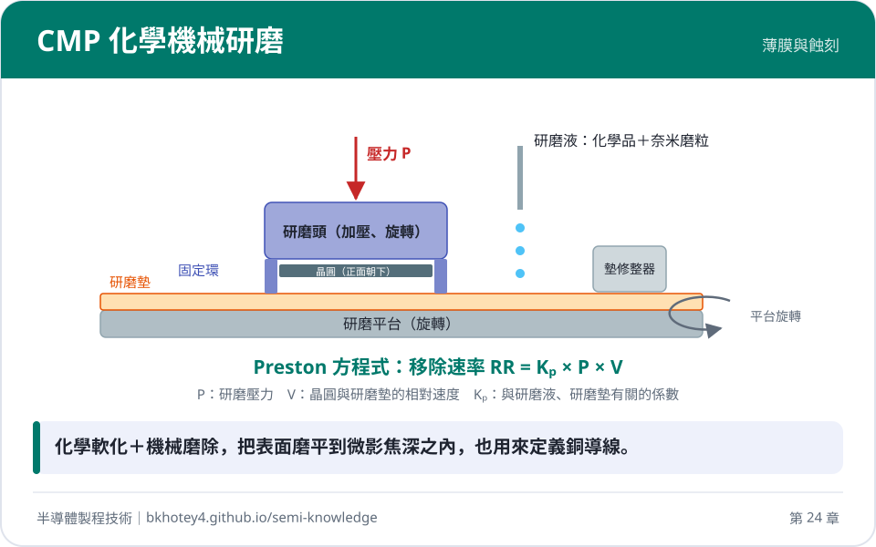
<figcaption>核心概念圖卡：CMP 化學機械研磨</figcaption>
</figure>

<figure markdown>
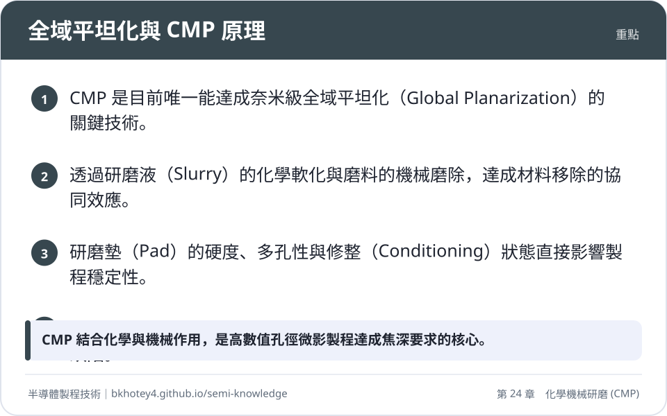
<figcaption>重點圖卡：全域平坦化與 CMP 原理</figcaption>
</figure>

<figure markdown>
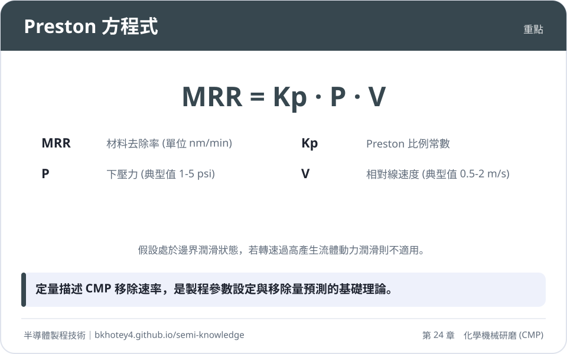
<figcaption>重點圖卡：Preston 方程式</figcaption>
</figure>

<figure markdown>
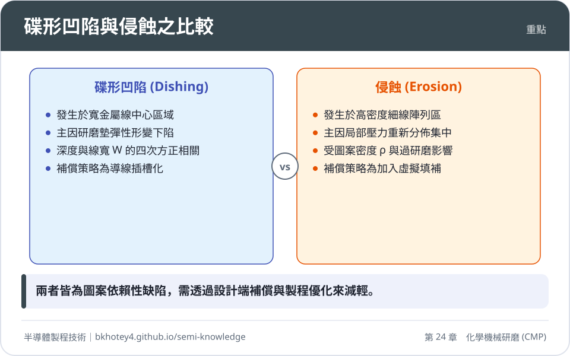
<figcaption>重點圖卡：碟形凹陷與侵蝕之比較</figcaption>
</figure>

<figure markdown>
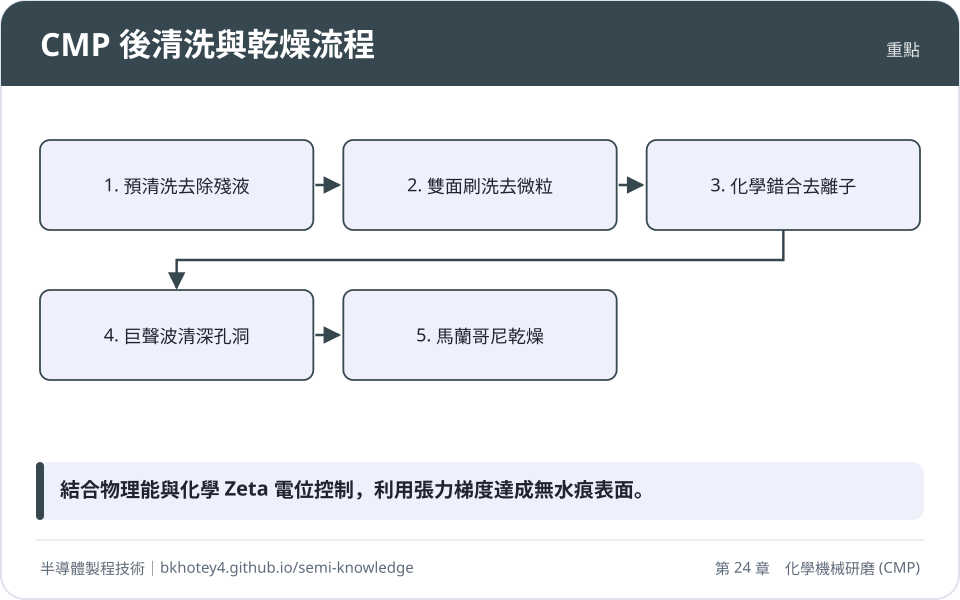
<figcaption>重點圖卡：CMP 後清洗與乾燥流程</figcaption>
</figure>

</div>

## 習題

**1.** 試說明為何隨著微影技術進入先進節點（如 7nm 以下），CMP 的全域平坦化能力變得比早期製程的局部平坦化更為重要？

??? success "參考解答"
    隨著微影系統的數值孔徑（NA）增加，光學系統的焦深（Depth of Focus, DOF）會顯著縮減（$DOF \propto \lambda / NA^2$）。在先進節點中，DOF 往往小於 50 nm。若晶圓表面起伏超過此範圍，微影成像將發生失焦，導致圖案解析度下降或線寬失真。CMP 是唯一能在大範圍（晶片或晶圓尺度）內達成奈米級平坦度的技術，確保表面起伏落在 DOF 裕度內。

**2.** 某製程使用 Preston 方程式進行研磨速率估算。已知在壓力 $P = 3\,\text{psi}$、相對速度 $V = 1\,\text{m/s}$ 時，材料去除率為 $3000\,\text{\AA/min}$。若將下壓力提升至 $4\,\text{psi}$，且為了維持相同的 $MRR$，相對速度應調整為多少？（假設 $K_p$ 為常數）

??? success "參考解答"
    根據 Preston 方程式 $MRR = K_p \cdot P \cdot V$：
    1. 首先求出 $K_p$：$3000 = K_p \cdot 3 \cdot 1 \Rightarrow K_p = 1000\,\text{\AA}/(\text{min} \cdot \text{psi} \cdot \text{m/s})$。
    2. 設定新的條件：$3000 = 1000 \cdot 4 \cdot V_{new}$。
    3. 解得 $V_{new} = 3000 / 4000 = 0.75\,\text{m/s}$。

**3.** 比較「碟形凹陷（Dishing）」與「侵蝕（Erosion）」在物理成因與受影響區域上的差異。

??? success "參考解答"
    (1) 碟形凹陷：發生於寬金屬線區域。成因是研磨墊具有彈性，在壓力下會下陷至溝槽內部，導致金屬中心被過度磨除，深度與線寬（$W$）呈正相關。
    (2) 侵蝕：發生於高密度細線區域。成因是局部壓力分佈不均，軟質金屬佔比高導致硬質介電層支撐力不足，使該區域整體移除速率加快，造成介電層厚度損失。

**4.** 在 STI 製程中，為何氧化鈰（$\text{CeO}_2$）研磨液對二氧化矽的移除速率遠高於氮化矽？這在製程上有何優點？

??? success "參考解答"
    氧化鈰顆粒表面的 $\text{Ce}^{3+}$ 能與二氧化矽分子產生強烈的化學親和力（化學牙齒效應），而透過添加特定的表面活性劑，可使其在氮化矽表面形成保護層。這種高選擇比（通常 $> 30:1$）的特性，使得研磨過程能精確停止在氮化矽層，減少氮化矽損耗並提升製程窗口（Process Window）。

**5.** 試述馬蘭哥尼效應（Marangoni Effect）在晶圓乾燥製程中的物理原理。

??? success "參考解答"
    馬蘭哥尼效應是由表面張力梯度驅動的流體流動。在乾燥過程中，於水膜表面引入異丙醇（IPA）蒸氣，由於 IPA 的表面張力遠低於水，在水膜邊緣產生張力梯度。流體會從低表面張力區（IPA 處）流向高表面張力區（水膜主體），將晶圓表面的殘留水膜迅速拉回液體中，達成無水痕乾燥。

## 本章術語

- **CMP**（化學機械研磨）：結合化學腐蝕與機械磨耗，達成晶圓表面全域平坦化的製程。
- **Preston Equation**（Preston 方程式）：描述材料移除速率與研磨壓力及相對速度成正比的經驗公式。
- **Slurry**（研磨液）：含有磨料與化學添加劑的懸浮液，用於 CMP 製程中提供化學與機械作用。
- **Selectivity**（選擇比）：在相同研磨條件下，兩種不同材料移除速率的比值。
- **Dishing**（碟形凹陷）：在寬導線區域，因研磨墊形變導致金屬中心高度低於周遭介電層的現象。
- **Erosion**（侵蝕）：在高密度圖案區，因局部壓力集中導致介電層厚度過度損耗的現象。
- **Dummy Fill**（虛擬填補）：在佈局設計中加入不具電性功能的圖案，以平衡圖案密度並減少 CMP 侵蝕。
- **Conditioning**（研磨墊修整）：利用金剛石修整盤切削研磨墊表面，以恢復其粗糙度與開孔率的程序。
- **Zeta Potential**（Zeta 電位）：微粒表面電雙層擴散層邊界處的電位，決定了微粒間的靜電斥力。
- **EPD**（終點偵測）：利用光學、電流或渦電流訊號即時監控研磨進度，以精確判定停止時間的技術。


## 互動學習

!!! tip "動手試試看"
    - [設備機台圖鑑：化學機械研磨機](../equipment.md)

<div class="quiz" data-quiz="04-07"></div>


## 產業最新進展

本節由每日產業新聞自動補充，說明本章技術在產業上的最新發展。

<!-- updates -->
（目前尚無補充。）
