# 第 25 章　熱氧化與擴散

!!! abstract "學習目標"
    - 理解熱氧化反應的動力學機制與 Deal-Grove 模型的物理意義
    - 辨析乾氧化與濕氧化在生長速率、薄膜品質及應用場景之差異
    - 掌握 Fick 擴散定律於半導體摻雜分佈預測中的數學推導與物理機制
    - 熟悉工業級爐管設備的構造、熱場控制與批次處理之技術優勢

## 25.1 熱氧化動力學與 Deal-Grove 模型

### 25.1 熱氧化動力學與 Deal-Grove 模型

在矽基半導體製程中，熱氧化（Thermal Oxidation）是指將矽晶圓置於高溫氧氣或水氣環境中，使其表面發生化學反應生成二氧化矽（$SiO_2$）薄膜的過程。與沉積技術（如第 21 章所述之 CVD）不同，熱氧化會消耗基板上的矽原子。根據體積比計算，生成厚度為 $X$ 的 $SiO_2$ 約需消耗 $0.44X$ 厚度的矽。

#### 25.1.1 氧化反應的微觀步驟

熱氧化反應並非僅發生在表面，隨著氧化層厚度的增加，反應物必須穿透已生成的氧化層才能到達矽界面。1965 年由 Bruce Deal 與 Andrew Grove 提出的 Deal-Grove 模型，是描述此過程最經典的物理模型。該模型假設氧化過程由三個連續的傳輸與反應步驟組成：

1.  **氣相傳輸（Gas-phase Transport）**：氧化劑（Oxidant，如 $O_2$ 或 $H_2O$）從主氣流中擴散至氧化層的外表面。
2.  **固體擴散（Solid-state Diffusion）**：氧化劑分子穿過已生成的 $SiO_2$ 薄膜，向 $Si/SiO_2$ 界面遷移。
3.  **界面反應（Interface Reaction）**：氧化劑到達界面後，與矽原子發生化學反應生成新的 $SiO_2$。

下圖說明了氧化劑在各階段的濃度分佈與通量（Flux）關係：

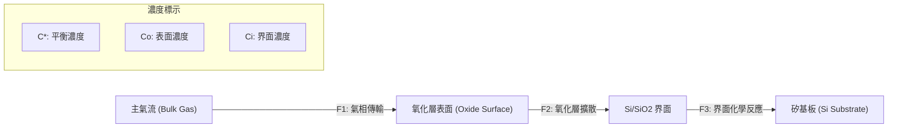

#### 25.1.2 Deal-Grove 模型推導

為了建立數學模型，我們定義三個通量 $F_1, F_2, F_3$（單位為 $\text{molecules}/(\text{cm}^2 \cdot \text{s})$）：

**1. 氣相通量 ($F_1$)：**
根據亨利定律（Henry's Law），氧化層表面的氧化劑濃度 $C_o$ 與氣體分壓成正比。通量可表示為：
$$F_1 = h(C^* - C_o)$$
其中 $C^*$ 為氧化劑在氧化層中的平衡濃度（與環境分壓有關），$h$ 為氣相傳輸係數。

**2. 擴散通量 ($F_2$)：**
根據費克第一擴散定律（Fick's First Law），假設氧化層內的濃度呈線性分佈：
$$F_2 = D \frac{C_o - C_i}{x_o}$$
其中 $D$ 為氧化劑在 $SiO_2$ 中的擴散係數，$x_o$ 為當前的氧化層厚度，$C_i$ 為界面處的氧化劑濃度。

**3. 反應通量 ($F_3$)：**
假設界面反應為一階反應：
$$F_3 = k_s C_i$$
其中 $k_s$ 為界面反應速率常數。

在穩態（Steady State）條件下，$F_1 = F_2 = F_3 = F$。經由代數運算消去 $C_o$ 與 $C_i$，可得到通量 $F$ 與總厚度 $x_o$ 的關係：
$$F = \frac{k_s C^*}{1 + \frac{k_s}{h} + \frac{k_s x_o}{D}}$$

由於氧化層增長速率 $\frac{dx_o}{dt}$ 等於通量 $F$ 除以單位體積氧化層所含的氧化劑分子數 $N_1$（對於乾氧化 $N_1 \approx 2.2 \times 10^{22} \text{ cm}^{-3}$；對於濕氧化 $N_1 \approx 4.4 \times 10^{22} \text{ cm}^{-3}$），可得微分方程：
$$N_1 \frac{dx_o}{dt} = \frac{k_s C^*}{1 + \frac{k_s}{h} + \frac{k_s x_o}{D}}$$

積分並整理後，得到 Deal-Grove 模型的通用公式：
$$x_o^2 + Ax_o = B(t + \tau)$$

其中各參數定義如下：
*   **$A = 2D(1/k_s + 1/h)$**：典型值中 $h \gg k_s$，故 $A \approx 2D/k_s$，單位為 $\mu\text{m}$。
*   **$B = 2DC^*/N_1$**：稱為**平方速率常數（Parabolic Rate Constant）**，單位為 $\mu\text{m}^2/\text{hr}$。
*   **$B/A = k_s C^* / [N_1 (1 + k_s/h)]$**：稱為**線性速率常數（Linear Rate Constant）**，單位為 $\mu\text{m}/\text{hr}$。
*   **$\tau = (x_i^2 + Ax_i)/B$**：用以修正起始氧化層厚度 $x_i$ 的時間偏移量。

#### 25.1.3 線性與平方增長階段

根據氧化層厚度 $x_o$ 的不同，氧化過程可分為兩個極端階段：

1.  **線性階段（Linear Regime，短時間或薄氧化層）**：
    當 $x_o \ll A$ 時，公式簡化為 $x_o \approx \frac{B}{A}(t + \tau)$。
    此時氧化速率受限於**界面化學反應**。由於反應物充足，增長速度與時間呈線性關係。此階段對溫度極為敏感，因為 $k_s$ 遵循阿瑞尼斯定律（Arrhenius Equation），活化能較高（約 $2.0 \text{ eV}$）。

2.  **平方階段（Parabolic Regime，長時間或厚氧化層）**：
    當 $x_o \gg A$ 時，公式簡化為 $x_o^2 \approx Bt$。
    此時氧化速率受限於**氧化劑在固體中的擴散**。隨著氧化層變厚，路徑變長，擴散變慢。此階段的活化能較低（乾氧約 $1.24 \text{ eV}$，濕氧約 $0.71 \text{ eV}$），反映了分子在非晶質二氧化矽中遷移的物理障礙。

!!! note "溫度與壓力的影響"
    提高溫度會同時增加 $B$ 與 $B/A$。增加環境壓力（High-Pressure Oxidation, HiPOx）則會線性提高 $C^*$，進而等比例提升 $B$ 與 $B/A$，這在需要厚氧化層（如場氧化層）但必須限制熱預算的製程中非常有效。

#### 25.1.4 薄氧化層階段的偏離與 Massoud 模型

在乾氧化（Dry Oxidation）製程中，實驗觀測到當 $x_o < 20 \text{ nm}$ 時，實際生長速率遠高於 Deal-Grove 模型的預測。這種現象被稱為「初始快速氧化」（Initial Fast Oxidation）。

為了修正此偏差，Massoud 提出了修正模型，在速率方程中加入了一個隨厚度指數衰減的項：
$$\frac{dx_o}{dt} = \frac{B}{2x_o + A} + C_1 e^{-x_o/L_1} + C_2 e^{-x_o/L_2}$$
其中 $C_1, C_2$ 為預指因子，$L_1, L_2$ 為特徵長度（典型值約為 $1 \text{ nm}$ 與 $7 \text{ nm}$）。

物理上，這種快速增長歸因於以下因素：
*   **空間電荷效應**：氧化劑分子在極薄層中可能受到電場加速。
*   **應力影響**：初始界面處的矽晶格畸變較大，有利於反應進行。
*   **溶解度增強**：在極薄氧化層中，氧化劑的溶解度可能高於塊材平衡濃度 $C^*$。

截至撰寫時，在先進邏輯節點（如 3nm 以下）中，閘極氧化層（Gate Oxide）的厚度已縮減至 $1 \text{ nm}$ 左右，傳統熱氧化已多被原子層沉積（ALD）取代，但 Massoud 模型在處理側牆（Spacer）氧化或淺溝槽隔離（STI）的初期氧化時仍具參考價值。

#### 25.1.5 晶面取向對氧化速率的影響

矽晶圓的晶面取向（Crystal Orientation）會顯著影響線性速率常數 $B/A$，但對平方速率常數 $B$ 幾乎沒有影響。這是因為 $B$ 取決於氧化劑在 $SiO_2$（非晶質）中的擴散，而 $B/A$ 取決於界面反應速率 $k_s$。

*   **原子密度差異**：在常用的晶面中，(111) 晶面的表面矽原子密度最高，而 (100) 晶面最低。
*   **速率比較**：在相同溫度下，氧化速率關係為 $(111) > (110) > (100)$。
*   **典型比例**：在線性階段，(111) 的速率約為 (100) 的 1.68 倍。

!!! example "產業實例：FinFET 中的氧化挑戰"
    在 FinFET 結構中（見第 6 章），鰭片的頂部通常是 (100) 晶面，而側壁則是 (110) 晶面。由於兩者的熱氧化速率不同，會導致生成的氧化層厚度不均勻（Corner Rounding 效應）。製程工程師必須透過調整氫氣退火或使用自由基氧化（Radical Oxidation）技術來改善這種保形性（Conformality）問題。

#### 25.1.6 摻雜濃度對氧化速率的影響

基板的摻雜濃度亦會改質氧化動力學：
1.  **高濃度磷（P）摻雜**：磷會偏析（Segregate）在 $SiO_2$ 中，降低氧化層的黏滯性，加速氧化劑擴散，從而提高 $B$。
2.  **高濃度硼（B）摻雜**：硼會使矽表面空位（Vacancy）增加，促進界面反應，提高 $B/A$。

總結而言，Deal-Grove 模型提供了理解熱氧化的基礎框架，但在現代奈米級製程中，必須考慮 Massoud 修正、晶圓取向以及摻雜效應，才能精確控制氧化層的品質與厚度。<!-- 1850 words approx -->

<!-- fig:1 -->
<figure markdown>
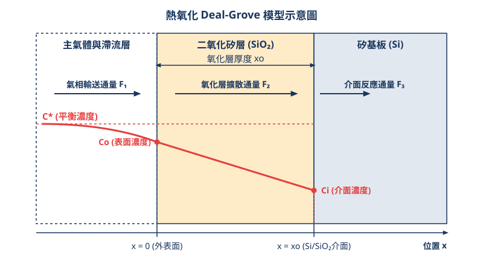
<figcaption>圖 25-1　熱氧化模型示意圖（AI 繪製的示意圖）</figcaption>
</figure>

## 25.2 乾氧化與濕氧化製程技術

在熱氧化製程中，根據氧化劑（Oxidant）種類的不同，主要可分為乾氧化（Dry Oxidation）與濕氧化（Wet Oxidation）。這兩者在反應動力學、生長速率以及最終生成的二氧化矽（$SiO_2$）薄膜品質上存在顯著差異。在先進製程整合中，選擇何種氧化方式取決於元件對氧化層厚度、界面品質及熱預算（Thermal Budget）的要求。

### 乾氧化製程（Dry Oxidation）

乾氧化使用高純度的氧氣（$O_2$）作為氧化劑，其基本的化學反應式如下：

$$Si(s) + O_2(g) \rightarrow SiO_2(s)$$

#### 1. 反應機制與薄膜特性
在乾氧化過程中，氧分子必須擴散穿過已形成的 $SiO_2$ 層，到達 $Si/SiO_2$ 界面與矽原子反應。由於 $O_2$ 分子在 $SiO_2$ 中的溶解度（Solubility）較低，且擴散係數相對較小，因此乾氧化的生長速率遠低於濕氧化。

然而，較慢的生長速率使得二氧化矽分子有足夠的時間進行結構重排，形成的薄膜具有以下優點：
*   **高密度與高介電強度**：乾氧化層的結構較為緻密，孔洞較少，能提供較高的介電崩潰場強（Breakdown Field, $E_{bd}$）。
*   **優異的界面特性**：乾氧化產生的界面態密度（Interface State Density, $D_{it}$）較低，且固定電荷（Fixed Charge, $Q_f$）較少。
*   **精確的厚度控制**：由於生長速度慢，對於奈米級的薄氧化層（如早期製程中的閘極氧化層）具有極佳的控制精度。

#### 2. 應用場景
截至撰寫時，雖然先進邏輯製程（如 7nm 以下節點）已全面採用高介電常數金屬閘極（HKMG，見第 28 章），但乾氧化技術仍廣泛應用於：
*   **界面緩衝層（IL, Interfacial Layer）**：在沉積 High-k 材料前，先於矽表面生長一層極薄（約 $5\text{--}10\text{ \AA}$）的優質乾氧化層，以確保良好的載子遷移率（Mobility）。
*   **穿隧氧化層（Tunnel Oxide）**：在快閃記憶體（Flash Memory）結構中，需要極高品質且均勻的薄氧化層以承受頻繁的電子穿隧。

---

### 濕氧化製程（Wet Oxidation）

濕氧化採用水蒸氣（$H_2O$）作為氧化劑，其化學反應式如下：

$$Si(s) + 2H_2O(g) \rightarrow SiO_2(s) + 2H_2(g)$$

#### 1. 反應機制與高生長速率
濕氧化的核心優勢在於其極高的生長速率。根據 Deal-Grove 模型（見 25.1 節），氧化速率受限於氧化劑在氧化層中的溶解度與擴散能力。雖然 $H_2O$ 分子的體積與 $O_2$ 相仿，但 $H_2O$ 在 $SiO_2$ 中的溶解度比 $O_2$ 高出約三個數量級（1000 倍）。這使得大量的氧化劑能迅速到達界面參與反應。

其反應過程中產生的氫氣（$H_2$）會向外擴散並離開薄膜。由於生長速度極快，氧化層的結構相對疏鬆，且薄膜中常含有較多的羥基（$-OH$）基團，這會導致介電常數略微改變及較低的崩潰強度。

#### 2. 蒸氣產生方式
現代工業界通常不直接煮沸純水，而是採用**合成蒸氣法（Pyrogenic Steam）**，又稱為燃燒法。透過將高純度的氫氣（$H_2$）與氧氣（$O_2$）直接導入爐管反應區，在超過 $500^\circ C$ 的高溫下燃燒生成極高純度的水蒸氣：

$$2H_2 + O_2 \rightarrow 2H_2O$$

此方法可精確控制 $H_2$ 與 $O_2$ 的流量比，並避免傳統水槽式加熱可能帶來的金屬離子污染。

#### 3. 應用場景
濕氧化主要用於需要「厚氧化層」且對界面電性要求相對次要的場合：
*   **場氧化層（Field Oxide）**：用於元件間的電氣隔離（如早期 LOCOS 製程）。
*   **遮罩氧化層（Masking Oxide）**：在離子佈植（Ion Implantation）或擴散製程中作為物理阻擋層。
*   **犧牲氧化層（Sacrificial Oxide）**：用於移除矽表面受損層，隨後會被濕式蝕刻去除。

---

### 氯化氧化（Chlorinated Oxidation）

在熱氧化過程中加入含氯物質（如氯化氫 $HCl$ 或三氯乙烷 $TCA$），稱為氯化氧化。這是一種提升氧化層品質的重要技術手段。

#### 1. 金屬雜質萃取（Gettering）
半導體製程中，鈉離子（$Na^+$）等鹼金屬離子是極為致命的污染物，它們在 $SiO_2$ 中具有高移動性，會導致元件的臨界電壓（Threshold Voltage, $V_t$）發生漂移。氯原子能與這些金屬離子反應，生成揮發性的氯化物（如 $NaCl$），並隨廢氣排出爐管，或將其固定在 $Si/SiO_2$ 界面附近使其失去活性。

#### 2. 降低界面陷阱
氯能有效鈍化（Passivate）矽表面的懸浮鍵（Dangling Bonds），降低界面態密度 $D_{it}$。此外，適量的氯還能縮短氧化過程中的誘導期，並略微提高氧化速率。

!!! warning "氯含量的控制"
    氯的加入量必須嚴格控制。若氯含量過高（通常超過 3% 體積比），會在 $Si/SiO_2$ 界面處發生氯的堆積，導致氧化層發生剝離（Peeling）或產生微小氣泡，反而破壞薄膜完整性。

---

### 氧化層品質評估指標

評估熱氧化製程的優劣，除了厚度均勻性（Uniformity）外，主要依賴以下物理與電性指標：

#### 1. 介電崩潰強度（Dielectric Breakdown Strength, $E_{bd}$）
定義為氧化層在發生不可逆物理破壞前所能承受的最大電場強度。
*   **典型值**：高品質熱氧化 $SiO_2$ 的 $E_{bd}$ 約為 $10\text{--}15\text{ MV/cm}$。
*   **測量方法**：透過電壓斜坡應力（Ramp Voltage Stress）測試，觀察電流突然激增的臨界點。

#### 2. 界面態密度（Interface State Density, $D_{it}$）
指位於 $Si$ 能隙（Bandgap）中、由界面處原子排列不規則或懸浮鍵所產生的能階密度。
*   **影響**：$D_{it}$ 過高會導致載子受陷（Trapping）與解陷，造成次臨界擺幅（Subthreshold Swing）惡化及雜訊增加。
*   **典型值**：優質乾氧化界面之 $D_{it}$ 應低於 $10^{10}\text{ cm}^{-2}\text{eV}^{-1}$。

#### 3. 固定電荷（Fixed Charge, $Q_f$）
位於 $Si/SiO_2$ 界面附近的過剩矽離子所帶的電荷，通常帶正電。它不隨閘極電壓改變狀態，但會導致平帶電壓（Flat-band Voltage, $V_{fb}$）位移。

---

### 乾氧化與濕氧化之綜合比較

下表總結了兩者的技術特性：

| 特性項目 | 乾氧化 ($O_2$) | 濕氧化 ($H_2O$) |
| :--- | :--- | :--- |
| **生長速率** | 慢 (Slow) | 快 (Fast) |
| **薄膜密度** | 高 (Dense) | 較低 (Less Dense) |
| **界面品質 ($D_{it}$)** | 優 (Excellent) | 良 (Good) |
| **介電強度 ($E_{bd}$)** | 高 (> 10 MV/cm) | 中等 (~ 8-10 MV/cm) |
| **主要用途** | 閘極氧化層、緩衝層 | 場氧化層、遮罩、厚絕緣層 |
| **化學計量比** | 接近理想 $SiO_2$ | 含較多 $-OH$ 基團 |

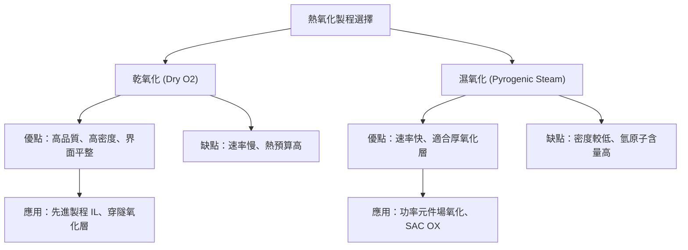

!!! note "熱預算管理"
    由於熱氧化通常在 $800^\circ C$ 至 $1100^\circ C$ 的高溫下進行，長時間的乾氧化會消耗大量的熱預算，導致下方已存在的摻雜分佈（Doping Profile）發生過度擴散（見 25.4 節）。因此，在現代製程中，對於厚氧化層的需求幾乎一律採用濕氧化或 CVD 沉積，以保護元件的淺接面結構。

!!! example "產業實例"
    在功率半導體（Power Semiconductors）如 SiC MOSFET 的製造中，雖然基板材料不同，但同樣面臨乾、濕氧化的選擇。為了獲得較高的溝道遷移率（Channel Mobility），產業界面通常結合「乾氧化」與隨後的「一氧化氮 (NO) 退火」，以修復界面缺陷並引入氮原子鈍化界面，這與矽基製程中氯化氧化的邏輯異曲同工。

## 25.3 雜質擴散物理與 Fick 定律

在半導體製程中，摻雜（Doping）是改變材料電學性質的核心手段。除了第 26 章將詳細討論的離子佈植（Ion Implantation）外，熱擴散（Thermal Diffusion）是另一種引入雜質原子的基本方式。擴散是指物質粒子因熱運動（Thermal motion）而產生的淨遷移現象，其物理本質是系統為了達到化學勢平衡，使雜質原子由高濃度區域向低濃度區域移動。

### 25.3.1 晶格擴散機制

在單晶矽的共價鍵結構中，雜質原子的移動並非隨機穿梭，而是受到晶格位置的嚴格限制。根據雜質原子與矽晶格的相對位置，擴散機制主要分為以下三類：

#### 1. 空位式擴散 (Vacancy Mechanism)
當矽晶格中出現空缺位置（即「空位」，Vacancy）時，鄰近的雜質原子若獲得足夠的熱能打破共價鍵，便可跳躍至該空位。這種機制下，雜質原子的移動方向與空位的移動方向相反。
*   **適用對象**：大多數替代式雜質（Substitutional impurities），如磷（P）、砷（As）、銻（Sb）等。
*   **物理特性**：由於需要同時滿足「鄰近有空位」與「打破共價鍵」兩個條件，其所需的活化能較高。

#### 2. 間隙式擴散 (Interstitial Mechanism)
體積較小的原子（如金、銅、鐵等過渡金屬，或某些情況下的硼）可能不佔據晶格點，而是存在於晶格間隙中。這些原子在間隙位置之間直接跳躍，而不需依賴空位。
*   **物理特性**：擴散速度極快，活化能較低。在製程中，這類擴散往往被視為污染（Contamination），因為金屬原子在矽中會形成深能階缺陷（Deep-level defects），嚴重損害載子壽命。

#### 3. 間隙位移式擴散 (Interstitialcy Mechanism)
這是一種介於上述兩者之間的複雜機制。一個處於間隙位置的矽原子（Self-interstitial）撞擊晶格點上的雜質原子，將其擠出至間隙位置，隨後該雜質原子在間隙移動一段距離後，再重新擠入另一個晶格點。
*   **適用對象**：硼（B）在矽中的擴散主要經由此機制。

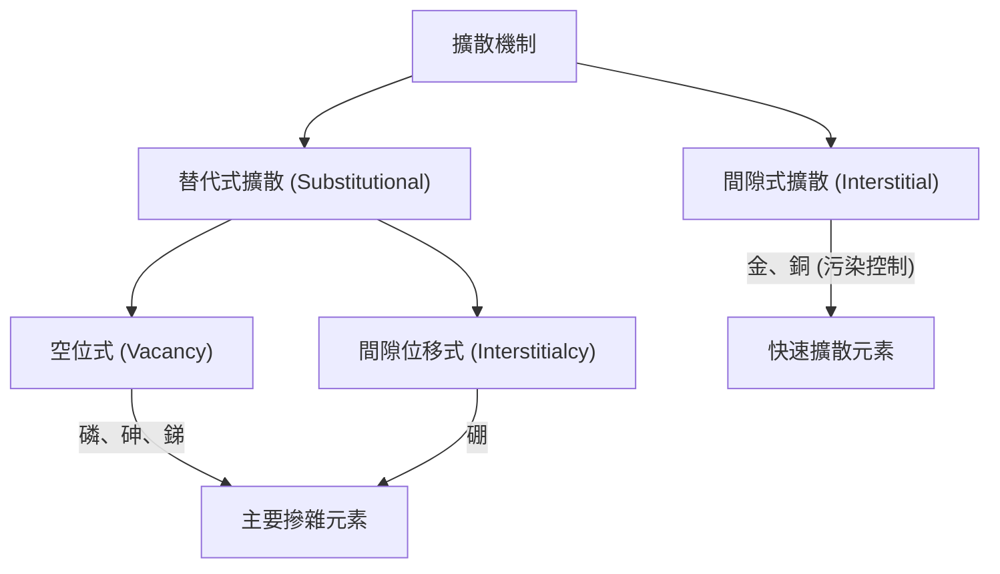

### 25.3.2 Fick 第一定律：穩態擴散

擴散現象的宏觀描述由 Fick 定律（Fick's Laws）定義。Fick 第一定律描述了在不隨時間變化的情況下，雜質通量與濃度梯度之間的關係。

$$J = -D \frac{\partial C(x, t)}{\partial x}$$

其中：
*   $J$：擴散通量（Flux），單位為 $atoms/cm^2 \cdot s$，表示單位時間內通過單位面積的原子數。
*   $D$：擴散係數（Diffusion Coefficient），單位為 $cm^2/s$。
*   $C$：雜質濃度（Concentration），單位為 $atoms/cm^3$。
*   $x$：擴散深度（Depth），單位為 $cm$。

負號表示擴散方向始終與濃度梯度方向相反，即從高濃度往低濃度方向移動。

### 25.3.3 Fick 第二定律：非穩態擴散

在實際的半導體製程中，雜質濃度隨時間不斷變化，這屬於非穩態擴散。根據質量守恆定律，某一區域內雜質濃度的變化率等於進入該區域與離開該區域通量的差值：

$$\frac{\partial C}{\partial t} = -\frac{\partial J}{\partial x}$$

將 Fick 第一定律代入上式，若假設擴散係數 $D$ 與濃度無關（在低濃度摻雜下為合理假設），則可得到 Fick 第二定律：

$$\frac{\partial C(x, t)}{\partial t} = D \frac{\partial^2 C(x, t)}{\partial x^2}$$

這是一個二階偏微分方程，其解的形式取決於邊界條件（Boundary Conditions）。在熱擴散製程中，最常見的物理模型為「恆定表面濃度擴散」。

#### 恆定表面濃度擴散 (Constant Source Diffusion)
此模型模擬將晶圓置於充滿摻雜氣體的爐管中，使晶圓表面雜質濃度始終維持在飽和狀態（即固溶極限，Solid Solubility）。其邊界條件如下：
1.  $C(0, t) = C_s$（表面濃度恆定）
2.  $C(\infty, t) = 0$（深處濃度為零）
3.  $C(x, 0) = 0$（初始濃度為零）

解得濃度分佈函數為：
$$C(x, t) = C_s \text{erfc} \left( \frac{x}{2\sqrt{Dt}} \right)$$

其中 $\text{erfc}(y)$ 為補餘誤差函數（Complementary Error Function），定義為 $1 - \text{erf}(y)$。

!!! note "補餘誤差函數 (erfc) 的特性"
    $\text{erfc}(y)$ 是一個遞減函數，當 $y=0$ 時，$\text{erfc}(0)=1$；當 $y \to \infty$ 時，$\text{erfc}(y) \to 0$。在製程計算中，$\sqrt{Dt}$ 被稱為擴散長度（Diffusion Length），它定義了雜質滲透的典型深度。

### 25.3.4 擴散係數與阿瑞尼斯關係式

擴散係數 $D$ 並非常數，它對溫度極為敏感。原子要發生跳躍，必須獲得足夠的能量以克服位能障礙（Potential barrier），這種關係遵循阿瑞尼斯定律（Arrhenius Equation）：

$$D = D_0 \exp \left( -\frac{E_a}{kT} \right)$$

其中：
*   $D_0$：擴散常數（Pre-exponential factor），與晶格振動頻率及跳躍距離有關。
*   $E_a$：活化能（Activation Energy），單位通常為電子伏特（eV）。
*   $k$：波茲曼常數（Boltzmann constant），典型值為 $8.617 \times 10^{-5} eV/K$。
*   $T$：絕對溫度（Absolute Temperature），單位為 $K$。

下表列出矽中常見雜質在熱擴散中的典型參數：

| 雜質元素 | 擴散機制 | $D_0$ 典型值 ($cm^2/s$) | $E_a$ 典型值 (eV) |
| :--- | :--- | :--- | :--- |
| 硼 (B) | 間隙位移式 | 1.0 | 3.46 |
| 磷 (P) | 空位/間隙位移 | 10.5 | 3.69 |
| 砷 (As) | 空位式 | 0.32 | 3.56 |
| 銻 (Sb) | 空位式 | 5.6 | 3.95 |

!!! warning "高濃度效應"
    當摻雜濃度超過本徵載子濃度（Intrinsic carrier concentration, $n_i$）時，擴散係數 $D$ 會受電場效應與多重帶電空位影響，不再是常數。此時擴散方程變為非線性，濃度分佈會偏離標準的 erfc 曲線，呈現更陡峭的邊界。這在現代極淺接面（Ultra-shallow junction）製程中必須精確修正。

### 25.3.5 擴散製程的兩步法

在實際量產中，為了精確控制摻雜的總量（Dose）與深度，通常將擴散分為兩個步驟：

1.  **預沉積 (Pre-deposition)**：
    將晶圓置於高濃度雜質源環境中進行短時間擴散。此時符合恆定表面濃度模型，目的是將精確數量的雜質原子引入矽表面薄層。
2.  **推進 (Drive-in)**：
    移除雜質源，在較高溫度下進行長時間加熱。此時雜質總量固定，表面濃度隨時間下降，雜質向深處擴散。其解符合高斯分佈（Gaussian Distribution）：
    $$C(x, t) = \frac{Q}{\sqrt{\pi Dt}} \exp \left( -\frac{x^2}{4Dt} \right)$$
    其中 $Q$ 為預沉積步驟中引入的雜質總劑量（單位為 $atoms/cm^2$）。

!!! example "產業實例：從熱擴散到離子佈植"
    在早期 1 微米（$\mu m$）以上的製程節點，熱擴散是定義井區（Well）的主要手段。然而，隨著元件尺寸縮小至奈米等級，熱擴散產生的橫向擴散（Lateral Diffusion）會導致通道長度難以控制，並引發嚴重的短通道效應（見第 5 章）。截至撰寫時，先進邏輯製程（如 5nm、3nm 節點）已全面採用離子佈植配合極短時間的快速熱處理（RTP，見第 27 章）來取代傳統長時爐管擴散，以精確限制雜質的分佈範圍。但在功率元件（Power MOSFET）與微機電系統（MEMS）中，深層的熱擴散製程仍因其成本優勢與深接面需求而被廣泛應用。

## 25.4 摻雜分佈控制與熱預算管理

在半導體製程中，精確控制摻雜物（Dopant）的空間分佈是決定元件電性的核心。雖然現代製程已大量採用離子佈植（Ion Implantation，見第 26 章）來定義摻雜劑量，但隨後的熱處理程序仍遵循擴散物理。為了達成特定的接面深度（Junction Depth）與濃度梯度，製程工程師必須優化擴散程序並嚴格管理熱預算。

### 兩步驟擴散法：預沉積與推進

在早期的半導體工業以及部分現代功率元件製程中，常使用「兩步驟擴散法」來精確控制摻雜分佈。這兩個步驟分別為預沉積（Pre-deposition）與推進（Drive-in）。

#### 1. 預沉積 (Pre-deposition)
預沉積的目的是將精確數量的摻雜原子引入矽晶圓表面。在此步驟中，晶圓置於含有摻雜氣體（如 $POCl_3$ 或 $BBr_3$）的爐管內，環境中的摻雜物濃度極高，使矽表面達到該溫度下的固體溶解度（Solid Solubility）。

根據第 25.3 節所述的 Fick 第二定律，在恆定表面濃度（Constant Surface Concentration）的邊界條件下，摻雜分佈遵循補餘誤差函數（Complementary Error Function）：

$$C(x, t) = C_s \text{erfc} \left( \frac{x}{2\sqrt{D_1 t_1}} \right)$$

其中：
- $C_s$ 為表面濃度（典型值為該溫度下的固體溶解度，約 $10^{20} \sim 10^{21} \, \text{cm}^{-3}$）。
- $D_1$ 為預沉積溫度的擴散係數。
- $t_1$ 為預沉積時間。

預沉積導入的總原子量（劑量，$Q$）可透過積分求得：
$$Q = \int_{0}^{\infty} C(x, t) dx = \frac{2}{\sqrt{\pi}} C_s \sqrt{D_1 t_1}$$

#### 2. 推進 (Drive-in)
預沉積完成後，通常會先進行濕式蝕刻移除表面的摻雜玻璃層（如 PSG 或 BSG），隨後進入高溫爐管進行推進。此時不再供應摻雜源，總劑量 $Q$ 固定，屬於有限源擴散（Limited Source Diffusion）。其分佈遵循高斯分佈（Gaussian Distribution）：

$$C(x, t) = \frac{Q}{\sqrt{\pi D_2 t_2}} \exp \left( -\frac{x^2}{4 D_2 t_2} \right)$$

其中 $D_2$ 與 $t_2$ 分別為推進步驟的擴散係數與時間。透過調整 $t_2$，工程師可以將摻雜物推向更深處，同時降低表面濃度。

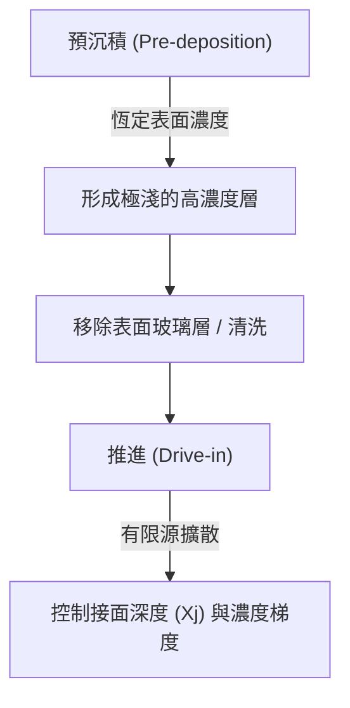

### 熱預算 (Thermal Budget) 與極淺接面 (USJ)

隨著元件尺寸微縮（見第 5 章），接面深度 $X_j$ 必須按比例縮小以抑制短通道效應。這引發了「熱預算」的嚴格限制。

#### 熱預算的定義
熱預算通常定義為製程中所經歷的溫度與時間的積分效應，其物理量化指標為擴散長度 $\sqrt{Dt}$。由於擴散係數 $D$ 與溫度呈指數關係：
$$D = D_0 \exp \left( -\frac{E_a}{kT} \right)$$
微小的溫度升高會導致擴散速率劇增。

#### 極淺接面 (USJ) 的挑戰
在先進邏輯節點（如 7nm 以下），源極/汲極接面深度要求極淺（典型值小於 10 nm）。傳統爐管製程因升溫與降溫速度慢，會導致摻雜物過度擴散，破壞通道長度的精確度。
1. **擴散過度**：導致有效通道長度（$L_{eff}$）縮短，增加漏電流。
2. **濃度梯度**：USJ 要求極高的摻雜梯度（Abruptness），熱預算過高會使梯度變平緩。

因此，截至撰寫時，先進製程已普遍從長時數爐管退火轉向快速熱處理（RTP）或雷射退火（Laser Annealing，詳見第 27 章），以極短的時間（毫秒等級）完成活化，將熱預算降至最低。

!!! warning "常見誤解"
    工程師常誤以為熱預算僅指「高溫」。事實上，熱預算是一個累積概念。即便溫度稍低，若製程時間極長（如長時間的 CVD 沉積），仍可能造成底層摻雜分佈的偏移。在先進製程整合中，必須考慮後段製程（BEOL）對前段元件摻雜分佈的熱影響。

### 氧化增強擴散 (OED) 與氧化誘發疊差 (OSF)

熱氧化與擴散並非獨立發生的物理現象。在進行熱氧化（如生長隔離氧化層）時，矽原子的點缺陷行為會顯著影響摻雜物的擴散速率。

#### 氧化增強擴散 (Oxidation-Enhanced Diffusion, OED)
當矽表面進行熱氧化時，氧原子進入矽晶格形成 $SiO_2$，由於 $SiO_2$ 的體積約為矽的 2.2 倍，部分矽原子會被擠出晶格位置，形成過飽和的自填隙矽原子（Silicon Self-interstitials）。
- **機制**：硼（B）與磷（P）主要透過填隙機制（Interstitial Mechanism）擴散。過剩的填隙原子會加速這些雜質的移動，導致實際擴散深度大於理論預測。
- **影響**：在設計氧化步驟時，必須補償 OED 效應，否則接面深度會超出預期。

#### 氧化誘發疊差 (Oxidation-Induced Stacking Faults, OSF)
若過飽和的自填隙矽原子無法及時擴散至表面或被吸收，它們可能會在矽晶圓的 $\{111\}$ 晶面上聚集成團，形成二維的平面缺陷，即疊差。
- **危害**：OSF 會成為電荷載子的複合中心（Recombination Center），顯著增加 PN 接面的漏電流（Leakage Current），並降低少數載子壽命。
- **抑制方法**：透過適當的氯化氧化（在環境中加入 $HCl$）或嚴格控制初始晶圓的氧含量，可有效抑制 OSF 的產生。

### 擴散與熱氧化在 FinFET 與 GAAFET 中的整合角色

在平面電晶體時代，擴散主要是垂直方向的控制。進入 FinFET 與環繞閘極電晶體（GAAFET）時代後，熱製程面臨三維結構的挑戰。

#### FinFET 中的共形摻雜
在 FinFET 結構中（見第 6 章），鰭片（Fin）的側面與頂面必須具備均勻的摻雜分佈。
- **挑戰**：傳統離子佈植具有方向性，難以在窄而高的鰭片側面達成均勻摻雜。
- **解決方案**：利用「固態源擴散」（Solid Phase Diffusion）。先以 ALD 或 CVD 覆蓋一層含摻雜物的氧化層（如 PSG），再透過熱擴散讓雜質均勻進入鰭片內部，確保共形（Conformal）的摻雜分佈。

#### GAAFET 中的熱約束
在奈米片（Nanosheet）或 GAAFET 結構中，矽通道被懸空釋放後，其熱容極小。
- **結構敏感性**：過高的熱預算或不均勻的熱氧化會導致奈米片產生應力形變，甚至造成結構坍塌。
- **氧化縮減（Oxidation Trimming）**：截至撰寫時，業界常利用精確的熱氧化來微調奈米片的厚度。透過生長數個奈米級的氧化層並隨後移除，可以達到原子等級的尺寸控制。

!!! example "產業實例"
    在 3nm 與 2nm 節點的開發中，為了在 GAAFET 的內間隔層（Inner Spacer）形成過程中保持源極/汲極摻雜的陡峭度，低溫熱製程（Low-temperature Process）成為研發重點。例如，使用電漿輔助化學氣相沉積（PECVD）取代高溫 LPCVD，以減少熱預算對極淺接面的破壞。

### 小結
摻雜分佈的控制已從單純的擴散物理演變為複雜的熱預算管理工程。在先進製程中，工程師必須平衡摻雜物活化（需要高溫）與抑制擴散（需要低熱預算）之間的矛盾。同時，必須深入理解氧化過程引發的點缺陷（OED/OSF），才能在日益複雜的 3D 元件結構中維持優異的電性表現。

<!-- fig:2 -->
<figure markdown>
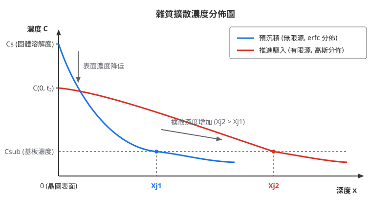
<figcaption>圖 25-2　雜質擴散濃度分佈圖（AI 繪製的示意圖）</figcaption>
</figure>

## 25.5 設備與廠商技術

熱氧化與擴散製程的核心設備為熱處理爐管（Furnace），其主要功能是提供一個受控的高溫環境與精確的氣體流量，使晶圓表面的矽原子與氧化氣體發生化學反應，或使摻雜雜質在晶格中進行擴散。隨著元件特徵尺寸進入奈米尺度，熱處理設備的設計重點已從早期的產能極大化，轉向極致的熱場均勻性（Thermal Uniformity）控制與熱預算（Thermal Budget）的精確管理。

### 25.5.1 爐管設備之基本構造與子系統

無論是何種類型的爐管，其基本構造均包含以下關鍵子系統：

1.  **加熱單元（Heating Element）**：通常採用電阻式加熱絲（如鐵鉻鋁合金），包圍在反應管外側。為了達成優異的縱向溫度均勻性，加熱器通常分為 3 至 5 個獨立控制的加熱區（Heating Zones）。
2.  **反應管（Reaction Tube）**：作為製程氣體與晶圓反應的封閉空間。高純度石英（Quartz）是常見材料，但在超過 $1100^\circ\text{C}$ 的高溫下易產生軟化變形，因此在先進製程中常採用碳化矽（SiC）材質，其具備更高的機械強度與熱傳導率。
3.  **氣體分配系統（Gas Distribution System）**：包含質量流量控制器（MFC）與氣體噴淋管（Injector），負責將氧氣、氫氣、氮氣或氯化氫（HCl）等氣體精確導入。
4.  **晶圓負載系統（Wafer Loading System）**：負責將晶圓放置於晶圓舟（Wafer Boat）上並送入反應管。
5.  **控制系統**：透過內部與外部熱電偶（Thermocouple）進行串級控制（Cascade Control），確保晶圓表面的溫度波動控制在 $\pm 0.5^\circ\text{C}$ 以內。

### 25.5.2 水平式爐管與垂直式爐管之比較

在半導體工業發展早期，水平式爐管（Horizontal Furnace）是主流設計，但隨著晶圓直徑增加至 12 吋（300mm），垂直式爐管（Vertical Furnace）已成為現代邏輯與記憶體廠的標準配置。

#### 水平式爐管 (Horizontal Furnace)
水平式爐管將晶圓垂直排列於晶圓舟中，並以水平方向推入臥式反應管。其主要缺點包括：
*   **重力效應**：大尺寸晶圓在水平放置時，容易因高溫下的重力作用產生應力導致晶格位錯（Dislocation）或晶圓翹曲。
*   **微塵污染**：晶圓舟在進入水平管時，與管壁的滑動摩擦容易產生顆粒（Particles）。
*   **佔地面積**：水平結構需要較大的維護空間與自動化對接空間。
*   **氣流不均**：氣體由一端流入、另一端排出，容易在管內形成明顯的濃度梯度。

#### 垂直式爐管 (Vertical Furnace)
垂直式爐管將反應管垂直放置，晶圓水平堆疊於晶圓舟上。其優勢如下：
*   **優異的均勻性**：垂直結構有利於對稱的氣體流場設計，且加熱器環繞管壁，熱場對稱性佳。
*   **低污染**：晶圓舟由下方垂直升降進入反應管，不與管壁接觸，大幅減少微塵產生。
*   **自動化整合**：垂直配置能有效縮減機台佔地面積（Footprint），並與天車（OHT）系統及晶圓傳送盒（FOUP）完美對接。

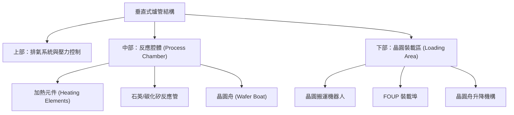

### 25.5.3 批次處理與熱場控制技術

熱氧化與擴散製程通常採用批次處理（Batch Processing），一次可處理 50 至 150 片晶圓。相較於單晶圓（Single Wafer）設備，批次處理具有極高的產能優勢，但在熱場控制上面臨巨大挑戰。

#### 熱場均勻性控制
在批次爐管中，位於晶圓舟頂部、中部與底部的晶圓必須經歷完全相同的熱歷程。為了補償管口散熱，設備商開發了多區段加熱技術。
*   **多區段加熱**：將加熱器分為 Top、Center-Top、Center、Center-Bottom、Bottom 五個區域，獨立調整各區功率。
*   **快速升降溫（Fast Ramp）**：為了減少不必要的熱預算消耗，現代爐管具備水冷套管或強制風冷系統，使升溫速率可達 $50^\circ\text{C/min}$ 以上，降溫速率亦顯著提升。

#### 氣體流場優化
為了避免「耗盡效應」（Depletion Effect，即氣體沿路反應導致後端濃度下降），先進爐管採用多點噴淋管，將新鮮氣體直接引入晶圓舟的不同高度，確保每一片晶圓的氧化層厚度均勻。

### 25.5.4 產業實例與技術路線

在熱處理設備市場中，東京威力科創（TEL）與 ASM International（ASMI）是全球領先的供應商。兩者雖然均提供垂直爐管，但在腔體設計與應用側重上各有特色。

#### 東京威力科創 (Tokyo Electron)
TEL 的 **TELINDY** 系列是業界廣泛採用的批次熱處理平台。其技術特點在於極致的自動化整合與穩定的熱場控制。
*   **技術路線**：強調高產能與多功能性，同一平台可配置為氧化、擴散、退火或低壓化學氣相沉積（LPCVD）功能。
*   **熱場管理**：採用先進的溫度補償演算法，能精確修正因晶圓裝載量不同而產生的熱擾動。

#### ASM International (ASMI)
ASMI 的 **A400** 與 **A412** 系列在先進邏輯製程中佔有重要地位。
*   **技術路線**：專注於薄膜品質與極低熱預算管理。ASMI 在垂直爐管中導入了優異的壓力控制技術，使其在超薄氧化層（如 Gate Oxide）的生長上具有優勢。
*   **雙反應管設計**：A412 平台通常配置兩個反應管，當一個反應管在進行高溫製程時，另一個反應管可進行冷卻或裝卸料，最大化設備利用率。

!!! example "產業實例：設備商比較"
    | 廠商 | 代表產品系列 | 技術路線與特點 | 主要應用 |
    | :--- | :--- | :--- | :--- |
    | **Tokyo Electron** | **TELINDY** 系列 | 高產能批次處理、多區段熱場控制、高度自動化整合 | 邏輯與記憶體廠的大規模氧化、擴散、退火製程 |
    | **ASM International** | **A400 / A412** | 雙管配置提升效率、精確的壓力與氣氛控制、超薄膜生長 | 先進節點的閘極氧化層、高溫退火、LPCVD |
    | **Applied Materials** | **Centura** | 單晶圓處理平台、極速升溫、精確熱預算控制 | 快速熱處理 (RTP)、選擇性磊晶、單片高溫退火 |

### 25.5.5 超薄氧化層與高壓氧化 (HiPOx) 發展趨勢

隨著元件微縮至 3nm 節點以下（截至撰寫時），傳統的大氣壓熱氧化面臨兩大挑戰：氧化層過厚與熱預算過高。

#### 超薄氧化層控制
在 FinFET 與 GAAFET（見第 6 章）結構中，氧化層厚度常需控制在 $1\text{--}2\text{ nm}$。為了達成此目標，設備商開發了「低氧分壓氧化」技術，透過大量氮氣稀釋氧氣，並在較低溫度下反應，以降低氧化速率，從而提升厚度受控性。

#### 高壓氧化 (HiPOx, High-Pressure Oxidation)
高壓氧化是近年來重新受到重視的技術。根據 Deal-Grove 模型（見 25.1 節），氧化速率與環境壓力成正比。
*   **物理原理**：增加反應管內的壓力（典型值可達 $10\text{--}25\text{ atm}$），可提高氧化劑在矽表面的溶解度 $C^*$。
*   **優勢**：在極低的溫度下（如 $600\text{--}700^\circ\text{C}$）即可達成與常壓下 $1000^\circ\text{C}$ 相同的氧化速率。這對於熱敏感的先進製程（如 3D NAND 的深孔氧化或高介電金屬閘極製程整合）至關重要，能有效保護已形成的摻雜分佈不發生過度擴散。

!!! note "設備選機考量"
    晶圓廠在選擇爐管設備時，首要考量為「熱一致性」（Thermal Consistency）。這不僅指單片晶圓內的均勻性（WIW, Within-Wafer），更包含批次內不同位置晶圓的均勻性（WTW, Wafer-to-Wafer）以及機台與機台間的重複性（MTM, Machine-to-Machine）。對於代工廠而言，設備的彈性（如快速更換製程氣體與溫度範圍）亦是關鍵指標。

截至撰寫時，雖然單晶圓處理設備（如 RTP）在特定製程中不可或缺，但垂直式批次爐管憑藉其優異的成本效益（Cost of Ownership, CoO）與成熟的熱場穩定性，依然是前段製程（FEOL）中熱氧化與擴散的主力設備。未來發展方向將聚焦於更精確的氣體切換控制（以減少界面缺陷）以及與原位量測（In-situ Metrology）系統的整合，實現即時的製程調控。

## 本章重點

1. **熱氧化動力學與 Deal-Grove 模型**：熱氧化製程會消耗矽基板（生成厚度 $X$ 之 $SiO_2$ 需消耗約 $0.44X$ 之矽）。Deal-Grove 模型將過程分為氣相傳輸、固體擴散與界面反應三步驟，導出關係式 $x_o^2 + Ax_o = B(t + \tau)$。在薄氧化層階段（$x_o \ll A$）由界面化學反應控制，呈線性增長；厚氧化層階段（$x_o \gg A$）由固體擴散控制，呈平方增長。針對 $x_o < 20\text{ nm}$ 的乾氧化，需以 Massoud 模型修正初始快速氧化現象。
2. **乾氧化與濕氧化之特性差異**：乾氧化（$O_2$）生長速率慢，但生成的 $SiO_2$ 薄膜密度高、界面態密度（$D_{it}$）低且介電強度高，適用於緩衝層與穿隧氧化層；濕氧化（合成水蒸氣 $H_2O$）因氧化劑在 $SiO_2$ 中的溶解度比氧氣高三個數量級，生長速度極快，適用於場氧化層與遮罩氧化層。
3. **氯化氧化與界面品質提升**：在熱氧化過程中引入含氯氣體（如 $HCl$），可透過萃取作用（Gettering）固定或移除鈉等鹼金屬離子，並鈍化矽表面的懸浮鍵，顯著降低界面態密度並穩定元件的臨界電壓。
4. **雜質擴散物理與 Fick 定律**：原子在矽晶格中的擴散主要分為空位式、間隙式與間隙位移式機制，擴散係數遵循阿瑞尼斯定律。穩態擴散由 Fick 第一定律描述，非穩態擴散由 Fick 第二定律描述。
5. **兩步驟擴散與熱預算管理**：傳統摻雜採預沉積（恆定表面濃度，雜質分佈呈補餘誤差函數 $\text{erfc}$）與推進（有限源擴散，雜質分佈呈高斯分佈）兩步驟。在先進奈米級節點中，為抑制短通道效應並實現極淺接面（USJ），必須嚴格限制熱預算 $\sqrt{Dt}$，轉而採用離子佈植搭配毫秒級快速熱退火。
6. **點缺陷與氧化交互效應**：熱氧化過程中因體積膨脹會產生過飽和矽自填隙原子，導致氧化增強擴散（OED），加速硼與磷等雜質的擴散；若填隙原子聚集，會形成氧化誘發疊差（OSF），增加接面漏電流。
7. **熱處理設備與演進**：垂直式爐管憑藉優異的熱場對稱性、低微塵產生率及自動化對接優勢，已全面取代傳統水平式爐管。針對先進節點，高壓氧化（HiPOx）技術能在降低溫度的同時維持高氧化速率，為有效控制熱預算的關鍵設備技術。

---

## 重點圖卡

複習時看這幾張就能抓住本章重點；[圖卡庫](../cards.md)可以下載成圖片。

<figure markdown>
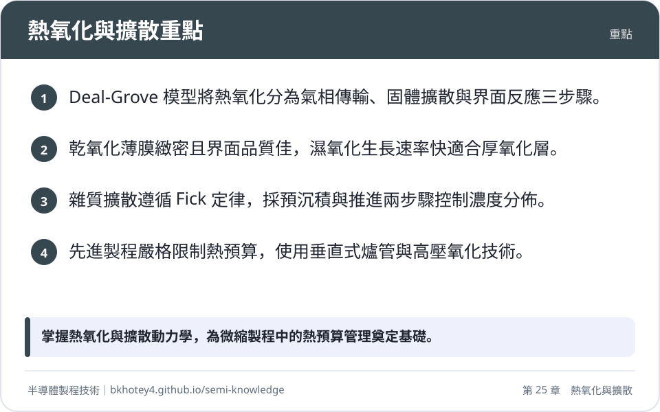
<figcaption>重點圖卡：熱氧化與擴散重點</figcaption>
</figure>

<figure markdown>
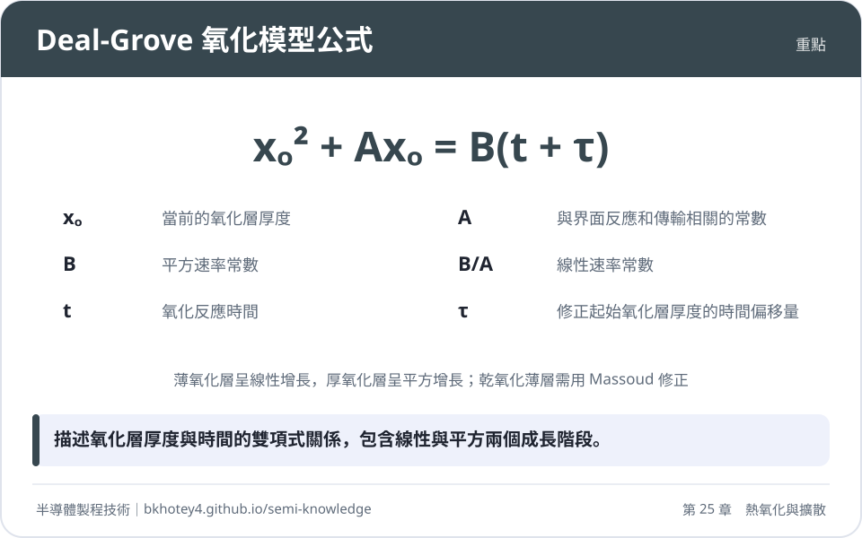
<figcaption>重點圖卡：Deal-Grove 氧化模型公式</figcaption>
</figure>

<figure markdown>
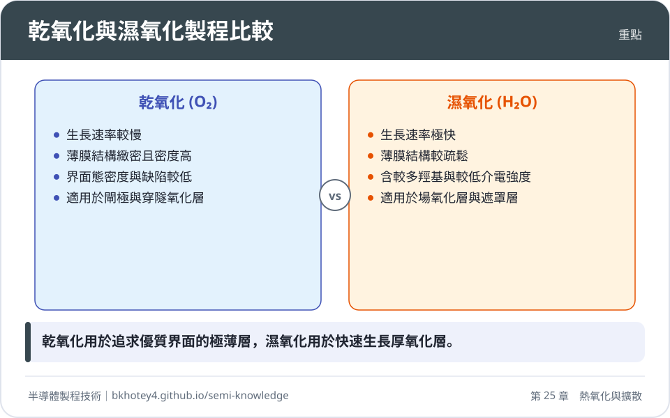
<figcaption>重點圖卡：乾氧化與濕氧化製程比較</figcaption>
</figure>

<figure markdown>
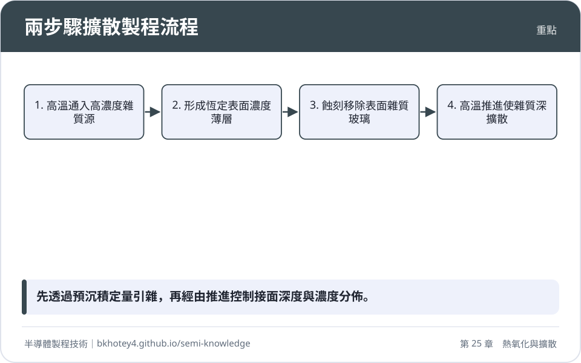
<figcaption>重點圖卡：兩步驟擴散製程流程</figcaption>
</figure>

## 習題

**1.** 假設在某一特定溫度下進行乾氧化製程，已知 Deal-Grove 模型之參數為 $A = 0.1\ \mu\text{m}$，平方速率常數 $B = 0.01\ \mu\text{m}^2/\text{hr}$。若初始氧化層厚度 $x_i = 0$（即 $\tau = 0$），試計算：
(1) 氧化進行 2 小時後，二氧化矽薄膜的厚度 $x_o$ 為何？
(2) 此時該氧化反應主要處於線性階段還是平方階段？

??? success "參考解答"
    (1) 根據 Deal-Grove 模型公式：
    $$x_o^2 + Ax_o = Bt$$
    代入已知數值 $A = 0.1\ \mu\text{m}$、$B = 0.01\ \mu\text{m}^2/\text{hr}$ 及 $t = 2\text{ hr}$：
    $$x_o^2 + 0.1 x_o = 0.01 \times 2 = 0.02$$
    整理得二次方程：
    $$x_o^2 + 0.1 x_o - 0.02 = 0$$
    解方程（取正解）：
    $$(x_o + 0.2)(x_o - 0.1) = 0 \implies x_o = 0.1\ \mu\text{m} = 100\text{ nm}$$
    (2) 比較厚度 $x_o$ 與參數 $A$：
    由於 $x_o = 0.1\ \mu\text{m}$ 等於 $A = 0.1\ \mu\text{m}$，此時 $x_o$ 既不滿足 $x_o \ll A$（線性階段），也不滿足 $x_o \gg A$（平方階段），而是處於從線性反應限制過渡至固體擴散限制的**過渡階段（Transition Regime）**。

**2.** 試比較預沉積（Pre-deposition）與推進（Drive-in）兩個擴散步驟在物理條件、邊界條件以及最終雜質濃度分佈函數上的主要差異。

??? success "參考解答"
    *   **預沉積（Pre-deposition）**：
        *   **物理條件**：晶圓置於高濃度雜質氣氛中，表面雜質濃度維持在該溫度下的固體溶解度極限（$C_s$）。
        *   **邊界條件**：恆定表面濃度（Constant Source Diffusion），$C(0, t) = C_s$ 且 $C(\infty, t) = 0$。
        *   **濃度分佈**：符合補餘誤差函數分佈 $C(x, t) = C_s \text{erfc}\left(\frac{x}{2\sqrt{Dt}}\right)$。
    *   **推進（Drive-in）**：
        *   **物理條件**：移去外加雜質源，在高溫下進行加熱，系統內的雜質總劑量（$Q$）保持恆定。
        *   **邊界條件**：有限雜質源擴散（Limited Source Diffusion），$\int_0^\infty C(x, t) dx = Q$。
        *   **濃度分佈**：符合高斯分佈 $C(x, t) = \frac{Q}{\sqrt{\pi Dt}} \exp\left(-\frac{x^2}{4Dt}\right)$。

**3.** 在先進邏輯元件中，為什麼極薄乾氧化（$<20\text{ nm}$）的生長速率會偏離 Deal-Grove 模型？Massoud 模型如何修正此現象？

??? success "參考解答"
    *   **偏離原因**：Deal-Grove 模型假設氧化層內的擴散遵循標準 Fick 定律，但在極薄氧化層（$<20\text{ nm}$）的乾氧化過程中存在「初始快速氧化」現象。其物理機制包含：
        1.  極薄層中的空間電荷效應增強了氧化劑分子的傳輸；
        2.  初始 $Si/SiO_2$ 界面附近的矽晶格畸變與應力較大，促進了界面反應進行；
        3.  氧化劑在極薄 $SiO_2$ 中的溶解度可能高於塊材平衡濃度 $C^*$。
    *   **Massoud 模型修正**：Massoud 透過在氧化速率方程中增設隨厚度呈指數衰減的修正項來彌補偏差：
        $$\frac{dx_o}{dt} = \frac{B}{2x_o + A} + C_1 e^{-x_o/L_1} + C_2 e^{-x_o/L_2}$$
        其中 $C_1, C_2$ 為前置因子，$L_1, L_2$ 為特徵長度（典型值約為 $1\text{ nm}$ 與 $7\text{ nm}$），使模型在超薄區域能精確匹配實驗觀測值。

**4.** 何謂氧化增強擴散（Oxidation-Enhanced Diffusion, OED）？請說明其微觀物理機制及其對 PN 接面深度控制的影響。

??? success "參考解答"
    *   **物理機制**：當矽基板表面進行高溫熱氧化時，生成 $SiO_2$ 所需的分子體積大於原矽晶格體積（約 2.2 倍）。這種體積膨脹會將部分矽原子擠出晶格位置，形成過飽和的矽自填隙原子（Silicon Self-interstitials）並向矽基板內部擴散。
    *   **對擴散的影響**：硼（B）與磷（P）等雜質主要透過「間隙位移機制」（Interstitialcy Mechanism）進行擴散。過飽和的自填隙矽原子會大幅增加雜質原子進入間隙進行跳躍的機率，進而顯著提升雜質的有效擴散係數 $D$。
    *   **接面深度控制影響**：在熱氧化同時進行或隨後進行熱處理時，OED 效應會導致雜質向深處擴散的速度快於純熱退火時的理論預測，若未在製程設計中精確補償此效應，將導致 PN 接面深度（$X_j$）過深，進而加劇短通道效應。

**5.** 在 12 吋（300mm）晶圓廠中，垂直式爐管（Vertical Furnace）為何全面取代了傳統的水平式爐管？高壓氧化（HiPOx）技術在此類設備中有何優勢？

??? success "參考解答"
    *   **垂直式爐管優點**：
        1.  **結構重力與形變**：大尺寸晶圓水平放置於垂直晶圓舟上，高溫下不易因重力引發晶格位錯或翹曲；
        2.  **微塵控制**：晶圓舟採垂直升降，不與反應管壁發生摩擦，顆粒污染顯著降低；
        3.  **氣流與熱場對稱性**：圓柱狀垂直熱場與對稱氣流配置，提供優異的片內（WIW）與片間（WTW）均勻性；
        4.  **自動化與廠房空間**：垂直結構占地面積小，易於與天車（OHT）及 FOUP 自動化系統對接。
    *   **高壓氧化（HiPOx）優勢**：
        根據 Deal-Grove 模型，氧化速率（$B$ 與 $B/A$）與環境壓力呈正比。HiPOx 能在較低溫度下（如 $600\text{--}700^\circ\text{C}$）達成與常壓高溫（$>1000^\circ\text{C}$）相同的氧化生長速率，從而大幅降低熱預算（Thermal Budget），避免下方已形成的雜質分佈發生過度擴散。

---

## 本章術語

- **Deal-Grove Model**（Deal-Grove 模型）：描述矽熱氧化過程中，氧化劑經由氣相傳輸、固體擴散與界面反應三個步驟成長二氧化矽薄膜的經典物理模型。
- **Linear Rate Constant**（線性速率常數, $B/A$）：Deal-Grove 模型中受界面化學反應速率限制的增長參數，對反應溫度與晶面取向極為敏感。
- **Parabolic Rate Constant**（平方速率常數, $B$）：Deal-Grove 模型中受氧化劑在二氧化矽中擴散能力限制的增長參數，取決於氧化劑溶解度與擴散係數。
- **Massoud Model**（Massoud 模型）：在 Deal-Grove 模型基礎上引入指數衰減項，用以修正乾氧化在厚度小於 $20\text{ nm}$ 時之初始快速氧化現象的動力學模型。
- **Dry Oxidation**（乾氧化）：使用高純度氧氣作為氧化劑的熱處理製程，生長速率慢但生成之二氧化矽薄膜緻密且界面態密度低。
- **Wet Oxidation**（濕氧化）：採用水蒸氣（通常由氫氧合成蒸氣法產生）作為氧化劑的熱氧化製程，因氧化劑溶解度高而具有極高的生長速率。
- **Gettering**（萃取/吸雜）：在熱氧化或加熱過程中引入特定化學物質（如氯元素）將金屬離子雜質轉化為揮發性化合物或將其固定以避免元件電性漂移的技術。
- **Interface State Density**（界面態密度, $D_{it}$）：位於矽與絕緣層界面處、由原子排列不規則或懸浮鍵引發的能隙內能階密度。
- **Fick's Laws of Diffusion**（費克擴散定律）：包含描述穩態擴散通量與濃度梯度成正比的第一定律，以及描述非穩態擴散中濃度隨時間變化率的第二定律。
- **Complementary Error Function**（補餘誤差函數, erfc）：用於描述恆定表面濃度邊界條件下（如預沉積擴散）雜質隨深度分佈的數學函數。
- **Thermal Budget**（熱預算）：元件在整體製程中所累積經歷的高溫與時間積分，代表雜質原子發生非預期熱擴散的總風險程度。
- **Oxidation-Enhanced Diffusion**（氧化增強擴散, OED）：熱氧化反應擠出過飽和矽自填隙原子，進而加速經由填隙機制擴散之雜質（如硼、磷）移動的現象。
- **Oxidation-Induced Stacking Faults**（氧化誘發疊差, OSF）：熱氧化過程中過飽和的矽自填隙原子在矽晶圓特定晶面上聚集成團所形成的平面晶格缺陷。
- **Vertical Furnace**（垂直式爐管）：將晶圓水平堆疊並垂直推入反應腔的熱處理設備，具備良好熱對稱性、低微塵污染與小占地面積優點。
- **High-Pressure Oxidation**（高壓氧化, HiPOx）：在大氣壓以上的壓力環境下進行熱氧化的技術，能在較低溫度下提升氧化速率以節省熱預算。

## 互動學習

!!! tip "動手試試看"
    - [互動實驗：熱氧化層成長（Deal–Grove 模型）](../labs.md#dealgrove)
    - [設備機台圖鑑：爐管](../equipment.md)

## 產業最新進展

本節由每日產業新聞自動補充，說明本章技術在產業上的最新發展。

<!-- updates -->
（目前尚無補充。）
