# 第 26 章　離子佈植

!!! abstract "學習目標"
    - 理解離子佈植的物理機制，包括核能阻擋與電子能阻擋對離子射程的影響。
    - 掌握離子佈植在晶體中的統計分布模型，以及通道效應的成因與抑制方法。
    - 分析離子佈植造成的晶格損傷與非晶化過程，並理解其對後續熱處理的需求。
    - 熟悉離子佈植機台的硬體架構，以及如何精確控制摻雜劑量與佈植能量。

## 26.1 離子佈植物理基礎與能損機制

在半導體製造中，為了改變材料的電學特性（如載子濃度與導電類型），必須將特定雜質原子（Dopants）引入矽晶格中。相較於第 25 章討論的熱擴散（Thermal Diffusion），離子佈植（Ion Implantation）是現代極大型積體電路（ULSI）製程中更為關鍵且精確的摻雜技術。

### 離子佈植與熱擴散之比較

熱擴散是一種基於濃度梯度驅動的熱力學平衡過程，而離子佈植則是一種非平衡態（Non-equilibrium）的高能物理過程。以下就物理特性與製程優勢進行對比：

1.  **非平衡態特性**：
    熱擴散受限於固溶度（Solid Solubility），即在特定溫度下，矽晶格所能容納雜質原子的最大平衡濃度。若欲超過此限度，熱擴散難以達成。離子佈植透過外部電場賦予離子極高的動能，強行將雜質射入晶格中，因此其摻雜濃度可輕易突破固溶度限制，實現超高濃度的摻雜。

2.  **精確的深度與劑量控制**：
    熱擴散的雜質分布通常呈高斯分布（Gaussian distribution）或餘誤差函數分布（Complementary Error Function, erfc），且最大濃度始終位於表面。離子佈植則可透過調整加速電壓（能量）來精確控制離子射入的深度，並透過積分束流（Beam current）精確計算進入晶圓的離子總數（劑量）。這使得製程工程師能夠在晶圓深處建立一個「峰值濃度區」，而表面保持較低濃度，這是熱擴散無法做到的。

3.  **低溫製程優勢**：
    熱擴散通常需要在 800°C 至 1200°C 的高溫下進行數小時，這會導致已存在的雜質分布發生二次擴散，破壞原有的元件輪廓。離子佈植本身可在室溫下進行（雖然後續仍需退火，見第 27 章），且佈植過程極快，大幅降低了熱預算（Thermal Budget）的消耗。

4.  **各向異性與遮蔽性**：
    離子佈植具有高度的方向性（各向異性），離子束幾乎垂直或以特定角度射入晶圓。這使得光阻（Photoresist）即可作為有效的遮蔽層，而不需要像熱擴散那樣必須使用高溫穩定的氧化矽或氮化矽硬遮罩（Hard Mask）。

### 能量損失機制：核能阻擋與電子能阻擋

當高能離子進入固體靶材（如單晶矽）時，會透過一系列的碰撞與交互作用逐漸喪失動能，最終停留在晶格中。這種動能隨路徑長度的減少率稱為「阻擋本領」（Stopping Power, $S$），定義為：

$$S = - \frac{dE}{dx}$$

其中 $E$ 為離子能量，$x$ 為行進路徑。根據離子與靶材原子交互作用對象的不同，能量損失機制可分為兩大類：核能阻擋（Nuclear Stopping, $S_n$）與電子能阻擋（Electronic Stopping, $S_e$）。

#### 1. 核能阻擋 (Nuclear Stopping)

核能阻擋是指入射離子與靶材原子的原子核之間發生的彈性碰撞（Elastic Collision）。

*   **物理機制**：入射離子與靶核之間存在庫倫斥力。當兩者距離極近時，會發生顯著的動量轉移。這種碰撞類似於撞球運動，入射離子會在大角度偏轉的同時，將能量傳遞給靶原子。
*   **晶格損傷**：由於轉移的能量通常遠大於矽原子的位移能（Displacement Energy，典型值約為 15 eV），靶原子會被撞離其晶格位置，產生空缺（Vacancy）與間隙原子（Interstitial），進而形成晶格損傷甚至使晶圓表面非晶質化（Amorphization）。
*   **能量依賴性**：核能阻擋在離子能量較低時占主導地位。隨著能量增加，$S_n$ 會先上升至一最大值，隨後因離子速度過快、與原子核作用時間縮短而下降。

#### 2. 電子能阻擋 (Electronic Stopping)

電子能阻擋是指入射離子與靶材原子的電子雲（或自由電子）之間發生的非彈性交互作用（Inelastic Interaction）。

*   **物理機制**：入射離子在穿過電子雲時，會引起電子的激發（Excitation）或游離（Ionization）。這可以類比為物體在黏滯流體中運動受到的阻力（Viscous Drag）。
*   **晶格損傷**：由於電子的質量極小，單次電子碰撞轉移的能量不足以導致原子位移，因此電子能阻擋幾乎不會造成晶格損傷，能量最終以熱能形式散失。
*   **能量依賴性**：電子能阻擋在離子能量較高時占主導地位。在低速階段，其阻擋本領與離子的速度（即能量的平方根 $\sqrt{E}$）成正比。

### LSS 理論基礎

1.963 年，Lindhard、Scharff 與 Schiøtt 提出了著名的 LSS 理論，為預測離子在固體中的射程分布奠定了數學基礎。該理論假設靶材是無定形（Amorphous）的，即原子隨機分布，不考慮晶格結構的對齊效應。

根據 LSS 理論，總阻擋本領為兩者的線性疊加：

$$\left( \frac{dE}{dx} \right)_{total} = \left( \frac{dE}{dx} \right)_n + \left( \frac{dE}{dx} \right)_e$$

#### 能量損失與原子序的關係

離子在減速過程中的行為高度取決於入射離子原子序 $Z_1$、質量 $M_1$ 以及靶材原子序 $Z_2$、質量 $M_2$。

*   **核能阻擋項**：
    在 LSS 模型中，核能阻擋通常採用屏蔽庫倫位能（Screened Coulomb Potential）來描述。對於給定的離子-靶材組合，$S_n$ 在低能量區隨能量增加，直到離子能量達到某個臨界值 $E_c$。
*   **電子能阻擋項**：
    對於速度低於波耳速率（Bohr velocity）的離子，電子能阻擋可表示為：

    $$S_e = k \cdot E^{1/2}$$

    其中 $k$ 是與 $Z_1, Z_2, M_1, M_2$ 相關的常數。

!!! note "臨界能量 (Critical Energy)"
    對於每一種離子，存在一個臨界能量 $E_c$，在此能量下 $S_n = S_e$。
    - 若 $E < E_c$，以核能阻擋為主，損傷嚴重，路徑曲折。
    - 若 $E > E_c$，以電子能阻擋為主，損傷較輕，路徑較直。
    以硼（B）佈植於矽中為例，$E_c$ 約為 17 keV；而對於較重的砷（As），$E_c$ 則高達約 800 keV。這意味著在一般的製程能量下，硼主要受電子阻擋影響，而砷主要受核能阻擋影響。

### 阻擋本領隨能量與原子序的變化關係

下圖與表格說明了不同離子在矽中的能量損失趨勢。

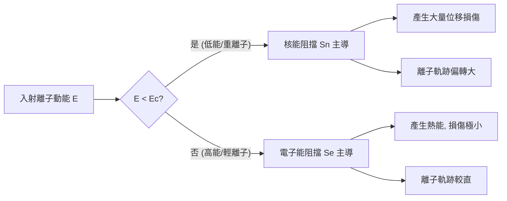

| 離子種類 | 原子量 (amu) | 典型佈植能量 (keV) | 主要阻擋機制 | 晶格損傷程度 |
| :--- | :--- | :--- | :--- | :--- |
| 硼 (B) | 10.8 | 5 - 50 | 電子能阻擋 | 較低 |
| 磷 (P) | 31.0 | 10 - 100 | 核能/電子混合 | 中等 |
| 砷 (As) | 74.9 | 10 - 150 | 核能阻擋 | 高 |
| 銻 (Sb) | 121.8 | 20 - 200 | 核能阻擋 | 極高 |

當離子原子序 $Z_1$ 增加時，核能阻擋的作用顯著增強。這是因為較重的離子具有更大的碰撞截面（Collision Cross-section），更容易與靶核發生強烈交互作用。相反地，輕離子（如 B）在矽中行進時，就像小球穿過棉花，主要透過與電子的摩擦力減速，因此能深入靶材內部。

!!! warning "LSS 理論的侷限性"
    LSS 理論最重要的假設是「無定形靶材」。然而，實際的半導體製程使用的是單晶矽。當離子入射方向與晶格軸向平行時，離子會進入晶格間的空隙（通道），幾乎不與原子核碰撞，導致射程遠大於 LSS 理論預測值，此現象稱為「通道效應」（Channeling Effect），詳細物理機制將於 26.2 節討論。

截至撰寫時（2026年11月），隨著元件微縮至 2 奈米（2nm）節點及以下，超淺接面（Ultra-shallow Junction, USJ）的形成對能量控制提出了極高要求。為了獲得極短的射程，製程中常使用極低能量（Low-energy Implantation, < 1 keV）或分子離子佈植（如 $B_{18}H_{x}$），這使得核能阻擋在極表層的行為成為製程模擬（TCAD）的核心課題。

!!! example "產業實例"
    在先進互補式金屬氧化物半導體（CMOS）製程中，源極/汲極延伸區（Source/Drain Extension, SDE）的摻雜必須極淺且濃度陡峭。工程師通常會利用鍺（Ge）或矽（Si）預先進行「前非晶質化佈植」（Pre-amorphization Implant, PAI），人為破壞晶格結構使其接近 LSS 理論假設的無定形狀態，藉此消除通道效應並增加後續摻雜離子的核能阻擋機率，從而精確控制接面深度。

## 26.2 射程分布與通道效應

在離子佈植製程中，精確控制摻雜物在半導體基板內的深度分布是元件設計的核心。當高能離子進入固體靶材時，會經由與電子及原子核的碰撞逐漸損失動能（見第 26.1 節能損機制），最終停留在晶格間隙或取代晶格位置。本節將探討描述此分布的物理量、數學模型，以及單晶結構所帶來的通道效應與其抑制方法。

### 26.2.1 投影射程與射程偏離

離子在固體中的運動軌跡並非直線，而是由一系列隨機碰撞構成的曲折路徑。為了工程應用上的便利，我們定義以下物理量來描述離子的最終位置：

1.  **總射程 (Total Range, $R$)**：離子自進入表面至停止所經過的實際路徑總長度。
2.  **投影射程 (Projected Range, $R_p$)**：總射程在入射方向（通常垂直於晶圓表面）上的投影距離，代表摻雜分布的平均深度。
3.  **射程偏離 (Straggle, $\Delta R_p$)**：由於碰撞過程的隨機性，離子停止位置會繞著 $R_p$ 分布，其標準差即為射程偏離，反映了分布的寬度。
4.  **橫向偏離 (Lateral Straggle, $\Delta R_t$)**：離子在垂直於入射方向（平行於表面）上的分布標準差。在微縮元件中，橫向偏離會導致摻雜物滲透至遮罩下方，影響通道長度。

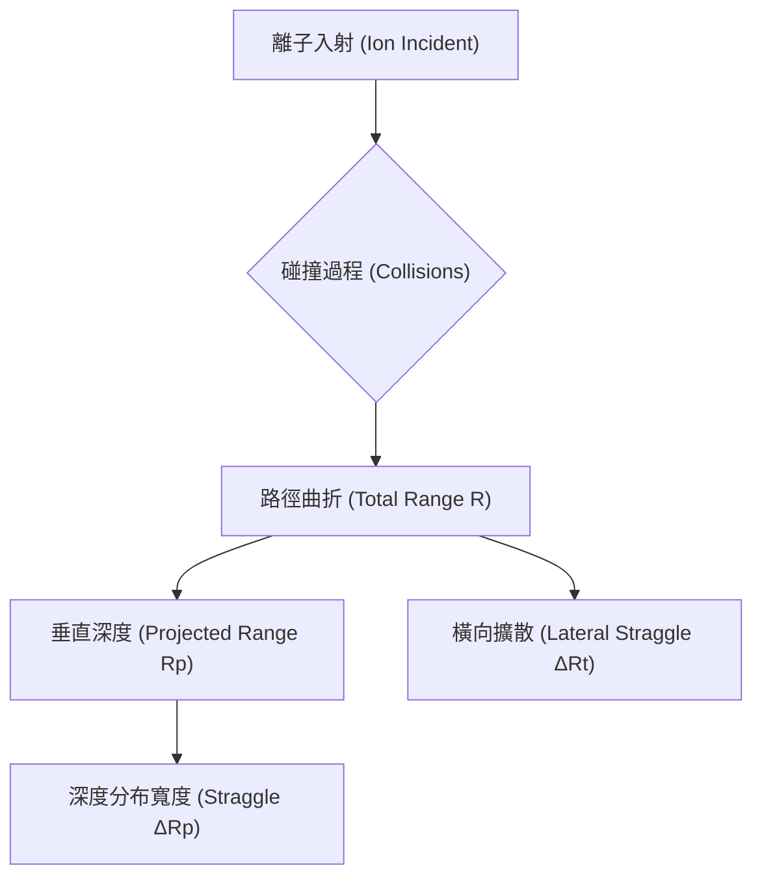

### 26.2.2 高斯分布模型與 Pearson IV 分布

在忽略晶體結構（假設靶材為無定形固體）的情況下，離子佈植後的濃度分布 $C(x)$ 最常以高斯分布（Gaussian Distribution）作為一階近似模型：

$$C(x) = \frac{\Phi}{\sqrt{2\pi}\Delta R_p} \exp\left[ -\frac{(x - R_p)^2}{2\Delta R_p^2} \right]$$

其中：
*   $C(x)$ 為深度 $x$ 處的摻雜濃度（單位：$cm^{-3}$）。
*   $\Phi$ 為佈植劑量（Dose，單位：$cm^{-2}$），代表單位面積內植入的總離子數。
*   $R_p$ 為投影射程。
*   $\Delta R_p$ 為投影射程偏離。

!!! note "典型值參考"
    對於能量為 $50 \text{ keV}$ 的硼（B）離子植入矽中，$R_p$ 約為 $160 \text{ nm}$，$\Delta R_p$ 約為 $50 \text{ nm}$；而同樣能量的砷（As）離子，由於質量較大，其 $R_p$ 僅約為 $32 \text{ nm}$，$\Delta R_p$ 約為 $11 \text{ nm}$。

然而，實際的佈植分布往往不對稱。輕離子（如硼）容易發生大角度反彈，導致分布向表面偏移（負偏態，Negative Skewness）；而重離子或具有通道效應時，分布則會向深處延伸（正偏態）。為了更精確地描述分布，製程模擬軟體（TCAD）常採用 **Pearson IV 分布**，它引入了三階動差（偏態，Skewness, $\gamma$）與四階動差（峰態，Kurtosis, $\beta$）：

*   **偏態 ($\gamma$)**：描述分布的左右不對稱性。
*   **峰態 ($\beta$)**：描述分布頂部的尖銳程度或尾端的厚度。

透過 Pearson IV 模型，工程師能更準確地預測 PN 接面的位置，這對於極淺接面（Ultra-Shallow Junction, USJ）的控制至關重要。

### 26.2.3 通道效應的物理機制

矽晶圓具有鑽石結構（Diamond Structure），原子在特定晶軸方向（如 $<110>$、$<100>$）排列整齊，形成長距離的空隙，稱為「通道」。

當入射離子的速度向量與這些晶軸或晶面平行時，離子與原子核發生大角度碰撞的機率大幅降低。在這種情況下，離子主要受到連續且微弱的電子能損（Electronic Stopping）影響，而非劇烈的核能損（Nuclear Stopping）。其物理機制如下：

1.  **低能損運動**：離子在通道中像是在管子內反彈，受到的阻力極小。
2.  **深度增加**：由於能量損失緩慢，通道離子的射程可達非晶態射程的數倍之多。
3.  **分布尾端 (Tail)**：通道效應會在標準的高斯分布深處產生一個長尾巴，這會導致接面深度（Junction Depth, $X_j$）難以縮減，嚴重影響短通道效應的控制（見第 5 章）。

### 26.2.4 抑制通道效應的方法

在先進製程中，為了獲得陡峭且可控的摻雜輪廓，必須抑制通道效應。主要方法包括：

#### 1. 傾斜角與旋轉角設定 (Tilt and Twist)
最傳統的方法是將晶圓相對於離子束傾斜一個角度，使離子「看」不到晶體的通道。
*   **傾斜角 (Tilt Angle)**：典型值為 $7^{\circ}$。這能有效避開主要的 $<100>$ 晶軸。
*   **旋轉角 (Twist Angle)**：在傾斜的同時旋轉晶圓，以確保在整個晶圓表面上，離子入射方向與晶面之間的幾何關係保持一致，避免因晶圓方位角產生的不均勻性。

!!! warning "微縮挑戰"
    隨著元件進入 FinFET 或 GAAFET 世代（見第 6 章），高傾斜角佈植會產生嚴重的陰影效應（Shadowing Effect），導致 3D 結構側面摻雜不均。因此，截至撰寫時，先進節點傾向於使用 $0^{\circ}$ 佈植，並搭配其他抑制技術。

#### 2. 預非晶化 (Pre-amorphization, PAI)
在植入主要的摻雜離子之前，先植入重質且不具電活性的離子（如鍺 $Ge^{+}$ 或矽 $Si^{+}$），將矽表面的單晶結構破壞，轉變為無定形（Amorphous）狀態。
*   **原理**：無定形層消除了晶體通道，後續植入的摻雜物（如硼）將如同在無定形靶材中運動，遵循預期的射程分布。
*   **後續處理**：佈植造成的晶格損傷必須透過後續的固相磊晶（Solid Phase Epitaxy, SPE）退火修復（見第 27 章）。

#### 3. 遮蔽氧化層 (Screen Oxide)
在晶圓表面生長一層薄氧化層（$SiO_2$，典型值 $5-20 \text{ nm}$）後再進行佈植。
*   **原理**：離子先穿過無定形的氧化層，發生初步的隨機散射，改變其進入矽晶圓時的方向，從而降低進入通道的機率。此外，這層氧化層還能防止大氣中的污染物直接被植入矽中。

### 26.2.5 佈植能量與分布的關係

離子佈植機的能量控制決定了 $R_p$。在製程整合中，必須根據元件需求選擇合適的能量：

| 應用類型 | 典型離子 | 能量範圍 (典型值) | 深度目標 |
| :--- | :--- | :--- | :--- |
| 極淺接面 (USJ) | $B^+, BF_2^+, As^+$ | $< 5 \text{ keV}$ | $< 20 \text{ nm}$ |
| 井區佈植 (Well) | $P^+, B^+$ | $100 - 500 \text{ keV}$ | $0.2 - 1.0 \text{ \mu m}$ |
| 深埋層 (Buried Layer) | $P^+, B^+$ | $> 1 \text{ MeV}$ | $> 2.0 \text{ \mu m}$ |

!!! example "產業實例"
    在 7 奈米以下的製程節點，為了達成極淺的源極/汲極延伸區（SDE），設備廠商如應用材料（Applied Materials）與亞舍立（Axcelis）開發了超低能量（Ultra-Low Energy, ULE）佈植技術，能量可低至 $0.2 \text{ keV}$。在這種極低能量下，離子束的傳輸效率與空間電荷效應（Space Charge Effect）的克服成為設備設計的技術門檻。

### 26.2.6 橫向分布與陰影效應

在定義電晶體通道邊界時，橫向偏離 $\Delta R_t$ 決定了摻雜物向閘極下方擴散的程度。當製程使用光阻或硬遮罩（Hard Mask）進行區域選擇性佈植時，遮罩的厚度與坡度會影響邊緣的濃度分布。

若採用傾斜角佈植，則會產生**陰影效應**。如下圖所示，遮罩高度 $H$ 與傾斜角 $\theta$ 會造成長度為 $S = H \cdot \tan(\theta)$ 的未摻雜區域。

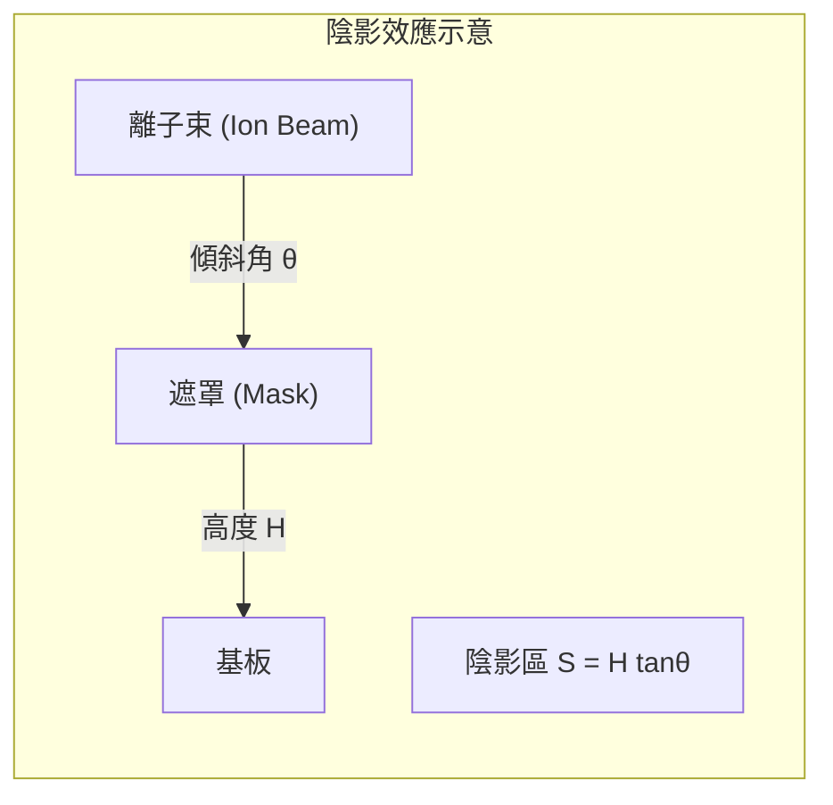

在現代高密度電路中，陰影效應會導致對稱性元件（如 SRAM 中的電晶體）出現特性不一致，因此在佈植機中通常會採用四階段旋轉（4-step rotation, $0^{\circ}, 90^{\circ}, 180^{\circ}, 270^{\circ}$）來補償這種不均勻性。

<!-- fig:1 -->
<figure markdown>
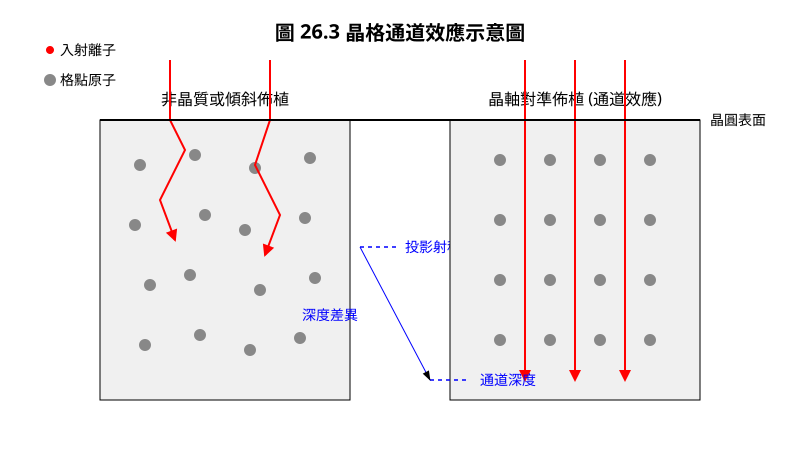
<figcaption>圖 26-1　晶格通道效應示意圖（AI 繪製的示意圖）</figcaption>
</figure>

## 26.3 劑量控制與佈植損傷

在離子佈植製程中，精確控制摻雜濃度與理解高能離子對晶體結構造成的破壞是製程整合的核心。本節將探討佈植劑量的定義與量測原理，並深入分析離子進入固體晶格後產生的微觀損傷機制。

### 26.3.1 劑量定義與離子束電流控制

離子佈植的「劑量」（Dose, $D$）是指單位面積內佈植進入晶圓的離子總數，其單位通常為 $\text{ions/cm}^2$。與擴散製程（見第 25 章）不同，離子佈植是一種非平衡過程，其摻雜量不受到固溶度（Solid Solubility）的熱力學限制，而是由佈植機的離子束電流（Beam Current）與佈植時間精確控制。

#### 1. 劑量與電流的積分關係

佈植劑量 $D$ 是離子束電流 $I$ 對時間 $t$ 的積分，並考量離子的電荷態與佈植面積。其數學表達式如下：

$$D = \frac{1}{nqA} \int_{0}^{t} I(t) dt$$

其中：
*   $D$：佈植劑量（$\text{atoms/cm}^2$）。
*   $n$：離子的電荷態（Charge state），例如單價離子 $n=1$，雙價離子 $n=2$。
*   $q$：基本電荷常數（Elementary charge），約為 $1.602 \times 10^{-19} \text{ Coulombs}$。
*   $A$：離子束掃描的有效面積（$\text{cm}^2$）。
*   $I(t)$：隨時間變化的離子束電流（$\text{Amperes}$）。

在實際操作中，佈植機會透過掃描機構（機械掃描或靜電掃描）確保離子束均勻覆蓋整片晶圓。對於固定電流 $I$ 與均勻掃描速度的情況，劑量可簡化為：

$$D = \frac{I \cdot t}{nqA}$$

#### 2. 法拉第杯與劑量監測

為了精確量測離子束電流，佈植機內部裝有「法拉第杯」（Faraday Cup）。這是一個中空的導電金屬杯，當離子束進入杯體並撞擊內壁時，會從外部電路吸取電子以中和電荷，產生的電流即代表離子束強度。

!!! warning "二次電子發射導致的量測誤差"
    當高能離子撞擊法拉第杯內壁時，會激發出「二次電子」（Secondary Electrons）。若這些電子逃離法拉第杯，外部電路會感測到額外的正電流，導致量測到的電流值大於實際離子束電流，進而造成佈植劑量不足（Under-dose）。為了修正此誤差，法拉第杯入口通常會施加負偏壓（Suppression Voltage）以將二次電子推回杯內，確保量測的準確性。

### 26.3.2 佈植損傷機制：從點缺陷到級聯損傷

當高能離子進入單晶矽（Single Crystal Silicon）晶格時，會透過核能損（Nuclear Stopping）與電子能損（Electronic Stopping）轉移能量（見 26.1 節）。當轉移至矽原子的能量超過其「位移能」（Displacement Energy, $E_d$，對於矽而言典型值約為 $15 \text{ eV}$）時，該矽原子會脫離晶格位置，形成損傷。

#### 1. 點缺陷與弗倫克爾缺陷對

最基本的損傷形式是「點缺陷」（Point Defects）：
*   **空孔（Vacancy, V）**：晶格中原本應有原子卻缺失的位置。
*   **間隙原子（Interstitial, I）**：脫離晶格的原子停留在晶格間隙中。
*   **弗倫克爾缺陷對（Frenkel pair）**：由一個空孔與一個鄰近的間隙原子所組成的缺陷對。

#### 2. 衝突級聯（Collision Cascade）

當入射離子的質量較大或能量較高時，被撞擊的矽原子（稱為初級敲擊原子，Primary Knock-on Atom, PKA）會獲得足夠動能去撞擊其他矽原子，產生連鎖反應。這種現象稱為「衝突級聯」。

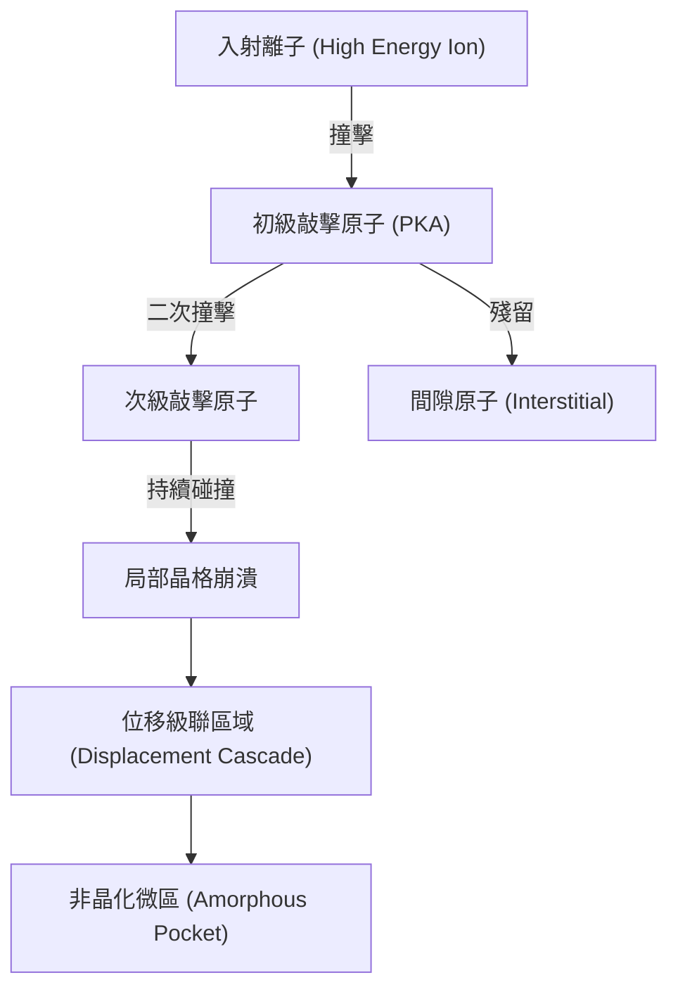

在級聯區域內，大量的原子偏離平衡位置，導致長程有序的晶體結構遭到破壞。若佈植離子為重離子（如砷 $\text{As}^+$ 或銻 $\text{Sb}^+$），其核能損極高，單一離子路徑周圍即可產生密集的損傷區；若為輕離子（如硼 $\text{B}^+$），則損傷較為分散，多以孤立的點缺陷為主。

### 26.3.3 非晶化臨界劑量與溫度依賴性

隨著佈植劑量的增加，晶格內的缺陷密度不斷上升。當缺陷濃度達到一定程度，晶體結構會完全喪失有序性，轉變為「非晶矽」（Amorphous Silicon, $\alpha\text{-Si}$）。

#### 1. 非晶化臨界劑量（Critical Dose for Amorphization, $D_c$）

使晶圓表面或特定深度形成連續非晶層所需的最低劑量稱為臨界劑量。此數值受以下因素影響：
*   **離子質量**：質量愈大，單次撞擊產生的位移原子愈多，$D_c$ 愈低。例如，$\text{As}^+$ 的 $D_c$ 遠低於 $\text{B}^+$。
*   **佈植能量**：能量影響能量損失率（$dE/dx$）的分布。
*   **基板溫度**：這是影響非晶化的關鍵熱力學因素。

#### 2. 動態退火（Dynamic Annealing）

在離子佈植過程中，晶格損傷的產生與自發性的修復（復位）是同時進行的。這種在佈植期間發生的缺陷複合現象稱為「動態退火」。
*   **低溫佈植**：動態退火效應弱，缺陷容易累積，較易達到非晶化。
*   **高溫佈植**：動態退火效應強，間隙原子與空孔快速複合，使得臨界劑量 $D_c$ 顯著上升。

!!! note "預非晶化佈植 (Pre-Amorphization Implant, PAI)"
    在先進製程中，為了消除輕離子（如硼）的通道效應（見 26.2 節）並獲得極淺接面（Ultra-shallow Junction），製程工程師常先佈植大劑量的矽（$\text{Si}^+$）或鍺（$\text{Ge}^+$）以在表面製造一層非晶層，隨後再佈植摻雜物。由於非晶矽缺乏長程有序結構，能有效阻擋離子進入通道，從而精確控制摻雜分布。

### 26.3.4 佈植損傷對元件特性的影響

離子佈植造成的晶格破壞若未能在後續熱處理中完全修復，將對 MOSFET 元件性能產生嚴重的負面影響。

#### 1. 漏電流增加（Increased Leakage Current）

殘留的缺陷（如位錯環、點缺陷複合體）會在能隙（Bandgap）中形成深能階（Deep Levels），充當產生-復合中心（Generation-Recombination Centers）。
*   在 PN 接面的空乏區內，這些能階會加速載子的產生，導致接面漏電流（Junction Leakage）大幅上升。
*   截至撰寫時，對於高密度封裝與低功耗元件，控制佈植損傷引起的漏電流仍是良率提升的關鍵。

#### 2. 載子遷移率下降（Mobility Degradation）

晶格損傷破壞了晶體的週期性位能，增加了載子在通道中運動時的散射（Scattering）機率。
*   **庫倫散射**：帶電缺陷對載子產生靜電干擾。
*   **晶格散射**：扭曲的晶格結構降低了平均自由徑。
這會直接導致元件的轉導（Transconductance, $g_m$）下降，進而影響運算速度。

#### 3. 暫態增強擴散（Transient Enhanced Diffusion, TED）

這是一種間接影響。佈植產生的過剩間隙原子在後續退火過程中會與摻雜原子結合，顯著提高摻雜原子的擴散速率。這會導致原本設定的摻雜輪廓（Doping Profile）變寬，加劇短通道效應（見第 5 章）。

| 損傷類型 | 對元件之主要影響 | 物理機制 |
| :--- | :--- | :--- |
| 點缺陷 (V, I) | 暫態增強擴散 (TED) | 間隙原子輔助摻雜物擴散 |
| 非晶層殘留 | 漏電流、高阻抗 | 晶格不連續導致能階陷阱 |
| 位錯環 (Dislocation Loops) | 接面崩潰電壓下降 | 局部電場集中與產生電流 |
| 表面損傷 | 氧化層品質下降 | 影響後續熱氧化成長之介面品質 |

### 26.3.5 損傷評估技術

在製程研發中，量化佈植損傷通常採用以下物理分析手段：
*   **透射電子顯微鏡（TEM）**：直接觀察非晶層厚度與位錯（Dislocation）分布。
*   **拉塞福背散射光譜（RBS/Channeling）**：利用離子束在通道方向的背散射產率來評估晶格的混亂程度。
*   **熱波分析（Thermal Wave Analysis）**：利用雷射誘導的熱反射率變化來非破壞性地監測劑量一致性與損傷程度。

!!! example "產業實例：低溫佈植 (Cryogenic Ion Implantation)"
    截至撰寫時，在 3 奈米（N3）及更先進節點中，為了抑制動態退火並獲得更穩定的非晶層，部分關鍵佈植步驟（如源極/汲極延伸區佈植）會採用低溫佈植技術。透過將晶圓冷卻至 $-60^\circ\text{C}$ 或更低，可以降低臨界劑量 $D_c$，使非晶化邊界更為陡峭，這對於後續固相磊晶（Solid Phase Epitaxy, SPE）修復晶格並活化摻雜物至關重要（見第 27 章）。

## 26.4 離子佈植機結構與系統組件

離子佈植機（Ion Implanter）是一套整合了精密物理電子光學、高壓電力系統、真空技術與自動化控制的複雜設備。其核心任務是將特定的原子電離，並精確地控制其能量與劑量，最終均勻地注入晶圓表面。典型的離子佈植機結構可依據離子束的行進路徑，區分為離子源、質量分析器、加速與傳輸系統、掃描系統以及終端站五大部分。

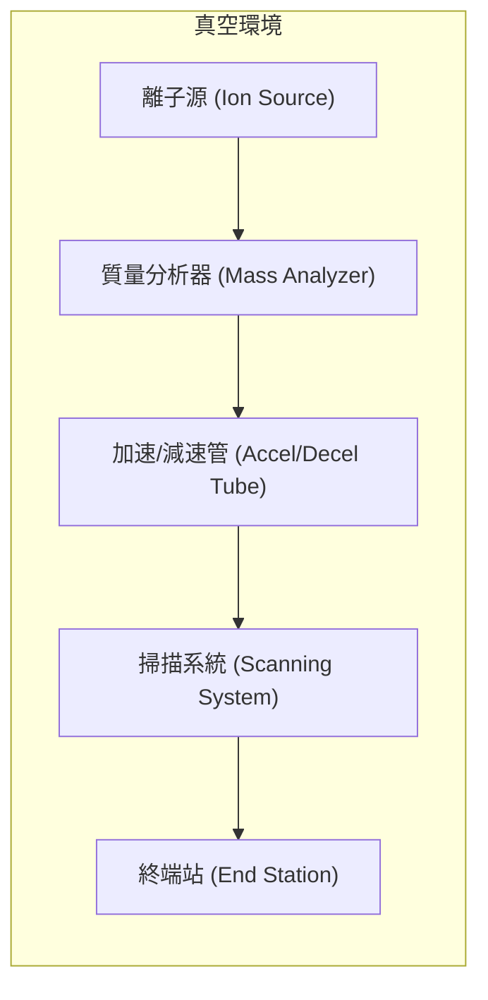

### 26.4.1 離子源（Ion Source）

離子源的功能是將摻雜元素轉化為電漿狀態，並從中提取出離子束。根據摻雜元素的常溫物理性質，可分為氣體源（如 $BF_3$、$PH_3$、$AsH_3$）與固體源（如固體磷或砷，需透過加熱爐蒸發）。

目前主流設備多採用熱陰極弧光放電（Hot Cathode Arc Discharge）機制，又稱為伯納斯型離子源（Bernas Source）或間接加熱陰極（Indirectly Heated Cathode, IHC）離子源。其運作原理如下：
1.  **熱電子發射**：鎢絲（Filament）通電加熱產生熱電子。
2.  **電離反應**：電子在弧光電壓（Arc Voltage）的加速下撞擊進入腔室的氣體分子，發生電離反應：

    $$e^- + M \rightarrow M^+ + 2e^-$$

    其中 $M$ 代表摻雜氣體分子。
3.  **電漿維持**：為了增加電離效率，離子源外部會施加一平行磁場，使電子的運動路徑呈螺旋狀，增加其與氣體分子碰撞的機率。
4.  **離子提取**：透過提取電極（Extraction Electrode）施加負偏壓，將帶正電的離子從電漿中拉出，形成初始離子束。

### 26.4.2 質量分析器（Mass Analyzer）

離子源產生的離子束成分極為複雜，例如使用 $BF_3$ 作為源氣體時，電漿中會同時存在 $B^+$、$^{11}B^+$、$^{10}B^+$、$BF^+$、$BF_2^+$ 等離子，甚至包含來自腔壁的雜質離子。為了確保注入晶圓的是單一物種，必須利用質量分析器進行篩選。

質量分析器主要由一個 90 度或 70 度的分析磁鐵（Analysis Magnet）組成。當離子束進入均勻磁場 $B$ 時，會受到勞侖茲力（Lorentz Force）作用而產生圓周運動。其運動半徑 $r$ 與離子的荷質比（Mass-to-charge ratio, $m/q$）關係如下：

$$r = \frac{mv}{qB} = \frac{1}{B} \sqrt{\frac{2mV}{q}}$$

其中 $m$ 為離子質量，$v$ 為速度，$q$ 為電荷量，$V$ 為提取電壓。

藉由精確調整磁場強度 $B$，可以使特定荷質比的離子通過出口狹縫（Resolving Slit），而其他雜質離子則會撞擊在分析管壁上被排除。

!!! note "同位素的選擇"
    在硼（Boron）佈植中，由於自然界存在 $^{10}B$（約 20%）與 $^{11}B$（約 80%），質量分析器通常設定為僅允許 $^{11}B^+$ 通過，以獲得穩定的束流強度並簡化製程控制。

### 26.4.3 加速與減速管（Acceleration/Deceleration Tube）

離子束在通過質量分析器後，其能量僅由提取電壓決定（典型值為 10-80 keV）。為了滿足不同製程需求，需透過加速或減速管調整最終能量。

1.  **加速管**：由一系列環狀電極組成，建立線性電位梯度。對於高能量佈植（如深井區形成），會將離子加速至數百 keV 甚至 MeV 等級。
2.  **減速管**：在超淺接面（Ultra-Shallow Junction, USJ）製程中，需要極低的佈植能量（低於 5 keV）。然而，低能離子束在長距離傳輸中容易因電荷排斥力（Space Charge Effect）而發散。因此，現代機台常採用「高能傳輸、末端減速」的設計，即讓離子以較高能量通過質量分析器，在接近晶圓前再進行減速。

**中性粒子過濾（Neutral Beam Filter）：**
離子在傳輸過程中可能與殘餘氣體分子碰撞並奪取電子，轉化為高能中性粒子。由於中性粒子不受後續掃描電場控制，會導致劑量不均。因此，系統通常會設計一個偏轉角度（如 7 度或 15 度），利用靜電偏轉板將帶電離子導向晶圓，而中性粒子則直線前進並被擋板捕捉。

### 26.4.4 掃描系統（Scanning System）

由於離子束的直徑通常遠小於晶圓直徑（截至撰寫時，主流晶圓為 300mm），必須透過掃描機制確保整片晶圓獲得均勻的劑量。

| 掃描方式 | 運作機制 | 優點 | 缺點 |
| :--- | :--- | :--- | :--- |
| **靜電掃描 (Electrostatic)** | 利用 X、Y 方向的偏轉板施加時變電場 | 掃描速度極快，適合低劑量佈植 | 離子束入射角會隨位置改變，易產生陰影效應 |
| **機械掃描 (Mechanical)** | 晶圓在旋轉盤上高速旋轉並進行徑向移動 | 離子束始終垂直入射，適合高劑量、大電流佈植 | 掃描速度受機械限制，真空密封難度高 |
| **混合掃描 (Hybrid)** | 離子束在一維方向電掃描，晶圓在另一維度機械移動 | 兼顧速度與角度控制，為目前 300mm 機台主流 | 系統控制邏輯較為複雜 |

為了克服靜電掃描產生的入射角偏差（Parallax Error），先進機台會配備「平行補償透鏡」（Parallelizing Lens），確保離子束在掃描到晶圓任何位置時，與晶圓表面的夾角保持一致。

### 26.4.5 終端站（End Station）

終端站是離子佈植機與自動化傳輸系統（如 OHT 與 FOUP）對接的界面，也是實際執行佈植的場所。

1.  **晶圓傳輸與定位**：包含真空負載鎖（Load Lock）與機械手臂，確保晶圓在不破壞主腔室真空的情況下進出。
2.  **靜電吸盤（Electrostatic Chuck, ESC）**：
    離子佈植過程中，高能離子撞擊晶圓會將動能轉化為熱能。若散熱不良，光阻可能發生碳化（Carbonization）甚至熔化。ESC 透過靜電力將晶圓緊貼於冷卻基座上，並在背後注入微量氦氣（He Backside Cooling）作為導熱介質，將溫度控制在 100°C 以下。
3.  **劑量監測系統（Faraday Cup）**：
    這是控制佈植精確度的核心組件。法拉第杯是一個金屬杯狀結構，用於收集離子束電荷並轉化為電流訊號。

    $$Dose (\Phi) = \frac{1}{qA} \int I(t) dt$$

    其中 $I$ 為電流，$A$ 為掃描面積，$t$ 為佈植時間。系統會即時積分電流值，一旦達到設定劑量，便立即關閉離子束。

!!! warning "二次電子抑制"
    當高能離子撞擊金屬表面時，會激發出二次電子。若這些電子逃逸，法拉第杯測得的電流值會偏高，導致實際注入劑量不足。因此，法拉第杯入口處必須施加負偏壓（Suppression Voltage），將二次電子壓制回杯內。

### 26.4.6 設備分類與產業實例

截至撰寫時，產業界面對不同的摻雜需求，將離子佈植機主要分為三大類：

1.  **中電流機（Medium Current）**：強調能量範圍廣（數 keV 至數 MeV）與精確的角度控制，常用於調整臨界電壓（$V_t$）與井區佈植。
2.  **大電流機（High Current）**：強調低能量、高束流（可達數十 mA），主要用於源極/汲極（S/D）與多晶矽閘極摻雜。為了提升產能，常採用帶狀離子束（Ribbon Beam）技術。
3.  **高能量機（High Energy）**：利用多級加速技術，能量可達數 MeV，用於深埋層（Buried Layer）或影像感測器（CIS）的深層光電二極體結構。

!!! example "產業實例"
    在全球半導體設備市場中，應用材料（Applied Materials, AMAT）的 Varian 系列與艾克爾（Axcelis）是離子佈植技術的主要供應商。例如 AMAT 的 VIISta 平台，透過單晶圓並行處理技術，在確保製程均勻性的同時，極大地提升了 300mm 晶圓的產出率（Throughput）。

<!-- fig:2 -->
<figure markdown>
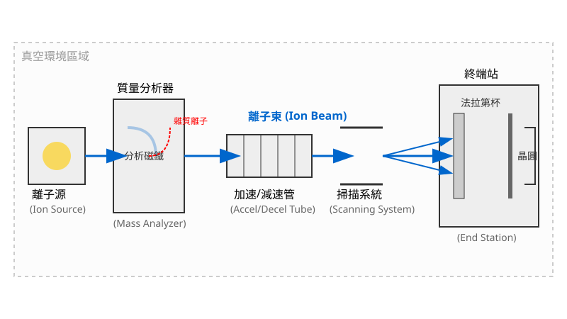
<figcaption>圖 26-2　離子佈植機系統組件圖（AI 繪製的示意圖）</figcaption>
</figure>

## 26.5 設備與廠商技術

在現代半導體製造中，離子佈植（Ion Implantation）是達成精確摻雜濃度的核心製程。隨著元件微縮至 3 奈米（nm）節點以下，佈植技術已從單純的濃度控制，演進為對晶格損傷、熱預算與三維結構保形性（Conformality）的綜合管理。本節將探討不同類型的離子佈植設備、新興的摻雜技術，以及主要設備供應商的技術路徑。

### 26.5.1 離子佈植機的分類與應用區隔

離子佈植機根據其射束電流（Beam Current）與離子能量（Energy）的範圍，主要分為三大類別。每一類設備針對特定的製程步驟進行優化，以平衡產能（Throughput）與製程精確度。

1.  **高電流佈植機（High Current Implanter）**
    *   **典型範圍**：能量通常低於 $80 \text{ keV}$，而射束電流可達 $10 \text{ mA}$ 以上。
    *   **主要應用**：源極／汲極（Source/Drain, S/D）佈植、多晶矽閘極摻雜。
    *   **技術挑戰**：在低能量下，離子束容易因空間電荷效應（Space Charge Effect）產生射束擴張（Beam Blow-up），導致劑量均勻性下降。因此，高電流機台常採用帶狀射束（Ribbon Beam）或極短的射束路徑設計。

2.  **中電流佈植機（Medium Current Implanter）**
    *   **典型範圍**：能量介於 $10 \text{ keV}$ 至 $500 \text{ keV}$，電流在微安培（$\mu\text{A}$）至毫安培（$\text{mA}$）等級。
    *   **主要應用**：臨界電壓調整（$V_t$ Adjust）、井區（Well）佈植、輕摻雜汲極（LDD）。
    *   **技術挑戰**：此類機台強調極高的劑量精確度與角度控制（精確度需優於 $0.1^\circ$），以應對短通道效應的抑制。

3.  **高能量佈植機（High Energy Implanter）**
    *   **典型範圍**：能量可達數 $\text{MeV}$（百萬電子伏特）。
    *   **主要應用**：深井（Deep Well）佈植、三重複合井（Triple Well）、影像感測器（CIS）的深層光電二極體形成。
    *   **技術技術**：通常採用射頻加速器（RF Linear Accelerator, Linac）原理，將離子加速至極高速度以穿透矽表面數微米的深度。

### 26.5.2 電漿摻雜技術（PLAD / PIII）

傳統束流式（Beamline）佈植在面對極淺接面（Ultra-Shallow Junction, USJ）與複雜 3D 結構（如 FinFET 的側壁或 GAAFET 的奈米片）時，存在物理極限。電漿摻雜（Plasma Doping, PLAD，亦稱 Plasma Immersion Ion Implantation, PIII）應運而生。

*   **物理原理**：將晶圓直接置於含有摻雜氣體（如 $\text{BF}_3$、$\text{PH}_3$）的電漿腔體中，並在晶圓基座施加負向脈衝偏壓（Negative Pulse Bias）。電漿中的離子會被電場加速，同時從各個角度植入晶圓表面。
*   **技術優勢**：
    1.  **極低能量**：不受束流式設備的空間電荷效應限制，可實現低於 $500 \text{ eV}$ 的等效佈植能量。
    2.  **高產能**：不論劑量高低，其佈植速度極快，特別適合高劑量的預非晶化（Pre-amorphization）或表面改質。
    3.  **保形性**：雖然非完全各向同性，但對於高深寬比結構的頂部與側壁覆蓋率優於傳統束流佈植。

### 26.5.3 低溫佈植技術（Cryogenic Implantation）

隨著元件尺寸縮小，佈植過程產生的點缺陷（Point Defects）在後續熱處理中的擴散行為會嚴重影響接面深度。低溫佈植（冷佈植）成為先進製程的關鍵技術。

*   **機制**：將晶圓冷卻至低溫（典型值為 $-60^\circ\text{C}$ 至 $-100^\circ\text{C}$）進行佈植。在低溫下，矽原子受撞擊產生的位移較難透過熱能自行修復（Self-annealing），這有助於形成更完整、邊界更陡峭的非晶層（Amorphous Layer）。
*   **效益**：
    1.  **抑制通道效應**：更易形成非晶層，減少離子沿著晶格孔道深入。
    2.  **提升活化效率**：在後續的快速熱退火（RTA）中，非晶層透過固相磊晶（Solid Phase Epitaxy, SPE）重新結晶，能使摻雜物達到更高的電性活化濃度並減少瞬態增強擴散（Transient Enhanced Diffusion, TED）。

### 26.5.4 設備供應商與技術路線比較

截至撰寫時，全球離子佈植設備市場主要由少數領導廠商佔據，其技術核心在於射束光學系統（Beam Optics）與晶圓傳輸效率的差異。

| 廠商 | 代表產品系列 | 技術路線與特點 | 主要應用 |
| :--- | :--- | :--- | :--- |
| **Applied Materials** | VIISta 系列 | 採用單晶圓平行射束處理，配備精確的角度量測系統，強調射束純度與劑量均勻性。 | 邏輯與記憶體全線製程，涵蓋高電流至高能量。 |
| **Axcelis** | Purion 系列 | 模組化平台設計，其高能量機型（Purion XE）具備優異的能量穩定性，並在低溫佈植（Purion VXE）有深度佈局。 | 功率元件、CIS 影像感測器、先進邏輯製程。 |
| **Sumitomo Eaton** | — | 結合了混合掃描（Hybrid Scan）技術，在維持高產能的同時，提供良好的角度控制與熱管理。 | 廣泛應用於亞洲晶圓廠的量產線。 |

#### 產業實例與技術取捨

在先進製程的選機考量上，廠商通常會根據產品特性進行取捨：

1.  **Applied Materials (應用材料)**：其 **VIISta 系列** 佈植機在市場佔有率極高，核心優勢在於其「帶狀射束」技術與整合式的計量系統。透過即時監控射束的角度與形狀，VIISta 能在 12 吋晶圓上達成極高的劑量一致性。對於需要頻繁切換摻雜物種類的邏輯代工廠，其自動清洗與快速切換離子源的能力是關鍵考量。

2.  **Axcelis (亞舍立)**：其 **Purion 系列** 在高能量佈植領域具有顯著優勢。例如在 CIS 影像感測器的製造中，需要將磷（P）或硼（B）植入矽深處以形成深層光電二極體，Purion XE 提供的能量穩定性與低金屬污染控制，能有效降低感測器的暗電流（Dark Current）缺陷。此外，Axcelis 針對 3 奈米以下節點推出的低溫佈植方案，透過特殊的靜電吸盤（E-Chuck）冷卻技術，確保在連續高功率佈植下，晶圓溫度仍能穩定維持在極低溫。

3.  **Sumitomo Eaton (住友)**：該公司設備在機械掃描與射束掃描的結合上具有特色。在處理大尺寸功率元件（如 SiC 或 GaN）時，其設備對於高溫佈植（Warm Implantation）的支援能力，能有效減少寬能隙半導體在佈植時產生的晶格應力，這是其在特定功率半導體市場的重要競爭力。

### 26.5.5 佈植機的核心子系統趨勢

為了因應未來更嚴苛的製程需求，離子佈植機的子系統正朝向自動化與智能化發展：

*   **離子源（Ion Source）技術**：為了延長機台運行時間（Uptime），新型離子源採用間接加熱陰極（Indirectly Heated Cathode, IHC）設計，並導入氟基清洗氣體以減少鎢沉積導致的短路問題。
*   **質量分析器（Mass Analyzer）**：隨著同位素純度要求提高，分析磁鐵的分辨率（Resolution）持續提升，以確保如 $^{11}\text{B}^+$ 與 $^{10}\text{B}^+$ 等離子能被精確區分。
*   **劑量監控（Dose Mapping）**：截至撰寫時，先進機台已導入原位（In-situ）劑量監控，結合大數據分析，能預測離子源壽命並在佈植過程中自動補償射束漂移，確保批次間（Lot-to-lot）的穩定性。

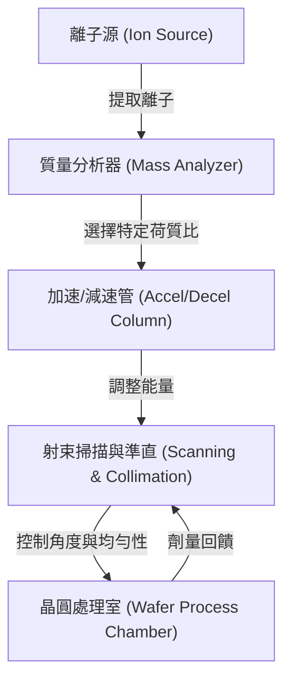

!!! note "技術趨勢：原子層摻雜 (ALD Doping)"
    雖然本章重點在於離子佈植，但讀者應注意，在極先進節點中，部分摻雜需求正轉向結合原子層沉積（ALD）與熱擴散的技術（見第 23 章與第 25 章），以達成 100% 的保形性。然而，離子佈植因其具備「方向性」與「局部摻雜」的不可替代性，在未來 3D 整合製程中仍將扮演關鍵角色。

## 本章重點

1.  離子佈植為一種非平衡態的高能物理摻雜技術，能突破固溶度限制，並透過加速電壓與束流積分精確控制摻雜深度（投影射程）與總劑量。
2.  能量損失機制分為核能阻擋（$S_n$）與電子能阻擋（$S_e$）。核能阻擋涉及原子核間的彈性碰撞，是造成晶格損傷與非晶質化的主因；電子能阻擋則類似黏滯阻力，能量以熱能形式散失。
3.  LSS 理論為預測離子射程分布的基礎，假設靶材為無定形結構。實際分布常以高斯分布或更精確的 Pearson IV 分布描述，後者引入了偏態與峰態以修正不對稱性。
4.  通道效應源於單晶矽的長程有序結構，使離子沿著晶軸空隙深入基板。製程中常透過傾斜角（Tilt）、旋轉角（Twist）、預非晶化佈植（PAI）或生長遮蔽氧化層來抑制此效應。
5.  佈植劑量由離子束電流對時間的積分決定，法拉第杯為核心量測元件。為避免二次電子發射導致劑量不足，必須施加負偏壓進行抑制。
6.  佈植損傷包含點缺陷、衝突級聯與非晶層。殘留損傷會引發漏電流、降低遷移率，並在退火過程中導致暫態增強擴散（TED），影響接面深度的精確度。
7.  離子佈植機由離子源、質量分析器、加速/減速管、掃描系統與終端站組成。質量分析器利用磁場下的勞侖茲力，依荷質比篩選出目標離子。

## 重點圖卡

複習時看這幾張就能抓住本章重點；[圖卡庫](../cards.md)可以下載成圖片。

<figure markdown>
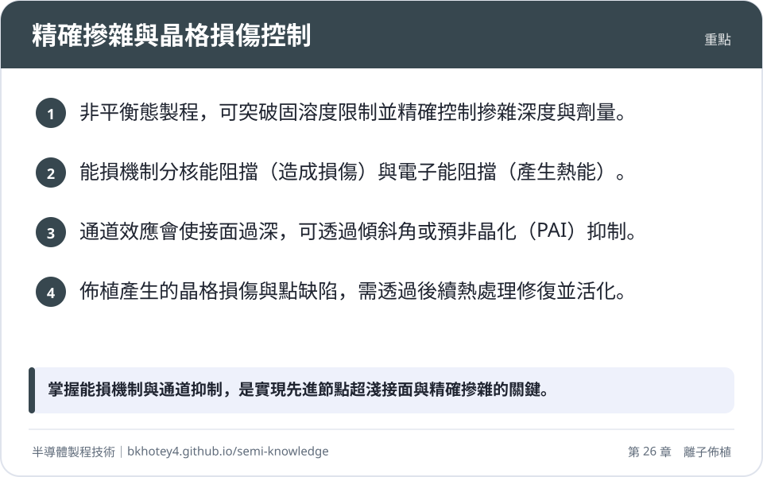
<figcaption>重點圖卡：精確摻雜與晶格損傷控制</figcaption>
</figure>

<figure markdown>
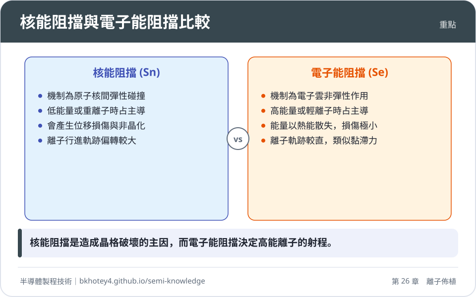
<figcaption>重點圖卡：核能阻擋與電子能阻擋比較</figcaption>
</figure>

<figure markdown>
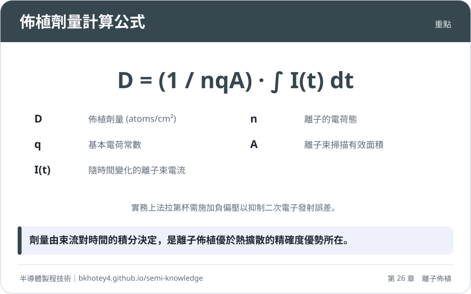
<figcaption>重點圖卡：佈植劑量計算公式</figcaption>
</figure>

<figure markdown>
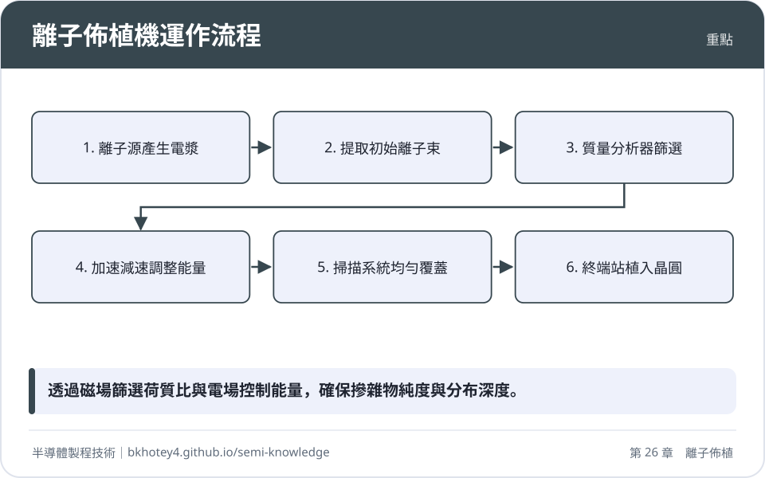
<figcaption>重點圖卡：離子佈植機運作流程</figcaption>
</figure>

## 習題

**1.** 試比較核能阻擋（Nuclear Stopping）與電子能阻擋（Electronic Stopping）在物理機制、能量依賴性以及對晶格結構影響上的差異。

??? success "參考解答"
    1. 物理機制：核能阻擋為入射離子與靶原子核間的彈性碰撞（動量轉移）；電子能阻擋為入射離子與靶原子電子雲間的非彈性交互作用（激發或游離）。
    2. 能量依賴性：核能阻擋在低能量時占主導地位；電子能阻擋在高能量時占主導地位，且低速時與離子速度（$\sqrt{E}$）成正比。
    3. 晶格影響：核能阻擋會將原子撞離晶格位置，產生空缺、間隙原子甚至非晶化；電子能阻擋幾乎不產生位移損傷，能量主要轉化為熱能。

**2.** 若一離子佈植機以 $1 \text{ mA}$ 的單價正離子束（$n=1$）均勻掃描一片直徑為 $300 \text{ mm}$ 的晶圓，欲達成 $1 \times 10^{15} \text{ atoms/cm}^2$ 的佈植劑量，試計算所需的佈植時間（秒）。（基本電荷 $q \approx 1.6 \times 10^{-19} \text{ C}$）

??? success "參考解答"
    根據劑量公式 $D = \frac{I \cdot t}{nqA}$，移項得 $t = \frac{D \cdot nqA}{I}$。
    1. 晶圓面積 $A = \pi \cdot (15 \text{ cm})^2 \approx 706.86 \text{ cm}^2$。
    2. $t = \frac{(1 \times 10^{15} \text{ cm}^{-2}) \cdot 1 \cdot (1.6 \times 10^{-19} \text{ C}) \cdot 706.86 \text{ cm}^2}{1 \times 10^{-3} \text{ A}}$。
    3. $t = \frac{0.1131}{0.001} \approx 113.1 \text{ 秒}$。

**3.** 何謂「通道效應」（Channeling Effect）？在先進製程中，工程師為何常在植入硼（B）離子前先進行鍺（Ge）離子的預非晶化佈植（PAI）？

??? success "參考解答"
    通道效應是指離子沿著單晶結構中原子排列整齊的空隙（通道）行進，因減少了與原子核的碰撞，使得射程遠大於無定形靶材預測值的現象。
    進行 PAI 的目的是利用重質的鍺離子破壞矽表面的單晶結構，使其轉變為無定形狀態。如此一來，後續植入的輕質硼離子將因失去通道路徑而增加碰撞機率，從而能精確控制在極淺範圍內，形成陡峭的接面輪廓。

**4.** 假設硼離子佈植後的深度分布符合高斯分布，已知投影射程 $R_p = 200 \text{ nm}$，射程偏離 $\Delta R_p = 50 \text{ nm}$，佈植劑量 $\Phi = 5 \times 10^{14} \text{ cm}^{-2}$。試求在深度 $x = 200 \text{ nm}$ 處的峰值摻雜濃度。

??? success "參考解答"
    在高斯分布中，峰值濃度發生於 $x = R_p$ 處，公式簡化為 $C_{max} = \frac{\Phi}{\sqrt{2\pi}\Delta R_p}$。
    1. $C(200 \text{ nm}) = \frac{5 \times 10^{14}}{\sqrt{2\pi} \cdot (50 \times 10^{-7} \text{ cm})}$。（注意單位換算：$50 \text{ nm} = 5 \times 10^{-6} \text{ cm}$，但此處應統一使用 $\text{cm}$ 以符合 $\text{cm}^{-3}$ 單位）。
    2. $C_{max} = \frac{5 \times 10^{14}}{2.5066 \cdot 5 \times 10^{-6}} \approx 3.99 \times 10^{19} \text{ cm}^{-3}$。

**5.** 說明法拉第杯（Faraday Cup）中「二次電子抑制」的重要性。若抑制電路失效，量測到的劑量會偏高還是偏低？

??? success "參考解答"
    當高能離子撞擊法拉第杯時會激發二次電子逃逸。若二次電子離開杯體，外部電路會感測到額外的正電荷流出，導致量測到的電流值（$I_{measured}$）大於實際的離子束電流。
    由於佈植機在達到設定的電流積分值（劑量）後會停止，若量測電流偏高，系統會過早停止佈植，導致實際注入晶圓的劑量「偏低」（Under-dose）。

## 本章術語

- **Ion Implantation**（離子佈植）：利用高壓電場加速雜質離子，將其強行射入半導體基板以改變電學特性的製程。
- **Projected Range, $R_p$**（投影射程）：離子進入基板後，在入射方向上停止位置的平均深度。
- **Straggle, $\Delta R_p$**（射程偏離）：離子在深度分布上的標準差，反映了摻雜區域的寬度。
- **Channeling Effect**（通道效應）：離子因進入晶格空隙而減少能量損失，導致射程異常增加的現象。
- **Pre-amorphization Implant, PAI**（預非晶化佈植）：在摻雜前先植入重離子破壞晶格，以消除通道效應並達成超淺接面的技術。
- **Faraday Cup**（法拉第杯）：用於收集離子束電荷並量測電流，以精確控制佈植劑量的感測裝置。
- **Transient Enhanced Diffusion, TED**（暫態增強擴散）：佈植產生的過剩間隙原子在退火初期誘導摻雜物快速擴散，導致接面加深的現象。
- **LSS Theory**（LSS 理論）：由 Lindhard、Scharff 與 Schiøtt 提出，描述離子在無定形靶材中能量損失與射程分布的數學模型。
- **Dose**（劑量）：單位面積內植入基板的離子總數，單位通常為 $\text{atoms/cm}^2$。
- **Mass Analyzer**（質量分析器）：利用磁場偏轉原理，根據荷質比篩選出特定摻雜離子的過濾系統。

## 互動學習

!!! tip "動手試試看"
    - [互動實驗：摻雜、費米能階與電阻率](../labs.md#doping)
    - [設備機台圖鑑：離子佈植機](../equipment.md)

## 產業最新進展

本節由每日產業新聞自動補充，說明本章技術在產業上的最新發展。

<!-- updates -->
（目前尚無補充。）
