# 第 27 章　快速熱處理與退火

!!! abstract "學習目標"
    - 理解離子佈植後晶格損傷修復機制（如固相磊晶再成長）與摻質電性活化的物理動力學
    - 掌握熱預算的數學定義及其在超淺接面形成中對瞬態增強擴散的抑制原理
    - 比較等溫退火、快速熱處理、尖峰退火與毫秒級退火之溫度-時間歷程與特徵長度
    - 分析雷射退火與閃光燈退火之非平衡活化機制與圖案效應挑戰
    - 認識主流快速熱退火設備的腔體設計、高精度測溫機制與產業實例

## 27.1 晶格損傷修復與摻質電性活化

### 佈植後晶格損傷與非晶化狀態

離子佈植（如第 26 章所述）是將具備高動能的雜質離子注入半導體靶材的非熱平衡過程。高能離子穿入單晶矽晶格時，透過核阻止（nuclear stopping）與電子阻止（electronic stopping）損失動能。當傳遞給矽原子的動能超過其晶格位移能（displacement energy，對於矽晶格典型值約為 $13\text{--}15\text{ eV}$）時，矽原子會被擊出原格位，形成一對弗蘭克爾缺陷（Frenkel pair，即一個空缺 $V$ 與一個自間隙矽原子 $I$）。被擊出的原初反衝原子（primary knock-on atom）若仍帶有充足動能，將進一步引發連鎖碰撞串級（collision cascade），在極短時間內（約 $10^{-13}\text{--}10^{-12}\text{ s}$）造成局部高度混亂的損壞區。

隨著佈植劑量（dose, $\Phi$）累積，點缺陷密度持續上升。當單位體積內沉積於晶格位移的核損壞能量達到臨界值（約每立方公分 $5 \times 10^{23}\text{ eV/cm}^3$）時，局部區域便轉變為非晶相（amorphous phase）。在足夠高的劑量下，這些孤立的非晶微區相互重疊，在晶圓表層形成連續的非晶矽層（continuous amorphous layer）。決定是否形成連續非晶層的臨界非晶化劑量（critical amorphization dose, $\Phi_{\text{crit}}$）與佈植離子的質量、能量及基板溫度密切相關；重離子（如砷 $\text{As}^+$、鍺 $\text{Ge}^+$）相較於輕離子（如硼 $\text{B}^+$），引發連鎖碰撞的局部能量密度高，其臨界劑量顯著較低。

連續非晶化結構的截面缺陷分佈可分為兩個主要區域：
1. **非晶矽層**：自表面延伸至特定深度的非晶相，其原有的長程有序（long-range order）完全破壞。
2. **射程終端區（End-of-Range, EOR）**：位於非晶/單晶結晶介面（amorphous/crystalline interface，簡稱 $a/c$ 介面）下方。此處離子能量衰減至核阻止主導區，碰撞串級並未完全使晶格崩塌成非晶態，但留下了大量超過熱平衡濃度的殘留點缺陷，特別是過飽和的自間隙矽原子。

在未達非晶化劑量的低劑量佈植情況下（例如輕摻雜汲極之硼佈植），晶格仍維持單晶骨架，但內部存在高濃度的空缺與間隙原子，通常可在深度分佈上觀察到「表面富集空缺、投影射程（projected range, $R_p$）附近及深處富集間隙矽」的空間分離特徵。

---

### 固相磊晶再成長機制

對於已產生連續非晶層的矽晶圓，修復晶格損傷最直接且高效的物理途徑為固相磊晶再成長（Solid Phase Epitaxial Regrowth, SPER）。SPER 是以介面下方未受損的單晶矽基底為原子模板，透過熱活化驅動 $a/c$ 介面處的矽原子進行局部位移與鍵結重組，使非晶相逐步轉變為單晶相的界面遷移過程。

SPER 的結晶前緣（crystallization front）推進速率 $v$ 服從阿瑞尼斯（Arrhenius）方程式：

$$v(T) = v_0 \exp\left(-\frac{E_a}{k_B T}\right)$$

其中：
- $v_0$ 為預指數因子（pre-exponential factor），與原子振動頻率及晶面原子密度有關。
- $E_a$ 為 SPER 的活化能，在純矽基板中公認的活化能典型值約為 $2.7\text{ eV}$。
- $k_B$ 為波茲曼常數（Boltzmann constant）。
- $T$ 為絕對溫度。

SPER 速率強烈相依於結晶前緣所處的晶向（crystallographic orientation）。實驗測得在相同溫度下，各低指數晶面的再結晶速率關係為：

$$v_{(100)} \approx 3 \times v_{(110)} \approx 20 \times v_{(111)}$$

這種顯著的向異性源於原子在不同晶面模板上成核重組所需的幾何鍵結數限制。在 $(100)$ 面上，非晶原子僅需在單晶階梯形成兩個共價鍵即可穩定結合；而在 $(111)$ 面上，若原子沉積順序錯誤極易形成微雙晶（micro-twins）或層錯（stacking faults），顯著抑制推進速率。

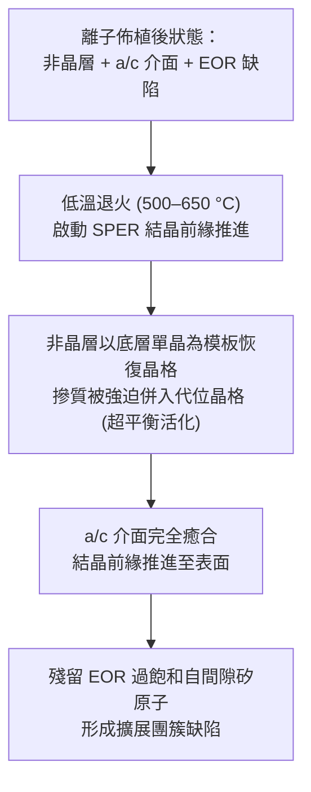

SPER 具備一項重要製程特性：其能在相對較低的溫度區間（$500\text{--}650\,^\circ\text{C}$）迅速完成非晶層的單晶化。更關鍵的是，當結晶前緣掃過非晶層時，原先隨機分佈在非晶相中的摻質原子（如硼、磷、砷）會被「掃入」新生單晶的正常晶格格位，此現象稱為溶質捕獲（solute trapping）。在低溫條件下，由於摻質的固態擴散係數極小，被捕獲進入代位格位的摻質無法透過擴散脫離，從而能達成遠高於熱力學平衡固溶極限的電性活化度。

---

### 摻質活化熱力學與固溶極限

佈植進入半導體晶格的雜質離子，在未經熱處理前絕大多數停留在晶格間隙（interstitial sites）或高度扭曲的無序環境中，缺乏與周圍矽原子的四面體共價配位，無法提供自由載子，在電性上處於非活化態（inactive）。

電性活化（electrical activation）是指經由熱處理提供足夠的熱動能，使雜質原子遷移並佔據晶格代位（substitutional site），與周圍矽原子形成穩定的 $sp^3$ 共價鍵，並釋出自由電洞（三價受光子，如 B）或自由電子（五價施體，如 P、As）。

摻質在矽中的平衡電性活化濃度受限於該元素在特定溫度下的熱力學平衡固溶極限（equilibrium solid solubility limit, $C_{\text{ss}}$）。固溶極限由混合自由能最小化決定，隨溫度的變化亦遵循 Arrhenius 關係：

$$C_{\text{ss}}(T) = C_0 \exp\left(-\frac{\Delta H_s}{k_B T}\right)$$

其中 $\Delta H_s$ 為溶解焓（enthalpy of solution），$C_0$ 為前因子。下表列出常見摻質在單晶矽中的平衡固溶極限典型範圍：

| 摻質種類 | 導電型態 | 活化能典型值 (eV) | 典型固溶極限最高值 ($\text{cm}^{-3}$) | 最高溶解度對應溫度區間 ($^\circ\text{C}$) |
| :--- | :--- | :--- | :--- | :--- |
| **硼 (B)** | p 型 (受體) | $3.5\text{--}4.0$ (擴散/取代) | $\approx 2 \times 10^{20}$ | $1100\text{--}1200$ |
| **磷 (P)** | n 型 (施體) | $3.6\text{--}3.9$ | $\approx 1.2 \times 10^{21}$ | $1150\text{--}1200$ |
| **砷 (As)** | n 型 (施體) | $4.0\text{--}4.2$ | $\approx 2 \times 10^{21}$ | $1150\text{--}1200$ |

若佈植濃度高於 $C_{\text{ss}}$，在持續的高溫熱平衡退火過程中，超出固溶限度的原子將透過化學反應析出，聚集成電性非活性的金屬矽化物沉澱（precipitates）或摻質-缺陷複合物（如 $B_n I_m$ 或 $As_m V_n$ 團簇），導致活化率不增反降，這種現象稱為去活化（deactivation）。

!!! note "SPER 亞穩態活化與熱平衡活化的差異"
    傳統高溫退火依賴熱擴散讓原子跳入代位，活化極限直接受限於 $C_{\text{ss}}(T)$；若要提高活化度必須提升溫度。然而，SPER 屬於非平衡相變歷程，結晶前緣強行將摻質固溶進晶格，可在 $600\,^\circ\text{C}$ 左右達到數倍於該溫度下熱平衡固溶度的活化濃度（亞穩態超飽和活化）。但此亞穩態在後續的高溫製程中若遇到過高的熱預算，將會快速解聚並回復至熱力學平衡態，造成載子濃度劇烈衰退。

---

### 團簇缺陷的演化歷程

在 SPER 完成非晶層結晶之後，原 $a/c$ 介面下方的 EOR 區域仍滯留了極高濃度的自間隙矽原子。這些非平衡的點缺陷具有極高的化學勢，在熱退火提供動能時，點缺陷無法立即完全擴散至表面湮滅，而是透過奧斯瓦爾德熟化（Ostwald ripening）機制，逐漸合併降低系統界面能，形成一系列延伸缺陷（extended defects）。

間隙矽原子團簇在不同熱處理階段的微觀演化階層如下：

1. **次奈米點缺陷團簇（Small Interstitial Clusters, $I_n$）**：退火初期（或溫度低於 $650\,^\circ\text{C}$），過飽和的間隙矽自發聚結為包含數個至數十個原子的不規則微小團簇（如 $I_3$、$I_4$）。
2. **$\{311\}$ 棒狀缺陷（$\{311\}$ Rod-like Defects）**：當溫度介於 $650\text{--}800\,^\circ\text{C}$ 時，小型團簇轉化為高深寬比的 $\{311\}$ 共格板狀（planar）或棒狀缺陷。此結構是自間隙矽原子在矽的 $\{311\}$ 晶面上排差插入形成，具有穩定的五元環與七元環原子重組結構，但尚未形成標準的晶格差排。
3. **差排環（Dislocation Loops）**：當退火溫度超過約 $800\,^\circ\text{C}$，$\{311\}$ 缺陷由於系統應變能過高而失去穩定性，開始溶解並將其釋放的間隙原子轉移形成更穩定的延伸差排結構。最初形成的是伯格斯向量（Burgers vector）垂直於缺陷平面的法蘭克不全差排環（Frank faulted loops，位於 $\{111\}$ 面）；隨著溫度進一步上升（$>950\,^\circ\text{C}$）或時間延長，不全差排環經由剪切反應轉化為完全差排環（perfect prismatic dislocation loops）。

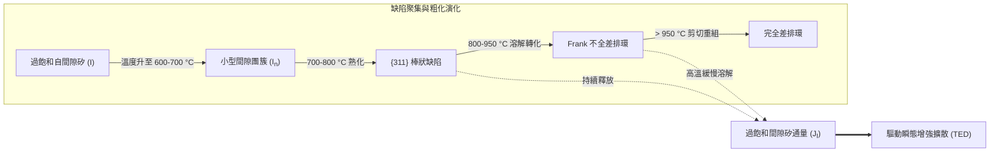

差排環的熱穩定性極高，要完全消除位於接面附近的 EOR 差排環，通常需要極高溫（超過 $1050\,^\circ\text{C}$）或特定熱預算條件；若殘留在元件的空乏區（depletion region）內，這些差排缺陷將作為深能階複合中心（deep-level recombination center），引發嚴重的接面漏電流（junction leakage）。

---

### 瞬態增強擴散物理機制

離子佈植後退火過程中最顯著的摻質反常行為是瞬態增強擴散（Transient Enhanced Diffusion, TED）。以硼（B）或磷（P）為例，在退火剛開始的數秒至數十秒內，其實驗測得的有效擴散係數可比熱平衡條件下的數值高出 $10^2$ 至 $10^4$ 倍；隨著退火時間延長，擴散速率迅速衰減，最終回歸到正常熱平衡擴散值。

TED 的微觀物理起因，本質上是由上述延伸缺陷演化時所釋放出的過飽和自間隙矽原子所驅動。硼與磷等原子在矽中的擴散主要仰賴間隙機制（interstitialcy mechanism），即摻質原子 $A$ 與自間隙矽原子 $I$ 結合形成可移動的活態中介物（mobile interstitial-dopant pair, $(AI)$）：

$$A_{\text{sub}} + I \rightleftharpoons (AI)$$

此時摻質的有效擴散係數 $D_A^{\text{eff}}$ 正比於當前環境中的自間隙矽原子濃度 $C_I$：

$$D_A^{\text{eff}} = D_A^{\text{eq}} \left( \frac{C_I}{C_I^*} \right)$$

其中：
- $D_A^{\text{eq}}$ 為熱平衡狀態下的摻質擴散係數。
- $C_I^*$ 為該溫度下自間隙矽原子的熱力學平衡濃度。
- $C_I / C_I^*$ 即為間隙矽過飽和比（interstitial supersaturation ratio, $S_I$）。

在佈植退火時，$\{311\}$ 缺陷充當了巨大的間隙矽「儲存庫」。在特定溫度下，$\{311\}$ 缺陷以一定速率溶解，持續向基板與晶圓表面發射間隙矽原子流。間隙矽通量（flux）模型可透過連續方程式描述：

$$J_I = -D_I \nabla C_I$$

$$\frac{\partial C_I}{\partial t} = \nabla \cdot (D_I \nabla C_I) + G_{\{311\}} - R_{\text{bulk}} - R_{\text{surf}}$$

其中 $D_I$ 為間隙矽擴散率，$G_{\{311\}}$ 為 $\{311\}$ 缺陷的熱分解生成率，$R_{\text{bulk}}$ 與 $R_{\text{surf}}$ 分別為間隙原子在主體晶格中與表面再結合（surface recombination）的消滅率。

!!! warning "TED 與「+1 模型」之關聯性"
    在定量分析 TED 總量時，經典的「+1 模型」（plus-one model）指出：儘管碰撞串級產生了數以千計的 Frenkel 對，但絕大多數空缺與間隙矽都在超快微觀時間尺度內相互重組湮滅；最終淨剩下來參與 TED 的未平衡間隙原子總數，大約等於佈植進入晶格的雜質離子總數（即「+1」個多餘原子佔據了晶格體積）。這些多餘的間隙原子必須全數擴散遷移至晶圓表面或深層差排沉陷（sinks）並完成湮滅，TED 現象才會完全終止。

TED 造成佈植分佈輪廓在退火初期嚴重展寬，破壞超淺接面（Ultra-Shallow Junction, USJ）的深度陡峭度。為了在抑制 TED（避免間隙矽長時間驅動擴散）的同時達成高電性活化與晶格完全修復，熱製程技術必須在加溫時間尺度上進行根本性的變革，這也構成了後續尖峰退火（Spike Anneal）及毫秒級退火技術發展的核心物理驅動力（見第 27.2 與 27.3 節）。

<!-- fig:1 -->
<figure markdown>
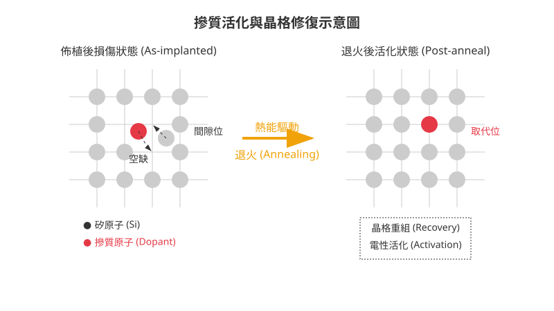
<figcaption>圖 27-1　摻質活化與晶格修復示意圖（AI 繪製的示意圖）</figcaption>
</figure>

## 27.2 熱預算管理與接面微縮挑戰

### 27.2.1 熱預算的數學定義與擴散長度評估

在半導體前段整合（Front-End of Line, FEOL）製程中，晶圓所經歷的所有高溫步驟累積之熱能量總和稱為「熱預算」（Thermal Budget）。熱製程會驅動原子的熱遷移，包含晶格原子、點缺陷以及佈植引入的摻質（見第 26 章）。嚴格控制熱預算的根本目的，在於使摻質獲得足夠的電性活化能，同時將不需要的固態擴散（Solid-State Diffusion）限制在次奈米尺度內。

在微觀物理機制上，雜質原子在晶格中的熱擴散係數 $D(T)$ 強烈依賴於絕對溫度 $T$，其關係遵循阿瑞尼斯方程式（Arrhenius Equation）：

$$D(T) = D_0 \exp\left(-\frac{E_a}{k_B T}\right)$$

其中，$D_0$ 為前置擴散指數因子（$\text{cm}^2/\text{s}$），$E_a$ 為擴散活化能（Activation Energy，單位為 $\text{eV}$），$k_B$ 為波茲曼常數（$8.617 \times 10^{-5} \text{ eV/K}$），$T$ 為絕對溫度（$\text{K}$）。

若製程維持在恆定溫度 $T$ 歷時時間 $t$，根據一維菲克第二定律（Fick's Second Law，見第 25 章），雜質擴散的特徵長度——即特徵擴散長度（Characteristic Diffusion Length）$L_{\text{diff}}$ 定義為：

$$L_{\text{diff}} = 2\sqrt{Dt} = 2\sqrt{D_0 \exp\left(-\frac{E_a}{k_B T}\right) t}$$

然而，在現代半導體製程中，溫度極少長時間恆定不變，而是包含升溫（Ramp-up）、持溫（Soak 或 Spike Peak）與降溫（Ramp-down）等多個非等溫動態區間。對於隨時間 $t$ 變化的溫度曲線 $T(t)$，熱預算的嚴格數學表述為擴散係數對時間的積分：

$$\int_0^{t_{\text{total}}} D(T(t)) \, dt = D_0 \int_0^{t_{\text{total}}} \exp\left(-\frac{E_a}{k_B T(t)}\right) dt$$

相應的總有效擴散長度 $L_{\text{diff, eff}}$ 則為：

$$L_{\text{diff, eff}} = 2\sqrt{\int_0^{t_{\text{total}}} D(T(t)) \, dt}$$

由於阿瑞尼斯關係中溫度處於指數項的分母，擴散速率對溫度變化極度敏感。例如，當溫度從 $900^\circ\text{C}$（$1173\text{ K}$）上升至 $1050^\circ\text{C}$（$1323\text{ K}$）時，對於活化能約 $3.5\text{ eV}$ 的常見摻質（如硼或砷），$D(T)$ 將劇烈增加兩個數量級以上。這意味著在極高峰值溫度下極短的滯留時間，其所貢獻的熱預算可能遠大於在較低溫度下數十分鐘的熱處理。

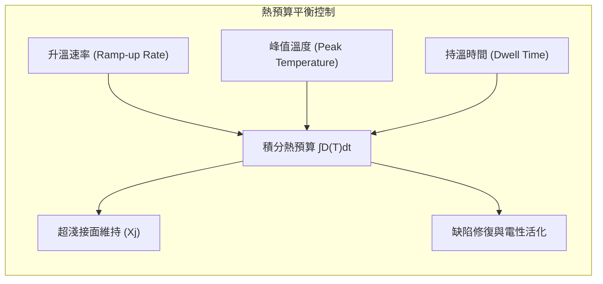

---

### 27.2.2 超淺接面的設計挑戰：$X_j$ 與 $R_s$ 的權衡

隨著電晶體實體閘極長度（Gate Length, $L_g$）持續微縮，為了抑制汲極引發能障降低（Drain-Induced Barrier Lowering, DIBL）與穿透效應（Punch-through）等短通道效應（Short-Channel Effects, SCE，見第 5 章），源極/汲極延伸區（Source/Drain Extension, SDE）的接面深度（Junction Depth, $X_j$）必須成比例變淺，發展為超淺接面（Ultra-Shallow Junction, USJ）。

在實務定義上，$X_j$ 通常是指摻質濃度下降至通道背景摻雜濃度（通常定義為 $1 \times 10^{18}\text{ cm}^{-3}$）時的物理深度。然而，接面深度變淺會引發嚴重的導電性劣變。薄層電阻（Sheet Resistance, $R_s$）的定義式為：

$$R_s = \frac{1}{q \int_0^{X_j} \mu(x) N_{\text{act}}(x) \, dx} \approx \frac{1}{q \bar{\mu} \bar{N}_{\text{act}} X_j}$$

其中，$q$ 為基本電荷（$1.602 \times 10^{-19}\text{ C}$），$\mu(x)$ 為載子遷移率，$\bar{\mu}$ 為平均載子遷移率，$N_{\text{act}}(x)$ 為已電性活化的摻質濃度，$\bar{N}_{\text{act}}$ 為平均活化濃度。

這導致了元件物理上極為尖銳的衝突：
1. **縮小 $X_j$**：需要降低退火溫度或縮短加熱時間以壓制擴散長度 $L_{\text{diff}}$。
2. **降低 $R_s$**：需要高溫以提升固溶度（Solid Solubility）並驅動晶格修復，使盡可能多的摻質進入晶格替代位（Substitutional Sites）成為電性活化載子。

若熱預算過低，摻質未充分活化且殘留大量離子佈植缺陷，將使 $R_s$ 急遽上升，導致電晶體的寄生源極/汲極串聯電阻（Series Resistance, $R_{\text{ext}}$）惡化，嚴重削弱開態飽和電流（$I_{\text{on}}$）；若熱預算過高，過度的橫向與垂直熱擴散會使 $X_j$ 增大並降低接面橫向突變度（Abruptness，典型規格需陡峭於 $2\sim 3\text{ nm/decade}$），破壞短通道控制能力。

| 參數指標 | 早期微米節點典型值 | 深次微米節點典型值 | 奈米與先進節點目標典型值 |
| :--- | :--- | :--- | :--- |
| **接面深度 ($X_j$)** | $> 200\text{ nm}$ | $30 \sim 50\text{ nm}$ | $< 10\text{ nm}$ |
| **接面突變度** | $> 10\text{ nm/dec}$ | $4 \sim 6\text{ nm/dec}$ | $< 2\text{ nm/dec}$ |
| **延伸區薄層電阻 ($R_s$)** | $< 100\ \Omega/\Box$ | $300 \sim 600\ \Omega/\Box$ | $< 800\ \Omega/\Box$（需維持極限平衡） |
| **熱處理時間尺度** | 數十分鐘（爐管） | 數秒至秒級（RTP / Spike） | 毫秒至微秒級（Laser / Flash） |

!!! warning "常見誤解"
    僅提高離子佈植的劑量並不能無限制地降低薄層電阻。當佈植摻質濃度超過該元素在矽中的平衡固溶度極限時，過量的摻質會形成不具電性活性的團簇（Clusters）甚至沉澱析出（Precipitates），進一步加劇瞬態增強擴散（Transient Enhanced Diffusion, TED）而使 $X_j$ 迅速失去控制。

---

### 27.2.3 先進節點整合中的熱敏材料與限制因素

在 FinFET、環繞式閘極（Gate-All-Around, GAA）奈米片（Nanosheet）及三維前段整合架構中，熱預算管理所牽涉的層面已不再侷限於單純的摻質擴散控制，同時受到晶圓上多種新型熱敏材料與異質介面的剛性限制：

1. **高介電常數金屬閘極（HKMG）系統的熱穩定性**：
   在先進節點中，不論採用先閘極（Gate-First）或後閘極（Gate-Last / Replacement Metal Gate, RMG）整合流程，高介電常數閘極介電層（如 $\text{HfO}_2$）與功函數調節金屬層（如 $\text{TiN}$、$\text{TaN}$、$\text{TiAlC}$ 等，見第 28 章）若承受過高熱預算，將誘發材料結晶相變、介面氧空缺擴散及雙層偶極（Dipole）漂移。這會導致元件的有效功函數（Effective Work Function）改變，引起臨界電壓（Threshold Voltage, $V_t$）的大幅度偏移與不可逆的閘極漏電流（$I_{\text{gate}}$）增加。

2. **異質磊晶應變材料的熱弛豫**：
   為了提升載子傳輸遷移率，源極/汲極區普遍導入異質磊晶結構（如 p 型電晶體採用嵌入式 $\text{Si}_{1-x}\text{Ge}_x$，n 型電晶體採用 $\text{Si}_{1-y}\text{C}_y$，見第 9 章）。這類材料依賴於與矽基板晶格常數不匹配所產生的偽晶應變（Pseudomorphic Strain）。當熱預算超出臨界極限時，熱應變能會驅使應變層產生失配位錯（Mismatch Dislocations），引發應變弛豫（Strain Relaxation），使通道應變效益完全消失；同時，過高溫度亦會引導鍺（$\text{Ge}$）原子向通道區非預期地相互擴散。

3. **已活化摻質的去活化（De-activation）與反向偏聚**：
   在後續製程（例如層間介電質沉積、矽化物接點退火）中，若熱處理溫度過高或時間過長，原本處於介穩態（Metastable State）的高濃度超飽和活化摻質會重新脫離晶格替代位，相互聚集成電中性團簇，此現象稱為去活化。此外，摻質極易在矽/氧化物或矽/金屬矽化物介面處發生熱偏聚（Segregation），消耗接觸介面附近的載子濃度，導致蕭基能障（Schottky Barrier）有效穿隧厚度變寬，大幅提高接觸電阻（Contact Resistance, $R_c$）。

---

### 27.2.4 從分級爐管退火向短週期熱處理之演進

傳統批次式爐管退火（Furnace Anneal）具有優異的晶圓間均勻度與產出率，但因加熱系統熱容龐大，其升降溫速率通常受限於每分鐘數度至十數度攝氏度（$1 \sim 15^\circ\text{C}/\text{min}$），整個熱循環歷時數十分鐘至數小時。在此類長週期加熱下，擴散長度 $L_{\text{diff}}$ 遠超過先進元件所容許的數奈米上限。

為了縮減無效熱歷程，半導體製程演進出時間週期不斷微縮的加熱技術路徑：
* **快速熱退火（Rapid Thermal Annealing, RTA）**：採用高功率鹵素燈管照射，將升溫速率提升至 $50 \sim 250^\circ\text{C}/\text{s}$，使加工時間縮小至數秒至數十秒。
* **尖峰退火（Spike Anneal）**：透過極限反轉控制，晶圓達到預設峰值溫度後立即以最大冷卻速率降溫，持溫時間實質趨近於零秒（通常定義為最高溫度以下 $50^\circ\text{C}$ 的滯留時間 $t_{\text{dwell}} < 1\text{ s}$）。
* **毫秒退火（Millisecond Annealing, MSA）**：利用高能量脈衝雷射（Laser Spike Annealing, LSA）或超高功率氙氣閃光燈（Flash Lamp Annealing, FLA），僅將能量注入晶圓極表面數微米的薄層區域，在 $10^{-3} \sim 10^{-2}\text{ 秒}$ 內將表面加熱至超過 $1100 \sim 1300^\circ\text{C}$。

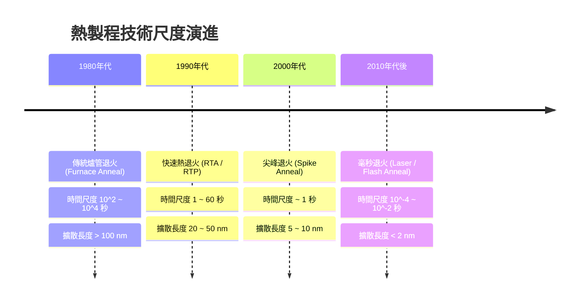

短週期熱處理的核心物理優勢在於：活化反應與熱擴散的活化能存在微觀差異。一般而言，替代位雜質活化與點缺陷重新結合的活化能相對擴散能障呈現不同的動力學行為；透過極高溫配搭極短持溫時間，可以利用非平衡動力學（Non-equilibrium Kinetics）機制，在摻質原子尚未有足夠時間發生長程隨機漫步擴散之前，即已克服障壁完成原地晶格重組與原位活化，從而突破傳統平衡固溶度極限與 $R_s - X_j$ 限制線。此種超短週期熱預算架構，正是第 27.3 節與第 27.4 節所探討的尖峰退火與毫秒退火技術之物理基礎。

## 27.3 快速熱處理與尖峰退火

快速熱處理（Rapid Thermal Processing, RTP）是現代先進邏輯製程與記憶體製造中不可或缺的熱製程技術。相較於傳統水平式或垂直式爐管（見第 25 章）動輒數小時的升降溫週期，RTP 能夠在數秒至數分鐘內完成熱處理，其核心目標在於精確控制熱預算（Thermal Budget），以因應深次微米（Deep Sub-micron）元件對極淺接面（Ultra-Shallow Junctions, USJ）的嚴苛要求。

### 輻射傳熱原理與能量守恆方程式

RTP 設備主要利用高功率鹵素燈管（Tungsten-Halogen Lamps）作為熱源，透過輻射（Radiation）方式將能量傳遞至晶圓表面。在真空或受控氣體環境中，輻射是熱交換的主導機制。根據史蒂芬-波茲曼定律（Stefan-Boltzmann Law），黑體輻射的功率與溫度的四次方成正比。

對於一片位於 RTP 反應腔內的晶圓，其熱平衡狀態遵循能量守恆方程式：

$$
\rho C_p d \frac{dT}{dt} = \epsilon \sigma (T_{lamp}^4 - T_w^4) - Q_{conv} - Q_{cond}
$$

其中各項參數定義如下：
- $\rho$：矽晶圓的密度（典型值約 $2.33 \, \text{g/cm}^3$）。
- $C_p$：矽的比熱（Specific Heat），隨溫度變化。
- $d$：晶圓厚度。
- $\frac{dT}{dt}$：晶圓溫度的變化率（升溫或降溫斜率）。
- $\epsilon$：晶圓的發射率（Emissivity），受表面薄膜種類、粗糙度及溫度影響。
- $\sigma$：史蒂芬-波茲曼常數（$5.67 \times 10^{-8} \, \text{W/m}^2\text{K}^4$）。
- $T_{lamp}$ 與 $T_w$：分別為燈管有效溫度與晶圓絕對溫度。
- $Q_{conv}$：經由製程氣體產生的對流熱損失（Convection loss）。
- $Q_{cond}$：經由晶圓支撐結構產生的傳導熱損失（Conduction loss）。

在 RTP 系統中，發射率 $\epsilon$ 的動態補償是溫度控制最困難的挑戰。由於晶圓表面可能覆蓋有氮化矽、二氧化矽或金屬薄膜，這些材料在不同波長下的吸收與反射特性迥異，會導致光學高溫計（Pyrometer）量測到的輻射強度與真實溫度產生偏差。截至撰寫時，先進 RTP 設備多採用多點即時發射率校正技術，以確保全晶圓溫度的均勻性（Uniformity）。

### 浸壓退火與尖峰退火之歷程比較

根據溫度歷程（Temperature Profile）的不同，RTP 可分為浸壓退火（Soak Anneal）與尖峰退火（Spike Anneal）。

1.  **浸壓退火（Soak Anneal）**：
    晶圓升溫至設定溫度後，會維持一段穩定的持溫時間（Dwell time），通常在 $10$ 至 $60$ 秒之間。此製程主要用於需要較長反應時間的步驟，如矽化物（Silicide）形成或厚氧化層的熱退火。其缺點是熱預算較高，摻質（Dopant）會發生明顯的擴散。

2.  **尖峰退火（Spike Anneal）**：
    晶圓在達到目標峰值溫度（Peak Temperature）後，立即開始降溫，不進行任何持溫。其溫度歷程曲線呈現尖銳的三角形。尖峰退火的目的是在極短的時間內提供足夠的能量使摻質活化，同時將擴散距離降至最低。

以下為兩者溫度歷程之示意圖：

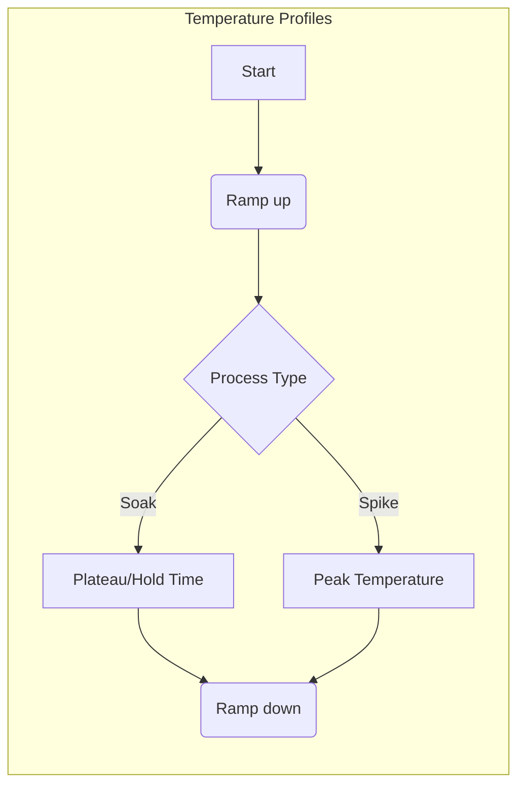

### 高升溫斜率對抑制 TED 之有效性

在離子佈植（見第 26 章）後，矽晶格會產生大量的間隙原子（Interstitials）。在後續熱處理過程中，這些間隙原子會與摻質（如硼、磷）交互作用，導致摻質在遠低於正常擴散係數的溫度下發生劇烈擴散，此現象稱為暫態增強擴散（Transient Enhanced Diffusion, TED）。

為了抑制 TED 並達成極淺接面，RTP 必須具備極高的升溫斜率（Ramp-up rate）。當升溫斜率大於 $100^\circ\text{C/s}$（先進設備可達 $250^\circ\text{C/s}$ 以上）時，晶圓能在極短時間內跨越 TED 易發生的中溫區（約 $600^\circ\text{C}$ 至 $800^\circ\text{C}$），直接進入高溫活化區（$>1000^\circ\text{C}$）。

在高溫下，摻質活化的速率（Activation rate）遠高於擴散速率（Diffusion rate）。因此，透過「高溫、極短時間」的尖峰退火，可以獲得高載子濃度且接面深度（Junction depth, $X_j$）極淺的電性分布。快速冷卻（Ramp-down）同樣關鍵，若冷卻速度過慢，晶圓在高溫區停留時間過長，仍會造成不必要的擴散與接面推移。

### 晶圓熱應力與滑移線產生機制

RTP 製程中，晶圓經歷劇烈的溫度變化，若全晶圓的溫度分布不均，將產生巨大的熱應力（Thermal Stress）。當熱應力超過矽晶圓在該溫度下的剪應力臨界值（Critical Resolved Shear Stress, CRSS）時，晶格會發生塑性變形，產生位錯（Dislocation）並沿著特定的晶面（如 $\{111\}$ 晶面）滑動，形成所謂的滑移線（Slip lines）。

滑移線對元件品質具有毀滅性影響：
*   **漏電流增加**：位錯會成為載子的陷阱中心，顯著增加 PN 接面的漏電流。
*   **機械強度下降**：受損的晶圓在後續製程（如 CMP 或自動化傳送）中極易破碎。
*   **微影對準失效**：嚴重的熱應力會導致晶圓翹曲（Warpage），造成微影對焦困難。

為控制熱應力，RTP 設備採取以下措施：
1.  **邊緣補償環（Edge Ring）**：晶圓邊緣散熱較快，透過預熱的補償環可以補償邊緣熱損失，維持徑向溫度均勻性。
2.  **多區燈管控制**：將燈管陣列分為多個獨立控制區，根據即時感測器的回饋調整各區域功率。
3.  **旋轉基座**：在加熱過程中旋轉晶圓，以消除燈管排列造成的非對稱熱場。

### 氣體氛圍控制與電性影響

RTP 反應腔內的氣體環境對製程結果有顯著影響。常見的氣體包括氮氣（$\text{N}_2$）、氬氣（$\text{Ar}$）以及微量氧氣（$\text{O}_2$）。

*   **氧化環境與 OED**：若氛圍中含有氧氣，表面會形成薄氧化層。氧化過程會向矽基體注入額外的間隙原子，進而引發氧化增強擴散（Oxidation Enhanced Diffusion, OED），這與 TED 類似，都會破壞極淺接面的控制。
*   **微氧控制（Micro-oxygen control）**：在某些製程中，會刻意加入極低濃度（ppm 等級）的氧氣。這是為了在晶圓表面形成一層極薄且穩定的氧化膜，防止在高溫下矽原子蒸發或表面粗糙化，同時避免環境中雜質直接擴散進入矽晶格。
*   **還原氛圍**：在金屬化製程後的退火（見第 31 章），有時會使用成型氣（Forming Gas, $\text{N}_2/\text{H}_2$ 混合氣），利用氫氣修補二氧化矽與矽介面處的懸鍵（Dangling bonds），降低介面態密度（Interface state density），改善元件的閾值電壓穩定性。

!!! note "熱預算與元件微縮"
    隨著製程節點進入 5nm 以下，傳統 RTP 的秒級熱處理對於某些極敏感的結構（如 GAAFET 的內部間隔層）仍顯得熱預算過高。這促使了毫秒退火（MSA）技術的發展，將在 27.4 節詳細討論。

!!! example "產業實例"
    在 28 奈米及更先進的邏輯製程中，為了精確控制源極/汲極（S/D）的摻質分布，通常會結合多次 RTP 步驟。例如，先進行一次低溫浸壓退火以修復部分損傷，再進行一次高溫尖峰退火（Spike Anneal）以達成最大化的電性活化。主要設備供應商如應用材料（Applied Materials）與美商亞舍立（Axcelis）均提供具備多感測器閉迴路控制的高速 RTP 平台。

!!! warning "常見誤解"
    工程師常誤以為退火溫度越高，導電性一定越好。事實上，若溫度過高或時間過長，摻質可能會發生去活化（Deactivation）或形成沉澱物（Precipitates），反而導致片電阻（Sheet Resistance, $R_s$）上升。此外，過高的溫度會導致金屬閘極結構（見第 28 章）中的功函數金屬發生擴散，造成閾值電壓漂移。因此，RTP 參數必須在活化效率與熱預算限制之間取得平衡。

<!-- fig:2 -->
<figure markdown>
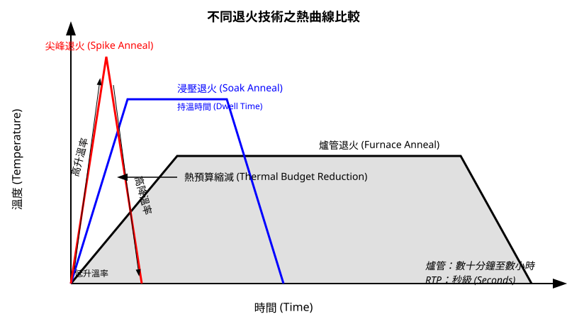
<figcaption>圖 27-2　不同退火技術之熱曲線比較（AI 繪製的示意圖）</figcaption>
</figure>

## 27.4 毫秒退火與雷射處理技術

隨著電晶體物理尺寸縮減至個位數奈米節點，傳統以秒為單位的快速熱處理（Rapid Thermal Processing, RTP）在抑制摻質擴散（Dopant Diffusion）方面已面臨物理極限。為了在極淺接面（Ultra-Shallow Junction, USJ）中達成極高的電性活化程度，同時將熱擴散距離限制在原子尺度，毫秒退火（Millisecond Annealing, MSA）技術成為先進邏輯製程與記憶體製造的核心。MSA 的製程時間通常介於 0.1 毫秒至 10 毫秒之間，其核心物理機制與傳統熱平衡退火有顯著差異。

### 傳熱機制：體積加熱與表面熱擴散局域化

在傳統 RTP 中，晶圓的正反面同時受到加熱，熱傳導時間足以讓整片晶圓（厚度約 775 $\mu m$）達到熱平衡，這種方式稱為「體積加熱」（Volumetric Heating）。然而，MSA 採用極高功率密度的能量源（雷射或閃光燈），在極短時間內僅對晶圓表層（通常小於 100 $\mu m$）進行加熱。

熱擴散長度 $L_D$ 是評估熱量傳遞深度的關鍵物理量，其定義如下：

$$L_D \approx \sqrt{\alpha \cdot \Delta t}$$

其中：
- $\alpha$ 為矽的熱擴散率（Thermal Diffusivity，典型值在 1000 K 時約為 $0.1 \, \text{cm}^2/\text{s}$）。
- $\Delta t$ 為加熱持續時間。

當 $\Delta t$ 從秒級（RTP）縮短至毫秒級（MSA），$L_D$ 會從數公釐縮減至數十微米。這意味著熱量被「局域化」（Localized）在晶圓表面。由於晶圓體部（Bulk）仍維持在較低溫度，當外部能量源關閉時，表面熱量會迅速向體部傳導，達成極高的冷卻速率（Cooling Rate，可達 $10^5 \, \text{K/s}$ 以上）。這種非平衡的熱傳機制，是實現亞穩態活化的物理基礎。

### 閃光燈退火（FLA）之原理與光譜匹配

閃光燈退火（Flash Lamp Annealing, FLA）利用充填氙氣（Xenon）的放電管，透過電容器組在極短時間內釋放高壓電能，產生高強度的脈衝光。

#### 電弧放電原理
FLA 的能量釋放過程遵循電漿物理中的電弧放電（Arc Discharge）。當電容器釋放電流穿過氙氣管時，氣體被電離形成電漿，並輻射出涵蓋紫外光至紅外光的連續光譜。脈衝寬度（Pulse Width）可透過電路中的電感與電容值進行精確調控，典型值為 0.5 ms 至 20 ms。

#### 光譜匹配與吸收
矽晶圓對於不同波長光的吸收率（Absorptivity）具有高度依賴性。氙氣燈發出的光譜在可見光區域有較高的能量分佈，這與矽在室溫下的能隙（Bandgap）能量相匹配（$E_g \approx 1.12 \, \text{eV}$，對應波長約 $1100 \, \text{nm}$）。為了提高吸收效率，FLA 設備通常會搭配預熱系統（Pre-heating），將晶圓預熱至 $400^\circ\text{C}$ 至 $600^\circ\text{C}$，此舉可增加自由載子濃度，進而提升對長波長紅外光的吸收能力。

### 雷射尖峰退火（LSA）與動態表面退火（DSA）

雷射退火技術利用高功率雷射掃描晶圓表面，根據掃描策略與光束形態的不同，可分為雷射尖峰退火（Laser Spike Annealing, LSA）與動態表面退火（Dynamic Surface Annealing, DSA）。

#### 光束整形與掃描策略
雷射退火設備通常使用二氧化碳雷射（$\text{CO}_2$ Laser，波長 $10.6 \, \mu\text{m}$）或半導體二極體雷射（Diode Laser，波長約 $810 \, \text{nm}$ 或 $980 \, \text{nm}$）。為了確保製程均勻性，原始的圓形雷射光束必須經過光學系統整形為長條形的「線光束」（Line Beam）。

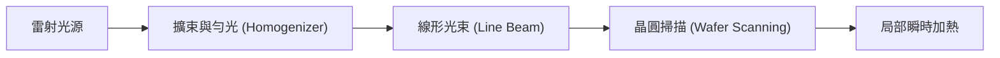

在 DSA 製程中，線光束以恆定速度橫向掃描晶圓。晶圓上任一點所經歷的溫度曲線（Thermal Profile）取決於光束寬度 $w$ 與掃描速度 $v$：

$$\Delta t_{dwell} = \frac{w}{v}$$

典型停留時間（Dwell Time）設定在 0.1 ms 至 2 ms。透過調整雷射功率密度，可精確控制表面最高溫度（Peak Temperature），通常設定在 $1100^\circ\text{C}$ 至 $1350^\circ\text{C}$ 之間（低於矽的熔點 $1414^\circ\text{C}$）。

### 亞穩態過飽和活化（Metastable Activation）

MSA 的核心價值在於突破固溶極限（Solid Solubility Limit）。在熱力學平衡狀態下，摻質（如硼、磷、砷）在矽晶格中的溶解度受限於溫度。若摻雜濃度超過此極限，多餘的原子會形成沉澱物（Precipitates）或間隙原子團簇（Clusters），失去電性活化能力。

#### 非平衡熱力學機制
由於 MSA 的加熱與冷卻速度極快，摻質原子在獲得足夠能量進入晶格格位（Substitution）後，系統便迅速降溫。此時，摻質原子缺乏足夠的擴散時間（Diffusion Time）來重新排列形成穩態的沉澱物。這種狀態稱為「亞穩態過飽和活化」（Metastable Supersaturated Activation）。

$$C_{active} > C_{solubility}(T_{peak})$$

這種技術允許工程師在不增加接面深度（Junction Depth, $X_j$）的前提下，大幅降低片電阻（Sheet Resistance, $R_s$），這對於 FinFET 或 GAAFET 的源極/汲極（S/D）工程至關重要。

!!! note "說明"
    在先進節點中，通常會結合 RTP 與 MSA。先利用 RTP 進行初步的晶格損傷修復（見第 27.1 節），再利用 MSA 達成超高活化。這種組合稱為「混合退火」（Hybrid Annealing）。

### 圖案負載效應（Pattern Loading Effect）與反射補償

MSA 面臨的最大挑戰是「圖案負載效應」（Pattern Loading Effect, PLE）。由於晶圓表面存在不同的元件結構（如淺溝槽隔離 STI、多晶矽閘極、氮化矽側牆等），不同區域的光學反射率（Reflectivity）與熱容量（Heat Capacity）存在顯著差異。

#### 光學吸收率非均勻性
根據菲涅耳方程（Fresnel Equations），多層薄膜結構會產生干涉現象，導致不同圖案區域對雷射或閃光燈能量的吸收率不一。這會造成晶圓表面微觀溫度的不均勻（Micro-loading），進而導致電性參數（如閾值電壓 $V_{th}$）在晶片內部的變異。

#### 反射補償技術
為了克服 PLE，業界開發了以下幾種技術：
1.  **吸光塗層（Absorbing Layer）**：在退火前於晶圓表面覆蓋一層高吸收率、高熱傳導的材料（如類鑽碳 DLC 或特定金屬氧化物），將光學吸收過程從複雜的元件結構轉移到均勻的塗層上。
2.  **長波長雷射**：使用波長遠大於元件特徵尺寸的 $\text{CO}_2$ 雷射（$10.6 \, \mu\text{m}$）。在此波長下，矽基板表現出較強的自由載子吸收，且微細圖案產生的散射與干涉效應較弱。
3.  **多角度入射與反射監控**：透過即時監控反射能量，動態調整雷射功率補償。

### 設備與產業實例

截至撰寫時（2026-11-16），MSA 技術已成為 7 奈米以下邏輯製程的標準配備。

*   **雷射退火設備**：以 **Applied Materials (AMAT)** 的 Astra 與 **Veeco** 的 LSA 系統為主流。這些設備強調極高的掃描精度與光學補償能力，特別是在處理高介電金屬閘極（HKMG）結構時，需精確控制熱預算以避免閘極功函數偏移（見第 28 章）。
*   **閃光燈退火設備**：**Screen Holdings (DNS)** 是 FLA 技術的主要供應商。其設備常被用於需要較大加熱深度的製程步驟，或是作為雷射退火的互補方案。

!!! warning "常見誤解"
    工程師常誤以為退火溫度越高活化效果越好。事實上，在 MSA 製程中，若溫度過高且停留時間過長，雖然活化程度提升，但會引發嚴重的摻質橫向擴散（Lateral Diffusion），導致短通道效應惡化（見第 5 章）。因此，MSA 的優化目標是在 $R_s$（片電阻）與 $L_{eff}$（有效通道長度）之間取得最佳平衡。

### 毫秒退火技術特性比較表

| 特性 | 快速熱處理 (RTP) | 閃光燈退火 (FLA) | 雷射尖峰退火 (LSA/DSA) |
| :--- | :--- | :--- | :--- |
| **典型時間尺度** | 1 - 60 秒 | 1 - 20 毫秒 | 0.1 - 2 毫秒 |
| **加熱機制** | 體積加熱 (平衡) | 表面局域加熱 (非平衡) | 表面局域加熱 (高度非平衡) |
| **最高溫度** | $1000 - 1100^\circ\text{C}$ | $1050 - 1300^\circ\text{C}$ | $1100 - 1350^\circ\text{C}$ |
| **冷卻速率** | $\sim 10^2 \, \text{K/s}$ | $\sim 10^5 \, \text{K/s}$ | $\sim 10^6 \, \text{K/s}$ |
| **摻質擴散** | 顯著 (數十奈米) | 極微小 (奈米級) | 幾乎忽略 (次奈米級) |
| **圖案負載效應** | 低 | 中 | 高 (需補償) |

隨著電晶體架構往 2 奈米及更先進節點演進，MSA 技術正朝向更短的時間尺度（微秒級）與更精密的空間熱控制方向發展，以應對互補式場效電晶體（CFET）等複雜 3D 結構帶來的熱管理挑戰。

## 27.5 設備與廠商技術

在先進半導體製程中，熱處理設備已從早期的批次式爐管（Batch Furnace）演進為單晶圓快速熱處理（Single-wafer RTP）系統，並進一步發展出毫秒等級的退火技術。本節將探討這些設備的核心子系統、測溫技術以及在先進邏輯元件（如 FinFET 與 GAAFET）中的整合方案。

### 27.5.1 快速熱處理系統之核心架構

快速熱處理（Rapid Thermal Processing, RTP）設備必須在極短的時間內將晶圓加熱至 1000°C 以上，並具備極高的溫度均勻性與升降溫速率控制能力。

#### 1. 燈管陣列與功率動態調控
主流 RTP 設備採用鎢鹵素燈管（Tungsten-Halogen Lamps）作為熱源。為了達成晶圓表面的熱場均勻性，燈管通常採「多區控制」（Multi-zone Control）配置。

*   **燈管配置**：燈管陣列通常排列成蜂巢狀或同心圓狀，位於晶圓上方。先進設備可能擁有超過 100 支燈管，並將其劃分為多個獨立控制的加熱區（Heating Zones）。
*   **動態功率調控**：系統透過電力分配單元（PDU）即時調整各區燈管的功率。由於晶圓邊緣的熱散失速度較快，邊緣區域的燈管功率通常設定得比中心區域高，以補償邊緣效應（Edge Effect）。
*   **旋轉機制**：為進一步消除燈管間的熱場不均勻，晶圓在處理過程中會以每分鐘 30 至 240 轉（RPM）的速度旋轉。

#### 2. 腔體設計與冷卻系統
RTP 腔體多採「冷牆式」（Cold-wall）設計，腔體壁面通常由不鏽鋼製成並具備水冷通道，內壁則塗佈高反射率材料（如金或拋光鋁），以確保熱輻射能有效集中在晶圓上，同時防止腔體壁面受熱釋放出雜質。

### 27.5.2 高溫環境即時測溫挑戰與技術

在 RTP 製程中，精確的溫度控制是決定摻質分佈（Dopant Profile）的關鍵。然而，由於加熱速度極快，傳統的熱電偶（Thermocouple）無法直接接觸旋轉中的晶圓，因此非接觸式的「光學高溫計」（Pyrometer）成為主流技術。

#### 1. 高溫計原理與普朗克定律
高溫計透過偵測晶圓發出的紅外線輻射強度來推算溫度。根據普朗克定律（Planck's Law），黑體輻射強度與溫度的關係為：

$$I(\lambda, T) = \frac{2hc^2}{\lambda^5} \frac{1}{e^{\frac{hc}{\lambda k_B T}} - 1}$$

其中 $I$ 為輻射強度，$\lambda$ 為波長，$T$ 為絕對溫度，$h$ 為普朗克常數，$c$ 為光速，$k_B$ 為波茲曼常數。

#### 2. 發射率（Emissivity）的挑戰與原位校正
實際晶圓並非理想黑體，其輻射強度需乘上發射率 $\epsilon$（$0 < \epsilon < 1$）。發射率受多重因素影響：
*   **晶圓背面狀態**：若背面沉積了二氧化矽、氮化矽或多晶矽，會產生薄膜干涉效應，導致發射率隨波長與溫度劇烈變化。
*   **波長選擇**：為了減少背景燈管光的干擾，高溫計通常選擇特定的工作波長（例如 0.9 $\mu m$ 或 2.7 $\mu m$），避開燈管的主要輻射能譜。

為了實現「原位校正」（In-situ Calibration），先進設備導入了「紋波技術」（Ripple Technique）或反射率測量。系統發射一束已知強度的探測光至晶圓表面，測量其反射率 $R$。對於不透光的矽晶圓，根據能量守恆定律：

$$\epsilon = 1 - R \quad (\text{晶圓不透光、穿透率 } T \approx 0 \text{ 時})$$

透過即時測得的反射率，系統可動態修正發射率，將測溫誤差控制在 $\pm 1$°C 以內。

### 27.5.3 產業尖端退火系統架構分析

針對不同的熱預算需求，產業發展出多種退火系統架構。

#### 1. 尖峰退火系統（Spike Annealing System）
以 Applied Materials 的 Centura 平台為例，其 Radiance 腔體採用多區鹵素燈管，配合極高速的測溫回饋控制，可實現每秒超過 200°C 的升溫速率。其特點在於「零持溫時間」（Zero Dwell Time），即溫度達到峰值後立即冷卻，以在活化摻質的同時，最大限度地限制擴散。

#### 2. 毫秒退火與雷射處理技術
隨著元件微縮至 3 奈米及以下節點，傳統 RTP 的熱預算仍顯過高。
*   **雷射尖峰退火（LSA/DSA）**：如 Applied Materials 的 Vantage Astra 系統，利用高功率雷射掃描晶圓表面。由於雷射能量集中在表面數微米的深度，可實現毫秒（ms）等級的極短處理時間。
*   **閃光燈退火（Flash Lamp Annealing, FLA）**：利用氙氣閃光燈（Xenon Flash Lamps）在 1 至 20 毫秒內釋放巨大能量。此技術能使晶圓表面達到極高溫以達成超飽和活化（Supersaturation Activation），而晶圓主體（Bulk）仍維持低溫，極大地保護了熱敏感結構。

### 27.5.4 廠商技術比較

下表列出目前市場上主要熱處理與退火設備廠商及其代表性技術路線。

| 廠商 | 代表產品系列 | 技術路線與特點 | 主要應用 |
| :--- | :--- | :--- | :--- |
| Applied Materials | Centura | 多區鹵素燈管 RTP，具備高精度發射率校正技術。 | 尖峰退火、RTO、矽化物形成。 |
| Applied Materials | Vantage | 雷射動態表面退火（DSA），毫秒級熱處理。 | 先進邏輯元件 S/D 活化。 |
| Tokyo Electron | TELINDY | 批次式長爐管，優異的壓力與氣氛控制。 | 氧化、擴散、低壓化學氣相沉積。 |
| SCREEN | — | 閃光燈退火（FLA），利用氙氣燈進行毫秒級處理。 | 超淺接面（USJ）活化、應力工程。 |
| ASM International | A400 / A412 | 垂直式批次爐管，針對大批量生產優化。 | 擴散、退火、厚氧化層成長。 |

!!! note "設備選機考量"
    晶圓廠在選擇退火設備時，首要考量為「熱預算控制能力」與「產出量（Throughput）」。對於前段製程（FEOL）的摻質活化，通常優先選擇具備毫秒處理能力的雷射或閃光燈系統；而對於需要長時間熱平衡的製程（如井區驅入或厚氧化層成長），則仍以批次式爐管為主。

### 27.5.5 先進邏輯元件之主流退火整合方案

截至撰寫時，在 3 奈米及更先進的 FinFET 與 GAAFET（Gate-All-Around FET）製程中，源極/汲極延伸區（S/D Extension）的活化已不再依賴單一熱處理步驟，而是採用「混合退火」（Hybrid Annealing）策略。

#### 1. 活化與擴散的權衡
在 GAAFET 結構中，奈米片（Nanosheet）的通道極為薄弱，過度的熱處理會導致摻質橫向擴散進入通道，造成嚴重的短通道效應。然而，為了降低接觸電阻，必須使源汲極區域的摻質活化程度達到最高。

#### 2. 主流整合流程
目前的技術趨勢通常結合以下步驟：
1.  **低溫預退火**：在離子佈植後，先以較低溫度進行長時退火，修復大部分的晶格損傷，並防止後續高溫步驟導致的摻質異常擴散（TED）。
2.  **尖峰退火（Spike Annealing）**：利用如 Centura Radiance 系統進行快速升溫，提供基本的晶格修復與初步活化。
3.  **毫秒退火（MSA）**：最後使用 Vantage Astra 或閃光燈系統，在極短時間內將表面加熱至 1200°C 以上。此步驟能將摻質推向超飽和活化狀態，同時因時間極短，有效抑制了原子的擴散長度（Diffusion Length）。

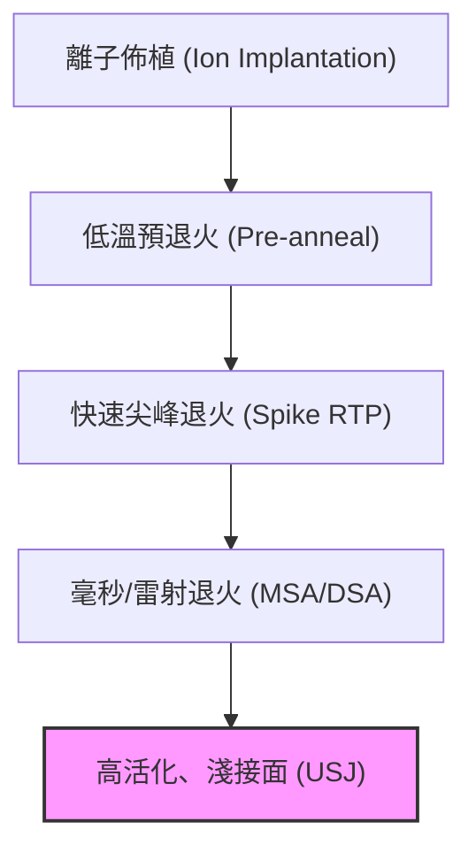

!!! warning "常見誤解"
    工程師常誤以為退火溫度越高，元件性能必然越好。實際上，過高的溫度雖然能提高活化率，但也會導致金屬閘極結構（見第 28 章）的功函數金屬發生擴散或相變，進而造成閾值電壓（Vth）偏移。因此，熱預算管理必須從全製程整合的角度出發，而非單一站點的最佳化。

截至撰寫時，產業研發方向正朝向更低溫的「微波退火」（Microwave Annealing）探索，利用偶極轉動產生的熱能實現選擇性加熱，以期在未來的次 2 奈米節點中進一步壓縮熱預算。

## 本章重點

1. 離子佈植後的晶格修復主要透過熱活化的固相磊晶再成長（SPER）達成，其在矽晶格中的活化能典型值約為 $2.7\text{ eV}$，且再結晶速率具有顯著的晶向向異性。
2. 摻質的電性活化受限於熱力學平衡固溶極限（$C_{\text{ss}}$）；若濃度超過此極限，過量原子會形成電性非活性的團簇或沉澱物，導致去活化現象。
3. 瞬態增強擴散（TED）是由佈植後殘留的過飽和自間隙矽原子所驅動，其擴散速率可比熱平衡狀態高出數個數量級，是破壞超淺接面（USJ）陡峭度的主要因素。
4. 熱預算（Thermal Budget）定義為擴散係數對時間的積分，現代製程透過縮短熱處理時間（從分鐘級演進至毫秒級）來壓制擴散長度，以解決 $X_j$ 與 $R_s$ 之間的權衡衝突。
5. 快速熱處理（RTP）利用輻射傳熱與高升溫斜率（$>100\,^\circ\text{C/s}$）跨越 TED 易發生的中溫區，在極短的尖峰退火過程中達成高效活化。
6. 毫秒退火（MSA）技術（如雷射或閃光燈退火）利用表面熱擴散局域化原理，在非平衡動力學條件下達成亞穩態超飽和活化，突破傳統固溶極限。
7. 溫度量測的精確度受晶圓發射率（Emissivity）影響，先進 RTP 設備需透過即時反射率監控與多區功率調控，以抑制圖案負載效應（PLE）並確保全晶圓均勻性。

## 重點圖卡

複習時看這幾張就能抓住本章重點；[圖卡庫](../cards.md)可以下載成圖片。

<figure markdown>
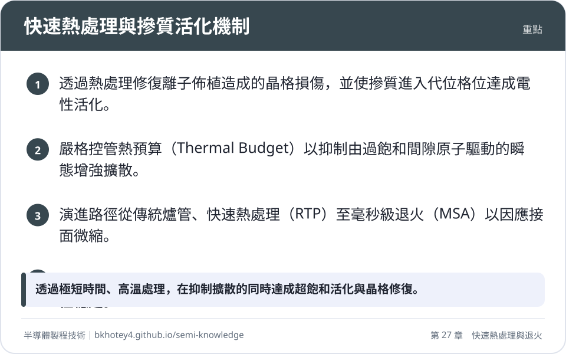
<figcaption>重點圖卡：快速熱處理與摻質活化機制</figcaption>
</figure>

<figure markdown>
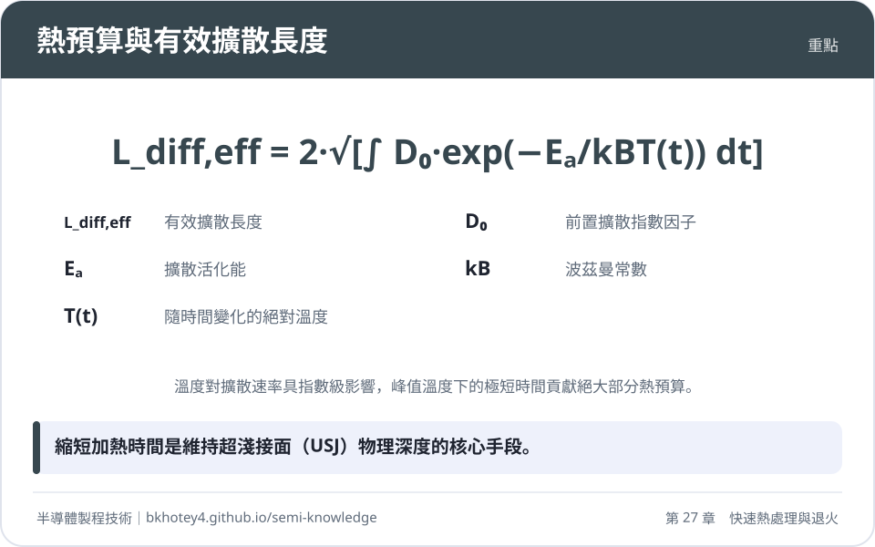
<figcaption>重點圖卡：熱預算與有效擴散長度</figcaption>
</figure>

<figure markdown>
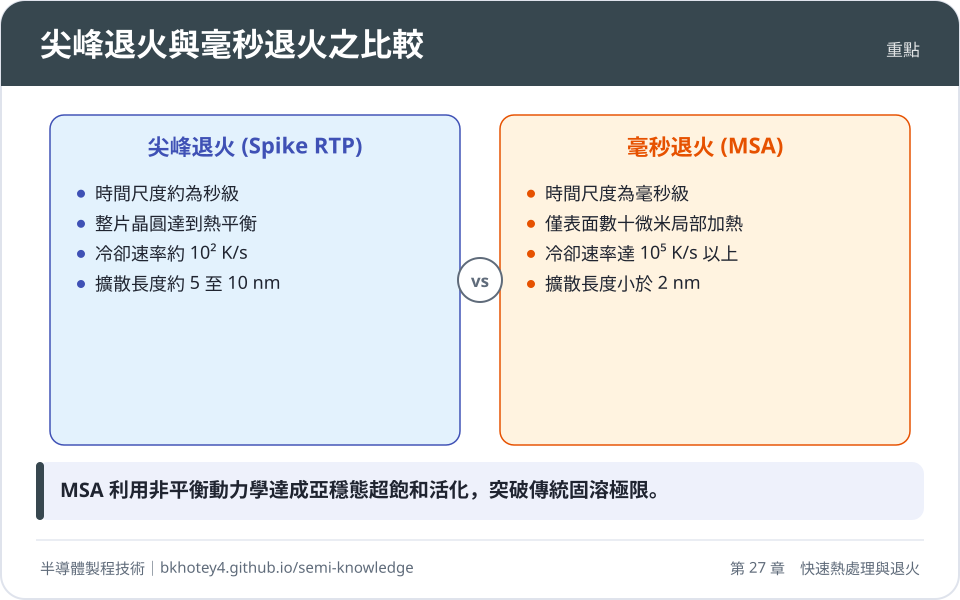
<figcaption>重點圖卡：尖峰退火與毫秒退火之比較</figcaption>
</figure>

<figure markdown>
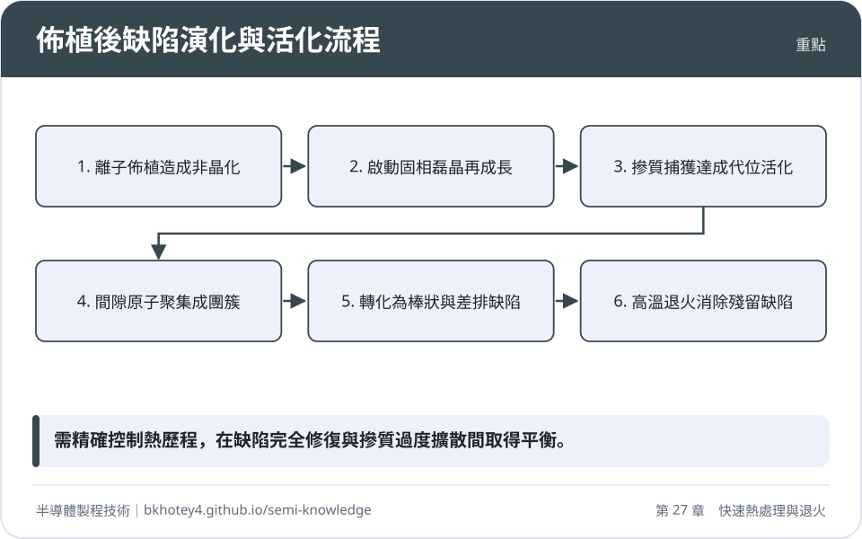
<figcaption>重點圖卡：佈植後缺陷演化與活化流程</figcaption>
</figure>

## 習題

**1.** 試比較「傳統高溫熱平衡退火」與「低溫固相磊晶再成長（SPER）」在摻質活化機制上的物理差異，並說明為何 SPER 能達成高於平衡固溶極限的活化濃度。

??? success "參考解答"
    傳統高溫熱平衡退火依賴原子隨機熱擴散跳入代位格位，其活化濃度嚴格受限於該溫度下的熱力學平衡固溶極限 $C_{\text{ss}}(T)$。若要提高活化度，必須提升溫度，但這會導致嚴重的熱擴散。
    SPER 則是一種非平衡相變歷程。當介面下方的單晶矽作為模板進行再結晶時，移動中的結晶前緣會強行將非晶相中的摻質原子掃入新生成的單晶格位（溶質捕獲效應）。由於 SPER 通常在較低溫（$500\text{--}650\,^\circ\text{C}$）進行，摻質原子的擴散能力極弱，無法脫離格位聚集成團簇，因此能將高濃度的摻質凍結在代位晶格中，形成亞穩態的超飽和活化。

**2.** 某摻質在矽中的擴散活化能 $E_a = 3.48\text{ eV}$，前置指數 $D_0 = 1.2 \times 10^{-2}\text{ cm}^2/\text{s}$。若製程要求擴散長度 $L_{\text{diff}}$ 不得超過 $2\text{ nm}$，且退火時間設定為 $1\text{ s}$（簡化為恆溫計算），試求該製程容許的最高退火溫度。（波茲曼常數 $k_B = 8.617 \times 10^{-5}\text{ eV/K}$）

??? success "參考解答"
    根據擴散長度公式 $L_{\text{diff}} = 2\sqrt{Dt}$，可得：
    $D = \frac{L_{\text{diff}}^2}{4t} = \frac{(2 \times 10^{-7}\text{ cm})^2}{4 \times 1\text{ s}} = 1 \times 10^{-14}\text{ cm}^2/\text{s}$
    代入阿瑞尼斯方程式 $D = D_0 \exp\left(-\frac{E_a}{k_B T}\right)$：
    $1 \times 10^{-14} = 1.2 \times 10^{-2} \exp\left(-\frac{3.48}{8.617 \times 10^{-5} \times T}\right)$
    $\ln(8.33 \times 10^{-13}) = -\frac{40385.3}{T}$
    $-27.81 = -\frac{40385.3}{T}$
    $T \approx 1452\text{ K}$
    轉換為攝氏溫度：$1452 - 273 = 1179\,^\circ\text{C}$。

**3.** 何謂瞬態增強擴散（TED）？為什麼提高快速熱處理（RTP）系統的升溫斜率（Ramp-up rate）能有效抑制 TED？

??? success "參考解答"
    TED 是指離子佈植後，晶格中殘留的過飽和自間隙矽原子在退火初期與摻質結合，形成高移動性的「間隙-摻質對」，導致有效擴散係數暫時性地大幅增加（可達 $10^2\text{--}10^4$ 倍）的現象。
    提高升溫斜率的目的是為了縮短晶圓停留在「中溫區」（約 $600\text{--}800\,^\circ\text{C}$）的時間。在此溫度區間，自間隙矽原子已具備動能驅動 TED，但尚未達到能使缺陷快速湮滅或使摻質達成高效活化的高溫。高升溫斜率（如 $>200\,^\circ\text{C/s}$）能讓晶圓迅速跨越此不穩定區間，直接進入高溫區，使缺陷在驅動長距離擴散前即被修復或轉化為穩定的延伸缺陷，從而減少總體擴散量。

**4.** 在毫秒退火（MSA）製程中，為何會出現圖案負載效應（Pattern Loading Effect, PLE）？這對元件的電性參數有何影響？

??? success "參考解答"
    PLE 的產生源於晶圓表面不同區域具有不同的光學與熱學特性。在 MSA 中，極高功率的能量（如雷射）在極短時間內注入表面，不同圖案（如 STI、閘極、側牆）會因多層薄膜干涉導致吸收率（Absorptivity）不一，且不同結構的局部熱容量與熱傳導率亦有差異。這導致在相同的雷射能量照射下，晶圓表面微觀區域間出現顯著的溫度偏差。
    電性影響方面，溫度的不均勻會直接導致摻質活化程度與擴散深度的變異，造成晶片內（Within-die）不同位置的電晶體出現臨界電壓（$V_t$）偏移、飽和電流（$I_{\text{on}}$）不均，進而降低產品的良率與時序收斂（Timing closure）性能。

## 本章術語

- **SPER**（固相磊晶再成長）：以單晶基底為模板，將非晶層熱活化恢復為單晶結構的過程。
- **TED**（瞬態增強擴散）：由離子佈植產生的過飽和間隙原子所引發的短暫且劇烈的摻質擴散現象。
- **Thermal Budget**（熱預算）：製程中晶圓所承受的熱能量總和，數學上表示為擴散係數對時間的積分。
- **USJ**（超淺接面）：為了抑制短通道效應，在先進節點中深度極淺且濃度分佈陡峭的源汲極接面。
- **RTP**（快速熱處理）：利用高功率燈管輻射，在數秒至數十秒內完成單片晶圓加熱的技術。
- **Spike Anneal**（尖峰退火）：無持溫時間的快速熱處理，旨在達成高活化的同時最小化熱擴散。
- **MSA**（毫秒退火）：利用雷射或閃光燈在毫秒尺度內加熱晶圓表面，達成非平衡態超高活化的技術。
- **Pyrometer**（光學高溫計）：一種非接觸式感測器，透過量測物體發出的紅外線輻射強度來推算溫度。
- **Emissivity**（發射率）：物體表面輻射能量的能力與同溫度黑體輻射能量之比值。
- **PLE**（圖案負載效應）：因晶圓表面圖案結構導致光學吸收或熱散失不均，進而引發局部溫度差異的現象。

## 互動學習

!!! tip "動手試試看"
    - [設備機台圖鑑：快速熱處理機](../equipment.md)

## 產業最新進展

本節由每日產業新聞自動補充，說明本章技術在產業上的最新發展。

<!-- updates -->
（目前尚無補充。）
