# 第 28 章　高介電金屬閘極與前段製程整合

!!! abstract "學習目標"
    - 理解高介電常數材料取代二氧化矽的物理必要性與等效氧化層厚度（EOT）概念
    - 掌握金屬閘極功函數調控原理及其對電晶體閾值電壓的影響
    - 分析應變工程對載子遷移率提升的機制，包括晶格錯置應力與接觸蝕刻停止層
    - 比較閘極優先（Gate-first）與閘極後製（Gate-last）製程的整合挑戰與技術優劣
    - 建構從淺溝槽隔離至矽化物形成的完整前段製程（FEOL）流程觀念

## 28.1 High-k 介電質物理與材料選擇

在金屬氧化物半導體場效電晶體（MOSFET）的微縮歷程中，閘極介電層（Gate Dielectric）的厚度縮減一直是提升元件效能的核心手段。根據比例微縮定律（Scaling Law，見第 5 章），縮減介電層厚度可增加單位面積的閘極電容，進而提升對通道電荷的調控能力並增加驅動電流。然而，當傳統的二氧化矽（$\text{SiO}_2$）厚度縮減至 1.2 奈米（nm）以下時，物理極限引發的量子效應與可靠度問題，迫使產業必須導入高介電常數（High-k）材料。

### 穿隧效應與二氧化矽的物理極限

在古典物理中，電子無法穿過位能障礙（Potential Barrier）高於其動能的區域。但在量子力學中，由於電子的波函數（Wave function）會滲透進入位能障礙區，當介電層極薄時，電子有一定機率直接穿過介電層，形成「直接穿隧」（Direct Tunneling）。

穿隧電流密度 $J_{DT}$ 與介電層物理厚度 $d$ 的關係可簡化表示為：

$$J_{DT} \propto \exp \left( -2d \frac{\sqrt{2m^* \Phi_B}}{\hbar} \right)$$

其中：
- $m^*$ 為電子的有效質量（Effective mass）。
- $\Phi_B$ 為位能障礙高度（Barrier height），對於 $\text{Si/SiO}_2$ 介面，傳導帶位能差約為 3.1 eV。
- $\hbar$ 為約化普朗克常數（Reduced Planck constant）。

當 $\text{SiO}_2$ 厚度微縮至 1 奈米以下（約 3 到 5 個原子層厚度），穿隧電流會隨厚度呈指數級成長。這導致閘極漏電流（Gate Leakage, $I_g$）大幅增加，不僅造成靜態功耗上升，更會引起嚴重的熱效應，使得行動裝置的待機時間大幅縮短。截至撰寫時，在先進邏輯製程中，若維持使用 $\text{SiO}_2$，其漏電流密度在 1 奈米厚度下可能超過 $100 \text{ A/cm}^2$，這在電路設計上是不可接受的。

### 等效氧化層厚度（EOT）與介電常數

為了解決漏電流問題，物理學上的對策是尋找一種材料，其介電常數（$\kappa$）高於 $\text{SiO}_2$（$\kappa \approx 3.9$）。根據平行板電容公式：

$$C = \frac{\kappa \epsilon_0 A}{d}$$

其中 $\epsilon_0$ 為真空電容率，$A$ 為面積。若使用高 $\kappa$ 材料，我們可以在維持相同電容值（即相同的驅動能力）的前提下，增加介電層的物理厚度 $d$，從而利用較厚的物理屏障抑制量子穿隧效應。

為了統一衡量標準，產業引入了「等效氧化層厚度」（Equivalent Oxide Thickness, EOT）的概念。EOT 定義為：若要達到與該 High-k 層相同的單位電容，所需的 $\text{SiO}_2$ 厚度。其數學表達式為：

$$EOT = d_{high-k} \left( \frac{\kappa_{SiO_2}}{\kappa_{high-k}} \right)$$

!!! note "EOT 的物理意義"
    EOT 代表了元件在電學性能上的微縮程度。例如，一個物理厚度為 4 奈米、介電常數為 20 的材料，其 EOT 約為 0.78 奈米。這意味著它能提供與 0.78 奈米厚的 $\text{SiO}_2$ 相同的電容，但其 4 奈米的物理厚度能將漏電流降低數個數量級。

### High-k 材料的選擇標準

並非所有高介電常數的材料都適合擔任閘極介電層。理想的材料必須滿足以下熱力學與電學條件：

1.  **介電常數（$\kappa$ 值）**：典型值需在 15 至 30 之間。過高（如超過 50）的 $\kappa$ 值通常伴隨著較小的能隙，且容易產生邊緣場效應（Fringing field effects），導致短通道效應惡化。
2.  **能隙與位能障礙**：材料的帶隙（Bandgap）必須夠大，且與矽（Si）的傳導帶及價帶之間需有足夠的位能差（Offsets），通常要求大於 1 eV，以阻擋電子與電洞的熱發射。
3.  **熱力學穩定性**：在後續的高溫退火製程（如離子佈植後的活化退火，見第 27 章）中，High-k 材料不能與矽基板發生化學反應生成低 $\kappa$ 的矽酸鹽或矽化物。
4.  **介面態密度（$D_{it}$）**：材料與矽接觸後的缺陷密度必須極低，否則會造成載子遷移率（Mobility）嚴重衰減。

下表列出幾種常見介電材料的物理特性對比：

| 材料 | 介電常數 ($\kappa$) | 能隙 (eV) | 對 Si 傳導帶位能差 (eV) |
| :--- | :--- | :--- | :--- |
| $\text{SiO}_2$ | 3.9 | 9.0 | 3.1 |
| $\text{Al}_2\text{O}_3$ | 9 | 8.8 | 2.8 |
| $\text{HfO}_2$ | 25 | 5.7 | 1.5 |
| $\text{ZrO}_2$ | 25 | 5.8 | 1.4 |
| $\text{La}_2\text{O}_3$ | 30 | 4.3 | 2.3 |

### 鉿基氧化物（Hf-based Oxides）的崛起

經過大量的篩選，二氧化鉿（$\text{HfO}_2$）及其衍生物成為產業主流。$\text{HfO}_2$ 具有適中的 $\kappa$ 值（約 25）、足夠的位能障礙，以及在矽上相對良好的熱穩定性。

然而，純 $\text{HfO}_2$ 在高溫下容易從非晶態（Amorphous）轉變為多晶態（Polycrystalline）。晶界（Grain boundaries）會成為氧擴散與漏電流的快速通道，並導致元件特性的隨機波動。為了提升熱穩定性，製程中常加入氮（N）或矽（Si）形成鉿矽氧氮複合物（HfSiON）。

#### 介面層（Interfacial Layer, IL）的必要性

在 High-k 膜層與矽基板之間，通常會刻意成長或保留一層極薄（約 0.5 至 0.7 奈米）的 $\text{SiO}_2$ 或 $\text{SiON}$，稱為介面層（IL）。

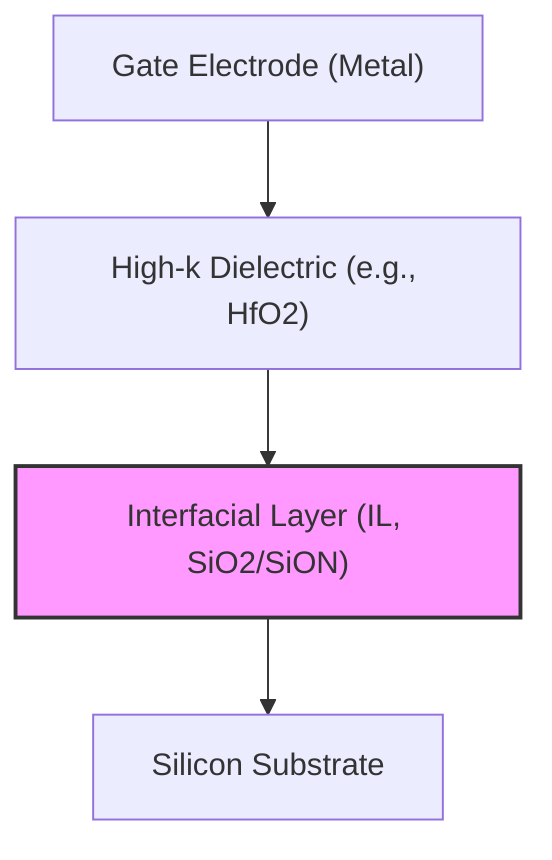

IL 的存在有兩個關鍵作用：
1.  **改善遷移率**：High-k 材料中的極性聲子（Polar phonons）與通道載子會產生強烈散射，IL 能有效隔離這種散射效應，維持載子遷移率。
2.  **化學過渡**：提供較好的鍵結匹配，降低介面態密度。

然而，IL 的存在會貢獻額外的 EOT。因此，在先進節點中，如何透過「清除製程」（Scavenging process）在不破壞介面品質的前提下極限縮減 IL 厚度，是製程整合的重點。

### 原子層沉積（ALD）在 High-k 製程中的角色

由於 High-k 介電層的物理厚度通常僅有 2 至 4 奈米，且必須在複雜的鰭式電晶體（FinFET）或環繞閘極電晶體（GAAFET）的三維結構上達成完美的階梯覆蓋率（Step coverage），傳統的 CVD（見第 21 章）或 PVD（見第 22 章）已無法滿足需求。

原子層沉積（ALD，見第 23 章）成為唯一的解決方案。ALD 利用自限式（Self-limiting）的表面反應，每次循環僅成長約一個原子層的厚度。

以 $\text{HfO}_2$ 的 ALD 成長為例，典型反應步驟如下：
1.  **前驅物脈衝**：通入四氯化鉿（$\text{HfCl}_4$）或有機鉿前驅物（如 TEMAH），使其吸附於飽和的表面位置。
2.  **清洗（Purge）**：移除多餘的前驅物與副產物。
3.  **反應物脈衝**：通入水蒸氣（$\text{H}_2\text{O}$）或臭氧（$\text{O}_3$），與表面吸附的前驅物反應生成氧化物。
4.  **清洗（Purge）**：移除殘餘氣體。

!!! warning "常見誤解：High-k 等於金屬閘極"
    初學者常將 High-k 與金屬閘極（Metal Gate）混為一談。事實上，High-k 指的是介電層材料的更換。然而，導入 High-k 後，傳統的多晶矽閘極會產生「費米能階釘紮」（Fermi-level pinning）與多晶矽耗盡效應（Polysilicon depletion），導致門檻電壓無法調控且有效電容下降。因此，High-k 必須與金屬閘極配對使用，這才構成了完整的 HKMG 技術。

!!! example "產業實例"
    Intel 於 2007 年在 45 奈米節點首度將基於鉿（Hafnium）的 High-k 材料導入量產，這被視為 MOSFET 自 1960 年代發明以來最大的材料變革。截至撰寫時，全球所有領先晶圓代工廠在 7 奈米以下的先進邏輯製程，均採用基於 $\text{HfO}_2$ 的 ALD 工藝來構建閘極堆疊。

## 28.2 金屬閘極與功函數工程

在金屬氧化物半導體場效應電晶體（MOSFET）的演進過程中，閘極材料的選擇經歷了從金屬（1960年代）到摻雜多晶矽（Polysilicon），再回歸到金屬閘極（Metal Gate）的重大轉變。這一轉變的核心動力在於解決深次微米元件中的物理極限問題，特別是多晶矽耗盡效應與費米能階釘紮現象。本節將深入探討金屬閘極的物理特性、材料選擇及其功函數調控機制。

### 28.2.1 多晶矽閘極的物理極限

在 45 奈米節點之前，摻雜多晶矽是主流的閘極材料，主因在於其優異的熱穩定性（可耐受源極/汲極活化的高溫退火）以及與二氧化矽（$SiO_2$）良好的界面特性。然而，隨著元件微縮，多晶矽暴露出了兩個致命缺陷。

#### 多晶矽耗盡效應（Polysilicon Depletion Effect, PDE）

當 MOSFET 進入反轉區（Inversion）時，閘極電壓會在多晶矽與介電質的界面處感應出電荷。由於多晶矽本質上是半導體而非理想導體，即便經過重摻雜（如 $10^{20} \text{ cm}^{-3}$），在界面處仍會形成一個極薄的耗盡層（Depletion Layer）。

此耗盡層的電容 $C_{poly}$ 會與閘極介電層電容 $C_{ox}$ 串聯，導致總有效電容降低：

$$\frac{1}{C_{total}} = \frac{1}{C_{ox}} + \frac{1}{C_{poly}}$$

其中 $C_{poly} = \epsilon_{si} / W_d$，$W_d$ 為多晶矽耗盡層寬度。這使得等效氧化層厚度（Effective Oxide Thickness, EOT）增加（典型增加值約 0.4 至 0.5 奈米），嚴重削弱了閘極對通道的受控能力，降低了驅動電流（$I_{on}$）。

#### 費米能階釘紮（Fermi Level Pinning, FLP）

當產業試圖引入高介電常數（High-k）材料（如 $HfO_2$）取代 $SiO_2$ 時，發現多晶矽與 High-k 材料接觸時，其界面會產生大量的氧空缺（Oxygen Vacancies）或偶極矩。這些缺陷會將多晶矽的費米能階（Fermi Level）「釘紮」在特定位置，通常靠近矽的能隙中間（Mid-gap）。

對於 NMOS，我們希望閘極功函數靠近導帶（Conduction Band, $\sim 4.1 \text{ eV}$）；對於 PMOS，則希望靠近價帶（Valence Band, $\sim 5.2 \text{ eV}$）。費米能階釘紮使得多晶矽無法透過摻雜有效調整功函數，導致閾值電壓（Threshold Voltage, $V_{th}$）過高且難以控制。因此，改用金屬閘極成為必然選擇。

### 28.2.2 金屬閘極材料選擇與特性

金屬閘極必須滿足多項嚴苛要求：適當的功函數、高熱穩定性、與 High-k 材料的化學相容性，以及優良的階梯覆蓋能力（Step Coverage）。

#### 常用金屬材料

1.  **氮化鈦 (TiN)**：最廣泛應用的金屬閘極材料。其功函數約在 4.6 至 4.8 eV 之間，屬於中能隙（Mid-gap）材料。透過調整沉積製程（如 ALD 或 PVD）中的氮含量或晶粒取向，可微調其功函數。TiN 常作為擴散阻障層或功函數調整層。
2.  **氮化鉭 (TaN)**：具有極佳的熱穩定性與阻障特性，功函數略低於 TiN，常用於 NMOS 的功函數堆疊中。
3.  **鋁 (Al)**：在後閘極（Gate-last）製程中，鋁常作為最終的填充金屬（Fill Metal）。此外，將鋁滲透進 TiN 層中可顯著提高功函數，用於 PMOS。
4.  **鎢 (W)**：主要作為填充金屬，因其電阻率低且機械強度高。

#### 功函數（Work Function, $\Phi_m$）與閾值電壓

金屬閘極的核心功能是決定元件的 $V_{th}$。根據理想 MOSFET 模型：

$$V_{th} = \Phi_{ms} - \frac{Q_{ox}}{C_{ox}} + 2\phi_f + \frac{\sqrt{2\epsilon_s q N_A (2\phi_f)}}{C_{ox}}$$

其中 $\Phi_{ms} = \Phi_m - \Phi_s$ 是金屬與半導體的功函數差。為了獲得低 $V_{th}$，NMOS 需要低功函數金屬（$\Phi_m \approx 4.0\text{--}4.2 \text{ eV}$），而 PMOS 需要高功函數金屬（$\Phi_m \approx 5.0\text{--}5.2 \text{ eV}$）。

### 28.2.3 功函數工程（Work Function Engineering）

在先進製程中，單一金屬難以同時滿足 NMOS 與 PMOS 的需求。因此，工程師開發了複雜的「功函數堆疊」（Work Function Stack）技術。

#### 材料成分與厚度控制

透過改變金屬層的厚度，可以利用「體積效應」（Bulk effect）或「界面效應」來調整等效功函數（Effective Work Function, EWF）。例如，在 TiN 層上方覆蓋一層薄鋁，並透過熱處理使鋁原子擴散至 TiN/High-k 界面，可將 EWF 移向價帶，適合 PMOS。

#### 偶極矩（Dipole）調控機制

這是目前最先進的調控手段。藉由在 High-k 層與底部的界面氧化層（Interfacial Layer, IL）之間引入極薄的雜質層（通常小於 1 奈米），人為製造電偶極矩，補償能帶偏移。

*   **NMOS 偶極矩**：引入鑭（La）、鎂（Mg）或鍶（Sr）等元素。這些陽離子在界面處形成的偶極矩方向朝向矽基板，降低了有效功函數。
*   **PMOS 偶極矩**：引入鋁（Al）或銻（Sb）等元素。這些元素形成的偶極矩方向相反，提升了有效功函數。

!!! note "物理機制：氧原子的移動"
    偶極矩的形成通常與氧原子的重新分布有關。例如，鑭原子傾向於吸引氧原子，改變了界面處的靜電勢能分布，進而導致能帶的移動（Band Shifting）。

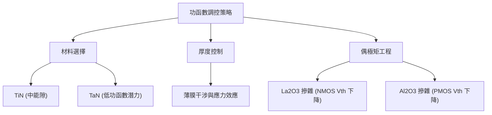

### 28.2.4 界面工程與有效功函數（EWF）

必須強調的是，金屬在真空中的功函數（真空功函數）與其在 MOSFET 結構中的「有效功函數」（EWF）存在顯著差異。EWF 會受到以下因素影響：

1.  **界面電荷**：High-k 材料內部的固定電荷（Fixed Charges）。
2.  **氧分壓控制**：在熱處理過程中，環境中的氧含量會影響氧空缺的濃度，進而改變 EWF。
3.  **金屬取向**：PVD 沉積的金屬具有多晶結構，不同晶面（如 TiN 的 <111> 與 <100>）具有不同的功函數。

!!! example "產業實例"
    截至撰寫時，在 5 奈米與 3 奈米節點的 FinFET 製程中，為了實現多重閾值電壓（Multi-$V_{th}$）設計，單一晶片上可能需要 6 到 10 種不同的 $V_{th}$ 等級。這通常不是透過改變離子佈植濃度（因為隨機摻雜波動 RDF 太大），而是透過精確控制金屬閘極堆疊中不同金屬層的厚度（如 TiN 的多重厚度）以及偶極矩材料的導入量來實現。

### 28.2.5 金屬閘極的結構堆疊

一個典型的 HKMG（High-k Metal Gate）堆疊結構由下至上通常包含：

1.  **界面層 (IL)**：約 0.5–1.0 nm 的 $SiO_x$，用於維持良好的遷移率。
2.  **高介電層 (High-k)**：如 $HfO_2$，厚度約 1.5–2.5 nm。
3.  **蓋層 (Capping Layer)**：如 $La_2O_3$ 或 $Al_2O_3$，用於形成偶極矩（視 NMOS/PMOS 而定）。
4.  **功函數金屬層 (WFM)**：如 TiN、TaN 或其合金，厚度精確控制在數個奈米。
5.  **阻障層 (Barrier)**：防止後續金屬擴散。
6.  **填充金屬 (Fill Metal)**：如鎢 (W) 或鋁 (Al)，填滿閘極溝槽。

這種複雜的堆疊對原子層沉積（ALD）技術提出了極高要求，必須確保每一層的厚度達到原子級的均勻性，否則會造成嚴重的 $V_{th}$ 不均勻（Variation），影響良率。

| 材料功能 | 典型材料 | 作用機制 |
| :--- | :--- | :--- |
| **High-k 介電質** | $HfO_2$, $HfZrO_x$ | 提供高電容密度並抑制漏電 |
| **NMOS 功函數層** | TiAl, TaN | 提供靠近導帶的 EWF |
| **PMOS 功函數層** | TiN (富氮), Mo | 提供靠近價帶的 EWF |
| **填充金屬** | W, Al, Co | 降低閘極電阻 |

透過金屬閘極與功函數工程，半導體製程成功克服了多晶矽耗盡效應，並在極薄的 EOT 下實現了對 $V_{th}$ 的精準調控。這不僅是材料上的替換，更是對界面物理與能帶理論的深度應用。在後續的 28.4 節中，我們將探討如何將這些複雜的材料堆疊整合進 Gate-first 或 Gate-last 的製程流程中。

## 28.3 應變工程與遷移率提升技術

在半導體元件微縮的過程中，當物理尺寸接近極限，單純依靠縮減幾何尺寸已無法顯著提升電晶體的效能。為了在不增加功耗的前提下提升驅動電流（$I_{on}$），「應變工程」（Strain Engineering）成為前段製程（FEOL）中不可或缺的技術。其核心原理是透過改變矽晶格的原子間距，調整能帶結構，進而提升載子的遷移率（Mobility）。

### 28.3.1 應變對能帶結構與遷移率的物理影響

載子在半導體中的遷移率 $\mu$ 可由以下公式定義：

$$\mu = \frac{q \tau}{m^*}$$

其中：
- $q$ 為基本電荷。
- $\tau$ 為平均散射時間（Mean free time），與載子受到的散射機率成反比。
- $m^*$ 為載子的有效質量（Effective mass）。

應變工程的主要目標是透過人工施加應力，達成「降低有效質量 $m^*$」以及「增加平均散射時間 $\tau$」兩個物理效應。

#### 1. 導帶分裂與電子遷移率提升（NMOS）
在未受應力的矽晶體中，導帶（Conduction band）具有六個等價的能谷（Valleys），稱為 $\Delta_6$ 能谷。當對矽施加沿著通道方向（通常為 $\langle 110 \rangle$ 方向）的張應力（Tensile stress）時，這六個能谷的簡併性（Degeneracy）會被打破，分裂為能量較低的兩個 $\Delta_2$ 能谷與能量較高的四個 $\Delta_4$ 能谷。

根據波茲曼分布，電子會優先佔據能量較低的 $\Delta_2$ 能谷。在 $\Delta_2$ 能谷中，電子的縱向有效質量（Longitudinal effective mass）較小，且由於能階分裂增加了能谷間的能量差，減少了電子在不同能谷間的散射（Intervalley scattering）機率，從而顯著提升電子遷移率。

#### 2. 價帶分裂與電洞遷移率提升（PMOS）
矽的價帶（Valence band）在布里淵區中心（$\Gamma$ 點）是簡併的，包含重電洞帶（Heavy hole band）與輕電洞帶（Light hole band）。施加壓縮應力（Compressive stress）會打破這種簡併性，使兩帶分離。

這種分離產生了兩個效果：第一，電洞會傾向於佔據有效質量較輕的能帶；第二，能帶間距的增加減少了帶間散射（Interband scattering）。對於 PMOS 而言，沿著通道方向施加壓縮應力是提升電洞遷移率最有效的方法。

### 28.3.2 單軸應變與雙軸應變的實現方式

應變技術依據施加方式可分為「雙軸應變」（Biaxial Strain）與「單軸應變」（Uniaxial Strain）。

| 特性 | 雙軸應變 (Biaxial Strain) | 單軸應變 (Uniaxial Strain) |
| :--- | :--- | :--- |
| **物理實現** | 在鬆弛的 SiGe 緩衝層上生長薄矽層（應變矽晶圓） | 透過製程結構（如 eSiGe、CESL）產生應力 |
| **應力方向** | 平行於晶圓表面的兩個維度 | 僅平行或垂直於通道方向的一個維度 |
| **整合難度** | 高（需特殊晶圓，易產生位錯缺陷） | 低（可整合於標準 CMOS 流程） |
| **微縮特性** | 隨閘極長度縮短而效能衰減較慢 | 隨閘極長度縮短而效能增益更顯著 |
| **產業應用** | 早期研究，現多用於特殊基板 | 90nm 節點後的主流技術 |

!!! note "物理機制差異"
    雙軸應變通常是「全局性」（Global）的，由基板提供；而單軸應變則是「局部性」（Local）的，由電晶體周邊的結構產生。截至撰寫時，主流先進製程（如 3nm、2nm）主要依賴單軸應變與新型通道材料的結合。

### 28.3.3 嵌入式矽鍺（eSiGe）對 PMOS 的壓縮應力

在 PMOS 中，提升效能最關鍵的技術是「嵌入式矽鍺」（Embedded Silicon Germanium, eSiGe）。

#### 1. 物理原理
矽（Si）的晶格常數約為 $5.431 \text{ \AA}$，而鍺（Ge）的晶格常數約為 $5.658 \text{ \AA}$。當在 PMOS 的源極與汲極（S/D）區域蝕刻出凹槽，並以磊晶（Epitaxy）方式生長摻雜硼的 SiGe 合金時，由於 SiGe 的晶格常數大於矽，它會對中間的矽通道產生強大的「擠壓」作用，形成單軸壓縮應力。

#### 2. 製程流程
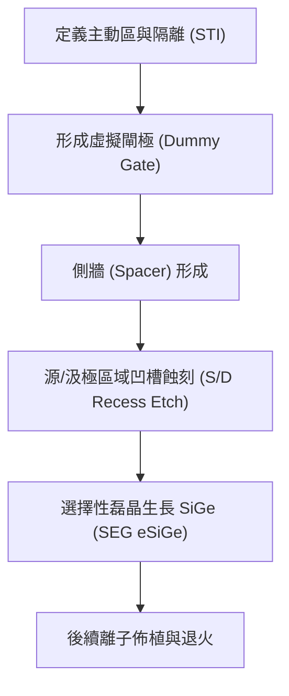

#### 3. 關鍵參數與挑戰
- **Ge 濃度**：Ge 含量越高，產生的應力越大，但過高的 Ge 濃度會導致晶格錯位（Dislocation）與缺陷，反而降低良率。典型值約為 25% 至 45%。
- **凹槽形狀**：蝕刻出的凹槽形狀（如 U-shape 或 Sigma-shape）會影響應力傳遞至通道的效率。Sigma-shape ($\Sigma$) 蝕刻能使 SiGe 更靠近通道下方，產生更高的應力。

### 28.3.4 NMOS 應變技術：CESL 與 SMT

對於 NMOS，需要的是張應力。由於目前尚無類似 eSiGe 這樣成熟的嵌入式材料（雖然 eSiC 曾被研究，但磊晶品質難以控制），產業主要採用接觸蝕刻停止層（CESL）與應力記憶技術（SMT）。

#### 1. 接觸蝕刻停止層 (Contact Etch Stop Layer, CESL)
在完成電晶體基本結構後，會覆蓋一層氮化矽（SiN）薄膜作為後續接觸孔蝕刻的停止層。透過調整電漿增強化學氣相沉積（PECVD）的參數（如壓力、功率、氣體比例），可以控制這層 SiN 膜內部的固有應力（Intrinsic stress）。
- **張應力 CESL**：用於 NMOS，將通道向兩側拉伸。
- **壓縮應力 CESL**：用於 PMOS（雖然效果通常弱於 eSiGe）。

#### 2. 應力記憶技術 (Stress Memorization Technique, SMT)
SMT 是一種利用熱處理過程「鎖住」應力的技術。其步驟如下：
1. 在源/汲極離子佈植後，於晶圓表面覆蓋一層具有高張應力的氮化矽覆蓋層（Capping layer）。
2. 進行快速熱退火（RTA）。在此過程中，矽晶格因佈植產生的非晶化區域會重新結晶。
3. 在重新結晶過程中，由於上方張應力層的束縛，矽晶格會依照受力狀態重新排列。
4. 移除覆蓋層後，矽晶格仍會保持這種受力狀態，即「記憶」了應力。

!!! warning "常見誤解"
    讀者常認為應變工程只在平面電晶體（Planar FET）有效。事實上，在 FinFET 結構中，eSiGe 仍然是 PMOS 效能提升的核心。鰭片（Fin）的三維結構使得應力分布更加複雜，需要更精密的製程控制來確保鰭片頂部與側壁的應力均勻性。

### 28.3.5 整合趨勢：從 FinFET 到 GAAFET

隨著製程演進至 5nm 以下，應變工程面臨新的挑戰與變革：

1. **鰭片應變優化**：在 FinFET 中，eSiGe 不僅提供應力，還兼具減少接觸電阻的功能。截至撰寫時，先進製程會透過調整鰭片的寬度與高度，來最大化應力傳遞效率。
2. **奈米片（Nanosheet/GAAFET）應變**：在環繞閘極電晶體（GAAFET）中，通道是被懸空的奈米片。這使得應力的施加更為困難，因為傳統的 CESL 難以包裹整個奈米片。此時，源/汲極磊晶層的體積與品質成為應力維持的關鍵。
3. **新型通道材料**：為了進一步提升遷移率，產業正研究在矽基板上磊晶生長高遷移率材料（如 PMOS 使用純 Ge 或 SiGe 通道，NMOS 使用 InGaAs 等 III-V 族材料）。這類技術本質上是利用材料本身的能帶特性，結合異質磊晶產生的應變。

### 28.3.6 產業實例

在 90nm 節點，**Intel** 率先在量產中引入了單軸應變技術，利用 eSiGe 提升 PMOS 效能，並利用張應力 SiN 膜提升 NMOS 效能，這被視為現代應變工程的開端。

到了 28nm 與 20nm 節點，**台積電（TSMC）** 與 **三星（Samsung）** 進一步優化了 Sigma-shape 蝕刻技術，使得 eSiGe 的應力增益達到極大化。

截至撰寫時（2026年），在 2nm 節點的開發中，應變工程已與「通道工程」深度融合。例如，透過在矽奈米片中刻意引入晶格錯位或使用高度應變的 SiGe 層作為犧牲層，來精確調控最終通道的應力狀態。

---

**本節小結：**
應變工程透過改變物理晶格結構，從根本上扭轉了矽材料的電子傳輸特性。PMOS 依賴 eSiGe 產生的單軸壓縮應力，而 NMOS 則透過 CESL 與 SMT 獲得張應力。隨著元件結構從平面轉向三維（FinFET）乃至全包覆（GAAFET），應變技術的實作雖然愈發困難，但其作為提升載子遷移率、突破微縮瓶頸的核心地位始終未變。

<!-- fig:1 -->
<figure markdown>
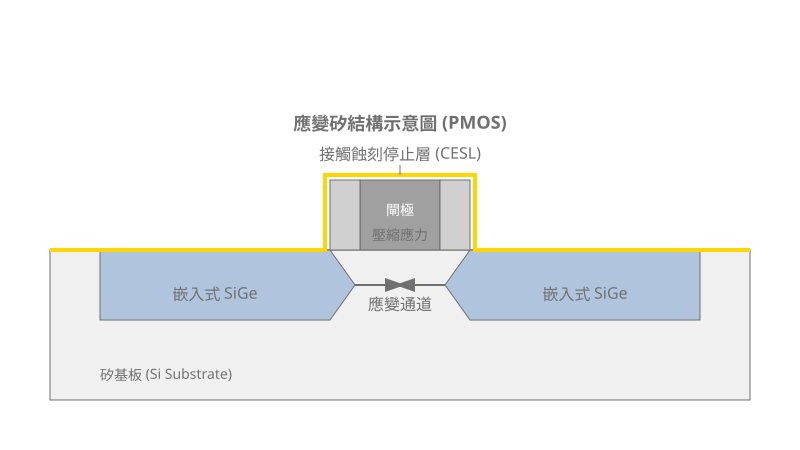
<figcaption>圖 28-1　應變矽結構示意圖（AI 繪製的示意圖）</figcaption>
</figure>

## 28.4 HKMG 整合方案：Gate-first 與 Gate-last

在導入高介電常數（High-k）材料與金屬閘極（Metal Gate）的過程中，最核心的挑戰在於如何將這些新材料整合進現有的互補式金屬氧化物半導體（CMOS）製程中，同時確保元件的功函數（Work Function）穩定且熱預算（Thermal Budget）不至於破壞材料特性。根據閘極形成的先後順序，整合方案主要分為「閘極優先」（Gate-first）與「閘極後製」（Gate-last）兩種路徑。

### 28.4.1 閘極優先（Gate-first）流程及其限制

閘極優先製程在邏輯上延續了傳統多晶矽（Polysilicon）閘極的製作順序。其基本流程為：在矽基板上先沉積 High-k 介電層，隨後沉積金屬閘極層（通常為氮化鈦 TiN 或氮化鉭 TaN），接著在其上方覆蓋一層多晶矽以作為後續離子佈植的遮罩。完成閘極堆疊（Gate Stack）的蝕刻後，再進行源極與汲極（Source/Drain, S/D）的離子佈植與高溫活化退火。

在閘極優先流程中，金屬閘極與 High-k 界面必須承受極高的熱預算。典型的源汲極活化退火溫度通常需達到 $1000^\circ\text{C}$ 以上，這會導致以下物理與化學問題：

1.  **費米能階釘紮（Fermi Level Pinning）：** 在高溫下，金屬與 High-k 界面會發生化學反應或產生氧空位（Oxygen Vacancies），導致金屬的有效功函數（Effective Work Function, EWF）向矽的能隙中間偏移，使得元件的臨界電壓（Threshold Voltage, $V_{th}$）難以調降。
2.  **界面層生長（Interfacial Layer Growth）：** 高溫會促使氧原子穿透金屬層與 High-k 層，在 High-k 與矽基板之間生成額外的二氧化矽（$\text{SiO}_2$）界面層，導致等效氧化層厚度（Equivalent Oxide Thickness, EOT）增加，喪失了 High-k 材料帶來的電容增益。
3.  **材料擴散與矽化：** 金屬原子可能擴散進入 High-k 層甚至通道區，造成漏電流增加或載子遷移率（Mobility）下降。

由於上述熱預算限制，閘極優先方案在 $V_{th}$ 控制上極為困難，截至撰寫時，此方案僅見於部分對效能要求較低、成本敏感度較高的成熟節點（如 28nm 的部分版本）。

### 28.4.2 閘極後製（Gate-last）或替代金屬閘極（RMG）製程

為了規避高溫退火對 HKMG 結構的破壞，產業轉向開發「閘極後製」流程，亦稱為「替代金屬閘極」（Replacement Metal Gate, RMG）。其核心思想是先使用一個「犧牲閘極」（Dummy Gate）來佔位，待所有高溫製程（如源汲極活化、矽化物形成）完成後，再將犧牲閘極移除，並在低溫環境（通常低於 $450^\circ\text{C}$）下填充真正的 High-k 介電質與金屬閘極。

RMG 製程的標準邏輯如下：

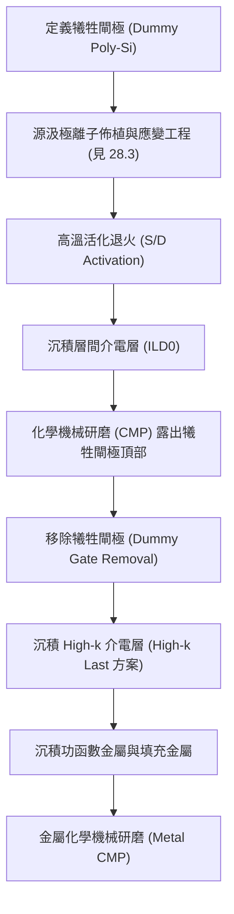

在 RMG 流程中，根據 High-k 層沉積的時間點，又可細分為：
*   **High-k First：** 在形成犧牲閘極前就先沉積 High-k 層。優點是 High-k 經歷了高溫退火，有助於改善膜質（如結晶化），但界面穩定性仍受挑戰。
*   **High-k Last：** 在移除犧牲閘極後才沉積 High-k 層。這是目前先進製程的主流，因為它能確保 High-k 界面完全不受到高溫製程的影響，提供最佳的 $V_{th}$ 穩定性與最小的 EOT。

### 28.4.3 犧牲閘極移除與高深寬比填充挑戰

在 RMG 製程中，有兩個關鍵的技術難點：

**1. 犧牲閘極的選擇性移除：**
通常使用多晶矽作為犧牲閘極材料。移除時必須使用高度選擇性的乾式或濕式蝕刻，確保在不傷害下方超薄界面層（Interfacial Layer, IL）與兩側側牆（Spacer）的前提下，完全清除溝槽內的多晶矽。若有殘留，將直接導致閘極漏電或功函數偏移。

**2. 高深寬比（High Aspect Ratio）金屬填充：**
隨著元件微縮至 FinFET 或環繞閘極電晶體（GAAFET），閘極溝槽變得極其狹窄且深。在這些奈米級溝槽中填充多層金屬膜（包括阻障層、功函數層、填充主體）極為困難。
*   **物理氣相沉積（PVD）的侷限：** 傳統 PVD 由於視線效應（Line-of-sight），容易在溝槽開口處產生「懸垂」（Overhang）現象，導致內部形成孔洞（Void）。
*   **原子層沉積（ALD）的必然性：** 為了實現優異的階梯覆蓋率（Step Coverage），功函數金屬（如 TiN, TaN, TiAl）必須採用 ALD 製程。然而，填充主體金屬（通常為鎢 W、鋁 Al 或鈷 Co）若採用 ALD 則速度過慢，因此常結合 CVD 與 ALD 技術。

!!! note "臨界電壓調變原理"
    在 RMG 製程中，NMOS 與 PMOS 需要不同的功函數金屬。臨界電壓 $V_{th}$ 與功函數差 $\Phi_{ms}$ 的關係如下：

    $$V_{th} = \Phi_{ms} - \frac{Q_{ss}}{C_{ox}} + 2\phi_f + \frac{\sqrt{2\varepsilon_s q N_a (2\phi_f + V_{sb})}}{C_{ox}}$$

    其中 $\Phi_{ms} = \Phi_m - \Phi_s$。透過在不同區域沉積不同厚度或種類的功函數金屬（Work Function Metal, WFM），工程師可以在同一片晶圓上實現多種臨界電壓（Multi-$V_{th}$）的電晶體。

### 28.4.4 先進邏輯節點採用 RMG 方案的技術必然性

截至撰寫時，從 22nm 節點開始，所有主流邏輯代工廠在先進製程（FinFET 與 GAAFET）中均全面採用 RMG 方案。這種技術必然性源於以下幾點：

1.  **精確的功函數控制：** RMG 允許在低溫下精確調整 NMOS（目標功函數約 $4.1 \sim 4.3 \text{ eV}$）與 PMOS（目標功函數約 $5.0 \sim 5.2 \text{ eV}$）的金屬成分，避免了高溫造成的費米能階釘紮。
2.  **應力工程的協同：** 在 RMG 流程中，移除犧牲閘極後，溝槽兩側的側牆會產生彈性鬆弛，這時填充金屬可以重新引入有利於載子遷移率的應力（見 28.3 節）。
3.  **超薄 EOT 的維持：** 由於 High-k 層不需要經歷源汲極的高溫活化，界面處的氧化反應被抑制，使得 EOT 能夠微縮至 $1\text{ nm}$ 以下，這對於維持短通道效應（SCE）的控制至關重要。

!!! warning "常見誤解：金屬閘極就是一塊純金屬"
    在 RMG 結構中，閘極並非單一材料，而是複雜的疊層。典型結構由下至上包括：界面層（IL）、High-k 層（如 $\text{HfO}_2$）、蓋層（Capping layer）、功函數金屬層（WFM）、以及最後的填充金屬（Fill Metal）。每一層的厚度通常僅有數個埃（Angstrom），對製程精度的要求極高。

### 28.4.5 產業實例：RMG 技術的演進

在產業實踐中，Intel 是最早在 45nm 節點導入 RMG 技術的廠商，當時成功解決了 High-k 材料與多晶矽閘極不相容的問題。隨後，台積電（TSMC）在 28nm 節點提供了 Gate-first（低功耗版本）與 Gate-last（高效能版本）兩種選擇，但最終市場證明 Gate-last 在效能與微縮潛力上具有絕對優勢。

截至撰寫時，進入 3nm 與 2nm 的 GAAFET（Nanosheet）時代，RMG 製程變得更加複雜。由於閘極必須完全環繞奈米片（Nanosheet）通道，金屬填充必須在奈米片之間的極小間隙（通常小於 $10\text{ nm}$）中完成。這要求 ALD 製程具備極高的保形性（Conformality），且 Metal CMP 必須具備極高的平坦化精度，以避免不同高度的奈米片之間產生電性不均勻。

| 特性 | 閘極優先 (Gate-first) | 閘極後製 (Gate-last / RMG) |
| :--- | :--- | :--- |
| **熱預算** | 高（需承受 $>1000^\circ\text{C}$） | 低（通常 $<450^\circ\text{C}$） |
| **功函數穩定性** | 較差（易受費米能階釘紮影響） | 極佳（低溫製程保持金屬特性） |
| **EOT 微縮能力** | 有限（界面層易增厚） | 優異（可維持超薄界面） |
| **製程複雜度** | 較低 | 極高（需額外 CMP 與選擇性蝕刻） |
| **適用節點** | 28nm 以上成熟節點 | 22nm 以下至 GAAFET 先進節點 |

在下一節中，我們將探討 FEOL 的完整整合流程，說明 RMG 如何與應變工程、淺溝槽隔離（STI）以及源汲極磊晶等步驟協同運作。

<!-- fig:2 -->
<figure markdown>
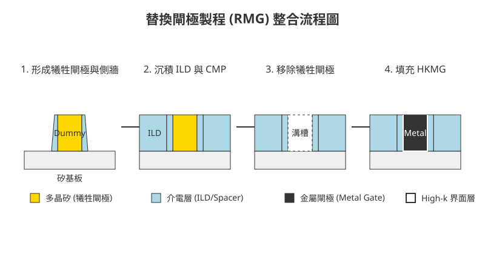
<figcaption>圖 28-2　Gate-last 整合流程圖（AI 繪製的示意圖）</figcaption>
</figure>

## 28.5 前段製程（FEOL）完整整合流程

前段製程（Front-End-of-Line, FEOL）是指在半導體晶圓上形成主動元件（如 MOSFET、FinFET 或 GAAFET）的完整物理結構之過程。此階段的整合品質直接決定了電晶體的靜態特性（如漏電流 $I_{off}$、閾值電壓 $V_{th}$）與動態性能（如切換速度、驅動電流 $I_{on}$）。

### 28.5.1 隔離技術與井區形成

FEOL 的起始點在於定義元件的活性區（Active Area）並進行電氣隔離。

#### 1. 淺溝槽隔離 (Shallow Trench Isolation, STI)
在次微米以下的製程中，STI 已完全取代傳統的局部矽氧化（LOCO）技術，以避免「鳥嘴」（Bird's beak）效應造成的面積損失。其標準流程如下：
1.  **墊氧化層與氮化矽沉積**：先成長薄層墊氧化層（Pad Oxide）以緩衝應力，再以低壓化學氣相沉積（LPCVD）成長氮化矽（$Si_3N_4$）作為後續化學機械研磨（CMP）的停止層。
2.  **溝槽蝕刻**：利用微影與反應離子蝕刻（RIE）在矽基板上開挖深度約 200–400 nm 的溝槽。
3.  **溝槽填充**：使用高密度電漿化學氣相沉積（HDP-CVD）或高深寬比製程（HARP）填充二氧化矽（$SiO_2$）。
4.  **平坦化**：透過 CMP 移除多餘的氧化層，停止於氮化矽層。

#### 2. 井區佈植與通道工程 (Well & Channel Implantation)
隔離完成後，需定義 NMOS 與 PMOS 的井區（Well）。
*   **井區佈植**：透過高能量離子佈植形成 P-well 與 N-well。現代製程常採用「逆行井」（Retrograde Well）分佈，即摻雜濃度峰值位於表面下方，以降低接面電容並抑制穿透效應（Punch-through）。
*   **閾值電壓調整 ($V_{th}$ Adjust)**：透過精確的離子佈植控制通道表面的摻雜濃度。根據電晶體原理（見第 4 章），閾值電壓可表示為：

    $$V_{th} = V_{FB} + 2\phi_F + \frac{\sqrt{2\epsilon_s q N_{sub} (2\phi_F + V_{SB})}}{C_{ox}}$$

    其中 $V_{FB}$ 為平帶電壓，$\phi_F$ 為費米能階差，$N_{sub}$ 為通道摻雜濃度，$C_{ox}$ 為閘極氧化層電容。在 High-k/Metal Gate (HKMG) 時代，由於金屬閘極的功函數可調，通道摻雜濃度有逐漸降低的趨勢，以減少隨機摻雜波動（Random Dopant Fluctuation, RDF）。

### 28.5.2 閘極堆疊與側牆工程

在完成井區後，進入閘極堆疊（Gate Stack）的建構。

#### 1. 閘極形成
在 Gate-first 流程中，此處會完成 High-k 介電質與金屬閘極的沉積與圖案化；而在 Gate-last 流程中，此處先形成「犧牲多晶矽閘極」（Dummy Poly Gate），待後續熱製程結束後再行替換（詳見 28.4 節）。

#### 2. 輕摻雜汲極 (Lightly Doped Drain, LDD)
為了緩解短通道效應中的熱載子注入（Hot Carrier Injection, HCI）問題，在閘極定義後，會進行低能量、低劑量的離子佈植，形成 LDD 結構（在先進節點常稱為 Extension 佈植）。這能降低汲極端的電場梯度，減少衝擊游離（Impact Ionization）。

#### 3. 側牆 (Spacer) 形成
利用電漿增強化學氣相沉積（PECVD）或原子層沉積（ALD）沉積一層氮化矽或氧化矽，接著進行高度異向性的乾式蝕刻。由於垂直方向的薄膜較厚，蝕刻後會在閘極兩側留下殘餘物，形成側牆。側牆的作用在於：
*   作為後續高劑量源極/汲極佈植的遮罩，確保摻雜區與閘極邊緣保持物理距離。
*   在後續的矽化物製程中防止閘極與源/汲極短路。

### 28.5.3 源極/汲極磊晶與超淺接面 (USJ)

隨著元件微縮，源極與汲極（S/D）的電阻與接面深度成為效能瓶頸。

#### 1. 選擇性磊晶成長 (Selective Epitaxial Growth, SEG)
截至撰寫時，在 7nm 以下節點，源/汲極通常採用嵌入式磊晶結構以引入應變（Strain）：
*   **PMOS**：在源/汲極區蝕刻出凹槽，磊晶成長矽鍺（SiGe）。由於 SiGe 的晶格常數大於 Si，會對通道產生壓縮應力（Compressive Stress），提升電洞遷移率。
*   **NMOS**：磊晶成長摻雜磷的矽（SiP）或矽碳（SiC），對通道產生張應力（Tensile Stress），提升電子遷移率（見 28.3 節）。

#### 2. 超淺接面 (Ultra-Shallow Junction, USJ) 與退火
為了抑制短通道效應，接面深度 $x_j$ 必須極小化。根據擴散定律：

$$x_j \propto \sqrt{Dt}$$

其中 $D$ 為擴散係數，$t$ 為時間。為了獲得極淺接面並維持高活化率（Activation），現代製程採用**快速熱處理（RTP）**結合**雷射尖峰退火（Laser Spike Anneal, LSA）**或**毫秒退火（Millisecond Anneal, MSA）**。這些技術能在極短時間內（$\mu s$ 至 $ms$ 等級）將表面加熱至 1000°C 以上，使摻雜物活化而幾乎不發生擴散。

!!! note "技術細節：隨機摻雜波動 (RDF)"
    隨著接面變淺與體積縮小，源/汲極區內的摻雜原子數量變得極少。少數原子的位置隨機分佈會導致元件間 $V_{th}$ 的顯著差異，這是先進製程良率控制的重大挑戰。

### 28.5.4 自對準矽化物 (Salicide) 與 ILD0 沉積

在 FEOL 的末端，必須降低半導體與金屬導線之間的接觸電阻。

#### 1. 自對準矽化物 (Self-aligned Silicide, Salicide)
此製程不需額外的光罩，利用金屬與矽在熱處理下的化學反應形成低電阻的矽化物：
1.  **金屬沉積**：利用 PVD 沉積一層過渡金屬（如鎳 Ni 或鈷 Co）。
2.  **第一次快速熱退火 (RTA1)**：金屬與暴露的矽（源/汲極與閘極頂端）反應形成矽化物。
3.  **選擇性蝕刻**：使用濕式化學藥劑移除未反應的金屬（位於側牆與隔離區上方的金屬）。
4.  **第二次快速熱退火 (RTA2)**：將矽化物轉化為更低電阻的相（如將 NiSi 穩定化）。

截至撰寫時，**矽化鎳 (NiSi)** 是主流選擇，因為其矽消耗量較少且在窄線寬下仍能維持低電阻率。

#### 2. 層間介電層 (Inter-Layer Dielectric, ILD0)
最後，沉積第一層介電層（通常稱為 PMD, Pre-Metal Dielectric 或 ILD0）。
*   **接觸蝕刻停止層 (Contact Etch Stop Layer, CESL)**：先沉積一層具備高應力的氮化矽薄膜。這層薄膜除了作為後續接觸孔（Contact）蝕刻的停止層外，還能提供額外的應力以增強遷移率。
*   **ILD0 填充**：使用流動性化學氣相沉積（FCVD）或高密度電漿 CVD 填充閘極間的縫隙，隨後進行 CMP 平坦化，為後續的中段製程（MOL）接觸孔開挖做好準備。

### 28.5.5 FEOL 整合流程總覽

下圖展示了從矽基板到完成 ILD0 的典型 FEOL 整合邏輯：

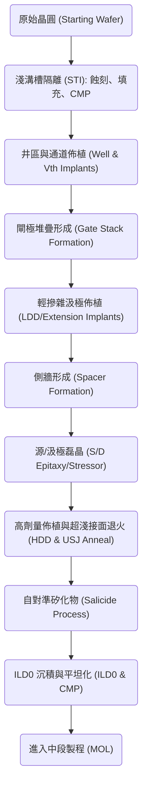

### 28.5.6 關鍵製程參數與典型值

在 FEOL 整合中，各項參數的精確度要求極高。下表列出先進製程節點中的典型物理範圍：

| 製程參數 | 典型值範圍 (7nm/5nm 節點) | 影響特性 |
| :--- | :--- | :--- |
| STI 深度 | 200 nm - 350 nm | 元件間漏電 (Isolation Leakage) |
| 接面深度 ($x_j$) | 10 nm - 20 nm | 短通道效應 (SCE) |
| 側牆寬度 | 5 nm - 15 nm | 串聯電阻與電容平衡 |
| 矽化物電阻率 | 10 - 20 $\mu\Omega\cdot cm$ | 接觸電阻 (Contact Resistance) |
| 退火溫度 (LSA) | 1100°C - 1300°C (毫秒級) | 摻雜物活化率與擴散控制 |

!!! warning "常見誤解：Salicide 與 Silicide"
    工程實務中常將兩者混用，但 **Salicide** 特指「自對準」（Self-aligned）的過程，即利用側牆與隔離層自然定義反應區域，不需光罩。若是在特定區域透過光罩定義形成的矽化物，則僅稱為 Silicide。在 FEOL 整合中，幾乎所有邏輯元件皆採用 Salicide 製程以節省成本並提高精確度。

## 28.6 設備與廠商技術

在高介電金屬閘極（High-k Metal Gate, HKMG）與前段製程（Front-End of Line, FEOL）的整合中，製程設備必須具備原子級的操控精度。隨著元件微縮至 5 奈米、3 奈米甚至更先進節點，傳統的化學氣相沉積（CVD）與物理氣相沉積（PVD）在填孔能力與厚度均勻性上已面臨物理極限，原子層沉積（ALD）與高精度化學機械研磨（CMP）成為不可或缺的核心技術。

### 關鍵設備類型與子系統架構

在 HKMG 整合流程中，主要涉及四類關鍵設備：成膜設備（ALD/PVD/CVD）、平坦化設備（CMP）、熱處理設備（RTP/Annealing）以及磊晶設備（Epitaxy）。

#### 1. 原子層沉積（ALD）設備
ALD 設備的核心在於其前驅物（Precursor）脈衝輸送系統與反應腔體（Chamber）的設計。為了實現自限式（Self-limiting）反應，設備必須精確控制前驅物進入腔體的時間與流量，並具備高效的高純度惰性氣體清洗（Purge）功能，以移除多餘的副產物。
*   **關鍵子系統**：
    *   **前驅物輸送系統**：包含加熱器與質量流量控制器（MFC），確保高飽和蒸氣壓。
    *   **電漿源（若為 PEALD）**：用於降低反應活化能，允許在較低溫度下沉積高品質薄膜。
    *   **真空泵浦系統**：需具備極高的抽氣速率，以縮短循環時間（Cycle time）。

#### 2. 化學機械研磨（CMP）設備
在後閘極（Gate-last）製程中，CMP 用於移除多餘的金屬功函數層與填充金屬（如鋁或鎢），並停在層間介電層（ILD）表面。其精度直接影響閘極高度的均勻性，進而影響閾值電壓（$V_{th}$）的分布。
*   **關鍵子系統**：
    *   **研磨頭（Polishing Head）**：具備多區壓力控制（Multi-zone pressure control），可補償晶圓邊緣效應。
    *   **終點偵測系統（End-point Detection, EPD）**：利用光學反射或渦電流（Eddy Current）原理，即時偵測薄膜厚度變化，確保在目標介面精準停止。

#### 3. 快速熱處理（RTP）與退火設備
用於活化摻雜區、修復晶格損傷或進行偶極（Dipole）工程以調整 $V_{th}$。在應變工程中，低溫退火可避免應變層（如 $SiGe$）發生弛豫（Relaxation）。
*   **關鍵子系統**：
    *   **加熱光源**：採用高功率鹵素燈管或雷射掃描系統，達成毫秒級（Millisecond Anneal, MSA）的升溫速度。

---

### 主要設備供應商技術比較

下表彙整了截至撰寫時，在 HKMG 與 FEOL 整合領域具代表性的設備供應商及其技術特點：

| 廠商 | 代表產品系列 | 技術路線與特點 | 主要應用 |
| :--- | :--- | :--- | :--- |
| **ASM International** | Pulsar 系列 | 單晶圓 ALD 平台，專精於 High-k 介電層（如 $HfO_2$）的原子級生長。 | 閘極介電層、界面層處理。 |
| **Applied Materials** | Endura 平台系列 | 整合型 PVD 與 ALD 系統，可在同一真空環境下完成阻障層與功函數金屬沉積。 | 功函數金屬（$TiN, TaN$）、金屬閘極填充。 |
| **Applied Materials** | Reflexion LK Prime | 具備高精度研磨頭與即時量測技術，針對金屬閘極研磨提供極佳的平坦度控制。 | Gate-last 製程中的金屬平坦化（RMG CMP）。 |
| **Applied Materials** | Centura Epi | 高溫/低溫磊晶生長，具備極佳的化學計量比控制。 | 源極/汲極應變工程（$SiGe, SiP$ 磊晶）。 |
| **Tokyo Electron** | TELINDY 系列 | 批次式熱處理爐管，具備優異的溫度場均勻性。 | 界面氧化層成長、低溫退火工程。 |
| **Lam Research** | Striker 系列 | 高產能 ALD 平台，強調薄膜的階梯覆蓋率（Step Coverage）。 | 間隔層（Spacer）、側牆介電質沉積。 |
| **Ebara** | F-REX 系列 | 獨特的研磨盤設計與清洗技術，減少研磨後的微塵污染。 | 前段製程金屬與介電質平坦化。 |

---

### 技術路線差異與選機考量

在晶圓廠導入 HKMG 製程時，設備的選擇通常基於以下技術取捨：

#### ALD 技術的取捨：單晶圓 vs. 批次式
*   **單晶圓（Single Wafer）**：如 ASM Pulsar，優點是製程控制極其精密，晶圓間的均勻性（Wafer-to-wafer uniformity）高，適合邏輯晶片最核心的閘極介電層。
*   **批次式（Batch）**：如 Tokyo Electron 的設備，優點是產出率（Throughput）高，適合厚度要求較不嚴苛、但需要大量生產的層別。

#### CMP 的平坦化精度
在 5 奈米以下節點，閘極高度的變異量必須控制在 1-2 奈米以內。Applied Materials 的 Reflexion LK Prime 採用多區壓力調整技術，能針對晶圓上的局部不平整進行補償。選機時，除了研磨速率（Removal Rate），更看重「碟凹」（Dishing）與「侵蝕」（Erosion）效應的抑制能力。

#### 整合型平台（Cluster Tool）的優勢
Applied Materials 的 Endura 平台強調「真空不破壞」的整合。在沉積功函數金屬前，若晶圓暴露於大氣，金屬介面會形成不穩定的原生氧化層，導致 $V_{th}$ 漂移。透過在同一平台上整合預清洗（Pre-clean）、ALD 與 PVD 腔體，能顯著提升元件性能。

---

### 產業實例：HKMG 於先進節點的演進

截至撰寫時，Intel、TSMC 與 Samsung 在 HKMG 的技術整合路徑上展現了不同的演進邏輯：

#### 1. Intel 的路徑
Intel 是最早在 45 奈米節點導入 HKMG 的廠商。其採用的 **Gate-last**（後閘極，又稱 Replacement Metal Gate, RMG）製程成為後續產業的主流。在 5 奈米以下節點，Intel 強化了偶極工程（Dipole engineering），透過在 $HfO_2$ 與界面層（IL）之間插入極薄的鑭（La）或鋁（Al）層，精準調控功函數。

#### 2. TSMC 的路徑
TSMC 在 28 奈米節點同時提供 Gate-first 與 Gate-last 方案，但隨後在 16 奈米 FinFET 及更先進節點全面轉向 Gate-last。截至撰寫時，在 3 奈米節點，TSMC 透過優化 ALD 沉積參數，實現了極薄的等效氧化層厚度（EOT），並結合應變工程提升載子遷移率。

#### 3. Samsung 的路徑
Samsung 在 28 奈米初期曾嘗試 Gate-first 製程以簡化流程，但隨後在高性能應用的壓力下亦轉向 Gate-last。在 3 奈米節點，Samsung 領先導入環繞閘極（GAAFET/MBCFET）架構，這對 ALD 設備提出了更高要求：必須在奈米片（Nanosheet）之間的狹窄縫隙中，均勻地包覆高介電常數材料與多層功函數金屬。

!!! note "應變工程中的低溫退火應用"
    在 5 奈米以下的 $SiGe$ 磊晶製程中，為了維持鍺（Ge）原子在矽晶格中的亞穩態（Metastable）分布以產生應變，後續的熱製程必須嚴格受限。產業中常使用 Applied Materials 的 Vantage 平台進行快速熱處理，或採用毫秒級退火技術，在極短時間內完成摻雜活化，而不致引起應變層的位錯（Dislocation）或弛豫。

### 前段製程（FEOL）整合流程簡圖

下圖展示了從淺溝槽隔離（STI）到金屬閘極形成的典型 FEOL 整合邏輯：

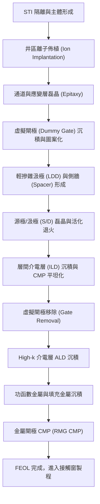

在上述流程中，步驟 H 到 K 即為後閘極製程的核心。設備間的精密協作——特別是 ALD 對厚度的原子級控制與 CMP 對高度的精密平坦化——是確保先進邏輯晶片良率的關鍵。

## 本章重點

- **物理極限與 High-k 需求**：當二氧化矽厚度縮減至 1.2 奈米以下，量子穿隧效應會導致閘極漏電流呈指數級增加。導入高介電常數（High-k）材料可在維持相同等效氧化層厚度（EOT）的前提下，增加物理厚度以抑制漏電。
- **材料選擇與界面層**：二氧化鉿（$\text{HfO}_2$）因具備適中的介電常數（典型值 $\approx 25$）與良好的熱力學穩定性成為主流。為維持載子遷移率，High-k 與矽基板間需保留極薄的二氧化矽界面層（IL）。
- **金屬閘極的必要性**：傳統多晶矽閘極在高微縮下會產生多晶矽耗盡效應（PDE）與費米能階釘紮（FLP），導致驅動電流下降與臨界電壓（$V_{th}$）失控，必須改採金屬閘極。
- **功函數工程**：透過調整金屬閘極的材料成分（如 TiN、TaN）、厚度，或引入偶極矩元素（如 La、Al），可精確調控 NMOS 與 PMOS 的有效功函數（EWF），實現多重閾值電壓設計。
- **應變工程技術**：利用嵌入式矽鍺（eSiGe）對 PMOS 通道施加壓縮應力，以及利用 CESL 或 SMT 對 NMOS 通道施加張應力，可分別提升電洞與電子的遷移率。
- **閘極後製（Gate-last）製程**：為規避高溫退火對金屬閘極功函數的破壞，先進製程採用替代金屬閘極（RMG）流程，在源/汲極活化後才於低溫下填充金屬閘極。
- **前段製程（FEOL）整合**：FEOL 涵蓋了從淺溝槽隔離（STI）、井區定義、閘極堆疊、源/汲極磊晶到自對準矽化物（Salicide）的完整過程，各步驟之熱預算與形貌控制對元件性能至關重要。
- **關鍵設備角色**：原子層沉積（ALD）提供原子級的厚度控制與優異的階梯覆蓋率，而化學機械研磨（CMP）則是實現 RMG 結構平坦化的核心技術。

## 重點圖卡

複習時看這幾張就能抓住本章重點；[圖卡庫](../cards.md)可以下載成圖片。

<figure markdown>
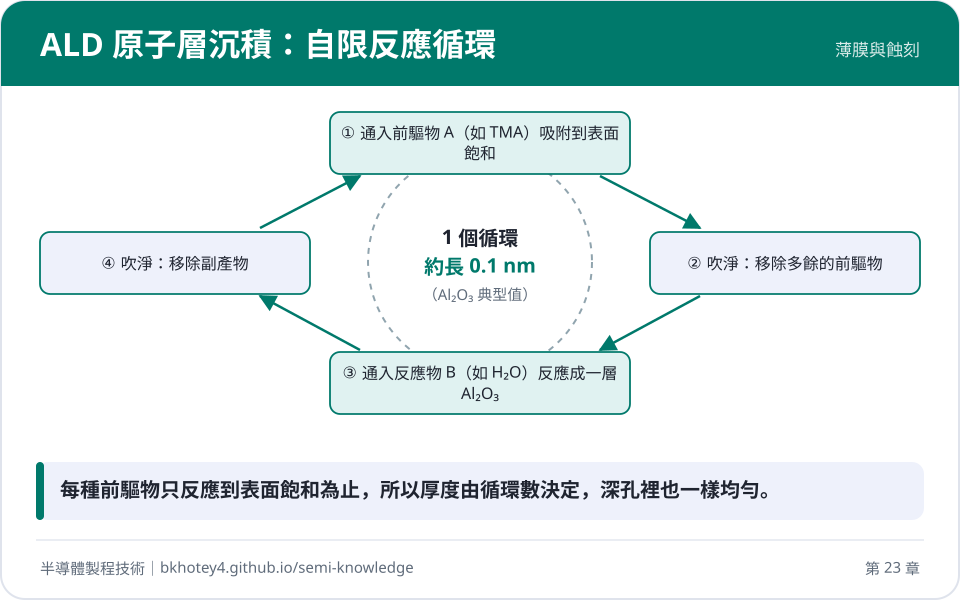
<figcaption>核心概念圖卡：ALD 原子層沉積：自限反應循環</figcaption>
</figure>

<figure markdown>
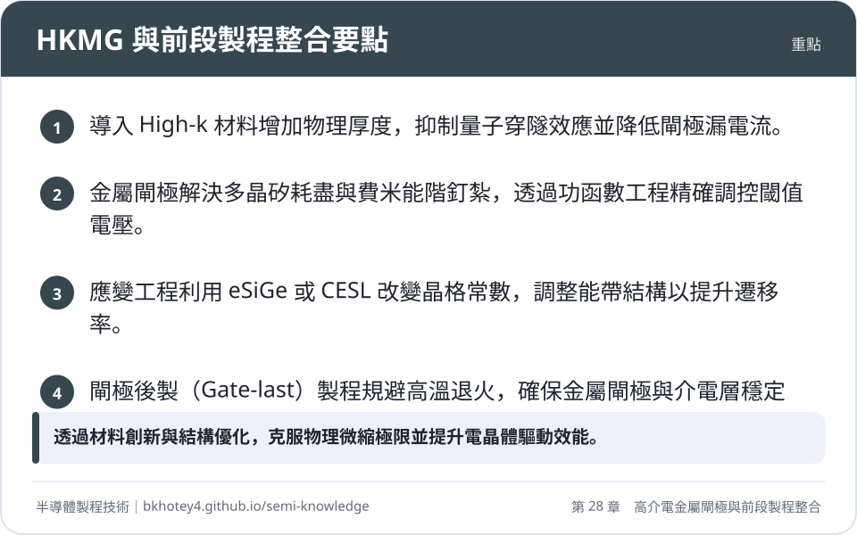
<figcaption>重點圖卡：HKMG 與前段製程整合要點</figcaption>
</figure>

<figure markdown>
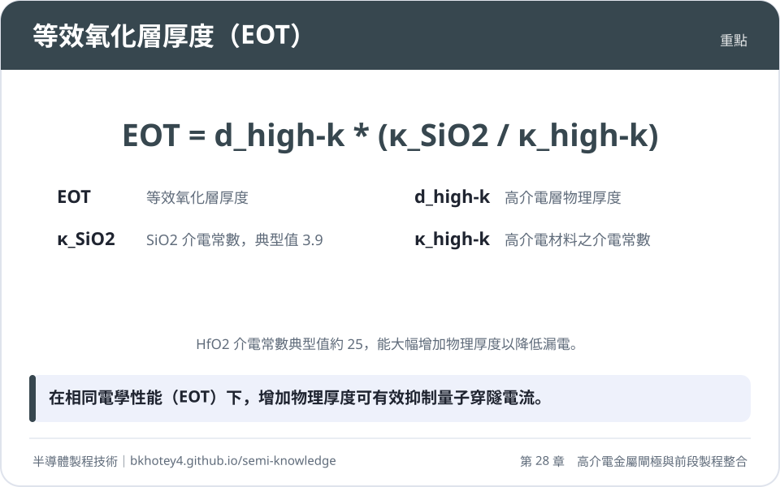
<figcaption>重點圖卡：等效氧化層厚度（EOT）</figcaption>
</figure>

<figure markdown>
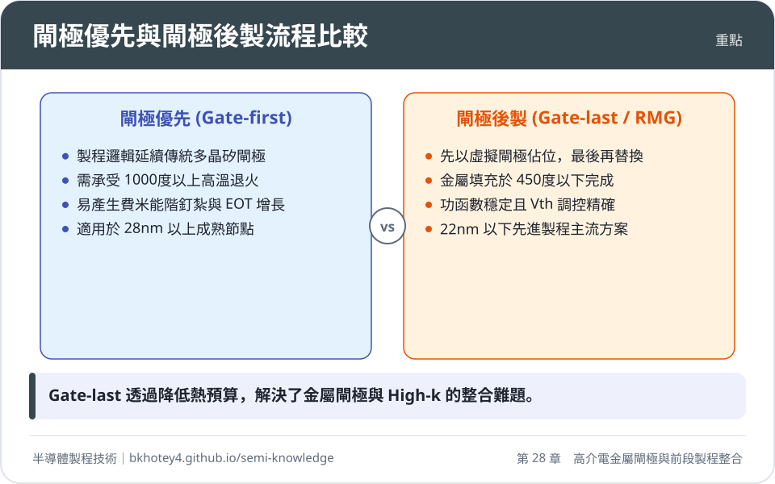
<figcaption>重點圖卡：閘極優先與閘極後製流程比較</figcaption>
</figure>

<figure markdown>
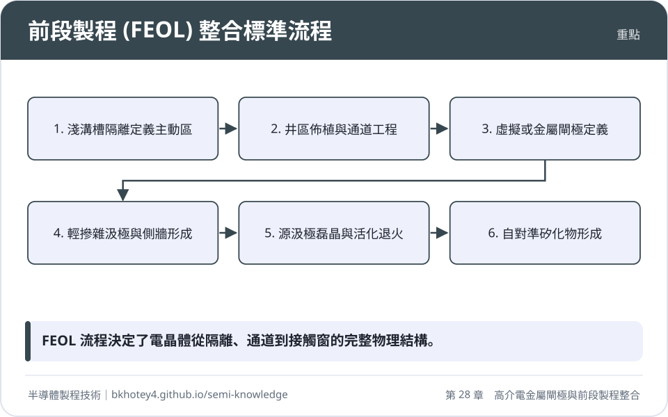
<figcaption>重點圖卡：前段製程 (FEOL) 整合標準流程</figcaption>
</figure>

## 習題

**1.** 試解釋為何在先進製程中，必須使用高介電常數（High-k）材料取代傳統的二氧化矽（$\text{SiO}_2$）作為閘極介電層？其物理機制為何？

??? success "參考解答"
    隨著元件微縮，$\text{SiO}_2$ 厚度若低於 1.2 奈米，電子波函數會滲透進入位能障礙區，引發嚴重的「直接穿隧效應」（Direct Tunneling），導致閘極漏電流（$I_g$）大幅增加，造成靜態功耗過高。導入 High-k 材料後，根據公式 $EOT = d_{high-k} (\kappa_{SiO_2} / \kappa_{high-k})$，在相同的電學性能（EOT）下，High-k 材料擁有較大的物理厚度 $d_{high-k}$，能有效阻擋電子穿隧，降低漏電流。

**2.** 假設一 MOSFET 採用物理厚度為 3 奈米的二氧化鉿（$\text{HfO}_2$，$\kappa \approx 25$）作為介電層，且其下方有一層厚度為 0.6 奈米的二氧化矽（$\text{SiO}_2$，$\kappa \approx 3.9$）界面層。試計算該元件的總等效氧化層厚度（EOT）。

??? success "參考解答"
    總 EOT 為各層等效厚度之和：
    $EOT_{total} = EOT_{IL} + EOT_{high-k}$
    $EOT_{total} = 0.6\text{ nm} + 3\text{ nm} \times (3.9 / 25)$
    $EOT_{total} = 0.6\text{ nm} + 0.468\text{ nm} = 1.068\text{ nm}$

**3.** 何謂多晶矽耗盡效應（Polysilicon Depletion Effect）？它對元件的電學特性有何負面影響？

??? success "參考解答"
    多晶矽耗盡效應是指當多晶矽閘極施加偏壓進入反轉區時，在多晶矽與介電層界面處會形成一個薄耗盡層。此耗盡層等同於一個串聯電容，會降低總有效閘極電容（$C_{total}$），使有效氧化層厚度增加（典型增加 0.4 至 0.5 奈米），進而削弱閘極對通道電荷的調控能力，導致驅動電流（$I_{on}$）下降。

**4.** 在應變工程中，為何在 PMOS 的源/汲極區域嵌入矽鍺（eSiGe）可以提升效能？請從晶格結構與能帶物理的角度說明。

??? success "參考解答"
    鍺（Ge）的晶格常數大於矽（Si）。當在矽基板的源/汲極區磊晶生長 SiGe 時，較大的 SiGe 晶格會對中間的矽通道產生單軸壓縮應力（Compressive Stress）。此應力會打破價帶能階的簡併性，使重電洞帶與輕電洞帶分離，降低電洞的有效質量（Effective mass）並減少帶間散射，從而顯著提升電洞遷移率。

**5.** 比較「閘極優先」（Gate-first）與「閘極後製」（Gate-last/RMG）兩種整合方案的優缺點。為什麼 22 奈米以下的先進製程普遍採用 Gate-last？

??? success "參考解答"
    Gate-first 優點是流程簡單、成本較低，但缺點是金屬閘極需承受源/汲極活化的高溫（$>1000^\circ\text{C}$），易導致功函數偏移與 EOT 增長。Gate-last 優點是金屬閘極在低溫下完成，能精確控制功函數與 $V_{th}$，並維持超薄 EOT。由於先進製程對 $V_{th}$ 穩定性與極限微縮的要求極高，Gate-first 的熱預算瓶頸無法克服，因此產業普遍轉向 Gate-last。

## 本章術語

- **High-k**（高介電常數）：指介電常數高於二氧化矽（3.9）的材料，用於抑制閘極穿隧漏電流。
- **EOT**（等效氧化層厚度）：將不同介電材料的電容效應折算為等效二氧化矽厚度的物理量。
- **Work Function**（功函數）：將電子從固體內部移至表面外所需的最少能量，決定了電晶體的臨界電壓。
- **Fermi-level Pinning**（費米能階釘紮）：半導體界面缺陷導致費米能階被固定在能隙特定位置，使功函數調控失效。
- **RMG**（替代金屬閘極）：一種 Gate-last 製程，先以虛擬閘極佔位，待高溫製程結束後再替換為真正的金屬閘極。
- **Strain Engineering**（應變工程）：透過物理應力改變晶格常數，以調整能帶結構並提升載子遷移率的技術。
- **eSiGe**（嵌入式矽鍺）：在 PMOS 源汲極區磊晶生長 SiGe，用以產生壓縮應力提升電洞遷移率。
- **Salicide**（自對準矽化物）：利用金屬與矽的熱反應在源/汲極與閘極上方形成低電阻接觸，不需額外光罩定義。
- **ALD**（原子層沉積）：利用自限式表面反應達成原子級厚度控制與極佳階梯覆蓋率的薄膜沉積技術。
- **ILD0**（第零層層間介電層）：覆蓋在電晶體主體上方、第一層金屬導線下方的絕緣介電層。

## 互動學習

!!! tip "動手試試看"
    - [設備機台圖鑑：原子層沉積機](../equipment.md)

## 產業最新進展

本節由每日產業新聞自動補充，說明本章技術在產業上的最新發展。

<!-- updates -->
（目前尚無補充。）
