# 第 29 章　銅雙鑲嵌製程

!!! abstract "學習目標"
    - 理解從鋁反應離子蝕刻轉變為銅雙鑲嵌製程的物理背景與熱力學限制
    - 掌握雙鑲嵌（Dual Damascene）的主要整合流程及其微影與蝕刻關鍵挑戰
    - 深入分析電化學沉積（ECD）的超填充（Superfilling）機制與添加劑化學原理
    - 闡明銅互連中的電遷移（EM）與應力遷移（SIV）退化機制及介面可靠度工程
    - 熟悉當前主流後段製程之沉積、電鍍與化學機械研磨機台架構與技術特點

## 29.1 導線材料演進：從鋁合金到銅互連

在積體電路（IC）的演進過程中，前段製程（FEOL）專注於電晶體元件的微縮與性能提升，而後段製程（BEOL）則負責將數以億計的元件透過金屬導線相互連接，形成具備功能的電路系統。隨著製程節點進入深次微米（Deep Sub-micron）乃至奈米尺度，互連線（Interconnects）的物理限制逐漸成為決定晶片整體效能、功耗與可靠度的關鍵因素。本節將探討導線材料從鋁合金轉向銅製程的物理背景、熱力學限制以及製程架構的根本變革。

### 互連微縮引發的電阻-電容延遲與熱耗散瓶頸

在早期的半導體製程中，鋁（Al）因其與二氧化矽（$SiO_2$）良好的附著性、成熟的乾式蝕刻技術以及相對低廉的成本，長期擔任互連導線的首選材料。然而，當特徵尺寸（Feature Size）持續微縮，互連線面臨了嚴峻的電學與熱學挑戰。

#### RC 延遲（RC Delay）

晶片的總訊號延遲（Total Delay）可近似為電晶體閘極延遲（Gate Delay）與互連線延遲（Interconnect Delay）之和。互連線延遲主要由電阻（Resistance, $R$）與電容（Capacitance, $C$）的乘積決定，即時間常數 $\tau = RC$。

對於一條長度為 $L$、寬度為 $w$、高度為 $h$、且與相鄰導線間距為 $s$ 的金屬線，其電阻 $R$ 與電容 $C$ 可簡化表示為：

$$R = \rho \frac{L}{w \cdot h}$$

$$C = \epsilon \frac{L \cdot h}{s}$$

其中 $\rho$ 為材料的電阻率（Resistivity），$\epsilon$ 為層間介電質（ILD）的介電常數。當製程微縮時，導線寬度 $w$ 與間距 $s$ 等比例縮小，導致 $R$ 與 $C$ 同時增加。對於長距離的金屬走線，其延遲時間 $\tau$ 會隨微縮呈平方級數增長：

$$\tau = RC \propto \left( \rho \frac{L}{w \cdot h} \right) \left( \epsilon \frac{L \cdot h}{s} \right) = \rho \epsilon \frac{L^2}{w \cdot s}$$

當電晶體切換速度因微縮而加快（見第 5 章），互連線延遲卻因 $w$ 與 $s$ 的減小而急劇上升，形成所謂的「互連瓶頸」。為了緩解此問題，業界必須尋找電阻率 $\rho$ 更低的材料，以及介電常數 $\epsilon$ 更低的介電材料（見第 30 章）。

#### 熱耗散與電流密度

隨著導線截面積（$w \cdot h$）縮小，為了維持電路驅動能力，導線必須承載更高的電流密度（Current Density, $J$）。根據焦耳定律（Joule's Law），單位體積產生的熱功率 $P_v$ 為：

$$P_v = J^2 \rho$$

高電流密度會導致嚴重的自加熱效應（Self-heating effect），若材料的熱導率（Thermal Conductivity）不足，將導致局部溫度升高，進一步誘發電遷移（Electromigration）失效，嚴重威脅晶片的可靠度。

---

### 銅與鋁之物理性質對比

在尋求鋁的替代材料時，銅（Cu）、銀（Ag）與金（Au）是主要的候選者。下表列出截至撰寫時，學界與業界公認的典型物理性質對比：

| 物理性質 | 鋁 (Al) | 銅 (Cu) | 說明 |
| :--- | :---: | :---: | :--- |
| 電阻率 $\rho$ ($\mu\Omega\cdot\text{cm}$) | ~2.7 (典型值) | ~1.7 (典型值) | 銅的電阻率約比鋁低 35-40% |
| 熱導率 ($W/m\cdot K$) | 237 | 401 | 銅具備更佳的散熱能力 |
| 熔點 ($^\circ C$) | 660 | 1085 | 較高熔點通常對應較高的原子鍵合力 |
| 電遷移活化能 $E_a$ ($eV$) | 0.5 - 0.7 | 0.8 - 1.2 | 銅對抗電遷移的能力顯著優於鋁 |
| 與 $SiO_2$ 附著力 | 優 | 差 | 銅需要額外的阻絕層以防擴散 |

!!! note "尺寸效應（Size Effect）對電阻率的影響"
    需注意上述電阻率為塊材（Bulk）數值。當金屬線寬縮減至與電子平均自由路徑（Mean Free Path, MFP；銅約為 39 nm）相近時，由於表面散射（Surface Scattering）與晶界散射（Grain Boundary Scattering）增加，銅的有效電阻率會大幅上升。截至撰寫時，在 3nm 以下節點，業界正積極評估鈷（Co）或釕（Ru）等 MFP 較短的材料作為替代方案（見第 31 章）。

從物理性質來看，銅不僅能有效降低 RC 延遲，其較高的電遷移活化能也使其能承受更高的電流密度，滿足高效能運算（HPC）的需求。

---

### 銅化學蝕刻的熱力學限制

儘管銅在電學性質上優於鋁，但將銅導入半導體製程卻延遲了數十年之久，其核心障礙在於「圖案化」（Patterning）的困難。

在鋁導線製程中，採用的是「金屬減成法」（Subtractive Etch）。其步驟為先在晶圓表面沉積整層鋁膜，塗佈光阻並顯影後，利用反應離子蝕刻（Reactive Ion Etching, RIE）去除多餘的金屬。鋁能成功進行 RIE，是因為鋁與氯氣（$Cl_2$）反應生成的副產物三氯化鋁（$AlCl_3$）在低溫下具有足夠高的蒸氣壓，容易揮發並被抽離反應室。

然而，銅與鹵素氣體（如 $Cl_2, F_2$）反應生成的鹵化銅（如 $CuCl, CuCl_2$），其物理性質與鋁截然不同：

1.  **低揮發性**：$CuCl_x$ 在攝氏 200 度以下的蒸氣壓極低，幾乎不揮發。
2.  **高溫需求**：若要使 $CuCl_x$ 揮發，蝕刻室溫度需提升至攝氏 250 度以上。在此高溫下，用於定義圖案的光阻（Photoresist）會發生熱降解、碳化甚至熔化，導致無法精確控制圖案尺寸。
3.  **擴散污染**：銅原子在矽與二氧化矽中具有極高的擴散係數，且會在矽的能隙中形成深能階缺陷（Deep-level traps），嚴重破壞電晶體的漏電流特性。高溫蝕刻製程會加劇銅原子的擴散風險。

由於缺乏有效的低溫乾式蝕刻路徑，傳統的「沉積-微影-蝕刻」模式在銅製程中宣告失敗。

---

### 鑲嵌概念的引入：從金屬減成法到加成法圖案化

為了解決銅無法蝕刻的難題，業界引進了源自古代工藝的「鑲嵌」（Damascene）概念。不同於減成法是「刻掉不要的金屬」，鑲嵌法是一種「加成法」（Additive Patterning），其邏輯是「先在介電層挖好槽位，再將金屬填入」。

#### 金屬減成法與鑲嵌法之比較

下圖展示了兩種製程邏輯的根本差異：

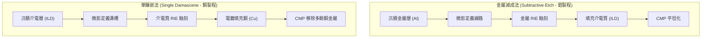

#### 鑲嵌製程的核心優勢

1.  **規避金屬蝕刻**：將挑戰從「蝕刻金屬」轉移到「蝕刻介電質」。二氧化矽或低介電常數材料（Low-k）的 RIE 技術非常成熟（見第 19 章）。
2.  **平坦化控制**：鑲嵌製程極度依賴化學機械研磨（CMP）。透過 CMP 移除溝槽外多餘的金屬，可以獲得極佳的表面平坦度，這對於後續多層互連（Multi-level Interconnect）的微影對準至關重要。
3.  **結構完整性**：在鑲嵌結構中，金屬線被包裹在介電質槽位內，配合適當的阻絕層（Barrier），能有效抑制銅原子的橫向擴散。

#### 雙鑲嵌（Dual Damascene）的演進

在實際量產中，為了提高生產效率並減少介面電阻，工程師進一步發展出「雙鑲嵌製程」。其特點是在同一個金屬填充步驟中，同時完成下層的通孔（Via）與上層的溝槽（Trench）。這種方法減少了製程步驟，並消除了通孔與導線之間的物理界面，從而提升了可靠度。

!!! warning "常見誤解：銅導線不需要阻絕層"
    初學者常認為銅的導電性好，直接填入即可。事實上，銅與介電層的附著力極差，且極易擴散進入矽基板導致元件失效（即「銅污染」）。因此，在所有銅鑲嵌製程中，沉積銅之前必須先沉積一層薄薄的擴散阻絕層（如 $Ta/TaN$），這雖然會略微增加總電阻，卻是製程整合中不可或缺的保險。

截至撰寫時，銅雙鑲嵌製程已成為 BEOL 的標準架構，支撐著從 180nm 到最先進節點的互連網路。隨後的章節將詳細討論實現此架構的關鍵技術：擴散阻絕層沉積、電鍍銅填充以及 CMP 平坦化。

## 29.2 雙鑲嵌製程架構與整合流程

在銅互連技術中，「鑲嵌」（Damascene）一詞源於古代大馬士革的工藝技術，意指將貴金屬嵌入預先刻好的凹槽中。由於銅（Cu）難以透過傳統的反應離子蝕刻（Reactive Ion Etching, RIE）進行圖案化（見第 19 章，銅的鹵化物揮發性極低），業界改採「先蝕刻介電質溝槽，再填充金屬」的策略。

### 單鑲嵌與雙鑲嵌之比較

單鑲嵌（Single Damascene）製程在每一層金屬互連中，將通孔（Via）與溝槽（Trench）分開處理。每完成一層通孔或一層導線，都需要經歷一次完整的微影、蝕刻、金屬沉積與化學機械研磨（CMP）。

雙鑲嵌（Dual Damascene）製程則是在沉積金屬前，先在層間介電質（Inter-layer Dielectric, ILD）中同時完成通孔與溝槽的蝕刻，隨後僅需一次電鍍填充與一次 CMP 研磨，即可同時形成垂直的通孔與水平的導線。

| 比較項目 | 單鑲嵌 (Single Damascene) | 雙鑲嵌 (Dual Damascene) |
| :--- | :--- | :--- |
| **製程步驟** | 較多（通孔與溝槽分開執行） | 較少（通孔與溝槽同時電鍍/研磨） |
| **CMP 次數** | 2 次（1 次通孔，1 次導線） | 1 次 |
| **成本** | 較高 | 較低（減少約 20%~30% 成本） |
| **介面電阻** | 通孔與導線間存在物理介面 | 通孔與導線為一體成型，介面電阻較低 |
| **應用範圍** | 接觸孔（Contact）或極細微間距層 | 截至撰寫時，主流後段製程（BEOL）之標準架構 |

### 雙鑲嵌三大主流整合架構

雙鑲嵌製程的核心挑戰在於如何在同一層介電質中，精確定義出兩種不同深度的圖案。根據微影與蝕刻的先後順序，主要分為以下三種架構：

#### 1. 通孔優先（Via-First）
這是目前業界最廣泛採用的方案。其流程如下：
1. 沉積層間介電質（ILD）與蝕刻停止層（Etch Stop Layer, ESL）。
2. 進行通孔微影與蝕刻，蝕刻深度通常穿透 ILD 直達下層的 ESL。
3. 填充有機平坦化層（Organic Planarization Layer, OPL）或底層抗反射塗層（BARC），以填滿通孔並平坦化表面。
4. 進行溝槽微影。
5. 進行溝槽蝕刻，此時通孔內的填充物可保護通孔底部，避免過度蝕刻（Over-etch）損傷下層導線。
6. 去除光阻與填充材料，完成雙鑲嵌結構。

#### 2. 溝槽優先（Trench-First）
先定義溝槽，再於溝槽底部定義通孔。此方法的主要缺點在於通孔微影必須在已具有高度起伏（Topography）的溝槽表面進行，導致焦深（Depth of Focus, DOF）控制極為困難，且光阻在溝槽邊緣容易產生堆積，影響解析度。因此，在先進製程中較少採用。

#### 3. 埋入式蝕刻停止層（Buried Etch Stop Layer）
在沉積 ILD 的過程中，預先在中間層加入一層極薄的氮化矽（SiN）或碳化矽（SiC）作為蝕刻停止層。
- **優點**：能精確控制溝槽深度，減少因電漿蝕刻速率不均導致的深度差異。
- **缺點**：額外的 ESL 會增加整體的有效介電常數（$k_{eff}$），導致 RC 延遲增加（見第 30 章）。

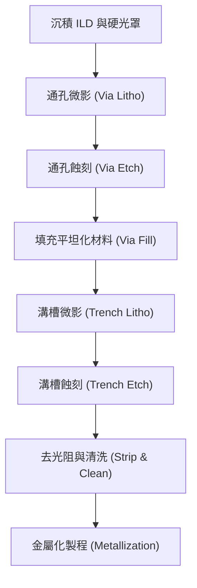

### 高深寬比結構之微影與整合挑戰

隨著製程微縮至 5nm 甚至更先進節點，雙鑲嵌製程面臨嚴峻的幾何挑戰：

#### 疊對誤差（Overlay Error）
通孔與溝槽之間的對準精度至關重要。若溝槽與通孔發生位移（Misalignment），會導致通孔與上方導線的接觸面積減少，增加電阻，甚至產生漏電路徑。截至撰寫時，先進製程多採用「自對準蝕刻停止層」（Self-Aligned Via, SAV）技術，利用材料間的蝕刻選擇比來放寬對微影對準的要求。

#### 殘留光阻填孔（Via Fill）與平坦化層
在「通孔優先」架構中，溝槽微影前必須將已蝕刻好的通孔填滿。若填充材料（如 BARC 或 SOC）在通孔底部產生氣泡（Void），溝槽蝕刻時的高能離子會擊穿通孔底部，損傷下層金屬。此外，填充材料的平坦化程度直接影響溝槽微影的關鍵尺寸（CD）控制。

!!! note "光阻殘留與「圍欄」效應 (Fence Formation)"
    若通孔填充材料與 ILD 側壁之間的化學性質不相容，在去光阻步驟後，通孔邊緣常會殘留聚合物（Polymer），形成類似「圍欄」的結構。這些殘留物會阻礙後續擴散阻絕層（Barrier）的連續性，導致電鍍銅時產生空洞。

### 介電質蝕刻輪廓控制與終點偵測

雙鑲嵌蝕刻屬於高深寬比（High Aspect Ratio, HAR）蝕刻範疇，其物理化學機制極為複雜。

#### 微溝槽效應（Micro-trenching）
在溝槽蝕刻過程中，入射離子與側壁發生碰撞並反射至溝槽底部邊角，導致邊角的蝕刻速率高於中心，形成類似「牛角」狀的下凹輪廓。這會導致金屬填充後，在邊角處產生應力集中，進而引發可靠度問題。

#### 蝕刻終點偵測（End-Point Detection, EPD）
為了精確停止在 ESL 層，蝕刻機台通常配備光學發射光譜（Optical Emission Spectroscopy, OES）。當蝕刻穿透氧化層（SiO2 或 Low-k）並觸及 ESL（如 SiN）時，電漿中特定波長的化學物種濃度會發生劇烈變化（例如氮原子或氰基 CN 的光譜強度上升）。

$$I_{\lambda}(t) = \int S(\lambda, t) d\lambda$$

其中 $I_{\lambda}$ 為特定波長的發射強度。透過監控 $dI/dt$ 的斜率變化，系統可在數毫秒內判定蝕刻終點，確保過度蝕刻量控制在 5% 以內。

### 整合流程中的關鍵參數

在雙鑲嵌整合中，必須嚴格監控以下物理量：
1. **深寬比（Aspect Ratio, AR）**：$AR = H/W$，其中 $H$ 為深度，$W$ 為寬度。當 $AR > 5$ 時，離子傳輸受限（Ion Shadowing），蝕刻速率會顯著下降（見第 19 章 RIE Lag）。
2. **側壁粗糙度（Sidewall Roughness）**：過高的粗糙度會導致擴散阻絕層覆蓋不均，進而引發銅原子向介電質擴散導致失效。
3. **關鍵尺寸偏差（CD Bias）**：微影定義的尺寸與最終蝕刻後尺寸的差異，需透過補償模型進行修正。

!!! warning "低介電常數材料的脆弱性"
    先進製程使用的 Low-k 介電質（如多孔性 SiCOH）機械強度極低且易受電漿損傷（Plasma Damage）。在雙鑲嵌蝕刻與去光阻過程中，若氧電漿處理不當，會導致 Low-k 材料表面的碳流失，使其 $k$ 值升高，失去低延遲優勢。

截至撰寫時，隨著電晶體密度持續增加，傳統雙鑲嵌製程在最底層金屬（M0/M1）已面臨極限。部分先進邏輯晶片開始探討採用「直接金屬蝕刻」（Direct Metal Etch）或「減成法銅製程」的可能性，但在多數互連層中，雙鑲嵌架構憑藉其成本與成熟度，仍是 BEOL 的核心製程。

<!-- fig:1 -->
<figure markdown>
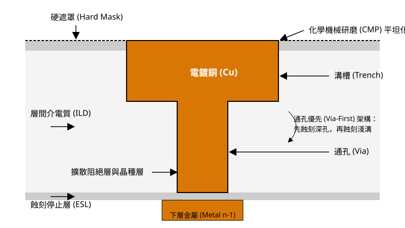
<figcaption>圖 29-1　雙鑲嵌結構剖面圖（AI 繪製的示意圖）</figcaption>
</figure>

## 29.3 擴散阻絕層與銅晶種層之沉積

在銅雙鑲嵌（Dual Damascene）製程中，由於銅原子與介電材料及矽基板之間存在高度的不相容性，無法直接將銅填入溝槽或通孔內。在進行電鍍銅（Electroplating）之前，必須先利用物理或化學氣相沉積技術，在特徵尺寸（Feature size）內壁依序鋪設「擴散阻絕層」（Diffusion Barrier Layer）與「銅晶種層」（Copper Seed Layer）。這兩層薄膜的品質直接決定了後續電鍍的填孔能力、導線的電阻值以及元件的長期可靠度。

### 銅原子的擴散機制與危害

銅在半導體材料中被視為一種嚴重的污染源（Killer Impurity）。與鋁（Al）不同，銅原子在二氧化矽（$SiO_2$）及低介電常數（Low-k）材料中的擴散係數極高。

#### 間隙式擴散與深能階缺陷
在單晶矽中，銅原子主要以間隙式（Interstitial）機制進行擴散。由於銅原子的離子半徑較小且電負度特性，使其能輕易穿過矽晶格的空隙。擴散係數 $D$ 遵循阿瑞尼斯方程式（Arrhenius Equation）：

$$D = D_0 \exp\left( -\frac{E_a}{kT} \right)$$

其中，$D_0$ 為頻率因子，$E_a$ 為擴散活化能（Activation Energy），$k$ 為波茲曼常數，$T$ 為絕對溫度。銅在矽中的 $E_a$ 典型值約為 0.43 eV，遠低於其他金屬。

一旦銅原子進入矽基板，會形成深能階缺陷（Deep-level Defects），在能帶間隙（Band gap）中產生陷阱位準（Trap levels）。這些陷阱會成為載子的重合中心（Recombination center），導致少數載子壽命（Minority carrier lifetime）大幅縮短，進而引發接面漏電流（Junction leakage）劇增，甚至導致電晶體失效（見第 2 章）。

#### 電場誘發之飄移破壞
在後段製程（BEOL）的層間介電層（ILD）中，銅不僅會因熱能擴散，更會受電場驅動產生離子飄移（Drift）。當導線間存在電位差時，銅原子易氧化成 $Cu^+$ 離子並向負極飄移，滲透進入介電層。這會導致介電層的絕緣性能退化，最終引發隨時間變化的介電質擊穿（Time-Dependent Dielectric Breakdown, TDDB）。因此，必須在銅與介電層之間建立一道連續且緻密的阻絕層。

### 擴散阻絕層：Ta/TaN 雙層膜系統

截至撰寫時，業界主流的阻絕層材料系統為鉭（Tantalum, Ta）與氮化鉭（Tantalum Nitride, TaN）的組合。

#### TaN 的阻絕功能
氮化鉭（TaN）主要負責與介電層接觸。其優點在於：
1. **化學穩定性**：TaN 與 $SiO_2$ 或 Low-k 材料有良好的附著力（Adhesion）。
2. **非晶質結構**：透過控制氮氣流量，沉積出的 TaN 趨向於非晶質（Amorphous）或奈米晶體結構。由於缺乏連續的晶界（Grain boundary），能有效阻斷銅原子沿著晶界擴散的路徑。

#### Ta 的晶相誘導功能
在 TaN 之上通常會再沉積一層純鉭（Ta）。Ta 層的作用是作為銅晶種層的過渡層。鉭金屬存在兩種主要的晶相：
*   **$\alpha$-Ta**：體心立方結構（BCC），電阻率較低（典型值約 15-30 $\mu\Omega \cdot cm$）。
*   **$\beta$-Ta**：正方晶系結構（Tetragonal），電阻率極高（典型值約 150-200 $\mu\Omega \cdot cm$）。

在製程中，目標是獲得 $\alpha$-Ta，因為它能誘導後續沉積的銅晶種層呈現 (111) 優選取向。銅 (111) 晶面具有最高的原子堆積密度，能顯著提升抗電遷移（Electromigration）能力（見 29.5 節）。

### 薄膜沉積技術與覆蓋率挑戰

隨著元件特徵尺寸微縮至奈米等級，溝槽與通孔的深寬比（Aspect Ratio, AR）劇增，傳統的物理氣相沉積（PVD）面臨嚴峻的階梯覆蓋率（Step Coverage）挑戰。

#### 離子化物理氣相沉積（iPVD）
為了改善孔底覆蓋率，製程採用離子化物理氣相沉積（Ionized PVD）。其原理是在靶材與晶圓之間導入高密度電漿，使濺鍍出來的金屬原子電離成正離子。透過在晶圓端施加射頻偏壓（RF Bias），利用電場加速金屬離子，使其以接近垂直的角度進入高深寬比的孔洞底部。

#### 原子層沉積（ALD）的導入
當技術節點微縮至 5nm 以下，即使是 iPVD 也難以在極細的通孔側壁維持連續且足夠薄的阻絕層（過厚的阻絕層會壓縮銅導線空間，導致電阻急升）。原子層沉積（ALD）技術（見第 23 章）因其自我限制（Self-limiting）反應特性，能提供近乎 100% 的階梯覆蓋率，成為先進製程中 TaN 沉積的關鍵技術。然而，ALD Ta 膜的電阻率控制與前驅物殘留仍是整合上的難題。

### 銅晶種層之沉積與缺陷防治

在阻絕層完成後，需沉積一層連續的銅晶種層（Cu Seed Layer），作為後續電鍍製程的導電電極。

#### 懸垂（Overhang）與連續性要求
銅晶種層通常採用 PVD 沉積。在高深寬比結構中，金屬原子容易在孔洞開口處堆積，形成「懸垂」（Overhang）現象。
*   **危害**：過大的懸垂會遮蔽孔洞內部，導致電鍍液進入困難，或在電鍍過程中提早封口，形成內部空洞（Void）。
*   **連續性**：若側壁晶種層過薄而不連續（Discontinuous），電鍍時會因局部電場不均導致填孔失效。

#### 再潤濕（Reflow）技術
為了解決高深寬比下的覆蓋問題，部分製程導入「再潤濕」技術。在沉積完銅晶種層後，於不破壞真空的情況下進行原位（In-situ）加熱。利用銅原子在該厚度下的表面擴散特性，使開口處的銅原子向孔洞內部流動，從而消除懸垂並補足側壁的不連續處。

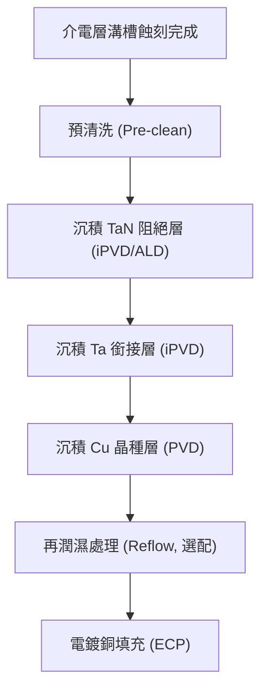

!!! note "阻絕層厚度與導線電阻的權衡"
    在先進節點中，導線寬度可能僅剩 10-20 nm。由於阻絕層（Ta/TaN）的電阻率遠高於銅，若阻絕層厚度維持不變，會嚴重佔據導線截面積，導致有效電阻率（Effective Resistivity）因尺寸效應（Size Effect）而飆升。因此，開發極薄（< 2nm）且具備高度完整性的阻絕層是目前 BEOL 製程的核心挑戰之一。

### 阻絕層與晶種層的結構分布

典型的雙鑲嵌結構內壁層疊如下表所示：

| 層別 | 主要材料 | 典型厚度範圍 | 主要功能 |
| :--- | :--- | :--- | :--- |
| **阻絕層 (Barrier)** | TaN | 1 - 3 nm | 防止 Cu 擴散，提供與介電層的附著力 |
| **銜接層 (Liner)** | Ta | 1 - 3 nm | 誘導 Cu (111) 晶向，提升附著力 |
| **晶種層 (Seed)** | Cu | 5 - 30 nm | 提供電鍍所需導電層，確保填孔完整性 |

!!! example "產業實例"
    在 7nm 及更先進的製程節點中，部分廠商開始嘗試導入鈷（Cobalt, Co）或釕（Ruthenium, Ru）作為阻絕層或直接取代部分銅導線。鈷與釕對銅具有更好的潤濕性（Wetting），能使銅晶種層在更薄的情況下保持連續，甚至在某些結構中可省略 Ta 銜接層，直接在 Co 上進行銅電鍍，以擴大銅導線的有效截面積。

## 29.4 電化學沉積（電鍍銅）原理與微觀填充

在銅雙鑲嵌製程中，電化學沉積（Electrochemical Deposition, ECD），俗稱電鍍銅，是填滿導線溝槽（Trench）與通孔（Via）的核心技術。相較於物理氣相沉積（PVD）或化學氣相沉積（CVD），電鍍技術具備高沉積速率、低成本以及優異的孔洞填充能力。然而，要在奈米級的高深寬比（Aspect Ratio, AR）結構中實現無縫隙（Void-free）填充，必須精確控制電解液中的化學添加劑動力學。

### 電化學沉積基本原理與法拉第定律

電鍍銅是一個將電能轉化為化學能的電解過程。在電鍍槽中，晶圓作為陰極（Cathode），銅金屬塊或含磷銅球作為陽極（Anode），兩者浸泡在含有硫酸銅（$CuSO_4$）與硫酸（$H_2SO_4$）的酸性電解液中。

其基本電極反應如下：
*   **陰極反應（還原）：** $Cu^{2+} + 2e^- \rightarrow Cu$
*   **陽極反應（氧化）：** $Cu \rightarrow Cu^{2+} + 2e^-$

根據法拉第定律（Faraday's Law），沉積在晶圓表面的銅質量 $m$ 與通過的總電量 $Q$ 成正比：

$$m = \frac{Q \cdot M}{n \cdot F} = \frac{(I \cdot t) \cdot M}{n \cdot F}$$

其中：
*   $m$：沉積金屬的質量（g）。
*   $I$：電流（A）。
*   $t$：電鍍時間（s）。
*   $M$：銅的原子量（約 63.55 g/mol）。
*   $n$：反應中的電子轉移數（對於 $Cu^{2+}$，$n=2$）。
*   $F$：法拉第常數（約 96485 C/mol）。

在實際製程中，電流效率（Current Efficiency）通常接近 100%，但必須嚴格控制電流密度（Current Density, $J$），以確保薄膜的均勻性與微結構品質。

### 微觀填充動力學：從共形到超填充

在微米或奈米級的特徵尺寸下，若採用傳統的共形沉積（Conformal Deposition），即孔洞側壁與底部以相同速率生長，會導致開口處過早封閉，進而在結構中心留下空洞（Void）。為了達成無縫填充，製程必須實現「由底向上填充」（Bottom-up Fill），又稱為「超填充」（Superfilling）。

超填充的物理基礎在於利用化學添加劑人為地改變局部電流密度，使孔洞底部的沉積速率遠高於場域（Field）表面與孔洞頂部。

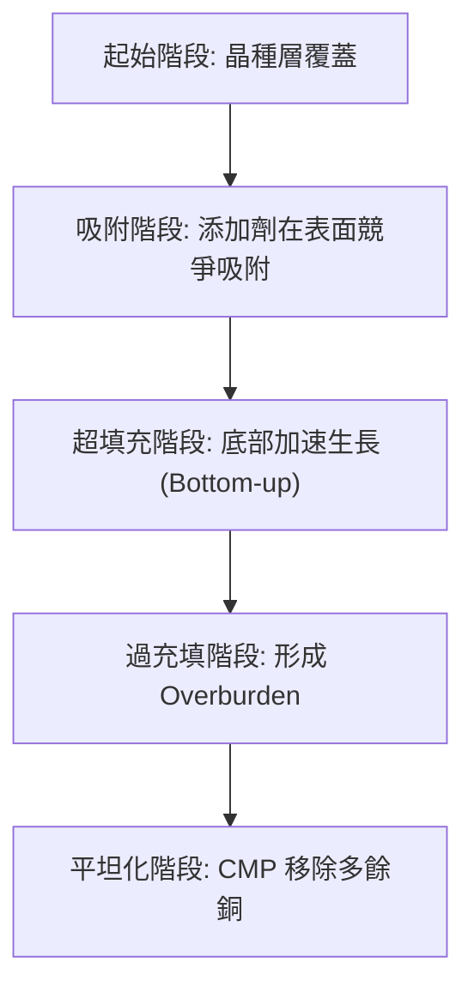

### 三元添加劑系統之協同作用

電鍍液中除了主成分硫酸銅與硫酸外，還包含極少量的有機添加劑，通常分為抑制劑、加速劑與整平劑。這三者的擴散速率與吸附特性差異，是達成超填充的關鍵。

#### 1. 抑制劑 (Suppressor)
通常為高分子聚合物，如聚乙二醇（Polyethylene Glycol, PEG）。
*   **作用機制：** 抑制劑分子量大，擴散速率慢，容易吸附在晶圓表面的場域區與孔洞開口處。它與氯離子（$Cl^-$）協同作用，在銅表面形成一層緻密的鈍化層，增加電荷轉移阻力，進而抑制該處的銅離子還原速率。
*   **物理效應：** 確保電流不會過度集中在開口處，防止「懸邊」（Overhang）效應導致孔洞提前封口。

#### 2. 加速劑 (Accelerator)
通常為含硫的小分子有機物，如雙(3-磺酸丙基)二硫化物（Bis(3-sulfopropyl) disulfide, SPS）。
*   **作用機制：** 加速劑分子量小，擴散能力強，能滲透至孔洞底部。它能置換掉部分的抑制劑，降低電化學反應的過電位（Overpotential），提升局部電流密度。
*   **曲率增強加速劑覆蓋模型（CEAC Model）：** 當孔洞底部因沉積而縮小時，吸附在底部的加速劑因表面積減少而發生「濃縮」效應（Crowding effect），使其濃度進一步提升，導致底部生長速率呈非線性加速。

#### 3. 整平劑 (Leveler)
通常為含氮的長鏈分子或表面活性劑。
*   **作用機制：** 整平劑帶有正電荷，容易吸附在電流密度較高的突起部位（如孔洞邊角）。其主要作用是抑制過度生長，防止在超填充末期於孔洞上方形成明顯的突起（Mounding）。

### 沉積後金屬退火與微結構演進

電鍍完成後的銅膜處於亞穩態（Metastable state），其晶粒極小（典型值小於 0.1 $\mu m$），且內部含有大量的位錯（Dislocation）與有機雜質殘留。

#### 自發性室溫再結晶 (Self-annealing)
截至撰寫時，電鍍銅薄膜在室溫下會發生緩慢的晶粒成長，稱為「自發性退火」。這會導致薄膜電阻率在數小時至數天內逐漸下降。然而，這種不穩定的變化不利於製程控制，因此必須引入人工熱退火。

#### 熱退火處理 (Thermal Anneal)
在電鍍後進行快速熱處理（RTP，見第 27 章），通常溫度範圍在 150°C 至 400°C 之間。
*   **晶粒粗化：** 透過熱能驅動晶界遷移，小晶粒合併為大晶粒（典型值可達數微米），減少晶界散射（Grain boundary scattering）。
*   **電阻率降低：** 銅的塊材電阻率約為 1.67 $\mu \Omega \cdot cm$，剛電鍍完的薄膜電阻率可能高達 2.0 $\mu \Omega \cdot cm$ 以上，退火後可接近理論值。
*   **應力釋放：** 調整薄膜內應力，防止後續製程中產生應力誘發空洞（Stress-induced voiding）。

### 過充填層之化學機械研磨與控制

電鍍製程為了確保所有不同尺寸的孔洞皆能填滿，會刻意沉積超出溝槽深度的銅，稱為過充填層（Overburden）。這些多餘的金屬必須透過化學機械研磨（CMP，見第 24 章）移除。

在銅 CMP 製程中，兩個主要的挑戰是：
1.  **凹陷（Dishing）：** 在寬導線區域，由於銅質地較軟且研磨墊（Pad）具有彈性變形，導線中心會被過度研磨，導致表面低於介電層平面。這會減少導線截面積，增加電阻。
2.  **侵蝕（Erosion）：** 在高密度細導線區，介電層與銅會同時被過度磨損，導致局部高度下降。

!!! note "製程整合重點"
    為了減少 Dishing，電鍍製程必須透過整平劑（Leveler）儘可能降低 Overburden 的表面起伏，使 CMP 進入平坦化階段時有更好的起始條件。

### 總結與後續

電化學沉積成功解決了銅導線無法透過乾式蝕刻成型的難題，並透過添加劑系統達成了極高深寬比的填充。然而，隨著製程節點微縮至 3nm 以下，銅導線的表面散射與界面電遷移問題日益嚴重，這促使業界開始研發如鈷（Co）、釕（Ru）等新一代導線材料，相關內容將在第 31 章詳細討論。而在完成本章所述之雙鑲嵌結構後，如何降低層間介電質的電容值以優化 RC 延遲，則是第 30 章的重點。

<!-- fig:2 -->
<figure markdown>
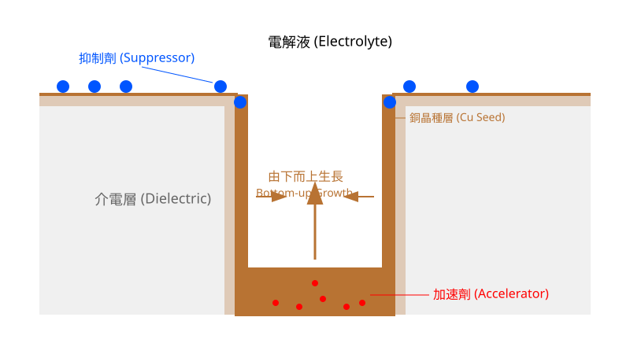
<figcaption>圖 29-2　銅電鍍超填充機制（AI 繪製的示意圖）</figcaption>
</figure>

## 29.5 電遷移機制與互連可靠度

在銅雙鑲嵌製程中，可靠度（Reliability）的評估是決定互連架構能否進入量產的關鍵。隨著元件微縮至奈米尺度，導線的電流密度（Current Density）劇增，導致金屬原子在電場與熱應力作用下發生位移，最終引發斷路或短路。本節將深入探討電遷移（Electromigration, EM）與應力誘發空孔形成（Stress-Induced Voiding, SIV）的物理機制與改善方案。

### 電遷移之微觀驅動力

電遷移是指在強大電流驅動下，金屬原子受電子撞擊而產生的質量傳輸（Mass Transport）現象。在微觀尺度下，作用於金屬離子上的力主要由兩個相反的向量組成：

1.  **直接靜電力（Direct Force, $F_{dir}$）**：導線內部的電場對帶正電的金屬離子產生的靜電吸引力，方向指向陰極（Cathode）。
2.  **電子風力（Electron Wind Force, $F_{wind}$）**：高速流動的傳導電子與金屬離子發生非彈性碰撞，將動量傳遞給離子，推動其向陽極（Anode）移動。

金屬原子受到的淨力 $F_{net}$ 可表示為：

$$F_{net} = F_{dir} + F_{wind} = (Z_{dir} + Z_{wind}) eE = Z^* eE$$

其中：
- $e$ 為電子電量。
- $E$ 為電場強度。
- $Z^*$ 稱為有效電荷數（Effective Charge Number）。

在良好的導體（如鋁或銅）中，電子風力 $F_{wind}$ 的強度遠大於直接靜電力 $F_{dir}$，因此金屬原子會沿著電子流的方向（即從陰極向陽極）移動。當原子在陰極端流失且無法得到補充時，會形成空孔（Void）；而在陽極端累積過多原子時，則會產生擠出（Hillock），可能刺穿介電層導致相鄰導線短路。

### 布萊克方程式與壽命評估

為了預測互連導線在實際工作條件下的使用壽命，工業界普遍採用布萊克方程式（Black's Equation）來計算中位故障時間（Median Time to Failure, MTTF）：

$$MTTF = A \cdot J^{-n} \cdot \exp\left( \frac{E_a}{k_B T} \right)$$

各參數物理意義如下：
- $A$：與導線幾何結構、材料特性相關的常數。
- $J$：電流密度（單位：$A/cm^2$）。
- $n$：電流密度指數。典型值在 $1$ 到 $2$ 之間。當 $n=1$ 時，失效機制受控於空孔成長（Void Growth）；當 $n=2$ 時，則受控於空孔成核（Void Nucleation）。
- $E_a$：電遷移活化能（Activation Energy），反映原子擴散的難易程度。
- $k_B$：波茲曼常數（Boltzmann Constant，$8.617 \times 10^{-5} \text{ eV/K}$）。
- $T$：導線的絕對溫度（需考慮焦耳熱效應產生的溫升）。

在研發階段，工程師會進行加速壽命測試（Accelerated Life Testing, ALT），在高溫（如 $250^\circ C$ 至 $350^\circ C$）與高電流密度下強迫元件失效，再透過阿瑞尼斯圖（Arrhenius Plot）線性回推，估算元件在正常工作溫度（如 $105^\circ C$）下是否能滿足 10 年以上的可靠度要求。

### 銅互連的原子擴散路徑

金屬原子的擴散路徑決定了 $E_a$ 的數值。在傳統鋁製程中，擴散主要發生在晶界（Grain Boundary）；但在銅雙鑲嵌結構中，由於銅與周圍材料的界面特性，擴散路徑更為複雜：

1.  **銅/介電保護層界面（Cu/Dielectric Cap Interface）**：這是銅互連中最薄弱的環節。由於銅與氮化矽（$SiN_x$）或碳氮化矽（$SiCN$）的鍵結力較弱，此界面的擴散活化能最低（典型值約 $0.8 \text{ eV}$ 至 $1.0 \text{ eV}$），是電遷移失效的主要路徑。
2.  **晶界擴散（Grain Boundary Diffusion）**：活化能約 $1.2 \text{ eV}$。大晶粒結構能有效減少晶界數量，提升抗電遷移能力。
3.  **晶粒內部擴散（Bulk/Lattice Diffusion）**：活化能最高（約 $2.3 \text{ eV}$），在正常工作溫度下幾乎可以忽略。

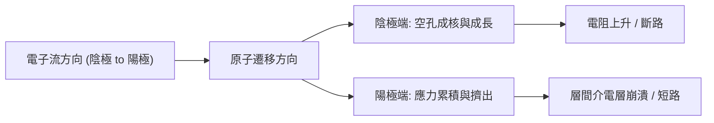

### 應力誘發空孔形成（SIV）

應力誘發空孔形成（Stress-Induced Voiding, SIV）是一種不需外加電流、純粹由熱機械應力（Thermomechanical Stress）驅動的失效機制。

其物理根源在於金屬銅（熱膨脹係數 $CTE \approx 17 \text{ ppm/}^\circ C$）與介電層（如二氧化矽 $CTE \approx 0.5 \text{ ppm/}^\circ C$）之間的熱膨脹係數嚴重失配。當晶圓從電鍍銅後的高溫退火步驟冷卻至室溫時，銅導線會受到強大的拉伸應力（Tensile Stress）。為了釋放能量，導線內部的過飽和空孔（Vacancies）會向應力集中的區域擴散並聚集，最終在通孔（Via）下方形成巨大的空孔。

!!! warning "常見誤解"
    SIV 與 EM 的失效表現相似，但驅動力完全不同。SIV 主要發生在高溫儲存（High-Temperature Storage）過程中，且失效點通常集中在寬導線下方的窄通孔處，這是因為寬導線提供了大量的空孔來源。

### 提升電遷移抗性之界面工程

為了因應先進製程（如 5nm 及更先進節點）中極高的電流密度需求，單純依靠傳統的 $SiCN$ 保護層已不足以抑制界面擴散。截至撰寫時，業界主要採用以下兩種策略提升可靠度：

#### 1. 金屬覆蓋層（Metal Capping）
在化學機械研磨（CMP）後，於銅導線頂部選擇性地沉積一層薄金屬，如鈷（Cobalt, Co）或釕（Ruthenium, Ru）。金屬與金屬間的鍵結力遠強於金屬與介電質，能顯著提高界面擴散的活化能 $E_a$，將 EM 壽命提升 10 倍以上。

#### 2. 合金化摻雜技術（Cu Alloying）
在電鍍過程中或透過晶種層（Seed Layer）摻入少量雜質，如錳（Mn）或鋁（Al）。這些雜質原子會偏析（Segregate）到銅的表面或晶界，形成穩定的化合物，起到「釘紮」（Pinning）作用，阻礙銅原子的移動。

| 改善技術 | 機制 | 優點 | 挑戰 |
| :--- | :--- | :--- | :--- |
| **Co Capping** | 強化頂部界面鍵結 | 大幅提升 EM 壽命 | 需選擇性沉積，避免短路 |
| **Cu-Mn 合金** | 形成自組裝阻絕層 | 改善底部與側壁可靠度 | 略微增加導線電阻 |
| **大晶粒退火** | 減少晶界路徑 | 降低整體擴散速率 | 增加熱預算（Thermal Budget） |

### 產業實例：先進節點的可靠度挑戰

截至撰寫時，在 3nm 與 2nm 節點中，傳統的銅雙鑲嵌製程面臨嚴峻挑戰。隨著線寬縮減至 $20 \text{ nm}$ 以下，阻絕層（Barrier）佔據了過多的空間，導致有效導電截面積縮小，電流密度飆升。

!!! note "說明"
    在台積電（TSMC）與三星（Samsung）的先進邏輯製程中，為了維持可靠度，已開始在底層金屬（M0/M1）導入釕（Ru）等無阻絕層金屬（Barrierless Metal）或採用鈷互連。雖然銅仍是中後段（MINT/Mx）的主力，但其界面工程已演進至極其複雜的多層結構，以確保在極端操作條件下不發生電遷移失效。

總結而言，電遷移與應力誘發空孔是銅互連製程中最核心的可靠度議題。透過對界面物理的深入理解與材料創新（如 Co/Ru Capping），半導體製程得以在不斷微縮的同時，維持電子產品長期的運作穩定性。後續關於低介電常數材料對應力分佈的影響，將在第 30 章進一步討論。

## 29.6 設備與廠商技術

在銅雙鑲嵌（Copper Dual Damascene）製程中，由於銅無法透過反應離子蝕刻（RIE）進行有效圖案化，製程邏輯由傳統的「金屬沉積後蝕刻」轉變為「介電質蝕刻後填充」。這一轉變使得製程設備必須高度整合物理氣相沉積（PVD）、原子層沉積（ALD）、電化學沉積（ECD）以及化學機械研磨（CMP）。截至撰寫時，先進邏輯節點（如 3nm、2nm 及更先進節點）對於薄膜連續性與填充無縫隙（Void-free）的要求已達原子級精度。

### 29.6.1 阻絕層與晶種層沉積設備：叢集式系統

為了防止銅原子擴散至介電層導致元件失效（見第 29.5 節），必須在溝槽與通孔內壁先沉積阻絕層（Barrier Layer，如 Ta/TaN）與晶種層（Seed Layer）。由於這些薄膜極易氧化，量產設備採用真空互鎖型（Vacuum Interlock）的叢集式系統（Cluster Tool），確保晶圓在不同反應腔體間傳輸時不接觸大氣。

1. **預清洗模組（Pre-clean Module）**：利用反應性離子清洗（Reactive Pre-clean）或遠端電漿（Remote Plasma）去除溝槽底部的氧化物與殘留物，確保接觸電阻（Contact Resistance）最小化。
2. **PVD/ALD 整合腔體**：
    *   **阻絕層**：傳統採用離子化物理氣相沉積（Ionized PVD），透過高偏壓導引金屬離子進入高深寬比（High Aspect Ratio, HAR）結構。然而，截至撰寫時，隨著特徵尺寸縮小，ALD 技術因其優異的階梯覆蓋率（Step Coverage），在超薄阻絕層的應用比例逐年增加。
    *   **晶種層**：通常採用 PVD 沉積一層連續且均勻的薄銅層，作為後續電鍍製程的導電電極。設備需具備低溫冷卻靜電吸盤（ESC），以抑制銅原子的表面擴散與凝聚。

### 29.6.2 電化學沉積（ECD）設備架構

電鍍銅設備的核心在於如何在大尺寸晶圓（300mm）上實現微觀結構的由下而上（Bottom-up）填充。量產型設備普遍採用「杯狀噴流式」（Fountain-Plater）反應槽。

#### 核心子系統與原理

*   **杯狀反應槽（Plating Cup）**：晶圓面朝下（Face-down）浸入電解液中。電解液由底部中心向上噴流，透過流體力學設計確保化學物質（如銅離子與添加劑）在晶圓表面的邊界層（Boundary Layer）厚度均勻。
*   **邊緣排除接觸環（Edge Exclusion Contact Ring）**：此為 ECD 設備的關鍵部件。它具備兩個功能：第一，提供陰極電流至晶圓邊緣的銅晶種層；第二，透過密封設計防止電解液接觸晶圓背面與極邊緣區域，避免金屬污染。
*   **動態電解液管理系統（Dynamic Electrolyte Management）**：
    *   **添加劑監控**：即時監測抑制劑（Suppressor）、加速劑（Accelerator）與平坦劑（Leveler）的濃度。
    *   **多陽極設計**：先進設備採用多重分區陽極（Multi-zone Anode），藉由調整各區電流比例，補償因晶種層電阻導致的電位降（Terminal Effect），提升整面均勻性。

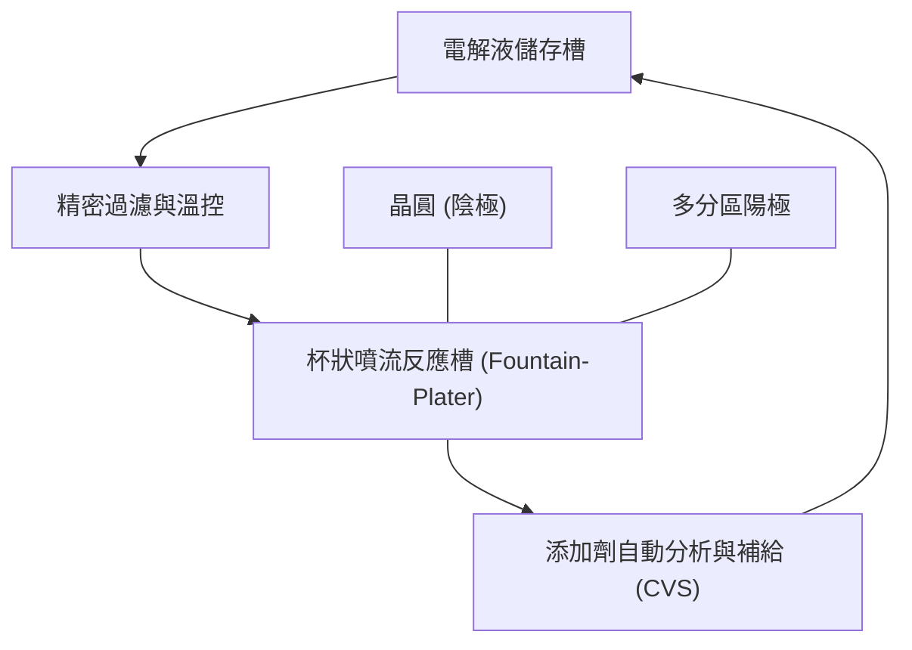

### 29.6.3 銅 CMP 研磨設備與後清洗模組

銅雙鑲嵌製程的最後一步是移除多餘的塊材銅（Bulk Copper）與阻絕層，並達成全局平坦化。

1. **多研磨區壓力控制（Multi-zone Pressure Control）**：
   研磨頭（Polishing Head）內部通常分為 5 至 7 個獨立氣壓區，能針對晶圓中心與邊緣的移除速率進行動態補償，將晶圓內不均勻性（WIWNU）降至最低。
2. **研磨液（Slurry）化學轉換**：
   銅 CMP 涉及複雜的化學反應。研磨液中的氧化劑（如 $H_2O_2$）將金屬銅氧化為銅離子或氫氧化銅，隨後螯合劑（Chelating Agent）與其反應形成易移除的錯合物。
3. **後清洗模組（Post-CMP Clean）**：
   研磨後表面留有大量的磨料顆粒、金屬離子與有機殘留。設備整合了雙面刷洗（Double-sided Brush Scrub）、高頻超音波（Megasonic）以及藥水清洗模組。截至撰寫時，為了防止銅線在乾燥過程中發生腐蝕（Corrosion）或產生水痕（Watermark），設備多採用異丙醇（IPA）蒸汽乾燥技術。

### 29.6.4 產業實例與廠商技術比較

在先進製程中，設備的選擇取決於其對缺陷控制（Defect Control）的能力以及對新材料（如低介電常數材料，見第 30 章）的機械應力相容性。

| 廠商 | 代表產品系列 | 技術路線與特點 | 主要應用 |
| :--- | :--- | :--- | :--- |
| Applied Materials | Endura 平台系列 | 整合 PVD/ALD 與去氣（Degas）模組，具備優異的真空維持能力與薄膜應力控制。 | 阻絕層與晶種層沉積 |
| Lam Research | SABRE 系列 | 採用多腔體並行處理，具備精密的添加劑流場控制與邊緣排除技術。 | 銅電鍍（ECD） |
| Applied Materials | Reflexion LK Prime | 整合多個研磨台與後清洗模組，支援即時終點偵測（In-situ Endpoint Detection）。 | 銅與阻絕層 CMP |
| Ebara | F-REX 系列 | 採用線性或旋轉式研磨技術，強調高產出與低壓力研磨以保護低介電材料。 | 銅與阻絕層 CMP |
| Tokyo Electron | CELLESTA 系列 | 專精於單晶圓清洗，提供高效能的化學藥水回收與表面去污乾燥技術。 | CMP 後清洗與濕式處理 |

#### 技術取捨與選機考量

*   **整合程度**：Applied Materials 的 Endura 平台強項在於「All-in-one」的真空整合，能將預清洗、阻絕層與晶種層在同一個真空環境下完成，這對於極紫外光（EUV）微縮下的超細微孔洞填充至關重要，因為任何氧化層都會導致填充失效。
*   **填充能力**：Lam Research 的 SABRE 系統在電鍍液的流體力學設計上有其特色，特別是在處理高深寬比結構時，能透過精確的電流波形控制（Pulsed Current）來優化由下而上的生長速率。
*   **平坦化精度**：在 CMP 階段，晶圓廠需考量研磨後的碟凹（Dishing）與侵蝕（Erosion）表現。Reflexion LK Prime 透過光學與電力偵測技術，能在不同材料界面切換時精準停止研磨，這對於維持多層互連（Multi-layer Interconnect）的阻抗一致性極為關鍵。

!!! note "設備發展趨勢"
    截至撰寫時，隨著邏輯節點進入 2nm 以下，產業開始探討將銅替換為釕（Ru）或鎢（W）的可能性（見第 31 章）。這將帶動 PVD/ALD 設備向更高溫、更具還原性的化學環境演進，同時 ECD 設備也需研發針對新金屬的電鍍液配方。

!!! warning "常見誤解"
    工程師常誤認為電鍍銅是「填滿」溝槽。實際上，若無添加劑的協同作用，電鍍會在開口處堆積較快，導致中心形成空洞。設備的價值不僅在於機械結構，更在於其對電化學反應動力學（Reaction Kinetics）的精確調控。

## 本章重點

*   **互連線材質轉變**：隨著製程微縮，鋁導線因電阻率較高且抗電遷移能力不足，逐漸被銅取代，以緩解 RC 延遲與熱耗散瓶頸。
*   **鑲嵌製程邏輯**：由於銅的鹵化物揮發性極低，無法採用傳統的減成法蝕刻，改採「先蝕刻介電質溝槽、再填充金屬」的鑲嵌（Damascene）架構。
*   **雙鑲嵌架構優勢**：雙鑲嵌製程透過一次電鍍與一次 CMP 同時形成通孔與導線，相較於單鑲嵌製程，能顯著減少製程步驟、降低成本並減少介面電阻。
*   **擴散阻絕層之必要性**：銅原子在矽與介電質中擴散速率極快，會造成元件失效，因此必須在沉積銅前先鋪設 Ta/TaN 等擴散阻絕層。
*   **超填充（Superfilling）機制**：電鍍銅製程利用抑制劑、加速劑與整平劑的濃度分佈差異，實現由底向上的無縫填充，避免高深寬比結構產生空洞。
*   **可靠度挑戰**：電遷移（EM）與應力誘發空孔（SIV）是銅互連的主要失效模式，需透過界面工程（如 Co/Ru 覆蓋層）或合金化技術提升壽命。
*   **CMP 平坦化控制**：化學機械研磨是定義銅導線圖案的關鍵，需嚴格控制凹陷（Dishing）與侵蝕（Erosion）效應，以維持多層互連的平坦度。

## 重點圖卡

複習時看這幾張就能抓住本章重點；[圖卡庫](../cards.md)可以下載成圖片。

<figure markdown>
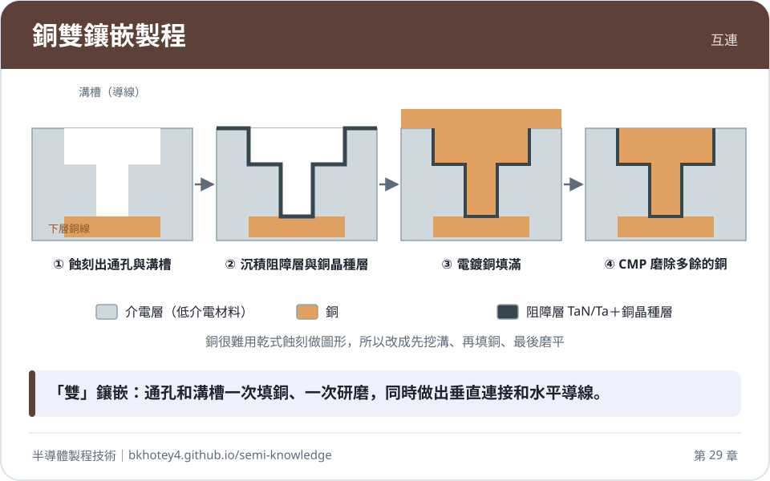
<figcaption>核心概念圖卡：銅雙鑲嵌製程</figcaption>
</figure>

<figure markdown>
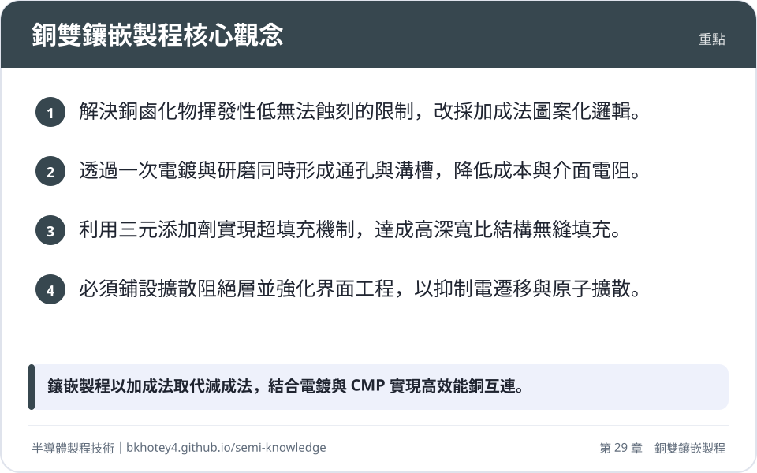
<figcaption>重點圖卡：銅雙鑲嵌製程核心觀念</figcaption>
</figure>

<figure markdown>
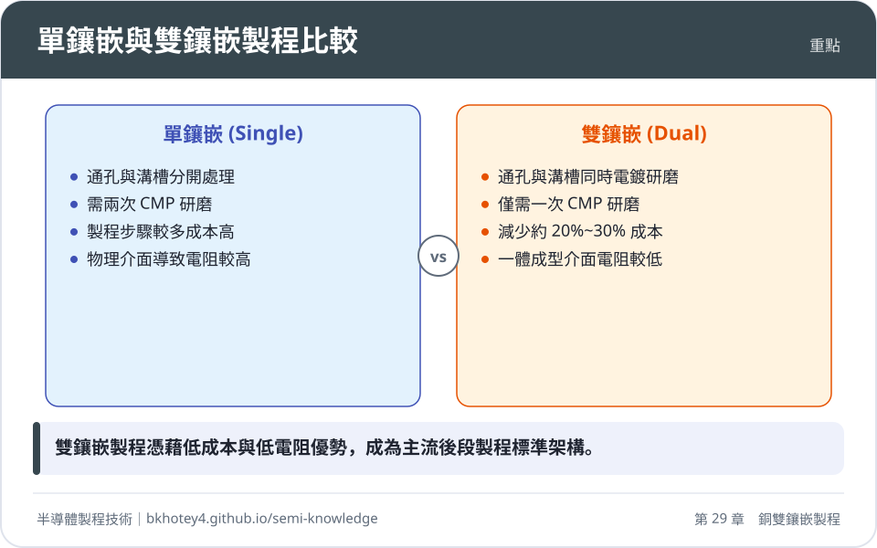
<figcaption>重點圖卡：單鑲嵌與雙鑲嵌製程比較</figcaption>
</figure>

<figure markdown>
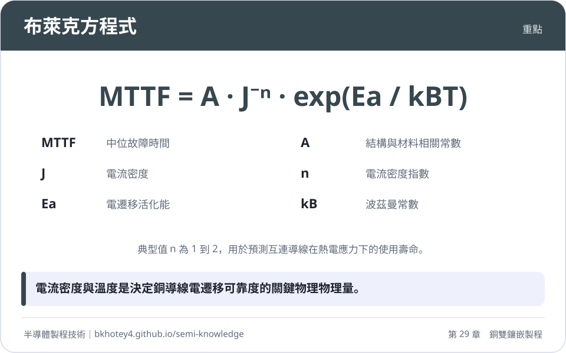
<figcaption>重點圖卡：布萊克方程式</figcaption>
</figure>

<figure markdown>
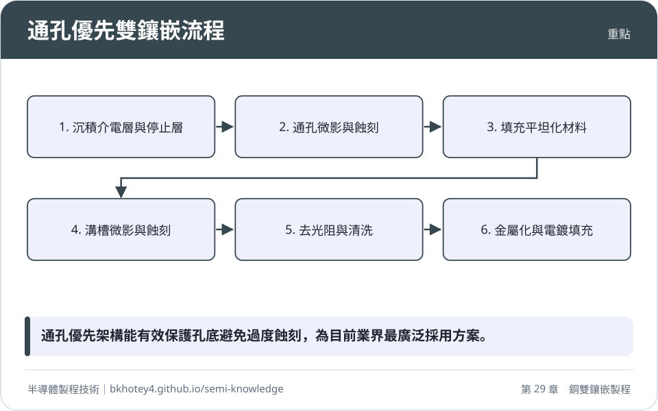
<figcaption>重點圖卡：通孔優先雙鑲嵌流程</figcaption>
</figure>

## 習題

**1.** 請由熱力學與物理性質角度，解釋為何銅製程無法沿用鋁製程的「金屬減成法（Subtractive Etch）」進行圖案化？

??? success "參考解答"
    主要原因有二：
    1. 副產物揮發性極低：鋁蝕刻產生的 $AlCl_3$ 在低溫下具高蒸氣壓易揮發，但銅與氯氣反應生成的 $CuCl_x$ 在 200°C 以下幾乎不揮發。
    2. 擴散污染與熱預算衝突：若要強制使 $CuCl_x$ 揮發，蝕刻溫度需升至 250°C 以上，此高溫會導致光阻碳化失效，且加劇銅原子擴散進入矽基板，破壞電晶體特性。

**2.** 假設一條銅導線長度 $L = 100\ \mu m$，寬度 $w = 20\ nm$，高度 $h = 40\ nm$，銅的電阻率 $\rho = 1.7\ \mu\Omega\cdot cm$。若相鄰導線間距 $s = 20\ nm$，層間介電質之相對介電常數 $\kappa = 2.5$（真空電容率 $\epsilon_0 = 8.854 \times 10^{-12}\ F/m$），請估算該導線的 RC 延遲時間常數 $\tau$。

??? success "參考解答"
    1. 計算電阻 $R$：
       $R = \rho \frac{L}{w \cdot h} = (1.7 \times 10^{-8}\ \Omega\cdot m) \frac{100 \times 10^{-6}\ m}{(20 \times 10^{-9}\ m) \cdot (40 \times 10^{-9}\ m)} = 2125\ \Omega$
    2. 計算電容 $C$：
       $C = \epsilon \frac{L \cdot h}{s} = (2.5 \cdot 8.854 \times 10^{-12}\ F/m) \frac{(100 \times 10^{-6}\ m) \cdot (40 \times 10^{-9}\ m)}{20 \times 10^{-9}\ m} = 4.427 \times 10^{-15}\ F$
    3. 時間常數 $\tau = RC = 2125 \cdot 4.427 \times 10^{-15} \approx 9.41 \times 10^{-12}\ s = 9.41\ ps$

**3.** 在電鍍銅（ECD）製程中，何謂「超填充（Superfilling）」？請說明抑制劑（Suppressor）與加速劑（Accelerator）在其中的角色。

??? success "參考解答"
    超填充是指孔洞底部的沉積速率高於場域表面的現象，以達成無縫填充。
    1. 抑制劑：分子量大、擴散慢，主要吸附在孔洞開口與場域表面，增加電荷轉移阻力，減緩該處沉積速率。
    2. 加速劑：分子量小、擴散快，能進入孔洞底部。隨著填充進行，底部表面積縮小導致加速劑濃度上升（CEAC 模型），進一步提升底部生長速率。

**4.** 根據布萊克方程式（Black's Equation），若某銅導線在 300°C 下測試的中位故障時間（MTTF）為 100 小時，活化能 $E_a = 0.9\ eV$。當工作溫度降至 105°C 時，假設電流密度不變，其預估壽命為何？（波茲曼常數 $k_B = 8.617 \times 10^{-5}\ eV/K$）

??? success "參考解答"
    根據 $MTTF \propto \exp(E_a / k_B T)$：
    1. 轉換絕對溫度：$T_1 = 300 + 273.15 = 573.15\ K$，$T_2 = 105 + 273.15 = 378.15\ K$。
    2. 比例計算：$MTTF_2 = MTTF_1 \cdot \exp[\frac{E_a}{k_B} (\frac{1}{T_2} - \frac{1}{T_1})]$
    3. 代入數值：$MTTF_2 = 100 \cdot \exp[\frac{0.9}{8.617 \times 10^{-5}} (\frac{1}{378.15} - \frac{1}{573.15})] \approx 100 \cdot \exp[10444.5 \cdot 0.0009] \approx 100 \cdot 12117 \approx 1.21 \times 10^6$ 小時。

**5.** 在雙鑲嵌製程的「通孔優先（Via-First）」架構中，為何在蝕刻溝槽前需要填充有機平坦化層（OPL/BARC）？

??? success "參考解答"
    1. 保護通孔底部：防止在溝槽蝕刻過程中，高能離子直接擊穿通孔底部的蝕刻停止層，損傷下層導線。
    2. 微影平坦化：填滿已蝕刻的通孔以提供平坦表面，避免溝槽微影時產生焦深（DOF）問題或光阻堆積。

## 本章術語

- **Dual Damascene**（雙鑲嵌）：一種同時形成金屬通孔與水平導線的加成法圖案化製程。
- **RC Delay**（RC 延遲）：由導線電阻與層間介電質電容乘積決定的訊號傳輸延遲。
- **Electromigration**（電遷移）：金屬原子受高電流密度下的電子風撞擊而產生的質量傳輸現象。
- **Diffusion Barrier**（擴散阻絕層）：位於銅與介電質間，用於防止銅原子滲透擴散的薄膜（如 TaN）。
- **Superfilling**（超填充）：電鍍製程中，利用添加劑使孔洞底部生長速率高於表面的現象。
- **CMP Dishing**（CMP 凹陷）：研磨過程中，寬導線中心區域被過度移除導致表面下凹的現象。
- **Black's Equation**（布萊克方程式）：用於預測金屬導線因電遷移導致失效壽命的經驗公式。
- **Seed Layer**（晶種層）：電鍍前沉積的薄金屬層，提供電化學反應所需的導電路徑。

## 互動學習

!!! tip "動手試試看"
    - [設備機台圖鑑：介電質蝕刻機、物理氣相沉積機（濺鍍）、電鍍機](../equipment.md)

## 產業最新進展

本節由每日產業新聞自動補充，說明本章技術在產業上的最新發展。

<!-- updates -->
（目前尚無補充。）
