# 第 30 章　低介電常數材料與 RC 延遲

!!! abstract "學習目標"
    - 理解互連線 RC 延遲的物理起源及其隨製程微縮對訊號傳輸速度的影響。
    - 掌握低介電常數（Low-k）材料的化學組成、極化機制與降低介電常數的物理手段。
    - 分析多孔材料與空氣間隙（Air Gap）技術在極低介電常數（ULK）需求下的實作與挑戰。
    - 探討 Low-k 材料在後段製程整合中的機械強度、熱穩定性及化學機械研磨（CMP）兼容性問題。
    - 辨識當前產業中用於沉積與處理低介電材料的主流設備技術與製程趨勢。

## 30.1 RC 延遲的物理起源與微縮挑戰

在積體電路進入深次微米（Deep Sub-micron）與奈米尺度節點後，電路效能的瓶頸已從前段製程（FEOL）的電晶體開關速度，轉移至後段製程（BEOL）的互連線（Interconnect）訊號傳輸速度。本節將從物理原理出發，探討電阻與電容如何共同決定訊號延遲，並分析微縮過程中所面臨的挑戰。

### 30.1.1 RC 延遲的物理起源

在金屬互連架構中，每一段導線都可以被視為一個由電阻（Resistance, $R$）與電容（Capacitance, $C$）構成的等效電路。當訊號（電壓脈衝）在導線中傳播時，必須先對導線本身及其周圍介電質所形成的電容進行充放電，這一過程所產生的時間延遲即稱為 RC 延遲（RC Delay）。

#### 1. 互連線電阻 $R$
根據歐姆定律與幾何結構，一條長度為 $L$、寬度為 $W$、厚度為 $H$ 的導線，其電阻值可表示為：
$$R = \rho \frac{L}{W \cdot H}$$
其中，$\rho$ 為材料的電阻率（Resistivity）。在第 29 章中已討論過，銅（Cu）由於具備較低的電阻率（典型值約為 $1.7 \times 10^{-8} \Omega \cdot m$），已全面取代鋁（Al）成為主流互連材料。然而，隨著線寬 $W$ 縮減至數十奈米以下，由於表面散射（Surface Scattering）與晶界散射（Grain Boundary Scattering）效應，導線的有效電阻率會顯著上升，導致 $R$ 的增加遠超幾何比例的預期。

#### 2. 互連線電容 $C$
互連線電容主要由兩個部分組成：導線對下方地平面的電容（Line-to-Ground Capacitance）以及相鄰並行導線之間的側向電容（Line-to-Line Capacitance，或稱側邊電容 $C_{side}$）。對於高密度佈線而言，側邊電容佔據主導地位。若兩條長度為 $L$、厚度為 $H$ 的導線，其間距為 $d$，中間填充介電常數為 $k$ 的材料，則其電容近似為：
$$C \approx \epsilon_0 k \frac{L \cdot H}{d}$$
其中，$\epsilon_0$ 為真空電容率（約 $8.854 \times 10^{-12} F/m$），$k$ 為相對介電常數（Relative Permittivity）。

#### 3. 傳播延遲 $\tau$
對於一段分佈式 RC 網路，其訊號傳播延遲 $\tau$（通常定義為電壓達到最終值 50% 或 90% 的時間）正比於 $R$ 與 $C$ 的乘積：
$$\tau \propto RC = \left( \rho \frac{L}{W \cdot H} \right) \left( \epsilon_0 k \frac{L \cdot H}{d} \right) = \frac{\rho \epsilon_0 k L^2}{W d}$$
從公式中可以觀察到一個關鍵物理特性：**互連延遲與導線長度的平方（$L^2$）成正比**。這意味著在長距離訊號傳輸中，RC 延遲將成為效能的絕對瓶頸。

### 30.1.2 微縮定律下的延遲趨勢演變

在半導體發展的早期（如 $0.5 \mu m$ 以上節點），電晶體的閘極延遲（Gate Delay）遠大於互連延遲。隨著製程節點的演進，兩者的消長呈現出截然不同的趨勢。

1.  **閘極延遲（Gate Delay, $\tau_g$）**：隨著通道長度縮短與高介電常數金屬閘極（HKMG，見第 28 章）的引入，電晶體的開關速度持續提升，$\tau_g$ 隨節點微縮而下降。
2.  **互連延遲（Interconnect Delay, $\tau_i$）**：若遵循等比例微縮（Scaling），當所有幾何尺寸（$W, H, d$）縮小為原本的 $1/S$（$S > 1$ 為微縮因子）時：
    *   單位長度電阻 $R/L$ 增加 $S^2$ 倍（截面積縮小為 $1/S^2$）。
    *   單位長度電容 $C/L$ 保持不變（$H$ 與 $d$ 同時縮小，比例抵消）。
    *   因此，對於相同長度的導線，其 RC 延遲會以 $S^2$ 的速率劇增。

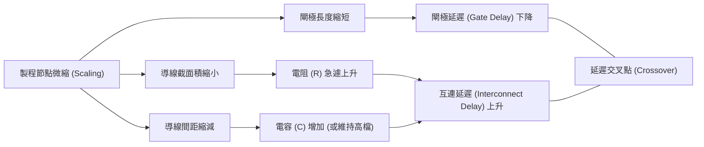

!!! note "延遲交叉點"
    根據產業歷史數據，閘極延遲與互連延遲的交叉點大約發生在 $130 nm$ 至 $90 nm$ 節點之間。在此之後，晶片設計必須投入大量資源處理後段製程的延遲問題。截至撰寫時，在 $3 nm$ 或更先進的節點中，互連延遲已佔據關鍵路徑（Critical Path）總延遲的 70% 以上。

### 30.1.3 線間串擾與動態功耗

除了訊號延遲外，電容 $C$ 的增加還會帶來另外兩個嚴重的物理問題：線間串擾（Crosstalk）與動態功耗（Dynamic Power Dissipation）。

#### 1. 線間串擾（Crosstalk）
當兩條相鄰導線（Aggressor 與 Victim）靠得極近時，側邊電容 $C_{side}$ 會產生強烈的電場耦合。當 Aggressor 線上的電壓發生快速變化（$dV/dt$）時，會透過耦合電容在 Victim 線上感應出雜訊電流。
*   **邏輯錯誤**：若雜訊振幅超過邏輯門的閾值電壓，可能導致錯誤的邏輯翻轉。
*   **米勒效應（Miller Effect）**：若兩條相鄰導線同時以相反方向切換電壓，其等效耦合電容會加倍，進一步惡化延遲。

#### 2. 動態功耗
在數位電路中，每次訊號翻轉都需要對電容進行充放電。單一互連節點的動態功耗 $P$ 可表示為：
$$P = \alpha \cdot f \cdot C \cdot V_{DD}^2$$
其中 $\alpha$ 為活動因子（Activity Factor），$f$ 為時脈頻率，$V_{DD}$ 為供應電壓。隨著晶片整合度增加，總導線長度與電容總量急遽上升，使得後段製程產生的功耗成為晶片發熱的主要來源之一。為了降低功耗，除了降低 $V_{DD}$，最有效的方法便是降低介電電容 $C$。

### 30.1.4 介電常數的物理本質與極化機制

為了減少電容，最直接的手段是降低絕緣材料的介電常數 $k$。在物理上，介電常數反映了材料在受激電場下產生極化（Polarization）的能力。

#### 1. 介電常數與極化率
介電常數 $k$ 與材料微觀的總極化率 $\alpha_{tot}$ 之間的關係可由 Clausius-Mossotti 方程式描述：
$$\frac{k - 1}{k + 2} = \frac{N \alpha_{tot}}{3 \epsilon_0}$$
其中 $N$ 為單位體積內的分子數。要降低 $k$ 值，必須減少材料的分子密度 $N$ 或降低分子的極化率 $\alpha_{tot}$。

#### 2. 材料的極化機制
材料的總極化率由以下四種物理機制組成，其對 $k$ 值的貢獻取決於電場頻率：

1.  **電子極化（Electronic Polarization）**：電場導致原子核外的電子雲產生位移。這是所有材料皆具備的基礎極化，反應速度最快（高頻下仍存在）。
2.  **離子極化（Ionic / Atomic Polarization）**：電場導致分子內正負離子（或原子）產生相對位移。在具有極性共價鍵的材料（如 $SiO_2$）中較為顯著。
3.  **取向極化（Orientational / Dipolar Polarization）**：具有永久偶極矩的分子（如水分子）隨電場方向旋轉排列。這在低頻下貢獻極大，但在 GHz 級別的電路中貢獻較小。
4.  **空間電荷極化（Space Charge Polarization）**：電荷在材料界面或缺陷處堆積形成的極化。

#### 3. 從 $SiO_2$ 到 Low-k 材料
傳統的層間介電質（Inter-layer Dielectric, ILD）使用二氧化矽（$SiO_2$），其 $k$ 值約為 $3.9$ 至 $4.2$。為了進一步降低 $k$ 值，材料科學的演進方向如下：
*   **引入低極化鍵結**：例如以氟（F）取代氧，形成氟化矽玻璃（FSG, $k \approx 3.5$），利用氟的高電負度降低電子極化率。
*   **引入碳與氫**：以碳摻雜氧化矽（SiCOH），利用 $Si-CH_3$ 鍵取代 $Si-O$ 鍵。由於 $Si-C$ 鍵的極化率較低，且甲基（Methyl group）體積較大可增加自由體積（Free volume），使 $k$ 值降至 $2.5$ 至 $3.0$。
*   **引入孔洞（Porosity）**：由於空氣的 $k$ 值接近 $1.0$，在材料中刻意製造奈米級孔洞是達到 $k < 2.5$（極低介電常數，Ultra Low-k, ULK）的必經之路。

!!! warning "常見誤解"
    工程師常誤以為只要換上 Low-k 材料就能解決所有 RC 問題。事實上，降低 $k$ 值雖然減少了 $C$，但 Low-k 材料通常伴隨著較差的熱傳導率（Thermal Conductivity）與機械強度。這意味著導線產生的熱能更難散發，且在化學機械研磨（CMP）製程中極易發生層間剝離（Delamination），這是製程整合上的巨大挑戰。

截至撰寫時，主流先進製程已普遍採用 $k$ 值在 $2.4$ 至 $2.7$ 之間的多孔性 SiCOH 材料，而研究方向正朝向 $k < 2.0$ 的材料以及空氣間隙（Air Gap）技術邁進，以應對 $2 nm$ 以下節點更為嚴苛的延遲要求。

<!-- fig:1 -->
<figure markdown>
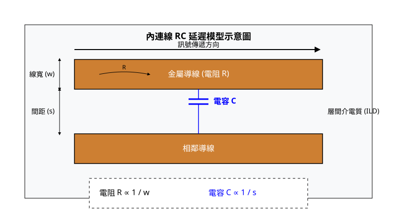
<figcaption>圖 30-1　內連線 RC 延遲模型（AI 繪製的示意圖）</figcaption>
</figure>

## 30.2 低介電常數材料的演進與化學特性

在積體電路進入深次微米（Deep Sub-micron）節點後，金屬導線間的電容效應成為限制元件速度的主要瓶頸。為了降低電阻電容延遲（RC Delay），除了在第 29 章討論的導體材料由鋁（Al）轉向銅（Cu）外，絕緣介電材料的演進同樣至關重要。本節將探討低介電常數（Low-k）材料從傳統二氧化矽演進至碳摻雜氧化矽的化學原理與物理特性。

### 30.2.1 從二氧化矽到摻氟氧化矽 (FSG)

在 0.25 微米製程節點之前，熱氧化或化學氣相沉積（CVD）生成的二氧化矽（$SiO_2$）是標準的層間絕緣膜（Inter-metal Dielectric, IMD）。$SiO_2$ 具有優異的熱穩定性、機械強度以及與矽基板良好的介面特性，其介電常數 $k$ 值約為 3.9 至 4.2。

然而，隨著導線間距縮小，$SiO_2$ 的高介電常數導致線間電容過大。為了在不改變基本製程架構的前提下降低 $k$ 值，業界首先引入了摻氟氧化矽（Fluorinated Silicate Glass, FSG，或稱 SiOF）。

**1. 降低介電常數的原理**
介電常數由材料內部的極化能力決定。氟（F）是週期表中電負度最強的元素，將氟原子引入 $SiO_2$ 網絡中，會產生以下效應：
*   **取代極性鍵結**：氟原子取代了 $SiO_2$ 中的部分氧原子，形成 $Si-F$ 鍵。由於 $Si-F$ 鍵的極化率低於 $Si-O$ 鍵，且氟原子的強電負度會抑制周圍電子的移動性，進而降低了電子極化（Electronic Polarization）與離子極化（Ionic Polarization）。
*   **結構疏鬆化**：氟原子的引入會終止部分矽氧網絡的連結，使微觀結構變得較為疏鬆，降低了單位體積內的偶極子密度。

**2. FSG 的特性與限制**
FSG 的典型 $k$ 值約在 3.5 至 3.7 之間。雖然相較於 $SiO_2$ 有所下降，但 FSG 存在顯著的缺點：
*   **吸濕性（Moisture Absorption）**：$Si-F$ 鍵容易與水氣反應生成氫氟酸（HF），這不僅會腐蝕金屬導線，還會導致 $k$ 值因水分（$k \approx 80$）進入而大幅回升。
*   **穩定性問題**：在高溫製程中，氟原子容易擴散（Out-gassing），影響與金屬層的黏著力。因此，FSG 僅作為過渡性材料，在 $k < 3.0$ 的需求下顯得力不從心。

### 30.2.2 碳摻雜氧化矽 (SiCOH) 的分子結構與極化理論

為了達成 $k < 3.0$ 的目標，業界發展出碳摻雜氧化矽（Carbon-Doped Oxide, CDO），其化學組成通常表示為 $SiC_xO_yH_z$，學術與產業實務上常稱為 SiCOH 或有機矽酸鹽玻璃（Organosilicate Glass, OSG）。

**1. 結構設計：引入甲基 ($-CH_3$)**
SiCOH 的核心思想是在 $Si-O$ 的無機網絡中引入有機基團（通常是甲基）。這種結構變革帶來了兩個關鍵影響：
*   **降低偶極極化（Dipole Polarization）**：$Si-CH_3$ 鍵的偶極矩（Dipole Moment）遠低於 $Si-OH$ 或 $Si-O$ 鍵。透過減少高極性鍵結的比例，材料在電場下的感應極化程度降低。
*   **增加自由體積（Free Volume）**：甲基基團具有較大的空間位阻（Steric Hindrance），會阻礙 $Si-O$ 網絡形成緻密的結構。這些「空間」本質上是充滿空氣（$k \approx 1.0$）的微小空隙，從物理層面降低了整體的平均介電常數。

**2. 介電常數與極化機制的物理模型**
材料的總極化率 $\alpha_{total}$ 可表示為：
$$\alpha_{total} = \alpha_e + \alpha_i + \alpha_d$$
其中：
*   $\alpha_e$：電子極化（由電子雲相對原子核位移引起）。
*   $\alpha_i$：離子極化（由正負離子相對位移引起）。
*   $\alpha_d$：偶極極化（由永久偶極在電場下轉向引起）。

SiCOH 藉由碳與氫的引入，同時抑制了這三種機制，特別是透過降低材料密度來減少單位體積內的極化貢獻。

### 30.2.3 介電常數、折射率與密度的經驗公式

在製程監控中，直接測量薄膜的 $k$ 值（通常使用汞探針或電容-電壓測量）較為耗時。工程上常利用光學折射率（Refractive Index, $n$）與 $k$ 值之間的相關性來進行快速評估。

**1. 麥克斯韋關係式 (Maxwell's Relation)**
在光學頻率下（約 $10^{14}$ Hz），離子極化與偶極極化無法跟上電場變化，此時介電常數 $\epsilon_r$ 與折射率 $n$ 存在以下關係：
$$\epsilon_r \approx n^2$$
對於 Low-k 材料，雖然實際運作頻率（GHz 等級）遠低於光頻，但 $n^2$ 仍能反映出電子極化的貢獻，是 $k$ 值的重要指標。典型 SiCOH 的折射率約在 1.3 至 1.45 之間，低於 $SiO_2$ 的 1.46。

**2. 克勞修斯-莫索提公式 (Clausius-Mossotti Equation)**
為了描述密度 $\rho$ 與介電常數的關係，可引用克勞修斯-莫索提公式：
$$\frac{k - 1}{k + 2} = \frac{N\alpha}{3\epsilon_0} = \frac{\rho \cdot N_A \cdot \alpha}{3M\epsilon_0}$$
其中：
*   $N$ 為單位體積分子數。
*   $\alpha$ 為分子極化率。
*   $M$ 為分子量。
*   $\epsilon_0$ 為真空電容率。

由公式可知，$k$ 值與密度 $\rho$ 呈正相關。這解釋了為何開發 Low-k 材料的核心策略之一就是「降低材料密度」。

### 30.2.4 有機聚合物與無機矽酸鹽類材料之比較

在 Low-k 技術發展初期，曾存在兩大陣營：有機聚合物（Organic Polymers）與無機矽酸鹽（Inorganic-based Silicates）。

| 特性 | 有機聚合物 (如 Polyimides, BCB) | 無機/混合類 (如 SiCOH, MSQ) |
| :--- | :--- | :--- |
| **介電常數 (k)** | 較低 (典型值 2.2 - 2.8) | 中等 (典型值 2.5 - 3.0) |
| **熱穩定性** | 較差 (通常 < 400°C) | 優異 (可耐 450°C 以上) |
| **機械強度** | 具彈性但硬度低，抗壓性差 | 較脆但硬度較高，適合 CMP |
| **熱膨脹係數 (CTE)** | 與銅/矽差異大，易分層 | 較接近矽基板 |
| **製程相容性** | 難以與傳統氧化物蝕刻製程整合 | 與 $SiO_2$ 製程高度相容 |

!!! note "技術主流的選擇"
    儘管有機聚合物擁有極低的 $k$ 值，但由於其熱膨脹係數與金屬差異過大，且在後續的化學機械研磨（CMP）製程中容易發生剝落（Delamination），截至撰寫時，主流邏輯晶片製程仍以 SiCOH 這類「類氧化物」結構的材料為主，因為其在機械強度與介電特性之間取得了較好的平衡。

### 30.2.5 SiCOH 的沉積方式：CVD 與 Spin-on

SiCOH 材料主要透過兩種物理化學路徑製備：

1.  **化學氣相沉積 (PECVD)**：
    *   使用有機矽前驅物（如 Trimethylsilane, 3MS 或 Tetramethylcyclotetrasiloxane, TMCTS）。
    *   透過電漿輔助使前驅物解離並在晶圓表面重新聚合。
    *   **優點**：薄膜緻密性較好，與現有設備相容性高。

2.  **旋塗式介電材 (Spin-on Dielectric, SOD)**：
    *   將前驅物溶解於溶劑中，利用旋塗機均勻塗佈於晶圓，再進行烘烤與固化（Curing）。
    *   常見材料包括倍半矽氧烷（Silsesquioxanes, 如 MSQ）。
    *   **優點**：容易形成多孔結構以進一步降低 $k$ 值，但機械強度通常較 CVD 薄膜弱。

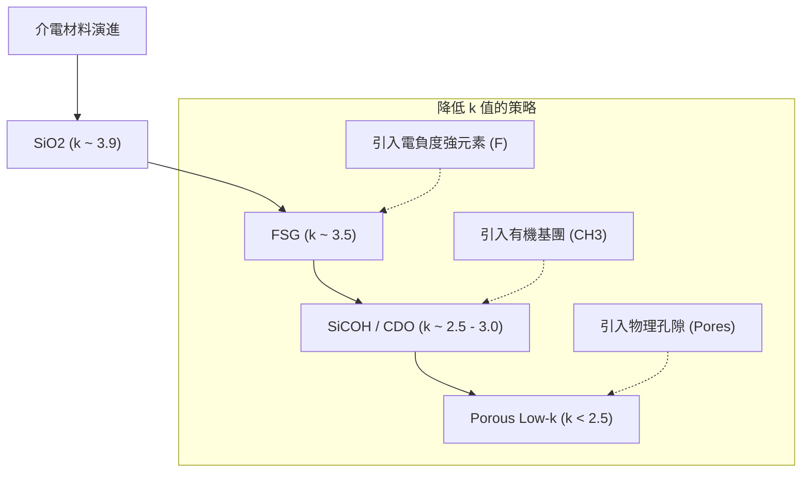

!!! example "產業實例"
    在 45 奈米至 7 奈米節點，應用材料（Applied Materials）開發的 **Black Diamond** 系列與科林研發（Lam Research）的 **Coral** 系列是市場上最具代表性的 CVD Low-k 沉積技術。這些技術透過精確控制前驅物流量與電漿功率，將 SiCOH 的 $k$ 值穩定控制在 2.5 至 2.6 左右，並確保薄膜能承受多次的 CMP 壓力與高溫退火。

隨著製程節點向 3 奈米及以下微縮，單純依靠化學組成的改變已難以滿足 $k$ 值進一步下降的要求，這促使了多孔結構（Porous Low-k）與空氣間隙（Air Gap）技術的誕生，相關細節將在第 30.3 節詳細討論。

## 30.3 多孔材料與空氣間隙技術

在互連技術進入奈米尺度後，單純依靠低介電常數（Low-k）材料的化學成分改質（如從 $\text{SiO}_2$ 轉向摻碳氧化矽 SiCOH）已逐漸無法滿足國際元件路徑圖（IRDS）對於電容降低的要求。為了進一步追求極低介電常數（Ultra Low-k, ULK，典型值 $k < 2.5$），製程技術必須在固態介質中引入「孔隙」（Porosity），利用空氣極低的介電常數（$k \approx 1.0$）來降低整體的有效介電常數（Effective Dielectric Constant, $k_{eff}$）。

### 引入孔隙降低介電常數的物理機制

固體材料的介電常數主要取決於其極化率（Polarizability）與分子密度。根據克勞修斯-莫索提公式（Clausius-Mossotti Equation），介電常數 $k$ 與分子極化率 $\alpha$ 及單位體積分子數 $N$ 的關係如下：

$$\frac{k - 1}{k + 2} = \frac{N\alpha}{3\epsilon_0}$$

其中 $\epsilon_0$ 為真空電容率。在 ULK 材料的開發中，除了透過化學鍵結（如引入 C-H 鍵取代 Si-O 鍵）降低 $\alpha$ 外，最有效的方法即是減少 $N$，即引入孔隙。

若將多孔材料視為由固體基質（Matrix）與空氣組成的複合材料，其有效介電常數可用麥克斯韋-加內特公式（Maxwell-Garnett Theory）或簡單的線性混合模型估算。在孔隙率（Porosity）為 $P$ 的情況下，有效介電常數 $k_{eff}$ 大約為：

$$k_{eff} = k_{matrix} (1 - P) + k_{air} \cdot P$$

由於 $k_{air} \approx 1.0$，當孔隙率達到 25% 至 30% 時，原本 $k \approx 3.0$ 的 SiCOH 基質可降至 $k \approx 2.4$ 以下。然而，孔隙的引入會顯著犧牲材料的機械強度，這在後續的化學機械研磨（CMP，見第 24 章）與封裝製程中構成了極大挑戰。

### 多孔 ULK 材料製程：致孔劑法

目前量產中最常見的多孔 ULK 製作方式是採用化學氣相沉積（CVD，見第 21 章）結合「致孔劑」（Porogen）技術。

#### 1. 致孔劑的選用與共沉積
製程起始於將兩種前驅物（Precursor）同時注入反應室：
*   **基質前驅物（Matrix Precursor）**：通常為有機矽氧烷（Organosilane），用於形成 SiCOH 骨架。
*   **致孔劑前驅物（Porogen Precursor）**：通常為熱不穩定、易分解的有機碳氫化合物（如環狀碳氫化合物）。

在沉積過程中，致孔劑會以奈米級液滴或分子團簇的形式被包埋在 SiCOH 骨架中，形成所謂的「混合薄膜」（Hybrid Film）。

#### 2. 致孔劑的移除與固化（Curing）
沉積後的混合薄膜尚不具備低介電特性，必須透過能量激發將致孔劑分解並排出。截至撰寫時，主流技術為紫外光固化（UV Curing）。

*   **熱分解**：加熱使有機致孔劑斷鍵分解成小分子。
*   **擴散排出**：分解後的小分子透過 SiCOH 骨架的微小孔道擴散至表面並逸散。
*   **骨架強化**：UV 光不僅協助致孔劑移除，還能促進 Si-O-Si 鍵結的交聯（Cross-linking），提升材料的機械強度。

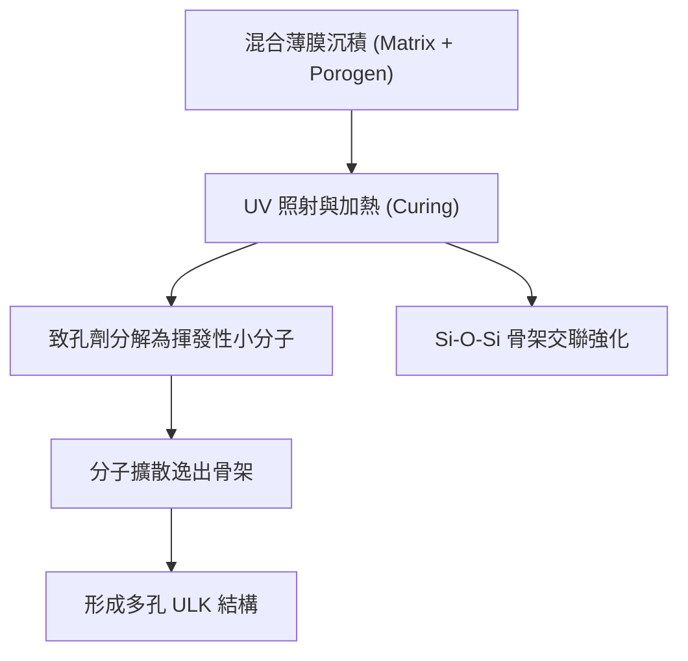

#### 3. 孔徑分佈（PSD）控制
孔隙的大小與分佈對可靠性至關重要。理想的 ULK 孔徑應小於 2 nm（微孔範圍），且呈現「閉合孔隙」（Closed Pore）狀態。若孔徑過大或形成相連的「開放孔隙」（Open Pore），在後續的導線製程中，金屬前驅物或清洗液容易滲入孔隙，導致漏電流增加或介電崩潰（Dielectric Breakdown）。

### 空氣間隙（Air Gap）技術

當元件微縮至 5 nm 節點以下，即使是多孔 ULK 材料也難以在維持機械強度的前提下進一步降低 $k$ 值。此時，「空氣間隙」（Air Gap）技術成為另一種解決方案。空氣間隙並非將整層介電層變為多孔，而是在金屬導線之間刻意製造「真空」或「空氣」填入的空腔，實現理論極限 $k \approx 1.0$。

目前實現空氣間隙的主要製程路徑有二：

#### 1. 非共形沉積法（Non-conformal Deposition）
利用 CVD 或 PVD 製程中較差的階梯覆蓋能力（Step Coverage）來製造空腔。
*   **原理**：在金屬導線蝕刻完成後，沉積覆蓋層（Capping layer）。調整製程參數（如增加沉積速率、降低離子偏壓），使開口處發生「封口」（Pinch-off）效應。
*   **特點**：製程簡單，與現有流程相容性高，但空腔的大小與形狀受導線間距（Pitch）影響極大，均勻性控制困難。

#### 2. 犧牲層法（Sacrificial Layer Method）
這是一種更精確但製程較複雜的技術。
*   **步驟**：
    1.  在導線間填入犧牲材料（如熱分解聚合物，TDP）。
    2.  沉積一層具有微孔結構或滲透性的頂層介電層（Permeable Membrane）。
    3.  進行高溫熱處理，使犧牲材料分解並透過頂層介電層擴散出去。
*   **特點**：可以精確定義空氣間隙的位置與體積，不依賴物理封口效應。

!!! note "空氣間隙的定位策略"
    空氣間隙通常不會應用於所有層別，而是優先用於電容感應最敏感的層別（如緊密間距的金屬層）。此外，為了維持結構穩定，空氣間隙通常被設計在金屬線的中段，而非緊鄰通孔（Via），以避免通孔蝕刻時發生對準偏差導致空腔暴露。

<!-- fig:2 -->
<figure markdown>
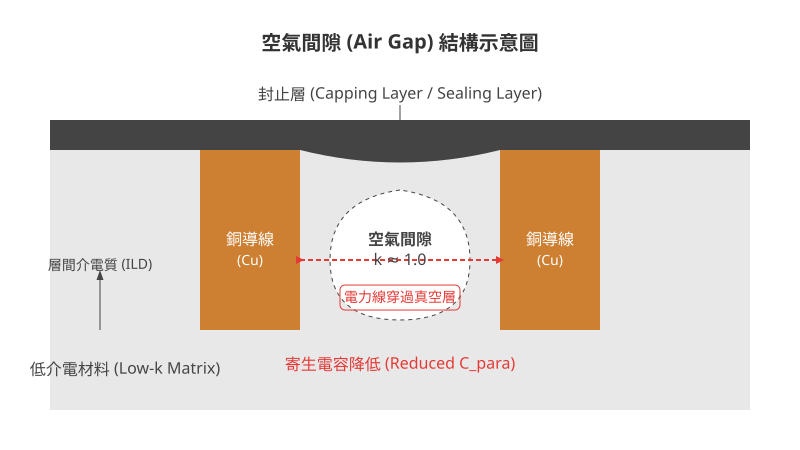
<figcaption>圖 30-2　空氣間隙結構示意圖（AI 繪製的示意圖）</figcaption>
</figure>

## 30.4 機械強度與後段製程整合挑戰

在導入低介電常數（Low-k）材料以降低 RC 延遲的過程中，半導體製程面臨了前所未有的物理與機械挑戰。隨著介電常數 $k$ 值的降低，材料的物理特性發生了根本性的變化，特別是從緻密的二氧化矽（$\text{SiO}_2$）轉向多孔性的有機矽酸鹽玻璃（OSG, Organosilicate Glass）。本節將深入探討低介電材料在機械強度、化學機械研磨（CMP）、電漿損傷以及擴散阻障層整合方面的關鍵挑戰。

### 30.4.1 機械強度與孔隙率的權衡

低介電常數材料主要透過兩種途徑降低 $k$ 值：一是引入極性較低的化學鍵（如以 $\text{Si-CH}_3$ 取代 $\text{Si-O}$），二是引入孔隙（Porosity）。然而，這兩者都會顯著削弱材料的機械強度。

#### 楊氏模數與硬度的下降
材料的機械強度通常由楊氏模數（Young's Modulus, $E$）與硬度（Hardness, $H$）來衡量。對於多孔性材料，其楊氏模數與孔隙率（$\Phi$）之間存在經驗性的指數關係：

$$E = E_0 (1 - \Phi)^n$$

其中，$E_0$ 為無孔隙時的基材楊氏模數，$n$ 為與孔隙結構相關的常數（典型值約在 2 到 4 之間）。

當 $k$ 值從傳統 $\text{SiO}_2$ 的 3.9 降至極低介電常數（ULK, Ultra Low-k）材料的 2.4 以下時，孔隙率通常需達到 25% 至 40%。這導致楊氏模數從 $\text{SiO}_2$ 的約 70 GPa 劇降至 5-10 GPa 甚至更低。

| 材料類型 | 介電常數 ($k$) | 楊氏模數 ($E$, GPa) | 硬度 ($H$, GPa) |
| :--- | :--- | :--- | :--- |
| 熱氧化矽 ($\text{SiO}_2$) | 3.9 | ~72 | ~8.0 |
| 氟化矽玻璃 (FSG) | 3.5 - 3.7 | ~60 | ~6.5 |
| 有機矽酸鹽 (SiCOH) | 2.7 - 3.0 | 10 - 20 | 1.5 - 3.0 |
| 多孔性 SiCOH (ULK) | 2.0 - 2.5 | 3 - 8 | 0.5 - 1.2 |

!!! warning "機械穩定性危機"
    極低的楊氏模數意味著材料極易變形，這在多層互連結構中會引發嚴重的可靠性問題。當晶片受到封裝應力或熱循環應力時，低強度材料可能無法支撐上方的金屬層，導致線路偏移或結構崩塌。

### 30.4.2 化學機械研磨（CMP）中的整合挑戰

在銅雙鑲嵌製程（見第 29 章）中，CMP 是實現平坦化的核心步驟。然而，Low-k 材料的脆弱性使得 CMP 製程變得極其困難。

#### 薄膜剝離與應力破裂
CMP 過程中，研磨頭會施加下壓力（Downforce）與剪切力（Shear Stress）。由於 Low-k 材料與相鄰層（如氮化矽阻障層或金屬覆蓋層）之間的黏著力（Adhesion）通常較弱，且材料本身的內聚力（Cohesion）不足，極易發生以下問題：

1.  **界面剝離（Delamination）**：應力集中在材料界面，導致 Low-k 薄膜從底層或覆蓋層上整片脫落。
2.  **裂紋擴散（Cracking）**：多孔結構中的微裂紋在研磨應力下迅速延伸，導致電性失效。
3.  **刮傷（Scratching）**：由於 Low-k 硬度極低，研磨液中的磨料顆粒極易在薄膜表面留下深層刮痕。

為了應對這些問題，製程工程師必須開發「低壓力 CMP」（Low-pressure CMP）技術，將下壓力降至 1.5 psi 以下，並優化研磨墊與研磨液的化學性質，以減少機械摩擦產生的負擔。

### 30.4.3 電漿蝕刻損傷（PID）與修復技術

在定義溝槽與通孔（Via）時，必須使用電漿蝕刻（見第 19 章）。然而，電漿中的離子轟擊與自由基反應會破壞 Low-k 材料的化學結構。

#### k 值回升現象
SiCOH 材料之所以具有低 $k$ 值，是因為其中的甲基（$-\text{CH}_3$）基團降低了材料密度並減少了極化率。在氧氣電漿去光阻（Ashing）或含氟電漿蝕刻過程中，高能自由基會與甲基反應：

$$\text{Si-CH}_3 + \text{O}^* \rightarrow \text{Si-OH} + \text{CO}_2 + \text{H}_2\text{O}$$

原本疏水的 $\text{Si-CH}_3$ 被親水的矽羥基（$-\text{Si-OH}$）取代。這些羥基會吸收環境中的水分（水的 $k \approx 80$），導致材料的有效介電常數大幅上升，失去 Low-k 的優勢。這種現象稱為「電漿誘導損傷」（Plasma Induced Damage, PID）。

#### 修復技術（k-recovery）
為了恢復受損的 $k$ 值，業界開發了多種修復製程：
1.  **矽烷化反應（Silylation）**：利用化學氣體（如六甲基二矽氮烷, HMDS）與受損表面的 $-\text{Si-OH}$ 反應，重新植入甲基基團。
2.  **UV 固化（UV Curing）**：透過特定波長的紫外線照射，促進材料內部的交聯（Cross-linking），排出水分並強化結構。

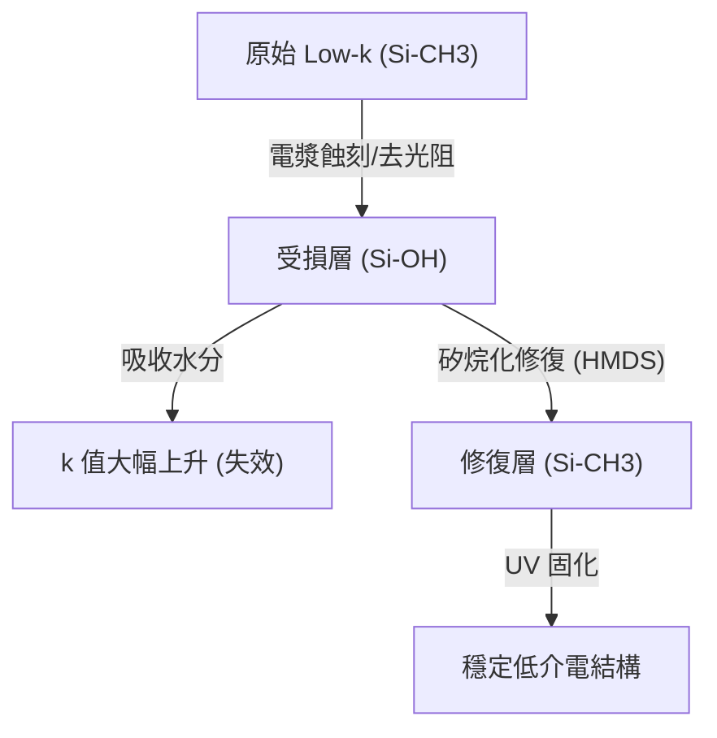

### 30.4.4 擴散阻障層在多孔結構上的挑戰

在銅製程中，必須沉積一層擴散阻障層（Barrier，通常為 $\text{Ta/TaN}$）以防止銅原子擴散進入介電層導致漏電。

#### 孔隙封孔（Pore Sealing）
當 Low-k 材料具有開放式孔隙（Open Porosity）時，沉積阻障層會面臨兩難：
1.  **物理氣相沉積（PVD）**：方向性強，難以均勻覆蓋多孔表面的微小凹陷，容易產生孔洞（Void）。
2.  **原子層沉積（ALD）**：雖然覆蓋性極佳，但前驅物氣體會滲透進 Low-k 內部的孔隙中，在介電層內部形成金屬沉積，這不僅無法阻擋擴散，反而會直接導致線路短路。

因此，在沉積阻障層之前，通常需要進行「封孔」處理。這可以透過薄薄一層非多孔性的化學氣相沉積（CVD）薄膜來實現，或者利用電漿處理在表面形成一層緻密的「表皮層」（Skin layer）。

#### 阻障層厚度微縮
隨著製程節點演進（截至撰寫時已進入 2 奈米以下研發階段），阻障層所佔據的空間必須極度壓縮，以保留足夠的空間給導電的銅金屬。然而，在多孔 Low-k 上沉積極薄（< 2 nm）且連續無孔洞的阻障層，對製程均勻性提出了極高的要求。若阻障層出現任何不連續，銅原子將在電場驅動下發生電遷移（Electromigration），滲入多孔介電層，最終導致元件崩潰。

### 30.4.5 整合流程中的熱預算限制

Low-k 材料通常含有機成分，其熱穩定性劣於傳統的 $\text{SiO}_2$。在後段製程（BEOL）中，後續的薄膜沉積或退火步驟必須嚴格控制熱預算（Thermal Budget）。

1.  **熱分解**：若溫度超過 $450^\circ\text{C}$，SiCOH 中的有機基團可能開始分解，導致材料收縮、產生裂縫或 $k$ 值改變。
2.  **熱膨脹係數（CTE）失配**：Low-k 材料的 CTE 通常與銅金屬（$\text{Cu}$）及矽基板存在顯著差異。在熱循環過程中，介面處會產生巨大的熱應力，對於機械強度本就薄弱的 Low-k 材料而言，這是引發剝離的主要誘因。

!!! note "設計規則的調整"
    為了補償 Low-k 材料的機械缺陷，電路設計端必須加入額外的限制。例如，在晶片邊緣設置「護環」（Guard Ring）以阻隔切割（Dicing）時產生的應力，或是在大面積金屬下方增加「介電質支柱」（Dummy Tiling）以強化結構支撐。

!!! example "產業實例"
    在 7 奈米與 5 奈米節點中，主流邏輯晶圓代工廠普遍採用了摻雜碳的氧化矽（Carbon-doped Oxide, CDO）作為主要絕緣材料。為了進一步降低 RC 延遲，在 3 奈米及更先進節點中，研發重點已轉向如何穩定地整合孔隙率超過 30% 的極低介電常數材料，並結合「空氣間隙」（Air Gap）技術（見 30.3 節）來達成等效 $k$ 值低於 2.0 的目標。

## 30.5 設備與廠商技術

在後段製程（BEOL）中，為了降低互連導線間的 RC 延遲，低介電常數（Low-k）材料的沉積與改質技術至關重要。本節將探討實現低介電常數薄膜的核心設備技術，包括化學氣相沉積（CVD）、旋塗式介電質（SOD）以及關鍵的紫外光固化（UV Curing）系統。

### 30.5.1 沉積設備與關鍵子系統

實現 Low-k 薄膜主要有兩條技術路徑：電漿增強化學氣相沉積（PECVD）與旋塗式製程（Spin-on Process）。

#### 1. PECVD 設備系統
PECVD 是目前量產主流，主要用於沉積摻碳氧化矽（SiCOH）薄膜。其關鍵子系統包括：
*   **氣體分配系統（Gas Delivery System）**：精確控制有機矽前驅物（Precursor，如 3MS、4MS）與致孔劑（Porogen）的流量比。
*   **射頻產生器（RF Generator）**：提供能量解離反應氣體。通常採用雙頻設計（高頻 HF 與低頻 LF），藉此調控離子轟擊能量，平衡薄膜的緻密性與應力。
*   **加熱載台（Heater/Pedestal）**：確保晶圓在沉積過程中維持在典型值 $300^\circ\text{C}$ 至 $400^\circ\text{C}$ 之間，以利化學反應進行。

#### 2. SOD 設備系統
SOD 則利用類似微影塗佈的技術（見第 11 章），將液態前驅物均勻塗佈於晶圓表面。其關鍵子系統包括：
*   **精密塗佈頭（Precision Coating Head）**：控制藥液滴下量與擴散均勻度。
*   **多級烘烤板（Multi-stage Bake Plates）**：在不同溫度下進行溶劑揮發與初步交聯（Cross-linking）。

### 30.5.2 設備廠商與技術路徑比較

下表列出目前產業中主要的 Low-k 沉積與處理設備供應商及其技術特點：

| 廠商 | 代表產品系列 | 技術路線與特點 | 主要應用 |
| :--- | :--- | :--- | :--- |
| Applied Materials | Producer 平台系列 | PECVD 技術；採用雙頻射頻控制，具備高產出之多腔體設計。 | SiCOH 與多孔 Low-k 沉積 |
| Lam Research | VECTOR 系列 | PECVD 技術；強調薄膜內應力控制與極佳的晶圓邊緣均勻度。 | 極低介電常數（ELK）薄膜沉積 |
| Tokyo Electron | CLEAN TRACK LITHIUS Pro Z | SOD 技術；精密旋塗與熱處理系統，適用於流動性介電質。 | 窄間隙填充與特定低介電材料塗佈 |

### 30.5.3 紫外光固化（UV Curing）技術

無論是 PECVD 還是 SOD 沉積的多孔 Low-k 薄膜，在沉積完成後均需經過紫外光固化處理。這是因為初始沉積的薄膜含有大量有機致孔劑，且矽氧烷網絡（Si-O-Si network）尚未完全交聯，機械強度不足。

#### 1. 物理化學機制
UV 固化系統利用特定波長（典型值為真空紫外光 VUV，波長小於 $200\,\text{nm}$）的能量來觸發以下反應：
*   **致孔劑移除**：UV 光子能量足以斷裂致孔劑中的有機鍵結，使其分解並從薄膜中擴散逸出，留下奈米級孔隙。
*   **網絡強化**：促進 Si-OH 基團縮合形成 Si-O-Si 鍵結，提升薄膜的楊氏模數（Young's Modulus）。

#### 2. 設備設計考量
UV 固化通常在真空或惰性氣體環境下進行，以防止臭氧產生或薄膜氧化。設備需精確控制照射時間與晶圓溫度，避免過度照射導致薄膜收縮或介電常數回升。

### 30.5.4 產業實例：主流 Low-k 解決方案

!!! example "產業實例：Applied Materials Black Diamond"
    Applied Materials 的 Black Diamond 系列是產業中應用最廣泛的 Low-k 方案之一。該技術在 Producer 平台上執行，透過 PECVD 沉積 SiCOH 薄膜。隨著技術演進，Black Diamond 發展出多代產品，透過調整致孔劑比例與優化 UV 固化參數，將 k 值從早期的 3.0 逐步降至 2.4 以下，同時維持足以支撐化學機械研磨（CMP）製程的機械強度。

!!! example "產業實例：Lam Research 極低介電常數方案"
    Lam Research 在其 VECTOR 平台上提供極低介電常數（ELK）薄膜技術。其特點在於對電漿環境的精確調控，確保多孔結構在薄膜內部分佈均勻，減少後續蝕刻製程（見第 19 章）中的電漿損傷（Plasma Damage），這對於維持元件的電氣特性至關重要。

### 30.5.5 先進節點的整合現況與空氣間隙（Air Gap）

截至撰寫時（2026年11月），在 $3\,\text{nm}$ 與 $2\,\text{nm}$（或 A14 節點）的邏輯製程中，單純依靠降低材料 k 值已面臨物理極限。當孔隙率過高時，薄膜的機械強度會大幅下降，導致封裝時發生分層（Delamination）風險。

#### 1. 局部空氣間隙（Local Air Gap）技術
為了在不犧牲機械強度的前提下進一步降低有效介電常數（$k_{eff}$），產業界開始導入局部空氣間隙技術。其製程流程如下：

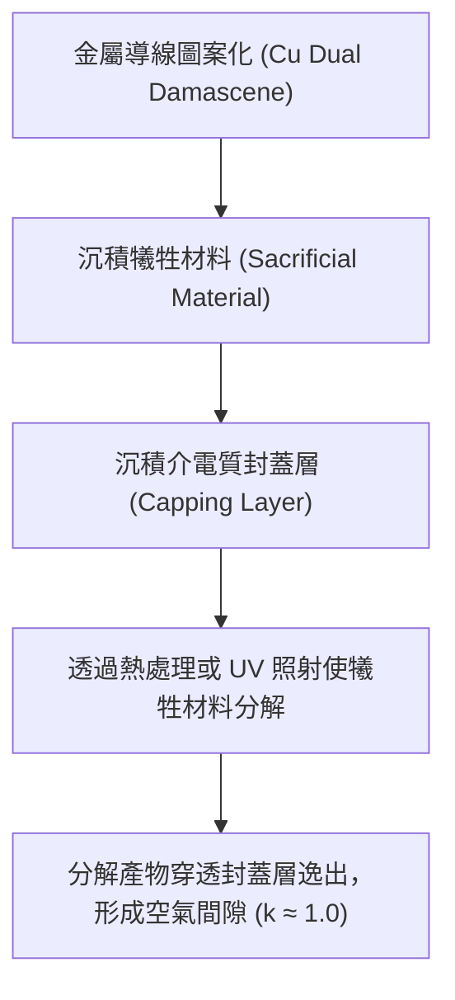

#### 2. 量產整合挑戰
截至撰寫時，空氣間隙技術主要應用於對 RC 延遲最敏感的關鍵金屬層（如 M1 至 M3）。
*   **結構支撐**：空氣間隙不能連續存在於所有區域，必須保留部分固體介電質作為結構支撐。
*   **可靠性**：必須確保空氣間隙完全密封，防止後續製程中的化學物質或水分滲入，造成導線腐蝕。

### 30.5.6 設備選機考量因素

晶圓廠在選擇 Low-k 相關設備時，通常基於以下物理與工程指標進行評估：
1.  **k 值穩定性**：薄膜在經過多次熱退火與 CMP 製程後，k 值是否能維持穩定而不上升。
2.  **機械強度（Hardness & Modulus）**：薄膜必須能承受 CMP 的剪切力（Shear Force），典型要求楊氏模數需大於 $6\,\text{GPa}$。
3.  **孔隙尺寸分佈（Pore Size Distribution）**：孔隙直徑需遠小於導線間距，以避免電場集中導致的崩潰（Breakdown）。
4.  **整合相容性**：薄膜與阻障層（Barrier Metal，如 TaN/TiN）之間的附著力（Adhesion），以及對蝕刻化學品的抗性。

隨著微縮持續推進，Low-k 材料的開發已從單一材料的演進轉向「材料與結構協同優化」（Co-optimization），這也促使設備商開發更具備原位（In-situ）處理能力的複合型機台。

## 本章重點

*   **RC 延遲的物理瓶頸**：隨著製程節點微縮，互連線電阻（$R$）因截面積縮小與散射效應上升，且線間電容（$C$）因間距縮減而增加，導致 RC 延遲取代閘極延遲成為限制晶片效能的主因。
*   **介電常數的物理本質**：材料的 $k$ 值取決於電子、離子、取向與空間電荷四種極化機制。降低 $k$ 值的核心策略在於減少材料密度（$N$）或降低分子的極化率（$\alpha$）。
*   **材料演進路徑**：層間介電質從傳統的 $\text{SiO}_2$ ($k \approx 4.0$)，演進至摻氟氧化矽 FSG ($k \approx 3.5$)，再到目前主流的碳摻雜氧化矽 SiCOH ($k \approx 2.5 \sim 3.0$)。
*   **多孔性極低介電常數材料（ULK）**：透過在 SiCOH 骨架中引入奈米級孔隙（利用空氣 $k \approx 1.0$），可將 $k$ 值降至 2.4 以下。製程上常採用致孔劑（Porogen）共沉積後，再以紫外光固化（UV Curing）將其移除。
*   **機械強度與可靠性挑戰**：Low-k 材料的楊氏模數與硬度隨孔隙率增加而劇降，導致其在化學機械研磨（CMP）製程中極易發生層間剝離（Delamination）或裂紋。
*   **電漿誘導損傷（PID）**：蝕刻與去光阻製程中的電漿會破壞 SiCOH 中的 $\text{Si-CH}_3$ 鍵結，產生親水性的 $\text{Si-OH}$ 並吸收水分，導致 $k$ 值顯著回升。
*   **空氣間隙（Air Gap）技術**：在先進節點中，透過非共形沉積或犧牲層法在導線間製造真空/空氣空腔，是達成 $k_{eff} < 2.0$ 並進一步降低電容的終極方案。

## 重點圖卡

複習時看這幾張就能抓住本章重點；[圖卡庫](../cards.md)可以下載成圖片。

<figure markdown>
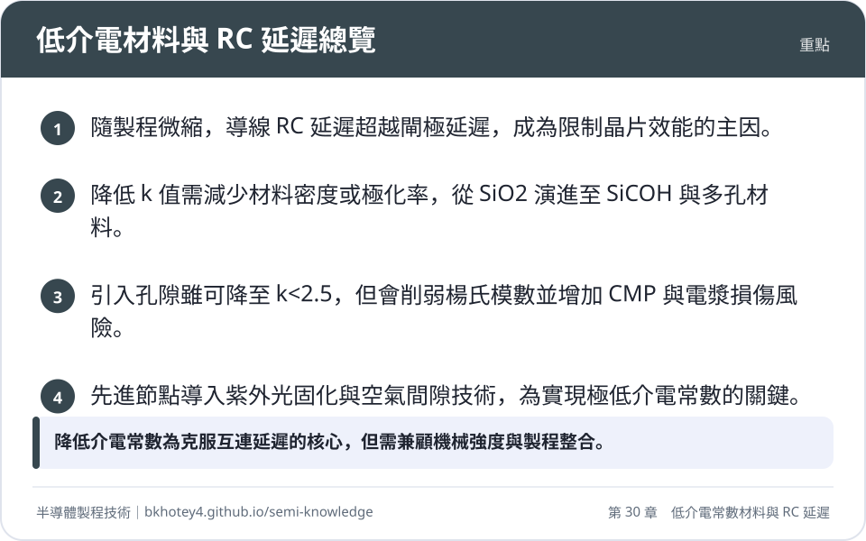
<figcaption>重點圖卡：低介電材料與 RC 延遲總覽</figcaption>
</figure>

<figure markdown>
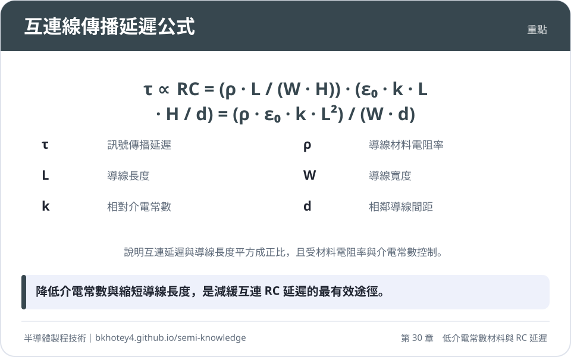
<figcaption>重點圖卡：互連線傳播延遲公式</figcaption>
</figure>

<figure markdown>
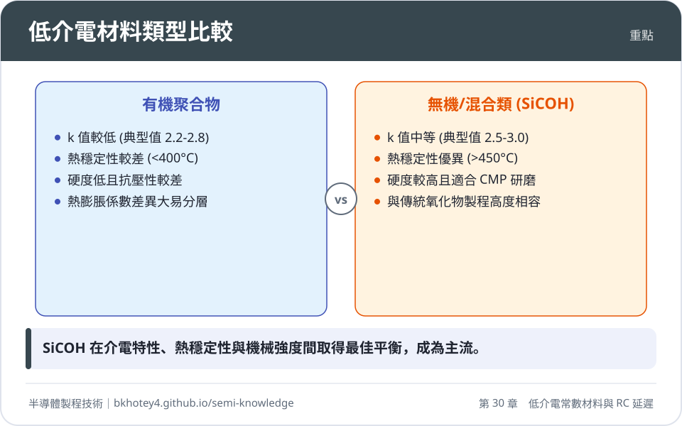
<figcaption>重點圖卡：低介電材料類型比較</figcaption>
</figure>

<figure markdown>
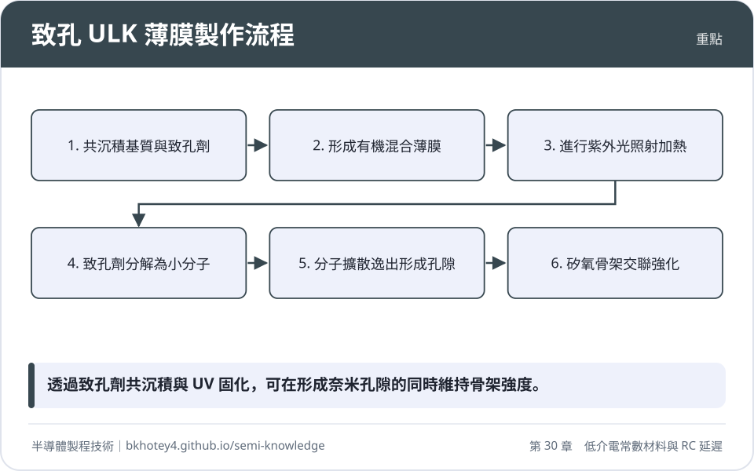
<figcaption>重點圖卡：致孔 ULK 薄膜製作流程</figcaption>
</figure>

## 習題

**1.** 試說明為何在等比例微縮（Scaling）路徑下，互連線的 RC 延遲會以微縮因子 $S$ 的平方速率增加？

??? success "參考解答"
    根據電阻公式 $R = \rho \frac{L}{W \cdot H}$ 與電容公式 $C = \epsilon \frac{L \cdot H}{d}$：
    1. 當幾何尺寸 $L, W, H, d$ 同時縮小為 $1/S$ 時：
    2. 新電阻 $R' = \rho \frac{L/S}{(W/S) \cdot (H/S)} = S \cdot R$。
    3. 新電容 $C' = \epsilon \frac{(L/S) \cdot (H/S)}{d/S} = \frac{1}{S} \cdot C$。
    4. 對於「固定長度」的導線而言，單位長度電阻增加 $S^2$ 倍（因截面積縮小為 $1/S^2$），而單位長度電容保持不變。因此，相同長度下的延遲 $\tau = R \cdot C$ 正比於 $L^2 / (W \cdot d)$，微縮後延遲增加為 $S^2$ 倍。

**2.** 某多孔性 SiCOH 材料的基質（Matrix）介電常數為 3.0，若欲達成有效介電常數 $k_{eff} = 2.4$，假設採用線性混合模型，其孔隙率（Porosity）應為多少？

??? success "參考解答"
    利用線性混合公式：$k_{eff} = k_{matrix} \cdot (1 - P) + k_{air} \cdot P$
    其中 $k_{air} \approx 1.0$，$k_{matrix} = 3.0$，$k_{eff} = 2.4$。
    $2.4 = 3.0 \cdot (1 - P) + 1.0 \cdot P$
    $2.4 = 3.0 - 3.0P + 1.0P$
    $2.0P = 0.6$
    $P = 0.3$
    因此，孔隙率應為 30%。

**3.** 試比較 PECVD 沉積 SiCOH 薄膜後，進行紫外光固化（UV Curing）處理的兩個主要物理/化學作用。

??? success "參考解答"
    1. **致孔劑移除**：UV 光子能量可斷裂薄膜中不穩定的有機致孔劑鍵結，使其分解成小分子並擴散逸出薄膜，藉此產生孔隙以降低介電常數。
    2. **骨架強化**：UV 能量能促進矽氧網絡（Si-O-Si）的交聯（Cross-linking）反應，減少矽羥基（Si-OH）含量，進而提升薄膜的楊氏模數與機械硬度。

**4.** 在銅雙鑲嵌製程中，為什麼多孔性 Low-k 材料在沉積擴散阻障層（Barrier）之前，通常需要先進行「封孔」（Pore Sealing）處理？

??? success "參考解答"
    若不進行封孔，當使用原子層沉積（ALD）或化學氣相沉積（CVD）製作阻障層時，前驅物氣體會滲透進 Low-k 材料的開放式孔隙中，導致金屬在介電層內部沉積。這會造成：
    1. 介電層漏電流大幅增加。
    2. 介電崩潰電壓（Breakdown Voltage）降低。
    3. 無法形成連續且緻密的阻障層，導致銅原子後續擴散進入介電質引發元件失效。

## 本章術語

- **RC Delay**（RC 延遲）：由導線電阻與介電質電容乘積所決定的訊號傳輸時間延遲。
- **Low-k Dielectric**（低介電常數材料）：指介電常數低於二氧化矽（$k < 3.9$）的絕緣材料。
- **SiCOH / CDO**（碳摻雜氧化矽）：在氧化矽結構中引入甲基（$-CH_3$）以降低極化率與密度的材料。
- **Porogen**（致孔劑）：在沉積過程中加入的犧牲性有機物質，移除後可產生奈米孔隙。
- **UV Curing**（紫外光固化）：利用紫外光能量移除致孔劑並強化介電質骨架交聯的後處理製程。
- **Air Gap**（空氣間隙）：在相鄰導線間刻意製造的空腔，利用空氣 $k \approx 1.0$ 的特性達到最低電容。
- **Young's Modulus**（楊氏模數）：衡量材料抵抗彈性變形能力的物理量，是評估 Low-k 材料機械強度的關鍵指標。
- **Plasma Induced Damage, PID**（電漿誘導損傷）：電漿製程導致 Low-k 材料中甲基流失、吸附水分，造成 $k$ 值回升的現象。

## 互動學習

## 產業最新進展

本節由每日產業新聞自動補充，說明本章技術在產業上的最新發展。

<!-- updates -->
（目前尚無補充。）
