# 第 31 章　接觸、通孔與新導線金屬

!!! abstract "學習目標"
    - 理解接觸電阻在奈米尺度下的物理極限與對元件效能的影響
    - 掌握鈷 (Co)、釕 (Ru) 與鉬 (Mo) 等新一代導線金屬的材料特性與製程優勢
    - 分析自對準通孔 (SAV) 技術如何克服微影疊對誤差帶來的良率挑戰
    - 探討減法式金屬蝕刻製程在極細線寬下相對於鑲嵌製程的應用潛力

## 31.1 接觸電阻與微縮挑戰

在積體電路微縮至埃米尺度（Angstrom scale）的過程中，互連（Interconnect）系統的電阻值已成為限制元件切換速度與功耗的主要瓶頸。特別是位於電晶體源極（Source）與汲極（Drain）上方的接觸孔（Contact）以及連接不同金屬層的通孔（Via），其接觸電阻（Contact Resistance, $R_c$）隨尺寸縮小而呈現非線性劇增，這被業界稱為「電阻牆」（Resistance Wall）挑戰。

### 金屬與半導體接面的物理機制

在後段製程（BEOL）與中段製程（MOL）的交界處，金屬導線必須與摻雜後的矽（Si）或矽鍺（SiGe）源汲極區域形成良好的電性接觸。理想情況下，我們希望形成歐姆接觸（Ohmic Contact），但在物理本質上，金屬與半導體接觸時會產生蕭特基障礙（Schottky Barrier）。

#### 蕭特基障礙與費米能階釘紮

根據莫特-蕭特基準則（Mott-Schottky Rule），理想的蕭特基障礙高度 $\Phi_B$ 取決於金屬功函數（Work Function, $\Phi_M$）與半導體電子親和力（Electron Affinity, $\chi$）之差：

$$
\Phi_{Bn} = \Phi_M - \chi \quad (\text{對於 n 型半導體})
$$

$$
\Phi_{Bp} = \frac{E_g}{q} + \chi - \Phi_M \quad (\text{對於 p 型半導體})
$$

其中 $E_g$ 為半導體能隙，$q$ 為基本電荷。然而，在實際製程中，由於半導體表面存在懸鍵（Dangling bonds）或介面態（Interface states），會導致費米能階釘紮（Fermi Level Pinning）現象，使得 $\Phi_B$ 往往受限於介面特性而非金屬種類，這增加了調控接觸電阻的難度。

#### 穿隧效應與比接觸電阻率

為了降低電阻，必須縮減耗盡層（Depletion region）的寬度，使載子能以穿隧（Tunneling）方式通過障礙。比接觸電阻率（Specific Contact Resistivity, $\rho_c$）是衡量接觸品質的核心指標，單位為 $\Omega \cdot \text{cm}^2$。在極高摻雜濃度（$N_D > 10^{20} \text{ cm}^{-3}$）下，場發射（Field Emission, FE）成為主要的傳導機制，其關係式可近似為：

$$
\rho_c \propto \exp \left( \frac{2\sqrt{\epsilon_s m^*}}{\hbar} \frac{\Phi_B}{\sqrt{N_D}} \right)
$$

其中：
- $\epsilon_s$：半導體介電常數。
- $m^*$：載子有效質量。
- $\hbar$：約化普朗克常數。
- $N_D$：摻雜濃度。

由公式可知，降低 $\rho_c$ 的關鍵在於：
1. **降低障礙高度 $\Phi_B$**：透過引入矽化物（Silicide）或特殊偶極層（Dipole layer）。
2. **提高摻雜濃度 $N_D$**：利用離子佈植與尖峰退火（Spike Anneal）技術（見第 26、27 章）。

### 接觸電阻隨尺寸微縮的非線性增長

隨著製程節點演進，接觸孔的直徑（或寬度）持續縮減。總接觸電阻 $R_c$ 與接觸面積 $A_c$ 的關係為：

$$
R_c = \frac{\rho_c}{A_c}
$$

當特徵尺寸（Feature size）由 $20\text{ nm}$ 縮減至 $10\text{ nm}$ 時，面積縮減為原來的四分之一，理論上 $R_c$ 應線性增加 4 倍。然而，截至撰寫時的先進製程觀測顯示，由於電流擁擠效應（Current Crowding Effect）以及介面缺陷比例增加，$R_c$ 的增長往往遠超預期。

!!! warning "常見誤解"
    工程師常誤以為只要更換高導電率的金屬（如將鎢換成鈷）就能徹底解決問題。事實上，在接觸孔結構中，金屬本體電阻（Bulk Resistance）所佔比例較小，真正的瓶頸在於金屬與半導體介面的 $\rho_c$，以及阻障層與襯墊層所產生的額外電阻。

### 擴散阻障層與襯墊層的體積限制

在傳統的鎢（W）接觸插塞或銅（Cu）通孔結構中，為了防止金屬原子擴散至介電層或矽基板中，必須先沉積一層擴散阻障層（Barrier Layer，如 TiN, TaN）與襯墊層（Liner，如 Ti, Ta）。

這些層別在微縮趨勢下面臨嚴峻挑戰：
1. **厚度無法等比例縮減**：為了維持足夠的阻隔能力，阻障層厚度通常需維持在 $1 \sim 2\text{ nm}$ 以上。
2. **有效導電截面積縮減**：在一個直徑僅 $10\text{ nm}$ 的通孔中，若兩側各佔據 $2\text{ nm}$ 的阻障層，則留給主體導體（如 Cu 或 W）的直徑僅剩 $6\text{ nm}$。

這導致了「有效電阻率」的急劇上升。下表顯示了典型通孔結構中各層佔據體積的示意估算：

| 節點 (典型值) | 通孔直徑 (nm) | 阻障層/襯墊層厚度 (nm) | 主體導體截面積佔比 (%) |
| :--- | :--- | :--- | :--- |
| 14 nm | 25 | 3 | ~72% |
| 7 nm | 15 | 2 | ~54% |
| 3 nm | 10 | 1.5 | ~49% |
| 1.4 nm (A14) | 8 | 1.2 | ~48% |

### 銅導線的尺寸效應：散射機制

除了接觸介面外，導線本身的電阻率 $\rho$ 在小尺寸下也不再是常數，而是隨尺寸縮小而增加。這主要是由電子散射（Electron Scattering）引起的。

#### 表面散射（Surface Scattering）
根據 Fuchs-Sondheimer (FS) 模型，當導線尺寸接近電子的平均自由徑（Mean Free Path, MFP；銅在室溫下約為 $39\text{ nm}$）時，電子在導線邊界發生的散射機率大幅增加，導致有效電阻率上升。

#### 晶界散射（Grain Boundary Scattering）
根據 Mayadas-Shatzkes (MS) 模型，金屬內部的晶界會阻礙電子運動。隨著導線變窄，晶粒尺寸受限，晶界密度增加。電阻率增加量 $\Delta \rho$ 可表示為：

$$
\frac{\rho_{bulk}}{\rho} = 3 \left[ \frac{1}{3} - \frac{\alpha}{2} + \alpha^2 - \alpha^3 \ln(1 + \frac{1}{\alpha}) \right]
$$

其中 $\alpha = \frac{\lambda}{d} \frac{R}{1-R}$，$\lambda$ 為 MFP，$d$ 為晶粒尺寸，$R$ 為晶界反射係數。

!!! note "物理意義"
    當導線寬度小於電子的平均自由徑時，銅（Cu）的優勢會逐漸喪失。這正是產業尋求替代金屬（如鈷、釕）的主要動力，因為這些金屬雖然塊材電阻率高於銅，但其平均自由徑較短（如釕約 $6.6\text{ nm}$），在極細線寬下的電阻率增長較為平緩。

### 接觸結構的演進趨勢

為了應對上述挑戰，製程結構正發生以下轉變：

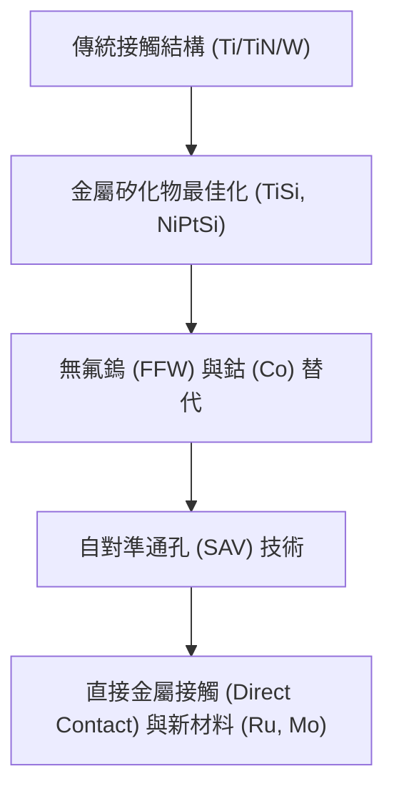

截至撰寫時，在 3 奈米及更先進節點中，中段製程已廣泛導入鈷（Co）作為接觸插塞材料，並在第一層金屬（M0/M1）嘗試使用釕（Ru）以取消厚重的阻障層。這些技術細節將在後續章節詳細討論。

總結而言，接觸電阻的挑戰來自於量子力學限制（穿隧效應）、材料界面性質（能階釘紮）以及幾何空間限制（阻障層佔位）。解決這些問題不僅需要新材料，更需要從製程整合的角度重新設計互連架構。

## 31.2 替代金屬材料：鈷、釕與鉬

### 物理原理：金屬微縮下的電阻率增長與指標參數

隨著電晶體元件尺寸持續縮小，先進製程的中段製程（Middle-Of-Line, MOL）接觸插塞（Contact Plug）與後段製程（Back-End-Of-Line, BEOL）最下層金屬導線（如 M0、M1）的線寬已微縮至 10 nm 以下。傳統採用的銅（Cu）與鎢（W）在此極限尺寸下遭遇了極嚴重的電阻率飆升問題。

金屬薄膜或奈米導線的有效電阻率（Effective Resistivity, $\rho_{\text{eff}}$）主要受限於兩種散射機制：電子在金屬表面或介面的散射（由 Fuchs-Sondheimer 模型描述）以及電子在晶粒邊界（Grain Boundary）的散射（由 Mayadas-Shatzkes 模型描述）。將兩者結合後的簡化理論模型可表示為：

$$\rho_{\text{eff}} \approx \rho_0 \left[ 1 + \frac{3}{8}(1-p)\frac{\lambda_0}{d} + \frac{3}{2}\frac{R}{1-R}\frac{\lambda_0}{g} \right]$$

其中：
- $\rho_0$ 為金屬的體電阻率（Bulk Resistivity）
- $\lambda_0$ 為體電子的平均自由路徑（Bulk Electron Mean Free Path）
- $d$ 為金屬導線的特徵尺寸（導線寬度或臨界尺寸）
- $g$ 為平均晶粒尺寸（Grain Size）
- $p$ 為表面鏡面反射係數（Specularity Parameter，$0 \le p \le 1$）
- $R$ 為晶粒邊界電子反射係數（Grain Boundary Reflection Coefficient，$0 \le R < 1$）

由上式可知，導線電阻率的增加量與「體電子平均自由路徑 $\lambda_0$」成正比。當金屬導線寬度 $d$ 縮減至接近或小於 $\lambda_0$ 時，散射效應將佔據主導地位，導致有效電阻率顯著高於體電阻率。因此，評價奈米級微縮導線材料優劣的關鍵品質因數（Figure of Merit, FOM）並非單純比較體電阻率 $\rho_0$，而是體電阻率與電子平均自由路徑的乘積 $\rho_0 \times \lambda_0$。$\rho_0 \times \lambda_0$ 數值越小，代表該材料在極細線寬下的電阻率飆升趨勢越不明顯。

下表列出傳統與新型導線金屬的物理特性典型值比較：

| 金屬材料 | 體電阻率 $\rho_0$ ($\mu\Omega\cdot\text{cm}$) | 電子平均自由路徑 $\lambda_0$ (nm) | 乘積 $\rho_0 \times \lambda_0$ ($10^{-16} \ \Omega\cdot\text{m}^2$) | 熔點 ($^{\circ}\text{C}$) |
| :--- | :--- | :--- | :--- | :--- |
| **銅 (Cu)** | 1.7 | 39.0 | 6.6 | 1085 |
| **鎢 (W)** | 5.4 | 15.9 | 8.6 | 3422 |
| **鈷 (Co)** | 5.6 | 7.8 | 4.4 | 1495 |
| **釕 (Ru)** | 7.1 | 6.6 | 4.7 | 2334 |
| **鉬 (Mo)** | 5.3 | 15.5 | 8.2 | 2623 |

除了電阻率模型外，銅導線因其易於擴散至介電層中，必須搭配一定厚度（典型值為 1.5–2.0 nm）的阻障層（Barrier Layer，如 TaN/Ta，見第 29 章）。當溝槽寬度縮小至 10–12 nm 時，高電阻率的阻障層將佔據溝槽截面積的 50% 以上，使銅金屬實際導電截面積大幅縮減，導致總導線電阻呈指數型劇增。因此，尋求可取消或使用極薄阻障層的新型金屬材料成為微縮的必經之路。

---

### 鈷 (Co)：接觸插塞與最下層導線的取代歷程

鈷（Co）是率先在先進邏輯製程中大規模取代鎢（W）作為接觸插塞（MOL Contact Plug）以及取代銅（Cu）作為 M0/M1 導線的新金屬材料。

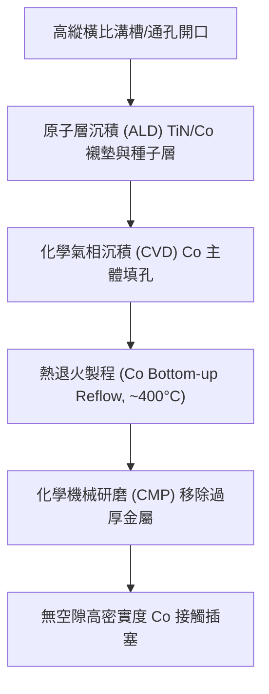

在 7 nm 及 5 nm 邏輯節點中，鈷被廣泛應用於元件閘極接觸（Poly Contact, CB）與源/汲極接觸（Source/Drain Contact, CA）。鈷能夠取代傳統鎢插塞與銅導線的主要製程優勢包含：

1. **較短的電子平均自由路徑**：鈷的 $\lambda_0$ 典型值約為 7.8 nm，遠低於銅的 39 nm。因此在 10 nm 以下的幾何尺寸中，鈷的散射效益較低，其有效電阻率開始低於帶有厚阻障層的銅。
2. **具備熱迴流能力（Reflow Capability）**：化學氣相沉積（CVD）或物理氣相沉積（PVD）沉積的鈷薄膜在約 400 $^\circ\text{C}$ 的相對低溫退火條件下，展現出優異的表面擴散能力。鈷能透過自下而上（Bottom-up）的迴流機制填滿極高縱橫比（Aspect Ratio > 10:1）的接觸孔，徹底解決傳統鎢 CVD 製程容易在孔洞中央形成接縫（Seam）或空隙（Void）的缺陷。
3. **優異的抗電遷移（Electromigration, EM）特性**：鈷的熔點高於銅，原子自擴散能力較低。在極高電流密度（$> 10^7 \ \text{A/cm}^2$）下，鈷導線的電遷移壽命較銅高出數個數量級。

!!! note "說明"
    雖然鈷在最下層金屬導線（M0/M1）發揮了微縮優勢，但在化學機械研磨（CMP，見第 24 章）製程中，鈷容易發生金屬腐蝕與刮傷問題；此外，鈷氧化物的導電性極差，若介面處理不當會引發接觸電阻異常。因此在更先進的節點中，材料研究逐漸進一步轉向釕與鉬。

---

###  (Ru)：無阻障層特性與極限微縮優勢

釕（Ru）屬於鉑族過渡金屬，被視為 3 nm 以下幾何節點及高密度記憶體中極具潛力的導線與通孔（Via）材料。

釕的核心物理優勢在於其極短的電子平均自由路徑（$\lambda_0 \approx 6.6\text{ nm}$）與高熔點（2334 $^\circ\text{C}$）。其最關鍵的製程突破是**無阻障層沉積（Barrierless Deposition）**或僅需極薄（< 0.5 nm）襯層的可行性。

```mermaid
gantt
    title 溝槽截面佔用率對比 (10 nm 寬溝槽)
    dateFormat X
    axisFormat %s

    section 傳統銅 (Cu) 導線
    TaN/Ta 阻障層 (3 nm) : 0, 3
    Cu 導體區域 (4 nm)    : 3, 7
    TaN/Ta 阻障層 (3 nm) : 7, 10

    section 釕 (Ru) 導線
    極薄襯層 (0.5 nm)    : 0, 1
    Ru 純金屬導體 (9 nm)  : 1, 9
    極薄襯層 (0.5 nm)    : 9, 10
```

如上圖所示，在 10 nm 的溝槽寬度中，若採用銅製程，兩側各 1.5 nm 的 TaN/Ta 阻障層會佔去 3 nm 的寬度，實際留給銅導體的寬度僅剩下 7 nm（截面積急劇縮減）；反觀釕金屬對二氧化矽或低介電常數介電質（Low-$k$）具備相對良好的附著力與極佳的擴散阻絕能力，可以直接將釕沉積於溝槽中。即使釕的體電阻率（$\sim 7.1 \ \mu\Omega\cdot\text{cm}$）高於銅（$\sim 1.7 \ \mu\Omega\cdot\text{cm}$），但由於**導電截面積大幅增加**，釕導線在極細線寬下的整體實測電阻反而遠低於銅導線。

在電性表現上，釕具有極高的鍵結能，其抗電遷移特性比銅高出至少兩個數量級，在高溫與高當量電流下幾乎不會產生原子遷移產生的空洞。截至撰寫時，釕已在極微縮的自對準通孔（Self-Aligned Via, SAV）與第一層金屬互連中進行全面量產評估與導入。

---

### 鉬 (Mo)：中段製程的新穎低電阻率金屬

鉬（Mo）近年在中段製程（MOL）接觸插塞與 DRAM 字元線（Wordline）/位元線（Bitline）微縮領域引起廣泛關注。

鉬的體電阻率約為 $5.3 \ \mu\Omega\cdot\text{cm}$，在所有難熔金屬（Refractory Metals，如 W、Ta、Nb、Mo）中屬於最低等級。雖然其體電子平均自由路徑（$\lambda_0 \approx 15.5\text{ nm}$）高於鈷與釕，但由於其體電阻率低，且在高溫退火後能成長出非常大的晶粒尺寸（Grain Size $g \gg \lambda_0$），使其在特定臨界尺寸範圍內的有效電阻率低於鎢與鈷。

鉬在中段製程整合中的物理特點包括：

1. **晶粒生長與晶界散射抑制**：鉬薄膜經由適當的熱處理（高溫退火），其晶粒能輕易生長至超過導線寬度（形成竹節狀結構 Grain Structure），這顯著降低了 Mayadas-Shatzkes 模型中的晶界散射反射係數 $R$，從而抑制了有效電阻率的飆升。
2. **與矽化物介面的低阻抗**：在中段製程與矽化鈦（$\text{TiSi}_x$）或矽化鍺鈦（$\text{TiSiGe}$）接合時，鉬能形成良好的電路接觸，降低特定接觸電阻率（Specific Contact Resistivity, $\rho_c$）。
3. **沉積熱預算容忍度高**：鉬的熔點高達 2623 $^\circ\text{C}$，能承受熱預算高達 600–800 $^\circ\text{C}$ 的後續製程，特別適合應用於 3D 快閃記憶體（3D NAND）或 3D 邏輯堆疊的中段熱穩定需求。

!!! warning "常見誤解"
    雖然鉬具有較低體電阻率，但鉬極易在微量氧氣環境下形成高電阻率的氧化鉬（$\text{MoO}_x$）。因此在沉積與後續蝕刻（見第 19 章）過程中，對腔體真空度與反應氣體純度的控制要求極高，否則接觸電阻會大幅上升。

---

### ALD 與 CVD 薄膜沉積與填充能力比較

將新型金屬（Co, Ru, Mo）順利整合至極高縱橫比的微小通孔與溝槽中，高度依賴前驅物（Precursor）化學與沉積技術。化學氣相沉積（CVD，見第 21 章）與原子層沉積（ALD，見第 23 章）是實現無空隙填孔的核心工具。

對於替代金屬的填孔，技術通常分為兩大類：
- **自我限幅 ALD 沉積**：利用前驅物與表面活性位點的飽和反應，獲得接近 100% 的保形覆蓋率（Conformal Coverage），適合極薄阻障層或晶種層（Seed Layer）。
- **CVD 配合底向上迴流（Bottom-up Fill / Reflow）**：利用特定前驅物在高縱橫比結構底部與頂部的沉積速率差異，或是沉積後輔以熱退火使金屬原子擴散填滿溝槽。

下表比較鈷、釕、鉬在 ALD 與 CVD 製程中的典型化學機制與填充特性：

| 金屬材料 | 主要前驅物類型 (Precursor) | 反應氣體 (Reducing Agent) | 沉積機制與優勢 | 填孔限制與挑戰 |
| :--- | :--- | :--- | :--- | :--- |
| **鈷 (Co)** | 環戊二烯基鈷、羰基鈷 $\text{Co}_2(\text{CO})_8$ | $\text{H}_2$ / 自由基 $\text{H}^*$ | CVD 沉積速率高；搭配熱退火（~400 $^\circ\text{C}$）可實現良好的 Bottom-up 迴流填孔。 | ALD 沉積速度較慢；前驅物殘留有機碳/氧雜質易升高電阻率。 |
| **釕 (Ru)** | 茂金屬釕（如 $\text{Ru(EtCp)}_2$）、羰基釕 $\text{Ru}_3(\text{CO})_{12}$ | $\text{O}_2$（輔助催化分解）/ $\text{H}_2$ | ALD 具備原子級數位控制與 100% 保形性；可在無阻障層氧化物上直接核化（Nucleation）。 | 使用 $\text{O}_2$ 作為反應物時若控制不當易導致下層金屬或矽化物過度氧化。 |
| **鉬 (Mo)** | 六氯化鉬（$\text{MoCl}_5$）、六氟化鉬（$\text{MoF}_6$） | $\text{H}_2$ | 氯化物前驅物可實現極低雜質含量（C, O < 0.1%）的高純度 Mo 薄膜，膜質緻密。 | 鹵化物前驅物腐蝕性強，易侵蝕下層介電質或鈦襯墊；需要更高的反應溫度。 |

在先進製程量產實務中，單一沉積技術往往難以兼顧「高生產吞吐量」與「無空隙高保形性」。因此，常見的替代金屬填孔方案是採取**組合製程**：先以 ALD 沉積 1–2 nm 薄而均勻的金屬晶種層，確保絕佳的附著力與完全覆蓋；隨後切換至高沉積速率的 CVD 製程快速填滿溝槽主體，最後結合熱退火與化學機械研磨（CMP）平坦化，順利完成奈米級中段接觸插塞與導線的構裝。

!!! example "產業實例"
    截至撰寫時，極紫外光微影（EUV）與 High-NA EUV 製程將金屬線距（Pitch）推向 20 nm 以下。在邏輯晶片的第一層金屬（M0/M1）中，業界正逐步以釕（Ru）減法蝕刻製程或鉬（Mo）雙鑲嵌製程取代傳統銅雙鑲嵌製程，藉由此類新金屬材料在極小體積下展現的低有效電阻與超高抗電遷移特性，打破摩爾定律在金屬互連領域的物理瓶頸。

## 31.3 自對準通孔技術

### 疊對誤差與通孔偏離之可靠度風險

在先進邏輯製程節點中，後段製程（Back-End-of-Line, BEOL）的金屬間距（Metal Pitch）已縮減至 $24\text{ nm}$ 以下，底層金屬導線寬度與相鄰線距通常小於 $12\text{ nm}$。在如此緊湊的尺寸下，連接上下層金屬的通孔（Via）製程面臨了嚴苛的幾何限制。

傳統雙鑲嵌製程（Dual Damascene，見第 29 章）依賴微影光罩將通孔圖案精確曝光於下層金屬（$M_x$）與上層金屬壕溝（Trench, $M_{x+1}$）之間。然而，多重圖案化（Multiple Patterning，見第 13 章）與極紫外光（EUV）微影中不可避免的邊緣放置誤差（Edge Placement Error, EPE）會導致通孔發生實體偏離（Misalignment）。邊緣放置誤差由臨界尺寸均勻度（CDU）、線邊緣粗糙度（LER）以及微影機台的疊對誤差（Overlay, $OVL$）綜合決定（見第 17 章）：

$$EPE = \frac{\Delta CD}{2} + 3\sigma_{LER} + OVL$$

其中 $\Delta CD$ 為臨界尺寸偏差量，$\sigma_{LER}$ 為線邊緣粗糙度標準差，$OVL$ 為疊對誤差向量。當金屬線寬僅約 $10\text{ nm}$ 時，若疊對誤差達到 $3\text{ nm}$ 以上，通孔圖案便會大幅偏離目標金屬線中心，引發嚴重的電氣與可靠度衰退：

1. **接觸電阻急遽上升與變異**：偏離目標金屬會使通孔與下層導線的有效接觸面積（$A_{\text{eff}}$）劇烈縮小。若通孔直徑為 $d_v$，側向偏離量為 $\delta_x$，下層導線寬度為 $w$，在未對準的情況下，$A_{\text{eff}}$ 隨 $\delta_x$ 呈非線性下降，導致介面接觸電阻 $R_c = \rho_c / A_{\text{eff}}$ 暴增，顯著擴大晶片內部訊號延遲的離散度。
2. **介電質崩潰（TDDB）與短路風險**：若通孔偏離過大而侵入相鄰非目標金屬導線（Unintended Neighbor）的間距區域，通孔金屬與相鄰導線之間的實體間距（$s_{\text{eff}}$）將大幅縮短。根據極限電場擊穿模型，絕緣介電質內部的局部電場強度 $E = V / s_{\text{eff}}$ 將急遽攀升，嚴重惡化經時介電質崩潰（Time-Dependent Dielectric Breakdown, TDDB，見第 30 章）壽命，甚至在微影或蝕刻穿透時直接造成層間金屬短路。
3. **電遷移（Electromigration, EM）耐受度劣化**：有效接觸面積的減小迫使電流集中於極窄的金屬介面邊界，造成局部電流密度（Current Density, $J$）大幅超越金屬原子的電遷移臨界容許值，加速空洞（Void）的形核與成長。

```
傳統通孔微影偏離示意圖：
目標位置：           微影偏離（Misalignment）：
   [ M_{x+1} ]            [ M_{x+1} ]
       |                      \
    [ Via ]                 [ Via ] ---> 侵入介電層與相鄰導線距離
  -------------         -------------
  [   M_x     ]         [   M_x     ]  [ 相鄰 M_x ]
```

為了解決疊對誤差對微縮造成的硬性限制，在佈局設計規則（Design Rules）中原本需要額外保留「導線末端延伸量」（Enclosure / Overlap）以包容微影誤差，但這會犧牲金屬繞線密度。自對準通孔（Self-Aligned Via, SAV）技術遂成為先進節點突破微影疊對極限的核心解決方案。

---

### 自對準通孔（SAV）之幾何結構與選擇性蝕刻機制

自對準通孔技術的核心物理概念，是**利用不同材料之間的化學蝕刻選擇比（Etch Selectivity），取代單純依賴光學微影的幾何對準精度**。在 SAV 架構中，通孔圖案允許在微影製程中刻意放大或產生偏移，但蝕刻行為僅會在預先設定的幾何空間內向下推進，偏離的區域則會被耐蝕刻的硬遮罩阻擋。

典型 SAV 製程採用金屬硬遮罩（Metal Hardmask, MHM）與雙重介電保護層設計，其實施架構與蝕刻反應機制如下：

1. **底層導線與介電帽層整合**：下層金屬線（$M_x$）平坦化後，在金屬頂部或相鄰介電質上方導入高蝕刻選擇比的材料。常用結構包含在金屬層上方形成自我對準的氮化矽（$\text{Si}_3\text{N}_4$）、碳氮氧化矽（$\text{SiCON}$）或氧化鋁（$\text{AlO}_x$）介電帽層（Dielectric Cap）。
2. **通孔微影放大與容偏**：微影曝光時，光阻開口尺寸設計得大於底層金屬線寬，允許通孔開口橫跨目標金屬線邊界並覆蓋到相鄰的介電結構上方。
3. **高選擇比非等向性蝕刻**：執行通孔反應離子蝕刻（RIE，見第 19 章）時，採用對層間介電層（如 SiOCH 超低介電常數材料，Low-$k$）具有極高蝕刻速率、但對介電帽層或相鄰金屬硬遮罩幾乎不反應的電漿化學環境（例如含氟碳氣體 $\text{C}_4\text{F}_8/\text{CF}_4/\text{Ar}$ 搭配偏壓調控聚合物沉積/蝕刻平衡）。
4. **自對準幾何修飾**：即便電漿離子束覆蓋了偏離區域，耐磨蝕的帽層仍完好無損，僅有目標金屬線正上方的 Low-$k$ 介電材料被縱向挖除。蝕刻輪廓自然終止於目標金屬表面與防蝕保護層的邊界，使成型的通孔邊界與下層金屬邊界達成物理對準。

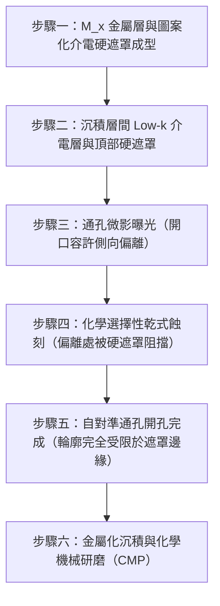

在化學選擇性蝕刻機理中，蝕刻氣體所產生的含氟自由基與聚合物沉積物（如 $\text{CF}_x$ 薄膜）在不同基材表面的吸附動態扮演決定性角色。選擇比（Selectivity, $S$）可定義為目標介電質蝕刻速率 $ER_{\text{target}}$ 與遮罩材料蝕刻速率 $ER_{\text{mask}}$ 之比值：

$$S = \frac{ER_{\text{target}}}{ER_{\text{mask}}}$$

在先進 SAV 製程中，$S$ 通常需要維持在 $10:1$ 以上甚至達到 $20:1$，以確保在過度蝕刻（Over-etch）階段，相鄰結構的介電帽層不致因離子物理轟擊而穿透，從而確保通孔側向電氣絕緣的完整性。

---

### 選擇性原子層沉積在通孔定義之應用

傳統 SAV 多依賴微影與蝕刻（Top-down）的方式建構硬遮罩邊界，然而隨著導線間距小於 $20\text{ nm}$，硬遮罩圖案化本身的 EPE 與微影缺陷再次成為瓶頸。此時，由下而上（Bottom-up）的面積選擇性沉積（Area-Selective Deposition, ASD），特別是**面積選擇性原子層沉積（Area-Selective Atomic Layer Deposition, AS-ALD）**，成為定義極小自對準結構的重要技術（見第 23 章）。

AS-ALD 的物理化學基礎建立在基材表面的化學吸附活化能差異上：

* **金屬表面與介電質表面活化差異**：已曝露的金屬線（如 $\text{Cu}$、$\text{Co}$、$\text{Ru}$）表面具有還原性金屬態或特定的電子軌域特性；相鄰的層間介電層（如含有羥基 $-\text{OH}$ 的 $\text{SiO}_2$ 或含甲基 $-\text{CH}_3$ 的 SiOCH）則表現出截然不同的表面化學鍵合行為。
* **化學鈍化機制（Surface Passivation）**：在執行沉積前，可利用氣相或液相分子在非目標表面選擇性形成自組裝單分子層（Self-Assembled Monolayers, SAMs）。例如，具有特定烷基鏈的硫醇（Thiols）會選擇性鍵結於金屬表面形成阻擋層，而有機矽烷類（Silanes）分子則易與氧化物表面的 $-\text{OH}$ 官能基反應，鈍化介電層區域，阻止後續前驅物（Precursor）化學吸附。
* **選擇性成核與生長**：在無鈍化保護的表面，ALD 前驅物能順利進行表面化學自限性反應（Self-Limiting Surface Reaction）。

下表列出先進互連製程中常見的選擇性沉積策略與材料系統：

| 沉積策略 | 成長表面（Growth Surface） | 非成長表面（Non-growth Surface） | 典型沉積材料 | 應用功能 |
| :--- | :--- | :--- | :--- | :--- |
| **金屬上沉積金屬** (M-on-M) | 導線金屬（如 $\text{Ru}, \text{Cu}$） | 介電層（$\text{SiO}_2$, Low-$k$） | $\text{Ru}, \text{Co}$ | 建立通孔底部低電阻接點或金屬阻障帽層 |
| **金屬上沉積介電質** (D-on-M) | 導線金屬（如 $\text{Cu}, \text{Co}$） | 介電層（Low-$k$） | $\text{Al}_2\text{O}_3, \text{TiO}_2$ | 形成自對準蝕刻阻擋層（Etch Stop Layer） |
| **介電質上沉積介電質** (D-on-D) | 層間介電質（$\text{SiO}_2$ 基材） | 導線金屬表面 | $\text{Al}_2\text{O}_3, \text{ZrO}_2$ | 建立通孔開孔周圍的高耐久蝕刻硬遮罩 |

在自對準通孔製程中，藉由 D-on-M 製程於金屬導線上方選擇性生長奈米等級厚度（典型值約 $2\text{--}4\text{ nm}$）的 $\text{Al}_2\text{O}_3$ 阻擋層，隨後整體塗佈 Low-$k$ 材料。在隨後的通孔壕溝蝕刻中，此介電阻擋層能在無微影對準需求下，天然地將通孔開口界定在特定區域內，將光學微影的疊對裕度要求轉化為材料表面的化學熱力學驅動力。

!!! note "面積選擇性沉積（ASD）的選擇性遺失問題"
    AS-ALD 的主要挑戰為「選擇性遺失」（Selectivity Loss）。當 ALD 循環次數增加時，前驅物分子仍有極小機率在非成長表面缺陷處發生非特異性成核（Non-specific Nucleation），形成寄生奈米顆粒。因此，實務製程常穿插「沉積—蝕刻」（Super-cycles of Deposition-Etch）循環，定期以微弱的電漿或原子層蝕刻（ALE，見第 23 章）清除寄生成核點，以維持整體製程的高選擇性。

---

### 完全自對準通孔（FSAV）對電路佈局密度的提升

在金屬間距微縮至 $20\text{ nm}$ 以下（對應先進 2 奈米及以下世代）時，傳統 SAV 的單向幾何限制已無法滿足需求，互連架構進一步推進至**完全自對準通孔（Fully Self-Aligned Via, FSAV）**。

傳統雙鑲嵌通孔受限於三維邊緣放置誤差，通孔在 $X$ 方向（橫跨下層平行線）與 $Y$ 方向（沿著下層線方向）皆有偏離風險。完全自對準通孔的技術構想，是**同時利用下層金屬線（$M_x$）的側向邊界與上層金屬壕溝（$M_{x+1}$）的正交邊界，將通孔的位置完全鎖定於兩層導線正交重疊的交點區域**。

```
完全自對準通孔（FSAV）之正交幾何界定：

        上層導線 (M_{x+1}) 方向 ───>
      ┌─────────────────────────┐
      │                         │
──────┼─────────────────────────┼──────
下層  │   [ 完全自對準通孔 ]     │
導線  │  (位置由兩層幾何交集    │
(M_x) │   與自對準遮罩共同鎖定) │
      │                         │
──────┼─────────────────────────┼──────
      │                         │
      └─────────────────────────┘
```

FSAV 通常結合多元材料硬遮罩架構實現。製程初期在層間介電層上配置兩組具備正交關係且材質互異的硬遮罩條帶（例如硬遮罩 A 為非晶矽 $\text{a-Si}$，硬遮罩 B 為金屬氧化物如 $\text{TiO}_x$）。通孔開口不透過微細圓孔微影曝光，而是透過寬鬆的多邊形甚至線狀曝光圖案跨越交叉點。在雙重選擇性蝕刻過程中：

1. 第一道蝕刻依據上層壕溝圖案移除遮罩 A，保留遮罩 B。
2. 第二道蝕刻依據下層線條圖案移除暴露的介電質，遮罩 A 與 B 交疊外的區域受到保護。
3. 最終只有在 $M_x$ 與 $M_{x+1}$ 正交投影重合的微小方形柱狀體內，介電質被完全掏空形成通孔。

FSAV 對先進晶片微縮帶來了重大的佈局優勢：

1. **消除導線端點延伸與邊界裕度（Zero Enclosure）**：標準單元（Standard Cell）設計中，導線端點對端點（Tip-to-Tip, T2T）間距受限於通孔偏離引發的擊穿短路風險，過去必須保留較大的安全距離。FSAV 消除了端點微影對準失敗的物理機制，使 T2T 間距可大幅微縮超過 30%（典型尺寸可壓低至 $15\text{ nm}$ 以下）。
2. **標準單元高度壓縮**：由於通孔具備完全自對準特性，繞線軌道（Track）可極限收縮。邏輯標準單元高度可由傳統的 6T（6 個金屬軌道高度）或 5T 壓縮至 4T 或以下，顯著提升電晶體密度。
3. **電阻與良率最優化**：FSAV 保證通孔開口必定佔滿下層與上層金屬導線的完整重疊幾何面，實現了理論上最大化的有效接觸面積 $A_{\text{eff}}$，徹底解決微影未對準引發的介面電阻飆升與電遷移可靠度隱患。

截至撰寫時，FSAV 製程結合極紫外光自對準四重圖案化（SAQP，見第 13 章）與選擇性原子層沉積技術，已成為先進邏輯晶片後段微細互連（$M_0$ 至 $M_3$ 關鍵層）維持摩爾定律微縮路徑的關鍵技術基石。

<!-- fig:1 -->
<figure markdown>
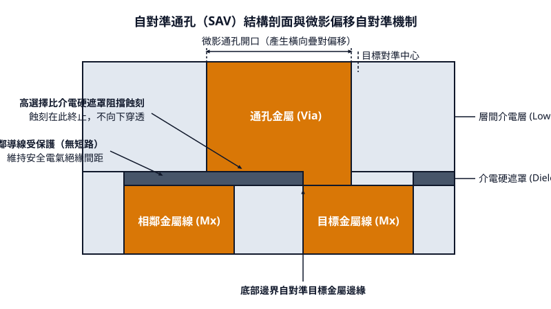
<figcaption>圖 31-1　自對準通孔結構剖面圖（AI 繪製的示意圖）</figcaption>
</figure>

## 31.4 減法式金屬蝕刻製程

### 31.4.1 從鑲嵌製程回歸減法製程之物理驅動力

在次 30 nm 導線間距（Pitch）的極致微縮架構中，自 1990 年代末期以來作為互連骨幹的銅雙鑲嵌製程（見第 29 章）面臨了嚴苛的物理瓶頸。此瓶頸主要來自材料幾何縮放限制、電阻率飆升以及製程填充極限：

1. **有效導電截面積縮減**：銅金屬極易向介電層擴散並引起嚴重的漏電流與元件劣化，因此銅導線周圍必須包覆連續的擴散阻障層（如 $\text{TaN}/\text{Ta}$）與襯墊層（如 $\text{Ru}$ 或 $\text{Co}$）。阻障層厚度受限於連續性與防擴散能力，極限很難低於 $1.5 \sim 2\text{ nm}$。當導線寬度 $W$ 微縮至 $10\text{ nm}$ 以下時，雙邊高電阻率阻障層所佔據的面積比例大幅增加，使銅的有效導電截面積急劇縮減。
2. **電子散射效應主導電阻率**：當金屬線寬小於銅電子的室溫平均自由程（$\lambda_{\text{Cu}} \approx 39\text{ nm}$）時，表面散射（Fuchs-Sondheimer 模型）與晶界散射（Mayadas-Shatzkes 模型，詳見第 31.1 節）導致銅的有效電阻率 $\rho_{\text{eff}}$ 呈指數型上升。
3. **高深寬比物理填充極限**：雙鑲嵌製程需先於介電質中蝕刻出溝槽與通孔，再以物理氣相沉積（PVD）沉積晶種層並進行電鍍填孔（ECD）。當特徵尺寸縮小且深寬比（Aspect Ratio, $\text{AR}$）提高時，PVD 晶種層在側壁容易出現懸突（Overhang）與不連續現象，導致電鍍時產生未填滿的空洞（Void）。

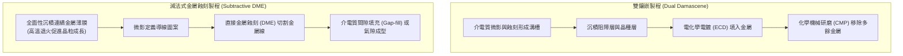

為克服上述問題，業界重新採用鋁導線時代的「減法製程」（Subtractive Process），但在材料與化學機制上全面革新為直接金屬蝕刻（Direct Metal Etch, DME）。減法製程的核心優勢在於：
- **消除側壁阻障層**：採用抗電遷移且不易擴散的新型金屬（如釕 $\text{Ru}$、鉬 $\text{Mo}$，見第 31.2 節），金屬導線側邊不需設置厚擴散阻障層，實質上將整個圖案化空間完全保留給導電金屬。
- **薄膜結晶最佳化**：金屬在平整的下層基板上全面性沉積，可在高溫下進行晶退火處理，使晶粒尺寸（Grain Size）最大化，顯著降低後續電子傳輸的晶界散射。

---

### 31.4.2 直接金屬蝕刻 (DME) 化學與側壁輪廓控制

直接金屬蝕刻面臨的重大挑戰在於過渡金屬（如 $\text{Ru}$、$\text{Mo}$）的原子結合能高、化學鍵極強，且多數金屬鹵化物在室溫下的蒸氣壓極低，不易轉化為揮發性副產物被真空系統抽除。因此，DME 需採用專門的電漿化學配方與反應機構。

#### 1. 釕 (Ru) 的反應性蝕刻化學
釕對鹵素（如 $\text{F}$、$\text{Cl}$）形成的鹵化物沸點極高，但釕的高價氧化物具有低沸點特性。釕蝕刻主要基於「氧化揮發」機制，典型氣體系統為氧基氣體與鹵素氣體的混合（例如 $\text{O}_2/\text{Cl}_2$ 或 $\text{O}_2/\text{N}_2$）：

$$\text{Ru} + 2\text{O}_2 \rightarrow \text{RuO}_4 \uparrow \quad (\text{沸點約 } 40^\circ\text{C})$$

$$\text{Ru} + \text{Cl}_2 + x\text{O}_2 \rightarrow \text{RuO}_x\text{Cl}_y \uparrow$$

四氧化釕（$\text{RuO}_4$）極易揮發，但熱穩定性相對脆弱；若側壁未受適當保護，高濃度的氧自由基將引起自發性的等向性化學咬蝕，導致嚴重的側向底切（Undercut）。

#### 2. 鉬 (Mo) 的反應性蝕刻化學
鉬可透過氟基或氧-氯基電漿進行揮發。常用反應氣體包括 $\text{CF}_4/\text{O}_2$、$\text{SF}_6/\text{O}_2$ 或 $\text{Cl}_2/\text{O}_2$：

$$\text{Mo} + 3\text{F}_2 \rightarrow \text{MoF}_6 \uparrow \quad (\text{沸點約 } 35^\circ\text{C})$$

$$\text{Mo} + \text{O}_2 + 2\text{Cl}_2 \rightarrow \text{MoO}_2\text{Cl}_2 \uparrow$$

六氟化鉬（$\text{MoF}_6$）在常溫下為氣態，化學反應速度快；因此，蝕刻過程需嚴密控制氟氧比例，避免快速等向性蝕刻破壞圖案線寬。

#### 3. 側壁鈍化保護與垂直輪廓控制
為了在極細間距下實現接近 $90^\circ$ 的垂直側壁（Anisotropic Profile），DME 製程高度依賴「離子轟擊引導的沉積-蝕刻平衡」機制：
- **微量鈍化層沉積**：在進氣中通入微量含碳、含矽或含氮前驅氣體（如 $\text{CH}_4$、$\text{SiCl}_4$、$\text{N}_2$），在反應過程中於蝕刻側壁形成極薄的保護聚合物或非揮發性鈍化膜（如 $\text{RuN}_x$、$\text{Si-O-C}$ 複合物）。
- **離子轟擊清除底層**：電漿反應器中的偏壓功率使帶正電離子垂直入射撞擊溝槽底部，打碎底部的鈍化保護層，維持向下蝕刻速率；垂直側壁因無離子垂直撞擊動能，鈍化膜得以保留並阻絕自由基的橫向侵蝕。
- **低溫蝕刻（Cryogenic Etching）**：將晶圓載台冷卻至低溫（例如 $-20^\circ\text{C}$ 至 $-60^\circ\text{C}$），抑制金屬揮發產物的側向熱化學脫附，進一步提升異向性，此技術在先進原子層蝕刻（ALE，見第 23 章）中是關鍵發展方向。

| 導線金屬 | 蝕刻反應氣體系統 | 主要揮發產物 | 副產物沸點 (典型值) | 側壁鈍化機制 |
| :--- | :--- | :--- | :--- | :--- |
| **釕 ($\text{Ru}$)** | $\text{Cl}_2/\text{O}_2$、$\text{O}_2/\text{N}_2$ | $\text{RuO}_4$、$\text{RuO}_x\text{Cl}_y$ | $\text{RuO}_4 \approx 40^\circ\text{C}$ | 側壁微氧化／氮化物自限制層 |
| **鉬 ($\text{Mo}$)** | $\text{SF}_6/\text{O}_2$、$\text{Cl}_2/\text{O}_2$ | $\text{MoF}_6$、$\text{MoO}_2\text{Cl}_2$ | $\text{MoF}_6 \approx 35^\circ\text{C}$ | 表面氟氧化物配合微量聚合物保護 |
| **鈷 ($\text{Co}$)** | $\text{Cl}_2$ 配合有機配位配方 | $\text{Co(diketonate)}_2$ 等有機配位化合物 | 取決於配位體，需加熱至 $> 150^\circ\text{C}$ | 熱驅動化學脫附，離子輔助蝕刻 |

---

### 31.4.3 高深寬比間隙填充與氣隙 (Air Gap) 整合

減法金屬蝕刻完成後，金屬圖案轉變為立於基板之上的獨立金屬條柱。隨後必須沉積層間介電質（Inter-Layer Dielectric, ILD）填入極細的金屬線縫隙中，此步驟面臨極嚴苛的間隙填充（Gap-fill）考驗。

```
減法金屬蝕刻後立柱形貌                間隙填充 (Gap-fill)                  氣隙 (Air Gap) 結構
      [金屬]     [金屬]                 [金屬]  [ILD]  [金屬]                 [金屬] [氣隙] [金屬]
     +------+   +------+               +------+------+------+               +------+  --  +------+
     |  Ru  |   |  Ru  |   ======>     |  Ru  | ILD  |  Ru  |   ======>     |  Ru  | (空氣|  Ru  |
     |  /Mo |   |  /Mo |  (介電質沉積)  |  /Mo | 介電 |  /Mo |  (故意懸突封口)  |  /Mo | k=1) |  /Mo |
=====+======+===+======+=============+======+======+======+=============+======+==--==+======+=====
            基底介電層                            基底介電層                            基底介電層
```

1. **常規介電質流動化填洞**：
   在極高深寬比（$\text{AR} > 3:1$）且奈米級線距下，傳統的電漿增強化學氣相沉積（PECVD）二氧化矽會因沉積通量在轉角處堆積形成懸突，過早閉合孔口並在導線之間產生非預期的不對稱空洞。解決途徑是改採原子層沉積（ALD）高階梯覆蓋力氧化矽，或是使用流動式化學氣相沉積（Flowable CVD, FCVD），沉積初始呈液態流動相的低分子量矽氮低聚物，填平金屬縫隙後再經熱退火轉化為堅固的低介電常數（Low-$k$）薄膜。

2. **自發性氣隙（Air Gap）結構整合**：
   減法製程相較於鑲嵌製程，具備自然整合「氣隙」的架構優勢。空氣或真空的介電常數 $k \approx 1.0$，是理論上的最低值。
   - **形成機制**：在完成金屬立柱蝕刻後，刻意採用階梯覆蓋能力較差（Non-conformal）的 PECVD 沉積製程。沉積物會在金屬線頂部快速側向生長並互相接觸封口，金屬線中央的間隙則被自然包覆保留為封閉氣隙。
   - **電容微縮效益**：相鄰兩條平行金屬導線的線間電容 $C$ 與介電質介電常數 $k$ 成正比：

     $$C = \frac{\varepsilon_0 k_{\text{eff}} A}{d}$$

     其中 $\varepsilon_0$ 為真空電容率，$A$ 為導線平行側壁面積，$d$ 為金屬線間距，$k_{\text{eff}}$ 為有效介電常數。引入氣隙可將兩線間的 $k_{\text{eff}}$ 從傳統固態低介電材料的 $2.4 \sim 2.7$ 驟降至 $1.5 \sim 1.8$ 左右，進一步抑制互連延遲（RC Delay）與線間串擾（Crosstalk）。

!!! note "氣隙的機械強度與散熱取捨"
    氣隙雖然大幅降低了導線電容，但真空環境缺乏固態介電質的支撐力與導熱路徑，會造成封裝應力耐受度下降與導線焦耳熱（Joule Heating）散失受阻。因此，氣隙結構通常僅策略性地應用於關鍵路徑上電容敏感的局部金屬層（如最小間距層 M0/M1），其上方層次仍需覆蓋具備良好機械強度之介電支撐層。

---

### 31.4.4 微縮極限下的可靠度與介電質擊穿防護

減法金屬蝕刻完全顛覆了後段互連材料的界面組成，為超細導線系統帶來了不同於傳統銅製程的可靠度行為：

#### 1. 無銅互連消除金屬向外擴散
由於金屬釕與鉬的原生自擴散活化能與擴散活化能遠高於銅，在後段熱預算（典型為 $\le 400^\circ\text{C}$）範圍內，釕與鉬對周圍介電層的擴散係數接近於零。此一特性使得互連線「完全不需要雙邊擴散阻障層」，即可避免金屬離子漂移進入介電質中，大幅降低了後段系統短路的風險。

#### 2. 時間相依介電質擊穿 (TDDB) 的演變
在減法製程中，時間相依介電質擊穿（Time-Dependent Dielectric Breakdown, TDDB）的物理失效模式轉由蝕刻缺陷主導：
- **側壁粗糙度與電場集中**：直接金屬蝕刻引發的線邊緣粗糙度（Line Edge Roughness, LER）與線寬粗糙度（Line Width Roughness, LWR）會在金屬側壁形成尖端凸起。在高密度電場作用下，局部微突起將導致局部電場強度 $\mathcal{E}$ 暴增，誘發介電質產生高電場 Fowler-Nordheim 穿隧電流或 Poole-Frenkel 傳導，加速缺陷陷阱生成並提前引發擊穿。
- **蝕刻殘留物污染**：若 DME 後的濕式清洗無法完全清除金屬凹槽底部的微量含金屬副產物，沉積在介電界面上的殘留物會形成界面傳導通道，顯著增加相鄰導線間的表面漏電流。

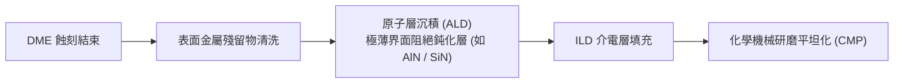

#### 3. 界面鈍化工程
為確保極細間距下 long-term 可靠度，減法金屬蝕刻完成後，必須施加嚴格的修補與界面包覆流程：
1. **電漿微損傷修復**：利用低溫氫氣或氨氣（$\text{H}_2/\text{NH}_3$）遠端電漿處理受蝕刻轟擊破壞的金屬側壁，還原殘餘的非化學計量過渡金屬氧化物。
2. **共形超薄界面鈍化層**：在間隙填充介電質之前，利用 ALD 沉積一層厚度小於 $1\text{ nm}$ 的超薄共形絕緣層（例如氮化鋁 $\text{AlN}$ 或低介電質矽碳氮化合物 $\text{SiCN}$）。該層的作用並非防止金屬擴散，而是作為緊密包覆的表面封蓋層，平滑側壁電場分佈、抑制界面載子誘發的缺陷擴散，確保超細線寬互連線具備優異的電氣絕緣與抗擊穿能力。

!!! example "先進邏輯節點的減法互連整合"
    截至撰寫時，全球頂尖研究機構與積體電路製造廠已在次 2 nm（如 A16、A14）節點的前沿研發中，廣泛評估將最小金屬間距（Pitch $\le 24\text{ nm}$）的關鍵互連層（M0/M1）由傳統銅雙鑲嵌製程切換為釕（Ru）減法直接蝕刻製程。實驗數據顯示，在 $18 \sim 20\text{ nm}$ 的極細間距下，減法 Ru 導線相較於傳統鑲嵌 Cu，不僅展現出低 $30\%$ 以上的單位線阻，更藉由高融點與強共價鍵結特性，將抗電遷移（EM）壽命提升了二至三個數量級。

<!-- fig:2 -->
<figure markdown>
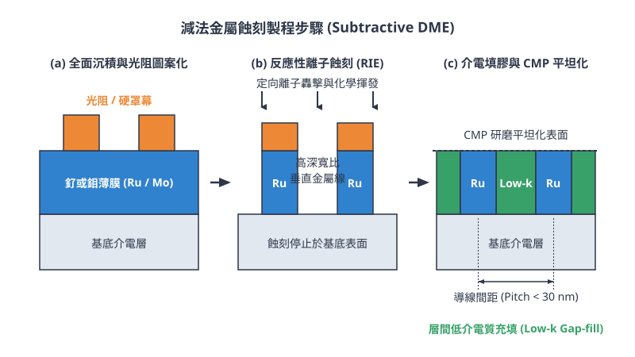
<figcaption>圖 31-2　減法金屬蝕刻製程步驟（AI 繪製的示意圖）</figcaption>
</figure>

## 31.5 設備與廠商技術

### 製程機台類型與關鍵子系統

在先進邏輯與高密度記憶體製程中，接觸（contact）、通孔（via）以及替代金屬導線的製作，涉及原子級薄膜沉積、高深寬比選擇性沉積、非等向性金屬與介電質蝕刻，以及高溫快速熱退火等精密步驟。依據製程模組劃分，此階段主要依賴四大類設備：

1. **多腔體金屬化與沉積整合平台（Cluster Tool）**：
   在微縮節點下，金屬介面極易在空氣中氧化並形成高阻抗缺陷（例如鈷或釕表面生成原生氧化物）。因此，現代金屬化系統必須將前置表面處理腔體（如遠程電漿氫還原或微弱濺鍍清洗）、物理氣相沉積（PVD）、化學氣相沉積（CVD）及原子層沉積（ALD）整合在同一個超高真空（Ultra-High Vacuum, UHV）多腔體傳輸平台內，實現真空不破壞（in-situ vacuum transfer）的連續製程。

2. **化學氣相沉積與原子層沉積設備（CVD/ALD）**：
   負責沉積阻障層（如 TiN、TaN）、晶種層（seed layer）或直接填充金屬。其關鍵子系統包含：
   * **超低蒸氣壓前驅物輸送系統**：針對釕（Ru）或鉬（Mo）等金屬有機金屬化學氣相沉積（MOCVD）或金屬鹵化物氣體，配備精確加熱氣化閥箱與管路保溫控制，防止氣體凝結。
   * **電漿源與微波激發系統**：電漿輔助原子層沉積（PEALD）使用感應耦合電漿（ICP）或微波電漿產生高活性自由基（如 $H^*$ 或 $NH^*$），以在較低基板溫度（$< 400\ ^\circ\text{C}$）下達成高純度膜層沉積。
   * **基板溫度與晶圓吸盤（Susceptor/Chuk）控制**：為實現「選擇性沉積」（Selective Deposition），吸盤通常具備多區獨立加熱迴路，維持晶圓表面極佳的面內均勻度（within-wafer non-uniformity $< 1\%$）。

3. **反應離子蝕刻設備（RIE）**：
   包含自對準通孔（SAV）之高選擇比介電質蝕刻機台，以及針對 Ru、Mo 或 Co 之減法式金屬蝕刻機台。關鍵子系統包含：
   * **高密度電漿源**：通常採用 ICP 或電容耦合電漿（CCP）源，具備獨立調節電漿密度與離子加速能量之雙頻或多頻偏壓（bias RF）產生器。
   * **高溫加熱腔壁與氣體分配噴淋頭（Showerhead）**：Ru 與 Mo 的鹵化蝕刻副產物（如 $\text{RuO}_4$、$\text{MoF}_6$、$\text{MoO}_2\text{Cl}_2$）在低溫下容易重新沉積在腔壁與晶圓表面，因此蝕刻腔壁常需加熱至 $150\ ^\circ\text{C}$ 至 $250\ ^\circ\text{C}$ 以上以避免顆粒污染。

4. **熱處理與退火設備**：
   用於金屬矽化物形成（如 TiSi、NiPtSi）或使 Ru/Mo 薄膜晶粒成長以降低晶界散射電阻（見第 31.2 節）。包含單晶圓快速熱處理（RTP）腔體與超高真空批次式直立爐管。

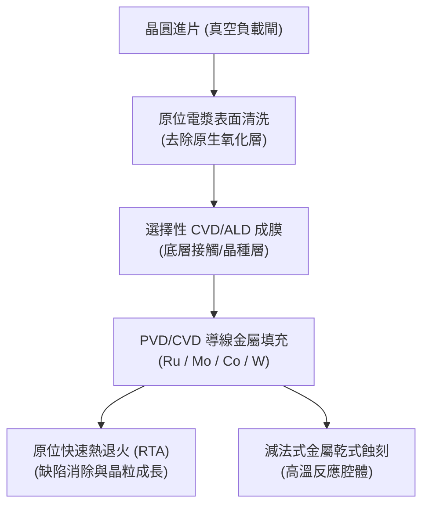

---

### 主要廠商與技術路線比較

在接觸孔填充、新金屬沉積與先進通孔蝕刻領域，設備市場由少數國際半導體設備商主導。下表彙整主要廠商及其代表產品系列與技術特點：

| 廠商 | 代表產品系列 | 技術路線與特點 | 主要應用 |
| :--- | :--- | :--- | :--- |
| **Applied Materials** | Endura | 多腔體高真空整合架構，結合前置清洗、ALD、PVD 與 CVD，支援金屬薄膜連續沉積與表面改質 | 中階層（MOL）接觸填充、Ru/Co 阻障層與導線沉積 |
| **Applied Materials** | Sym3 | 高傳導率對稱流場設計與高腔壁溫度控制，具備高壓低解離/低壓高離子化雙重電漿操作模式 | 自對準通孔高選擇比蝕刻、難揮發金屬乾式蝕刻 |
| **Lam Research** | ALTUS | 脈衝化學氣相沉積（PCVD）與 ALD 成膜架構，透過專用前驅物注入口設計達到低電阻晶種與無縫填充 | 接觸窗鎢（W）與替代金屬化插塞（contact plug）填充 |
| **Lam Research** | Kiyo | 高密度感應耦合電漿（ICP）搭配精密偏壓控制，具備高度可調的離子能量分佈函數（IEDF） | 減法式金屬導線蝕刻、閘極極微細線寬圖案化 |
| **Lam Research** | Flex | 多頻電容耦合電漿（CCP）設計，搭配客製化化學氣體配方與晶圓表面溫度動態調節 | 高深寬比接觸孔（HAR Contact）與自對準通孔介電質蝕刻 |
| **Tokyo Electron (TEL)** | Trias | 單晶圓多腔體熱成膜平台，微環境真空密封技術，具備精準前驅物遞送與沉積溫度控制 | 金屬 CVD/ALD（如 TiN、Ru、Mo 薄膜）與界面工程 |
| **Tokyo Electron (TEL)** | Tactras | 雙腔體整合電漿蝕刻平台，具備多晶圓旋轉對稱電極與高頻脈衝偏壓功能 | 自對準接觸（SAC）與先進介電層硬遮罩圖案化 |
| **Tokyo Electron (TEL)** | TELINDY | 超高真空垂直批次爐管，氣流流場模擬優化，晶圓間溫差極小化控制 | 大批量矽化物化學反應與低溫長晶退火 |

---

### 技術路線差異與晶圓廠選機考量

在評估新導線金屬與微細通孔設備時，晶圓廠通常聚焦於電漿源架構、前驅物管理與熱預算配置三大核心面向的權衡：

#### 1. 沉積腔體的真空整合與選擇性沉積取向
在沉積 Ru 或 Co 薄膜時，界面純淨度直接決定接觸電阻（$R_c$）。
* **整合式多腔體路線**：以 Applied Materials 的 Endura 平台為代表，強調在一套超高真空主幹系統（Backbone）上串聯預清洗（Pre-clean）、PVD 襯墊層（Liner）與 CVD 填充。其優勢在於界面完全杜絕氧與水分吸附，製程良率高；然而機台佔地面積（footprint）大，系統複雜度與日常腔體維護（PM）排程受限於共用真空臂。
* **專用獨立模組路線**：Tokyo Electron 的 Trias 平台則側重於單一沉積模組的高精度熱流控制與超短氣體置換時間。其採用微型化腔體設計（mini-batch 或 compact single-wafer），以減少腔壁表面積，降低前驅物浪費與交叉污染風險。對於 Mo 此類需以固態或低溫昇華源氣化的金屬，其管路保溫與精準載氣注入控制是選機的關鍵技術指標。

#### 2. 金屬乾式蝕刻的化學與物理機制取捨
在減法式金屬蝕刻（Subtractive Etch）製程中（見第 31.4 節），Ru 與 Mo 面臨截然不同的化學挑戰：
* **氧化揮發 vs. 鹵化刻蝕**：Ru 的蝕刻極度仰賴含氧或含臭氧的電漿（生成具揮發性的四氧化釕 $\text{RuO}_4$），但其對周遭的光阻或碳基硬遮罩侵蝕速率極高；Mo 則傾向使用氟基（F）或氯基（Cl）電漿進行反應。
* **電漿源與腔體溫度設計**：
  * Lam Research 在導體蝕刻平台（如 Kiyo 系列）上傾向強化感應耦合電漿（ICP）的線圈對稱性，藉由多區射頻微調離子通量分佈，並結合高溫腔壁以抑制反應產物凝結沉積。
  * Applied Materials 的 Sym3 平台則強調腔內流場之幾何對稱性與超高抽氣速率，其腔體材料大量採用特殊耐鹵素電漿陶瓷塗層，旨在將蝕刻副產物迅速排出腔體，大幅縮短每片晶圓之間的殘留氣體清除時間，適合極易因副產物回沉而形成微毛刺（micro-masking defect）的 Ru 蝕刻。

#### 3. 晶圓廠選機的核心考量指標
晶圓廠在採購決策中，不僅評估機台的初期硬體建置成本，更量化以下工程參數：
* **缺陷率與平均無故障時間（MTBC）**：新金屬沉積與蝕刻常產生具黏附性或高氧化活性的副產物，腔體清洗週期若低於特定晶圓加工數（例如數百片即需濕式化學清潔），將嚴重衝擊晶圓廠營運稼動率。
* **介面電阻（Rc）均勻性**：晶圓邊緣與中心接觸通孔的電阻變異係數（CV值）需控制在 $3\%$ 以內。
* **熱預算（Thermal Budget）相容性**：先進節點的後段互連（BEOL）受限於低介電常數（Low-k）材料的劣化極限，所有沉積與退火步驟之基板溫度上限通常鎖定在 $400\ ^\circ\text{C}$，甚至研發中之後段整合要求低於 $350\ ^\circ\text{C}$。

---

### 先進節點導入評估現況

截至撰寫時，全球主要晶圓代工廠與整合元件製造商（IDM）正積極推進 2 奈米（A16/N2 代工命名體系）及次 2 奈米（A14 以下）製程節點。針對最底層金屬層（Metal 0/Metal 1）與高深寬比通孔（Via 0），傳統銅雙鑲嵌（Cu Dual-Damascene）因擴散阻障層所佔截面積過大，電阻率隨線寬縮小急劇竄升（見第 29 章與第 31.1 節），新金屬的替代評估已進入關鍵分水嶺：

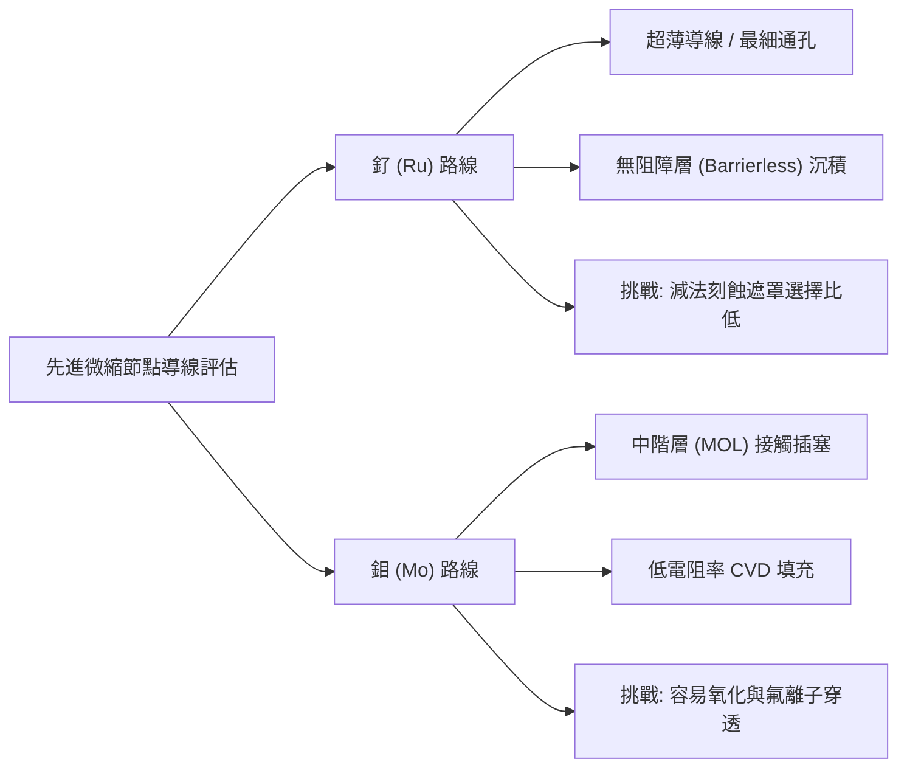

#### 1. 釕（Ru）的評估現況
釕金屬具備極短的電子平均自由程（$\lambda \approx 4.9\ \text{nm}$）與極高的電遷移阻抗（抗熔融與活化能高），且無需介電質擴散阻障層（Barrierless），成為次 2 奈米邏輯後段製程中最受青睞的候選者：
* **局部導線（Local Interconnect）**：在 M0 與 M1 層，數家領先晶圓代工廠正評估以「減法式 Ru 蝕刻」取代鑲嵌製程。此技術能產出深寬比大於 2:1 且完全無空隙（void-free）的細線路。
* **通孔插塞（Via Plug）**：針對最底層垂直連線，採用選擇性 ALD Ru 沉積技術直接自底部鎢或矽化物向上生長，能有效消除底部阻障層電阻，文獻與代工評估數據顯示可降低通孔串聯電阻達 $30\%$ 至 $50\%$。

#### 2. 鉬（Mo）的評估現況
鉬具備與鎢接近的熱膨脹係數與電遷移穩定性，但塊材電阻率（$\sim 5.3\ \mu\Omega\cdot\text{cm}$）與室溫電子散射特性在特定厚度區間略優於 Ru：
* **前段與中段接觸（MOL Contact）**：主要晶圓製造商在評估將閘極接觸插塞（Contact to Gate, CB）與源／汲極接觸插塞（Contact to Active, CA）材料由傳統的氟化鎢（$\text{WF}_6$ 沉積）替換為鉬。鉬可在較薄的成膜厚度下展現出低薄膜電阻，且使用無氟前驅物沉積可避免傳統鎢製程中氟離子攻擊閘極高介電層（High-k Dielectric）的可靠度問題（見第 28 章）。
* **整合挑戰**：Mo 在含有微量氧氣的環境下極易生成揮發性低但電阻極高的氧化鉬（如 $\text{MoO}_2$），且其沉積後的晶粒定向對生長基底極為敏感，目前設備商正集中火力研發專用的基底前處理技術以誘導特定結晶方向（如 (110) 晶向）之均勻成長。

整體而言，次 2 奈米世代之互連金屬結構已打破過去數十年由銅全面主導的單一格局。在接觸層與金屬第一層，依據導線幾何尺寸、寄生電容與訊號延遲（RC Delay）的折衷考量，業界正呈現以 Ru 作為最細互連、以 Mo 作為高縱深接觸插塞的雙軌發展態勢。

## 本章重點

1. **接觸電阻隨微縮呈現非線性劇增（電阻牆）**：受限於費米能階釘紮（Fermi Level Pinning）與場發射穿隧厚度，比接觸電阻率（$\rho_c$）調控難度提高；加上幾何接觸面積縮小及擴散阻障層無法等比例減薄，使接觸孔與通孔電阻成為先進節點元件效能的關鍵瓶頸。
2. **極細線寬下的電子散射效應主導有效電阻率**：當導線尺寸接近或小於電子平均自由路徑（MFP）時，表面散射（FS 模型）與晶界散射（MS 模型）造成電阻率急遽竄升；評估奈米導線材料優劣的核心指標為體電阻率與電子平均自由路徑之乘積 $\rho_0 \times \lambda_0$，而非單純比較體電阻率。
3. **新型導線金屬（Co、Ru、Mo）各具材料與整合優勢**：鈷（Co）具備約 $400^\circ\text{C}$ 的自下而上熱迴流填孔能力與優良抗電遷移特性；釕（Ru）具極短平均自由路徑（$\sim 6.6\text{ nm}$）且具備無阻障層（Barrierless）沉積可行性；鉬（Mo）體電阻率低且晶粒易退火長大，能耐受較高沉積熱預算。
4. **自對準通孔（SAV 與 FSAV）突破微影疊對誤差極限**：利用材料間的高蝕刻選擇比與雙重硬遮罩架構，容許微影曝光發生側向偏離而不造成電氣短路；完全自對準通孔（FSAV）利用上下層導線正交交集界定通孔邊界，能消除導線端點延伸裕度（Zero Enclosure），大幅壓縮標準單元高度。
5. **面積選擇性沉積（ASD）轉化對準機制為表面化學熱力學驅動**：利用金屬與介電質表面化學吸附活化能差異，搭配自組裝單分子層（SAMs）鈍化，實現無微影圖案化的自底向上精準沉積；製程中需導入「沉積—蝕刻」超循環以修復選擇性遺失問題。
6. **減法式金屬蝕刻（DME）顛覆雙鑲嵌製程極限**：針對 Ru、Mo 等難熔金屬改採全面性薄膜沉積、高溫長晶退火與乾式蝕刻，消除了側壁高電阻阻障層並最大化導電截面；結合流動式 CVD 間隙填充或故意懸突封口的氣隙（Air Gap）結構，能顯著降低層間寄生電容與 RC 延遲。
7. **設備整合平台走向超高真空與高溫化**：金屬沉積機台普遍採用多腔體高真空整合架構以防止界面氧化；乾式蝕刻設備則採用高溫腔壁設計以維持揮發性副產物（如 $\text{RuO}_4$、$\text{MoF}_6$）的抽除效率，避免微毛刺與副產物再沉積缺陷。

---


## 重點圖卡

複習時看這幾張就能抓住本章重點；[圖卡庫](../cards.md)可以下載成圖片。

<div class="ix-cards" markdown>

<figure markdown>
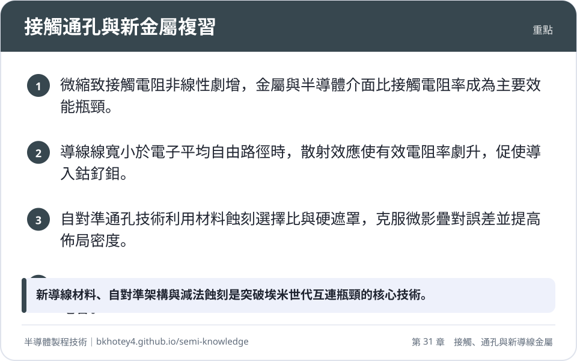
<figcaption>重點圖卡：接觸通孔與新金屬複習</figcaption>
</figure>

<figure markdown>
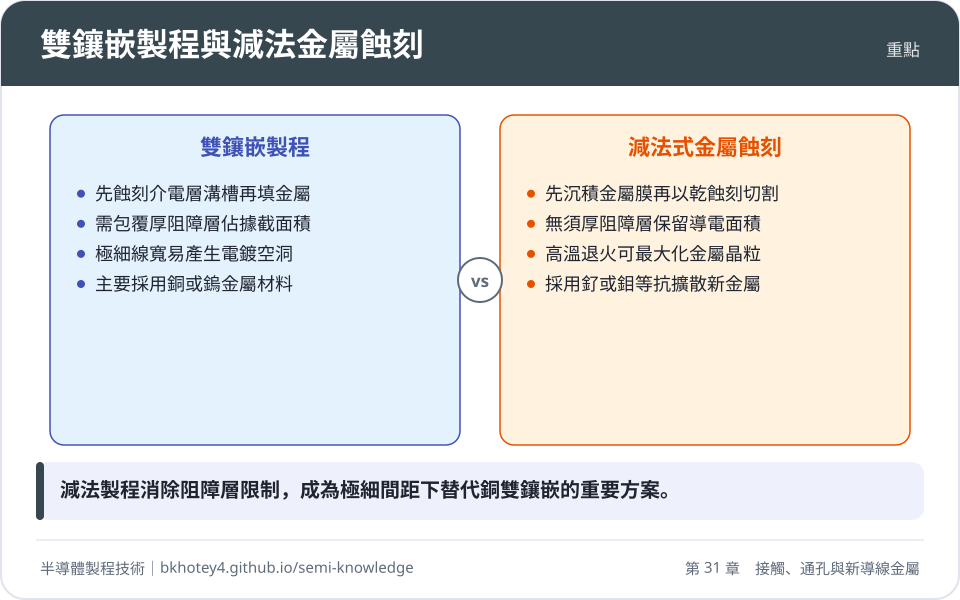
<figcaption>重點圖卡：雙鑲嵌製程與減法金屬蝕刻</figcaption>
</figure>

<figure markdown>
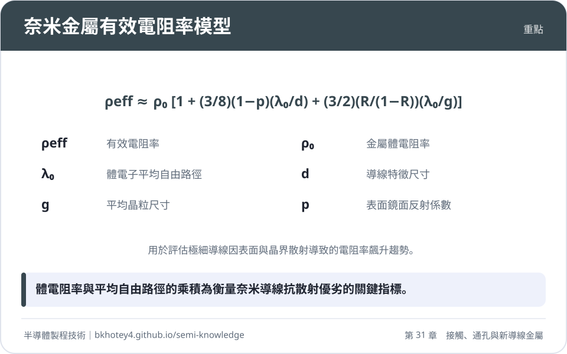
<figcaption>重點圖卡：奈米金屬有效電阻率模型</figcaption>
</figure>

<figure markdown>
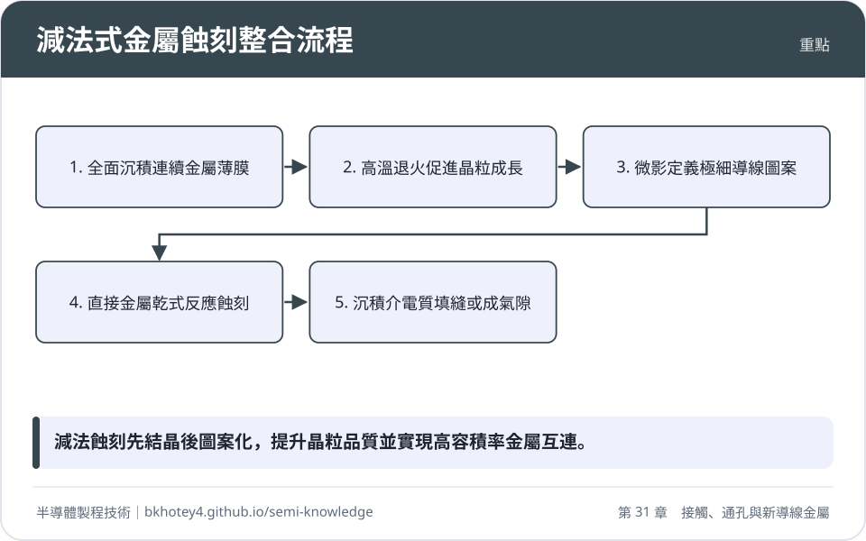
<figcaption>重點圖卡：減法式金屬蝕刻整合流程</figcaption>
</figure>

</div>

## 習題

**1.** 在先進互連微縮評估中，假設一個圓形通孔直徑為 $D = 10\text{ nm}$，深度為 $20\text{ nm}$。
(a) 若採用傳統銅鑲嵌製程，孔內周圍必須包覆厚度 $t_{\text{barrier}} = 1.5\text{ nm}$ 的擴散阻障層／襯墊層，計算留給主體金屬（Cu）的有效導電截面積佔通孔總截面積的百分比。
(b) 若改採無阻障層之釕（Ru）金屬填充，通孔全由 Ru 金屬佔滿。若已知純銅在 10 nm 通孔環境中的有效電阻率受散射影響飆升為 $\rho_{\text{eff, Cu}} = 25\ \mu\Omega\cdot\text{cm}$，而無阻障層 Ru 在同尺寸下的有效電阻率為 $\rho_{\text{eff, Ru}} = 12\ \mu\Omega\cdot\text{cm}$，請忽略阻障層本身的導電貢獻，計算此通孔在兩種方案下的本體電阻值（單位為 $\Omega$），並比較何者電阻較低。

??? success "參考解答"
    **(a) 計算主體金屬截面積佔比：**
    通孔總半徑 $R = \frac{D}{2} = 5\text{ nm}$。
    總截面積 $A_{\text{total}} = \pi R^2 = \pi \times 5^2 = 25\pi\text{ nm}^2 \approx 78.54\text{ nm}^2$。
    
    扣除阻障層厚度後，Cu 導體半徑 $r_{\text{Cu}} = R - t_{\text{barrier}} = 5 - 1.5 = 3.5\text{ nm}$。
    主體 Cu 截面積 $A_{\text{Cu}} = \pi r_{\text{Cu}}^2 = \pi \times 3.5^2 = 12.25\pi\text{ nm}^2 \approx 38.48\text{ nm}^2$。
    
    有效導電截面積百分比：

    $$\frac{A_{\text{Cu}}}{A_{\text{total}}} = \frac{12.25\pi}{25\pi} = \frac{12.25}{25} = 49\%$$
    
    **(b) 計算通孔電阻值：**
    通孔長度（深度）$L = 20\text{ nm} = 20 \times 10^{-7}\text{ cm}$。
    
    1. **Cu 通孔方案**：
       - 截面積 $A_{\text{Cu}} = 38.48 \times 10^{-14}\text{ cm}^2$。
       - 有效電阻率 $\rho_{\text{eff, Cu}} = 25\ \mu\Omega\cdot\text{cm} = 25 \times 10^{-6}\ \Omega\cdot\text{cm}$。
       - 通孔電阻 $R_{\text{via, Cu}} = \rho_{\text{eff, Cu}} \frac{L}{A_{\text{Cu}}} = \frac{25 \times 10^{-6} \times 20 \times 10^{-7}}{38.48 \times 10^{-14}} = \frac{5.0 \times 10^{-11}}{3.848 \times 10^{-13}} \approx 130.0\ \Omega$。
    
    2. **Ru 通孔方案**：
       - 截面積 $A_{\text{Ru}} = A_{\text{total}} = 78.54 \times 10^{-14}\text{ cm}^2$。
       - 有效電阻率 $\rho_{\text{eff, Ru}} = 12\ \mu\Omega\cdot\text{cm} = 12 \times 10^{-6}\ \Omega\cdot\text{cm}$。
       - 通孔電阻 $R_{\text{via, Ru}} = \rho_{\text{eff, Ru}} \frac{L}{A_{\text{Ru}}} = \frac{12 \times 10^{-6} \times 20 \times 10^{-7}}{78.54 \times 10^{-14}} = \frac{2.4 \times 10^{-11}}{7.854 \times 10^{-13}} \approx 30.6\ \Omega$。
    
    **結論**：無阻障層 Ru 通孔的電阻（約 $30.6\ \Omega$）遠低於銅鑲嵌通孔（約 $130.0\ \Omega$），電阻降低約 $76.5\%$。

**2.** 釕（Ru）的塊材電阻率約為 $7.1\ \mu\Omega\cdot\text{cm}$，顯著高於純銅的體電阻率（約 $1.7\ \mu\Omega\cdot\text{cm}$）。請從「電子散射機制（FS 與 MS 模型）」與「薄膜幾何與界面工程」兩個維度，詳細論述為何在線寬小於 $10\text{ nm}$ 的極限微縮互連中，Ru 導線的整體導電效能與可靠度會優於 Cu 導線。

??? success "參考解答"
    釕在極細線寬下超越銅的物理機制如下：
    
    1. **電子散射模型維度（$\rho_0 \times \lambda_0$ 指標）**：
       - 根據 Fuchs-Sondheimer（FS）表面散射與 Mayadas-Shatzkes（MS）晶界散射模型，當導線特徵尺寸 $d$ 縮小至平均自由路徑 $\lambda_0$ 以下時，散射主導有效電阻率，其增長斜率正比於 $\rho_0 \times \lambda_0$。
       - 銅的電子平均自由路徑極長（$\lambda_0 \approx 39.0\text{ nm}$），其乘積 $\rho_0 \times \lambda_0 \approx 6.6 \times 10^{-16}\ \Omega\cdot\text{m}^2$；而釕的平均自由路徑極短（$\lambda_0 \approx 6.6\text{ nm}$），乘積 $\rho_0 \times \lambda_0 \approx 4.7 \times 10^{-16}\ \Omega\cdot\text{m}^2$。
       - 當線寬 $d < 10\text{ nm}$ 時，銅發生強烈的表面與晶界彈性/非彈性碰撞，電阻率呈指數暴增；釕因特徵尺寸仍接近其平均自由路徑，尺寸效應造成的電阻率增幅遠平緩於銅。
    
    2. **薄膜幾何與界面工程維度（無阻障層特性）**：
       - 銅具有高度向介電質擴散的傾向，必須在溝槽內包覆不低於 $1.5\text{ nm}$ 的高電阻率擴散阻障層（如 $\text{TaN}/\text{Ta}$），在 $10\text{ nm}$ 線寬下阻障層佔據截面積超過 $50\%$，使銅實際導電面積急劇萎縮。
       - 釕具備高鍵結能與低界面擴散係數，具備「無阻障層（Barrierless）」直接沉積於介電質的特性，導線截面能 $100\%$ 由純金屬填充。儘管 Ru 塊材電阻率較高，但極大的有效導電截面積使其整體總電阻低於含阻障層的極細銅導線。
    
    3. **可靠度維度**：
       - 釕的熔點高達 $2334^\circ\text{C}$（遠高於銅的 $1085^\circ\text{C}$），金屬原子的熱活化能與晶格凝聚能高，在高電流密度下抗電遷移（EM）壽命比銅高出 $2 \sim 3$ 個數量級。

**3.** 微影圖案化中的邊緣放置誤差由下式決定：$EPE = \frac{\Delta CD}{2} + 3\sigma_{LER} + OVL$。設某先進金屬層的臨界尺寸偏差 $\Delta CD = 1.0\text{ nm}$，線邊緣粗糙度標準差 $\sigma_{LER} = 0.8\text{ nm}$，微影機台疊對誤差向量大小 $OVL = 2.5\text{ nm}$。
(a) 計算此製程條件下的邊緣放置誤差（$EPE$）。
(b) 若相鄰兩條平行金屬導線的實體間距為 $S = 10\text{ nm}$，介電層擊穿臨界電場為 $E_{\text{break}} = 8\text{ MV/cm}$，兩線工作電壓差為 $V_{DD} = 0.8\text{ V}$。若未採用自對準技術，當通孔發生上述最大 $EPE$ 側向偏離時，通孔與相鄰金屬線之間的等效間距縮小為多少？此時介電質承受的局部電場強度是否超過擊穿臨界電場？

??? success "參考解答"
    **(a) 計算 EPE：**

    $$EPE = \frac{\Delta CD}{2} + 3\sigma_{LER} + OVL = \frac{1.0}{2} + 3(0.8) + 2.5 = 0.5 + 2.4 + 2.5 = 5.4\text{ nm}$$
    
    **(b) 計算有效間距與局部電場：**
    - 通孔朝向相鄰金屬線產生實體偏離，偏離量為 $EPE = 5.4\text{ nm}$。
    - 偏離後的有效實體間距：

      $$s_{\text{eff}} = S - EPE = 10\text{ nm} - 5.4\text{ nm} = 4.6\text{ nm} = 4.6 \times 10^{-7}\text{ cm}$$

    - 此時兩導體間的平均局部電場強度：

      $$E = \frac{V_{DD}}{s_{\text{eff}}} = \frac{0.8\text{ V}}{4.6 \times 10^{-7}\text{ cm}} \approx 1.74 \times 10^6\text{ V/cm} = 1.74\text{ MV/cm}$$

    - **比較結論**：局部電場 $1.74\text{ MV/cm}$ 雖然尚未超過理想瞬時擊穿電場 $E_{\text{break}} = 8\text{ MV/cm}$，但間距由 $10\text{ nm}$ 劇縮至 $4.6\text{ nm}$ 使局部電場激增超過 2.17 倍。這將引發高場漏電流並大幅加速經時介電質崩潰（TDDB）劣化；若存在幾何尖端效應，局部電場更可能引發突發性擊穿短路。此計算亦證實了導入自對準通孔（SAV）防止實體間距縮減的必要性。

**4.** 直接金屬蝕刻（DME）已成為次 2 奈米互連的重要候選製程。
(a) 寫出釕（Ru）以含氧電漿進行反應性蝕刻的主要揮發性反應產物化學式及其大約沸點。
(b) 寫出鉬（Mo）以氟基電漿進行反應性蝕刻的主要揮發性反應產物化學式及其大約沸點。
(c) 在減法蝕刻後整合「氣隙（Air Gap）」技術。若相鄰兩條平行導線原採用有效介電常數 $k_1 = 2.7$ 的固態低介電材料，改用氣隙結構後使有效介電常數降至 $k_2 = 1.5$。在幾何形狀與線距不變的條件下，計算線間寄生電容降低了多少百分比？

??? success "參考解答"
    **(a) Ru 蝕刻反應產物與沸點：**
    主要揮發性產物為四氧化釕（$\text{RuO}_4$），反應式為 $\text{Ru} + 2\text{O}_2 \rightarrow \text{RuO}_4 \uparrow$。
    沸點典型值約為 $130^\circ\text{C}$。
    
    **(b) Mo 蝕刻反應產物與沸點：**
    主要揮發性產物為六氟化鉬（$\text{MoF}_6$），反應式為 $\text{Mo} + 3\text{F}_2 \rightarrow \text{MoF}_6 \uparrow$。
    沸點典型值約為 $35^\circ\text{C}$（室溫下即為氣態）。
    
    **(c) 計算線間寄生電容降低百分比：**
    平行導線間電容公式為 $C = \frac{\varepsilon_0 k_{\text{eff}} A}{d}$。當幾何尺寸 $A$（平行側壁面積）與 $d$（線距）保持不變時，電容正比於有效介電常數 $k_{\text{eff}}$。
    
    電容變化百分比：

    $$\Delta C\% = \frac{C_1 - C_2}{C_1} \times 100\% = \frac{k_1 - k_2}{k_1} \times 100\%$$

    $$\Delta C\% = \frac{2.7 - 1.5}{2.7} \times 100\% = \frac{1.2}{2.7} \times 100\% \approx 44.44\%$$
    
    導入氣隙結構可使相鄰導線間的寄生電容降低約 $44.4\%$，顯著減小互連 RC 延遲與動態功耗。

**5.** 在完全自對準通孔（FSAV）架構中，請說明其如何透過上層導線壕溝（$M_{x+1}$）與下層導線（$M_x$）的正交幾何關係，以及多重材料硬遮罩的化學選擇性蝕刻機制，達成「零端點延伸裕度（Zero Enclosure）」並解決邊緣放置誤差？

??? success "參考解答"
    FSAV 的實現機制與幾何優勢如下：
    
    1. **正交幾何界定**：
       - 傳統通孔依賴單獨微影開出圓孔，若微影沿 X 或 Y 方向偏離，通孔即偏離導線。
       - FSAV 不使用微細圓孔光罩，而是將通孔定義於下層導線條帶（$M_x$）與上層正交壕溝條帶（$M_{x+1}$）投影重合的交集柱狀區域。
    
    2. **多元硬遮罩選擇比蝕刻**：
       - 層間預先覆蓋兩種具備正交圖案且化學蝕刻特性互補的硬遮罩材料（例如非晶矽與金屬氧化物）。
       - 微影曝光時允許開口設計得較寬鬆並跨越多條線路；隨後利用兩道具備極高化學蝕刻選擇比的非等向性乾式蝕刻，第一道蝕刻依上層壕溝圖案移除遮罩 A，第二道蝕刻依下層線條圖案移除暴露的介電層。
       - 只有兩層幾何正交重疊的矩形柱體內之介電質會被掏空形成通孔，其餘區域完全受到耐蝕硬遮罩的物理保護。
    
    3. **消除端點延伸（Zero Enclosure）之效益**：
       - 由於通孔側壁由下層導線邊界與上層壕溝邊界自發性定義，物理上消除了通孔「滑出」導線邊緣引發短路或面積收縮的機制。
       - 佈局規則不再需要在導線末端額外保留向外延伸的補償重疊區（Overlap/Enclosure），導線對端點（Tip-to-Tip）距離得以極限壓縮，消除多餘寄生電容，並使標準單元繞線軌道高度顯著縮減（如由 6T 縮減至 4T）。

---

## 本章術語

- **Specific Contact Resistivity（比接觸電阻率，$\rho_c$）**：用以量化金屬與半導體或金屬接觸介面單位面積阻抗的物理量，單位為 $\Omega\cdot\text{cm}^2$。
- **Fermi Level Pinning（費米能階釘紮）**：半導體介面處因高密度界面能態或懸鍵使費米能階位置固定於能隙特定位置，導致蕭特基障礙高度難以藉由更換金屬功函數調控的現象。
- **Mean Free Path, MFP（電子平均自由路徑，$\lambda_0$）**：固態物理中傳導電子在兩次相鄰碰撞（散射）之間自由運動的平均距離。
- **$\rho_0 \times \lambda_0$ Figure of Merit（電阻率與平均自由路徑乘積品質因數）**：評估微細金屬薄膜在尺寸微縮下抗散射與電阻率增長特性的核心品質指標。
- **Edge Placement Error, EPE（邊緣放置誤差）**：微影與圖案化過程中，因疊對誤差、臨界尺寸變異及線邊緣粗糙度共同導致特徵圖形邊緣相對於理論設計位置的實體偏差量。
- **Self-Aligned Via, SAV（自對準通孔）**：利用相鄰材料間的化學乾式蝕刻選擇比與硬遮罩保護，使通孔圖案在微影偏離下仍能自動對準下層導線的垂直互連結構。
- **Fully Self-Aligned Via, FSAV（完全自對準通孔）**：同時利用下層導線邊界與上層壕溝正交重疊之幾何交集界定通孔邊界，徹底消除雙向微影對準裕度需求的互連技術。
- **Area-Selective Deposition, ASD（面積選擇性沉積）**：利用基板不同表面化學特性的熱力學活化能差異，使前驅物僅在特定材料區域成核生長而抑制非目標區域沉積的自底向上製程。
- **Direct Metal Etch, DME（直接金屬蝕刻）**：先於平整介電質上全面沉積連續金屬薄膜，再以微影與反應離子電漿蝕刻直接切割出導線立柱的減法式互連圖案化技術。
- **Air Gap（氣隙）**：在相鄰金屬導線之間刻意留出未填充固態介電質的真空或氣體封閉間隙，利用介電常數 $k \approx 1$ 的物理特性大幅降低線間寄生電容的結構。
- **Time-Dependent Dielectric Breakdown, TDDB（時間相依介電質擊穿）**：在低於瞬時擊穿電場的長期電應力作用下，絕緣介電層因內部缺陷聚集成導電通道而導致絕緣性突發失效的可靠度物理機制。


## 互動學習

<div class="quiz" data-quiz="06-03"></div>


## 產業最新進展

本節由每日產業新聞自動補充，說明本章技術在產業上的最新發展。

<!-- updates -->
（目前尚無補充。）
