# 第 32 章　晶背供電網路

!!! abstract "學習目標"
    - 理解傳統正面供電網路在先進製程節點面臨的電壓降 (IR Drop) 與佈線擁塞挑戰
    - 掌握晶背供電網路 (BSPDN) 的基本架構、物理原理及其對提升晶片效能與面積效率的貢獻
    - 辨析 PowerVia 與超級電軌 (Super Power Rail) 等不同晶背供電實作路徑的技術差異
    - 學習晶背供電製程中的關鍵技術，包括晶圓鍵合、極致薄化與高深寬比通孔蝕刻

## 32.1 傳統正面供電之瓶頸與電壓降挑戰

在積體電路（IC）的演進過程中，微縮定律（Scaling Law，見第 5 章）始終引導著電晶體密度的提升。然而，隨著製程節點進入 3 奈米（nm）以下，甚至邁向埃米（Angstrom）時代，傳統的後段製程（Back-End-of-Line, BEOL）架構面臨了前所未有的物理極限。本節將深入探討傳統正面供電架構在極限微縮下所遭遇的瓶頸，特別是電阻劇增引發的電壓降（IR Drop）問題，以及其對系統效能與佈線資源的負面影響。

### 32.1.1 後段製程導線微縮與電阻爆炸

在傳統的晶片架構中，訊號傳輸導線與功率分配網路（Power Delivery Network, PDN）均位於電晶體層（Front-End-of-Line, FEOL）之上的金屬層中。這種架構稱為「正面供電」。隨著電晶體尺寸縮小，金屬導線的寬度與間距（Pitch）也必須同步微縮。

根據電阻公式：
$$R = \rho \frac{L}{A} = \rho \frac{L}{W \cdot H}$$
其中：
*   $R$ 為導線電阻。
*   $\rho$ 為材料電阻率（Resistivity）。
*   $L$ 為導線長度。
*   $A$ 為截面積，由寬度 $W$ 與高度 $H$ 決定。

當製程節點微縮，導線寬度 $W$ 縮減，導致截面積 $A$ 急遽下降。更嚴重的是，當導線尺寸接近電子平均自由路徑（Mean Free Path，銅約為 39 nm）時，會產生顯著的尺寸效應（Size Effect）。這包括晶界散射（Grain Boundary Scattering）與表面散射（Surface Scattering），使得有效電阻率 $\rho$ 不再是常數，而是隨著線寬縮小而指數級增加（見第 29 章與第 31 章）。

在先進節點中，底層金屬（如 M0、M1）的電阻值相較於 28 nm 節點已增加數十倍。這種電阻爆炸直接導致了嚴重的 RC 延遲（RC Delay），抵消了電晶體開關速度提升帶來的優勢。

### 32.1.2 電壓降 (IR Drop) 的物理機制與影響

功率分配網路的主要任務是將電源電壓（$V_{DD}$）與接地（$V_{SS}$）從封裝端傳遞至晶片上的每一個電晶體。在正面供電架構中，電力必須由最上層的厚金屬（Global Routing）逐層向下傳遞至最底層的局部導線（Local Interconnect），最後進入電晶體的源極（Source）與汲極（Drain）。

#### 靜態與動態電壓降
電壓降（IR Drop）定義為電流 $I$ 流經具備電阻 $R$ 的網路時產生的電位損失：
$$V_{drop} = I \times R_{PDN}$$

1.  **靜態電壓降 (Static IR Drop)**：主要取決於 PDN 的平均電阻與平均電流。隨著導線變細，即使電流不變，電壓降也會因 $R$ 的增加而上升。
2.  **動態電壓降 (Dynamic IR Drop)**：發生在大量邏輯閘同時切換時，瞬間產生的峰值電流（Switching Current）在 PDN 的寄生電感與電阻上產生的壓降。

#### 對電晶體驅動電流的影響
電晶體的飽和電流 $I_{ds,sat}$ 與過驅動電壓（Overdrive Voltage）成正比。簡化模型如下：
$$I_{ds,sat} \propto (V_{GS} - V_{th})^\alpha$$
其中 $\alpha$ 通常在 1 到 2 之間。當 $V_{DD}$ 因 IR Drop 而下降，實際到達電晶體端的有效電壓 $V_{effective} = V_{DD} - V_{drop}$ 減小，導致驅動電流下降，進而增加邏輯閘的切換時間（Gate Delay），最終降低晶片的最高工作頻率。

!!! note "電壓縮減與 IR Drop 的矛盾"
    為了降低功耗，先進製程的 $V_{DD}$ 已降至 0.7V 甚至更低。在這種情況下，即便只有 50mV 的 IR Drop，也會佔去電壓預算的 7% 以上，這對雜訊容限（Noise Margin）與時序收斂（Timing Closure）是極大的威脅。

### 32.1.3 訊號與供電的資源競爭

在正面供電架構中，訊號線與電源線在有限的金屬層空間內互不相讓。這種競爭關係在底層金屬層（Lower Metal Layers）尤為激烈。

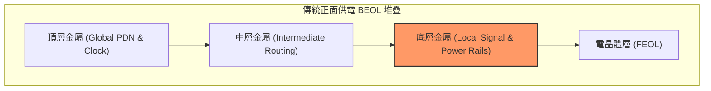

如上圖所示，底層金屬層必須同時承擔：
1.  **標準單元內的訊號互連**。
2.  **橫跨標準單元的電源軌（Power Rails）**。

為了降低 IR Drop，設計者必須增加電源軌的寬度或密度，但這會直接佔用訊號佈線的通道（Routing Tracks）。截至撰寫時，在 5 奈米以下的設計中，PDN 往往佔用了超過 20% 至 30% 的底層佈線資源。這種「佈線擁塞」（Routing Congestion）迫使晶片設計必須增加金屬層數（目前已達 15-20 層以上）或增大晶片面積，導致成本上升。

### 32.1.4 標準單元高度與物理極限

標準單元（Standard Cell）的高度通常以「軌道數」（Track Height, T）來衡量。例如，6T 單元表示其高度可容納 6 條金屬線。

在傳統設計中，每個標準單元的頂部與底部各有一條 $V_{DD}$ 與 $V_{SS}$ 的電源軌（Power Rail）。當我們試圖將單元高度從 6T 微縮至 5T 或更低（例如 4.5T）時，會遇到以下物理限制：
1.  **電源軌寬度限制**：若電源軌太細，電阻過大導致 IR Drop 無法承受；若電源軌維持寬度，則留給訊號線的空間（Tracks）將不足，導致無法完成自動佈線（Place and Route）。
2.  **通孔（Via）空間限制**：將電力從上層導引至電源軌需要大量的通孔。在極小單元中，通孔的物理尺寸與疊對誤差（Overlay）限制了其佈置的可能性（見第 17 章）。

這種現象被稱為「標準單元微縮瓶頸」。如果供電問題不解決，單純縮小電晶體的閘極長度（Gate Length）已無法有效縮減晶片整體的邏輯區域面積。

### 32.1.5 熱管理與電磁遷移挑戰

除了電壓降，傳統正面供電架構還面臨熱與可靠度的挑戰：
*   **焦耳熱（Joule Heating）**：高電阻導線在通過電流時會產生熱量。由於 BEOL 被低介電常數材料（Low-k Dielectrics，見第 30 章）包圍，而 Low-k 材料通常是熱的不良導體，熱量難以散發，導致晶片局部過熱（Hotspots）。
*   **電磁遷移（Electromigration, EM）**：在極細的導線中，高電流密度會推動金屬原子位移，導致導線斷路或短路。為了滿足 EM 壽命要求，必須限制電流或增加導線截面積，這與微縮目標背道而馳。

!!! example "產業實例"
    在 7nm 節點，IR Drop 對時序的影響尚可透過設計工具（EDA）的優化來補償；但在 3nm 節點，若不改變供電架構，為了維持電壓穩定性，晶片可能需要犧牲高達 15% 的有效面積來佈置電源線。這正是產業轉向晶背供電（BSPDN）的核心驅動力。

總結而言，傳統正面供電架構在電阻物理特性、佈線資源分配以及標準單元微縮三方面已達極限。電壓降不再只是訊號完整性的問題，而是限制半導體繼續微縮的核心障礙。

## 32.2 晶背供電網路 (BSPDN) 之物理架構

晶背供電網路（Backside Power Delivery Network, BSPDN）的出現，代表了半導體架構從傳統的「由上而下」單面互連模式，演進為「雙面夾心」的三維空間互連模式。本節將深入探討 BSPDN 的物理架構設計原理，分析其如何透過空間解耦（Decoupling）解決深次微米節點下的電學瓶頸。

### 32.2.1 電源與訊號的空間解耦原理

在傳統的正面供電網路（Frontside Power Delivery Network, FSPDN）中，電源線（Vdd）與接地線（Vss）必須與訊號線（Signal lines）競爭有限的金屬層空間。隨著電晶體微縮至 3 奈米節點以下，標準元件（Standard Cell）的高度持續壓縮，導致正面金屬層（見第 29 章與第 31 章）變得極度擁擠。

BSPDN 的核心物理意義在於「空間解耦」。其設計原理是將原本位於晶圓正面（Frontside）複雜的金屬互連堆疊進行功能性拆分：
1.  **正面互連層**：專職負責邏輯訊號的傳輸（Signal Routing），優化電容與串音（Crosstalk）。
2.  **背面互連層**：專職負責電能的分配（Power Delivery），優化電阻與電流承載能力（Electromigration resistance）。

這種架構將電源分配網路從邏輯電路的上方移至下方，使得電源電流不再需要穿過多達 10 至 15 層的細微訊號金屬層，而是直接從晶圓背面透過較短的垂直路徑抵達電晶體源極（Source）與汲極（Drain）。

### 32.2.2 供電路徑與電阻模型分析

評估供電網路優劣的核心指標是電壓降（IR Drop）。根據歐姆定律，電壓降 $\Delta V$ 可表示為：
$$\Delta V = I \cdot R_{total} = I \cdot \sum_{i=1}^{n} (R_{metal,i} + R_{via,i})$$
其中 $I$ 為負載電流，$R_{metal,i}$ 為第 $i$ 層金屬的電阻，$R_{via,i}$ 為連接各層的通孔電阻。

#### 1. 傳統 FSPDN 的路徑挑戰
在 FSPDN 架構中，電流必須從封裝凸塊（Bump）開始，經過最頂層的厚金屬（如 M15），逐層向下通過直徑愈來愈小、電阻愈來愈高的通孔（Via），最終到達底層金屬（M0/M1）以驅動電晶體。
*   **路徑長度**：典型值約為 5 $\mu m$ 至 10 $\mu m$ 的垂直堆疊高度。
*   **通孔數量**：需經過 10 層以上的通孔轉換，每一層通孔都會引入額外的接觸電阻。
*   **電阻累積**：由於底層金屬線寬極窄（低於 20 nm），其單位長度電阻呈指數級增長，導致總體 $R_{total}$ 居高不下。

#### 2. BSPDN 的物理優勢
BSPDN 縮短了電源供應點與消費點之間的物理距離。電流從晶圓背面的電源凸塊進入，經過寬大的背面金屬層（Backside Metal Layers），直接透過矽穿孔（TSV）或微型通孔（Nano-TSV/PowerVia）連接至電晶體層。
*   **路徑縮短**：垂直路徑減少至數百奈米至數微米（視晶圓薄化程度而定）。
*   **電阻降低**：由於背面空間充裕，可以使用較寬、較厚的導線，且避開了正面高密度訊號線的干擾。

下表對比了 FSPDN 與 BSPDN 在典型 2 奈米節點下的結構差異：

| 特性參數 | 傳統正面供電 (FSPDN) | 晶背供電 (BSPDN) |
| :--- | :--- | :--- |
| **供電路徑長度** | 長（需穿過完整後段製程堆疊） | 短（直接從基板背面進入） |
| **通孔級數** | 10 - 15 級 | 1 - 3 級 |
| **金屬線寬限制** | 受限於訊號線密度，極窄 | 空間寬裕，可採用較寬線寬 |
| **典型 IR Drop 損耗** | 較高（> 10% Vdd） | 較低（可降低約 30% - 50%） |

### 32.2.3 結構優勢：正面佈線簡化與面積微縮

BSPDN 不僅改善了電學特性，更對標準元件的物理佈局（Layout）產生了革命性影響。

#### 1. 消除正面電軌（Power Rail）
在傳統設計中，標準元件的頂部和底部必須預留空間給電源軌（Vdd/Vss Rail），這被稱為「軌道高度」（Track Height）。隨著製程演進，軌道高度從 9T、7T 縮減至 5T 甚至更低。然而，金屬線愈細，電阻愈高，使得 5T 以下的設計面臨嚴重的供電不足。
藉由 BSPDN，這些電源軌被移往晶圓背面。這意味著：
*   **單元高度壓縮**：標準元件不再需要為正面電源軌留位，可進一步縮小單元面積（Cell Area），實現邏輯密度的持續微縮。
*   **繞線資源釋放**：原本被電源軌佔據的金屬層空間現在可完全用於訊號繞線，解決了佈線擁塞（Routing Congestion）問題。

#### 2. 訊號完整性提升
由於電源線與訊號線在空間上分離，兩者之間的寄生電容（Parasitic Capacitance）顯著降低。這有助於減少訊號線上的串音干擾，並提升時脈頻率。截至撰寫時，實驗數據顯示 BSPDN 可使處理器時脈在相同功耗下提升約 8% 至 10%。

### 32.2.4 垂直三維空間的物理架構模型

BSPDN 的物理架構可以透過下方的 Mermaid 圖示來理解其堆疊層次：

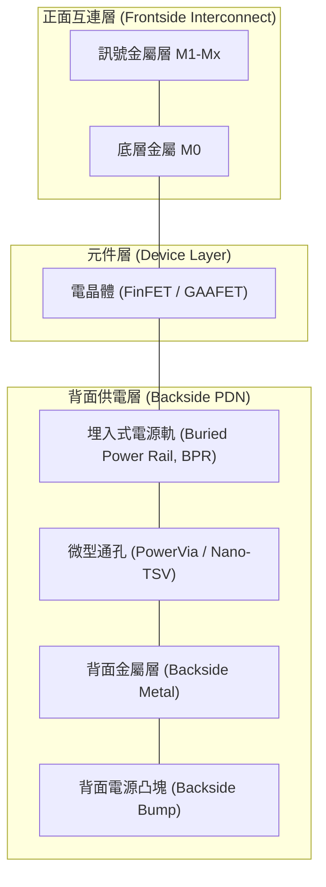

在該架構中，**埋入式電源軌（Buried Power Rail, BPR）** 扮演了關鍵的轉接角色。BPR 通常埋設在淺溝槽隔離（STI，見第 20 章）區域內，位於電晶體層的下方或側面。它作為正面電路與背面供電路徑的物理接口。

!!! note "物理意義：從 2D 供電到 3D 供電"
    傳統 FSPDN 雖然在物理上也是三維堆疊，但在邏輯上屬於「單向供給」，所有能量與資訊都由上方進入。BSPDN 則實現了真正的「雙向接入」，將晶圓視為一個具有厚度的活性介質，正面負責「運算與通訊」，背面負責「能源供給」。這種垂直分離模式是未來 3D IC 與異質整合（見第 39 章）的重要技術基礎。

### 32.2.5 實作挑戰與物理限制

儘管 BSPDN 在理論上具有顯著優勢，但其物理架構的實現必須克服極高的製程複雜度。

1.  **晶圓薄化（Wafer Thinning）**：為了讓背面通孔能夠精準接合至正面元件，晶圓必須從原本約 775 $\mu m$ 的厚度薄化至 500 nm 以下。如此極端的薄化會導致晶圓機械強度大幅下降，必須依賴臨時鍵合（Temporary Bonding）技術支撐。
2.  **對準精度（Alignment Accuracy）**：背面通孔與正面 BPR 的對準必須達到奈米級精度。由於是從背面進行微影（Lithography），傳統的對準標記（Alignment Mark）可能因晶圓薄化與鍵合過程產生形變，這對微影設備的疊對（Overlay）能力提出了極高要求（見第 17 章）。
3.  **熱管理物理**：在 FSPDN 中，矽基板充當了部分散熱路徑；而在 BSPDN 中，由於背面佈滿了金屬線與絕緣層，且晶圓極薄，熱量的橫向擴散能力受限，可能導致電晶體工作時的局部熱點（Hotspot）問題更加嚴重。

!!! example "產業實例"
    截至撰寫時，Intel 提出的 **PowerVia** 技術與台積電（TSMC）提出的 **超級電軌（Super Power Rail, SPR）** 均屬於 BSPDN 的物理架構範疇。Intel 的 PowerVia 側重於利用深型通孔直接連接至元件層；而台積電的 SPR 則更強調利用埋入式電源軌（BPR）與背面金屬的直接接觸，以最大化減少正面單元面積。這些技術預計在 2 奈米（N2）及更先進的 A16 節點進入量產。

總結而言，BSPDN 的物理架構是半導體製程從平面微縮轉向空間優化的必然結果。它透過將電源網路遷移至背面，不僅解決了 IR Drop 的電學瓶頸，更為正面訊號佈線與標準元件的持續微縮騰出了關鍵空間。在後續小節中，我們將詳細討論支撐此架構的關鍵元件——PowerVia 與 BPR 的具體製程實作。

<!-- fig:1 -->
<figure markdown>
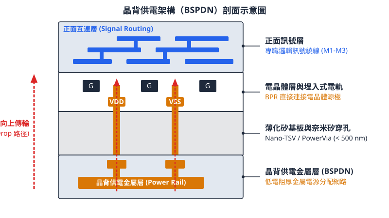
<figcaption>圖 32-1　晶背供電架構剖面圖（AI 繪製的示意圖）</figcaption>
</figure>

## 32.3 核心技術實作：PowerVia 與超級電軌

### 埋入式電源軌（BPR）的結構與前段製程整合

為了將電源分配網路（PDN）從元件正面轉移至晶背，架構演進的第一個重要里程碑是在前段製程（FEOL）中引進「埋入式電源軌」（Buried Power Rail, BPR）。傳統正面電源軌（Power Rail）佔據金屬第一層（M1）或金屬第零層（M0）的線寬空間，導致標準單元（Standard Cell）的高度的微縮受限於金屬軌道數（Track Height）。

埋入式電源軌的核心概念，是將原本位於電晶體上方的電源導線，向下沉降並埋入淺溝槽隔離（STI）氧化層或基板內部。結構上，BPR 位於兩組相鄰電晶體之間的隔離區域下方。其與前段製程的整合順序如下：

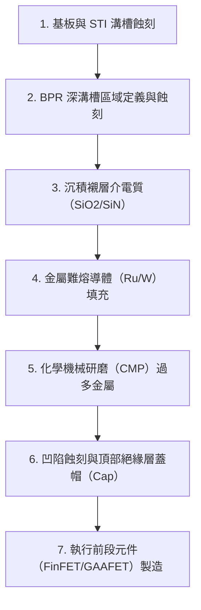

在材料選擇上，BPR 與後段金屬化製程（BEOL）有本質上的不同。由於 BPR 是在電晶體通道與源極/汲極（S/D）形成前或過程中建構，它必須承受後續高溫退火製程（如高介電金屬閘極製程中的快速熱退火，見第 27 章與第 28 章），其熱預算（Thermal Budget）極高。因此，銅（Cu）因低熔點與易擴散污染矽通道的特性而無法用於 BPR。

產業普遍採用難熔金屬（Refractory Metals），如鎢（W）或釕（Ru）。釕具備優異的高溫穩定性、極低的自擴散係數，且在極小尺寸下（導線寬度小於 $10\text{ nm}$）的平均自由程（Mean Free Path）短，其體電阻率下降幅度優於銅，成為 BPR 金屬填充的首選材料。

BPR 與電晶體的電氣連接透過垂直金屬觸點（BPR Contact, VBPR）實現。VBPR 穿透 STI 絕緣層，將 BPR 向上連接至源極/汲極的磊晶層或前段導通孔（V0）。然而，BPR 雖然釋放了 M1 的空間，但若電源仍需透過正面 BEOL 往下傳輸至 BPR，其電壓降（IR Drop）改善有限。因此，BPR 的完整潛能必須仰賴晶背奈米矽穿孔將其與晶背電源網路接通。

---

### PowerVia 技術與奈米矽穿孔（nTSV）

PowerVia 為一種利用晶背導通孔將電源直接引入前段接觸層的架構。在此技術中，正面 BEOL 僅用於訊號傳輸，而晶背金屬層透過奈米矽穿孔（Nano-TSV, nTSV）穿透極薄化的單晶矽基板，直接與金屬第零層（M0）或埋入式電源軌相連。

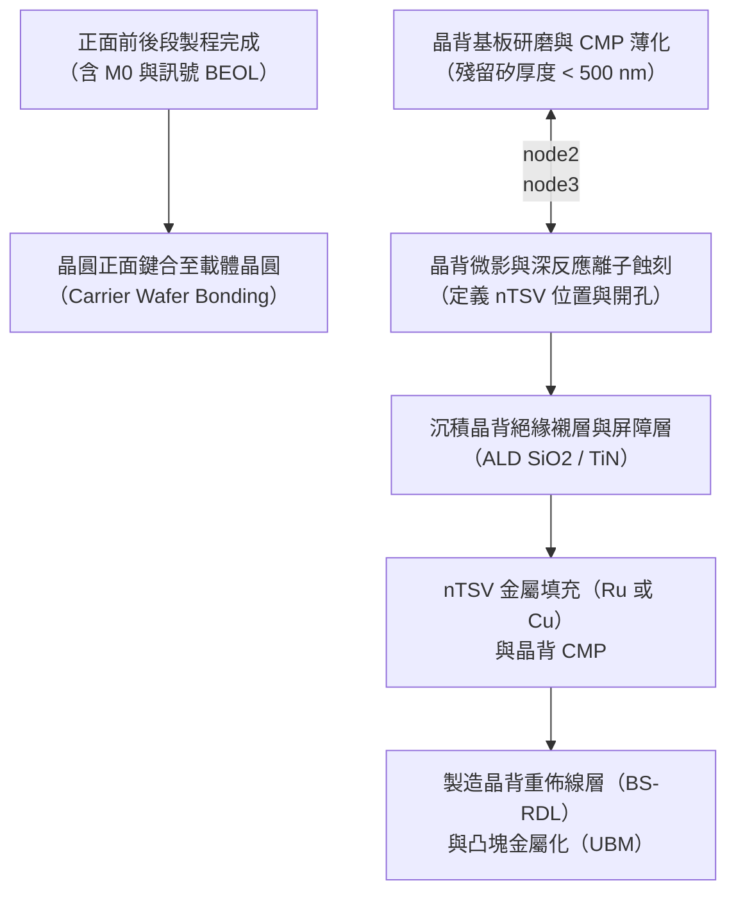

nTSV 的物理尺寸遠小於封裝級的傳統 TSV（見第 39 章）。典型 nTSV 的臨界尺寸（CD）約在 $10\text{ nm}$ 至 $50\text{ nm}$ 之間，縱橫比（Aspect Ratio）通常維持在 $3:1$ 至 $10:1$ 的範圍內。由於其尺寸已微縮至奈米數量級，蝕刻與填充的精準度直接影響晶片良率。

在電氣特性上，nTSV 的電阻可以透過幾何形狀與材料參數計算。設 nTSV 為圓柱體，其電阻 $R_{\text{nTSV}}$ 表達如下：

$$R_{\text{nTSV}} = \rho \cdot \frac{h}{\pi \cdot \left(\frac{d}{2}\right)^2} = \frac{4 \rho h}{\pi d^2}$$

其中 $\rho$ 為填充金屬之電阻率，$h$ 為矽基板薄化後的剩餘厚度（即 nTSV 的高度），$d$ 為 nTSV 的直徑。

以 PowerVia 結構而言，電阻控制關鍵在於薄化厚度 $h$ 的均勻性。若矽基板過厚，不僅 $R_{\text{nTSV}}$ 成正比增加，高縱橫比的深溝槽蝕刻（见第 19 章）亦易產生空洞（Void）；反之若薄化過度，則可能傷害前端元件通道。

在 PowerVia 整合流程中，nTSV 是在正面所有晶體與 BEOL 金屬層製造完畢後，由晶背向下向下開孔並止於 M0 金屬層底部。此順序避免了高溫對 nTSV 材料的限制，因此 nTSV 內部可以採用電鍍銅（Cu）或化學氣相沉積釕（Ru）進行填充。

---

### 超級電軌（Super Power Rail, SPR）之設計細節

超級電軌（Super Power Rail, SPR）為晶背供電架構的進一步演化。在 PowerVia 架構中，晶背金屬仍透過 nTSV 連接至正面 M0，再由 M0 接至源極/汲極；而 SPR 則直接消除正面 M0 的電源過渡層，允許晶背電源直接透過 SPR 結構觸及電晶體源極/汲極的磊晶層（Epitaxial S/D）。

!!! note "PowerVia 與 Super Power Rail 的極限結構差異"
    PowerVia 的連接路徑為：晶背金屬 $\rightarrow$ nTSV $\rightarrow$ 正面 M0/V0 $\rightarrow$ 源極/汲極接觸。
    超級電軌（SPR）的連接路徑為：晶背金屬 $\rightarrow$ SPR（直接穿透/邊界接觸）$\rightarrow$ 源極/汲極磊晶層。SPR 的開孔邊界直接重疊於電晶體的源極與汲極邊緣，不再經過任何正面金屬層轉接。

SPR 的主要設計挑戰在於與標準單元接觸的介面工程。在全環繞閘極電晶體（GAAFET/Nanosheet，見第 6 章）架構下，電晶體的源極/汲極磊晶層體積極小，晶背蝕刻若直接止於磊晶區域，製程對準邊限（Overlay Tolerance）的要求極高（通常小於 $2\text{ nm}$）。

為實現 SPR 與標準單元的直接接觸，製程採用自對準晶背接觸（Self-Aligned Backside Contact）技術：

1. **矽化金屬介面形成（Silicide Formation）：** 在晶背開孔暴露源極/汲極矽/矽鍺區域後，先以原子層沉積（ALD）沉積鈦（Ti）或鎳（Ni），並經由雷射退火（Laser Anneal）形成低電阻的矽化金屬接觸（如 $\text{TiSi}_x$），以降低特徵接觸電阻率（$\rho_c < 10^{-9} \ \Omega\cdot\text{cm}^2$）。
2. **單元高度極限縮減（Track Height Reduction）：** 在傳統供電架構下，標準單元邊界必須留出包含正/負電源軌（$V_{DD}$ / $V_{SS}$）的金屬線路，單元高度通常為 5-Track（5T）或 6-Track。導入 SPR 後，電源軌完全自正面消失，標準單元高度可進一步微縮至 4-Track 甚至 3.5-Track，顯著提升電晶體密度。

```
【傳統正面供電 6T 標準單元】             【SPR 晶背供電 4T 標準單元】
+-----------------------+ VDD Rail    +-----------------------+ Cell Border
| Signal Routing Zone   | M1 Line     | Signal Routing Zone   | M1 Line
|                       | M1 Line     |                       | M1 Line
|                       | M1 Line     |                       | M1 Line
|                       | M1 Line     |                       | M1 Line
+-----------------------+ VSS Rail    +-----------------------+ Cell Border
 (電源軌佔用正面 M1 空間)               (電源軌移至晶背，正面純跑訊號)
```

---

### 不同晶背供電實作路徑之比較

晶背供電網路的實現可依據整合深度與結構分為三大路徑：BPR 搭配正面供電、PowerVia（晶背至 M0/V0）、以及超級電軌（SPR，晶背直連源極/汲極）。三者在電氣效能、製程複雜度及晶片面積節省上展現出不同的折衷（Trade-off）。

下表列出此三種實作路徑的關鍵技術參數與特性比較：

| 評估項目 | 埋入式電源軌（BPR + 正面供電） | PowerVia 架構 | 超級電軌（Super Power Rail, SPR） |
| :--- | :--- | :--- | :--- |
| **電源導通孔連接點** | 連接至正面 M0 / M1 | 連接至正面 M0 金屬層底部 | 直連電晶體源極/汲極磊晶層 |
| **金屬軌道數（Track Height）** | 5.5T $\rightarrow$ 5T | 5T $\rightarrow$ 4.5T | 4.5T $\rightarrow$ 3.5T ~ 4T |
| **標準單元面積縮減率（典型值）** | $5\% \sim 8\%$ | $8\% \sim 12\%$ | $10\% \sim 15\%$ |
| **接觸電阻 ($R_c$) 與 PDN 電阻** | 中等（受限於正面長走線） | 顯著降低（PDN 電阻降 $>30\%$）| 極低（PDN 電阻降低 $>50\%$） |
| **前段熱預算限制** | 極高（金屬需耐高溫退火）| 低（前段完成後才製作晶背） | 中至高（需考慮晶背矽化退火）|
| **微影對準（Overlay）挑戰** | 高（前段雙重/多重圖案化）| 高（晶背對準正面 M0） | 極高（晶背自對準直連磊晶層）|
| **主要金屬材料** | 釕（Ru）、鎢（W） | 銅（Cu）、釕（Ru） | 釕（Ru）、鈦矽化物（$\text{TiSi}_x$） |

!!! warning "常見誤解：晶背供電僅能改善電源品質"
    許多人誤以為 BSPDN 的唯一優勢在於降低 IR Drop。事實上，如上表所示，SPR 等技術將電源軌移出正面後，釋放了大量原本用於電源傳輸的金屬軌道空間。這使得正面金屬層能重新進行繞線最佳化（Routing Optimization），大幅減少訊號線之間的寄生電容與金屬擁塞度（Congestion），從而在相同功率下提升 $8\% \sim 10\%$ 的邏輯時脈運作效能。

在實際製程選擇上，PowerVia 技術因為避開了前段高溫退火對金屬材料的苛刻限制，製程整合難度相對較低，成為初期的量產方案；而超級電軌（SPR）透過消弭中間轉換層，雖然帶來了極高的晶背對準微影技術（見第 17 章）挑戰，但其提供的晶片面積縮減率（典型值 $10\% \sim 15\%$）與電壓降改善幅度最大，為極限微縮節點下不可或缺的核心實作技術。

!!! example "產業實例"
    截至撰寫時，Intel 已在其 Intel 20A 及 18A 製程節點中導入名為 PowerVia 的晶背供電技術，成功實現電源線與訊號線的分離；而台積電（TSMC）亦宣佈於 A16 製程節點中採用超級電軌（Super Power Rail, SPR）架構，將電源軌直接與電晶體源極/汲極接通，進一步壓縮標準單元面積並提高能源效率。

## 32.4 關鍵製程整合：鍵合、薄化與通孔成形

### 載體晶圓鍵合技術與對準極限

將晶圓供電網路（BSPDN）從正面轉移至背面，製程順序必須經歷「先完成正面元件與後段金屬（FEOL/BEOL）— 翻轉晶圓 — 背面加工」的流程。由於傳統單晶矽基板在加工前厚度約為 775 $\mu\text{m}$，若直接進行背面加工，結構強度不足以支撐後續的微影與蝕刻應力。因此，必須先將已完成正面製程的元件晶圓（Device Wafer）正面朝下，與一塊高平坦度的載體晶圓（Carrier Wafer）進行鍵合（Bonding）。

鍵合技術主要分為有機膠材鍵合（Adhesive Bonding）與直接氧化物對氧化物融合鍵合（Oxide-to-Oxide Fusion Bonding / Direct Bond Interconnect）。在先進節點的高溫熱預算限制下，常採用低溫氧化物融合鍵合。鍵合前，元件晶圓的最頂層介電質與載體晶圓表面需經過極度嚴格的化學機械研磨（CMP，見第 24 章），使其表面均方根粗糙度（RMS Roughness）達到 $R_q < 0.2\text{ nm}$，並經由氧電漿進行表面活化（Surface Activation），形成高濃度的矽羥基（$\text{Si-OH}$）。當兩晶圓在室溫下接觸時，首先藉由氫鍵（Hydrogen Bond）相互吸引：

$$\text{Si-OH} + \text{HO-Si} \longrightarrow \text{Si-OH}\cdots\text{HO-Si}$$

隨後經過 200°C 至 300°C 的低溫退火製程（見第 27 章），氫鍵脫水轉化為強固的共價矽氧鍵（$\text{Si-O-Si}$）：

$$\text{Si-OH} + \text{HO-Si} \longrightarrow \text{Si-O-Si} + \text{H}_2\text{O}\uparrow$$

介面鍵合能量（Bonding Energy, $\gamma$）可由以下界面熱力學關係式描述：

$$\gamma = \gamma_1 + \gamma_2 - \gamma_{12}$$

其中 $\gamma_1$ 與 $\gamma_2$ 為兩鍵合表面的表面自由能，$\gamma_{12}$ 為兩者形成介面後的介面能。經過退火後，鍵合強度可達 $2.0\text{ J/m}^2$ 以上，足承受後續機械研磨的強大剪應力。

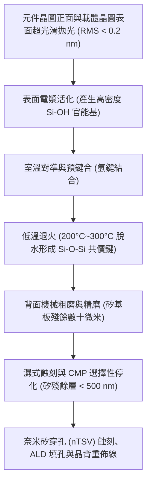

鍵合過程面臨的最大挑戰為幾何變形所導致的「疊對誤差」（Overlay Error，見第 17 章）。晶圓鍵合時若存在微小的夾持應力或局部熱梯度，會誘發非線性扭曲（Grid Distortion）。當晶圓翻轉進行背面微影曝光時，光學步進機必須透過微米甚至奈米級的紅外線（IR）或透視對準標記（Through-Silicon Marks），精確對準位於晶圓內部的正面金屬層。截至撰寫時，先進晶背供電節點要求晶背至晶正面的對準精度必須控制在 10 nm 以內，這對微影機台的鏡頭非線性修正與應力補償模型提出了極嚴苛的要求。

!!! warning "鍵合引發的印出效應 (Print-through Effect)"
    若鍵合介面夾雜顆粒（Particle）或空隙（Void），將導致晶圓表面產生微小的局部隆起。在後續薄化研磨後，此隆起會造成元件層厚度不均或焦點偏移（ defocus），進而導致微影失敗。因此，鍵合製程必須在 ISO Class 1 級別極致清潔的無塵室環境下執行（見第 55 章）。

---

### 晶圓極致薄化與應力調控

鍵合完成後，必須將元件晶圓原本約 775 $\mu\text{m}$ 厚的矽基板進行極致薄化（Extreme Thinning），將殘餘矽厚度（Remaining Silicon Thickness）減至數百奈米（典型值為 100 nm 至 500 nm），甚至停在埋氧化層（BOX）或磊晶阻擋層上（見第 9 章）。

薄化流程通常分為三個階段：
1. **粗磨（Coarse Grinding）**：使用粗顆粒金剛石砂輪迅速去除約 90% 以上的矽基板，將厚度降至約 30–50 $\mu\text{m}$。
2. **精磨（Fine Grinding）**：選用微米級細顆粒砂輪，減緩研磨速率，將厚度進一步削減至 5–10 $\mu\text{m}$。此階段會在矽表面留下微觀的機械損傷層（Sub-surface Damage, SSD）。
3. **應力消除與終點停化（CMP / Chemical Wet Etch）**：利用化學機械研磨（CMP）配合高選擇比的鹼性化學漿料，或使用四甲基氫氧化胺（TMAH）、硝酸/氫氟酸混合液（$\text{HNO}_3/\text{HF}$）進行濕式蝕刻（見第 20 章），徹底清除 SSD 層，並精密控制停在化學阻擋層上。

總厚度變異（Total Thickness Variation, TTV）與應力管理是薄化製程的核心指標。薄化後殘餘矽層的厚度不均勻性必須控制在 $\pm 5\text{ nm}$ 內。薄化過程中，由於元件正面多層金屬與介電質（BEOL）的熱膨脹係數（CTE）與矽基板不匹配，極易引發強烈的晶圓彎曲（Bow and Warp）。薄膜應力與晶圓曲率的關係可由斯托尼公式（Stoney's Equation）精確量化：

$$\sigma_f = \frac{E_s \cdot t_s^2}{6 (1 - \nu_s) t_f} \left( \frac{1}{R} - \frac{1}{R_0} \right)$$

符號說明：
- $\sigma_f$：元件與膜層之累積有效應力（$\text{Pa}$）
- $E_s$：矽基板之楊氏模數（$\text{Pa}$）
- $\nu_s$：矽基板之泊松比（無因次）
- $t_s$：基板總厚度（$\text{m}$）
- $t_f$：沉積膜層總厚度（$\text{m}$）
- $R_0, R$：薄膜沉積/薄化前後之晶圓曲率半徑（$\text{m}$）

由上式可知，隨著基板厚度 $t_s$ 呈二次方劇烈減小，微小的內應力即可能導致極大的曲率變化 $1/R$，引發晶圓邊緣剝離（Delamination）或晶格缺陷破裂。因此，必須在薄化過程中實施動態應力補償（應力調節層沉積）與精密邊緣 trim（Edge Trimming）製程，預先切除晶圓邊緣易崩裂的懸空區域。

---

### 奈米矽穿孔 (nTSV) 開孔與 ALD 金屬填充

傳統三維積體電路的矽穿孔（TSV，見第 39 章）直徑通常在 1 $\mu\text{m}$ 至 10 $\mu\text{m}$ 之間，深度達數十微米。但在晶背供電網路中，為了連接晶背金屬與晶體管源極/汲極（Source/Drain）或超級電軌（Super Power Rail, SPR），穿孔直徑必須微縮至 20 nm 至 50 nm 級別，稱為奈米矽穿孔（nano-TSV, nTSV）或晶背通孔（Backside Via）。

```
【傳統 TSV 與晶背 nTSV 結構對比】

     [傳統 3D-IC TSV]                   [晶背供電 nTSV]
   
     +---------------+                +---------------+
     |   介電絕緣層   |                | 晶背金屬線 RDL |
     |  +---------+  |                +-------+-------+
     |  |         |  |                        |  (CD ~ 20-50 nm)
     |  |  Cu 導體 |  | (CD ~ 1-10 um)         |  nTSV (Ru/W)
     |  |         |  |                        v
     |  +---------+  |                +---------------+
     |   高深寬比   |                | 源極/汲極接點 | (M0/VB0)
     +---------------+                +---------------+
```

nTSV 的製造包含以下核心關鍵步驟：

#### 1. 高深寬比反應離子蝕刻（HAR RIE）
在薄化後的晶背透過 EUV 微影（見第 14 章）定義出直徑約 30 nm 的開孔圖案。接著利用反應離子蝕刻（RIE，見第 19 章），使用含氟電漿（如 $\text{SF}_6/\text{C}_4\text{F}_8$ 或 $\text{CF}_4/\text{H}_2$）穿透殘餘矽層，準確停在正面底部的源/汲極擴散層金屬接點（如釕 $\text{Ru}$ 或鈷 $\text{Co}$，見第 31 章）上。由於深寬比（Aspect Ratio）常達 10:1 以上，蝕刻過程中必須嚴格控制側壁鈍化，避免產生底切（Undercut）或偏斜（Micro-trenching）。

#### 2. 超薄介電隔離層沉積
為了防止 nTSV 內部的金屬原子擴散至矽基板中導致元件漏電，必須在通孔側壁沉積一層極薄（1–3 nm）且高品質的二氧化矽（$\text{SiO}_2$）或氮化矽（$\text{Si}_N$）絕緣層。物理氣相沉積（PVD）與傳統 CVD 因階梯覆蓋力（Step Coverage）不足，無法滿足此要求；必須採用原子層沉積（ALD，見第 23 章）。ALD 利用自限性（Self-limiting）表面反應，能在高深寬比奈米孔內均勻鋪展：

$$\text{SiH}_2[\text{N(C}_2\text{H}_5)_2]_2 + \text{O}_3 \overset{\text{ALD}}{\longrightarrow} \text{SiO}_2 + \text{副產物}$$

#### 3. 阻障層與種子層沉積
金屬擴散阻障層（Barrier Layer）通常採用 ALD 沉積氮化鈦（$\text{TiN}$）或氮化鉭（$\text{TaN}$），厚度僅需 1–2 nm。若採用銅（$\text{Cu}$）作為填充材料，需再以 PVD 或 ALD 沉積銅種子層；然而在 30 nm 以下的 nTSV 中，銅易受電遷移（Electromigration）與孔洞填充限制，截至撰寫時，無種子層（Seedless）直填金屬如釕（Ru）或鎢（W）已成為主流替代方案。

#### 4. 原子層金屬填充與 CMP 平坦化
採用化學氣相沉積鎢（CVD W）或 ALD 釕（ALD Ru）實現自底向上（Bottom-up）或無縫隙（Seam-free）填孔。以 ALD 釕為例，使用五羰基釕 $\text{Ru(CO)}_5$ 作為前驅物：

$$\text{Ru(CO)}_5 \xrightarrow{\Delta} \text{Ru(s)} + 5\text{CO(g)}\uparrow$$

填孔完成後，利用特製的金屬 CMP 漿料拋除晶背多餘的金屬層，使 nTSV 端面與晶背介電層完全齊平。

| 參數指標 | 傳統 TSV (見第 39 章) | 晶背奈米矽穿孔 (nTSV) |
| :--- | :--- | :--- |
| **臨界尺寸 (CD)** | $1.0\,\mu\text{m} \sim 10.0\,\mu\text{m}$ | $20\,\text{nm} \sim 50\,\text{nm}$ |
| **深度 (Depth)** | $10\,\mu\text{m} \sim 100\,\mu\text{m}$ | $100\,\text{nm} \sim 500\,\text{nm}$ |
| **深寬比 (Aspect Ratio)** | $5:1 \sim 10:1$ | $5:1 \sim 20:1$ |
| **絕緣/阻障層技術** | PECVD $\text{SiO}_2$ / PVD $\text{TaN}$ | ALD $\text{SiO}_2$ / ALD $\text{TiN}$ |
| **主要填充金屬** | 電鍍銅 ($\text{Cu}$) | ALD/CVD 釕 ($\text{Ru}$) 或 鎢 ($\text{W}$) |

---

### 晶背金屬重佈線層、鈍化層與微凸塊整合

nTSV 平坦化完成後，晶背即展露出與正面邏輯電路直接相連的極高密度電源接點。下一步需在晶背製作金屬重佈線層（Backside Redistribution Layer, B-RDL），以建立低電阻的供電網絡。

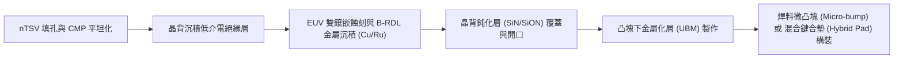

#### 1. 晶背金屬重佈線層（B-RDL）製程
與正面 BEOL 多層繁複的細微導線不同（見第 29、30 章），晶背 B-RDL 專為電力輸送設計，主要由 2 至 4 層較厚且低電阻的金屬層組成。金屬材質多採用銅（$\text{Cu}$）或釕（$\text{Ru}$）。若採用銅導線，通常採用傳統的雙鑲嵌製程（Dual Damascene），搭配低介電常數（Low-$k$）介電質以降低寄生電容。由於晶背沒有極細微訊號線的擁塞問題，導線厚度與寬度可放大數倍，有效將供電網路的線路電阻降至最低。

#### 2. 晶背保護與鈍化層（Passivation Layer）
金屬重佈線層完成後，必須覆蓋高品質的晶背鈍化層，以保護金屬導線免受環境濕氣、應力及離子污染（如 $\text{Na}^+$、$\text{K}^+$）的侵蝕。鈍化層材料通常為無應力氮化矽（$\text{SiN}_x$）、氧化氮化矽（$\text{SiON}$）或聚醯亞胺（Polyimide, PI）的複合疊層。沉積技術多採用電漿增強化學氣相沉積（PECVD，見第 21 章），並需嚴格控制薄膜的固有應力，避免導致已薄化的晶圓再次發生彎曲。

#### 3. 凸塊下金屬化層（UBM）與外部連接介面
最後，在鈍化層上進行微影開孔，曝光出 B-RDL 的最外層接腳，並製作凸塊下金屬化層（Under Bump Metallization, UBM）。UBM 結構通常包含：
- **附著與阻障層**：如濺鍍鈦/鎳釩合金（$\text{Ti/NiV}$）或鉻/銅合金（$\text{Cr/Cu}$）。
- **可焊層**：如濺鍍或電鍍的銅（$\text{Cu}$）或鎳（$\text{Ni}$）。

UBM 完成後，可根據最終系統封裝需求（見第 37、38、39 章）銜接不同的接合技術：
- **微凸塊（Micro-bump / C4 Bump）**：利用電鍍錫銀合金（$\text{Sn-Ag}$）熱回焊形成凸塊，用於與封裝載板（Substrate）或中介板（Interposer）連接。
- **晶圓級無凸塊直接混合鍵合（Direct Hybrid Bonding / Cu-Cu Bonding）**：若需將晶背直接與另一塊電源管理 IC（PMIC）或深溝槽電容晶片（Deep Trench Capacitor Die）堆疊，則不製作凸塊，而是將 B-RDL 的銅接點與介電質表面拋光至極致平坦，直接進行銅-銅與介電質-介電質的原子級 3D 堆疊鍵合（見第 39 章）。

!!! example "產業實例：台積電 A16 與 Intel PowerVia 之技術選擇"
    截至撰寫時，主要半導體製造商在晶背供電的關鍵製程整合上展現了不同的路徑選擇：
    
    *   **Intel PowerVia 技術**：採取先製作全套元件與正面 BEOL 後段金屬，再透過鍵合薄化技術從晶背開鑿 nTSV。其 nTSV 穿透殘餘矽層後，直接接觸到正面最底層金屬（M0），能顯著改善晶片內部的電壓降（IR Drop）並釋放正面佈線空間。
    *   **台積電 A16 (Super Power Rail, SPR)**：進一步將供電軌道（Power Rail）直接埋入元件的源極/汲極擴散層底下。nTSV 無需經過 M0 即可直接將電力注入電晶體。這種結構對對準精度（Overlay）與極致薄化的控制要求極高，疊對誤差容許度已收窄至個位數奈米級別。

## 32.5 BSPDN 對熱管理與可靠度之影響

晶背供電網路（Backside Power Delivery Network, BSPDN）將電源分配網路從晶片正面移至背面，大幅緩解了正面多層金屬互連的擁塞與 $IR$ 降問題（見第 29 章與第 31 章）。然而，此一結構革新同時徹底改變了晶片的熱傳導路徑、電磁熱耦合特性以及後續製程的熱預算（Thermal Budget）限制。本節將從物理機制出發，深入分析晶圓薄化對熱阻的影響、晶背供電架構下的電遷移（Electromigration, EM）與電源完整性（Power Integrity, PI）特性，以及晶背後段製程對前段元件的熱預算挑戰。

### 散熱路徑改變與熱阻分析

在傳統正面供電架構中，半導體元件通道區（FEOL，見第 4 章與第 6 章）運作時產生的熱能，主要透過厚度約 $775\text{ }\mu\text{m}$ 的體矽基板（Bulk Silicon Substrate）傳導至晶片背面，再經由封裝熱界面材料（Thermal Interface Material, TIM）與散熱片散逸至外部環境。矽單晶具備良好的熱導率（$k_{\text{Si}} \approx 148\text{ W/(m}\cdot\text{K)}$，於室溫下），為主要熱傳導路徑。

當採用 BSPDN 架構時，晶圓必須經歷極度薄化製程（薄化至數百奈米至 $1\text{ }\mu\text{m}$ 以下，見第 24 章與第 39 章），並接合至載體晶圓（Carrier Wafer）或封裝基板。此一結構轉變導致散熱物理模型發生實質改變。

根據一維穩態熱傳導模型，元件總熱阻 $R_{th}$ 可表示為各層材料熱阻的串聯總和：

$$R_{th} = \sum_{i} \frac{d_i}{k_i \cdot A}$$

其中：
- $d_i$ 為第 $i$ 層材料之厚度（$\text{m}$）
- $k_i$ 為第 $i$ 層材料之熱導率（$\text{W/(m}\cdot\text{K)}$）
- $A$ 為垂直熱傳導之有效截面積（$\text{m}^2$）

元件接面溫度上升量 $\Delta T_j$ 則由總功耗 $P$ 與熱阻決定：

$$\Delta T_j = P \cdot R_{th} = P \cdot \sum_{i} \frac{d_i}{k_i \cdot A}$$

在 BSPDN 架構中，熱傳導路徑的變更產生了雙重效應：

1. **體矽熱容與熱導效應下降**：矽基板厚度 $d_{\text{Si}}$ 大幅縮減，雖然縮短了傳導距離，但由於接合介面（如氧化物對氧化物混合鍵合介面，熱導率 $k_{\text{SiO}_2} \approx 1.4\text{ W/(m}\cdot\text{K)}$）與低介電常數絕緣層（Low-$k$ 介電材料，$k_{\text{low-}k} < 0.5\text{ W/(m}\cdot\text{K)}$，見第 30 章）的導入，引入了高熱阻層。
2. **晶背金屬層作為散熱通道**：晶背供電導線通常具有較大的截面積與較高熱導率的金屬（如銅 $k_{\text{Cu}} \approx 400\text{ W/(m}\cdot\text{K)}$ 或釕 $k_{\text{Ru}} \approx 117\text{ W/(m}\cdot\text{K)}$），若直接經由晶背金屬延伸至封裝，可提供全新的低熱阻散熱路徑。

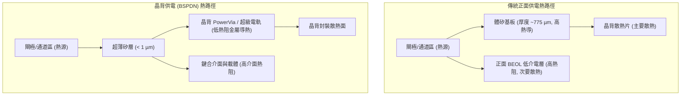

!!! warning "熱在地化效應 (Thermal Localization)"
    在 BSPDN 架構中，由於正面純化為訊號線且廣泛使用極低介電常數材料（ULK），其熱傳導率極低；若晶背金屬通孔（PowerVia）分布不均，將導致通道區產生的熱能無法及時傳導，形成區域性熱點（Hotspots），使局部通道溫度陡升，進一步引發載子遷移率下降（見第 2 章）與元件可靠度劣化。

---

### 電壓完整性與電遷移特性

#### 電源完整性（PI）改善機制

BSPDN 對電源完整性帶來了數量級的提升。傳統正面電源網路需跨越多達 15 至 20 層的金屬層，從最頂層厚金屬層逐層經由高電阻通孔（Via）降至最底層接觸點（M0/Contact）。線路總電阻與寄生電感大，導致顯著的 $IR$ 降與 $L \frac{di}{dt}$ 瞬態電壓突波。

導入 BSPDN 後，電源軌直接設置於矽基板背面，透過微型化貫孔（PowerVia 或微型 TSV，見第 31 章與第 39 章）直連前段電晶體的源極/汲極。電源傳輸路徑長度縮短了 80% 以上，顯著降低了直流電阻 $R_{DC}$ 與交流阻抗 $Z(f)$。

高頻下的電源網路阻抗可簡化表示為：

$$Z(f) = R + j2\pi f L + \frac{1}{j2\pi f C}$$

BSPDN 大幅降低了迴路電感 $L$，使得電源分配網路在寬頻段內均能維持低阻抗特性，降低了高頻切換時的電源雜訊。

#### 電遷移（EM）可靠度分析

電遷移是指金屬原子在高電流密度作用下，受到移動電子動量轉移（電子風，Electron Wind）而發生的質傳現象。金屬導線的平均失效時間（Mean Time to Failure, MTTF）由布萊克公式（Black's Equation）描述：

$$\text{MTTF} = A \cdot J^{-n} \exp\left( \frac{E_a}{k_B T} \right)$$

其中：
- $A$ 為結構與材料相關常數
- $J$ 為電流密度（$\text{A/cm}^2$）
- $n$ 為電流密度指數（對於銅與釕金屬互連，典型值 $n \approx 2$）
- $E_a$ 為電遷移活化能（$\text{eV}$）
- $k_B$ 為波茲曼常數（$8.617 \times 10^{-5}\text{ eV/K}$）
- $T$ 為絕對導線溫度（$\text{K}$）

在 BSPDN 架構下，電遷移特性呈現以下複合變化：

| 分析維度 | 正面供電架構 | 晶背供電架構 (BSPDN) | 對 EM 可靠度之影響 |
| :--- | :--- | :--- | :--- |
| **訊號線電流密度 ($J$)** | 電源與訊號共用空間，訊號線寬受限 | 訊號線獨占正面空間，線寬與間距彈性增加 | 正面訊號導線 $J$ 降低，EM 壽命提升 |
| **電源線截面積 ($A_{cross}$)** | 受限於前段微縮，M0/M1 軌道極窄 | 晶背可採用較厚、較寬的金屬線 | 電源軌 $J$ 大幅下降，有效抑制 EM 空洞形成 |
| **導線運作溫度 ($T$)** | 熱能可往厚矽基板傳導 | 局部熱阻增加可能提高導線運作溫度 $T$ | 指數項 $\exp(E_a / k_B T)$ 變小，導致 EM 壽命衰減 |

因此，儘管 BSPDN 藉由放大導線截面積大幅降低了電流密度 $J$，但若散熱設計不佳導致局部溫度 $T$ 上升，溫度效應將會侵蝕電流密度降低所帶來的 EM 壽命紅利。

---

### 晶背後段製程之熱預算限制

在 BSPDN 製程流程中，晶背圖案化、蝕刻、金屬沉積與退火步驟是在前段元件（FEOL）及正面後段互連（BEOL）均已製作完成後才進行（見第 28 章與第 29 章）。因此，晶背製程的熱預算（Thermal Budget）受到極為嚴格的限制。

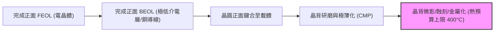

#### 熱預算上限物理邊界

晶背製程的最高容許溫度通常嚴格限制於 $400^\circ\text{C}$ 至 $450^\circ\text{C}$ 以下，主要受限於以下三個物理機制：

1. **矽化金屬接點相變與擴散**：
   前段源極/汲極接點採用的矽化金屬（如鎳鉑矽化物 NiPtSi，見第 31 章）在高於 $450^\circ\text{C}$ 時會發生熱聚集（Agglomeration）或相變，導致接觸電阻（Contact Resistance, $R_c$）劇烈飆升。

2. **超低介電常數（ULK）材料劣化**：
   正面 BEOL 採用的多孔性 Low-$k$ 或 ULK 材料（見第 30 章）受熱超過 $400^\circ\text{C}$ 時，其 Si-CH3 官能基容易脫落，引發材料致密化與吸濕，導致介電常數 $k$ 值不可逆上升及擊穿電壓下降。

3. **銅擴散與阻障層破壞**：
   正面銅雙鑲嵌結構（見第 29 章）中的金屬阻障層（如 TaN/Ta）在長時間高溫下可能失效，導致銅原子擴散至周圍介電層中，引發元件漏電流增長。

4. **摻雜物二次擴散（Re-diffusion）**：
   超淺接面（Ultra-Shallow Junctions）中的摻雜物（如硼、磷，見第 26 章與第 27 章）若經歷過高的後續熱預算，會發生急劇擴散，破壞短通道效應（SCE）的控制力。

#### 低溫晶背製程實作

為了在低於 $400^\circ\text{C}$ 的熱預算限制下完成高品質晶背金屬化，製程技術必須進行以下調整：

* **化學氣相沉積與原子層沉積**：傳統高溫 CVD 被低溫電漿輔助化學氣相沉積（PECVD，見第 21 章）與電漿輔助原子層沉積（PEALD，見第 23 章）取代，用於沉積晶背介電層與保角性阻障層。
* **低溫金屬退火**：晶背銅金屬或釕金屬的結晶與應力釋放退火，改採短時間雷射脈衝退火（Laser Spike Annealing, LSA）或低溫長時退火，確保熱能僅局部作用於晶背表面，而不傳導至正面元件層。

---

## 32.6 設備與廠商技術

晶背供電網路 (Backside Power Delivery Network, BSPDN) 的建構，打破了傳統前段製程 (Front-End of Line, FEOL) 與後段製程 (Back-End of Line, BEOL) 的明確分界。製造 BSPDN 需要將晶圓進行翻轉、鍵合、極度薄化，並自晶圓背面進行微米/奈米級矽穿孔 (Nano-TSV, nTSV) 的圖案化與金屬充填。這項技術對機台設備的對準精度、研磨均勻度及高深寬比蝕刻能力提出了前所未有的苛刻要求。

#### 32.6.1 晶背供電製程之設備需求與子系統總覽

實作 BSPDN 製程的核心設備模組與關鍵子系統可歸納為以下四大類：

1. **晶圓鍵合系統 (Wafer Bonding System)**：包含高精度紅外線/可見光雙面對準子系統 (Dual-side Optical Alignment System) 與電漿表面活化腔體 (Plasma Surface Activation Chamber)。其主要功能係在常溫或低溫下實現晶圓與載板 (Carrier Wafer) 之間無微孔洞 (Void-free) 的原子級鍵合。
2. **晶圓薄化與平坦化系統 (Wafer Thinning & Planarization System)**：包含高剛性金剛石粗/精研磨基座、原位光學干涉厚度感測器 (In-situ Optical Thickness Sensor)，以及高選擇比化學機械研磨 (CMP) 工具。研磨機台必須將晶圓基板厚度由數百微米均勻削減至數百奈米，並由 CMP 完成應力消除與晶背極致平坦化。
3. **高深寬比微影與蝕刻系統 (HAR Lithography & Etch System)**：包含高密度感應耦合電漿 (ICP) 或電容耦合電漿 (CCP) 反應腔，搭配脈衝電漿與氣體切換控制系統。用於在薄化後的矽基板或介電層中，蝕刻出高深寬比 (Aspect Ratio, $\text{AR} > 10:1$) 且側壁光滑的通孔。
4. **金屬阻障層與導體充填系統 (Metallization & Fill System)**：包含高定向性物理氣相沉積 (PVD)、原子層沉積 (ALD) 與化學氣相沉積 (CVD) 腔體，以及高均勻度電鍍 (Electroplating) 模組。用於完成通孔絕緣層、擴散阻障層與金屬鎢 (W) 或銅 (Cu) 的無縫隙充填。

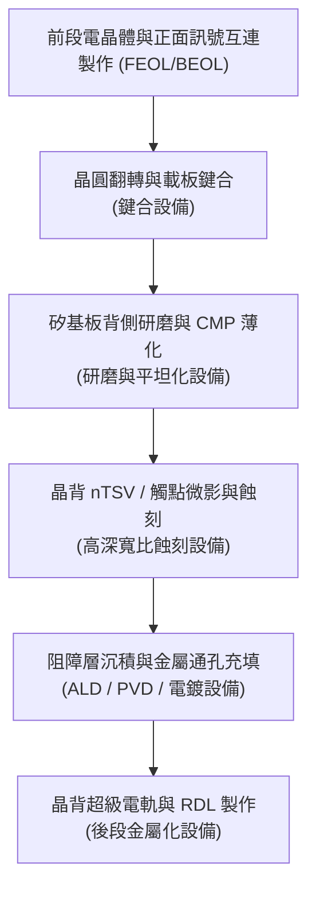

#### 32.6.2 主要設備廠商與產品線比較

在 BSPDN 製造鏈中，各家設備商依據其核心技術佈局不同的機台產品。下表列出主要設備廠商、代表產品系列及其在 BSPDN 製程中的技術特點與主要應用：

| 廠商 | 代表產品系列 | 技術路線與特點 | 主要應用 |
| :--- | :--- | :--- | :--- |
| **EV Group** | GEMINI, ComBond | 採用高精度光學對準與低溫表面電漿活化技術，實現次微米級對準精度與高鍵合強度 | 晶圓與載板暫時/永久鍵合、晶圓對晶圓直接鍵合 |
| **DISCO** | DGP 系列 | 採用高剛性金剛石研磨輪與空氣軸承主軸，整合原位厚度監控系統 | 矽基板高精度機械削薄與應力消除拋光 |
| **Applied Materials** | Sym3, Endura, Reflexion LK Prime, Producer | 整合導體電漿蝕刻、高定向金屬 PVD/ALD 阻障層及高選擇比 CMP 平坦化平台 | nTSV 蝕刻、金屬阻障層沉積與晶背 CMP 平坦化 |
| **Lam Research** | Syndion, Flex, ALTUS, SABRE, Striker | 具備深矽快速切換蝕刻、原子層絕緣膜沉積、鎢 CVD 與無縫隙銅電鍍技術 | 高深寬比通孔圖案化、絕緣層沉積與金屬通孔電鍍 |
| **Tokyo Electron** | Tactras, Trias | 單晶圓高均勻度介電質與金屬膜沉積，搭配高穩定度電漿蝕刻反應腔 | 晶背保護層沉積與金屬接觸洞蝕刻 |
| **Accretech** | — | 精密研磨機構整合多軸高感度厚度量測系統，即時控制晶圓邊緣與中央厚度 | 矽基板研磨過程之厚度原位監控與邊緣修整 |
| **KLA** | WaferSight | 利用光學干涉與雷射幾何感測，量測晶圓全區厚度分布與奈米級表面地形變化 | 薄化晶圓幾何形貌、應力翹曲與 TTV 檢測（見第 33 章） |

!!! example "產業實例：Intel PowerVia 與台積電 Super Power Rail (SPR)"
    截至撰寫時，主要半導體製造廠在晶背供電的架構與實作路徑上展現出不同方向：
    
    1. **Intel PowerVia 技術路徑**：於 Intel 20A 節點導入。其製程先完成前段電晶體與正面所有訊號互連層，隨後將晶圓翻轉並鍵合至載板。自晶圓背面進行矽基板研磨薄化，並蝕刻出 Nano-TSV (nTSV) 通孔，直接穿過基板連接至前段電晶體下方的金屬層。此技術將電源分配網路與訊號網路完全解耦，大幅降低正面繞線擁擠度。
    
    2. **台積電 (TSMC) Super Power Rail (SPR) 技術特點**：於 A16 節點規劃導入。與傳統穿透矽基板連接至前段金屬的 nTSV 不同，SPR 採用更緊湊的結構，將晶背金屬電軌直接接合至電晶體的源極/汲極 (Source/Drain) 磊晶區。這種結構省去了中間接觸金屬層的空間，進一步降低寄生電阻與晶片面積浪費，但對晶圓鍵合的對準精度（次 10 奈米級）以及晶背蝕刻停止控制提出了極高的製程挑戰。

#### 32.6.3 晶圓鍵合、薄化與平坦化設備實作

BSPDN 的首要關卡為晶圓翻轉後的載板鍵合與基板薄化。晶圓鍵合設備（如 EV Group GEMINI 與 ComBond 系列）的核心在於控制表面親水性與對準偏差。在親水性直接鍵合 (Hydrophilic Direct Bonding) 中，機台先以電漿活化晶圓表面，形成高密度的矽醇基 (Si-OH)。晶圓在對準系統輔助下於室溫接合，隨後於退火腔體中發生縮合反應：

$$\text{Si-OH} + \text{Si-OH} \xrightarrow{\Delta} \text{Si-O-Si} + \text{H}_2\text{O}$$

此反應使界面形成強大的共價鍵結。對準系統採用雙面紅外線透射或對準馬克 (Alignment Mark) 光學辨識，以確保晶背圖案與晶片正面電晶體結構的對疊誤差 (Overlay Error) 符合規範。

鍵合完成後，晶圓進入薄化階段。研磨設備（如 DISCO DGP 系列）透過粗研磨輪削去絕大部分的矽基板（典型值由 $775\ \mu\text{m}$ 削減至 $10\ \mu\text{m}$ 以下），再以細研磨輪進行微米級修整。為了消除機械研磨造成的結晶晶格損傷與表面微裂紋，晶圓隨後須經過濕式蝕刻或化學機械研磨機台（如 Applied Materials Reflexion LK Prime）進行最終拋光。

在薄化過程中，總厚度變異 (Total Thickness Variation, TTV) 是最關鍵的幾何參數。若全晶圓厚度不均，將導致後續 nTSV 蝕刻出現過蝕刻 (Over-etch) 或未蝕穿 (Under-etch) 的缺陷。TTV 的定義為：

$$\text{TTV} = z_{\max} - z_{\min}$$

其中 $z_{\max}$ 與 $z_{\min}$ 分別為晶圓全區厚度量測的最大值與最小值。機台透過整合原位光學干涉感測器，並搭配區域壓力可調的研磨頭，可將薄化後的矽基板 TTV 控制在典型值 $\text{TTV} < 0.3\ \mu\text{m}$ 的範圍內。薄化後的晶圓幾何地形與翹曲度量測，則依賴 KLA WaferSight 等專用檢測設備進行品質控管（詳細量測技術見第 33 章）。

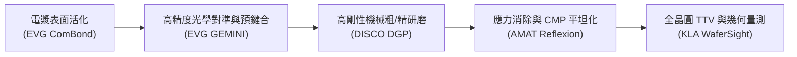

#### 32.6.4 高深寬比通孔蝕刻與金屬化設備實作

薄化完成後，必須自晶背開出通透矽層的 nTSV 或直接接觸源/汲極的微型通孔。由於孔徑微縮至數十奈米等級，而矽基板剩餘厚度仍有數百奈米，蝕刻深寬比常高達 $10:1$ 以上。

導體蝕刻設備（如 Lam Research Syndion 或 Applied Materials Sym3 系列）採用高密度感應耦合電漿 (ICP)。在矽通孔蝕刻中，常採用快速切換蝕刻與鈍化氣體的方法（Bosch 製程或其衍生改進型），交替通入蝕刻氣體 $\text{SF}_6$ 與側壁保護氣體 $\text{C}_4\text{F}_8$：

* **蝕刻步驟**：
  $$\text{SF}_6 + e^- \rightarrow \text{SF}_x^+ + \text{F}^* + e^-$$
  $$\text{Si} + 4\text{F}^* \rightarrow \text{SiF}_4\uparrow$$
* **鈍化步驟**：
  $$\text{C}_4\text{F}_8 + e^- \rightarrow \text{CF}_x^* + e^- \rightarrow \text{側壁 (CF}_2)_n\text{ 聚合物薄膜}$$

此機制能在高蝕刻速率下維持垂直側壁。對於 Super Power Rail 這類需精確停止於電晶體源/汲極磊晶層的接觸孔，蝕刻機台須具備極高的材質選擇比，並利用光學終點檢測系統 (Optical Emission Spectroscopy, OES) 即時監控電漿光譜特徵，避免損傷前段主體結構。

通孔成形後的金屬化步驟包含了絕緣層、阻障層與金屬充填：

1. **絕緣層沉積**：使用低溫 ALD 設備（如 Lam Research Striker 或 Applied Materials Producer 平台）於通孔側壁沉積均勻的高品質二氧化矽或氮化矽，防止電流漏至矽基板。
2. **阻障層與種子層沉積**：利用高方向性 PVD 設備（如 Applied Materials Endura 平台），透過自電離電漿 (SIP) 技術沉積氮化鈦 (TiN) 或氮化鉭 (TaN) 擴散阻障層，隨後沉積銅種子層。
3. **金屬充填**：通孔充填分為鎢與銅兩種路徑。若採用鎢充填，使用 CVD 設備（如 Lam Research ALTUS）進行高順應性 (Conformal) 充填；若採用銅充填，則透過電鍍設備（如 Lam Research SABRE）配合有機添加劑（抑制劑、加速劑與平坦劑），實現自底向上 (Bottom-up) 的無縫隙銅電鍍。

#### 32.6.5 晶圓廠機台選型與整合考量

半導體廠在評估與建置 BSPDN 生產線時，機台選型主要圍繞以下三個核心指標進行權衡：

* **對準精度與熱預算 (Alignment Precision vs. Thermal Budget)**：晶圓鍵合與後續沉積製程的溫度必須低於前段元件與金屬層的承受極限（典型值 $< 400^\circ\text{C}$）。選用機台時，鍵合機台的低溫對準穩定度及沉積機台的低溫 ALD/CVD 能力為首要考量。
* **研磨選擇比與缺陷控制 (CMP Selectivity & Defect Density)**：晶背 CMP 必須在去除多餘金屬或介電質的同時，極化控制矽基板的刮痕 (Scratch) 與凹陷 (Dishing)。化學機械研磨機台的研磨頭多區域壓力控制能力以及研磨液 (Slurry) 供給系統的穩定度是決策重點

## 本章重點

* **傳統正面供電之微縮極限**：隨著製程節點進入 3 奈米以下，正面金屬導線截面積縮減引發電阻爆炸與嚴重的電壓降（IR Drop），且電源軌佔用高達 20% 至 30% 的底層佈線資源，成為標準單元高度微縮的物理障礙。
* **BSPDN 空間解耦原理**：晶背供電網路將電源分配網路（PDN）轉移至晶圓背面，實現「正面負責訊號傳輸、背面負責電能分配」的三維解耦架構，大幅縮短垂直供電路徑並降低電源網路阻抗。
* **三大核心實作路徑**：包括埋入式電源軌（BPR）、PowerVia（nTSV 連接正面底層金屬 M0）以及超級電軌（SPR）。其中 SPR 消除中間過渡金屬層，直接接觸電晶體源極/汲極磊晶區，可使標準單元高度壓縮至 4T 以下。
* **關鍵整合製程技術**：BSPDN 的實作仰賴低溫氧化物融合鍵合（Oxide Fusion Bonding）、晶圓極致薄化（殘餘矽厚度小於 500 nm）、高深寬比奈米矽穿孔（nTSV）蝕刻與 ALD 金屬（如 Ru/W）填充技術。
* **熱管理與電遷移（EM）轉變**：晶圓薄化與介面絕緣層增加了局部熱阻，易引發熱在地化現象；但晶背放大電源導線截面積大幅降低了電流密度，顯著提升了電源軌的 EM 壽命。
* **嚴格的晶背熱預算限制**：由於晶背製程是在正面元件與 BEOL 完成後執行，為避免前段矽化物接點劣化、ULK 介電常數上升與金屬擴散，晶背製程熱預算必須嚴格控制在 400°C 以下。

---


## 重點圖卡

複習時看這幾張就能抓住本章重點；[圖卡庫](../cards.md)可以下載成圖片。

<div class="ix-cards" markdown>

<figure markdown>
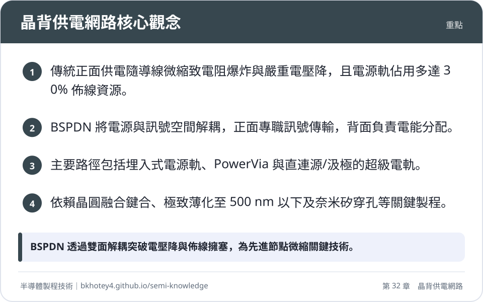
<figcaption>重點圖卡：晶背供電網路核心觀念</figcaption>
</figure>

<figure markdown>
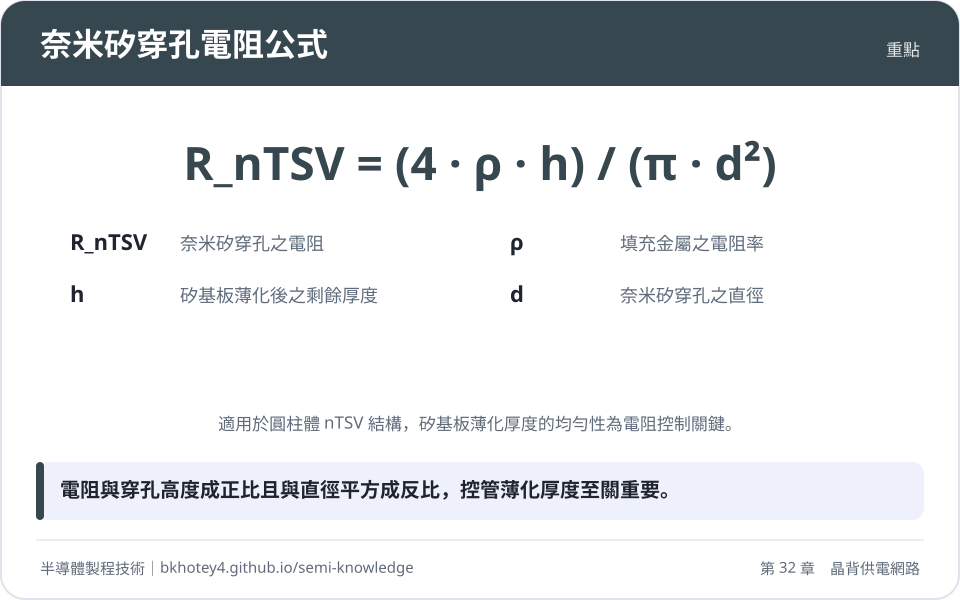
<figcaption>重點圖卡：奈米矽穿孔電阻公式</figcaption>
</figure>

<figure markdown>
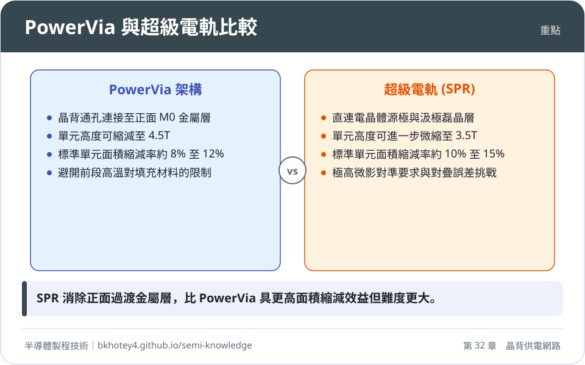
<figcaption>重點圖卡：PowerVia 與超級電軌比較</figcaption>
</figure>

<figure markdown>
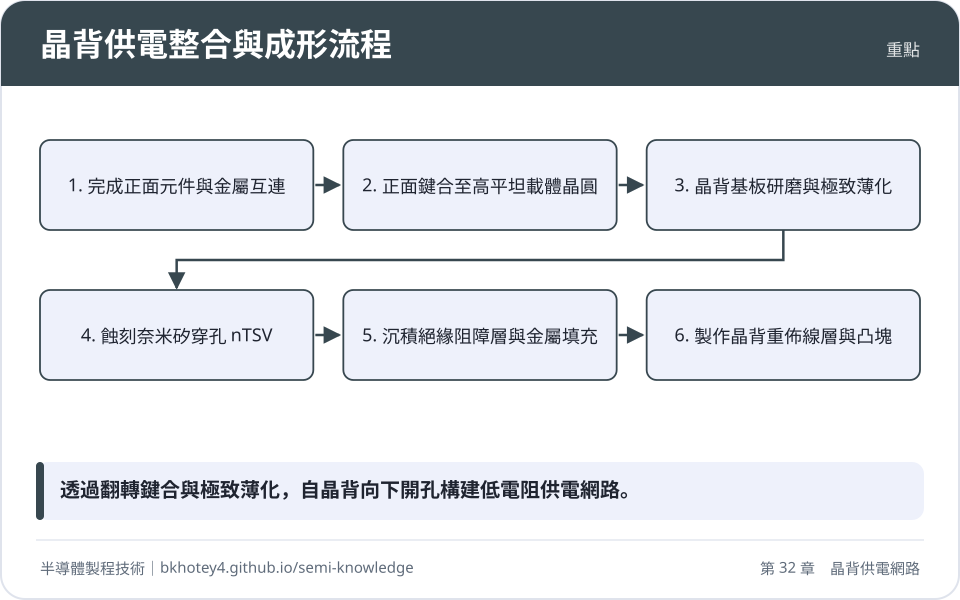
<figcaption>重點圖卡：晶背供電整合與成形流程</figcaption>
</figure>

</div>

## 習題

**1.** 已知單個圓柱體晶背奈米矽穿孔（nTSV）直徑 $d = 30\text{ nm}$，高度 $h = 300\text{ nm}$，內部填充金屬釕（Ru），其微觀體電阻率 $\rho = 20\text{ n}\Omega\cdot\text{m}$。請計算單個 nTSV 的電阻值 $R_{\text{nTSV}}$。若某邏輯單元運作時需要 $0.1\text{ mA}$ 的峰值電流，且容許的 nTSV 壓降不得超過 $1\text{ mV}$，則該供電節點至少需要並聯多少個 nTSV？

??? success "參考解答"
    根據圓柱體電阻公式：
    $$R_{\text{nTSV}} = \rho \cdot \frac{h}{A} = \frac{4 \rho h}{\pi d^2}$$
    代入數值：
    $$R_{\text{nTSV}} = \frac{4 \times (20 \times 10^{-9}\ \Omega\cdot\text{m}) \times (300 \times 10^{-9}\ \text{m})}{\pi \times (30 \times 10^{-9}\ \text{m})^2} = \frac{2.4 \times 10^{-14}}{\pi \times 9 \times 10^{-16}} \approx 84.88\ \Omega$$
    
    若容許壓降 $V_{\text{max}} = 1\text{ mV} = 10^{-3}\text{ V}$，峰值電流 $I = 0.1\text{ mA} = 10^{-4}\text{ A}$，則供電網路最大容許總電阻為：
    $$R_{\text{total}} = \frac{V_{\text{max}}}{I} = \frac{10^{-3}\text{ V}}{10^{-4}\text{ A}} = 10\ \Omega$$
    
    假設所需並聯的 nTSV 數量為 $N$，則：
    $$N \ge \frac{R_{\text{nTSV}}}{R_{\text{total}}} = \frac{84.88\ \Omega}{10\ \Omega} = 8.488$$
    因此，至少需要並聯 9 個 nTSV。

**2.** 請比較 PowerVia 架構與超級電軌（Super Power Rail, SPR）架構在晶背金屬連接點位置與標準單元（Standard Cell）面積縮減潛能上的差異，並說明為何 SPR 對微影對準精度（Overlay Tolerance）的要求更為嚴苛。

??? success "參考解答"
    1. **連接點位置差異**：PowerVia 將晶背奈米矽穿孔（nTSV）連接至正面最底層金屬（M0/V0）；而超級電軌（SPR）則完全消除正面 M0 轉接層，直接將晶背供電結構觸及電晶體源極/汲極（Source/Drain）的磊晶層。
    2. **面積縮減潛能**：PowerVia 能將單元高度從 5T 縮減至 4.5T；SPR 因完全移除了正面的電源軌與過渡接觸層，可將單元高度進一步微縮至 4T 甚至 3.5T，提供更大的邏輯密度提升。
    3. **對準精度要求**：SPR 的晶背蝕刻開孔邊界直接與奈米級的電晶體源/汲極磊晶區重疊，缺乏正面金屬層的緩衝容錯空間，其微影對疊誤差容許度通常需達到小於 2 nm 的極限精度，因此對準挑戰遠高於 PowerVia。

**3.** 某先進晶片運作時的功率密度為 $100\text{ W/cm}^2$（相當於 $10^6\text{ W/m}^2$）。在 BSPDN 製程中，矽基板經極致薄化後厚度降至 $d_{\text{Si}} = 200\text{ nm}$（熱導率 $k_{\text{Si}} = 148\text{ W/(m}\cdot\text{K)}$），鍵合氧化層厚度 $d_{\text{ox}} = 100\text{ nm}$（熱導率 $k_{\text{ox}} = 1.4\text{ W/(m}\cdot\text{K)}$）。請計算此兩層結構所產生的單位面積熱阻 $R_{th}''$（單位：$\text{K}\cdot\text{cm}^2/\text{W}$），並求在此功率密度下該兩層結構導致的垂直溫升 $\Delta T$。

??? success "參考解答"
    單位面積熱阻 $R_{th}''$ 為各層熱阻之和：
    $$R_{th}'' = \frac{d_{\text{Si}}}{k_{\text{Si}}} + \frac{d_{\text{ox}}}{k_{\text{ox}}}$$
    代入 SI 單位數值：
    $$\frac{d_{\text{Si}}}{k_{\text{Si}}} = \frac{200 \times 10^{-9}\ \text{m}}{148\ \text{W/(m}\cdot\text{K)}} \approx 1.351 \times 10^{-9}\ \text{K}\cdot\text{m}^2/\text{W}$$
    $$\frac{d_{\text{ox}}}{k_{\text{ox}}} = \frac{100 \times 10^{-9}\ \text{m}}{1.4\ \text{W/(m}\cdot\text{K)}} \approx 7.143 \times 10^{-8}\ \text{K}\cdot\text{m}^2/\text{W}$$
    $$R_{th}'' = 1.351 \times 10^{-9} + 7.143 \times 10^{-8} = 7.278 \times 10^{-8}\ \text{K}\cdot\text{m}^2/\text{W}$$
    轉換單位至 $\text{K}\cdot\text{cm}^2/\text{W}$（因為 $1\ \text{m}^2 = 10^4\ \text{cm}^2$）：
    $$R_{th}'' = 7.278 \times 10^{-8} \times 10^4 = 7.278 \times 10^{-4}\ \text{K}\cdot\text{cm}^2/\text{W}$$
    在功率密度 $q'' = 100\text{ W/cm}^2$ 下，溫升 $\Delta T$ 為：
    $$\Delta T = q'' \times R_{th}'' = 100\ \text{W/cm}^2 \times 7.278 \times 10^{-4}\ \text{K}\cdot\text{cm}^2/\text{W} \approx 0.0728\ \text{K}$$
    計算結果顯示，雖然薄矽層熱阻極低，但導熱率較差的介面氧化層貢獻了超過 98% 的熱阻。

**4.** 為什麼晶背後段製程（Backside BEOL）的熱預算必須嚴格控制在 400°C 以下？請列出至少三項前段或正面結構在高溫下會發生的物理/化學失效機制。

??? success "參考解答"
    因為晶背製程是在前段電晶體（FEOL）及正面金屬互連（BEOL）完全製作完畢後才進行，若熱預算過高會破壞既有的敏感結構。
    常見的三項失效機制為：
    1. **矽化金屬接點劣化**：前段源極/汲極接點採用的金屬矽化物（如 NiPtSi）在高於 450°C 時會發生熱聚集（Agglomeration）或相變，導致接觸電阻劇烈上升。
    2. **ULK 材料特性退化**：正面 BEOL 採用的極低介電常數（ULK）多孔材料受熱過高會失去 Si-CH3 官能基，引發材料致密化與吸濕，導致介電常數 $k$ 值不可逆上升及擊穿電壓下降。
    3. **金屬原子擴散與阻障層失效**：正面銅導線的微細阻障層（TaN/Ta）在高溫下可能失效，導致銅原子擴散至周圍介電層中引起元件嚴重漏電。
    （註：超淺接面的摻雜物發生二次擴散亦為合理解答）。

**5.** 在 BSPDN 的製程整合中，若晶圓薄化後的總厚度變異（Total Thickness Variation, TTV）控制不佳，會對後續奈米矽穿孔（nTSV）的微影與蝕刻製程產生何種致命影響？

??? success "參考解答"
    若 TTV 過大，意味著全晶圓殘餘矽基板的厚度極不均勻。這將導致：
    1. **微影焦深（DOF）失效**：曝光機台在進行晶背圖案化時，因表面高度起伏超過焦點深度範圍，導致開孔臨界尺寸（CD）無法精確控制。
    2. **蝕刻過蝕與未蝕穿缺陷**：在執行高深寬比 RIE 蝕刻時，較薄區域的通孔會過度蝕刻（Over-etch），破壞底部的接觸結構或造成側壁底切；而較厚區域的通孔則會未蝕穿（Under-etch），導致金屬無法與前段接通而形成開路（Open）失效。

---

## 本章術語

- **BSPDN**（晶背供電網路）：將電源分配網路從晶片正面轉移至晶圓背面的雙面空間互連架構。
- **IR Drop**（電壓降）：電流流經具備電阻的金屬分配網路時所產生的電位壓降損失。
- **BPR**（埋入式電源軌）：埋設於電晶體下方淺溝槽隔離區域內、用以轉接電源的前段金屬軌道。
- **PowerVia**（晶背電源通孔技術）：透過晶背奈米矽穿孔將電力直接引入正面底層金屬（M0/V0）的供電架構。
- **SPR**（超級電軌）：將晶背供電結構直接與電晶體源極/汲極磊晶層接通極限微縮供電技術。
- **nTSV**（奈米矽穿孔）：臨界尺寸在數十奈米數量級、貫穿薄化矽基板的微型垂直導通孔。
- **Fusion Bonding**（融合鍵合）：利用表面活化與脫水縮合反應在低溫下形成矽氧共價鍵的晶圓直接接合技術。
- **Extreme Thinning**（極致薄化）：利用機械研磨與化學研磨將晶圓矽基板厚度削減至數百奈米等級的製程。
- **TTV**（總厚度變異）：晶圓全區測量獲得的最大厚度與最小厚度之差值。
- **B-RDL**（晶背重佈線層）：位於晶圓背面、專用於低電阻電能分配的高密度金屬佈線層。


## 互動學習

<div class="quiz" data-quiz="06-04"></div>


## 產業最新進展

本節由每日產業新聞自動補充，說明本章技術在產業上的最新發展。

<!-- updates -->
（目前尚無補充。）
