# 第 33 章　量測技術總覽

!!! abstract "學習目標"
    - 理解半導體計量學（Metrology）之物理極限與量測不確定度，掌握厚度、線寬及三維輪廓之量測機制。
    - 深入掌握臨界尺寸掃描電子顯微鏡（CD-SEM）與光學臨界尺寸（OCD/散射量測）之成像物理、信號萃取演算法及互補特性。
    - 解析光譜橢圓偏光儀（SE）、原子力顯微鏡（AFM）與穿透式電子顯微鏡（TEM）在線上製程監控與離線物理校正之分工與應用。
    - 理解現代先進量測機台之控制主機與運算伺服器分離架構，以及量測數據如何驅動先進製程控制（APC）實現閉環優化。

## 33.1 半導體計量學概論與膜厚量測技術

在半導體製造過程中，「量測」（Metrology）與「檢測」（Inspection）是維持良率的兩大支柱。量測專指對晶圓上物理特徵的量化數值測定，如薄膜厚度、關鍵尺寸、應力或摻雜濃度；而檢測則著重於缺陷的發現與分類（詳見第 34 章）。隨著製程節點進入 3 奈米以下，量測技術的挑戰已從「如何看清楚」演變為「如何精準定義三維結構的微小偏差」。

### 33.1.1 半導體計量學的基本指標

在評估任何量測設備或方法時，必須建立一套標準的統計指標，以確保量測數據能真實反映製程狀態。

#### 1. 精確度（Accuracy）與重複性（Precision）
精確度是指量測平均值與「真實值」（True Value）之間的接近程度。真實值通常由更高解析度的參考計量工具（如 TEM）或國家標準實驗室定義。重複性（或稱精密度）則是指在相同條件下，對同一目標進行多次量測後，結果的一致性。

在產業實務中，重複性通常以標準差（Standard Deviation, $\sigma$）來衡量，並要求 $P/T$ 比值（Precision-to-Tolerance ratio）需小於一定比例。
$$ P/T = \frac{6\sigma}{\text{Tolerance}} $$
其中 Tolerance 為製程容許的誤差範圍。截至撰寫時，先進製程對量測重複性的要求通常需達到製程容許誤差的 10% 以下。

#### 2. 機台間匹配性（Tool-to-Tool Matching, TTTM）
在大型晶圓廠中，同一製程通常由多台相同型號的量測機台共同分擔產能。匹配性是指不同機台量測同一片晶圓時，其結果的偏差程度。若匹配性不佳，將導致製程控制（APC）產生錯誤的反饋。

#### 3. 量測誘發損傷（Measurement-Induced Damage）
量測過程本身不得對晶圓造成不可逆的物理或化學改變。例如，高能電子束（CD-SEM）可能導致光阻收縮（Shrinkage）或電荷累積（Charging）；高強度雷射可能導致薄膜局部升溫。因此，非破壞性（Non-destructive）是半導體量測技術的首要前提。

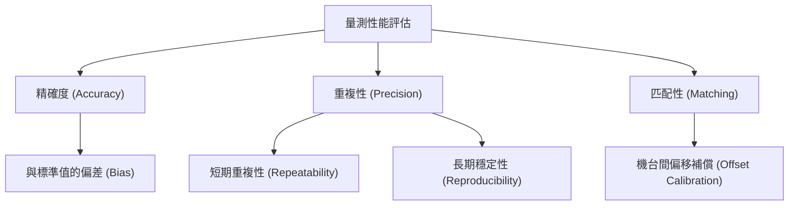

### 33.1.2 光學干涉與光譜反射儀 (SR)

薄膜厚度量測是半導體製程中最頻繁的量測項目。光譜反射儀（Spectroscopic Reflectometry, SR）利用光在多層介電薄膜界面產生的干涉現象來計算厚度。

#### 1. 物理原理：薄膜干涉
當入射光照射至薄膜表面時，一部分光在空氣與薄膜界面反射，另一部分光進入薄膜並在薄膜與基板界面反射。這兩束光之間會產生相位差 $\delta$：
$$ \delta = \frac{4\pi n d \cos(\theta)}{\lambda} $$
其中：
- $n$ 為薄膜折射率。
- $d$ 為薄膜厚度。
- $\theta$ 為薄膜內的折射角。
- $\lambda$ 為入射光波長。

當相位差為 $2\pi$ 的整數倍時，發生干涉相長（Constructive Interference），反射率達到極大值；當相位差為 $\pi$ 的奇數倍時，發生干涉相消（Destructive Interference），反射率達到極小值。

#### 2. 光譜分析
SR 設備透過寬頻光源（如氙燈或氘燈）照射晶圓，並量測反射率隨波長變化的函數 $R(\lambda)$。藉由對反射光譜進行傅立葉轉換或模型擬合，即可精確推導出薄膜厚度。SR 的優點是量測速度極快且架構簡單，適用於量測數十奈米至數微米厚的透明或半透明介電層（如二氧化矽、氮化矽）。

### 33.1.3 光譜橢圓偏光術 (SE)

對於極薄膜（小於 10 奈米）或具有複雜光學性質的材料（如金屬氮化物、多晶矽），SR 的靈敏度不足，此時需採用光譜橢圓偏光術（Spectroscopic Ellipsometry, SE）。

#### 1. 偏振光狀態轉換
SE 並非量測光的強度，而是量測光在反射後「偏振狀態」的改變。入射光通常設定為已知的線性偏振態，反射光則會轉變為橢圓偏振態。量測結果以兩個參數 $\Psi$（振幅比）與 $\Delta$（相位差）表示：
$$ \rho = \frac{r_p}{r_s} = \tan(\Psi) e^{i\Delta} $$
其中：
- $r_p$ 為平行入射面（p-polarized）的複數反射係數。
- $r_s$ 為垂直入射面（s-polarized）的複數反射係數。
- $\Psi$ 反映了 $p$ 分量與 $s$ 分量的振幅衰減比例。
- $\Delta$ 反映了兩者之間的相位偏移。

#### 2. 複數折射率與光學模型
SE 是一種「間接量測」技術。量測得到的 $\Psi$ 與 $\Delta$ 光譜無法直接轉換為厚度，必須建立一個包含厚度 $d$ 與複數折射率 $\tilde{n} = n + ik$ 的物理模型。其中 $n$ 為折射率（Refractive Index），$k$ 為消光係數（Extinction Coefficient）。

透過迴歸分析（Regression Analysis），調整模型參數使理論光譜與量測光譜的誤差平方和（Mean Square Error, MSE）最小化，從而求得精確的厚度與材料性質。

!!! note "為什麼 SE 比 SR 更精準？"
    SE 量測的是「比值」（$\Psi$）與「相位」（$\Delta$），而非絕對強度。這使得 SE 對光源波動、環境光干擾不敏感，且相位資訊對於極薄膜（$d \ll \lambda$）的變化極為靈敏，解析度可達埃（$\text{\AA}$）等級。

### 33.1.4 光學色散模型 (Optical Dispersion Models)

在進行 SE 擬合時，材料的 $n$ 與 $k$ 會隨波長 $\lambda$ 變化，這稱為色散關係。選擇正確的色散模型對於量測準確度至關重要。

#### 1. Cauchy 模型
適用於在量測波段內完全透明（$k=0$）的介電材料，如熱氧化層（Thermal Oxide）。
$$ n(\lambda) = A + \frac{B}{\lambda^2} + \frac{C}{\lambda^4} $$
其中 $A, B, C$ 為擬合參數。

#### 2. Tauc-Lorentz 模型
適用於具有能隙（Bandgap）的半導體或非晶材料（如非晶矽、高介電常數材料）。該模型基於量子力學能帶躍遷理論，能同時描述吸收邊界（Absorption Edge）與消光係數的變化。

#### 3. Drude 模型
適用於金屬或高度摻雜的半導體，描述自由載子對光場的響應。

### 33.1.5 極薄膜與挑戰

隨著電晶體架構演進至 High-k/Metal Gate (HKMG)（見第 28 章）與原子層沉積（ALD）技術（見第 23 章），量測技術面臨嚴峻挑戰。

#### 1. 敏感度極限
當閘極氧化層（EOT）微縮至 1 奈米以下時，介面層（Interfacial Layer, IL）與高介電層（High-k Layer）的厚度交織在一起。SE 必須具備極高的光譜解析度與寬廣的波段（從深紫外光到紅外光），才能區分出性質極為接近的超薄多層膜。

#### 2. 超薄金屬薄膜
金屬薄膜（如 TiN 功函數層）具有極高的消光係數，光線穿透深度極淺（Skin Depth 效應）。對於厚度僅有數個原子層的金屬膜，其光學常數 $n, k$ 會偏離塊材（Bulk）數值，呈現尺寸效應（Size Effect）。這要求量測模型必須考慮量子限制效應或採用更複雜的有效介質理論（Effective Medium Approximation, EMA）。

#### 3. 表面粗糙度與非均質性
在奈米尺度下，薄膜表面的粗糙度會導致光的散射，進而影響 $\Psi$ 與 $\Delta$ 的數值。若不將粗糙度納入模型計算，將導致厚度量測產生數埃的偏差。

!!! example "產業實例：HKMG 量測"
    在 5 奈米及更先進製程中，閘極堆疊包含界面氧化層、高介電層、蓋層（Capping Layer）與金屬閘極。量測機台（如 KLA 或 Onto Innovation 的產品）通常結合了多角度 SE 與小點徑（Small Spot）技術，以在切割道（Scribe Line）內微小的測試鍵（Test Key）上完成量測。為了提高精確度，工程師會定期抽取片子進行 TEM 破壞性量測，以校正 SE 模型的偏差（Bias）。

### 33.1.6 先進製程控制 (APC) 的整合

量測數據最終服務於製程控制。透過先進製程控制（Advanced Process Control, APC）系統中的 Run-to-Run (R2R) 演算法，量測得到的薄膜厚度偏差會即時反饋至沉積機台（如 CVD 或 ALD），動態調整下一批次的加工時間。

例如，若 SE 量測顯示層間介電質（ILD）經過 CMP 研磨後（見第 24 章）剩餘厚度偏薄，APC 系統會自動縮短下一批次在 CMP 機台的研磨時間，或調整後續微影製程的曝光能量，以補償光學路徑的改變。這種閉環控制（Closed-loop Control）是現代晶圓廠維持高良率的關鍵。

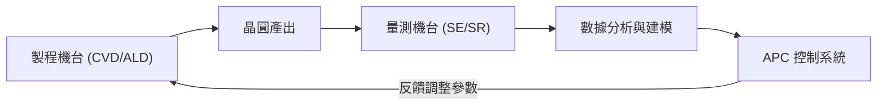

截至撰寫時，隨著 3D 結構（如 GAAFET 奈米片堆疊）的普及，單純的膜厚量測已不足夠，量測技術正朝向結合光學、電子束與 X 光（X-Ray Metrology）的多感測器融合方向發展，以應對日益複雜的半導體幾何結構。

<!-- fig:1 -->
<figure markdown>
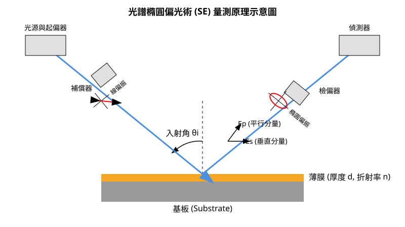
<figcaption>圖 33-1　橢圓偏振儀量測原理（AI 繪製的示意圖）</figcaption>
</figure>

## 33.2 臨界尺寸掃描電子顯微鏡 (CD-SEM)

在微影製程完成後，為了確認圖案（Pattern）的尺寸是否符合設計規範，必須進行臨界尺寸（Critical Dimension, CD）量測。由於先進製程節點已進入奈米尺度，傳統光學顯微鏡受限於繞射極限（見第 12 章），其解析度不足以觀察奈米級線寬。臨界尺寸掃描電子顯微鏡（Critical Dimension Scanning Electron Microscope, CD-SEM）利用電子束作為探針，憑藉其極短的德布羅意波長（de Broglie wavelength），提供奈米級的空間解析度，成為半導體製程中最核心的量測工具之一。

### 電子束物理與著陸能量調控

CD-SEM 的基本原理是利用高能電子束掃描晶圓表面，並收集激發出的二次電子（Secondary Electrons, SE）成像。電子的波長 $\lambda$ 與其動量 $p$ 成反比：

$$\lambda = \frac{h}{p} = \frac{h}{\sqrt{2m_e E}}$$

其中 $h$ 為普朗克常數，$m_e$ 為電子質量，$E$ 為電子能量。在典型 CD-SEM 的加速電壓下，電子波長遠小於 1 奈米，這使得解析度主要受限於電子束斑點大小（Spot size）與電子與物質交互作用的體積（Interaction volume）。

在量測製程中，電子束進入樣品後會發生彈性與非彈性散射。對於 CD-SEM 而言，最重要的訊號來源是二次電子。二次電子是指受入射電子激發而脫離原子束縛的低能電子（能量通常小於 50 eV）。由於其能量極低，只有發生在樣品表面極淺層（約 1 至 5 奈米）的二次電子才能逸出表面被偵測器接收。這種特性使得二次電子訊號對表面形貌極為敏感。

為了保護晶圓上的敏感結構（如光阻），CD-SEM 採用低能電子束技術。入射電子的「著陸能量」（Landing Energy, $E_L$）定義為：

$$E_L = e(V_{acc} - V_{bias})$$

其中 $V_{acc}$ 為電子槍的加速電壓，$V_{bias}$ 為施加於晶圓載台（Stage）的反向偏壓（Retarding bias）。透過施加負偏壓，可以使電子束在接近晶圓表面時減速，實現低著陸能量（典型值為 100 eV 至 2000 eV）。低著陸能量不僅能減少電子束對材料的穿透深度，降低底層圖案的干擾，更能有效減緩電子束對有機光阻的損傷。

### 二次電子訊號輪廓線與線寬萃取

當電子束橫向掃描過一個線條結構時，偵測器收到的二次電子強度會隨位置改變，形成一條強度輪廓線（Intensity Profile）。在線條的邊緣處，由於電子束入射角與表面法線的夾角增大，或是電子束從側面進入材料，會導致二次電子的逸出機率大幅增加，這種現象稱為「邊緣效應」（Edge Effect）。在輪廓線上，這表現為對應邊緣位置的尖峰（Peak）。

如何從這條強度輪廓線中精確定義「線寬」，需要依靠線寬萃取演算法。常見的方法包括：

1.  **門檻值法（Threshold Method）**：設定一個百分比 $k$（如 50%），定義強度在峰值與背景值之間 $k$ 比例處的位置為邊緣。
    $$I_{edge} = I_{min} + k \cdot (I_{max} - I_{min})$$
2.  **最大斜率法（Maximum Slope Method）**：取輪廓線一階導數最大值（即斜率最陡處）的位置作為邊緣。此方法對雜訊較為敏感，但能較好地反應物理邊緣。
3.  **模型擬合（Model-based Library, MBL）**：利用蒙地卡羅模擬（Monte Carlo Simulation）預先建立不同形貌下的電子散射資料庫，將實測輪廓線與資料庫比對，以反推真實的 3D 形貌。

!!! note "邊緣定義的挑戰"
    隨著元件結構從平面 MOSFET 轉向 FinFET 甚至 GAAFET（見第 6 章），線條的側壁角度（Sidewall Angle, SWA）會顯著影響二次電子訊號。若僅使用簡單的門檻值法，量測出的 CD 值可能與底部真實寬度存在偏差。

### 線邊緣粗糙度（LER）與線寬粗糙度（LWR）

在先進製程中，平均 CD 值已不足以代表圖案品質，線條邊緣的波動——粗糙度（Roughness），成為影響元件效能與良率的關鍵。

*   **線邊緣粗糙度（Line Edge Roughness, LER）**：指單一邊緣相對於理想直線的偏差。通常以偏差值的標準差（$3\sigma$）來量化。
*   **線寬粗糙度（Line Width Roughness, LWR）**：指線條寬度沿著長度方向的變異。

若兩側邊緣的波動是不相關的，則兩者關係為 $LWR = \sqrt{2} \cdot LER$。然而，在微影製程中，兩側邊緣往往存在相關性。隨著特徵尺寸縮小，LER/LWR 佔總 CD 的比例上升，會導致電晶體臨界電壓（$V_{th}$）的局部變異（Local Variation），進而造成靜態隨機存取記憶體（SRAM）的穩定性下降。CD-SEM 透過高頻率的影像擷取與演算法，可計算功率譜密度（Power Spectral Density, PSD），將粗糙度分解為不同空間頻率的成分，協助製程工程師判斷粗糙度來源是微影光阻隨機性（Stochastic）或是蝕刻製程。

### 帶電效應與放電抑制機制

由於晶圓表面常覆蓋絕緣材料（如二氧化矽、氮化矽或光阻），當電子束照射時，入射電子數與逸出電子數（二次電子加反射電子）若不平衡，樣品表面會累積電荷，稱為「帶電效應」（Charging Effect）。

*   **正帶電**：當二次電子產率（Yield）大於 1 時，表面累積正電，會形成減速電場，吸引二次電子回落，導致影像變暗或失真。
*   **負帶電**：當入射能量過高，電子滲透入體材且無法及時導走，表面累積負電，會排斥入射電子，導致束斑偏移（Beam tilt）或影像異常發亮。

為了抑制帶電效應，CD-SEM 機台採取多種策略。首先是調控著陸能量至「臨界能量」（$E_1$ 或 $E_2$），使二次電子產率接近 1。其次，可利用「預掃描」（Pre-scan）技術，在正式量測前先以特定能量的電子束均勻照射，使表面電位達到穩定狀態。此外，現代機台具備主動式電荷補償機制，例如在電子槍路徑中整合離子槍或紫外光照射，以中和表面電荷。

### EUV 光阻之電子束誘發微縮效應

截至撰寫時，極紫外光（EUV）微影已成為 7 奈米以下節點的量測重點。然而，EUV 光阻（無論是化學增幅光阻 CAR 或金屬氧化物光阻 MOR）對電子束極其敏感。當 CD-SEM 的電子束掃描 EUV 光阻圖案時，高能電子會引發光阻分子的化學鍵斷裂或交聯，導致光阻體積收縮，稱為「微縮效應」（Shrinkage）。

微縮效應會導致量測出的 CD 值隨掃描次數增加而減小，這不僅造成量測不準確，更會對晶圓造成不可逆的損傷。為了應對此問題，量測策略必須優化：
1.  **極低劑量量測**：減少掃描次數或降低束流強度（Beam current）。
2.  **演算法補償**：紀錄多次掃描後的 CD 變化曲線，利用外插法（Extrapolation）推算回第零次掃描（Scan 0）時的原始尺寸。
3.  **冷凍載台（Cryogenic Stage）**：透過降低樣品溫度來減緩化學反應速率，抑制微縮效應。

### CD-SEM 系統架構與運算流程

CD-SEM 的運作涉及極高數據量的處理。為了兼顧機台控制的即時性與影像處理的運算負荷，現代機台採用「控制與運算分離」的雙主機架構。

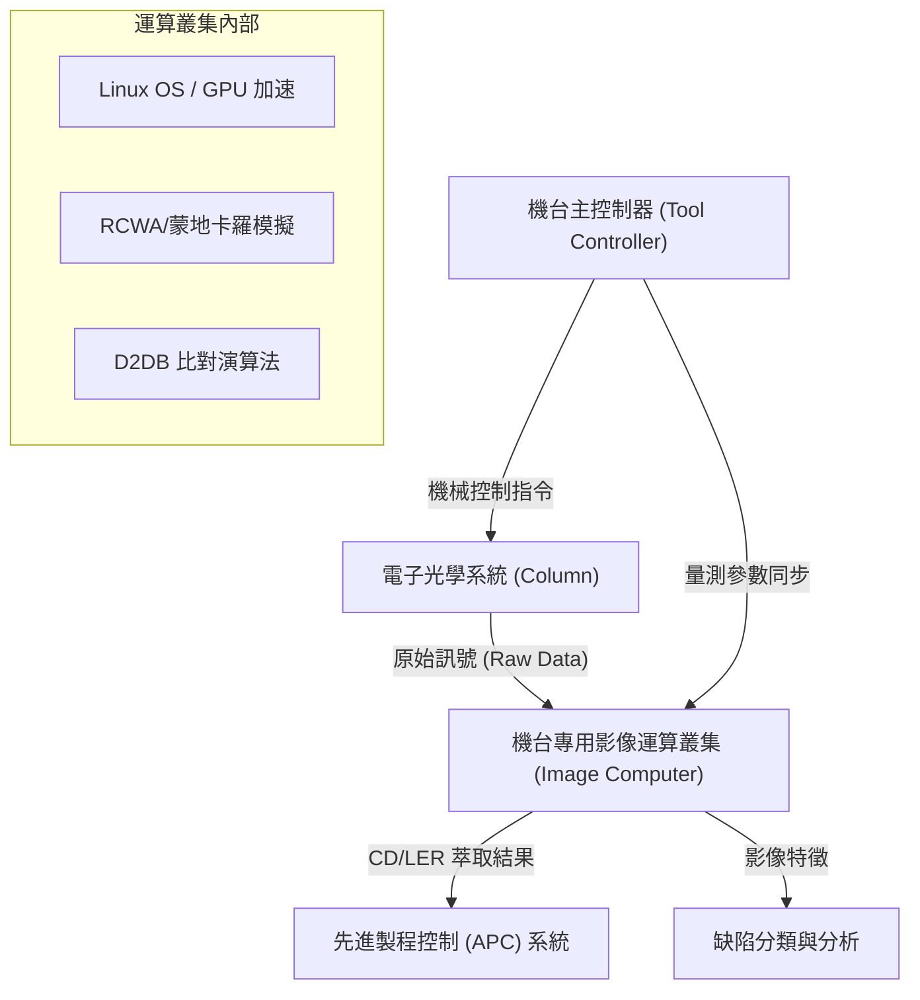

機台主控制器（Tool Controller）運行即時作業系統（RTOS），負責真空系統、晶圓傳送手臂與電子槍偏壓的精確控制，確保物理動作的確定性。而外掛的影像運算叢集（Image Computer）則負責消化每秒數 GB 的影像數據，執行複雜的去雜訊、邊緣偵測與 3D 形貌重建演算法。

!!! example "產業實例"
    在量產線中，CD-SEM 的量測結果會即時回傳至先進製程控制（Advanced Process Control, APC）系統。若發現微影後的 CD 偏離目標值，APC 會自動計算補償量，並反饋（Feedback）給微影機台調整曝光能量（Exposure Dose），或前饋（Feed-forward）給後續的蝕刻機台調整蝕刻時間，以確保最終蝕刻後的線寬符合規範。

隨著 High-NA EUV（見第 15 章）的導入，特徵尺寸進一步縮小至 10 奈米以下，CD-SEM 面臨著更高的信雜比（SNR）挑戰。未來的發展方向包括多束電子束（Multi-beam）掃描技術以提升產出（Throughput），以及結合人工智慧（AI）深度學習演算法，從低劑量、高雜訊的影像中萃取出更精確的邊緣資訊。

## 33.3 光學臨界尺寸量測與散射術 (OCD / Scatterometry)

光學臨界尺寸量測（Optical Critical Dimension, OCD），又稱為散射術（Scatterometry），是先進半導體製程中不可或缺的非破壞性（Non-destructive）三維形貌量測技術。隨著元件結構由平面 MOSFET 演進至 FinFET，乃至於截至撰寫時最先進的環繞閘極電晶體（GAAFET，見第 6 章），傳統的臨界尺寸掃描電子顯微鏡（CD-SEM）僅能提供二維的俯視圖（Top-down view），難以精確掌握垂直方向的幾何資訊。OCD 透過分析光束與週期性結構交互作用後的繞射光譜，結合嚴密的電磁場數值模擬，可同時提取線寬、高度、側壁角度（Side Wall Angle, SWA）及多層膜厚度等關鍵參數。

### 33.3.1 光學繞射與散射原理

OCD 的物理基礎建立在光學繞射（Diffraction）與散射（Scattering）之上。量測時，機台會將寬頻光束（通常涵蓋深紫外光至近紅外光，約 190 nm 至 1000 nm）投射於晶圓上的特定量測標靶（Metrology Target）。這些標靶是由待測結構組成的週期性光柵（Grating）。

當入射光的波長與光柵的週期（Pitch）處於同一數量級時，光波會發生繞射現象。根據光柵方程式：
$$m\lambda = P(\sin\theta_i + \sin\theta_m)$$
其中：
- $m$ 為繞射階數（Diffraction order）。
- $\lambda$ 為入射光波長。
- $P$ 為光柵週期。
- $\theta_i$ 為入射角。
- $\theta_m$ 為第 $m$ 階繞射角。

在 OCD 量測中，由於製程節點微縮，光柵週期 $P$ 通常遠小於量測波長 $\lambda$，導致除了零階繞射（即鏡面反射，Specular reflection, $m=0$）外，高階繞射波多為消散波（Evanescent waves）。因此，OCD 主要收集零階繞射光的強度光譜（Reflectometry）或偏振狀態變化（Ellipsometry）。

光束與結構交互作用後產生的光譜特徵，包含了結構的幾何資訊。例如，結構高度的變化會引起干涉條紋的相位移動，而線寬（CD）的改變則會影響光譜的振幅。

### 33.3.2 嚴格耦合波分析法 (RCWA)

由於半導體結構的尺寸已進入奈米尺度，經典的幾何光學已不適用，必須求解麥克斯韋方程式（Maxwell's equations）。在 OCD 技術中，最廣泛使用的數值模擬方法為「嚴格耦合波分析法」（Rigorous Coupled-Wave Analysis, RCWA）。

RCWA 的核心思想是將複雜的三維結構在垂直方向（z 軸）切割成數層薄片，每一層在水平方向（x-y 平面）具有週期性的介電常數（Permittivity）分布。其運算步驟如下：

1.  **空間頻率域展開**：將每一層的介電常數 $\varepsilon(x, y)$ 與電磁場進行傅立葉展開（Fourier expansion），將麥克斯韋方程式轉化為一組耦合的一階線性微分方程組。
2.  **特徵值求解**：在每一層內求解矩陣的特徵值（Eigenvalues）與特徵向量（Eigenvectors），以獲得該層電磁場的模態。
3.  **邊界條件匹配**：利用層與層之間電磁場切線分量連續的邊界條件，透過 S 矩陣（S-matrix）或 T 矩陣（T-matrix）演算法，逐層傳遞並求解整個結構的反射係數與透射係數。

對於一個 $N$ 層的結構，總反射係數 $R$ 是結構參數 $\vec{p}$（如 CD、高度、折射率等）的函數：
$$R_{calc} = f(CD, Height, SWA, n, k, \lambda, \theta, \phi)$$
其中 $n, k$ 為材料的光學常數，$\theta, \phi$ 為入射角與方位角。

### 33.3.3 逆向問題求解與模型回歸

OCD 量測本質上是一個「逆向問題」（Inverse Problem）：已知量測到的光譜 $S_{meas}$，求取最符合此光譜的幾何參數 $\vec{p}$。這通常透過非線性最小平方法（Non-linear Least Squares）進行信號擬合，其目標是極小化殘差函數（$\chi^2$）：
$$\chi^2 = \sum_{i} \frac{[S_{meas}(\lambda_i) - S_{calc}(\lambda_i, \vec{p})]^2}{\sigma_i^2}$$

求解過程主要分為兩種模式：

1.  **資料庫比對（Library Matching）**：
    在量測前，預先定義各參數的變化範圍（如 CD 從 15 nm 到 25 nm，步進 0.1 nm），利用 RCWA 預先計算成千上萬組光譜並儲存於資料庫中。量測時，僅需進行快速的搜尋與插值比對。此方法速度快，但受限於資料庫的解析度與維度。
2.  **即時回歸（Real-time Regression）**：
    量測時直接調用運算伺服器進行 RCWA 模擬與疊代優化。此方法精確度高且不受預設範圍限制，但對運算資源要求極高。

!!! warning "參數退化問題 (Parameter Correlation)"
    在 OCD 模型中，不同幾何參數對光譜的影響可能極其相似，導致殘差函數存在多個局部極小值，此現象稱為「參數退化」或「參數相關性」。例如，在某些結構中，頂部線寬（Top CD）的增加與結構高度（Height）的減少可能產生幾乎相同的光譜變化。這需要透過多角度、多偏振態的複合量測，或引入外部約束條件（如來自第 23 章 ALD 沉積速率的厚度限制）來解除耦合。

### 33.3.4 3D 奈米結構量測應用

隨著製程進入 3 奈米及更先進節點，OCD 的應用已從簡單的線條擴展到極其複雜的 3D 結構。

*   **FinFET 鰭片輪廓**：OCD 可量測鰭片的高度、底部寬度及側壁傾斜度。在鰭片揭露（Fin Reveal）製程後，OCD 是監控鰭片形狀一致性的關鍵工具。
*   **GAAFET 奈米片（Nanosheets）**：在 GAA 結構中，OCD 必須量測多層矽/矽鍺（Si/SiGe）超晶格結構的厚度。最具挑戰性的是「內側壁襯墊蝕刻」（Inner Spacer Indentation，見第 6 章）後的內凹深度，這直接影響閘極長度。
*   **高深寬比（HAR）結構**：在 3D NAND 或 DRAM 的電容器孔洞蝕刻中，OCD 可偵測孔洞底部的關鍵尺寸（Bottom CD）與傾斜（Tilt），這是 CD-SEM 無法觸及的區域。

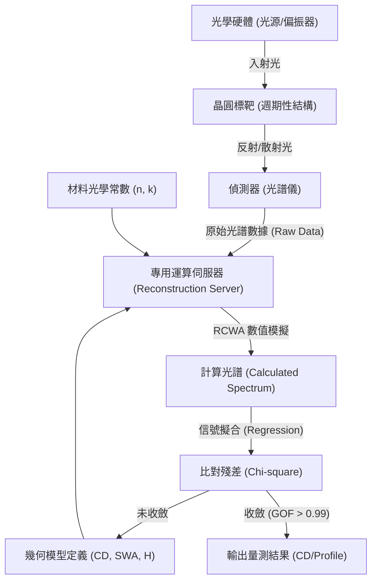

### 33.3.5 設備架構與運算效能

OCD 機台為了在維持高產出（Throughput）的同時處理龐大的 RCWA 運算，其硬體架構採取了「控制」與「運算」物理分離的設計。

1.  **機台主控制器（Tool Controller / IPC）**：負責機械手臂（Robot）傳送、晶圓對準（Alignment）、真空系統監控及與廠端 MES 系統（見第 45 章）通訊。其作業系統通常要求極高的穩定性與確定性（如 VxWorks 或 Windows RTOS）。
2.  **重建伺服器（Reconstruction Server / Image Computer）**：專門執行 RCWA 演算法與模型回歸。截至撰寫時，先進的重建伺服器通常採用高效能 Linux 叢集，配備多路處理器（如 AMD EPYC 或 Intel Xeon）及專用的硬體加速卡（GPU 或 FPGA）。

!!! example "產業實例"
    在量產線中，如 KLA 的 SpectraShape 系列或 ASML 的 YieldStar 系統，其運算伺服器與機台主體之間透過專屬的 40GbE 或更高頻寬的光纖網路直連。這種架構確保了每小時處理數百片晶圓時，每片晶圓上數千個量測點的複雜 3D 模型能在數秒內運算完成，並即時將結果反饋至先進製程控制（APC）系統，調整前站的微影能量（Exposure Dose）或蝕刻時間。

OCD 的優勢在於其優異的量測重複性（Precision）與全晶圓覆蓋能力，典型值的精確度可達 0.1 nm 以下。然而，其缺點是屬於間接量測，極度依賴物理模型的準確性。若製程中出現非預期的結構變異（如異常的殘留物），OCD 模型可能失效或產生錯誤的擬合結果。因此，在製程開發階段，通常需要配合 TEM（見第 33.4 節）進行模型校準（Calibration），確保光學模型能真實反映物理形貌。

<!-- fig:2 -->
<figure markdown>
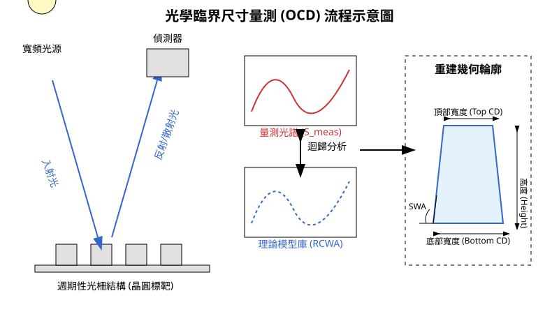
<figcaption>圖 33-2　光學臨界尺寸量測流程（AI 繪製的示意圖）</figcaption>
</figure>

## 33.4 奈米形貌與微觀結構分析：AFM 與 TEM

在先進製程進入 3 奈米（nm）節點及更先進的環繞閘極（GAAFET）架構後，傳統的光學量測與掃描電子顯微鏡（SEM）在垂直輪廓與原子級解析度上逐漸面臨挑戰。為了獲得製程開發所需的「真值」（Ground Truth），必須仰賴原子力顯微鏡（AFM）提供三維形貌資訊，以及穿透式電子顯微鏡（TEM）進行原子級的結構與成分分析。

### 33.4.1 原子力顯微鏡（AFM）之物理原理與運作模式

原子力顯微鏡（Atomic Force Microscope, AFM）屬於掃描探針顯微術（SPM）的一種，其核心原理是利用一個極細微的探針（Tip）安裝在彈性懸臂（Cantilever）末端，當探針極度接近樣品表面時，探針原子與樣品表面原子之間會產生微弱的交互作用力。

#### 1. 原子間交互作用力
AFM 主要感測的是凡得瓦力（Van der Waals force）。根據蘭納-瓊斯位能（Lennard-Jones potential）模型，兩原子間的作用力 $F$ 隨距離 $r$ 的變化可表示為：

$$F(r) = -\frac{dA}{dr} \approx \frac{12\epsilon}{r} \left[ \left( \frac{\sigma}{r} \right)^{12} - \left( \frac{\sigma}{r} \right)^{6} \right]$$

其中：
- $\epsilon$ 為位能井深度。
- $\sigma$ 為原子間作用力為零時的平衡距離。
- $r^{-12}$ 項代表近距離的包立不相容原理產生的斥力。
- $r^{-6}$ 項代表長距離的偶極交互作用產生的引力。

當探針距離表面約為數個埃（$\text{\AA}$）時，表現為斥力；當距離較遠（約 1 nm 至 10 nm）時，則表現為引力。AFM 透過雷射光束射向懸臂背面，並由四象限光電二極體（Position Sensitive Detector, PSD）接收反射光，藉此偵測懸臂因受力而產生的極微小撓曲（Deflection）。

#### 2. 運作模式（Operation Modes）
根據探針與樣品的作用區域，AFM 的運作模式可分為以下三類：

*   **接觸模式（Contact Mode）：**
    探針與樣品表面直接接觸，運作於斥力區。系統維持恆定的懸臂撓曲量，藉由回授控制壓電陶瓷（Piezoelectric）載台的垂直位移來掃描地形。此模式解析度高，但探針與樣品間的側向剪力（Shear Force）極大，容易損壞軟性材料（如光阻）或磨損探針。
*   **非接觸模式（Non-contact Mode）：**
    探針在樣品表面上方約 5 nm 至 15 nm 處振盪，運作於引力區。利用凡得瓦力改變懸臂的共振頻率或振幅。此模式對樣品無損傷，但易受表面水氣層干擾，穩定性較差。
*   **輕敲模式（Tapping Mode / Intermittent Contact Mode）：**
    這是半導體量測中最常用的模式。懸臂以其共振頻率強制振盪，探針在振盪週期的最低點會短暫「輕敲」樣品表面。相較於接觸模式，它大幅減少了側向剪力；相較於非接觸模式，它對表面水氣不敏感且訊號穩定。

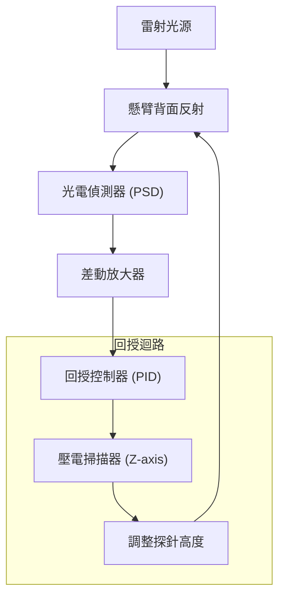

#### 3. 高深寬比探針（HAR Tips）與 3D 形貌量測
在先進製程中，FinFET 的鰭片（Fin）或 3D NAND 的深孔具有極高的深寬比（Aspect Ratio）。普通錐形探針會受限於幾何形狀而無法到達底部。因此，業界開發出**高深寬比探針（High Aspect Ratio Tips）**，利用電子束誘導沉積（EBID）生長出長度達數微米、直徑僅數十奈米的碳針。

此外，為了量測垂直側壁（Sidewall），先進 AFM 具備傾斜掃描或 3D AFM 技術，使探針能感測側向作用力，進而重構出溝槽的真實輪廓（Profile），這對於微影後的關鍵尺寸（CD）校正至關重要。

#### 4. 在 CMP 製程中的應用
AFM 是監控化學機械研磨（CMP）平坦化品質的核心工具（見第 24 章）。它能精確量測：
*   **碟陷（Dishing）：** 銅導線中心因磨耗率差異而產生的凹陷。
*   **侵蝕（Erosion）：** 密集導線區氧化層的過度磨損。
由於 AFM 具有亞奈米級的垂直解析度，它是定義製程規格（Spec）中表面粗糙度（Roughness, $R_a$）的標準工具。

### 33.4.2 穿透式電子顯微鏡（TEM）與原子級成像

當元件特徵尺寸縮小至 5 nm 以下時，電子束與樣品的交互作用變得極其複雜。穿透式電子顯微鏡（Transmission Electron Microscope, TEM）利用高能電子束（通常為 200 keV 至 300 keV）穿透極薄的樣品（厚度小於 100 nm），獲取樣品內部的結構資訊。

#### 1. 物理原理：物質波與繞射
根據德布羅意關係式，電子的波長 $\lambda$ 與其動量成反比。在考慮相對論效應下，300 keV 電子的波長約為 0.0197 $\text{\AA}$，遠小於可見光或 DUV，這使得 TEM 的理論解析度能達到原子等級（$< 1 \text{\AA}$）。

當電子束通過單晶樣品時，會發生布拉格繞射（Bragg Diffraction）：
$$n\lambda = 2d \sin \theta$$
其中 $d$ 為晶格間距。透過分析繞射圖譜（Diffraction Pattern），工程師可以判斷材料的晶相（如多晶矽與單晶矽的區別）以及晶格應變（Strain）狀態。

#### 2. 掃描穿透式電子顯微鏡（STEM）與 HAADF 成像
在現代半導體失效分析中，**掃描穿透式電子顯微鏡（Scanning TEM, STEM）**更為常用。它將電子束聚焦成極細的探針點進行掃描。
*   **高角度環形暗場（High-Angle Annular Dark-Field, HAADF）：**
    此技術收集高角度散射的電子，其影像強度 $I$ 大致正比於原子序 $Z$ 的平方（$I \propto Z^{1.6 \sim 1.9}$），稱為 **Z-對比（Z-contrast）成像**。在觀察包含高原子序金屬（如鎢 W、鉭 Ta）與低原子序材料（如矽 Si、二氧化矽 $\text{SiO}_2$）的介面時，HAADF 能提供極清晰的邊界資訊。

!!! note "說明：TEM 樣品製備"
    TEM 量測是破壞性的。樣品必須透過聚焦離子束（FIB）切割成極薄的薄片（Lamella）。截至撰寫時，自動化 FIB 技術已能實現晶圓級取樣，但其產出率（Throughput）仍遠低於光學或 SEM 量測。

### 33.4.3 微區化學成分分析：EDS 與 EELS

除了形貌，了解原子層級的元素分佈對於製程開發同樣重要。TEM 通常配備以下兩種光譜儀：

#### 1. 能散 X 射線光譜儀（EDS / EDX）
當高能電子擊出樣品內層電子後，外層電子躍遷回填會釋放特徵 X 射線。
*   **優點：** 操作簡單，對中重元素（如 Cu, Ti, W）偵測靈敏度高。
*   **侷限：** 對輕元素（如 B, C, N）解析度較差，且 X 射線產率隨原子序降低而下降。

#### 2. 電子能量損失光譜（EELS）
分析電子束穿透樣品後，因非彈性散射而損失的能量。
*   **優點：** 對輕元素極其靈敏，且能提供化學鍵結資訊（如判斷碳原子是 $sp^2$ 還是 $sp^3$ 混成）。
*   **應用：** 在 HKMG 製程（見第 28 章）中，EELS 用於量測極薄介電層（如 $\text{HfO}_2$）中的氧空缺或元素擴散。

### 33.4.4 TEM 作為黃金標準（Golden Reference）

在半導體計量學中，CD-SEM 與 OCD（見第 33.2 與 33.3 節）雖然速度快且非破壞性，但其量測結果屬於「間接推算」。例如，OCD 需透過光學模型模擬繞射光譜，若模型假設的側壁角度不準，結果就會產生偏差。

因此，TEM 被定義為**黃金標準（Golden Reference）**。製程工程師會定期抽取晶圓進行 TEM 橫截面（Cross-section）觀測，將得到的真實物理尺寸與 CD-SEM 或 OCD 的讀值進行比對，並計算出校正因子（Offset）。

!!! example "產業實例：GAAFET 奈米片量測"
    在 2 奈米以下的 GAAFET 結構中，奈米片（Nanosheet）的厚度與間距僅約 5-10 nm。截至撰寫時，只有 TEM 能夠精確量測每一層奈米片的均勻度，並以此數據校正線上（In-line）的 OCD 監控模型，確保 APC（先進製程控制）系統能根據正確的數據調整蝕刻時間。

### 33.4.5 AFM 與 TEM 之技術限制與未來方向

儘管 AFM 與 TEM 提供最高等級的解析度，但其共同缺點在於量測通量極低。AFM 掃描一個 1 $\mu\text{m} \times 1 \mu\text{m}$ 的區域可能需要數分鐘，而 TEM 的樣品製備與裝機觀察則需數小時。

目前的發展方向包括：
1.  **多探針 AFM（Multi-probe AFM）：** 透過平行化掃描提升產出。
2.  **自動化 TEM 流程：** 結合 AI 影像辨識與自動 FIB 取樣，減少人為操作誤差。
3.  **低電壓 TEM：** 減少電子束對敏感材料（如新型低介電常數材料）的輻照損傷（Beam Damage）。

總結而言，AFM 與 TEM 在量測體系中扮演「定錨」的角色。AFM 提供非破壞性的三維表面形貌，而 TEM 則深入原子尺度揭示結構與成分，兩者共同建構了先進製程良率分析的物理基礎。

## 33.5 設備與廠商技術

在先進製程中，量測設備（Metrology Tools）的角色已從單純的「製程監控」演變為「製程導航」。隨著元件結構進入三維化（如 FinFET、GAAFET）以及尺寸微縮至亞奈米等級，量測機台所產生的原始數據量呈幾何級數成長。為了在維持高產出（Throughput）的同時完成複雜的物理模型重建，現代量測設備在硬體架構、運算分配與製程控制邏輯上，均展現了高度的系統整合技術。

### 33.5.1 機台控制與影像運算之物理分離架構

在先進製程機台的設計中，為了確保晶圓處理的穩定性與海量數據處理的即時性，系統架構普遍採取「控制」與「運算」物理分離的策略。這種架構將機台區分為主控單元（Tool Controller）與專用運算伺服器（Reconstruction Server / Image Computer Cluster）兩大核心。

#### 1. 機台主控單元 (Tool Controller / IPC)
機台主控單元通常採用工業電腦（IPC）硬體，運行即時作業系統（RTOS，如 VxWorks 或 Windows Real-Time 擴充）。其核心任務在於執行具備「確定性」（Determinism）的指令，確保製程動作在微秒級的誤差範圍內完成。

*   **機械手臂與傳送控制：** 負責晶圓從裝載埠（Load Port）到量測載台（Stage）的精確傳輸。
*   **真空與環境互鎖：** 監控腔體壓力、氣體流量與安全連鎖（Interlock）機制，防止硬體受損。
*   **通訊協定：** 負責與廠級製造執行系統（MES）進行 SECS/GEM 通訊（見第 44 章），上報機台狀態與接收生產指令。
*   **穩定性要求：** 主控單元必須具備極高的平均無故障時間（MTBF），且不參與耗費資源的影像處理，以避免因運算過載導致系統當機或機械動作延遲。

#### 2. 專用運算伺服器 (Image Computer / Reconstruction Server)
相對於主控單元的穩定性要求，運算伺服器追求的是極致的運算吞吐量。以光學關鍵尺寸量測（OCD）為例，機台擷取的光譜數據需透過嚴密耦合波分析（RCWA）進行模型比對，這涉及大規模的矩陣運算。

*   **硬體配置：** 通常為外掛式的 Linux 伺服器機櫃，配置多顆高效能處理器（如 Xeon 或 EPYC）、數 TB 等級的記憶體，以及專用的運算加速卡（GPU 或 FPGA）。
*   **儲存架構：** 採用高速 NVMe SSD 組成的 RAID 快取陣列，用以緩衝每秒產生的數十 GB 原始影像或光譜數據。
*   **演算法執行：** 執行缺陷比對（D2D/D2DB）、光譜重建或電子束影像合成。這種「外掛小腦」的設計，使得機台能在不影響晶圓傳送的情況下，同步完成複雜的數學運算。

#### 3. 私有運算網路 (Dedicated Private LAN)
為了連結主控單元與運算伺服器，機台內部建置了隔離的私有區域網路。

*   **傳輸介質：** 普遍採用 10G 或 40G 以上規格的光纖直連。
*   **設計目的：** 杜絕廠內一般網路（Plant Network）的封包抖動（Jitter）與頻寬競爭。原始數據（Raw Data）從感測器擷取後，直接推送到運算伺服器進行解算，確保量測結果能即時回傳至主控單元以決定下一片晶圓的動作。

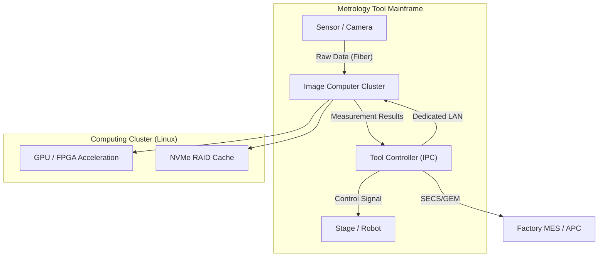

### 33.5.2 先進製程控制 (APC) 之整合

量測設備產出的數據並非僅供記錄，而是先進製程控制（APC）系統的核心輸入。透過批次對批次（Run-to-Run, R2R）控制演算法，量測數據被動態反饋至前站或回饋至後站機台。

#### 1. 反饋控制 (Feedback Control)
當 CD-SEM 或 OCD 量測到當前批次的臨界尺寸（CD）發生偏移時，APC 系統會計算偏移量，並自動調整後續批次在微影機台（見第 13 章）的曝光劑量（Dose）或對焦位置（Focus）。例如，若量測顯示線寬過粗，APC 會指令微影機增加曝光能量，以縮減光阻圖案尺寸。

#### 2. 前饋控制 (Feedforward Control)
在某些製程中，量測數據被用於調整同一批晶圓的後續加工參數。例如，在化學機械研磨（CMP）前量測的膜厚數據，可前饋至 CMP 機台（見第 24 章），動態調整各個壓力區域（Zone）的研磨時間，以補償沉積製程的不均勻性。

#### 3. 數學模型簡述
基本的 R2R 控制常採用指數加權移動平均（EWMA）演算法來估計製程漂移：
$$ S_t = \lambda y_t + (1 - \lambda) S_{t-1} $$
其中 $S_t$ 為第 $t$ 批次的預測偏移量，$y_t$ 為實際量測值，$\lambda$ 為權重因子（典型值介於 0.1 至 0.3 之間）。透過此模型，系統能過濾掉量測雜訊，僅針對真實的製程趨勢進行補償。

### 33.5.3 產業實例與廠商技術比較

截至撰寫時，全球半導體量測市場由少數幾家技術領先的廠商主導，各家在光學與電子束技術路徑上各有側重。

| 廠商 | 代表產品系列 | 技術路線與特點 | 主要應用 |
| :--- | :--- | :--- | :--- |
| **KLA** | SpectraShape 系列 | 寬頻光學散射量測，具備強大的 RCWA 重建演算法。 | 複雜 3D 結構（如 FinFET, GAA）之 OCD 量測。 |
| **KLA** | Archer 系列 | 影像式疊對量測（IBO），強調高精度光學對準。 | 微影站疊對誤差（Overlay）監控。 |
| **Hitachi High-Tech** | CG6300, CG7300, GT2000 | 高解析度 CD-SEM，採用低加速電壓電子束以減少光阻損傷。 | 線上臨界尺寸量測、線邊緣粗糙度分析。 |
| **ASML** | YieldStar 系列 | 繞射式量測（DBO），利用微影機台同源之光學原理。 | 高速疊對量測與微影製程控制整合。 |
| **Applied Materials** | PROVision, SEMVision | 高解析度電子束檢測與複查，強調多束（Multi-beam）掃描效率。 | 奈米級缺陷複查與高深寬比結構量測。 |

#### 1. KLA：光學量測與系統整合
KLA 在 OCD 領域的領先地位源於其 SpectraShape 系列機台。該系列利用寬頻電漿光源（Broadband Plasma），提供從深紫外光到近紅外光的連續光譜。其核心競爭力在於與機台整合的運算叢集，能處理包含數十個幾何參數的物理模型。在先進節點中，SpectraShape 常用於量測閘極環繞（GAA）結構中奈米片（Nanosheet）的厚度與間距，其數據精確度可達埃（Å）等級。

#### 2. Hitachi High-Tech：電子束計量之基準
Hitachi High-Tech 的 CD-SEM（如 CG7300）是業界公認的線寬量測標準。其技術重點在於電子光學系統的穩定性與自動化量測演算法。為了因應 EUV 光阻易受電子束損傷的特性，Hitachi 開發了極低能量掃描技術，在不破壞光阻化學結構的前提下，獲取高對比度的邊緣影像。

#### 3. ASML：整體微影解決方案
ASML 的 YieldStar 系列機台採用繞射式量測（Diffraction Based Metrology）。與傳統影像式量測不同，YieldStar 透過分析量測標靶（Target）產生的繞射光譜來計算疊對誤差。其優勢在於能與 TWINSCAN 微影平台高度整合，將量測數據直接回饋至微影機的對準系統，實現閉環控制。

### 33.5.4 晶圓廠選機考量與技術趨勢

晶圓廠在選擇量測設備時，通常需在以下三個維度進行權衡：

1.  **精確度與重複性（Precision & Repeatability）：** 在亞奈米製程中，量測誤差（P/T Ratio）必須嚴格控制在製程容許範圍的 10% 以內。
2.  **產出量（Throughput）：** 量測站通常是生產線的瓶頸。光學量測（OCD/YieldStar）因取樣速度快，適合全晶圓監控；電子束量測（CD-SEM）雖然解析度高，但掃描速度較慢，通常採取抽樣策略。
3.  **非破壞性（Non-destructiveness）：** 隨著材料科學進步，量測過程產生的電荷累積或熱效應是否會影響元件性能，已成為關鍵考量。

!!! note "產業實例：混合量測 (Hybrid Metrology)"
    截至撰寫時，單一量測技術已難以完全描述先進元件。晶圓廠開始導入「混合量測」流程：利用 CD-SEM 獲得精確的表面維度，再將此數值作為已知參數輸入 OCD 的重建模型中，以解算更複雜的下層結構（如高深寬比溝槽底部寬度）。這種跨機台的數據整合，仰賴於統一的數據格式與高效的 APC 運算網路。

!!! warning "常見誤解：量測解析度等於光學波長"
    在 OCD 量測中，雖然使用的光源波長遠大於量測特徵尺寸（例如使用 400nm 光源量測 10nm 線寬），但由於其原理是分析繞射光譜的整體變化而非直接成像，因此其解析度不受瑞利準則（Rayleigh Criterion）限制，而是取決於模型重建的準確度與訊雜比。

隨著 High-NA EUV（見第 15 章）進入量產階段，量測技術正朝向更高能級的光源（如軟 X 射線）與更複雜的人工智慧演算法發展，以應對日益嚴苛的良率挑戰。機台硬體架構的演進，將持續圍繞著「極速傳輸」與「海量運算」這兩大核心軸線。

## 本章重點

1.  量測（Metrology）與檢測（Inspection）在半導體製造中扮演不同角色，量測側重於物理特徵的量化測定，並以精確度、重複性與機台間匹配性作為核心評估指標。
2.  光譜反射儀（SR）與光譜橢圓偏光術（SE）是薄膜厚度量測的主流技術，其中 SE 透過量測偏振狀態的變化（振幅比 $\Psi$ 與相位差 $\Delta$），對 10 奈米以下的極薄膜具有極高的靈敏度。
3.  臨界尺寸掃描電子顯微鏡（CD-SEM）利用低能電子束與二次電子成像，提供奈米級的二維線寬資訊，但需注意電子束誘發的帶電效應與光阻微縮效應。
4.  光學臨界尺寸量測（OCD）或稱散射術，利用嚴格耦合波分析法（RCWA）求解麥克斯韋方程式，能以非破壞性方式推導出 FinFET 或 GAAFET 等複雜結構的三維形貌。
5.  原子力顯微鏡（AFM）與穿透式電子顯微鏡（TEM）提供原子級的解析度，在製程開發中作為校正光學與電子束量測機台的「真值」或黃金標準。
6.  先進製程控制（APC）透過批次對批次（R2R）演算法，將量測數據即時反饋至沉積、微影或蝕刻機台，實現製程參數的自動化閉環調整。
7.  現代量測設備採「控制與運算分離」架構，利用專用運算伺服器處理海量的影像與光譜數據，確保在維持高產出的同時完成複雜的物理模型重建。

## 重點圖卡

複習時看這幾張就能抓住本章重點；[圖卡庫](../cards.md)可以下載成圖片。

<figure markdown>
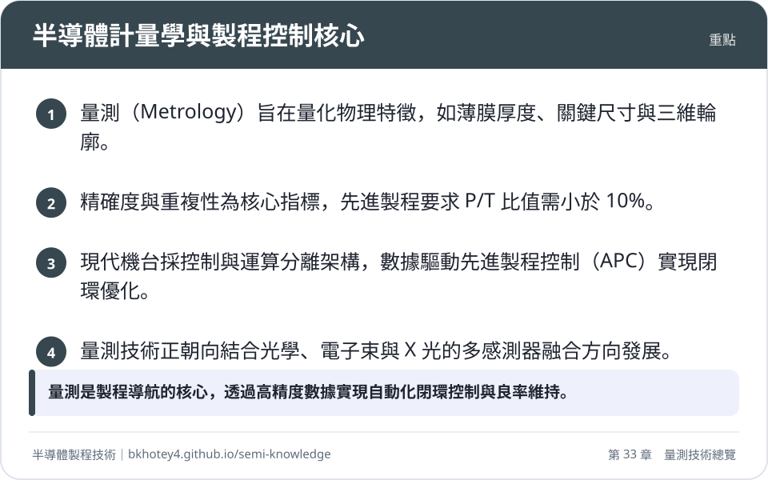
<figcaption>重點圖卡：半導體計量學與製程控制核心</figcaption>
</figure>

<figure markdown>
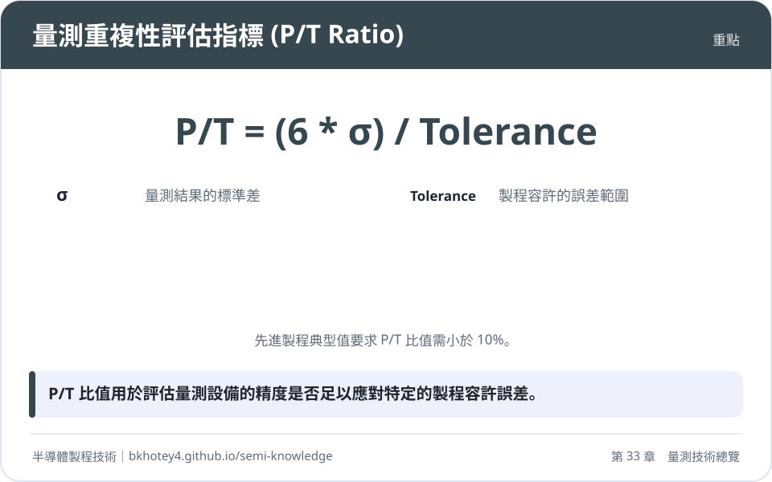
<figcaption>重點圖卡：量測重複性評估指標 (P/T Ratio)</figcaption>
</figure>

<figure markdown>
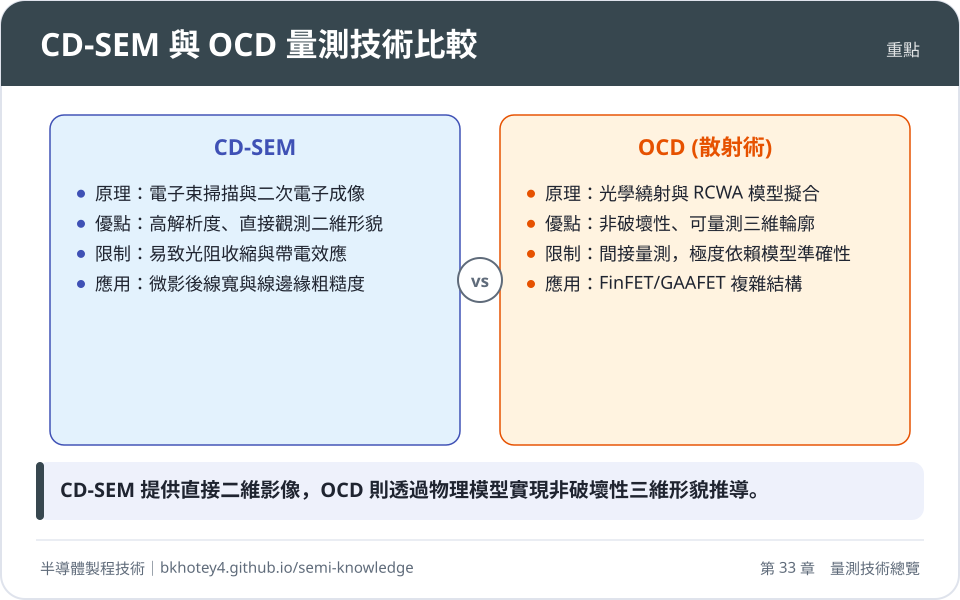
<figcaption>重點圖卡：CD-SEM 與 OCD 量測技術比較</figcaption>
</figure>

<figure markdown>
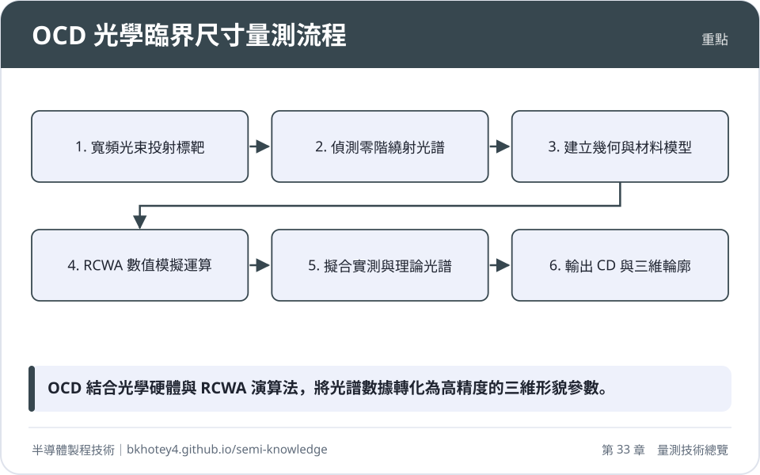
<figcaption>重點圖卡：OCD 光學臨界尺寸量測流程</figcaption>
</figure>

## 習題

**1.** 某製程要求薄膜厚度的容許誤差範圍（Tolerance）為 $\pm 5\text{ nm}$（即總範圍為 $10\text{ nm}$）。若量測機台的重複性標準差 $\sigma$ 為 $0.12\text{ nm}$，請計算其 $P/T$ 比值，並判斷該機台是否符合先進製程對量測重複性需小於 10% 的要求。

??? success "參考解答"
    根據公式 $P/T = \frac{6\sigma}{\text{Tolerance}}$：
    $P/T = \frac{6 \times 0.12\text{ nm}}{10\text{ nm}} = \frac{0.72}{10} = 0.072$（即 7.2%）。
    由於 7.2% < 10%，該機台符合先進製程的要求。

**2.** 試說明為什麼在量測 2 奈米厚的閘極氧化層時，光譜橢圓偏光術（SE）比光譜反射儀（SR）更具優勢？

??? success "參考解答"
    SR 量測的是反射光的絕對強度，易受光源波動與環境干擾影響，且對於厚度遠小於波長的極薄膜，其強度變化不顯著。SE 量測的是反射光的偏振狀態變化（振幅比與相位差），屬於相對量測，對光源不穩定不敏感。更重要的是，SE 提供的相位資訊（$\Delta$）對於極薄膜的變化極為靈敏，解析度可達埃（$\text{\AA}$）等級。

**3.** 在 CD-SEM 量測中，若入射電子的加速電壓 $V_{acc}$ 為 $2000\text{ V}$，載台的反向偏壓 $V_{bias}$ 為 $-1500\text{ V}$，請計算電子的著陸能量（Landing Energy）。並說明採用低著陸能量的主要目的。

??? success "參考解答"
    著陸能量 $E_L = e(V_{acc} - V_{bias}) = e(2000\text{ V} - 1500\text{ V}) = 500\text{ eV}$。
    採用低著陸能量的主要目的包括：(1) 減少電子束對材料（特別是光阻）的穿透深度與損傷；(2) 降低底層圖案的干擾；(3) 調整二次電子產率以抑制絕緣表面的帶電效應。

**4.** 何謂 OCD 量測中的「參數相關性」（Parameter Correlation）問題？在實務上如何解決此問題以獲得準確的 3D 形貌？

??? success "參考解答"
    參數相關性是指在 OCD 模型擬合中，不同的幾何參數（如頂部線寬增加與高度減少）對光譜產生的影響極其相似，導致數學解不唯一。解決方法包括：(1) 採用多角度、多偏振態的複合量測以增加資訊量；(2) 引入外部約束條件，如將 TEM 觀測值或前站製程的已知參數（如沉積厚度）固定於模型中，以解除參數間的耦合。

**5.** 試比較 AFM 與 TEM 在半導體量測應用上的優缺點。

??? success "參考解答"
    AFM 優點：非破壞性、具備亞奈米級垂直解析度、可量測表面粗糙度與 3D 輪廓。缺點：掃描速度慢、探針易磨損、無法觀察材料內部結構。
    TEM 優點：原子級解析度、可觀察內部晶格結構與成分（結合 EDS/EELS）、為量測的黃金標準。缺點：破壞性量測、樣品製備極其困難且耗時、量測通量極低。

## 本章術語

- **Metrology**（量測）：對晶圓上物理特徵（如尺寸、厚度）進行量化的測定技術。
- **Precision**（重複性/精密度）：在相同條件下多次量測結果的一致性，通常以標準差 $\sigma$ 衡量。
- **Spectroscopic Ellipsometry, SE**（光譜橢圓偏光術）：透過量測光反射後偏振狀態的改變來推算薄膜厚度與光學常數的技術。
- **CD-SEM**（臨界尺寸掃描電子顯微鏡）：利用電子束成像來量測奈米級線寬的專用顯微設備。
- **Secondary Electrons, SE**（二次電子）：受入射電子激發而脫離原子表面、能量小於 50 eV 的低能電子，為 CD-SEM 主要訊號來源。
- **Scatterometry / OCD**（散射術/光學臨界尺寸量測）：透過分析週期性結構的繞射光譜並結合 RCWA 模擬來重建三維形貌的技術。
- **Rigorous Coupled-Wave Analysis, RCWA**（嚴格耦合波分析法）：一種求解麥克斯韋方程式的數值演算法，用於 OCD 光譜模擬。
- **Atomic Force Microscope, AFM**（原子力顯微鏡）：利用探針與原子間凡得瓦力感測表面形貌的掃描探針技術。
- **Transmission Electron Microscope, TEM**（穿透式電子顯微鏡）：利用高能電子束穿透薄片樣品以獲得原子級結構影像的技術。
- **Advanced Process Control, APC**（先進製程控制）：利用量測數據動態調整製程參數以維持良率的自動化控制系統。

## 互動學習

!!! tip "動手試試看"
    - [設備機台圖鑑：CD-SEM 線寬量測機、光學關鍵尺寸量測機 (OCD)、膜厚量測機](../equipment.md)

## 產業最新進展

本節由每日產業新聞自動補充，說明本章技術在產業上的最新發展。

<!-- updates -->
- **2026-10-29**　國研院與汎銓科技合作助攻半導體先進製程材料驗證。這項進展與量測技術有關，能協助工程師在奈米級先進製程中進行精確的材料分析與結構檢測。（來源：[國研院攜手汎銓科技 助攻半導體先進製程材料驗證 - Yahoo新聞](https://news.google.com/rss/articles/CBMi3AJBVV95cUxOWkxneHBaV1NRQVVDOGRvZkg0RXJjajhCcHMzTnJmRDlRMExRYkhpX0NFcl9DV1l1QzBhc2ZfV05yeTJLa2FyMUtMNUltb1FySGwzSHltOVRtX3BadnpueE9xYXBvWnlfTm1CTEFDeEFqMDZQSGZuREhCb3ZreVlPbklOdG56VE5sSDJ4VFJnTEszZUxESmF4TmpVSl9LNkxBdE1UR0ZJM2FCT2lZNFNQWkZwYU9oRlB6V0NjcEI0TEV6RUU1U0xBaXNkcUN5cWg2VWdOWl9Dd3BKM0w3Unp0cmxMdjl5ZUF3RE1yMGV2dGIxekJjYllVSG5uZXdQWG9RYXA3ZWMydkx4YXN2bDMwR0V1MTB4bzkySGpkazZ6WXI3THBudFJDSmhzODc1UjVldWRYSGFyUzFpR29MR0lVQjhwU1FFaUxVbldfTGxQemdfMF9OVUNKeVJoQ0s?oc=5)）
