# 第 34 章　缺陷檢測與分類

!!! abstract "學習目標"
    - 理解光學明場與暗場檢測的物理原理及其在圖案化晶圓上的應用差異
    - 掌握電子束檢測的技術優勢，特別是針對電性缺陷與奈米級尺寸缺陷的偵測能力
    - 學習缺陷複查流程與自動分類技術的演進，以及如何藉此提升良率分析效率
    - 探討人工智慧與深度學習技術在現代半導體缺陷檢測中扮演的角色與實作挑戰

## 34.1 光學檢測原理：明場與暗場技術

在半導體製造過程中，缺陷檢測（Defect Inspection）是確保良率（Yield）的核心技術。隨著製程節點進入 3 奈米以下，缺陷的物理尺寸已縮小至數奈米等級，這對檢測設備的靈敏度與吞吐量（Throughput）提出了極高的挑戰。光學檢測技術因其非破壞性且具備高速掃描能力，至今仍是晶圓廠（Fab）內最主要的線上（In-line）檢測手段。

光學檢測主要分為明場（Brightfield, BF）與暗場（Darkfield, DF）兩大技術流派，兩者在光學架構與物理原理上各有側重，分別應對不同類型的缺陷偵測需求。

### 34.1.1 明場檢測（Brightfield Inspection）光學架構與原理

明場檢測的物理基礎與傳統光學顯微鏡相似，其核心特徵在於「入射光路」與「反射光路」共用部分光學元件。光源垂直或近乎垂直地照射在晶圓表面，感測器接收的是由晶圓表面圖案（Pattern）直接反射回來的光線。

#### 1. 空間濾波與對比度增強
在明場系統中，影像的對比度源於晶圓表面不同材料的反射率差異，以及地形起伏造成的相位差。對於具有週期性結構的區域（如 DRAM 的電容器陣列或 SRAM 區域），明場檢測常利用空間濾波（Spatial Filtering）技術。

當相干性較強的光源照射週期性圖案時，在光學系統的傅立葉平面（Fourier Plane）上會形成離散的繞射斑點。透過在該平面放置特製的遮罩（Fourier Mask），可以阻擋代表正常週期性結構的繞射光，僅讓代表缺陷（非週期性擾動）的散射光通過。這種物理層級的背景抑制技術，能顯著提升缺陷對背景雜訊的信噪比（Signal-to-Noise Ratio, SNR）。

#### 2. 明場檢測的光學路徑
明場檢測設備通常採用深紫外光（Deep Ultraviolet, DUV）波段，以獲得更高的解析度。其基本光學流程如下：

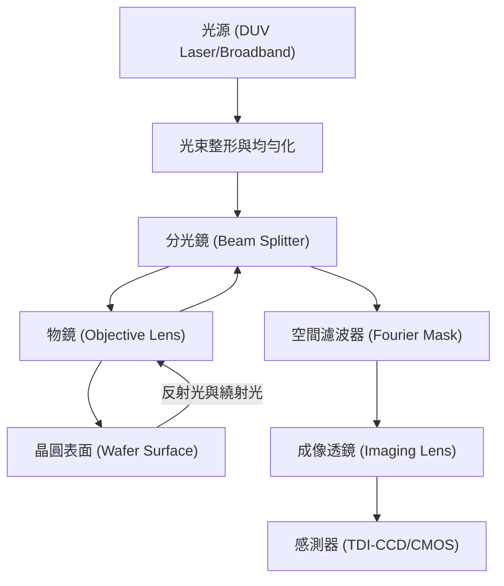

#### 3. 特點與應用
明場檢測的主要優勢在於解析度高，能夠捕捉到細微的圖案變形（Pattern Distortion）、橋接（Bridging）或斷路（Open）。然而，由於其光學路徑複雜且需處理大量的影像資料，其掃描速度通常慢於暗場檢測。截至撰寫時，先進節點的明場檢測已廣泛採用寬頻電漿（Broadband Plasma, BBP）光源，利用極短波長（低於 200 nm）來偵測 10 nm 以下的微小缺陷。

### 34.1.2 暗場檢測（Darkfield Inspection）與散射物理

暗場檢測與明場截然不同，其入射光以傾斜角度（Oblique Incidence）照射晶圓，而偵測器則放置在非鏡面反射的方向。在理想的平整表面上，傾斜入射光會遵循反射定律向另一側射出，不會進入偵測器，因此背景呈現黑暗；當表面存在微粒（Particle）或突起缺陷時，光線會向四周散射，部分散射光進入偵測器形成亮點。

#### 1. 瑞利散射與米氏散射
暗場檢測的靈敏度高度依賴於缺陷對光的散射效率。根據缺陷尺寸 $d$ 與入射波長 $\lambda$ 的比例關係，可分為兩種物理模型：

*   **瑞利散射（Rayleigh Scattering）：** 當缺陷尺寸遠小於波長（$d \ll \lambda$）時，散射光強度 $I$ 與缺陷直徑的六次方成正比，與波長的四次方成反比：
    $$I \propto \frac{d^6}{\lambda^4}$$
    這意味著當製程節點縮小，缺陷尺寸減半時，散射信號強度會劇降至原來的 $1/64$。為了補償信號損失，暗場檢測設備必須不斷縮短波長並增加光源功率。
*   **米氏散射（Mie Scattering）：** 當缺陷尺寸與波長接近（$d \approx \lambda$）時，散射強度隨尺寸的變化較為複雜，且具有明顯的方向性。此時，偵測器的空間佈局（多角度偵測）對於捕捉不同形狀的缺陷至關重要。

#### 2. 暗場檢測的優勢
暗場檢測最大的優點是「高吞吐量」。由於背景光被物理性地排除，系統可以採用極高功率的雷射進行快速掃描，而不需要像明場那樣進行複雜的像素級影像比對。這使得暗場檢測成為晶圓廠內進行全自動化、大批量微粒監控的首選。

### 34.1.3 光學解析度極限與波長選擇

光學檢測的物理極限受限於阿貝繞射極限（Abbe's Diffraction Limit）。解析度 $R$ 可表示為：
$$R = k_1 \frac{\lambda}{NA}$$
其中 $\lambda$ 為波長，$NA$ 為物鏡的數值孔徑（Numerical Aperture），$k_1$ 為與系統相關的常數（見第 12 章）。

#### 1. 從 DUV 到極短波長的演進
為了偵測更小的缺陷，檢測波長已從可見光一路縮減至 DUV（如 266 nm、193 nm）。截至撰寫時，雖然微影製程已全面導入極紫外光（EUV, 13.5 nm，見第 14 章），但光學缺陷檢測設備主要仍停留在 DUV 波段。其主因在於 EUV 光源的功率尚不足以支持高吞吐量的掃描檢測，且 EUV 光學系統必須在真空環境下運行，大幅增加了檢測設備的成本與維護難度。

#### 2. EUV 節點的挑戰
在 3 奈米及更先進節點，光學檢測面臨以下挑戰：
*   **信號微弱：** 缺陷尺寸已進入瑞利散射的極限區域，背景雜訊（如線邊緣粗糙度 LER）產生的散射光可能掩蓋真實缺陷。
*   **穿透深度：** DUV 光在多層結構中的穿透力有限，對於高深寬比（High Aspect Ratio, HAR）結構（如 3D NAND 通孔）底部的缺陷，光學檢測難以觸及。

!!! note "說明"
    雖然光學檢測在絕對解析度上不如電子束檢測（見 34.2 節），但其具備「光學穿透性」，可以透過調整偏振（Polarization）與相位，偵測到透明薄膜下方或多層導線結構內部的缺陷，這是電子束檢測較難達成的。

### 34.1.4 雜訊抑制與信噪比（SNR）優化

在先進製程中，檢測的難點往往不在於「看不見」缺陷，而在於「雜訊太強」。晶圓表面的本徵粗糙度、薄膜厚度的微小不均勻以及圖案的隨機變異，都會產生所謂的「非視覺缺陷雜訊」（Nuisance Noise）。

#### 1. 影像比對演算法
為了從雜訊中提取缺陷信號，通常採用以下三種比對模式：
*   **晶粒對晶粒（Die-to-Die, D2D）：** 比對同一片晶圓上相鄰兩個晶粒的對應像素。若兩者差異超過閾值（Threshold），則判定為缺陷。這是最常用的線上檢測模式。
*   **晶粒對資料庫（Die-to-Database, D2DB）：** 將實測影像與原始設計電路圖（GDSII/OASIS）進行比對。此方法能發現重複出現的系統性缺陷（Systematic Defects），但運算量極大。
*   **晶粒對黃金影像（Die-to-Golden-Image）：** 建立一個無缺陷的標準影像模板進行比對。

#### 2. 演算法處理流程
現代檢測設備在獲取原始光學信號後，會經過一系列數位信號處理：
1.  **對齊（Alignment）：** 進行次像素（Sub-pixel）級別的影像補償，消除機械位移誤差。
2.  **灰階歸一化（Normalization）：** 補償因光源波動或薄膜厚度變化引起的亮度差異。
3.  **動態閾值設定：** 針對晶圓上不同的區域（如邏輯區與記憶體區）設定不同的靈敏度。邏輯區圖案複雜，雜訊高，需調高閾值；記憶體區圖案規律，可調低閾值以偵測極微小缺陷。

!!! example "產業實例"
    在先進邏輯製程的量產線中，KLA 的 39xx 系列寬頻電漿檢測儀是明場技術的代表，利用極寬的光譜範圍捕捉不同層次的缺陷；而 Applied Materials 的 Compass 系列則在暗場技術上透過多通道偵測器（Multiple Channel Detectors）同時收集不同角度的散射光，以區分微粒與圖案缺陷。

### 34.1.5 小結：明場與暗場的互補性

下表總結了明場與暗場檢測技術的物理特性對比：

| 特性 | 明場檢測 (Brightfield) | 暗場檢測 (Darkfield) |
| :--- | :--- | :--- |
| **物理原理** | 直接反射光與繞射光成像 | 傾斜入射光的散射信號 |
| **光源** | DUV 寬頻電漿或雷射 | 高功率單波長雷射 |
| **解析度** | 高 (可達 sub-10nm 偵測) | 中等 |
| **吞吐量** | 較低 (掃描速度慢) | 極高 (適合全自動監控) |
| **主要偵測對象** | 圖案缺陷、橋接、微小斷路 | 表面微粒 (Particle)、刮傷 (Scratch) |
| **背景雜訊處理** | 空間濾波、影像比對 | 物理光學隔離 |

在實際的晶圓廠良率管理中，通常會在製程初期使用明場檢測來定義關鍵缺陷並建立基準（Baseline），隨後在量產階段使用暗場檢測進行高頻率的微粒監控，以達到成本與偵測能力的平衡。隨著製程微縮，兩者的界線也開始模糊，部分先進設備已嘗試結合兩者的光學路徑，以在單次掃描中獲取更多維度的缺陷資訊。

<!-- fig:1 -->
<figure markdown>
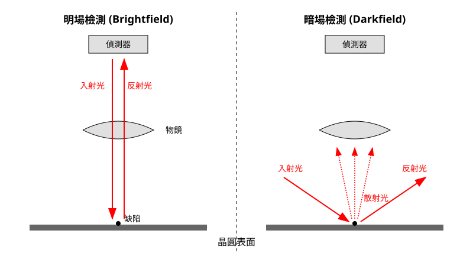
<figcaption>圖 34-1　明場與暗場檢測原理（AI 繪製的示意圖）</figcaption>
</figure>

## 34.2 電子束檢測 (EBI) 與電性缺陷偵測

在半導體製程進入深次微米（Deep Sub-micron）乃至於埃米（Angstrom）尺度後，傳統光學檢測技術受限於波長帶來的繞射極限（Diffraction Limit），其解析度已難以捕捉極微小的物理缺陷。電子束檢測（Electron Beam Inspection, EBI）技術利用電子波長極短的物理特性，提供了超越光學極限的空間解析度，並具備偵測電性缺陷（Electrical Defects）的獨特能力。

### 34.2.1 電子束檢測的物理特性與優勢

電子束檢測的核心物理基礎在於物質波理論。根據德布羅意（de Broglie）公式，電子的波長 $\lambda$ 與其動量成反比：

$$\lambda = \frac{h}{p} = \frac{h}{\sqrt{2m_0 q V (1 + \frac{qV}{2m_0 c^2})}}$$

其中：
- $h$ 為普朗克常數（Planck constant）。
- $m_0$ 為電子靜止質量。
- $q$ 為電子電荷量。
- $V$ 為加速電壓。
- $c$ 為光速（括號內為相對論修正項）。

在典型值為 $1 \text{ keV}$ 的加速電壓下，電子的波長約為 $0.039 \text{ nm}$，遠小於極紫外光（EUV）的 $13.5 \text{ nm}$。這使得 EBI 能夠輕易突破光學繞射極限，實現奈米級（典型值為 $1 \text{ nm}$ 至 $3 \text{ nm}$）的空間解析度。

然而，高解析度伴隨著物理上的權衡。電子光學系統的數值孔徑（NA）通常極小，導致其焦深（Depth of Focus, DOF）非常窄。這意味著 EBI 對晶圓表面的平整度極為敏感，通常需要配合高精度的 Z 軸補償系統。此外，電子束與物質交互作用會產生電荷累積（Charging Effect），若未妥善控制，會造成影像扭曲或損壞元件電性。

### 34.2.2 電壓對比 (Voltage Contrast, VC) 原理

EBI 與光學檢測最大的差異在於其能偵測「看不見」的缺陷，即電性缺陷。這主要透過電壓對比（Voltage Contrast, VC）技術達成。

當一次電子束（Primary Electron Beam）照射在晶圓表面時，會激發出次級電子（Secondary Electrons, SE）。次級電子的逃逸率（Yield）高度依賴於樣品表面的局部電位。

1.  **正電壓對比（Positive VC）：** 當電子束掃描到一個與地（Ground）相連的導電結構（如已接通的插塞 Via）時，累積電荷可經由路徑洩放，表面維持中性或微正電位，次級電子容易被偵測器收集，影像呈現「明亮」。
2.  **負電壓對比（Negative VC）：** 若該結構發生斷路（Open），電荷無法洩放而累積在表面形成負電位，負電位會排斥後續產生的次級電子，或使其能量分佈改變，導致偵測器收集到的訊號減少，影像呈現「黑暗」。

!!! note "電性缺陷的非破壞性偵測"
    電壓對比技術讓工程師能在不切片、不破壞晶圓的情況下，於製程中途（In-line）發現如鎢插塞（W-plug）未填滿、閘極氧化層漏電或金屬線斷路等問題。這對於複雜的 3D 結構（如 FinFET 或 GAAFET）尤為重要。

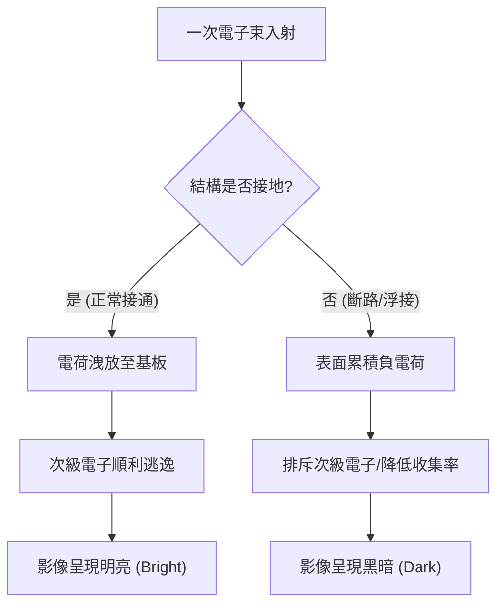

### 34.2.3 多束電子束 (Multi-beam) 技術

傳統 EBI 的最大缺點在於產出率（Throughput）極低。單束電子束（Single-beam）掃描一片 $12 \text{ 吋}$ 晶圓的全區域可能耗時數日甚至數週，這在量產環境中是不可接受的。

為了克服此瓶頸，多束電子束（Multi-beam）技術應運而生。截至撰寫時，主流技術發展方向是將單一電子源產生的電子束經過微細孔徑陣列（Aperture Array）分割成數十甚至上百束子束（Sub-beams），並由一組共用的電磁透鏡系統進行聚焦與偏轉。

**多束電子束面臨的挑戰：**
- **束間干擾（Crosstalk）：** 多條電子束同時掃描時，彼此間的庫倫斥力會導致束斑（Spot size）擴大，影響解析度。
- **偵測器整合：** 必須開發對應的感測器陣列（如 CMOS Direct Electron Detector），以同時接收來自不同座標的次級電子訊號。
- **數據處理量：** 多束並行掃描產生的影像數據流（Data Rate）極大，對後端影像處理硬體（GPU/FPGA 陣列）提出了極高要求。

典型值顯示，採用 $5 \times 5$ 或更高階的陣列配置，可將檢測速度提升一個數量級以上，使 EBI 逐漸具備進入高產量製造（HVM）監控的潛力。

### 34.2.4 電子束與光學檢測的互補策略

在先進製程廠（Fab）中，檢測策略並非由單一技術主導，而是採取「光學為主，電子為輔」的協同模式。

| 特性 | 光學檢測 (Optical) | 電子束檢測 (EBI) |
| :--- | :--- | :--- |
| **解析度** | 低 (受繞射極限限制) | 極高 (可達奈米級) |
| **掃描速度** | 快 (全晶圓掃描) | 慢 (局部掃描) |
| **缺陷類型** | 物理缺陷、微粒、刮傷 | 電性缺陷 (VC)、極微小物理缺陷 |
| **應用場景** | 全製程監控、大量生產 | 熱點 (Hotspot) 監控、研發階段 |

**互補策略實作：**
1.  **熱點監控（Hotspot Monitoring）：** 利用計算微影（見第 16 章）預測出晶圓上最容易產生弱點的區域（Hotspots），EBI 僅針對這些特定座標進行精確掃描，而非全晶圓掃描，以節省時間。
2.  **引導式複查（Guided Review）：** 先由光學檢測機台進行快速的全晶圓掃描，標註出疑似缺陷的座標（Candidate sites），再將座標傳送至 EBI 或缺陷複查電子顯微鏡（DR-SEM）進行高解析度成像與分類。
3.  **電性特徵化：** 當光學檢測查無物理異常，但電性測試（見第 42 章）出現良率損失時，EBI 的電壓對比功能是找出失效根因（Root Cause）的唯一手段。

!!! warning "常見誤解：EBI 可以完全取代光學檢測"
    儘管 EBI 的解析度極佳，但即便在多束技術普及後，其產出率仍遠低於光學檢測。在量產線中，光學檢測負責「廣度」的統計製程控制（SPC），而 EBI 負責「深度」的關鍵缺陷捕捉。兩者在可預見的未來將持續並行。

### 34.2.5 設備與產業實例

截至撰寫時，電子束檢測設備的技術領先者主要為 **ASML (HMI)** 與 **Applied Materials (AMAT)**。

- **產業實例：** ASML 的 eP5 系列與後續的多束電子束機台，強調與其微影設備的數據整合，利用微影模擬結果指引電子束掃描熱點。Applied Materials 的 PROVision 系列則強調其在高解析度下的電壓對比靈敏度，特別是在 $3 \text{ nm}$ 節點以下的閘極與接觸窗檢測。

隨著電晶體結構由 FinFET 轉向 GAAFET（見第 6 章），通道被奈米片（Nanosheets）包覆，傳統檢測更難觀測到內部缺陷。EBI 技術結合人工智慧影像辨識（見第 34.4 節），已成為先進製程研發中不可或缺的診斷工具。

<!-- fig:2 -->
<figure markdown>
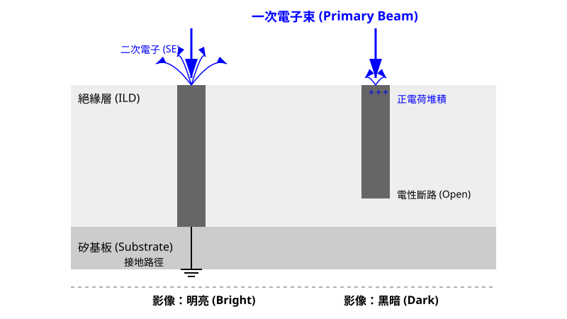
<figcaption>圖 34-2　電壓對比檢測原理（AI 繪製的示意圖）</figcaption>
</figure>

## 34.3 缺陷複查與自動缺陷分類 (ADC)

在半導體製造過程中，檢測設備（如 34.1 節所述的光學檢測或 34.2 節的電子束檢測）的主要任務是在極短的時間內掃描整片晶圓，並標定出疑似缺陷的座標。然而，受限於產能（Throughput）與解析度的權衡，檢測設備所產生的「缺陷圖譜」（Defect Map）往往包含大量的非關鍵缺陷（Nuisance）或偽影（False Alarms）。為了精確判定缺陷的物理本質、來源及其對良率的影響，必須進入「缺陷複查」（Defect Review）與「自動缺陷分類」（Automatic Defect Classification, ADC）階段。

### 缺陷複查掃描式電子顯微鏡 (DR-SEM)

缺陷複查掃描式電子顯微鏡（Defect Review SEM, DR-SEM）是量產線中不可或缺的診斷工具。其核心任務是接收檢測設備傳來的缺陷座標，自動導航至該位置，並拍攝高解析度的影像。

#### 1. 座標重定位與影像擷取
檢測設備（如明場光學檢測）提供的座標精確度通常在微米（$\mu m$）等級，而 DR-SEM 的視野（Field of View, FOV）在進行高倍率成像時可能僅有數百奈米。因此，DR-SEM 必須具備強大的「重定位」（Re-alignment）能力。

其運作流程如下：
1.  **載入缺陷圖譜**：讀取檢測設備產生的檔案。
2.  **低倍率掃描（Low-Mag Scan）**：在較大的 FOV 下尋找與檢測設備影像特徵相符的區域。
3.  **缺陷居中（Defect Centering）**：透過影像處理演算法將缺陷移至 FOV 中心。
4.  **高倍率成像（High-Mag Imaging）**：以高解析度（典型值為 1 nm 至 3 nm）拍攝缺陷影像。

#### 2. 多維度成像技術
隨著元件結構從平面 MOSFET 演進至 FinFET 甚至 GAAFET（見第 6 章），單純的俯視（Top-down）影像已不足以判斷缺陷。現代 DR-SEM 具備以下功能：
*   **傾斜成像（Tilt View）**：透過傾斜載台或電子束偏轉技術，以 30° 至 60° 的角度觀察溝槽（Trench）側壁或鰭片（Fin）底部的殘留物。
*   **能量散射 X 射線譜（EDX/EDS）**：當電子束擊中缺陷時，會激發出特徵 X 射線。藉由分析 X 射線的光譜，可以得知缺陷的化學元素組成（如鋁、銅、氟或碳），這對於追蹤缺陷來源至關重要。

### 自動缺陷分類 (ADC) 的演進

自動缺陷分類（ADC）是指利用電腦視覺與演算法，將 DR-SEM 拍攝到的影像自動歸類為特定的缺陷類別（如刮傷、微塵、橋接、斷路等）。其技術演進可分為三個階段：

#### 1. 基於規則的分類 (Rule-based ADC)
早期技術主要依賴人為定義的幾何特徵。工程師會設定一系列門檻值，例如：
*   **面積（Area）**：若大於 $X \mu m^2$ 則歸類為大型微塵。
*   **長寬比（Aspect Ratio）**：若長寬比大於 5，則歸類為刮傷（Scratch）。
*   **對比度（Contrast）**：判斷缺陷是凸起（亮點）還是凹陷（暗點）。

這種方法的缺點是對於複雜形狀或邊界模糊的缺陷，分類準確率（Accuracy）與穩定性（Purity）較差。

#### 2. 統計模式識別 (Statistical Pattern Recognition)
此階段引入了特徵向量（Feature Vector）的概念。系統會提取缺陷的多維特徵（如紋理、矩特徵、邊緣分佈等），並在特徵空間中進行聚類分析。
設特徵向量為 $\mathbf{x} = [x_1, x_2, ..., x_n]^T$，分類器目標是找到一個映射函數 $f(\mathbf{x}) \rightarrow C_i$，其中 $C_i$ 為預定義的缺陷類別。常用的數學模型包括支援向量機（SVM）或隨機森林（Random Forest）。

#### 3. 深度學習分類 (Deep Learning ADC)
截至撰寫時（2026年），基於卷積神經網路（CNN）的 ADC 已成為先進製程的主流。其優勢在於不再需要人工定義特徵，網路能自動從原始像素中學習高階特徵。這對於區分極微小的圖案畸變（Pattern Distortion）與背景雜訊具有極高效率。

### 缺陷來源分析 (DSA)

缺陷分類的最終目的是為了「根因分析」（Root Cause Analysis）。缺陷來源分析（Defect Source Analysis, DSA）結合了空間分佈資訊與製程歷史資料。

#### 1. 空間特徵分析 (Spatial Signature Analysis, SSA)
透過分析缺陷在晶圓上的分佈圖案，可以直觀地判斷問題來源：
*   **環狀分佈（Ring Pattern）**：通常與旋轉塗佈（見第 11 章）或 CMP（見第 24 章）的壓力不均有關。
*   **刮痕（Scratch）**：多數源於自動化物料搬運系統（AMHS）的機械手臂磨擦或 CMP 研磨顆粒。
*   **局部聚集（Cluster）**：可能源於噴嘴（Nozzle）滴落或局部電漿不均勻。

#### 2. 共性分析 (Commonality Analysis)
當良率出現異常波動時，系統會自動比對受影響晶圓的製程路徑。
$$P(D|M_j) = \frac{N(D \cap M_j)}{N(M_j)}$$
其中 $P(D|M_j)$ 表示在機台 $M_j$ 生產的晶圓中出現缺陷 $D$ 的機率。透過計算不同機台間的缺陷相關性，可快速鎖定故障設備。

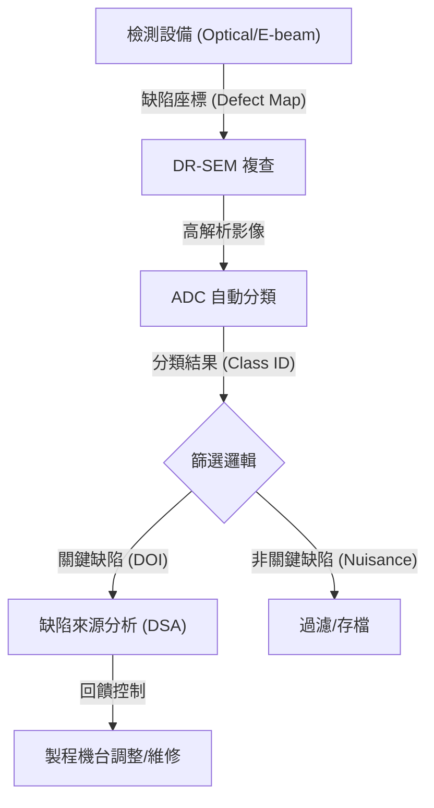

### 關鍵缺陷 (DOI) 與非關鍵缺陷 (Nuisance) 的篩選邏輯

在先進製程（如 3 奈米節點以下）中，單片晶圓上的檢測點可能高達數萬個，但其中絕大多數對電性良率並無影響。如何有效過濾雜訊是提升檢測效率的關鍵。

#### 1. 定義與區別
*   **目標缺陷 (Defect of Interest, DOI)**：會導致電路失效（如斷路、短路）或可靠性問題的物理缺陷。又稱為「致命缺陷」（Killer Defects）。
*   **非關鍵缺陷 (Nuisance)**：雖然在光學或電子信號上產生擾動，但物理上不影響電路功能。例如：
    *   **背景雜訊**：因晶圓表面粗糙度（LWR/LER）引起的信號波動。
    *   **非致命微塵**：位於非主動區（Non-active area）的微小顆粒。
    *   **下層圖案干擾**：因透明薄膜層導致觀察到下層的正常結構。

#### 2. 篩選邏輯與分類矩陣
為了評估 ADC 與篩選邏輯的效能，通常使用混淆矩陣（Confusion Matrix）進行分析：

| 實際 \ 預測 | 判定為 DOI | 判定為 Nuisance |
| :--- | :--- | :--- |
| **真實 DOI** | 正確捕捉 (Capture) | **漏檢 (Underkill)** |
| **真實 Nuisance** | **誤報 (Overkill)** | 正確過濾 (Filter) |

!!! warning "良率管理的權衡"
    在製程開發初期，為了找出所有潛在問題，通常會容忍較高的**誤報率（Overkill）**；但在成熟量產階段，過高的誤報會佔用過多的 DR-SEM 產能並誤導製程工程師，此時則需優化篩選邏輯以降低誤報，同時嚴格控制**漏檢率（Underkill）**，避免致命缺陷流向後段製程。

#### 3. 基於設計資訊的檢測 (Design-Based Inspection, DBI)
現代篩選邏輯常引入 EDA（電子設計自動化）的佈局資訊（GDSII/OASIS）。如果缺陷座標位於對電性極為敏感的區域（如 SRAM 的傳輸電晶體閘極），系統會將其優先級（Priority）調高；若位於寬大的金屬佈線邊緣且未造成短路風險，則可能被自動過濾。

### 產業實例

截至撰寫時，全球主要的缺陷複查與分類解決方案供應商包括：
*   **KLA (美商科磊)**：其 eDR 系列 DR-SEM 結合了其光學檢測平台的數據鏈路，具備極高的座標轉換精度與自動分類演算法。
*   **Applied Materials (美商應用材料)**：其 SEMVision 系列強調高解析度傾斜成像與 EDX 快速分析能力，廣泛應用於先進邏輯與記憶體製程。
*   **Hitachi High-Tech (日立先端科技)**：在電子束量測與複查領域擁有深厚的電子光學技術，其設備在穩定性與自動化程度上具有競爭優勢。

!!! note "AI 與 ADC 的深度融合"
    隨著模型複雜度增加，2026 年的趨勢是將 ADC 模型直接整合進檢測機台的邊緣運算單元（Edge Computing），實現「掃描即分類」（Classification on-the-fly），大幅減少資料傳輸延遲並提升決策速度。關於 AI 演算法的具體架構，請參閱 34.4 節。

## 34.4 人工智慧在缺陷檢測的深度應用

隨著半導體製程進入次 3 奈米節點，缺陷的物理尺寸已縮減至數個奈米量級，且受限於極紫外光（EUV）微影產生的隨機性缺陷（Stochastic defects）與複雜的多重圖案化（Multiple Patterning）結構，傳統基於規則（Rule-based）或簡單統計特徵的自動缺陷分類（Automatic Defect Classification, ADC）技術已面臨瓶頸。人工智慧（AI），特別是深度學習（Deep Learning）技術，已成為提升檢測靈敏度、分類準確度與縮短新產品導入（New Product Introduction, NPI）週期的核心驅動力。

### 卷積神經網路 (CNN) 在複雜圖案缺陷分類中的實作

卷積神經網路（Convolutional Neural Networks, CNN）是目前缺陷影像處理的主流架構。與傳統影像處理技術需人工定義特徵（如面積、長寬比、灰階對比）不同，CNN 透過多層濾波器自動提取從低階（邊緣、紋理）到高階（特定幾何結構、缺陷形態）的特徵。

在半導體檢測中，CNN 的核心運算為卷積層（Convolutional Layer），其數學表達式如下：

$$
y(i, j) = \sigma \left( \sum_{m} \sum_{n} x(i+m, j+n) \cdot w(m, n) + b \right)
$$

其中：
- $x(i, j)$ 為輸入影像的像素值。
- $w(m, n)$ 為卷積核（Kernel）或權重，代表特定的特徵過濾器。
- $b$ 為偏置項（Bias）。
- $\sigma$ 為非線性激活函數（Activation Function），通常採用 ReLU（Rectified Linear Unit）。
- $y(i, j)$ 為特徵圖（Feature Map）的輸出。

針對先進製程，CNN 實作面臨兩大挑戰：一是缺陷與背景圖案（Nuance）的對比度極低，二是缺陷種類繁多。截至撰寫時，業界普遍採用殘差網路（Residual Networks, ResNet）或注意力機制（Attention Mechanism）來增強模型對微小缺陷的捕捉能力。注意力機制允許模型在處理高解析度掃描電子顯微鏡（SEM）影像時，將權重集中於疑似缺陷的區域，而非背景的週期性電路圖案。

!!! note "分類準確度與漏檢率"
    在生產線環境中，AI 分類器的評估指標不僅是準確度（Accuracy），更重要的是純度（Purity）與完成率（Completion Rate）。純度定義為被分類為 A 類缺陷中真正屬於 A 類的比例；完成率則是所有 A 類缺陷中被正確分類出來的比例。AI 模型的目標是在維持極低誤報率（False Alarm Rate）的前提下，最大化關鍵缺陷（Critical Defects）的檢出。

### 生成式 AI 與合成數據：解決樣本不足問題

在先進製程開發初期（R&D 階段），由於良率尚不穩定且新製程特有的缺陷形態尚未完全定義，工程師往往面臨「缺陷樣本不足」的問題，導致深度學習模型因缺乏足夠的訓練資料而產生過擬合（Overfitting）。

為解決此問題，生成式 AI（Generative AI）技術被引入以產生合成數據（Synthetic Data）。主要技術路徑包括：

1.  **生成式對抗網路 (Generative Adversarial Networks, GANs)**：
    由生成器（Generator, G）與判別器（Discriminator, D）組成。生成器嘗試從噪聲中產生逼真的缺陷影像，而判別器則負責區分影像是由機台拍攝還是由生成器產生。兩者在對抗中不斷進化，其目標函數為：
    $$\min_{G} \max_{D} V(D, G) = \mathbb{E}_{x \sim p_{data}(x)}[\log D(x)] + \mathbb{E}_{z \sim p_{z}(z)}[\log(1 - D(G(z)))]$$
    其中 $x$ 為真實影像，$z$ 為隨機噪聲。

2.  **擴散模型 (Diffusion Models)**：
    截至撰寫時，擴散模型因其生成的影像品質與多樣性優於 GAN，已開始應用於半導體領域。透過將電路設計圖（GDSII/OASIS）作為制約條件（Condition），模型可以生成符合物理設計規則但帶有特定缺陷形態（如短路、斷路、橋接）的模擬 SEM 影像。

3.  **物理輔助合成 (Physics-informed Synthesis)**：
    結合光學模擬或電子束交互作用物理模型（見第 12 章與第 34.2 節），將設計圖案轉化為模擬影像，再疊加 AI 生成的隨機缺陷。這種方法能確保合成影像符合電子束散射或光學繞射的物理特性，顯著提升模型在真實機台上的泛化能力。

### 邊緣運算與即時影像處理

檢測設備（如明場光學檢測機台）在掃描過程中會產生海量的影像數據，每秒數據量可達數十 GB 甚至 TB 等級。若將所有影像傳輸至中央伺服器進行 AI 運算，將造成嚴重的傳輸延遲與頻寬壓力。因此，邊緣運算（Edge Computing）架構在現代檢測設備中至關重要。

邊緣運算的實作通常涉及硬體加速器，如現場可程式邏輯閘陣列（FPGA）或專用集成電路（ASIC/NPU）。其運算流程如下：

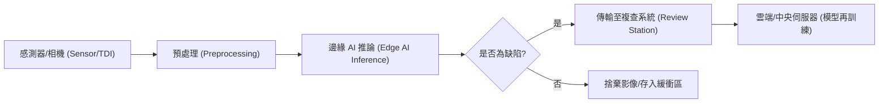

在邊緣端，AI 模型執行「缺陷偵測（Detection）」任務，快速過濾掉 99% 以上的正常圖案。僅有被判定為疑似缺陷的影像片段（Image Patches）會被送往高階 GPU 叢集進行精確的「缺陷分類（Classification）」。這種分層架構確保了檢測設備的高吞吐量（Throughput），同時兼顧了分類的深度與準確性。

### AI 驅動的自動化配方 (Auto-recipe) 生成

在 NPI 階段，建立一個新的檢測配方（Recipe）通常需要資深工程師耗費數天甚至數週的時間進行參數調整，包括光源角度、波長選擇、感測器增益以及演算法閾值。AI 驅動的自動化配方生成技術旨在縮短此週期。

其核心原理是將配方優化視為一個高維度的尋優問題。利用貝氏優化（Bayesian Optimization）或強化學習（Reinforcement Learning, RL），AI 可以在廣大的參數空間中自動尋找最佳組合。

*   **貝氏優化**：適用於評估成本昂貴的場景。透過代理模型（Surrogate Model）預測不同參數組合下的信噪比（SNR），並利用採集函數（Acquisition Function）決定下一個測試點，以最少的實驗次數找到最優參數。
*   **強化學習**：將配方調整視為一個代理人（Agent）與環境（檢測機台）互動的過程。代理人根據當前影像品質獲得獎勵（Reward），並據此調整參數，直到達到預設的檢測靈敏度目標。

!!! example "產業實例"
    截至撰寫時，領先的檢測設備供應商如應用材料（Applied Materials）與科磊（KLA）已在其先進檢測平台中導入 AI 配方助手。透過導入設計端資料（Design-Integrated Inspection），AI 能自動識別晶圓上的關鍵區域（Critical Areas），並針對這些區域自動配置最高靈敏度的檢測參數，將配方開發時間從數日縮短至數小時。

### AI 在缺陷檢測中的未來挑戰

儘管 AI 顯著提升了檢測效能，但在實際量產環境中仍面臨「模型漂移（Model Drift）」的挑戰。隨著製程設備的零件磨損或化學藥水濃度的微幅波動，背景影像的統計特性會發生變化，導致原本訓練好的 AI 模型準確度下降。

因此，建立一套自動化的模型生命週期管理系統（MLOps）成為必然趨勢。這包括：
1.  **自動化標記**：利用高解析度缺陷複查（Review）結果自動更新訓練資料庫。
2.  **持續學習 (Continual Learning)**：使模型能在不忘記舊缺陷特徵的前提下，學習新出現的缺陷形態。
3.  **可解釋 AI (XAI)**：協助工程師理解 AI 為何將特定圖案判定為缺陷，這對於失效分析（Failure Analysis）至關重要。

AI 在缺陷檢測的應用已從單純的影像分類，演進為貫穿設計、製程開發到量產監控的全方位智慧化解決方案，是實現工業 4.0 與智慧晶圓廠（Smart Fab）的關鍵技術支柱。

## 34.5 設備與廠商技術

在半導體製造進入次 3 奈米節點與 High-NA EUV（高數值孔徑極紫外光）時代後，缺陷檢測設備已不僅是單純的成像工具，而是結合精密光學、高能物理、高速運算與人工智慧的整合系統。本節將探討當前產業主流的檢測設備類別、核心子系統，以及主要設備供應商的技術路線。

### 檢測設備類別與關鍵子系統

缺陷檢測設備主要分為光學檢測與電子束檢測兩大類。為了在生產線上實現高效率與高靈敏度的平衡，檢測機台必須具備以下關鍵子系統：

1.  **光源或電子源系統**：光學檢測機台採用寬頻電漿（Broadband Plasma, BBP）或深紫外光（DUV）雷射；電子束檢測則採用熱場發射（Thermal Field Emission）電子槍。
2.  **掃描與定位系統**：由於奈米級缺陷對位置極其敏感，機台需配備氣浮式工作台（Air-bearing Stage）與雷射干涉儀定位，確保晶圓移動時的震動與位移誤差控制在奈米等級。
3.  **訊號感測與影像擷取**：光學系統多採用時間延遲積分（Time Delay Integration, TDI）感測器，以在高速掃描下累積足夠的光子訊號；電子束系統則使用閃爍體（Scintillator）與光電倍增管（PMT）或直接電子偵測器。
4.  **高速影像處理單元**：檢測過程中產生的原始數據量極大（每秒可達數十 GB），需透過大規模並列處理器（FPGA 或 GPU 陣列）進行即時的「晶粒對晶粒」（Die-to-Die）影像比對。

### 主要廠商技術概覽

下表彙整了截至撰寫時，全球半導體缺陷檢測與複查設備的主要廠商及其代表性產品：

| 廠商 | 代表產品系列 | 技術路線與特點 | 主要應用 |
| :--- | :--- | :--- | :--- |
| **KLA** | 29xx / 39xx 系列 | 寬頻電漿光學圖案晶圓檢測 (BBP) | 前段製程 (FEOL) 高靈敏度圖案缺陷檢測 |
| **KLA** | Puma 系列 | 雷射掃描圖案晶圓檢測 | 中後段製程高速缺陷監控 |
| **KLA** | Surfscan 系列 | 無圖案晶圓檢測 | 裸晶圓出貨檢驗、成膜後顆粒監測 |
| **KLA** | eDR 系列 | 電子束缺陷複查 (Review SEM) | 缺陷高解析度成像與自動分類 |
| **Applied Materials** | PROVision 系列 | 電子束檢測 (EBI) 與多束技術 | 關鍵層電性缺陷 (VC) 偵測 |
| **Applied Materials** | SEMVision 系列 | 電子束缺陷複查 | 缺陷複查、成分分析與 3D 成像 |
| **ASML (HMI)** | eScan 系列 | 電子束檢測 (EBI) | EUV 節點關鍵缺陷與電性檢測 |
| **Hitachi High-Tech** | CG6300 / CG7300 | 關鍵尺寸掃描式電子顯微鏡 (CD-SEM) | 線寬、孔徑等幾何尺寸量測 |
| **Lasertec** | ACTIS A150 | EUV 光化光罩檢測 (Actic Inspection) | EUV 光罩缺陷檢測 |

### 產業實例：KLA 寬頻電漿 (BBP) 技術

KLA 在光學檢測領域長期佔據領先地位，其 29xx 與 39xx 系列是先進製程廠（Foundry）的標準配備。該技術的核心在於「寬頻電漿」（Broadband Plasma）光源，其原理是利用高功率雷射激發氙氣（Xe）等惰性氣體產生極高亮度的電漿，從而發射出涵蓋深紫外光（DUV）到可見光範圍的連續光譜。

!!! note "光學對比度優化"
    在多層薄膜結構中，單一波長的光容易產生薄膜干涉現象，導致特定深度的缺陷訊號消失。BBP 技術透過寬頻光譜，可以同時獲取多個波長的反射資訊，並透過光學濾波器選擇最佳的對比度窗口（Contrast Window），以偵測埋藏在多層結構（如 3D NAND 或 FinFET 閘極）中的缺陷。

39xx 系列進一步提升了數值孔徑（NA）與感測器速度，使其在 3 奈米及以下節點仍能維持足夠的訊噪比（SNR）。對於晶圓廠而言，選擇 KLA BBP 設備的主要考量在於其極高的產出率（Throughput），單片晶圓的檢測時間通常在 1 小時以內，遠快於電子束檢測。

### 產業實例：Applied Materials 多束電子束技術

Applied Materials（應用材料）在電子束檢測（EBI）領域透過 PROVision 系列推動了技術變革。傳統單束電子束檢測雖然解析度高（可達 1nm 以下），但掃描速度極慢，僅能用於研發或抽樣。

PROVision 系列的核心在於「多束電子束」（Multi-beam）技術。其原理是將單一電子源產生的電子束經過微透鏡陣列（Micro-lens Array）分割成數十甚至數百支子束（Beamlets），並並行掃描晶圓表面。

$$Throughput \propto N_{beams} \times f_{scan}$$

其中 $N_{beams}$ 為電子束數量，$f_{scan}$ 為掃描頻率。透過增加束數，PROVision 能夠在保持高解析度的同時，將檢測速度提升一個數量級以上，使其更接近量產線的監控需求。此外，該系列特別擅長偵測「電性缺陷」，例如透過電壓對比（Voltage Contrast, VC）成像技術，找出導通孔（Via）內部的微小殘留物或斷路，這是光學設備難以達成的。

### 產業實例：ASML (HMI) 在 EUV 節點的佈局

ASML 透過併購漢民微測（HMI）取得了電子束檢測技術，並將其整合至 EUV 微影生態系中。HMI 的 eScan 系列與 ASML 的 YieldStar（見第 17 章）以及微影機台（TWINSCAN NXE/EXE 系列）形成了閉環控制。

在 EUV 節點，由於隨機性缺陷（Stochastic Defects）增加，晶圓廠需要 eScan 系列提供的高解析度影像來驗證光罩圖案轉移的精確度。ASML 的策略是將檢測數據回饋至微影機的運算模型中，進行即時的疊對（Overlay）補償與劑量（Dose）調整。截至撰寫時，HMI 亦致力於開發適用於 High-NA EUV 的高解析電子束系統，以因應更小的圖案特徵。

### High-NA EUV 節點的檢測挑戰與發展現況

隨著 High-NA EUV（NA 0.55）進入研發與初步導入階段（見第 15 章），半導體製程的關鍵尺寸（CD）縮減至 10nm 以下，這對檢測技術提出了極限挑戰：

1.  **解析度極限**：光學檢測的波長必須進一步縮短，或開發更先進的計算影像演算法（Computational Imaging）來超越繞射極限。
2.  **光子隨機效應**：在極小尺寸下，光子或電子的統計漲落（Shot Noise）會嚴重干擾影像品質，需要更高亮度的光源與更長積分時間的感測器。
3.  **薄膜損傷**：高能電子束在檢測敏感材料（如新型光阻或低介電材料）時，可能會造成樣品損傷（Beam Damage），因此「低電壓、高解析」成為電子束設備研發的重點。

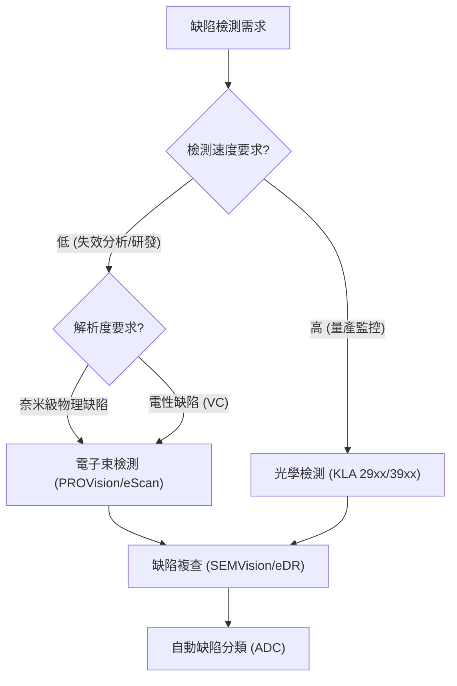

### 設備選機考量

晶圓廠在選擇檢測設備時，通常會在「靈敏度」（Sensitivity）、「產出率」（Throughput）與「持有成本」（COO）之間取得平衡。

*   **前段關鍵層（Critical Layers）**：如電晶體閘極、接觸孔，通常採用 KLA BBP 進行全掃描，並搭配 Applied Materials PROVision 進行抽樣電性檢查。
*   **後段導線層（BEOL）**：由於圖案尺寸較大，多採用 KLA Puma 等雷射掃描設備，以追求最高的掃描速度與產能。
*   **失效分析（Failure Analysis）**：則高度依賴電子束複查機台（如 SEMVision 或 eDR 系列），並結合能譜儀（EDS）進行化學成分分析，以追溯缺陷來源（如機台零件磨損或化學品污染）。

截至 2026 年底，隨著 AI 演算法深度整合進檢測平台，設備商的競爭重點已從單純的硬體解析度，轉向如何利用大數據分析減少「虛假缺陷」（Nuisance Defects），並縮短從發現缺陷到找出製程根因（Root Cause）的時間。

## 本章重點

*   **光學檢測物理特性**：明場（BF）檢測利用直接反射光成像，解析度高但速度較慢，適用於圖案缺陷；暗場（DF）檢測利用傾斜入射光的散射訊號，背景雜訊低且吞吐量極高，適用於表面微粒監控。
*   **散射理論與縮放限制**：根據瑞利散射定律，散射光強度與缺陷直徑的六次方成正比，與波長的四次方成反比。隨著製程節點微縮，必須縮短波長並增加光源功率以維持偵測靈敏度。
*   **電子束檢測（EBI）優勢**：利用電子波長極短的特性（典型值於 1 keV 時約 0.039 nm），EBI 能突破光學繞射極限，並透過電壓對比（VC）技術偵測如斷路或漏電等「看不見」的電性缺陷。
*   **缺陷複查與分類流程**：檢測機台標定座標後，由 DR-SEM 進行高解析度成像，再透過自動缺陷分類（ADC）區分關鍵缺陷（DOI）與非關鍵缺陷（Nuisance），以優化良率管理成本。
*   **人工智慧應用**：深度學習（如 CNN）已取代傳統基於規則的分類法；生成式 AI（如 GAN 或擴散模型）則用於產生合成數據，解決先進製程研發初期缺陷樣本不足的問題。
*   **多束電子束技術**：為克服 EBI 產出率低下的瓶頸，多束技術透過並行掃描大幅提升檢測速度，使其具備進入高產量製造（HVM）監控的潛力。
*   **產業協同策略**：先進晶圓廠採「光學為主（廣度）、電子為輔（深度）」的策略，並結合設計資訊（DBI）與邊緣運算，實現即時的製程監控與根因分析。

## 重點圖卡

複習時看這幾張就能抓住本章重點；[圖卡庫](../cards.md)可以下載成圖片。

<figure markdown>
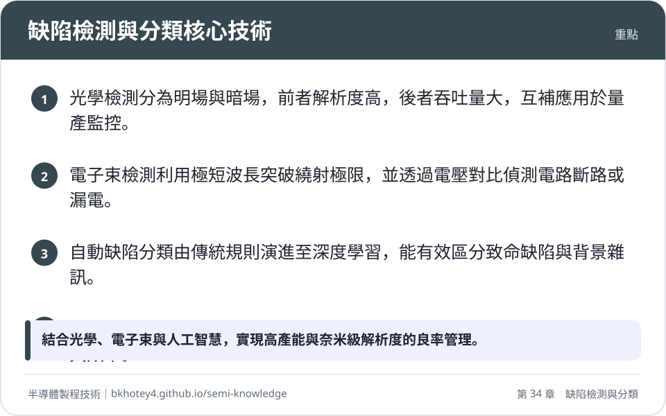
<figcaption>重點圖卡：缺陷檢測與分類核心技術</figcaption>
</figure>

<figure markdown>
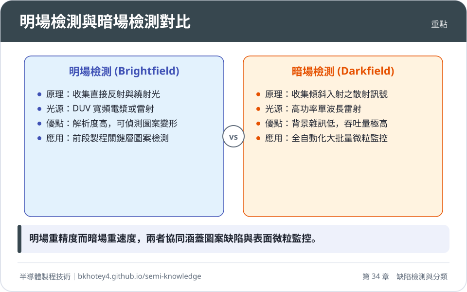
<figcaption>重點圖卡：明場檢測與暗場檢測對比</figcaption>
</figure>

<figure markdown>
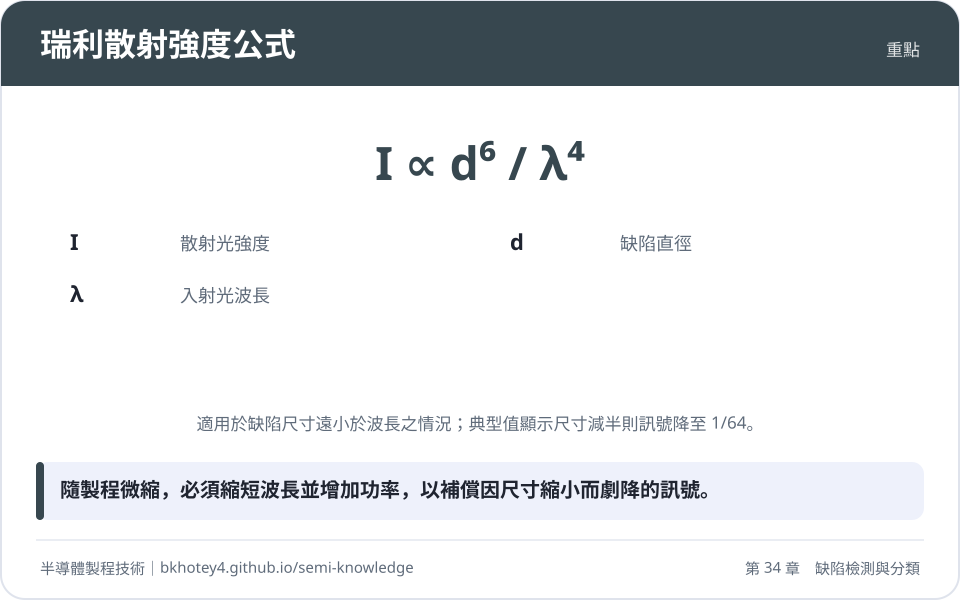
<figcaption>重點圖卡：瑞利散射強度公式</figcaption>
</figure>

<figure markdown>
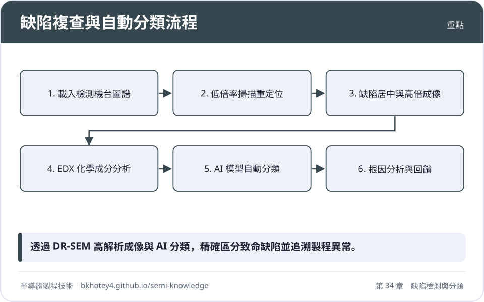
<figcaption>重點圖卡：缺陷複查與自動分類流程</figcaption>
</figure>

## 習題

**1.** 根據瑞利散射（Rayleigh Scattering）理論，若檢測設備的光源波長 $\lambda$ 從 266 nm 縮短至 193 nm，而缺陷尺寸 $d$ 保持不變，其散射光強度 $I$ 理論上會變為原來的幾倍？

??? success "參考解答"
    根據公式 $I \propto \frac{1}{\lambda^4}$：
    新的強度 $I_{new} \propto \frac{1}{193^4}$，原強度 $I_{old} \propto \frac{1}{266^4}$。
    比例為 $(266 / 193)^4 \approx (1.378)^4 \approx 3.61$ 倍。
    因此，縮短波長能顯著提升微小缺陷的訊號強度。

**2.** 試比較明場檢測（Brightfield）與暗場檢測（Darkfield）在光學架構上的主要差異，並說明為何暗場檢測較適合用於高速微粒監控。

??? success "參考解答"
    (1) 光學架構差異：明場檢測的入射光與反射光共用物鏡路徑，感測器接收直接反射光；暗場檢測採傾斜入射，感測器置於非鏡面反射方向，僅接收缺陷產生的散射光。
    (2) 高速監控原因：暗場技術在物理層面上排除了背景光，使影像背景呈現黑暗，缺陷表現為高對比度的亮點。這使得系統不需進行複雜的像素級影像比對即可判定缺陷，能承受極高的掃描速度與雷射功率。

**3.** 計算加速電壓為 $5 \text{ kV}$ 時電子的德布羅意波長（忽略相對論修正，已知 $h = 6.626 \times 10^{-34} \text{ J}\cdot\text{s}$，$m_0 = 9.11 \times 10^{-31} \text{ kg}$，$q = 1.6 \times 10^{-19} \text{ C}$）。

??? success "參考解答"
    利用公式 $\lambda = \frac{h}{\sqrt{2m_0 q V}}$：
    $\lambda = \frac{6.626 \times 10^{-34}}{\sqrt{2 \times 9.11 \times 10^{-31} \times 1.6 \times 10^{-19} \times 5000}}$
    $\lambda = \frac{6.626 \times 10^{-34}}{\sqrt{1.4576 \times 10^{-45}}} \approx \frac{6.626 \times 10^{-34}}{3.818 \times 10^{-23}}$
    $\lambda \approx 1.735 \times 10^{-11} \text{ m} = 0.01735 \text{ nm}$。

**4.** 在電壓對比（Voltage Contrast）檢測中，若一個原本應接地的導電插塞（Via）發生斷路（Open），在 EBI 影像中通常會呈現較亮還是較暗？請說明其物理機制。

??? success "參考解答"
    (1) 呈現較暗（Negative VC）。
    (2) 物理機制：當一次電子束掃描斷路結構時，電荷無法經由接地路徑洩放，導致表面累積負電荷。這些負電荷會排斥隨後產生的次級電子（Secondary Electrons），或降低其逃逸至偵測器的機率，使得偵測器接收到的訊號減少，影像呈現黑暗。

**5.** 何謂「非關鍵缺陷」（Nuisance）？在 3 奈米節點下，為何「漏檢率」（Underkill）的控制通常比「誤報率」（Overkill）更受重視？

??? success "參考解答"
    (1) 非關鍵缺陷指在檢測中產生訊號擾動，但物理上不影響電路功能或電性良率的異常（如背景粗糙度、非主動區微塵）。
    (2) 漏檢率（Underkill）代表致命缺陷（Killer Defects）未被發現而流向後段製程，這會導致最終產品良率損失與成本浪費；而誤報率（Overkill）雖會增加複查負擔，但不會直接導致壞片流出。在先進節點，單片晶圓價值極高，因此必須嚴格控制漏檢率以確保良率。

## 本章術語

- **Brightfield (BF)**（明場檢測）：利用物鏡收集直接反射光與繞射光的檢測技術，解析度高。
- **Darkfield (DF)**（暗場檢測）：利用傾斜照明並收集缺陷散射光的檢測技術，適合高速掃描。
- **Voltage Contrast (VC)**（電壓對比）：利用表面電位差異影響次級電子收集率，進而偵測電性缺陷的技術。
- **EBI**（電子束檢測）：使用電子束代替光束進行檢測，具備奈米級解析度。
- **DR-SEM**（缺陷複查電子顯微鏡）：專用於對檢測機台標定的缺陷進行高解析度成像與分析的設備。
- **ADC**（自動缺陷分類）：利用演算法或 AI 將缺陷影像自動歸類為特定物理類別的技術。
- **DOI**（目標缺陷）：對電性功能或可靠性有致命影響的關鍵缺陷。
- **Nuisance**（非關鍵缺陷）：檢測中產生的雜訊或對良率無影響的偽缺陷。
- **BBP**（寬頻電漿）：利用電漿產生寬譜光源的光學檢測技術，能優化多層結構的對比度。
- **DSA**（缺陷來源分析）：透過缺陷的空間分佈與製程歷史資料追蹤故障機台的技術。

## 互動學習

!!! tip "動手試試看"
    - [設備機台圖鑑：光學缺陷檢測機、電子束檢測與缺陷複查機](../equipment.md)

## 產業最新進展

本節由每日產業新聞自動補充，說明本章技術在產業上的最新發展。

<!-- updates -->
（目前尚無補充。）
