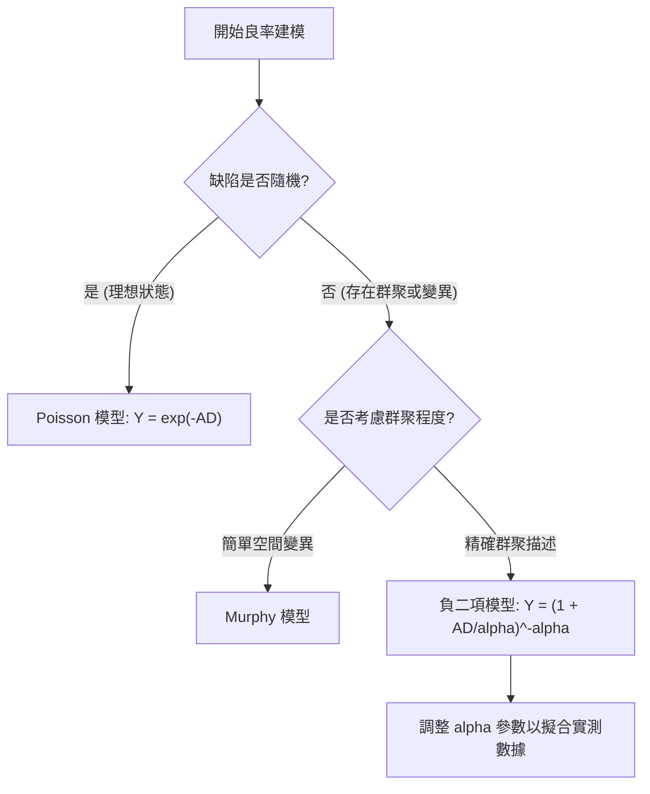
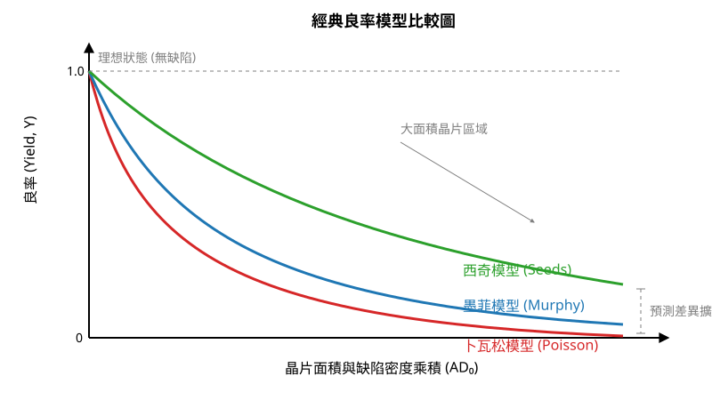
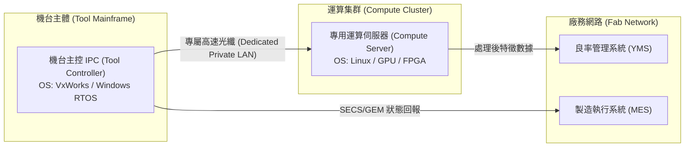
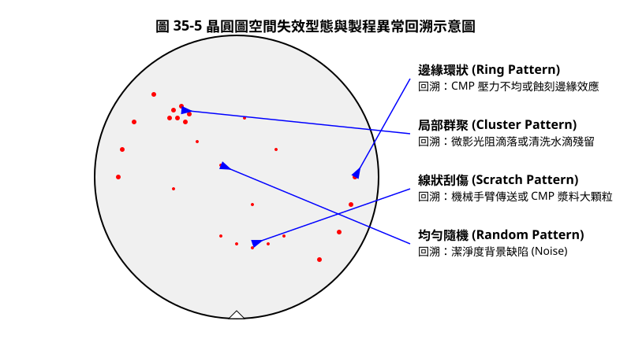
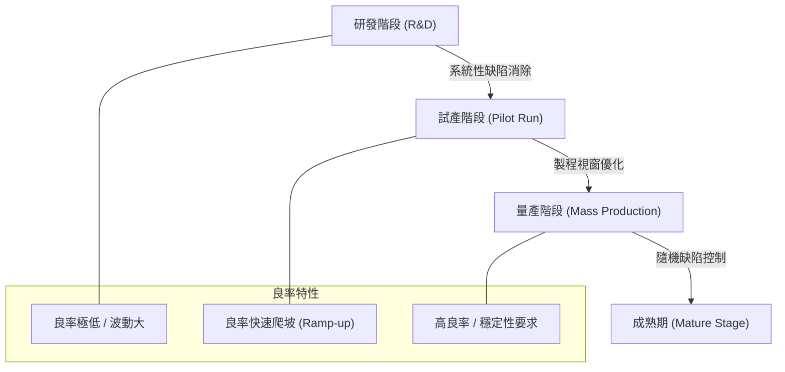
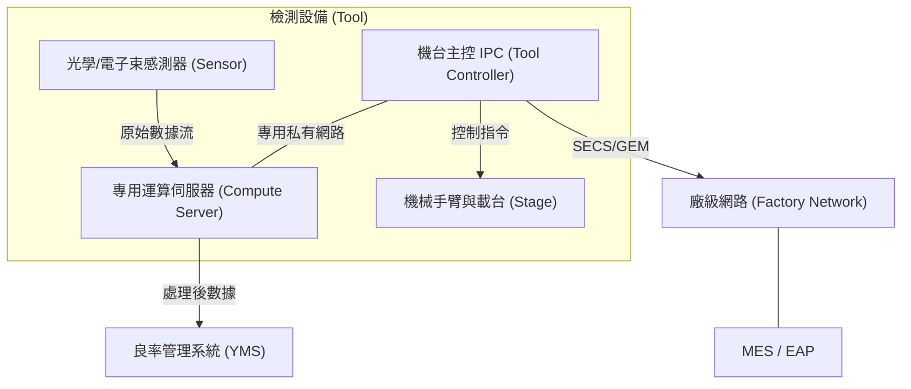
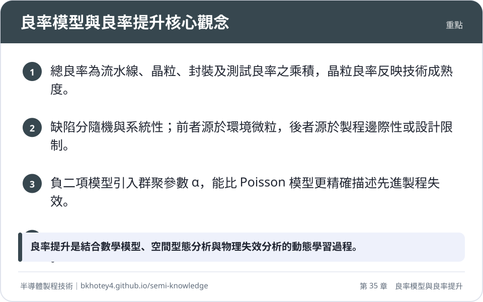
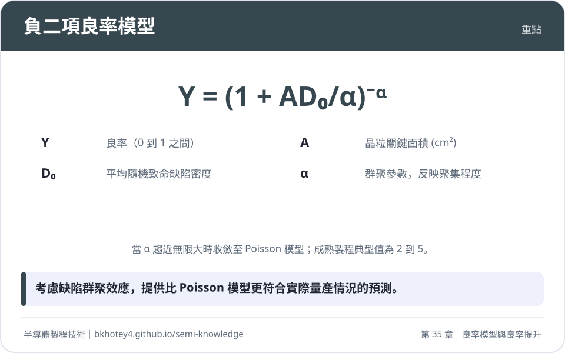
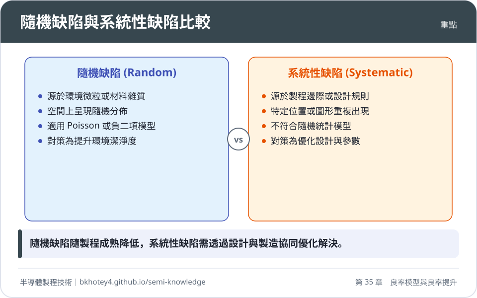
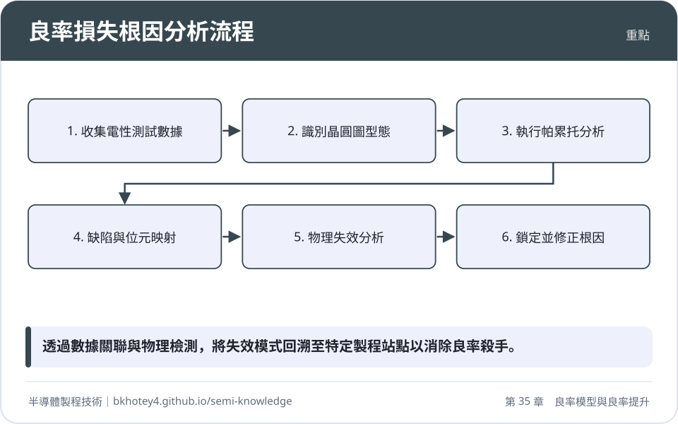

# 第 35 章　良率模型與良率提升

!!! abstract "學習目標"
    - 理解缺陷密度與晶粒面積對良率的數學關係與物理意義。
    - 掌握 Poisson、Murphy 與負二項良率模型的推導原理與適用場景。
    - 學習如何透過晶圓圖（Wafer Map）的空間型態特徵進行製程根因追溯。
    - 探討良率學習曲線的演進規律及先進製程中的良率提升策略。

## 35.1 良率定義與缺陷統計基礎

在半導體製造中，良率（Yield）不僅是評估生產效率的核心指標，更是衡量製程技術成熟度與穩定性的物理體現。從原始矽晶圓投入（Wafer Start）到最終成品測試（Final Test），晶圓需經過數百道物理與化學程序，任何微小的環境擾動或參數偏離都可能導致元件失效。本節將從良率的組成架構出發，探討缺陷的物理來源，並建立缺陷密度與晶粒面積之間的數學關聯。

### 35.1.1 良率的組成架構

半導體總良率（Total Yield, $Y_{Total}$）是一個多階層的乘積結果，反映了製造鏈中各個階段的損耗。在製程整合的視角下，最基礎的分類可分為流水線良率（Line Yield）與晶粒良率（Die Yield）。

#### 流水線良率 (Line Yield, $Y_L$)
流水線良率又稱為「晶圓存活率」，定義為最終完成所有製程步驟並進入測試階段的晶圓數與初始投入晶圓數之比。其數學表示為：
$$Y_L = \frac{N_{out}}{N_{in}}$$
其中，$N_{in}$ 為投入生產線的晶圓總數，$N_{out}$ 為未因破片、嚴重製程偏離（Excursion）或人為疏失而報廢（Scrap）的產出晶圓數。流水線良率主要受設備穩定性、自動化搬運系統（見第 43 章）以及廠務環境控制（見第 55 章）的影響。

#### 晶粒良率 (Die Yield, $Y_D$)
晶粒良率是指在一片「存活」的晶圓上，功能正常的晶粒數量與總晶粒數（Total Dies Per Wafer, TDPW）之比。這是製程技術研發中最核心的指標，直接受微影解析度、蝕刻精確度、薄膜純度等製程因素影響。

#### 總良率公式
綜合考慮封裝與測試階段，總良率可表示為：
$$Y_{Total} = Y_L \times Y_D \times Y_{PKG} \times Y_{FT}$$
- $Y_{PKG}$：封裝良率（Packaging Yield），受打線或覆晶封裝製程影響（見第 37 章）。
- $Y_{FT}$：最終測試良率（Final Test Yield），排除封裝後損壞或未達標之成品。

在製程開發階段，工程師通常專注於提升 $Y_L$ 與 $Y_D$，因為這兩者直接反映了前段（FEOL）與後段（BEOL）製程的健康狀況。

### 35.1.2 缺陷的物理來源與分類

導致晶粒失效的缺陷（Defects）依其產生的物理機制與空間分佈特性，可分為隨機缺陷（Random Defects）與系統性缺陷（Systematic Defects）。

#### 隨機缺陷 (Random Defects)
隨機缺陷是由環境中的微塵粒子（Particles）、化學殘留物或材料不純物所引起。其出現位置在晶圓上呈現隨機分佈，無法透過設計修改來完全消除。
- **物理來源**：無塵室空氣中的懸浮微粒、設備腔體內的副產物剝落（如 CVD 腔壁上的薄膜碎屑）、研磨液（Slurry）中的大尺寸粒子（見第 24 章）。
- **統計特性**：通常假設符合卜瓦松分佈（Poisson Distribution），其發生機率與環境潔淨度及製程潔淨規範密切相關。

#### 系統性缺陷 (Systematic Defects)
系統性缺陷與製程邊界（Process Margin）或設計規則（Design Rules）有關。當製程參數處於臨界狀態時，特定的圖形結構會反覆出現失效。
- **物理來源**：微影製程中的光學鄰近效應（OPE）導致的圖形橋接（Bridging）、CMP 製程中的碟陷（Dishing）導致導線變薄、或蝕刻負載效應（Loading Effect）導致的深孔未開路（見第 19 章）。
- **統計特性**：具有高度的可重複性，通常出現在晶圓的特定位置（如邊緣）或特定的電路佈局（Layout）中。

```mermaid
graph TD
    "Total Defects" --> "Random Defects (隨機缺陷)"
    "Total Defects" --> "Systematic Defects (系統性缺陷)"
    "Random Defects (隨機缺陷)" --> "Particles (微粒)"
    "Random Defects (隨機缺陷)" --> "Chemical Residue (化學殘留)"
    "Systematic Defects (系統性缺陷)" --> "Litho Hotspots (微影熱點)"
    "Systematic Defects (系統性缺陷)" --> "Process Marginality (製程邊際性)"
    "Systematic Defects (系統性缺陷)" --> "Design-Process Interaction (設計與製程交互作用)"
```

### 35.1.3 缺陷密度 ($D_0$) 與臨界面積 ($A_c$)

為了量化缺陷對良率的影響，我們引入缺陷密度（Defect Density）的概念。

#### 缺陷密度 (Defect Density, $D_0$)
$D_0$ 定義為單位面積內導致晶粒失效的平均缺陷數。其單位通常為 $defects/cm^2$。必須注意，並非所有觀察到的缺陷都會導致電路失效。僅有造成電路短路（Short）或斷路（Open）的缺陷才被稱為「致命缺陷」（Fatal Defects）。

#### 臨界面積 (Critical Area, $A_c$)
臨界面積是衡量電路佈局對缺陷敏感度的物理量。對於給定尺寸 $x$ 的缺陷，如果其中心落在某個區域內會導致電路失效，該區域即為臨界面積 $A_c(x)$。
- **導線間距影響**：當導線間距（Spacing）愈小，較小的缺陷就有可能造成短路，因此 $A_c$ 隨之增加。
- **導線寬度影響**：當導線寬度（Width）愈小，較小的缺陷就可能造成斷路。

截至撰寫時，隨著製程節點進入 3 奈米以下，微影技術採用的 EUV（見第 14 章）雖然減少了多重圖案化的疊對誤差，但由於金屬導線間距已縮減至 20 奈米以下，極微小的隨機粒子（如 10 奈米等級）所貢獻的 $A_c$ 顯著增加，這使得 $D_0$ 的控制變得極端困難。

### 35.1.4 晶粒面積與良率的非線性關係

良率與晶粒面積（Die Area, $A$）之間並非線性關係，而是呈現指數級別的敏感度。這是因為隨著晶粒面積增加，該晶粒包含至少一個致命缺陷的機率會大幅提升。

假設缺陷在晶圓上是完全隨機且獨立分佈的，根據基礎機率模型，晶粒良率 $Y$ 可簡化表示為：
$$Y \approx e^{-A \cdot D_0}$$
其中：
- $A$：晶粒面積 ($cm^2$)
- $D_0$：致命缺陷密度 ($defects/cm^2$)

!!! note "說明"
    上述公式為最簡單的卜瓦松模型（Poisson Model）。雖然在實際量產中，缺陷往往具有「叢集效應」（Clustering Effect），導致此模型過於悲觀，但它直觀地展示了面積對良率的殺傷力。更精確的模型如負二項模型（Negative Binomial Model）將在第 35.2 節討論。

#### 面積敏感度分析
1.  **小面積晶粒**：如電源管理 IC 或簡單感測器，即使 $D_0$ 略高，良率仍能維持在較高水準。
2.  **大面積晶粒**：如高效能運算（HPC）處理器或大型 GPU。若晶粒面積增加一倍，在相同的 $D_0$ 下，良率的下降並非一倍，而是呈指數級衰減。這也是為何先進製程晶片傾向於採用小晶片（Chiplet）架構，透過將大晶粒拆分為多個小晶粒以提升良率（詳見第 38 章與第 39 章）。

!!! example "產業實例"
    在 7 奈米製程導入初期，一片 300mm 晶圓上若生產面積為 $100 mm^2$ 的晶粒，其良率可能達到 80%；但若生產面積為 $600 mm^2$ 的超大型伺服器晶片，在相同的設備潔淨度（即 $D_0$ 相同）下，良率可能驟降至 20% 以下。這種非線性關係決定了高階晶片的定價策略與製程選擇。

### 35.1.5 缺陷統計的工程意義

在晶圓廠的實際運作中，良率提升（Yield Ramp）的過程本質上就是不斷縮小 $D_0$ 與消除系統性缺陷的過程。工程師透過光學檢測（Optical Inspection）與電子束檢測（e-beam Inspection）（見第 34 章）獲取缺陷數據，並將其與電路佈局進行疊對分析（Overlay Analysis），計算出不同製程層的 $A_c$。

透過監控 $D_0$ 的變化趨勢，可以判斷生產線是否受到污染；而透過分析晶圓圖（Wafer Map）上的失效分佈，則可以追蹤出特定機台的機械故障或製程參數偏移。這種從物理缺陷到統計模型，再到根因分析（Root Cause Analysis）的過程，構成了現代半導體良率工程的基礎。

## 35.2 經典良率預測模型

在半導體製造中，良率（Yield）的預測與評估是製程整合與產能規劃的核心。良率模型的主要目的，在於建立晶粒（Die）失效機率與缺陷密度（Defect Density）以及晶粒面積（Die Area）之間的數學關係。透過這些模型，工程師可以在產品設計階段預估產出，並在量產階段診斷製程健康狀況。

### 35.2.1 隨機缺陷與 Poisson 良率模型

最基礎的良率模型建立在缺陷於晶圓上呈完全隨機分佈（Random Distribution）的假設之上。若假設缺陷的發生彼此獨立，且在晶圓表面各處出現的機率均等，則單位面積內的缺陷數量符合卜瓦松分佈（Poisson Distribution）。

根據卜瓦松機率函數，在給定區域內出現 $k$ 個缺陷的機率為：

$$P(k) = \frac{\lambda^k e^{-\lambda}}{k!}$$

其中，$\lambda$ 為該區域內缺陷數量的期望值。在半導體良率分析中，我們將 $\lambda$ 定義為平均缺陷密度 $D_0$ 與晶粒有效面積 $A$ 的乘積，即 $\lambda = A \cdot D_0$。

一個晶粒若要成為合格品（Good Die），其缺陷數 $k$ 必須為 0。因此，Poisson 良率模型定義如下：

$$Y = P(0) = e^{-AD_0}$$

*   $Y$：良率（0 到 1 之間）。
*   $A$：晶粒的關鍵面積（Critical Area），即缺陷落在該區域會導致電路失效的面積。
*   $D_0$：單位面積的平均隨機缺陷密度（典型值為每平方公分內的缺陷數）。

!!! warning "常見誤解"
    Poisson 模型假設缺陷是完全隨機且不具相關性的。然而，在實際製程中，缺陷往往具有「群聚效應」（Clustering Effect），例如來自機台噴嘴的微粒噴灑或化學機械研磨（CMP）產生的刮傷。這導致 Poisson 模型在預測大面積晶粒或高缺陷密度製程時，往往會過度低估實際良率，呈現過於悲觀的預測結果。

### 35.2.2 Murphy 模型：引入缺陷密度的空間變異

為了修正 Poisson 模型對空間均勻性的過度簡化，Murphy 提出了引入缺陷密度分佈函數 $f(D)$ 的概念。他認為缺陷密度 $D$ 並非一個常數，而是在晶圓不同位置有所波動。總良率應為各局部良率對缺陷密度分佈函數的加權積分：

$$Y = \int_{0}^{\infty} e^{-AD} f(D) dD$$

Murphy 提出了一種對稱的三角形分佈函數（Triangular Distribution）來描述 $D$ 的變化。在這種假設下，缺陷密度以 $D_0$ 為中心對稱波動。經過積分推導，Murphy 良率模型表示為：

$$Y = \left( \frac{1 - e^{-AD_0}}{AD_0} \right)^2$$

Murphy 模型相較於 Poisson 模型，考慮了缺陷密度的不均勻性，其預測曲線較為平緩。在相同的 $A$ 與 $D_0$ 條件下，Murphy 模型預測的良率通常高於 Poisson 模型，這更接近早期半導體製程的實際觀察值。

### 35.2.3 負二項模型（Negative Binomial Model）

隨著製程進入超大型積體電路（VLSI）時代，工程師發現缺陷的群聚效應對良率的影響極大。群聚效應意味著缺陷傾向於成群出現，若一個晶粒已經存在一個缺陷，該晶粒及其鄰近區域出現第二個缺陷的機率會高於隨機機率。

為了精確描述這種現象，學界引入了負二項模型，這也是目前業界最廣泛應用的經典模型之一。該模型假設缺陷密度 $D$ 符合伽瑪分佈（Gamma Distribution），其良率公式推導如下：

$$Y = \left( 1 + \frac{AD_0}{\alpha} \right)^{-\alpha}$$

其中，$\alpha$ 被稱為「群聚參數」（Clustering Parameter）或「離散參數」：

1.  **物理意義**：$\alpha$ 反映了缺陷在晶圓上的聚集程度。
2.  **數值範圍**：
    *   當 $\alpha \to \infty$ 時，負二項模型會收斂至 Poisson 模型（完全隨機）。
    *   當 $\alpha$ 較小（例如 $\alpha < 2$）時，表示缺陷具有強烈的群聚傾向。
    *   在成熟製程中，$\alpha$ 的典型值通常落在 2 到 5 之間。

!!! note "說明"
    負二項模型之所以強大，是因為它能透過調整 $\alpha$ 值來適應不同的製程特性。在開發初期，製程不穩定，缺陷常成片出現（$\alpha$ 小）；隨著製程成熟，系統性問題被排除，缺陷趨於隨機分佈（$\alpha$ 變大）。

### 35.2.4 模型演進與物理特性比較

下表總結了三種經典良率模型的特性與適用情境：

| 模型名稱 | 核心假設 | 數學特徵 | 適用情境 |
| :--- | :--- | :--- | :--- |
| **Poisson** | 完全隨機、獨立分佈 | 指數衰減 | 小面積晶粒、極低缺陷密度 |
| **Murphy** | 缺陷密度呈三角形分佈 | 平方反比修正 | 中等複雜度之早期製程 |
| **負二項 (NB)** | 缺陷具群聚效應 (Gamma 分佈) | 冪律衰減 (含 $\alpha$ 參數) | 先進製程、大面積 SoC、多層導線結構 |



### 35.2.5 先進製程節點（5nm 以下）的預測準確度

截至撰寫時，隨著製程微縮至 5nm、3nm 甚至更先進節點，經典良率模型面臨新的挑戰。在極紫外光（EUV）微影與多重圖案化（見第 13、14 章）的背景下，良率損失不再僅僅由隨機微粒（Random Particles）引起，更多來自於以下因素：

1.  **系統性缺陷（Systematic Defects）**：
    由於光學鄰近效應（OPC）失效、蝕刻負載效應（Loading Effect）或 CMP 不均勻導致的失效。這類缺陷在晶圓上的位置是固定的，不符合隨機或群聚分佈模型。
2.  **關鍵面積（Critical Area）的複雜化**：
    在 5nm 以下節點，導線間距極小，微小的尺寸偏差（CD Variation）即可導致短路。這使得 $A$ 不再是一個幾何常數，而是一個與製程容許度（Process Window）相關的函數。
3.  **多層結構的累加效應**：
    先進邏輯晶片擁有超過 15 層的金屬層（見第 31 章），每一層都有其特有的 $D_0$ 與 $\alpha$。總良率必須表示為各層良率的乘積：
    $$Y_{total} = \prod_{i=1}^{n} Y_i$$
    這要求良率管理系統（YMS）必須具備強大的層間關聯分析能力。

在 5nm 以下節點的量產初期，負二項模型仍被用於基體（Baseline）良率評估，但工程師會結合「臨界電壓波動」（$V_{th}$ Variation）與「疊對誤差」（Overlay Error，見第 17 章）等物理參數進行模型修正。研究顯示，對於大面積的 AI 加速器晶片或高效能運算（HPC）處理器，若不使用負二項模型並精確提取 $\alpha$ 值，預測誤差可能高達 15% 以上。

!!! example "產業實例"
    在現代化晶圓廠中，良率管理系統（YMS）會自動抓取晶圓針測（CP，見第 42 章）的 Wafer Map，利用非線性最小平方法（Non-linear Least Squares）對大量批次數據進行擬合，自動計算出該製程節點當前的 $D_0$ 與 $\alpha$。這些參數會回饋給整合工程師（PIE），作為判斷製程是否偏離基準（Excursion）的重要指標。若 $\alpha$ 突然大幅下降，通常暗示機台產生了局部性的污染或硬體故障。

### 35.2.6 模型的侷限性與現代修正

雖然經典模型在預測「功能良率」（Functional Yield）方面表現良好，但它們難以預測「參數良率」（Parametric Yield）。參數良率是指晶片雖然功能正常，但因電流、頻率或功耗未達標而導致的損失。在先進節點，參數良率的損失往往佔據總良率損失的顯著比例。

因此，當前的發展方向是將經典的缺陷模型與統計製程控制（SPC，見第 36 章）以及機器學習模型相結合。透過收集機台感測器數據（FDC，見第 46 章）與光學檢測影像，建立更為動態且具備空間感知能力的良率預測系統，以彌補傳統數學模型在處理非隨機失效模式時的不足。

<!-- fig:1 -->
<figure markdown>

<figcaption>圖 35-1　經典良率模型比較圖（AI 繪製的示意圖）</figcaption>
</figure>

## 35.3 晶圓圖型態分析與特徵識別

在半導體製造中，單一晶粒（Die）的失效往往並非隨機發生，而是呈現特定的空間分佈特徵。晶圓圖（Wafer Map）是將晶圓上每一顆晶粒的測試結果（如電性測試的 Pass/Fail）或缺陷檢測數據，依照其物理座標進行視覺化呈現的二維圖表。透過分析晶圓圖上的空間型態（Spatial Patterns），工程師能有效追蹤製程中的系統性偏差（Systematic Variation），進而縮短良率提升（Yield Learning）的週期。

### 35.3.1 晶圓圖的空間數據結構與視覺化

晶圓圖的數據來源主要分為兩大類：一是來自晶圓針測（Wafer Sort/CP，見第 42 章）的電性分類代碼（Bin Code），二是來自光學或電子束檢測設備（見第 34 章）的缺陷座標數據。

#### 1. 座標系統與數據格式
晶圓圖通常採用直角座標系 $(X, Y)$，其中原點通常設定在晶圓中心或特定的對準標記（Alignment Mark）。數據結構包含：
- **晶粒座標（Die Coordinates）：** 以整數表示晶粒在陣列中的行與列。
- **缺陷座標（Defect Coordinates）：** 以微米（$\mu m$）或奈米（$nm$）為單位，記錄缺陷在晶粒內部的精確位置。
- **分類代碼（Binning）：** 
    - **硬分類（Hard Bin）：** 物理測試結果，如開路、短路、功耗超標等。
    - **軟分類（Soft Bin）：** 軟體根據測試參數範圍進行的細分，用於良率分析。

#### 2. 數據視覺化之意義
視覺化處理能將數以萬計的數位記錄轉化為人類專家或機器學習模型可識別的圖形。例如，將良率數據進行「堆疊圖」（Stacked Map）處理，即將同一批次（Lot）內 25 片晶圓的失效分佈累加，能過濾掉隨機缺陷（Random Defects），使隱藏的系統性問題顯現。

### 35.3.2 常見空間型態識別與物理成因

空間型態識別（Spatial Pattern Recognition, SPR）是良率分析的核心。不同的圖案往往對應特定的設備特徵或製程缺陷。

#### 1. 環狀型態（Ring Patterns）
失效晶粒集中在晶圓的特定半徑區域，通常呈現同心圓狀。
- **物理成因：** 
    - **化學機械研磨（CMP）：** 研磨頭（Polishing Head）壓力分佈不均，導致中心或邊緣移除速率（Removal Rate）不一致（見第 24 章）。
    - **熱製程：** 快速熱處理（RTP）中，晶圓邊緣的熱輻射散失較快，導致溫度梯度（見第 27 章）。
    - **蝕刻製程：** 電漿密度在邊緣與中心的不均勻分佈（見第 19 章）。

#### 2. 刮痕型態（Scratch Patterns）
呈現線狀或弧形的失效分佈。
- **物理成因：**
    - **機械手臂（Robot）：** 晶圓傳送過程中，機械手臂的末端效應器（End Effector）或對準器（Aligner）刮傷晶圓背面或表面。
    - **CMP 漿料（Slurry）：** 漿料中若含有大尺寸顆粒或乾涸結塊，會在旋轉研磨時劃出弧形刮痕。

#### 3. 局部簇集（Blob / Cluster Patterns）
失效晶粒在局部區域成群出現，形狀不規則。
- **物理成因：**
    - **微影光阻：** 光阻滴落（Dripping）不均或氣泡破裂（見第 11 章）。
    - **清洗製程：** 乾燥過程中的水滴殘留（Water Mark）。
    - **顆粒污染：** 來自腔體內壁掉落的副產物。

#### 4. 邊緣失效（Edge Exclusion）
晶圓最外圈（典型值為 1-3 mm 區域）的良率極低。
- **物理成因：**
    - **邊緣珠除（EBR）：** 微影製程中為了防止光阻剝落污染，會去除邊緣光阻，導致該區域無法成像。
    - **夾具遮蔽（Clamping）：** PVD 或離子佈植時，機械夾具遮蔽了晶圓邊緣。

#### 5. 掃描或線性型態（Scan / Linear Patterns）
呈現水平或垂直的條紋狀。
- **物理成因：**
    - **離子佈植：** 掃描束（Scanning Beam）的重疊度不均或掃描速度波動（見第 26 章）。
    - **微影曝光：** 步進掃描儀（Scanner）在掃描場（Scan Field）之間的銜接誤差。

| 型態名稱 | 英文術語 | 常見關聯製程 | 物理機制簡述 |
| :--- | :--- | :--- | :--- |
| 環狀 | Ring | CMP / Etch / RTP | 徑向分佈不均（壓力、濃度、溫度） |
| 刮痕 | Scratch | Handling / CMP | 機械性物理損傷 |
| 簇集 | Cluster / Blob | Litho / Cleaning | 局部污染或液體分佈異常 |
| 區域性 | Zone | Deposition | 噴頭（Showerhead）局部阻塞 |
| 掃描線 | Scan Line | Ion Implant / Litho | 掃描機構運動不穩定 |

### 35.3.3 型態分析與特定製程站點的關聯

將晶圓圖型態與製程參數進行關聯分析，是定位根因（Root Cause）的關鍵步驟。這通常涉及「空間自相關性」（Spatial Autocorrelation）的計算。

#### 1. 空間聚集度指標
常用於量化缺陷聚集程度的指標之一是聚集指數（Cluster Index, $I$）：
$$I = \frac{\sigma^2}{\mu}$$
其中 $\mu$ 為單一晶圓上平均每顆晶粒的缺陷數，$\sigma^2$ 為其變異數。
- 若 $I \approx 1$，代表缺陷分佈接近 Poisson 分佈（隨機）。
- 若 $I > 1$，代表缺陷具有聚集傾向（系統性）。

#### 2. 製程站點追蹤實例
- **微影疊對（Overlay）偏移：** 若晶圓圖呈現旋轉對稱的失效，可能與微影機台的對準系統有關（見第 17 章）。
- **離子佈植劑量不均：** 若出現規律的條紋，通常與離子佈植機的掃描磁鐵電流波動有關。
- **CMP 研磨過度（Over-polishing）：** 若失效集中在晶圓邊緣且呈現特定扇形，可能與研磨墊（Pad）的修整（Conditioning）狀態有關。

### 35.3.4 自動化缺陷分類（ADC）與良率管理

隨著製程節點進入 3 奈米及以下，人工判讀晶圓圖已不具可行性。自動化缺陷分類（Automatic Defect Classification, ADC）與空間型態識別（SPR）系統成為良率管理系統（YMS）的核心。

#### 1. 深度學習與影像識別
現代 ADC 系統利用卷積神經網路（CNN）對缺陷影像與晶圓圖進行特徵提取。系統會將即時產出的 Wafer Map 與資料庫中的「特徵圖譜」（Signature Library）進行比對，自動標註為「CMP Ring」或「Implant Streak」。

#### 2. 硬體架構：控制與運算的分離
先進檢測設備（如高產率光學檢測機台）在架構上採取了「控制」與「運算」物理分離的設計，以因應龐大的數據處理需求。



- **機台主控 IPC：** 負責高即時性（Real-time）的任務，如機械手臂傳送、真空互鎖與安全監控。其作業系統追求絕對的穩定性，避免因運算過載導致機台當機。
- **專用運算伺服器：** 負責消化每秒數十 GB 的原始影像數據（Raw Data）。例如在光學繞射重構（见第 17 章）中，利用大量 GPU 執行嚴格耦合波分析（RCWA）模擬，將繞射光譜反推為物理尺寸。

!!! note "說明"
    這種分離架構確保了即使在進行複雜的 AI 影像識別或大數據型態分析時，機台的物理動作（如晶圓傳輸）仍能保持最高的產出率（Throughput），不受運算延遲影響。

#### 3. ADC 在良率管理中的角色
ADC 不僅是分類，更重要的是觸發「警示機制」。當 YMS 偵測到某一特定型態（如 Scratch）的發生頻率超過管制上限（見第 36 章），系統會自動比對 MES 中的製造歷程，找出該批次共同經過的機台（Common Tool Analysis），從而精確鎖定故障設備。

!!! example "產業實例"
    在先進製程中，ASML 的 YieldStar 量測設備會將採集到的繞射數據傳送至專屬的重構伺服器（Reconstruction Server）。該伺服器利用高效能運算集群執行麥克斯威方程組（Maxwell's Equations）模擬，將光學訊號轉換為奈米級的疊對（Overlay）偏移值，並即時回饋給微影機台進行自動補償（APC, 見第 46 章）。

截至撰寫時，晶圓圖型態分析已從單純的「事後檢討」演進為「即時預警」。透過將檢測設備的外掛運算小腦與廠級良率管理系統整合，晶圓廠能在良率大幅滑落前，就先識別出微小的空間型態異常，這對於高成本的先進製程（如 EUV 世代）至關重要。

<!-- fig:2 -->
<figure markdown>

<figcaption>圖 35-2　晶圓圖缺陷型態識別（AI 繪製的示意圖）</figcaption>
</figure>

## 35.4 良率學習曲線與提升路徑

在半導體製造生命週期中，良率並非一個靜態的定值，而是一個隨時間、累積產量與工程經驗而演進的動態過程。良率提升（Yield Learning）是指透過識別、分析並消除造成晶圓失效的根因，使良率從研發階段的低點逐步爬升至量產階段的高穩定狀態。

#### 35.4.1 良率學習曲線的數學表達式

良率學習曲線（Yield Learning Curve）描述了良率提升的速度與累積經驗（通常以時間或累積加工晶圓數表示）之間的關係。在工業工程與半導體實務中，最常使用的模型為指數增長模型：

$$Y(t) = Y_0 + (Y_{\infty} - Y_0)(1 - e^{-\lambda t})$$

其中：
- $Y(t)$ 為在時間 $t$（或累積批次 $n$）時的預期良率。
- $Y_0$ 為製程初始階段（如研發初期）的初始良率。
- $Y_{\infty}$ 為該製程節點在理論上或技術極限下能達到的成熟良率（Mature Yield）。
- $\lambda$ 為良率學習速率（Learning Rate），其物理意義代表工程團隊解決問題的效率。

$\lambda$ 的數值受多重因素影響，包括製程複雜度（如 EUV 多重曝光次數，見第 14 章）、檢測設備的靈敏度（見第 34 章）以及自動化數據分析系統的效能。較大的 $\lambda$ 值意味著良率爬坡速度較快，能縮短產品進入市場的時間。

另一種常見的表達方式是基於累積產量的冪定律（Power Law）模型：

$$Y(n) = A \cdot n^b$$

其中 $n$ 為累積產出的晶圓數量，$b$ 為學習係數。此模型強調「實作中學習」（Learning by Doing）的效應，即產量每翻一倍，良率損失（Yield Loss）減少的比例。

#### 35.4.2 良率爬坡階段分析

良率提升過程依據產品生命週期可分為三個主要階段：研發階段（R&D）、試產階段（Pilot Run）與量產階段（Mass Production/HVM）。



1.  **研發階段 (R&D)：**
    此階段的重點在於「可行性驗證」。良率通常極低，甚至經常出現「零良率」晶圓。此時的良率損失主要來自於**系統性缺陷（Systematic Defects）**，例如設計規則（Design Rules）與製程能力不匹配、微影重疊精度（Overlay）不足（見第 17 章）或蝕刻負載效應（Loading Effect）過於嚴重。工程目標是透過失效分析（Failure Analysis, FA）修正設計或製程基準（Baseline）。

2.  **試產階段 (Pilot Run / Ramp-up)：**
    當系統性問題基本解決後，進入良率爬坡期。此階段的目標是驗證製程的重複性與穩定性。良率損失轉向**整合性缺陷**，如化學機械研磨（CMP）後的殘留物、薄膜應力導致的晶圓翹曲等。此時 $\lambda$ 值的最大化至關重要，工程團隊需頻繁進行短迴路（Short Loop）實驗以快速迭代。

3.  **量產階段 (Mass Production / High Volume Manufacturing, HVM)：**
    截至撰寫時，先進製程（如 3 奈米與 2 奈米節點）進入 HVM 的門檻極高。此階段良率已達到較高水準（如 80% 以上，視產品類別而定），良率提升的重點轉向**隨機性缺陷（Random Defects）**的控制，例如無塵室環境中的微塵粒子（Particles）或設備零件磨耗產生的金屬污染。此時的良率管理依賴統計製程控制（SPC，見第 36 章）來監控異常偏移（Excursion）。

#### 35.4.3 根因分析（RCA）方法論

良率提升的核心在於精準的根因分析（Root Cause Analysis, RCA）。這需要將物理檢測到的缺陷數據與最終電性測試結果進行空間與邏輯上的關聯。

**1. 缺陷對應與位元映射 (Defect-to-Bit Mapping)：**
對於記憶體產品（如 DRAM 或 HBM，見第 40 章），可透過電性測試定位出失效的特定位元（Bit）。將此電性失效圖（Bit Map）與製程中段檢測到的缺陷圖（Defect Map，見第 34 章）進行座標重疊（Overlay Analysis）。若某個缺陷座標與失效位元座標吻合，則該缺陷被定義為「致命缺陷」（Killer Defect）。

**2. 掃描鏈分析 (Scan Chain Analysis)：**
對於邏輯電路，利用掃描鏈技術將內部正反器的狀態移出，藉此定位邏輯閘層級的失效位置。結合計算微影（Computational Lithography）與佈局數據（GDSII/OASIS），可推斷出是否為特定圖案敏感（Pattern Sensitive）的缺陷。

**3. 物理失效分析 (Physical Failure Analysis, PFA)：**
當數據分析指向特定製程步驟時，需進行破壞性檢測。
- **聚焦離子束 (FIB)：** 切割特定失效點的截面。
- **穿透式電子顯微鏡 (TEM)：** 觀察奈米級的晶體缺陷、薄膜層間擴散或閘極氧化層穿孔。
- **能量散射 X 射線譜 (EDX)：** 分析缺陷的化學成分，判斷其來源（例如：來自蝕刻氣體的聚合物或來自機械手臂的金屬磨屑）。

#### 35.4.4 良率損失之帕累托分析與優先級排序

在複雜的製程中，可能同時存在數百種造成良率損失的因素。為了有效配置工程資源，必須使用帕累托圖（Pareto Chart）進行分析。

!!! note "帕累托法則在良率管理中的應用"
    在半導體製程中，通常 80% 的良率損失是由 20% 的關鍵缺陷類型（Yield Killers）所造成的。帕累托分析的目的在於識別這些「關鍵少數」。

**良率損失排序步驟：**
1.  **分類：** 將所有失效晶粒依據失效模式（Failure Mode）分類，如「開路（Open）」、「短路（Short）」、「漏電（Leakage）」或「參數偏移（Parametric Shift）」。
2.  **量化：** 計算每種失效模式對總良率損失的貢獻百分比。
3.  **繪圖：** 橫軸為失效類型（按貢獻度由大到小排列），縱軸為損失比例，並繪製累積百分比曲線。

!!! example "產業實例：先進節點的 Pareto 轉變"
    在 7 奈米轉向 5 奈米製程初期，帕累托圖的首位通常是「微影對準誤差（Overlay Error）」。隨著製程成熟，首位可能轉變為「特定金屬層的 CMP 刮傷（Scratch）」或「原子層沉積（ALD）的微小孔洞（Pinhole）」。

**優先級排序策略：**
工程團隊在處理 Pareto 前幾項問題時，需考慮「影響程度」與「解決難度（Ease of Fix）」：
- **高影響/低難度：** 優先處理，通常稱為「低垂果實（Low-hanging Fruit）」，如調整清洗配方以去除特定粒子。
- **高影響/高難度：** 屬於核心技術攻關，需跨部門（設計、整合、設備）協作，如更換新一代的光阻材料。

#### 35.4.5 關鍵區域分析 (CAA) 與良率預測

良率提升不僅是事後補救，更包含事前預測。透過關鍵區域分析（Critical Area Analysis, CAA），可以評估設計佈局對隨機缺陷的敏感度。

關鍵區域 $A_c$ 定義為：若缺陷中心落在該區域內，則會導致電路失效（如短路）。對於大小為 $x$ 的缺陷，其失效機率為：

$$P(x) = \frac{A_c(x)}{A_{total}}$$

結合缺陷尺寸分佈函數 $D(x)$（通常遵循 $1/x^p$ 分佈），可估算預期良率。若 Pareto 分析顯示某層金屬短路比例過高，工程團隊可透過 DFM（Design for Manufacturing）規則增加金屬線距，減少該層的 $A_c$，從而在不改變製程環境的前提下提升良率。

!!! warning "常見誤解：良率提升僅是製程工程師的責任"
    現代半導體製程中，良率提升是「設計與製造協同優化（DTCO）」的結果。若設計端未考慮製程視窗（Process Window），單靠製造端的調整往往難以跨越良率爬坡的瓶頸。

截至撰寫時，隨著人工智慧與機器學習（AI/ML）技術整合進良率管理系統（YMS），根因分析的時間已從數週縮短至數小時。系統能自動關聯數千個機台感測器參數（見第 54 章）與電性測試結果，識別出隱藏的多元件交互作用（Multivariate Interaction），這已成為 2 奈米以下節點良率競爭的核心技術。

## 35.5 設備與廠商技術

在現代半導體量產中，良率管理已從單純的「事後檢驗」演進為「即時預測與回饋」。為了處理先進製程（如 3 奈米、2 奈米及更先進節點）產生的海量數據，量測與檢測設備的架構發生了根本性的變革。本節將探討支撐良率提升的關鍵設備技術、運算架構以及良率管理系統（Yield Management System, YMS）的整合邏輯。

### 35.5.1 先進檢測設備的雙主機運算架構

隨著電路特徵尺寸微縮至原子尺度，檢測設備必須在極短時間內掃描晶圓表面並識別出奈米級缺陷。這產生了極高的資料吞吐量需求。例如，一台高解析度光學檢測機台在掃描整片晶圓時，每秒產生的影像原始數據（Raw Data）可達數十 GB。

為了確保機台運作的穩定性與運算的高效性，先進製程設備普遍採用「控制與運算物理分離」的雙主機架構：

1.  **機台主控 IPC (Tool Controller)：**
    通常運行即時作業系統（RTOS，如 VxWorks）或經過優化的 Windows 環境。其核心任務是確保機械手臂傳送、腔體壓力控制、真空互鎖（Interlock）以及與工廠製造執行系統（MES）通訊（透過 SECS/GEM 協定，見第 44 章）的絕對穩定。此主機追求的是 100% 的確定性，避免因運算資源被佔用而導致機台當機或晶圓破損。
2.  **專用運算伺服器 (Compute Server / Image Computer)：**
    專門處理運算密集型任務。這類伺服器通常運行 Linux 系統，配備多顆高效能處理器（如 Xeon 或 EPYC）、大量隨機存取記憶體（RAM）、專用圖形處理器（GPU）或場可程式化邏輯閘陣列（FPGA）運算卡，並配置特製的 NVMe RAID 快取陣列。其任務是執行複雜的影像差分演算法、機器學習分類或物理模型模擬。

兩者之間透過隔離的專用私有區域網路（Dedicated Private LAN，如 10G 或 40G 光纖）直連，以杜絕廠級網路流量抖動對資料傳輸產生的干擾。



### 35.5.2 良率管理系統 (YMS) 的資料追溯架構

良率管理系統（YMS）是晶圓廠整合製造大數據的核心平台。其目標是將物理缺陷（Defect）與電性測試結果（Electrical Test）進行空間與時間上的關聯。

截至撰寫時，先進製程的 YMS 追溯架構包含以下關鍵維度：

*   **空間關聯 (Spatial Correlation)：** 將缺陷檢測機台產生的缺陷圖（Defect Map）與晶圓針測（CP）產生的良率圖（Wafer Map）進行疊加。透過座標轉換，分析特定位置的缺陷是否直接導致了電性失效。
*   **時間與歷程追溯 (Lot History Traceback)：** 整合 MES 中的生產履歷，分析良率下降是否與特定的機台（Chamber）、特定批次的化學品或特定的製程參數偏移有關。
*   **設計關聯 (Design-Based Inspection, DBI)：** 將檢測到的缺陷座標映射回原始設計的 GDSII 佈局圖中。這有助於判斷缺陷是隨機產生的（Random Defect），還是由於設計規則過於嚴苛導致的系統性缺陷（Systematic Defect）。

### 35.5.3 產業實例：光學繞射重構與影像處理

在良率提升實務中，ASML 與 KLA 的技術路徑代表了兩種主流的運算密集型應用。

!!! example "產業實例：ASML YieldStar 與 Reconstruction Server"
    ASML 的 YieldStar 系列設備主要用於疊對（Overlay）量測。與傳統影像式量測不同，它採用繞射式量測（Diffraction Based Overlay, DBO）。設備收集光學繞射光譜後，必須將數據傳送至專用的**重構伺服器（Reconstruction Server）**。
    該伺服器執行**嚴格耦合波分析（Rigorous Coupled-Wave Analysis, RCWA）**，這是一種基於麥克斯威方程組（Maxwell's Equations）的數值模擬方法。透過不斷調整模型參數，使模擬光譜與量測光譜匹配，從而反推回奈米級的疊對偏移值。這種計算模式對 CPU 核心數與記憶體頻寬有極高要求。

!!! example "產業實例：KLA 寬頻電漿檢測與高效能運算集群"
    KLA 的圖案晶圓檢測平台（如 39xx 系列）利用寬頻電漿（Broadband Plasma）光源捕捉晶圓影像。為了在量產環境下維持產能，其運算架構必須處理每秒數十 GB 的影像數據。
    其核心技術在於**像素差分比對（Die-to-Die Comparison）**：運算伺服器將當前晶圓單元（Die）的影像與鄰近單元或標準資料庫（Die-to-Database）進行即時比對。任何微小的像素差異都會被標記為潛在缺陷。這類設備通常配置龐大的運算集群（Computing Cluster），利用並行運算技術來縮短檢測循環時間（Cycle Time）。

### 35.5.4 主要供應商技術比較

下表列出良率管理、檢測與量測領域的主要廠商及其代表性技術路線：

| 廠商 | 代表產品系列 | 技術路線與特點 | 主要應用 |
| :--- | :--- | :--- | :--- |
| **KLA** | 29xx、39xx 系列 | 寬頻電漿（BBP）光學掃描，具備極高影像吞吐量與靈敏度。 | 圖案晶圓缺陷檢測 |
| **KLA** | Archer 系列 | 影像式疊對量測（IBO），利用光學成像對準標記。 | 疊對精度量測 |
| **ASML** | YieldStar 系列 | 繞射式量測（DBO），利用光學繞射光譜重構物理特徵。 | 疊對與關鍵尺寸量測 |
| **ASML** | eScan 系列 | 多束電子束（Multi-beam）檢測，提升電子束掃描產能。 | 奈米級缺陷檢測 |
| **Applied Materials** | PROVision、SEMVision | 電子束檢測與缺陷自動複查（ADC），具備高解析度成像。 | 缺陷分類與關鍵尺寸量測 |
| **Hitachi High-Tech** | CG6300、CG7300 | 掃描式電子顯微鏡（CD-SEM），製程控制的標準量測工具。 | 關鍵尺寸（CD）量測 |
| **Advantest** | V93000 平台 | 高速數位與混合訊號測試，提供良率分析所需的電性數據。 | 晶圓針測與成品測試 |
| **Teradyne** | UltraFLEX 系列 | 高精度 SoC 測試，支援複雜系統晶片的電性特徵分析。 | 晶圓針測與成品測試 |
| **PDF Solutions** | Exensio | 良率大數據分析平台，整合設計、製造與測試數據。 | 廠級良率管理系統 (YMS) |

### 35.5.5 機台選機考量與技術取捨

晶圓廠在選擇良率提升相關設備時，通常會在以下三個維度進行取捨：

1.  **靈敏度 (Sensitivity) 與產能 (Throughput)：**
    光學檢測速度快但解析度受限於波長；電子束檢測（E-beam）解析度極高但速度慢。截至撰寫時，多束電子束技術（Multi-beam）正試圖彌補兩者間的鴻溝。
2.  **準確度 (Accuracy) 與精密度 (Precision)：**
    量測設備必須具備極低的變異性。在先進節點中，量測誤差預算（P/T Ratio）通常要求小於製程容許範圍的 10%。
3.  **擁有成本 (Cost of Ownership, CoO)：**
    除了機台售價，運算伺服器的維護、電力消耗以及軟體授權費用亦是重要考量。例如，採用 RCWA 模擬雖然精準，但需要龐大的運算資源投入。

透過整合高效能硬體與智慧化軟體平台，晶圓廠得以在量產初期快速爬升良率學習曲線（見第 35.4 節），並在成熟期維持穩定的產出品質。

## 本章重點

- 半導體總良率由流水線良率、晶粒良率、封裝良率與最終測試良率之乘積組成，其中晶粒良率是衡量製程技術成熟度的核心指標。
- 缺陷依物理特性分為隨機缺陷與系統性缺陷。隨機缺陷主要來自環境微粒，符合機率分佈；系統性缺陷則源於製程邊際性或設計規則限制，具有高度可重複性。
- 經典良率預測模型經歷了從卜瓦松模型（Poisson Model）到負二項模型（Negative Binomial Model）的演進。負二項模型引入群聚參數 $\alpha$，能更精確地描述先進製程中缺陷成群出現的物理現象。
- 晶圓圖型態分析是診斷製程異常的關鍵工具。透過識別環狀、刮痕、局部簇集等空間型態，工程師可將失效模式與特定的製程站點（如 CMP、微影或蝕刻）進行關聯。
- 先進檢測設備採用控制與運算分離的雙主機架構，利用專用運算伺服器處理海量影像數據與複雜的物理模型重構（如 RCWA），以確保在維持高產能的同時達成奈米級的量測精度。
- 良率提升是一個動態的學習過程。透過帕累托分析識別關鍵失效因素，並結合失效分析（PFA）與關鍵區域分析（CAA），可有效縮短從研發到量產的良率爬坡週期。


## 重點圖卡

複習時看這幾張就能抓住本章重點；[圖卡庫](../cards.md)可以下載成圖片。

<div class="ix-cards" markdown>

<figure markdown>

<figcaption>重點圖卡：良率模型與良率提升核心觀念</figcaption>
</figure>

<figure markdown>

<figcaption>重點圖卡：負二項良率模型</figcaption>
</figure>

<figure markdown>

<figcaption>重點圖卡：隨機缺陷與系統性缺陷比較</figcaption>
</figure>

<figure markdown>

<figcaption>重點圖卡：良率損失根因分析流程</figcaption>
</figure>

</div>

## 習題

**1.** 假設某製程節點的致命缺陷密度 $D_0$ 為 $0.5\ defects/cm^2$。若一塊高效能運算晶片的晶粒面積 $A$ 為 $2.0\ cm^2$，請分別使用卜瓦松模型與負二項模型（假設群聚參數 $\alpha = 2.0$）計算其預期良率。

??? success "參考解答"
    1. 卜瓦松模型：
       $Y = e^{-AD_0} = e^{-(2.0 \times 0.5)} = e^{-1} \approx 0.3679$ (36.79%)
    2. 負二項模型：
       $Y = (1 + \frac{AD_0}{\alpha})^{-\alpha} = (1 + \frac{2.0 \times 0.5}{2.0})^{-2.0} = (1 + 0.5)^{-2} = (1.5)^{-2} \approx 0.4444$ (44.44%)
    由此可見，考慮缺陷群聚效應時，預測良率會較卜瓦松模型樂觀。

**2.** 請解釋為何在先進製程（如 5 奈米以下）中，系統性缺陷的控制比成熟製程更為困難？

??? success "參考解答"
    在先進製程中，特徵尺寸已接近物理極限，製程視窗（Process Window）極端狹窄。微小的光學鄰近效應（OPE）、蝕刻負載效應或 CMP 的不均勻性，都會因導線間距極小（低於 20 奈米）而導致圖形橋接或斷路。此外，多重圖案化技術引入的疊對誤差（Overlay Error）累加，使得設計與製程交互作用（DPI）產生的系統性缺陷成為良率損失的主要來源。

**3.** 在檢測設備的硬體架構中，為何要將「機台主控 IPC」與「專用運算伺服器」進行物理分離？

??? success "參考解答"
    主要原因在於確保機台運作的穩定性與即時性。機台主控 IPC 負責高即時性的硬體控制（如機械手臂動作、真空系統、安全互鎖），不容許任何因運算過載導致的延遲。而專用運算伺服器需處理每秒數十 GB 的影像數據或執行複雜的數值模擬（如 RCWA），耗費大量 CPU/GPU 資源。分離架構可防止運算任務佔用控制資源，確保機台在進行大數據分析時仍能維持最高的產出率（Throughput）。

**4.** 何謂「關鍵區域分析」（Critical Area Analysis, CAA）？它在設計與製造協同優化（DTCO）中扮演什麼角色？

??? success "參考解答"
    關鍵區域 $A_c$ 是指電路佈局中，若缺陷中心落在該區域即會導致電路失效（如短路或斷路）的敏感區域。在 DTCO 中，CAA 可在產品下線前預估良率。若分析顯示特定佈局層的 $A_c$ 過大，設計工程師可透過調整線寬或線距（DFM 規則）來降低對隨機缺陷的敏感度，從而在不改變製程潔淨度的情況下提升良率。

**5.** 某晶圓廠在量產初期發現良率偏低，經分析發現 70% 的失效來自於金屬層短路，而其中又有 80% 的短路集中在晶圓邊緣。請說明應如何應用本章提到的工具進行根因分析？

??? success "參考解答"
    首先，利用帕累托分析（Pareto Analysis）確認金屬層短路為主要良率殺手（Yield Killer）。其次，透過晶圓圖型態分析（Wafer Map Patterns）識別出「環狀」或「邊緣失效」特徵。接著，利用良率管理系統（YMS）進行機台追蹤（Common Tool Analysis），找出該批次共同經過的 CMP 或蝕刻機台。最後，進行物理失效分析（PFA），如使用 FIB/TEM 觀察邊緣失效處的截面，判斷是否為研磨頭壓力不均或電漿邊緣效應所致。

## 本章術語

- **Total Yield**（總良率）：從晶圓投入到最終成品測試通過的整段製程產出比率。
- **Line Yield**（流水線良率）：未因製程異常或人為疏失而報廢，成功完成所有製程步驟的晶圓比例。
- **Random Defects**（隨機缺陷）：位置不可預測的缺陷，主要由環境微粒或材料不純物引起。
- **Systematic Defects**（系統性缺陷）：與設計佈局或製程極限相關，在特定條件下會重複出現的失效。
- **Defect Density ($D_0$)**（缺陷密度）：單位面積內導致電路失效的平均致命缺陷數。
- **Critical Area ($A_c$)**（臨界面積）：電路佈局中對特定尺寸缺陷敏感，會導致失效的區域面積。
- **Negative Binomial Model**（負二項模型）：考慮缺陷群聚效應的良率預測模型，為目前業界主流。
- **Clustering Parameter ($\alpha$)**（群聚參數）：描述缺陷在晶圓上聚集程度的數學參數，值愈小代表群聚效應愈強。
- **Wafer Map**（晶圓圖）：將晶圓上各晶粒的測試結果或缺陷座標進行視覺化呈現的二維圖表。
- **Spatial Pattern Recognition (SPR)**（空間型態識別）：自動識別晶圓圖上特定幾何圖案以追蹤製程根因的技術。
- **Automatic Defect Classification (ADC)**（自動化缺陷分類）：利用影像識別技術（如 CNN）自動將缺陷歸類的系統。
- **Yield Learning Curve**（良率學習曲線）：描述良率隨累積經驗或時間爬升的數學模型。
- **Root Cause Analysis (RCA)**（根因分析）：透過數據關聯與物理檢測找出導致失效之根本原因的過程。
- **RCWA**（嚴格耦合波分析）：一種用於光學量測重構，計算繞射光譜與物理結構關係的嚴謹數值演算法。


## 互動學習

!!! tip "動手試試看"
    - [互動實驗：良率模型與晶圓圖](../labs.md#yield)

<div class="quiz" data-quiz="07-03"></div>


## 產業最新進展

本節由每日產業新聞自動補充，說明本章技術在產業上的最新發展。

<!-- updates -->
（目前尚無補充。）
