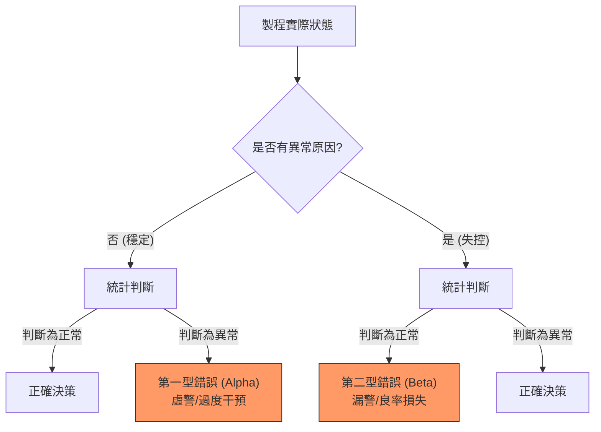
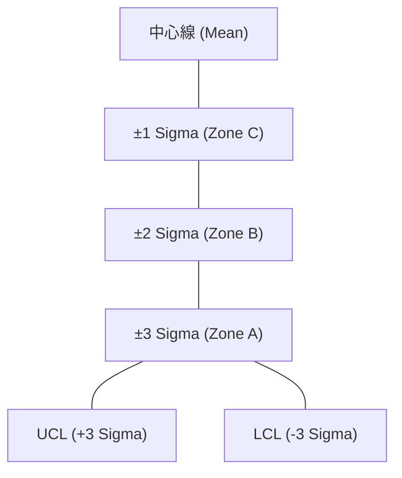
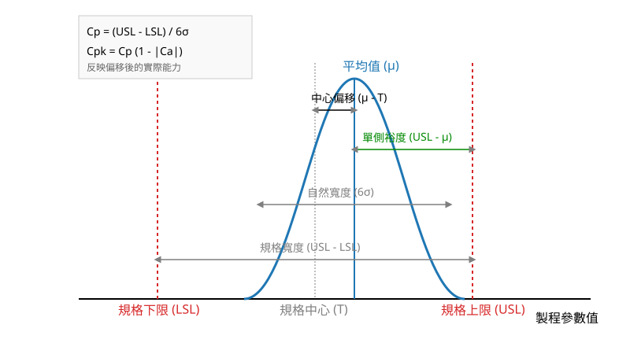
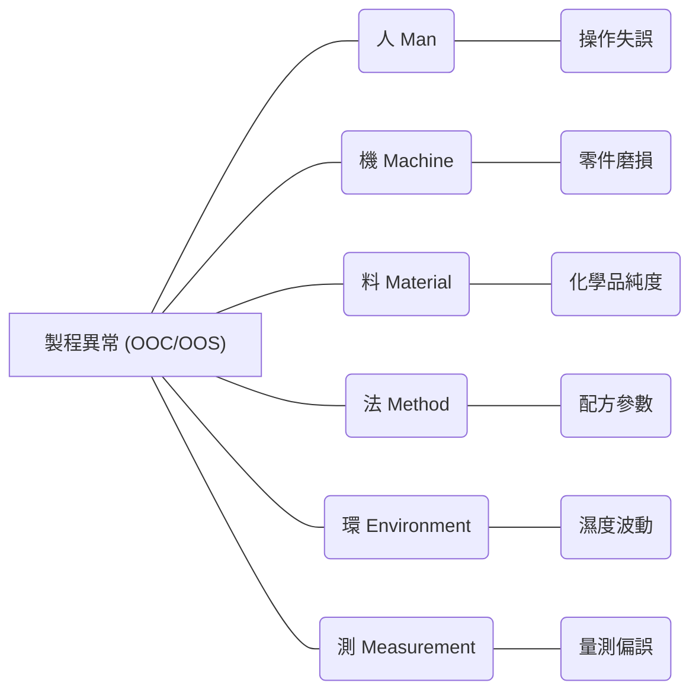
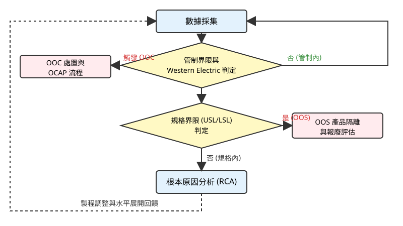
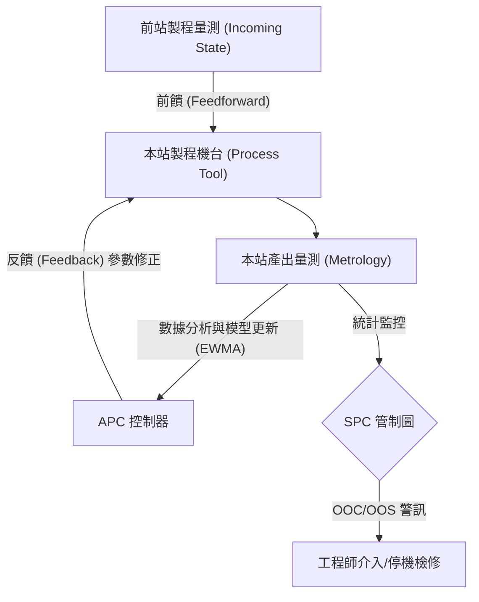
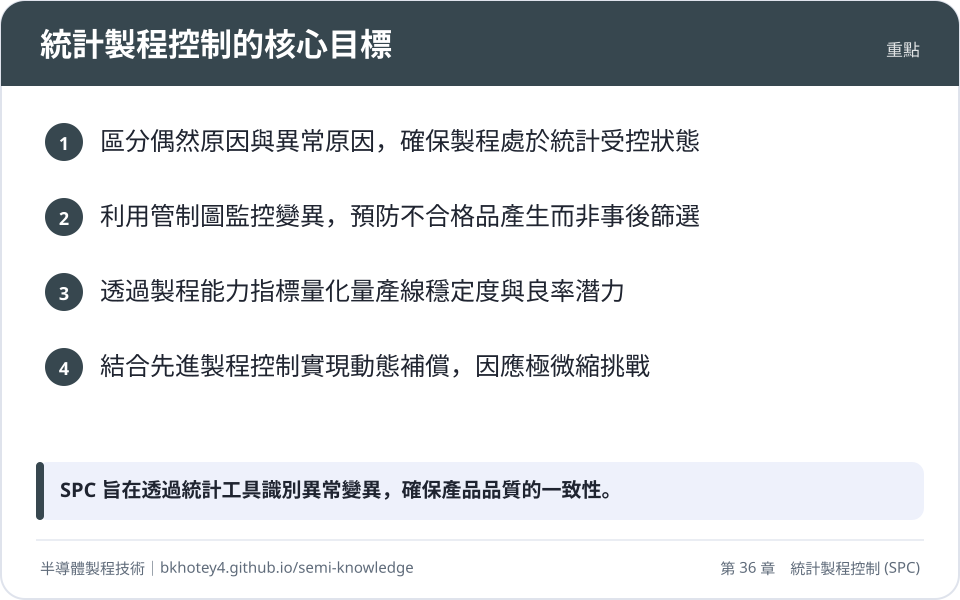
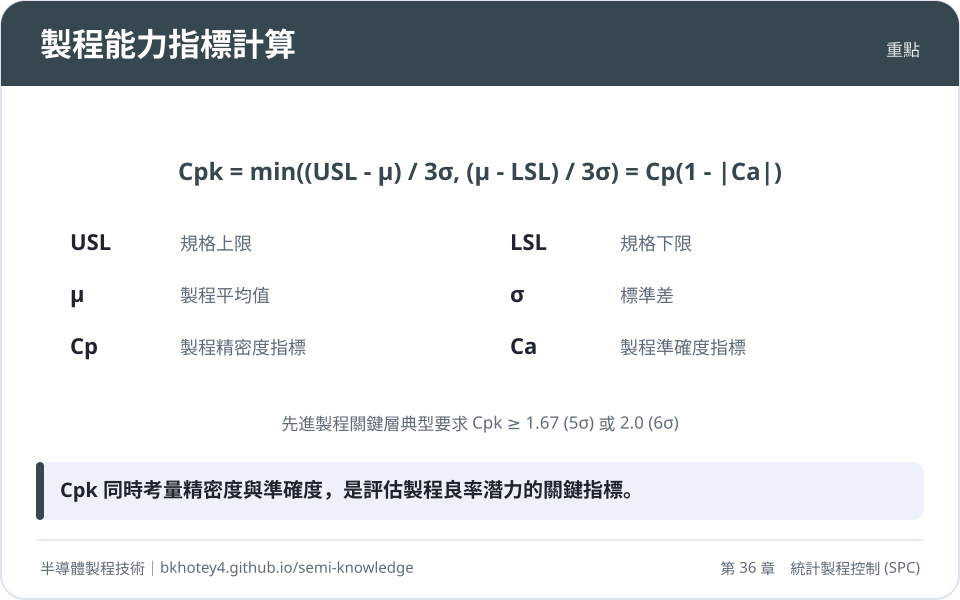
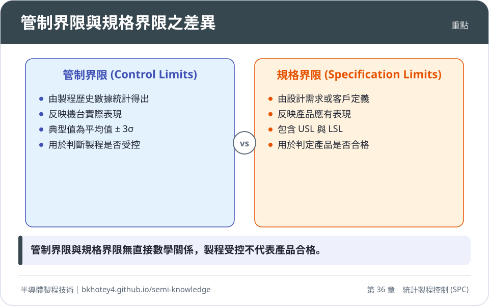
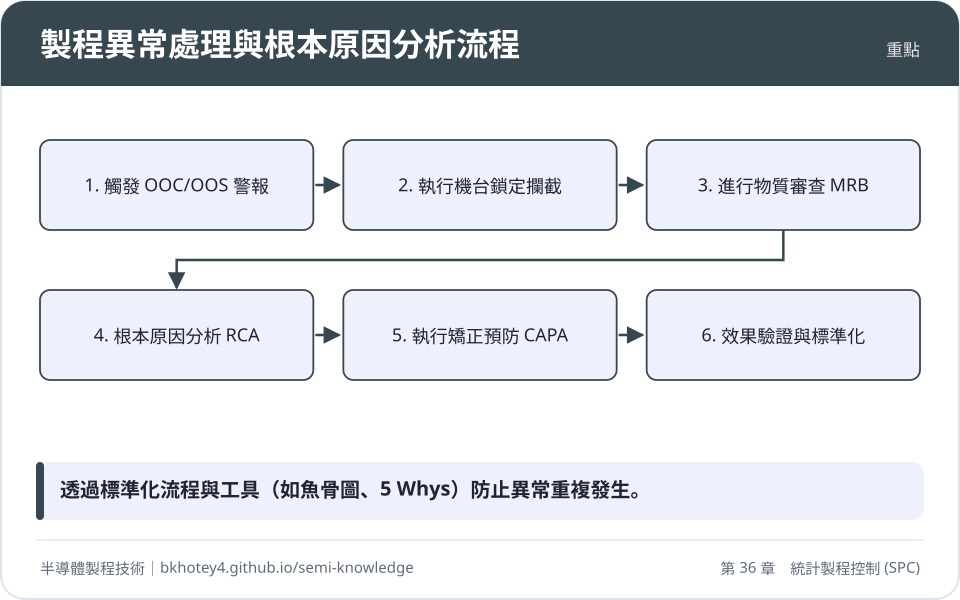

# 第 36 章　統計製程控制 (SPC)

!!! abstract "學習目標"
    - 理解半導體製程中偶然原因與異常原因的統計區分原理
    - 掌握管制圖的建立方法、管制界限計算及 Western Electric 判讀準則
    - 學習如何運用製程能力指標 Cp 與 Cpk 評估量產線的穩定性與良率潛力
    - 建立針對製程異常（OOC）與規格超限（OOS）的標準化處理與根本原因分析流程

## 36.1 製程變異的統計基礎

在半導體製造過程中，即便是在高度自動化且環境受控的無塵室（見第 55 章）內，任何製程參數（如薄膜厚度、蝕刻深度、臨界尺寸 CD 等）都不可能完全恆定。這種變動性稱為「變異」（Variation）。統計製程控制（Statistical Process Control, SPC）的核心目標，在於利用統計學工具區分製程中的「正常變異」與「異常變異」，進而確保產品品質的一致性。

### 36.1.1 常態分佈與中央極限定理

半導體製程數據的分析基礎建立於機率分佈理論之上。當一個製程處於穩定狀態時，其量測數據通常趨向於「常態分佈」（Normal Distribution，又稱高斯分佈）。

#### 1. 常態分佈的數學特徵
常態分佈由兩個關鍵參數決定：平均值（Mean, $\mu$）與標準差（Standard Deviation, $\sigma$）。其機率密度函數（PDF）表示為：

$$f(x) = \frac{1}{\sigma\sqrt{2\pi}} e^{-\frac{1}{2}\left(\frac{x-\mu}{\sigma}\right)^2}$$

其中：
*   $\mu$ 代表製程的中心趨勢（Centering）。
*   $\sigma$ 代表製程的離散程度（Dispersion）。

在統計學上，常態分佈具有「$68-95-99.7$」法則：
*   約 $68.26\%$ 的數據落在 $\mu \pm 1\sigma$ 範圍內。
*   約 $95.44\%$ 的數據落在 $\mu \pm 2\sigma$ 範圍內。
*   約 $99.73\%$ 的數據落在 $\mu \pm 3\sigma$ 範圍內。

在半導體工業中，$\pm 3\sigma$ 被視為界定製程是否在統計受控狀態下的基本基準。

#### 2. 中央極限定理（Central Limit Theorem, CLT）
製程工程師經常觀察到，即使單一物理量（如單片晶圓的蝕刻速率）不完全符合常態分佈，但當我們抽取多個樣本並計算其「平均值」時，這些平均值的分佈會趨近於常態分佈。

中央極限定理指出：設從平均值為 $\mu$、標準差為 $\sigma$ 的任意分佈中，隨機抽取容量為 $n$ 的樣本，當 $n$ 足夠大時，樣本平均值 $\bar{X}$ 的抽樣分佈將趨近於常態分佈 $N(\mu, \sigma^2/n)$。

這項定理在 SPC 中至關重要，因為它允許我們使用 $\bar{X}$ 管制圖來監控各類製程，而不必過度擔心原始數據的母體分佈型態。同時，公式中的 $\sigma/\sqrt{n}$（稱為標準誤差，Standard Error）說明了增加樣本數可以提高對製程中心偏移偵測的靈敏度。

### 36.1.2 偶然原因與異常原因的物理意義

製程變異根據其來源性質，可分為「偶然原因」與「異常原因」。區分這兩者是 SPC 的首要任務。

#### 1. 偶然原因（Common Causes / Chance Causes）
偶然原因是指製程中固有、隨機且難以完全消除的變異來源。它們是由大量微小且獨立的因素共同作用的結果。
*   **物理意義**：在電漿蝕刻（見第 19 章）中，電漿密度的微小瞬時波動、氣體流量計（MFC）的極低頻率震盪、或是晶圓表面原子級的粗糙度不均。
*   **統計特性**：當製程僅受偶然原因影響時，數據表現出穩定的統計分佈（通常為常態分佈），其平均值與變異數隨時間保持恆定。
*   **處理原則**：偶然原因屬於「系統性變異」。若要減少此類變異，必須進行重大的技術升級或機台硬體改造（例如更換更高精度的感測器）。

#### 2. 異常原因（Special Causes / Assignable Causes）
異常原因是指非製程固有的、由特定外部因素引起的變異。
*   **物理意義**：例如化學氣相沈積（CVD，見第 21 章）的加熱器失效導致溫度大幅偏移、光罩上的微塵造成圖案缺陷、或是作業員誤用了錯誤的製程配方（Recipe）。
*   **統計特性**：異常原因會導致製程分佈發生偏移（$\mu$ 改變）或離散度擴大（$\sigma$ 改變），使製程進入「失控狀態」（Out of Control）。
*   **處理原則**：異常原因通常是可以識別並排除的。SPC 的目的就是即時偵測到異常原因的出現，並在產生大量不良品前停止生產進行檢修。

| 特性 | 偶然原因 (Common Causes) | 異常原因 (Special Causes) |
| :--- | :--- | :--- |
| **來源** | 製程設計與機台精度固有 | 外部特定事件、人為錯誤、零件損壞 |
| **數量** | 眾多微小因素 | 少數顯著因素 |
| **可預測性** | 統計上可預測（穩定分佈） | 不可預測（分佈發生突變） |
| **改善責任** | 管理階層與研發工程師（系統變革） | 現場工程師與技術員（故障排除） |

### 36.1.3 規格界限與管制界限的本質差異

在半導體廠中，經常會混淆「規格界限」與「管制界限」，這兩者在物理意義與數學來源上完全不同。

#### 1. 規格界限（Specification Limits, SL）
規格界限是由設計工程師或客戶根據元件物理性能要求定義的。
*   **USL (Upper Specification Limit)**：上限規格。
*   **LSL (Lower Specification Limit)**：下限規格。
*   **本質**：代表「產品應該是什麼樣子」。例如，為了確保 MOSFET 的閾值電壓（見第 4 章），閘極氧化層厚度必須在 $2.0 \pm 0.1$ nm 之間。若超過此界限，產品即為不合格品（Non-conforming product）。

#### 2. 管制界限（Control Limits, CL）
管制界限是由製程本身的實際表現（歷史數據）經統計計算得出的。
*   **UCL (Upper Control Limit)**：上限管制界限，典型值為 $\mu + 3\sigma$。
*   **LCL (Lower Control Limit)**：下限管制界限，典型值為 $\mu - 3\sigma$。
*   **本質**：代表「製程目前實際上是什麼樣子」。它反映了製程在僅受偶然原因影響下的自然波動範圍。

!!! warning "常見誤解"
    工程師有時會錯誤地將管制界限設定在規格界限之內或之外。事實上，管制界限與規格界限之間沒有直接的數學關係。一個製程可能完全在管制界限內（受控），但其產出的產品卻全部超出規格界限（不合格），這代表製程能力（Capability）不足。

### 36.1.4 第一型錯誤與第二型錯誤對生產成本的影響

在利用 SPC 管制圖進行決策時，必然面臨統計判斷錯誤的風險。

#### 1. 第一型錯誤（Type I Error, $\alpha$）：虛警（False Alarm）
*   **定義**：製程實際上處於穩定受控狀態（僅有偶然原因），但觀測值因隨機波動剛好落在管制界限之外，導致工程師誤判為有異常原因發生。
*   **風險機率**：在標準的 $\pm 3\sigma$ 管制圖下，單點觸發第一型錯誤的機率約為 $0.27\%$。
*   **成本影響**：
    *   **機台停機時間（Downtime）**：不必要的檢查導致生產中斷。
    *   **工程資源浪費**：工程師耗費時間尋找不存在的「鬼影」原因。
    *   **過度調整（Over-adjustment）**：對穩定的製程進行調整，反而會人為增加變異（此現象稱為「戴明漏斗實驗」效應）。

#### 2. 第二型錯誤（Type II Error, $\beta$）：漏警（Missed Alarm）
*   **定義**：製程實際上已經發生偏移（存在異常原因），但觀測值仍然落在管制界限之內，導致工程師誤判為製程正常。
*   **風險機率**：$\beta$ 的大小取決於偏移的程度。偏移越小，被偵測到的機率越低，$\beta$ 越大。
*   **成本影響**：
    *   **良率損失（Yield Loss）**：大量不合格品流向後續製程，甚至封裝測試階段（見第 42 章）。
    *   **廢料成本（Scrap）**：在先進節點（如截至撰寫時的 3nm 或 2nm 節點），單片晶圓價值極高，漏警導致的整批報廢損失巨大。
    *   **可靠度風險**：部分潛在缺陷（Latent defects）可能未在測試中檢出，最終導致客戶端產品失效。



### 36.1.5 先進製程中的統計挑戰

截至撰寫時，隨著半導體製程進入埃米（Angstrom）時代，統計基礎面臨新的挑戰。

1.  **非正態性（Non-normality）**：在極紫外光（EUV）微影（見第 14 章）中，隨機性缺陷（Stochastics）的分佈往往不符合常態分佈，而是呈現長尾分佈（Long-tail distribution），這使得傳統基於 $3\sigma$ 的管制界限失效。
2.  **小樣本問題**：在研發階段或高產品組合（High-mix）的晶圓廠中，單一產品的數據量不足以建立穩健的統計模型，必須依賴「跨產品管制」（Across-product control）技術。
3.  **多變量相關性**：現代機台擁有數千個感測器，參數之間存在複雜的耦合關係。單一參數的 SPC 已不足夠，必須轉向多變量統計製程控制（MSPC），利用主成分分析（PCA）等方法監控製程整體的健康度。

!!! note "說明"
    在實際量產環境中，為了平衡 $\alpha$ 與 $\beta$ 風險，工程師通常會結合「Western Electric 規則」（見 36.2 節）來提高管制圖的靈敏度，而非僅依賴單點是否超出 $3\sigma$。

## 36.2 管制圖理論與 Western Electric 規則

在半導體製造中，統計製程控制（Statistical Process Control, SPC）的核心工具是管制圖（Control Charts）。管制圖由華特·休哈特（Walter A. Shewhart）於 1920 年代提出，其基本假設是：任何製程變異皆可歸因於「偶然原因」（Common Cause）與「異常原因」（Special Cause）。偶然原因屬於製程固有的隨機波動，而異常原因則是系統性的偏差，如機台零件磨損、化學藥液濃度失效或人為操作錯誤。

### 36.2.1 休哈特管制圖的分類與數學基礎

在半導體前段製程（FEOL）與後段製程（BEOL）中，量測數據多為連續型的計量值（Variables），如薄膜厚度、關鍵尺寸（CD）、蝕刻深度或金屬層電阻。針對這類數據，最常使用的休哈特管制圖為「平均值-全距管制圖」（$\bar{X}-R$ Chart）與「平均值-標準差管制圖」（$\bar{X}-s$ Chart）。

#### 1. 平均值-全距管制圖 ($\bar{X}-R$ Chart)
當樣本組（Subgroup）的大小 $n$ 較小（通常 $n < 10$）時，全距（Range, $R$）是衡量製程分散程度（Dispersion）的簡便指標。在半導體量測中，若每一片晶圓（Wafer）僅取 5 至 9 個點進行量測，$\bar{X}-R$ 圖是極為常見的選擇。

*   **平均值圖 ($\bar{X}$ Chart)**：用以監控製程中心值的偏移。
    *   中心線 ($CL_{\bar{X}}$) = $\bar{\bar{X}}$（所有樣本組平均值的平均）
    *   管制上限 ($UCL_{\bar{X}}$) = $\bar{\bar{X}} + A_2 \bar{R}$
    *   管制下限 ($LCL_{\bar{X}}$) = $\bar{\bar{X}} - A_2 \bar{R}$
*   **全距圖 ($R$ Chart)**：用以監控製程變異的大小。
    *   中心線 ($CL_R$) = $\bar{R}$
    *   管制上限 ($UCL_R$) = $D_4 \bar{R}$
    *   管制下限 ($LCL_R$) = $D_3 \bar{R}$

其中，$A_2, D_3, D_4$ 為隨樣本數 $n$ 改變的統計常數，其設計目的是為了估計群體標準差 $\sigma$。

#### 2. 平均值-標準差管制圖 ($\bar{X}-s$ Chart)
隨著自動化光學檢測（AOI）與全自動量測設備的普及，單一晶圓的採樣點數大幅增加。當 $n \ge 10$ 時，全距 $R$ 對於數據分布末端的敏感度下降，此時應採用樣本標準差（Sample Standard Deviation, $s$）來取代全距。

*   **標準差圖 ($s$ Chart)**：
    *   中心線 ($CL_s$) = $\bar{s}$
    *   管制上限 ($UCL_s$) = $B_4 \bar{s}$
    *   管制下限 ($LCL_s$) = $B_3 \bar{s}$

在先進製程中，由於對變異的容忍度極低，$\bar{X}-s$ 圖能提供更精確的製程波動資訊，有助於早期發現機台內部的微小異常。

### 36.2.2 管制界限的統計顯著性

管制圖的核心在於「$\pm 3$ 個標準差」（$\pm 3\sigma$）的管制界限（Control Limits）。根據常態分布（Normal Distribution）理論，若製程僅受偶然原因影響，數據落在 $\pm 3\sigma$ 範圍內的機率約為 99.73%。

$$ P(\mu - 3\sigma \le X \le \mu + 3\sigma) \approx 0.9973 $$

這意味著，當一個數據點超出管制界限時，該點屬於隨機波動的機率僅約 0.27%（即約 370 個點中才會出現一次虛警）。因此，一旦點位超出 $UCL$ 或 $LCL$，統計學上便有極高的信心認為製程出現了異常原因，必須立即停機檢查。

!!! warning "常見誤解：管制界限 vs. 規格界限"
    工程師常混淆「管制界限」（Control Limits）與「規格界限」（Specification Limits, USL/LSL）。
    1. **管制界限**：由製程本身的統計數據計算而得，反映的是機台「實際表現」。
    2. **規格界限**：由元件設計需求（見第 4 章 MOSFET 原理）或客戶要求決定，反映的是產品「應有表現」。
    SPC 的目標是確保管制界限遠窄於規格界限，以預留足夠的緩衝空間。

### 36.2.3 Western Electric 規則與區域規則

單純觀察點位是否超出 $\pm 3\sigma$（稱為 Rule 1）對於偵測「突發性」的異常非常有效，但對於「趨勢性」或「微小偏移」的偵測能力較弱。為了提升管制圖的靈敏度，業界普遍採用 Western Electric 規則（Western Electric Rules），將管制圖區分為三個區域（Zones）：

*   **Zone A**：距離中心線 $2\sigma$ 至 $3\sigma$ 之間。
*   **Zone B**：距離中心線 $1\sigma$ 至 $2\sigma$ 之間。
*   **Zone C**：中心線至 $1\sigma$ 之間。



以下為 Western Electric 規則中針對「非隨機性」分布的八大判讀準則，當符合任一條件時，即判定為製程失控（Out of Control, OOC）：

1.  **Rule 1 (Extreme Point)**：任何一點落在 Zone A 之外（即超出 $\pm 3\sigma$）。
2.  **Rule 2 (Shift)**：連續 9 點落在中心線的同一側。這通常代表製程中心值發生了偏移，例如化學氣相沈積（CVD）反應室的壓力設定值發生微移。
3.  **Rule 3 (Trend)**：連續 6 點持續上升或持續下降。這暗示了耗材的磨損，如 CMP 研磨墊（Pad）的壽命逐漸到達末期（見第 24 章）。
4.  **Rule 4 (Oscillation)**：連續 14 點上下交替波動。這通常與過度調整（Over-adjustment）或兩台機台數據混雜有關。
5.  **Rule 5 (Zone A Rule)**：連續 3 點中有 2 點落在同一側的 Zone A 或之外。
6.  **Rule 6 (Zone B Rule)**：連續 5 點中有 4 點落在同一側的 Zone B 或之外。
7.  **Rule 7 (Stratification)**：連續 15 點落在中心線兩側的 Zone C 內。這並非代表製程極其穩定，而是可能發生了採樣分層錯誤，導致變異被人為縮小。
8.  **Rule 8 (Mixture)**：連續 8 點落在中心線兩側，但無任何點落在 Zone C 內。這通常代表數據來自兩個不同的母體（如兩台不同的曝光機數據被誤放在同一張管制圖）。

### 36.2.4 半導體高精密特性下的應用挑戰

截至撰寫時，隨著製程節點進入 3 奈米以下，製程容許誤差（Error Budget）極度收縮。傳統的 Western Electric 規則在應用上面臨以下挑戰：

1.  **虛警率（False Alarm Rate）問題**：同時啟用八大規則會顯著提高虛警率。在高度自動化的晶圓廠中，過多的虛警會導致不必要的停機，降低機台稼動率。因此，現代 SPC 系統通常會根據製程的重要性，選擇性地啟用 Rule 1、2、3 與 5。
2.  **自相關性（Autocorrelation）**：在連續式生產設備中（如擴散爐管），相鄰批次的數據往往具有高度相關性，這違反了休哈特管制圖「樣本獨立」的假設，容易導致 Rule 2 頻繁觸發。
3.  **多變量監控**：現代設備如 EUV 曝光機具有數千個感測器參數。單一參數的 SPC 已不足以描述製程健康度，逐漸轉向多變量統計製程控制（MSPC），利用主成分分析（PCA）等演算法將多個維度壓縮後再進行管制。

!!! example "產業實例"
    在黃光微影製程中，疊對（Overlay）精度的管制至關重要（見第 17 章）。若 SPC 偵測到 Rule 3（連續上升趨勢），系統會自動觸發「先進製程控制」（APC）演算法，在下一批次（Run）進入前自動修正機台的對準參數。這種將 SPC 警訊轉化為自動修正指令的機制，是現代半導體量產維持高良率的關鍵。

### 36.2.5 區域規則（Zone Rules）的權重化應用

為了平衡偵測靈敏度與虛警率，部分先進廠區採用權重化的區域規則。例如，給予 Zone A 的點位較高權分，Zone B 較低。當連續點位的累計權分超過門檻值時才發出警報。這種作法結合了累積和管制圖（CUSUM）與指數加權移動平均（EWMA）的精神，能更有效地偵測製程中的微小階梯式偏移（Step Shift）。

在半導體製造的實務操作中，管制圖不僅是監控工具，更是「製程穩定性」的量化指標。只有在製程處於統計受控狀態（In Control）的前提下，後續討論的製程能力指標（Cp/Cpk）才具有統計學上的意義。

## 36.3 製程能力指標 Cp 與 Cpk

在半導體製造中，僅使製程處於統計受控狀態（見第 36.2 節）是不夠的。一個穩定的製程若其變異範圍超過了設計規格，依然會產生大量的廢料。製程能力指標（Process Capability Index）即是用於量化製程輸出滿足設計規格（Specification）程度的工具，是連結製造端與設計端的核心橋樑。

### 36.3.1 製程精密度指標 Cp 的定義與物理意義

製程精密度指標 $C_p$ 用於衡量製程的「潛在能力」，即在不考慮平均值偏移的情況下，製程本身的離散程度（Dispersion）是否足夠小。

從物理意義上理解，$C_p$ 是「規格寬度」與「製程自然寬度」的比例。定義公式如下：

$$C_p = \frac{USL - LSL}{6\sigma}$$

其中：
*   $USL$ (Upper Specification Limit)：規格上限。
*   $LSL$ (Lower Specification Limit)：規格下限。
*   $\sigma$ (Standard Deviation)：製程的標準差，通常由管制圖中的組內變異推估。

在統計學上，正態分佈（Normal Distribution）下 $\pm 3\sigma$ 的範圍涵蓋了 99.73% 的數據點，這被稱為製程的「自然寬度」（Natural Process Variation）。

*   若 $C_p > 1$：表示規格寬度大於製程自然寬度，製程具備滿足規格的潛力。
*   若 $C_p = 1$：表示規格寬度恰好等於製程自然寬度，任何微小的平均值偏移都會導致產品超出規格。
*   若 $C_p < 1$：表示製程本身的變異過大，即使平均值精確對準中心，仍會產生不合格品。

!!! note "說明"
    $C_p$ 僅反映了製程的「精密度」（Precision），即數據點是否集中，但不反映「準確度」（Accuracy），即數據中心是否偏離目標值（Target）。

### 36.3.2 製程準確度指標 Ca

為了衡量製程平均值 $\mu$ 與規格中心值 $T$ 的偏離程度，引入製程準確度指標 $C_a$（Capability of Accuracy，亦稱 $k$ 值）。其定義為：

$$C_a = \frac{\mu - T}{(USL - LSL) / 2}$$

其中：
*   $\mu$：製程平均值。
*   $T$ (Target)：規格中心值，通常為 $(USL + LSL) / 2$。

$C_a$ 的絕對值越小，代表製程平均值越接近規格中心。在半導體實務中，$C_a$ 通常以百分比表示。若 $|C_a|$ 過高，代表製程存在系統性偏差，例如蝕刻速率（Etch Rate）因機台老化而整體下滑，此時需透過調整機台參數（如增加電漿功率或延長時間）來修正。

### 36.3.3 綜合指標 Cpk 的計算公式推導

在實際生產中，我們最關心的是製程在考慮偏移後的「實際表現」。製程能力指標 $C_{pk}$ 同時考慮了精密度的寬度與準確度的偏移，其定義為製程平均值距離最近之規格界限的距離，除以 $3\sigma$：

$$C_{pk} = \min \left( \frac{USL - \mu}{3\sigma}, \frac{\mu - LSL}{3\sigma} \right)$$

透過代數整理，$C_{pk}$ 與 $C_p$、$C_a$ 的關係可表示為：

$$C_{pk} = C_p (1 - |C_a|)$$

此公式清楚揭示了 $C_{pk}$ 的物理本質：
1.  當製程完全沒有偏移（$C_a = 0$）時，$C_{pk} = C_p$。
2.  當製程偏移增加時，$C_{pk}$ 會隨之下降。
3.  即使製程精密度極高（$C_p$ 很大），若偏移量達到規格的一半（$|C_a| = 1$），則 $C_{pk} = 0$，代表已有 50% 的產品落在規格外。

```mermaid
graph TD
    "製程能力評估" --> "精密度 (Cp)"
    "製程能力評估" --> "準確度 (Ca)"
    "精密度 (Cp)" --> "變異寬度 (6σ)"
    "準確度 (Ca)" --> "中心偏移 (μ - T)"
    "精密度 (Cp)" --> "Cpk 指標"
    "準確度 (Ca)" --> "Cpk 指標"
    "Cpk 指標" --> "計算良率與 PPM"
    "Cpk 指標" --> "決定製程改善方向"
```

### 36.3.4 Cpk 數值與良率及 PPM 的對應關係

$C_{pk}$ 的數值直接對應到統計學上的不合格率。假設製程數據服從正態分佈，且製程處於受控狀態，我們可以計算出不同 $C_{pk}$ 水準下的百萬分率缺陷（Parts Per Million, PPM）。

| Cpk 數值 | 對應的 Sigma 水準 | 單側不合格率 (PPM) | 雙側總不合格率 (PPM) | 良率 (Yield) |
| :--- | :--- | :--- | :--- | :--- |
| 0.33 | 1σ | 158,655 | 317,310 | 68.2689% |
| 0.67 | 2σ | 22,750 | 45,500 | 95.4500% |
| 1.00 | 3σ | 1,350 | 2,700 | 99.7300% |
| 1.33 | 4σ | 31.6 | 63.3 | 99.9937% |
| 1.50 | 4.5σ | 3.4 | 6.8 | 99.9993% |
| 1.67 | 5σ | 0.28 | 0.57 | 99.9999% |
| 2.00 | 6σ | 0.001 | 0.002 | 99.9999998% |

!!! warning "常見誤解"
    在六標準差（Six Sigma）管理理論中，常提到 $6\sigma$ 對應的缺陷率為 3.4 PPM，而非表格中的 0.002 PPM。這是因為該理論假設了製程平均值在長期運行中會存在 $\pm 1.5\sigma$ 的漂移。在半導體製程監控的短期 $C_{pk}$ 計算中，通常不考慮此漂移，應以瞬時的 $\sigma$ 為準。

### 36.3.5 先進製程節點對 Cpk 的要求演進

隨著半導體元件微縮至埃米（Angstrom）尺度，製程容許誤差（Error Budget）極度收縮。在成熟製程（如 0.18 $\mu m$ 或 90 nm）時代，業界普遍接受 $C_{pk} \ge 1.33$（即 $4\sigma$ 水準）作為製程合格的基準。然而，進入 7 nm、5 nm 以及截至撰寫時最先進的 3 nm 與 2 nm 節點，製程要求發生了顯著變化。

#### 1. 關鍵尺寸（CD）與疊對（Overlay）的高標準
在極紫外光（EUV）微影技術中（見第 14 章），關鍵尺寸的變異直接影響電晶體的閾值電壓（$V_{th}$）與漏電流。為了確保數十億個電晶體在單一晶片上的均一性，關鍵層（Critical Layers）的 $C_{pk}$ 要求通常提升至 1.67（$5\sigma$）甚至更高。

#### 2. 缺陷密度的容忍度下降
在先進封裝如 CoWoS 或 3D 堆疊製程中（見第 38、39 章），單一微凸塊（Micro-bump）的失效可能導致整顆昂貴的系統級封裝（SiP）報廢。因此，針對打線、鍵合與 TSV 等製程，業界領先廠商已開始要求 $C_{pk} \ge 2.0$（$6\sigma$），以追求趨近於零缺陷的製造目標。

#### 3. Cpk 與先進製程控制（APC）的聯動
截至撰寫時，單純依賴靜態的 $C_{pk}$ 評估已不足以應對 N2 以下節點的挑戰。現代晶圓廠將 $C_{pk}$ 監控與先進製程控制（APC）系統深度整合。當 $C_{pk}$ 出現下滑趨勢時，APC 系統會自動介入，透過 Run-to-Run（R2R）演算法即時補償製程漂移，將平均值強行拉回規格中心，從而人為地維持高 $C_{pk}$ 表現。

!!! example "產業實例"
    在 28 nm 節點，某蝕刻製程的關鍵尺寸規格為 $30 \pm 3$ nm。若製程 $\sigma = 0.5$ nm，則 $C_p = 6 / (6 \times 0.5) = 2.0$。若平均值偏移至 30.5 nm，則 $C_{pk} = (33 - 30.5) / (3 \times 0.5) = 1.67$。在當時這被認為是極優異的製程。
    然而在 2 nm 節點，若規格縮小為 $12 \pm 0.6$ nm，同樣的 $\sigma = 0.5$ nm 將導致 $C_p = 1.2 / 3.0 = 0.4$，製程完全失效。這迫使設備商必須研發原子層蝕刻（ALE，見第 23 章）等技術，將 $\sigma$ 壓低至 0.1 nm 以下，方能使 $C_{pk}$ 重回 1.67 以上的水準。

### 36.3.6 製程能力分析的侷限性

儘管 $C_{pk}$ 是極為強大的指標，但在應用時必須滿足以下前提：
1.  **數據必須服從正態分佈**：若數據呈現雙峰分佈或偏態分佈（如金屬污染濃度、顆粒計數等），直接計算 $C_{pk}$ 會產生誤導。此時需進行數據轉換（如 Box-Cox 轉換）或採用非參數統計方法。
2.  **製程必須處於受控狀態**：若製程存在特殊原因變異（Special Cause），計算出的 $C_{pk}$ 僅代表過去的數據堆疊，不具備預測未來的能力。
3.  **樣本數充足**：在半導體研發階段，樣本數通常較少，此時計算出的 $C_{pk}$ 具有較大的置信區間誤差，應參考 $P_{pk}$（製程性能指標）並結合信賴區間進行解讀。

<!-- fig:1 -->
<figure markdown>

<figcaption>圖 36-1　製程能力指標示意圖（AI 繪製的示意圖）</figcaption>
</figure>

## 36.4 異常處理流程：OOC 與 OOS

在半導體製造過程中，統計製程控制（SPC）的核心價值不僅在於監控，更在於當異常發生時，系統如何即時反應以極小化損失。本節將深入探討當製程數據觸發異常警訊時，自動化系統與工程團隊的標準作業程序（SOP），區分「管制狀態外」（Out of Control, OOC）與「規格超限」（Out of Specification, OOS）的本質差異，並介紹系統化的失效分析工具。

### 36.4.1 管制狀態外（OOC）之觸發與機台鎖定邏輯

管制狀態外（Out of Control, OOC）是指製程數據違反了基於統計學定義的管制界限（Control Limits, UCL/LCL），或觸發了第 36.2 節所述之 Western Electric 規則（如連續點上升、週期性波動等）。OOC 代表製程中存在「特殊原因變異」（Special Cause Variation），即便此時產品量測值可能尚未超出客戶要求的規格界限（Specification Limits），但製程已失去統計穩定性，潛藏品質風險。

#### 1. 即時觸發機制
在現代化晶圓廠（Fab）中，SPC 系統與製造執行系統（MES，見第 45 章）及設備自動化程式（EAP，見第 44 章）高度整合。當量測機台（Metrology Tool）完成資料上傳後，SPC 引擎會立即進行運算：

1.  **點對點檢查**：判斷最新的一筆或一組數據是否落在 $\pm 3\sigma$ 之外。
2.  **趨勢檢查**：回溯歷史數據，判斷是否符合特定異常圖形。
3.  **警示發送**：若判定為 OOC，系統會自動發送電子郵件或簡訊通知負責工程師。

#### 2. 機台鎖定（Inhibit/Interlock）邏輯
為了防止問題擴大，最有效的手段是實施「機台鎖定」。當 SPC 判定 OOC 時，系統會透過 MES 介面將該生產機台（Process Tool）的狀態變更為「待修」（Down）或「限制生產」（Restricted）。

*   **單站鎖定（Tool Inhibit）**：若異常與特定機台強烈相關（例如某台 CVD 的沉積厚度偏低），系統將禁止該機台接收後續的生產批次（Lots）。
*   **腔體鎖定（Chamber Inhibit）**：在多腔體設備中，若僅單一腔體出現 OOC，系統可僅鎖定該腔體，允許其餘正常腔體繼續運作，以維持產能利用率。
*   **預防性鎖定（Preventive Inhibit）**：若 OOC 情況嚴重，系統甚至會鎖定該製程段的所有同類型機台，直到初步確認非共通性問題（如化學品供應系統異常）為止。

!!! note "自動化攔截的必要性"
    在先進製程（如 3 奈米節點以下）中，單片晶圓的價值極高。若無即時鎖定邏輯，在工程師人工介入前的數小時內，可能已有數百片晶圓進入異常機台，造成難以承受的良率損失。

---

### 36.4.2 規格超限（OOS）之產品處置

規格超限（Out of Specification, OOS）是指產品的物理或電性參數已超出工程設計或客戶要求的上下限（USL/LSL）。所有 OOS 的產品必然屬於 OOC，但 OOC 的產品不一定 OOS。一旦發生 OOS，該批次產品必須進入「物質審查委員會」（Material Review Board, MRB）流程，決定其最終去向。

#### 1. 重工（Rework）
若異常發生在可逆的製程步驟，且重工不會對元件可靠度造成永久損傷，則優先選擇重工。
*   **典型案例**：微影製程（見第 11 章）後的關鍵尺寸（CD）或疊對（Overlay）誤差超限。由於光阻可透過濕式蝕刻或電漿灰化（Ashing）去除而不傷及下方矽基板，該批次可重新進行塗佈與曝光。
*   **限制**：擴散、離子佈植或蝕刻後的 OOS 通常無法重工，因為這些步驟涉及了材料層的永久性改變。

#### 2. 降級（Downgrade）
若產品無法達到最高規格，但仍符合較低等級產品的標準，可考慮降級處理。
*   **典型案例**：高效能運算（HPC）晶片若因製程偏移導致工作頻率無法達標，但功耗與基本功能正常，可將其重新標記為消費級或低階產品銷售。
*   **風險**：降級必須符合客戶契約規範，且需經過嚴密的電性測試（見第 42 章）確認其長期穩定性。

#### 3. 報廢（Scrap）
當產品完全無法修復，且不具備任何使用價值或存在嚴重可靠度風險（如金屬層短路、嚴重缺陷污染）時，必須執行報廢。
*   **成本考量**：報廢不僅損失材料成本，更損失了已投入的機台工時與產能。

| 處置方式 | 適用時機 | 優點 | 缺點 |
| :--- | :--- | :--- | :--- |
| **重工** | 可逆製程（如微影、CMP） | 挽回晶圓價值 | 增加循環時間（Cycle Time）、可能引入缺陷 |
| **降級** | 功能正常但效能未達標 | 減少直接財務損失 | 售價較低、庫存管理複雜 |
| **報廢** | 不可逆損壞、嚴重缺陷 | 確保出貨品質 | 成本損失最大、影響交期 |

---

### 36.4.3 根本原因分析（RCA）工具

當 OOC 或 OOS 發生後，必須進行根本原因分析（Root Cause Analysis, RCA），以確保問題不再重複發生。以下為半導體業界常用的三種核心工具：

#### 1. 魚骨圖（Ishikawa/Fishbone Diagram）
魚骨圖用於腦力激盪，將可能影響製程的變數歸類為 6M 範疇：
*   **人（Man）**：操作員是否違反 SOP？維修人員是否更換錯誤零件？
*   **機（Machine）**：感測器失效？加熱器老化？機械手臂精準度偏移？
*   **料（Material）**：化學藥水濃度異常？光阻過期？晶圓來料缺陷？
*   **法（Method）**：配方（Recipe）設定錯誤？製程順序變動？
*   **環（Mother Nature/Environment）**：無塵室溫濕度波動？震動干擾？（見第 55 章）
*   **測（Measurement）**：量測機台未校準？抽樣代表性不足？



#### 2. 5 Whys（五問法）
透過連續追問「為什麼」，剝離表象以發現深層原因。
*   *問題：晶圓表面出現金屬污染。*
    1.  **為什麼？** 因為清洗槽的過濾器失效。
    2.  **為什麼？** 因為過濾器已超過更換週期。
    3.  **為什麼？** 因為維修管理系統沒有發出提醒。
    4.  **為什麼？** 因為該型號機台的保養排程未錄入系統。
    5.  **為什麼？** 因為新機台移交時的標準檢查清單（Checklist）遺漏了此項目。（**根本原因**）

#### 3. 失效模式與效應分析（FMEA）
FMEA 是一種預防性的風險評估工具，透過計算「風險優先數」（Risk Priority Number, RPN）來排序處理優先級：
$$RPN = S \times O \times D$$
其中：
*   **嚴重度（Severity, S）**：失效對產品或客戶的影響程度（1-10 分）。
*   **發生度（Occurrence, O）**：失效原因發生的頻率（1-10 分）。
*   **偵測度（Detection, D）**：現有管制手段在失效發生前偵測到的難度（1-10 分，分數越高越難偵測）。

!!! warning "常見誤解"
    工程師常認為 RPN 降低只需加強「偵測度」（如增加抽檢頻率），但這僅是治標。真正的品質提升應著重於降低「發生度」，即透過製程改善（Process Improvement）消除失效根源。

---

### 36.4.4 矯正與預防措施（CAPA）流程

RCA 完成後，必須執行矯正與預防措施（Corrective and Preventive Actions, CAPA），這是品質管理系統（如 ISO 9001/IATF 16949）的核心要求。

#### 1. 矯正措施（Corrective Action）
針對「已發生」的異常進行處置。
*   **圍堵（Containment）**：立即隔離受影響的批次，並鎖定相關機台。
*   **修復**：對 OOS 產品進行重工或報廢處理。

#### 2. 預防措施（Preventive Action）
針對「未來潛在」的風險進行預防。
*   **水平展開（Horizontal Deployment）**：若 A 機台因某零件老化導致 OOC，應立即檢查廠內所有同型號機台（B, C, D...）的相同零件狀態。
*   **系統更新**：修改 SOP、調整 FDC（故障偵測與分類，見第 46 章）的警示界限，或在 MES 中加入防錯機制（Poka-Yoke）。

#### 3. 驗證流程（Verification）
CAPA 執行後，不能立即結案，必須經過驗證期：
*   **效果驗證**：觀察後續連續若干批次的 SPC 數據，確認 Cpk 是否回升至目標值以上（見第 36.3 節）。
*   **副作用檢查**：確認矯正措施是否意外引發其他製程參數的偏移。
*   **標準化**：驗證有效後，將變更正式寫入受控文件，並對相關人員進行教育訓練。

截至撰寫時，先進晶圓廠已開始導入人工智慧（AI）輔助 RCA。透過機器學習模型分析 FDC 感測器數據與 SPC 趨勢的關聯性，系統能在 OOC 觸發的數秒內提供可能的失效原因排序，大幅縮短了從異常發現到 CAPA 執行的反應時間。

<!-- fig:2 -->
<figure markdown>

<figcaption>圖 36-2　異常處理邏輯流程圖（AI 繪製的示意圖）</figcaption>
</figure>

## 36.5 從靜態 SPC 到動態先進製程控制

在現代半導體製造中，隨著製程節點進入埃米尺度（Angstrom scale），傳統統計製程控制（SPC）的侷限性日益顯著。傳統 SPC 屬於一種「被動監控」機制，其核心假設是製程處於穩定狀態，僅在觀測值偏離管制界限時才發出警訊。然而，在先進製程中，環境因素（如電漿腔室的老化）、材料特性（如光阻感度微差）與機台漂移（Drift）是持續發生的。若僅依賴 SPC 進行事後攔截，將導致大量的晶圓報廢或降級。因此，製程控制已由「靜態監控」演進為「動態先進製程控制」（Advanced Process Control, APC）。

### 36.5.1 先進製程控制（APC）的核心邏輯

先進製程控制（APC）並非取代 SPC，而是透過數學模型與自動化演算法，在製程進行中或批次之間進行動態補償。APC 的主要目標是將受控變數（Controlled Variables）的變異最小化，使其盡可能貼近目標值（Target）。

APC 系統通常包含兩個關鍵機制：
1.  **反饋控制（Feedback Control）**：根據已完成加工的晶圓量測結果，修正後續批次的加工參數。這主要用於補償隨時間緩慢漂移的系統誤差，例如蝕刻速率隨腔室沈積物增加而下降。
2.  **前饋控制（Feedforward Control）**：根據前一站製程的輸出結果（即本站的輸入狀態），動態調整本站的加工參數。例如，若化學氣相沈積（CVD）站產出的薄膜厚度偏厚，則前饋至化學機械研磨（CMP）站，自動增長研磨時間。

### 36.5.2 逐批（Run-to-Run, R2R）控制演算法

在 APC 的實作中，最常見的模式是「逐批控制」（Run-to-Run Control, R2R）。R2R 演算法結合了統計模型與控制工程理論，最經典的演算法為「指數加權移動平均」（Exponentially Weighted Moving Average, EWMA）。

在 R2R 框架下，我們假設製程模型為線性關係：
$$y_t = \alpha + \beta u_t + \epsilon_t$$
其中，$y_t$ 為第 $t$ 批次的產出量測值（如蝕刻深度），$u_t$ 為控制輸入（如蝕刻時間），$\alpha$ 為截距（Offset），$\beta$ 為製程增益（Gain），$\epsilon_t$ 為隨機雜訊。

為了補償製程漂移，系統會動態更新對 $\alpha$ 的估計值（記為 $a_t$）：
$$a_t = \lambda (y_t - \beta u_t) + (1 - \lambda) a_{t-1}$$
這裡的 $\lambda$ 為權重因子（$0 < \lambda < 1$），決定了系統對於最新量測數據的敏感度。較大的 $\lambda$ 能快速反應突發性偏移，但容易受雜訊干擾；較小的 $\lambda$ 則能平滑雜訊，但對漂移的反應較慢。

根據更新後的 $a_t$，下一批次的建議控制參數 $u_{t+1}$ 將被計算為：
$$u_{t+1} = \frac{T - a_t}{\beta}$$
其中 $T$ 為製程目標值。透過此機制，APC 能在 SPC 觸發管制規則前，就預先微調參數以抵消偏差。

### 36.5.3 應用實例：微影疊對與 CMP 研磨

#### 1. 微影疊對（Overlay）的前饋與反饋
微影製程對圖案對準的要求極為嚴苛（見第 17 章）。截至撰寫時，在 3 奈米以下的量產節點，疊對誤差容許值通常小於 2 奈米。
*   **反饋機制**：微影機（Scanner）根據前一批次晶圓的疊對量測數據（Overlay Metrology），計算出晶圓台（Wafer Stage）的平移（Translation）、旋轉（Rotation）與縮放（Scaling）修正量。
*   **前饋機制**：考慮到晶圓在經過高溫退火或應力較大的薄膜沈積後會產生非線性形變，APC 系統會接收來自前站的晶圓形貌（Wafer Geometry）數據，在曝光當下動態調整透鏡補償器或晶圓台路徑，以達成精準對準。

#### 2. 化學機械研磨（CMP）的動態研磨時間
CMP 製程（見第 24 章）的研磨速率受研磨墊（Pad）壽命、漿料（Slurry）流量及環境溫度影響，具有高度不確定性。
*   **前饋應用**：若前站 CVD 沉積的介電層厚度分布不均，APC 會將此空間分布數據傳遞至 CMP 機台。具備多區壓力控制（Multi-zone Pressure Control）的研磨頭會針對較厚區域施加較高壓力。
*   **反饋應用**：根據量測站回傳的殘餘厚度，R2R 演算法會更新研磨速率模型，調整下一片晶圓的研磨時間。



### 36.5.4 SPC 與 APC 的協同作業模式

當 APC 介入製程調整時，傳統 SPC 的應用方式必須隨之改變。若直接對受 APC 調整後的量測值 $y_t$ 畫管制圖，會發現數據點高度集中於中心線，這會導致管制界限（Control Limits）過窄，反而容易引發假警報。

因此，在 APC 環境下，SPC 的監控對象轉變為以下兩者：
1.  **殘差監控（Residual SPC）**：監控「實際量測值」與「APC 模型預測值」之間的差值。若殘差突然增大，代表製程發生了 APC 演算法無法補償的突發性變異（如零件損壞），此時必須觸發 OOC 流程。
2.  **調整量監控（Adjustment SPC）**：監控 APC 給出的修正參數（如 $u_t$）。如果 APC 為了維持目標值而給出了極端的修正量，雖然產出合格，但可能暗示機台硬體已接近維護極限。

!!! note "關鍵差異"
    傳統 SPC 關注的是「結果是否穩定」；APC 協同下的 SPC 則關注「模型是否失效」以及「機台修正能力是否耗盡」。

### 36.5.5 虛擬量測（Virtual Metrology）的整合

截至撰寫時，由於量測設備（Metrology Tools）的產能有限且成本高昂，無法對每一片晶圓進行全檢。這導致 APC 的反饋存在延遲（Time Delay）。為了解決此問題，先進晶圓廠導入了「虛擬量測」（Virtual Metrology, VM）。

VM 利用機台內建感測器（Sensors）蒐集的即時數據（如電漿強度、氣體流量、真空度），透過機器學習模型預測該片晶圓的加工結果。APC 系統可利用 VM 的預測值進行「逐片」（Wafer-to-Wafer, W2W）的即時補償，而實體量測數據則用於定期校準 VM 模型。這種架構進一步壓縮了製程變異，是實現高良率量產的關鍵技術。

!!! warning "常見誤解"
    工程師常誤以為有了 APC 就不需要 SPC。事實上，APC 是一種「補償」手段，它可能掩蓋了機台底層的物理問題。若缺乏 SPC 對殘差與調整量的嚴密監控，機台可能在性能嚴重惡化時仍勉強運作，最終導致災難性的設備損毀或大批次報廢。

關於 APC 系統與故障偵測與分類（FDC）系統在工廠自動化層面的架構整合，以及數據通訊協定之細節，請參閱第 46 章。

## 36.6 設備與廠商技術

在半導體製造中，統計製程控制（SPC）的實施並非僅依賴數學理論，更需要一套完整的硬體感測器、機台端處理單元以及廠級資訊系統的整合。隨著製程節點進入 3 奈米以下，傳統的靜態 SPC 已不足以應對極紫外光（EUV）微影或原子層沉積（ALD）等高精密製程的變異需求。

### 36.6.1 系統架構與資料同步技術

SPC 系統的運作依賴於機台端（Tool-side）與製造執行系統（Manufacturing Execution System, MES）之間的即時資料交換。其核心架構通常分為三層：

1.  **感測器與機台層（Sensor & Equipment Level）**：機台內部配置大量的物理感測器（如壓力計、流量計、射頻功率計），負責收集製程中的原始資料（Raw Data）。
2.  **邊緣運算與設備自動化程式（Edge Computing & EAP）**：設備自動化程式（Equipment Automation Program, EAP）透過 SECS/GEM 通訊協定（見第 44 章）獲取資料。為了降低網路頻寬負擔，現代機台常具備即時統計模組，在本地端進行初步的資料過濾與特徵提取。
3.  **廠級 SPC 伺服器（Fab-wide SPC Server）**：接收來自量測機台（Metrology Tool）的量測值（如膜厚、線寬）或來自生產機台的製程參數，進行統計分析並判定是否觸發管制規則。

!!! note "資料同步的關鍵：上下文資訊（Contextual Data）"
    SPC 的判定必須結合「上下文資訊」，包括產品型號、製程步驟、機台編號、腔體（Chamber）編號以及光罩 ID。若資料同步出現延遲，可能導致錯誤的管制界限（Control Limits）應用，引發不必要的停機（False Alarm）。

### 36.6.2 主流統計分析軟體架構

截至撰寫時，半導體產業主要採用整合型良率管理平台來執行 SPC，其中以 PDF Solutions 的 Exensio 與 KLA 的 Klarity 最具代表性。

#### PDF Solutions Exensio
Exensio 平台的核心在於其大數據架構，能夠將設計端的模擬資料、晶圓廠的製程資料與封裝測試端的測試資料進行關聯。
*   **技術特點**：採用分散式資料庫架構，支援高頻率的資料寫入。其 SPC 模組不僅監控單一變數，還能進行多變量統計製程控制（Multivariate SPC, MSPC），分析多個參數間的交互作用。
*   **產業實例**：在先進封裝製程中，Exensio 常被用於追蹤晶圓在不同機台間的熱歷史（Thermal History），並透過統計模型預測潛在的可靠性風險。

#### KLA Klarity
Klarity 則是針對缺陷（Defect）與量測資料優化的分析系統，與 KLA 自家的檢測設備有極高的整合度。
*   **技術特點**：專長於「缺陷空間分析」（Defect Spatial Analysis），能自動識別晶圓上的異常圖案（如刮痕、環狀缺陷）。其 SPC 功能主要應用於監控缺陷密度（Defect Density）與關鍵尺寸（Critical Dimension, CD）的穩定性。
*   **產業實例**：在微影製程中，Klarity 結合 YieldStar 的量測數據，能即時產出疊對（Overlay）誤差的管制圖，並在異常發生時自動觸發缺陷複查（Defect Review）。

### 36.6.3 機器學習與自動特徵辨識

傳統 SPC 依賴 Western Electric 規則來判定異常，但這些規則難以識別複雜的非線性趨勢。截至撰寫時，基於機器學習（ML）的自動特徵辨識（Automated Pattern Recognition, APR）已成為管制圖判讀的發展重點。

#### 自動特徵辨識（APR）
透過卷積神經網路（CNN）等深度學習模型，系統可以自動識別管制圖中的特定模式，例如：
*   **週期性波動（Cyclic Patterns）**：可能源於冷卻系統的循環或電力不穩。
*   **階梯式偏移（Step Shifts）**：通常與零件更換或化學品更換有關。
*   **趨勢性漂移（Trending）**：反映了耗材（如 CMP 研磨墊）的磨損。

#### 感測器融合與預測性維護（PdM）
感測器融合（Sensor Fusion）技術將來自不同物理量（如振動、電流、溫度）的訊號整合進統計模型中。這不僅能提升 SPC 的靈敏度，更是預測性維護（Predictive Maintenance, PdM）的基礎。
$$ RUL = f(S_1, S_2, ..., S_n, t) $$
其中 $RUL$ 為剩餘壽命（Remaining Useful Life），$S_n$ 為各感測器的統計特徵值。透過監控這些特徵值的統計分佈，系統可以在機台真正失效前（即超出 OOS 之前）發出預警。

### 36.6.4 主要廠商技術比較

在 SPC 實務中，量測機台的精準度決定了統計數據的品質。以下整理主要廠商在製程控制與量測領域的代表產品：

| 廠商 | 代表產品系列 | 技術路線與特點 | 主要應用 |
| :--- | :--- | :--- | :--- |
| **KLA** | SpectraShape 系列 | 光學關鍵尺寸（OCD）量測，利用廣譜偏振光分析複雜結構。 | 監控 FinFET 或 GAAFET 的 3D 幾何形狀穩定性。 |
| **KLA** | Archer 系列 | 影像式疊對（Overlay）量測，具備高吞吐量與高精度。 | 微影製程各層間對準精度的統計監控。 |
| **ASML** | YieldStar 系列 | 繞射式量測（SCOL），利用繞射光譜分析疊對與 CD。 | EUV 與 DUV 製程的即時量測與反饋控制（R2R）。 |
| **Applied Materials** | PROVision 系列 | 電子束（e-beam）量測，具備極高解析度，可偵測深孔底部。 | 先進節點的接觸孔（Contact）與通孔（Via）量測。 |
| **Hitachi High-Tech** | CG6300 / CG7300 | 關鍵尺寸掃描式電子顯微鏡（CD-SEM），產線標準量測設備。 | 晶圓圖案化後的線寬量測與 SPC 數據收集。 |
| **PDF Solutions** | Exensio | 良率與製造資料分析軟體平台，整合全廠數據。 | 跨機台、跨製程的相關性分析與統計監控。 |

### 36.6.5 晶圓廠選機與系統整合考量

晶圓廠在規劃 SPC 系統與選購相關量測設備時，通常考量以下核心指標：

1.  **量測精度與重複性（Precision-to-Tolerance Ratio, P/T Ratio）**：量測設備本身的變異必須遠小於製程容許的變異。一般要求 P/T Ratio 應小於 0.1，以確保觀測到的變異來自製程而非量測誤差。
2.  **吞吐量（Throughput）與抽樣率**：在先進製程中，為了獲得足夠的統計顯著性，抽樣率（Sampling Rate）必須提高，這要求量測機台具備極高的單位小時產出（Wafers Per Hour, WPH）。
3.  **資料延遲（Latency）**：從晶圓完成加工到 SPC 系統產出判定結果的時間。在先進製程控制（APC）架構下，低延遲的資料回傳對於實現 Run-to-Run（R2R）補償至關重要（見第 46 章）。
4.  **系統開放性**：軟體平台（如 Exensio）是否能無縫接收來自不同供應商（如 KLA、Applied Materials）機台的資料格式（如 KLARF、CSV 或自定義 XML）。

隨著 2 奈米以下製程的發展，SPC 正在從「事後檢測」轉向「事前預測」。透過機台端感測器的高頻採樣（High-frequency Sampling）與 AI 演算法的結合，未來的統計製程控制將能更精準地捕捉瞬時變異（Transient Variation），從而進一步提升極紫外光微影等尖端製程的良率。

## 本章重點

*   統計製程控制（SPC）的核心在於區分「偶然原因」（Common Causes）與「異常原因」（Special Causes），前者屬於製程固有的系統變異，後者則是由外部特定事件引起的失控狀態。
*   管制界限（Control Limits）由製程實際表現的歷史數據決定（典型值為 $\pm 3\sigma$），而規格界限（Specification Limits）則是由元件設計需求定義，兩者在物理意義上互不隸屬。
*   休哈特管制圖（如 $\bar{X}-R$ 或 $\bar{X}-s$）結合 Western Electric 規則，可有效偵測製程中的偏移、趨勢與週期性波動，提升對微小變異的偵測靈敏度。
*   製程能力指標 $C_p$ 衡量製程的精密度（離散程度），而 $C_{pk}$ 同時考慮了精密度與準確度（中心偏移），是評估製程是否能穩定產出合格產品的關鍵量化指標。
*   在先進製程節點（如 3nm 或 2nm），為了確保高良率與元件可靠度，關鍵層的 $C_{pk}$ 要求通常需達到 1.67（$5\sigma$）甚至 2.0（$6\sigma$）以上。
*   異常處理流程包含「管制狀態外」（OOC）的機台鎖定與「規格超限」（OOS）的物質審查（MRB），並透過魚骨圖、5 Whys 與 FMEA 等工具進行根本原因分析（RCA）。
*   先進製程控制（APC）透過前饋（Feedforward）與反饋（Feedback）機制實現逐批（Run-to-Run）動態補償，將製程由被動監控轉為主動修正，以因應極微縮尺度下的製程漂移。


## 重點圖卡

複習時看這幾張就能抓住本章重點；[圖卡庫](../cards.md)可以下載成圖片。

<div class="ix-cards" markdown>

<figure markdown>

<figcaption>重點圖卡：統計製程控制的核心目標</figcaption>
</figure>

<figure markdown>

<figcaption>重點圖卡：製程能力指標計算</figcaption>
</figure>

<figure markdown>

<figcaption>重點圖卡：管制界限與規格界限之差異</figcaption>
</figure>

<figure markdown>

<figcaption>重點圖卡：製程異常處理與根本原因分析流程</figcaption>
</figure>

</div>

## 習題

**1.** 試說明「第一型錯誤」（Type I Error）與「第二型錯誤」（Type II Error）在半導體量產環境中的物理意義及其對生產成本的具體影響。

??? success "參考解答"
    *   **第一型錯誤（$\alpha$, 虛警）**：製程正常但統計判斷為異常。影響包括：不必要的機台停機時間（Downtime）、工程資源浪費在尋找不存在的原因、以及因過度調整（Over-adjustment）人為增加的製程變異。
    *   **第二型錯誤（$\beta$, 漏警）**：製程已失控但統計判斷為正常。影響包括：大量不合格品流向後續製程導致良率損失（Yield Loss）、高價值晶圓報廢（Scrap）成本、以及潛在缺陷導致的客戶端可靠度風險。

**2.** 某化學氣相沈積（CVD）製程的薄膜厚度規格為 $100 \pm 10$ nm。經量測得知目前製程平均值 $\mu = 104$ nm，標準差 $\sigma = 2$ nm。請計算該製程的 $C_p$ 與 $C_{pk}$，並判斷該製程能力是否充足（以 $C_{pk} > 1.33$ 為標準）。

??? success "參考解答"
    *   $USL = 110, LSL = 90$
    *   $C_p = \frac{USL - LSL}{6\sigma} = \frac{110 - 90}{6 \times 2} = \frac{20}{12} \approx 1.67$
    *   $C_{pk} = \min \left( \frac{USL - \mu}{3\sigma}, \frac{\mu - LSL}{3\sigma} \right) = \min \left( \frac{110 - 104}{3 \times 2}, \frac{104 - 90}{3 \times 2} \right) = \min \left( \frac{6}{6}, \frac{14}{6} \right) = \min(1, 2.33) = 1.0$
    *   判斷：雖然 $C_p = 1.67$ 顯示製程潛力優異，但因中心偏移導致 $C_{pk} = 1.0 < 1.33$，故該製程能力不足，需調整平均值回中心。

**3.** 在 Western Electric 規則中，「連續 6 點持續上升或持續下降」（Rule 3）在半導體製程設備中通常暗示何種物理現象？請舉出一例。

??? success "參考解答"
    此規則暗示製程存在「趨勢性漂移」（Trending）。在半導體設備中，這通常與耗材的逐漸磨損或老化有關。例如：化學機械研磨（CMP）中的研磨墊（Pad）隨使用次數增加而磨損，導致研磨速率逐漸下降；或是乾式蝕刻機台腔室內壁累積的聚合物（Polymer）逐漸增厚，影響電漿分佈。

**4.** 試比較「前饋控制」（Feedforward Control）與「反饋控制」（Feedback Control）在先進製程控制（APC）中的運作差異，並說明為何兩者在 3nm 以下節點需協同運作。

??? success "參考解答"
    *   **前饋控制**：根據本站「輸入」狀態（前站的結果）調整本站參數（如根據前站薄膜厚度調整本站研磨時間）。
    *   **反饋控制**：根據本站「輸出」結果修正後續批次的參數（如根據剛完成的蝕刻結果修正下一批的蝕刻時間）。
    *   **協同必要性**：在 3nm 以下節點，製程誤差容許極小。反饋控制能解決隨時間漂移的系統誤差，但無法應對來料的不均勻性；前饋控制能處理來料變異，但無法修正本站機台本身的漂移。兩者結合才能確保最終產出的精準度。

**5.** 某製程工程師發現管制圖出現「連續 15 點落在中心線兩側的 Zone C 內」（Rule 7），該工程師認為製程極其穩定而無需處理。請從統計學角度評論此看法是否正確。

??? success "參考解答"
    此看法錯誤。Rule 7 稱為「分層」（Stratification），連續 15 點極度靠近中心線且變異遠小於 $\pm 1\sigma$，在統計上極不尋常。這通常不代表製程變穩定，而是代表：(1) 數據收集過程出錯；(2) 樣本抽樣方式錯誤（如將多台機台的數據混合後取平均）；(3) 管制界限計算錯誤（過寬）。這會導致系統失去偵測異常的能力。

## 本章術語

- **SPC**（統計製程控制）：利用統計方法監控製程狀態，區分偶然原因與異常原因的技術。
- **Common Cause**（偶然原因）：製程中固有、隨機且難以完全消除的微小變異來源。
- **Special Cause**（異常原因）：由特定外部因素（如機台損壞、人為錯誤）引起的非隨機變異。
- **Control Limits**（管制界限）：根據製程歷史數據計算出的統計界限，通常設為平均值加減三個標準差。
- **Specification Limits**（規格界限）：由產品設計或客戶定義的物理尺寸或性能容許範圍。
- **$C_{pk}$**（製程能力指標）：同時考慮製程精密度與準確度，衡量製程產出滿足規格能力的指標。
- **OOC**（管制狀態外）：製程數據違反統計管制規則，顯示存在異常原因的狀態。
- **OOS**（規格超限）：產品量測值超出設計規格界限，判定為不合格品的狀態。
- **RCA**（根本原因分析）：系統性尋找導致失效或異常之底層核心原因的分析過程。
- **FMEA**（失效模式與效應分析）：一種預防性的風險評估工具，透過嚴重度、發生度與偵測度評分。
- **APC**（先進製程控制）：利用數學模型動態調整製程參數，以補償漂移並最小化變異的系統。
- **R2R**（逐批控制）：APC 的一種實作模式，在每一個生產批次之間動態更新控制模型。
- **Virtual Metrology**（虛擬量測）：利用機台感測器數據預測製程結果，以減少對實體量測機台依賴的技術。


## 互動學習

!!! tip "動手試試看"
    - [互動實驗：良率模型與晶圓圖](../labs.md#yield)

<div class="quiz" data-quiz="07-04"></div>


## 產業最新進展

本節由每日產業新聞自動補充，說明本章技術在產業上的最新發展。

<!-- updates -->
（目前尚無補充。）
