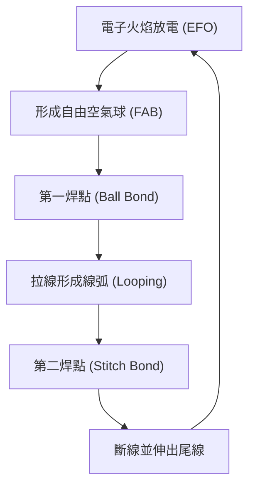
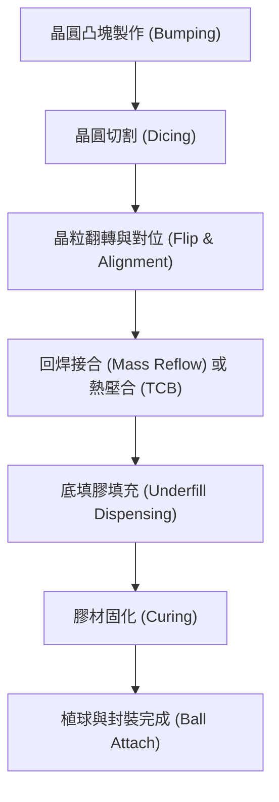
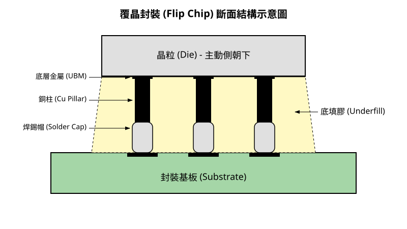
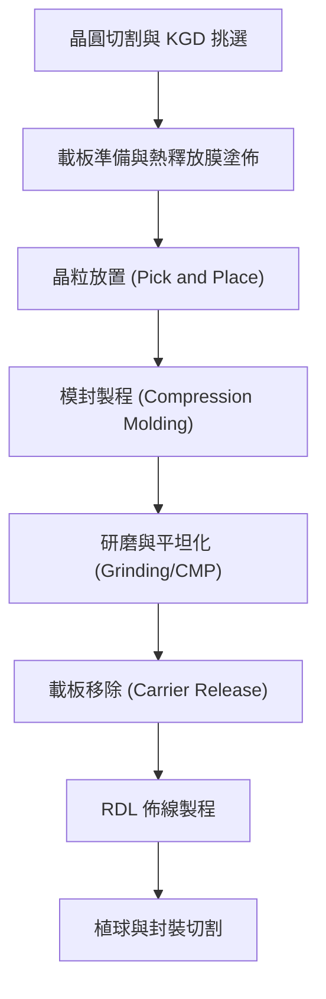
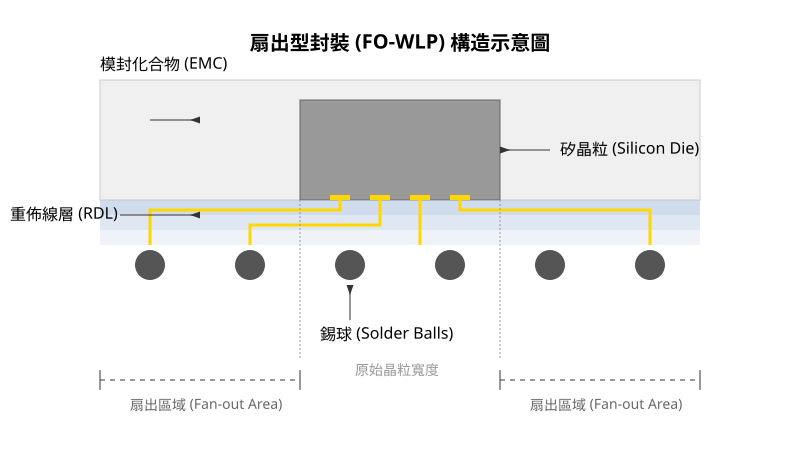
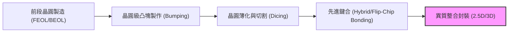
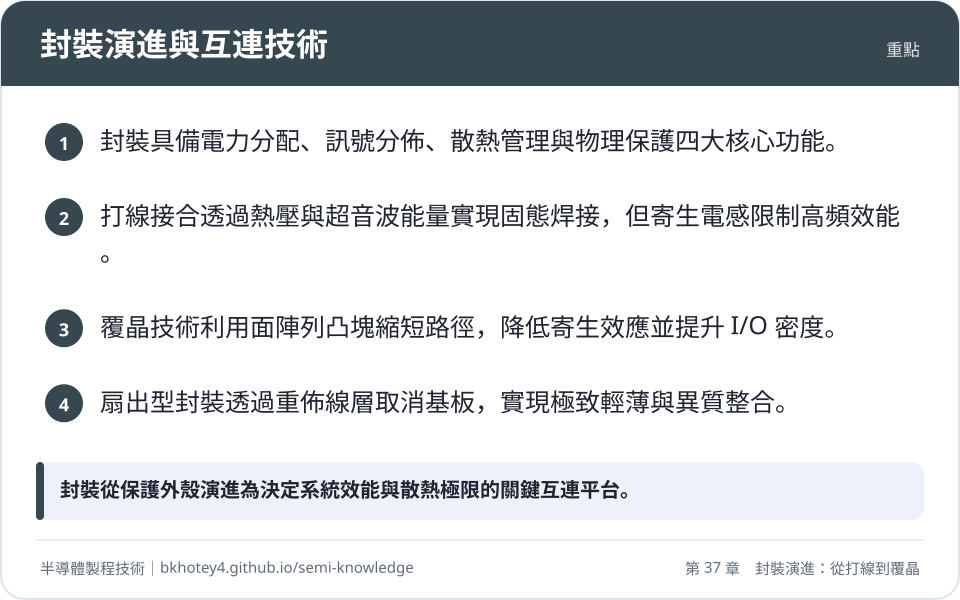
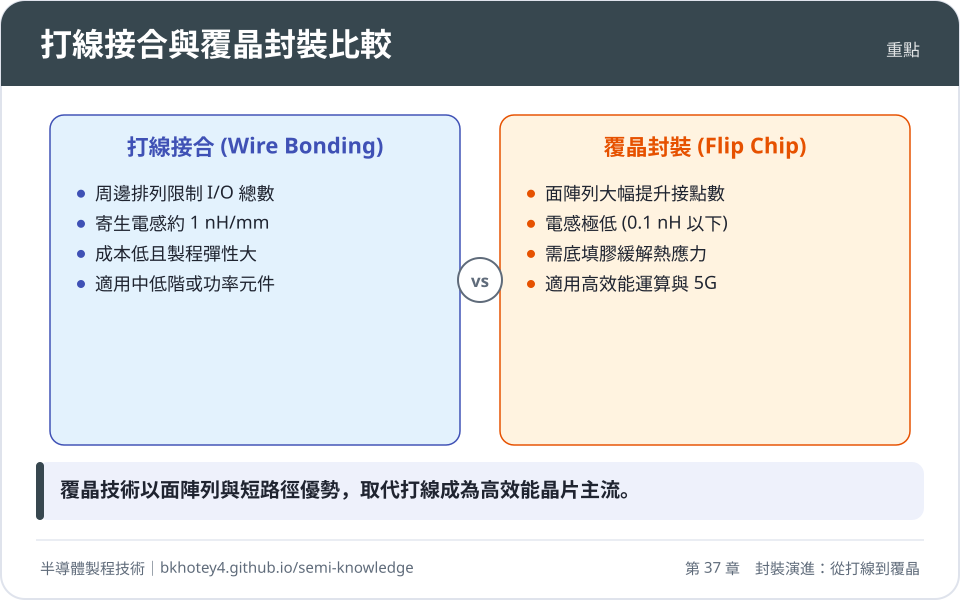
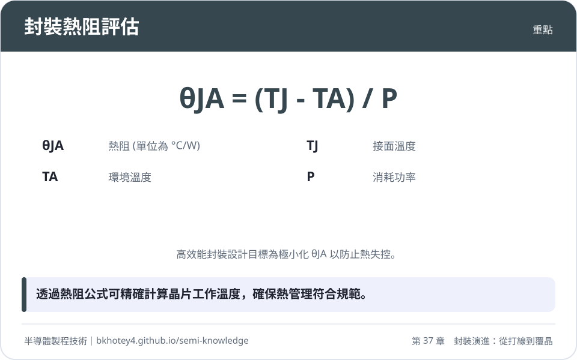
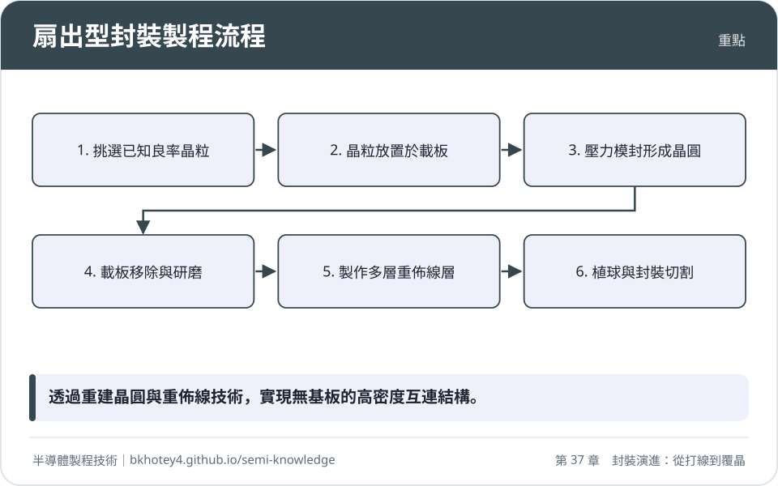

# 第 37 章　封裝演進：從打線到覆晶

!!! abstract "學習目標"
    - 理解半導體封裝的核心功能，包括電力分配、訊號佈線、散熱管理與機械保護。
    - 掌握打線接合（Wire Bonding）與覆晶（Flip Chip）的物理結構、製程流程及其電性差異。
    - 分析凸塊（Bumping）技術與重佈線層（Redistribution Layer, RDL）在縮小封裝體積與提升互連密度中的關鍵作用。
    - 探討扇出型封裝（Fan-out Packaging）的演進，特別是其在晶圓級封裝中的結構創新與技術優勢。

## 37.1 封裝的基本功能與物理限制

### 37.1.1 封裝的定義與角色

在半導體製造流程中，前段製程（FEOL）與後段製程（BEOL）完成了晶圓上的電晶體與金屬導線（見第 28 至 31 章），然而，單獨的晶粒（Die）並不能直接應用於終端電子產品。封裝（Packaging）是指將切割後的晶粒，透過特定的物理連接技術，轉化為具備電性連接、機械支撐與環境保護功能的成品製程。

從系統層級來看，封裝是微觀世界（微米或奈米等級的晶粒 I/O）與巨觀世界（毫米等級的印刷電路板，PCB）之間的橋樑。隨著摩爾定律（Moore's Law）進入後微縮時代，封裝不再僅是保護晶片的「外殼」，而是決定系統效能、功耗與散熱極限的關鍵環節。

### 37.1.2 封裝的四大核心功能

封裝必須同時滿足電學、熱力學與力學的多重需求，其核心功能可歸納為以下四點：

#### 1. 電力分配 (Power Distribution)
晶粒內部的數十億個電晶體需要穩定的電壓供應。封裝必須提供足夠的電源（Vdd）與接地（Vss）路徑。由於先進製程下電壓持續降低（典型值低於 1.0V），而電流需求因效能提升而增加，封裝路徑上的電阻（Resistance）會導致明顯的壓降（IR Drop）：

$$V_{drop} = I \cdot R_{pkg}$$

其中 $R_{pkg}$ 為封裝導線的等效電阻。若封裝設計不當，電力分配網路（PDN）的阻抗過高，將導致晶粒在高負載運作時電壓不穩，進而引發邏輯錯誤或頻率下降。

#### 2. 訊號分佈 (Signal Distribution)
晶粒上的 I/O 墊（I/O Pad）通常以極小的間距（Pitch）排列，而 PCB 上的佈線間距受限於製程能力，通常比晶粒間距大一個數量級以上。封裝的主要任務是進行「扇出」（Fan-out），將密集的晶粒訊號引導至較寬鬆的封裝載板（Substrate）或引腳（Lead），並確保訊號在傳輸過程中不失真。這涉及阻抗匹配（Impedance Matching）與減少串音（Crosstalk）干擾。

#### 3. 散熱 (Heat Dissipation)
半導體元件運作時產生的熱能若無法及時排出，會導致載子遷移率下降（見第 2 章）或誘發熱失控。封裝提供了熱能傳導的路徑，從晶粒表面經過封裝材料（如模封化合物、散熱片）傳導至外部環境。
評估封裝散熱效能的關鍵指標為熱阻（Thermal Resistance, $\theta_{JA}$）：

$$\theta_{JA} = \frac{T_J - T_A}{P}$$

其中 $T_J$ 為接面溫度（Junction Temperature），$T_A$ 為環境溫度（Ambient Temperature），$P$ 為消耗功率。高效能封裝設計的目標在於極小化 $\theta_{JA}$。

#### 4. 物理保護 (Protection)
晶粒極為脆弱，容易受機械應力、濕氣、化學汙染或電磁干擾（EMI）影響。封裝透過模封化合物（Molding Compound）或陶瓷外殼提供機械強度，防止晶粒在組裝或使用過程中受損。此外，封裝材料必須具備適當的熱膨脹係數（CTE），以減少因溫度變化產生的熱應力。

### 37.1.3 封裝層級分類

在電子系統組裝中，封裝依據其位置與功能分為不同的層級（Levels of Packaging）：

| 層級 | 名稱 | 描述 |
| :--- | :--- | :--- |
| **Level 0** | 晶粒級 (Die Level) | 晶圓上的電路與 I/O 墊。 |
| **Level 1** | 封裝級 (Package Level) | 將晶粒連接至封裝載板或引腳架，形成單晶片或多晶片模組。 |
| **Level 2** | 板級 (Board Level) | 將封裝後的成品焊接至印刷電路板 (PCB) 上。 |
| **Level 3** | 系統級 (System Level) | 將多塊 PCB 組裝至機箱或終端產品中。 |

本章所討論的「封裝演進」主要集中於 Level 0 到 Level 1 的互連技術，以及 Level 1 到 Level 2 的介面優化。

```mermaid
graph TD
    A["Level 0: 晶粒 (Die)"] -->|打線/覆晶| B["Level 1: 封裝成品 (Package)"]
    B -->|表面黏著 (SMT)| C["Level 2: 電路板 (PCB)"]
    C -->|組裝| D["Level 3: 終端系統 (System)"]
    style A fill:#f9f,stroke:#333,stroke-width:2px
    style B fill:#bbf,stroke:#333,stroke-width:2px
```

### 37.1.4 互連密度與物理限制

隨著晶片效能提升，封裝技術面臨的核心挑戰在於如何提升「互連密度」並降低「寄生效應」。

#### 1. 寄生電感與電源完整性 (Power Integrity)
在傳統的打線接合（Wire Bonding）中，細長的金屬線會產生顯著的寄生電感（Parasitic Inductance, $L$）。當電路中大量開關同時切換時，會產生瞬態電流變化（$di/dt$），進而引發同步切換雜訊（Simultaneous Switching Noise, SSN），又稱地彈（Ground Bounce）：

$$V_{noise} = L \cdot \frac{di}{dt}$$

截至撰寫時，高效能運算（HPC）晶片的電流變化率極高，傳統打線封裝的電感已成為效能瓶頸，這促使產業轉向覆晶（Flip Chip）技術，利用極短的凸塊（Bump）大幅降低 $L$。

#### 2. 訊號完整性 (Signal Integrity)
在高頻傳輸下，封裝路徑被視為傳輸線。若封裝內部的導線長度與訊號波長可比擬，則必須考慮反射與衰減。互連路徑的特徵阻抗 $Z_0$ 定義為：

$$Z_0 = \sqrt{\frac{L}{C}}$$

其中 $C$ 為寄生電容。為了維持訊號完整性，封裝設計必須精確控制導線幾何形狀，以達成 50 $\Omega$ 或 100 $\Omega$（差動訊號）的阻抗匹配。

#### 3. 互連密度 (Interconnect Density)
互連密度通常以「節距」（Pitch）衡量。
- **打線接合**：受限於毛細管（Capillary）物理尺寸與線弧干涉，典型節距約為 40 $\mu m$ 至 60 $\mu m$。
- **覆晶封裝**：利用面陣列（Area Array）排列，典型節距可縮減至 100 $\mu m$ 以下。
- **先進封裝（如 InFO）**：透過重佈線層（RDL），可進一步提升佈線密度。

!!! note "物理限制：熱膨脹係數 (CTE) 錯配"
    封裝設計中最棘手的物理問題之一是 CTE 錯配。矽的 CTE 約為 $2.6 \times 10^{-6} / ^\circ C$，而 PCB（如 FR4 材質）的 CTE 約為 $15 \sim 20 \times 10^{-6} / ^\circ C$。當環境溫度變化時，兩者間的膨脹程度差異會對焊點（Solder Joint）產生巨大的剪切應力（Shear Stress），長期可能導致疲勞斷裂。因此，封裝材料中常加入底填膠（Underfill）來緩解應力。

### 37.1.5 封裝技術的演進趨勢

截至撰寫時，封裝技術的演進路徑主要由「微縮」與「整合」兩大驅動力主導：

1.  **從周邊到面陣列**：從僅能在晶粒四周打線，演進到在晶粒表面佈滿凸塊（Flip Chip），顯著增加了 I/O 數量。
2.  **從引腳到無引腳**：從具備長引腳的雙列直插封裝（DIP）演進到球柵陣列封裝（BGA），縮短了傳輸路徑。
3.  **從單晶片到多晶片整合**：隨著系統單晶片（SoC）成本攀升，將不同功能的晶粒（如邏輯、記憶體）整合在同一個封裝內（System-in-Package, SiP）成為主流。

!!! example "產業實例：高效能運算 (HPC) 的封裝需求"
    截至撰寫時，人工智慧加速器與伺服器處理器對頻寬的需求已達到 TB/s 等級。傳統封裝因寄生電容與電感過大，無法支撐如此高頻的訊號傳輸。這迫使封裝技術從傳統的 Level 1 結構轉向 2.5D 與 3D 整合（見第 38、39 章），將封裝的功能直接延伸至晶圓製程等級。

## 37.2 打線接合技術：材料、機構與製程

打線接合（Wire Bonding）是半導體封裝製程中發展最久、技術最成熟且成本最低廉的互連（Interconnect）技術。其核心功能是利用細金屬線，將晶粒（Die）上的焊墊（Bond Pad）與封裝基板（Substrate）或導線架（Lead Frame）的接腳連接，建立電力傳輸與訊號交換的迴路。儘管先進封裝技術不斷演進，打線接合在微控制器（MCU）、電源管理 IC（PMIC）及中低階消費性電子產品中，截至撰寫時仍佔據極高的產值比例。

### 鍵結物理原理：熱壓與超音波能量的協同作用

打線接合本質上是一種「固態焊接」（Solid-state welding）過程，其物理機制並非熔化金屬，而是透過壓力、熱能與超音波能量的結合，促使兩個金屬表面產生原子擴散，進而形成穩固的介金屬化合物（Intermetallic Compound, IMC）。

實現鍵結的主要物理參數包含：
1.  **壓力（Force）**：使金屬線變形並與焊墊緊密接觸，增加有效接觸面積。
2.  **熱能（Temperature）**：降低金屬的屈服強度（Yield Strength），並加速原子擴散速率。典型加熱溫度範圍為 $150^\circ\text{C}$ 至 $250^\circ\text{C}$。
3.  **超音波能量（Ultrasonic Power）**：透過換能器（Transducer）產生高頻振動（典型頻率為 $60\text{ kHz}$ 至 $120\text{ kHz}$），其作用有二：一是軟化金屬線材（聲學軟化效應）；二是透過摩擦破壞金屬表面的氧化層，露出新鮮的金屬原子以利鍵結。

鍵結強度的物理描述可參考擴散方程式：
$$J = -D \frac{\partial C}{\partial x}$$
其中 $J$ 為擴散通量，$D$ 為擴散係數，$C$ 為原子濃度。擴散係數 $D$ 與溫度 $T$ 遵循阿瑞尼斯定律（Arrhenius equation）：
$$D = D_0 \exp\left(-\frac{Q}{kT}\right)$$
其中 $Q$ 為活化能，$k$ 為波茲曼常數。增加溫度與超音波能量能有效降低活化能障礙，縮短鍵結所需時間（典型單點鍵結時間僅需數十毫秒）。

### 接合形式：球焊與楔焊

根據製程機構與工具的不同，打線接合主要分為球焊（Ball Bonding）與楔焊（Wedge Bonding）兩大類。

#### 球焊 (Ball Bonding)
球焊是目前應用最廣泛的技術，主要使用金（Au）或銅（Cu）線。其製程工具為陶瓷材質的「毛細管」（Capillary）。
*   **製程步驟**：
    1.  **形成自由空氣球（FAB）**：利用電子火焰（EFO）放電，將伸出毛細管末端的線材熔化成球狀。
    2.  **第一焊點（First Bond）**：將球壓向晶粒焊墊，形成「球焊點」。
    3.  **拉線（Looping）**：毛細管移動形成特定的弧度。
    4.  **第二焊點（Second Bond）**：將線材直接壓在基板上，形成「魚尾焊點」（Stitch Bond）或「楔形焊點」。
    5.  **斷線**：拉斷線材，準備下一次循環。



#### 楔焊 (Wedge Bonding)
楔焊主要使用鋁（Al）線，製程工具為「楔形刀具」（Wedge Tool）。與球焊不同，楔焊不需形成球體，而是直接將線材平壓於焊墊。
*   **特點**：
    1.  **方向性限制**：由於刀具形狀，第二焊點必須位於第一焊點的特定直線後方，缺乏球焊的 360 度轉向靈活性。
    2.  **間距（Pitch）優勢**：楔焊點的寬度通常小於球焊點，適用於極細間距的應用。
    3.  **低溫製程**：鋁楔焊通常在常溫下進行（超音波鍵結），適用於對熱敏感的元件。

| 特性 | 球焊 (Ball Bonding) | 楔焊 (Wedge Bonding) |
| :--- | :--- | :--- |
| **工具** | 陶瓷毛細管 (Capillary) | 楔形刀具 (Wedge) |
| **主要材料** | 金 (Au)、銅 (Cu) | 鋁 (Al)、金 (Au) |
| **方向性** | 360 度任意方向 | 需對準單一方向 |
| **典型速度** | 極快 (10-20 條線/秒) | 較慢 |
| **應用** | 大部分 IC 封裝 | 功率元件、高頻微波元件 |

### 材料選擇與物理特性

打線材料的選擇直接影響封裝的可靠度、電氣特性與成本。

1.  **金 (Au)**：
    *   **優點**：化學穩定性極佳（不氧化）、延展性好、導電性優。
    *   **缺點**：價格昂貴。在與鋁焊墊鍵結時，長期受熱易產生「柯肯多爾效應」（Kirkendall effect），形成空洞導致電阻增加。

2.  **鋁 (Al)**：
    *   **優點**：成本低、與鋁焊墊無異質金屬介面問題。
    *   **缺點**：易氧化，氧化鋁（$Al_2O_3$）極硬，需較大超音波能量破碎氧化層。主要用於大電流功率元件（粗鋁線）。

3.  **銅 (Cu)**：
    *   **優點**：導電與導熱性優於金，且成本極低。
    *   **挑戰**：銅極易氧化，製程中需通入還原氣體（Forming Gas, $N_2/H_2$）保護 FAB 不被氧化。此外，銅的硬度較高，打線時若參數不當，容易壓裂晶粒下方的介電層（如 Low-k 材料），此現象稱為「焊墊擊穿」（Pad Cratering）。

!!! note "銅打線的產業轉移"
    在 2010 年前後，由於金價飆升，半導體產業大規模將金線替換為銅線。截至撰寫時，除了極高可靠度要求的車用或航太晶片外，銅打線已成為中低階封裝的主流。為了進一步防止氧化，業界亦開發出「鍍鈀銅線」（Pd-coated Cu wire），利用鈀層保護銅核心。

### 打線佈局限制與電性挑戰

打線接合雖然成熟，但在高效能運算（HPC）時代面臨嚴峻的物理限制：

#### 1. 周邊型排列（Periphery Array）
打線接合的焊墊通常只能排列在晶粒的四周（Periphery）。
*   **接腳數（Pin Count）限制**：隨著晶粒功能增加，所需的 I/O 數量急劇上升。受限於焊墊間距（Pitch）的物理極限（典型值約 $30\text{--}40\ \mu m$），周邊排列能提供的 I/O 總數遠低於覆晶封裝（Flip Chip）的面陣列排列。
*   **晶粒尺寸增加**：為了容納更多焊墊，有時必須刻意放大晶粒尺寸（Pad-limited design），造成矽晶圓利用率下降與成本上升。

#### 2. 寄生電感（Parasitic Inductance）
打線的長度通常在 $1\text{--}5\text{ mm}$ 之間，這在高速電路中會產生顯著的寄生電感。
根據長直導線電感估算公式：
$$L \approx 2l \left[ \ln\left(\frac{2l}{r}\right) - 0.75 \right] \times 10^{-7} \text{ H}$$
其中 $l$ 為線長，$r$ 為線徑。典型打線的電感值約為 $1\text{ nH/mm}$。
在高頻訊號傳輸下，感抗 $X_L = 2\pi fL$ 會隨頻率 $f$ 增加，導致訊號衰減與反射。此外，在電源供應線路上，大的 $L$ 會在電流快速切換時產生電壓突波（$V = L \frac{di}{dt}$），即所謂的「同步切換雜訊」（Simultaneous Switching Noise, SSN），嚴重影響訊號完整性（Signal Integrity）。

#### 3. 線弧干涉（Wire Sweep）
在封裝模封（Molding）製程中，熔融的環氧樹脂（EMC）注入模具會產生流體壓力，導致細長的金屬線發生位移，稱為「沖線」（Wire Sweep）。若線間距過窄，可能導致短路。這限制了打線封裝在超高密度互連中的應用。

!!! warning "常見誤解"
    初學者常認為增加線徑可以降低電阻並提高強度。然而，線徑增加會導致線弧剛性變大，增加第一焊點對晶粒的應力，且會限制最小焊墊間距。因此，在高速應用中，縮短線長（Short wire loop）比增加線徑更為關鍵。

總結而言，打線接合技術憑藉其極高的製程彈性與低成本，在半導體後段製程中仍扮演基石角色。然而，隨著製程節點進入 $5\text{ nm}$ 以下，對於低感抗、高 I/O 密度的需求，促使業界轉向覆晶封裝（見第 37.3 節）與扇出型封裝（見第 37.4 節）。

## 37.3 覆晶封裝與凸塊技術

隨著積體電路（IC）功能的複雜化與輸出/輸入（I/O）數量的急遽增加，傳統的打線接合技術（Wire Bonding）在接合密度與電性表現上逐漸遭遇瓶頸。覆晶封裝（Flip Chip, FC）技術的出現，改變了晶粒與基板間的互連方式，從晶粒邊緣的「線」連接轉化為晶粒表面的「面」陣列連接，成為高效能運算（HPC）與行動裝置晶片的主流封裝形式。

### 37.3.1 覆晶封裝的物理結構與原理

覆晶封裝的核心概念是將晶粒（Die）正面（即具有主動元件與金屬層的一面）翻轉朝下，利用預先在晶粒焊墊（Bond Pad）上製作的金屬凸塊（Bumping），直接與封裝基板（Substrate）或導線架對接。

相對於打線接合僅能利用晶粒四周邊緣進行互連，覆晶技術採用面積陣列（Area Array）佈局。若晶粒邊長為 $L$，焊墊間距（Pitch）為 $P$，在打線接合中，最大 I/O 數 $N_{WB}$ 受限於周邊長度：
$$N_{WB} \approx \frac{4L}{P}$$
而在覆晶封裝中，I/O 數 $N_{FC}$ 則取決於晶粒表面積：
$$N_{FC} \approx \left( \frac{L}{P} \right)^2$$
當 $L$ 增大或 $P$ 縮小時，$N_{FC}$ 的增長速度遠高於 $N_{WB}$，這使得覆晶技術能支撐數千甚至上萬個 I/O 需求。

### 37.3.2 凸塊技術（Bumping）與底層金屬（UBM）

凸塊是覆晶封裝中實現機械支撐與電氣連接的關鍵結構。在製作凸塊前，必須在晶粒的鋁或銅焊墊上沉積一層底層金屬（Under Bump Metallurgy, UBM），其功能包含：
1.  **附著層（Adhesion Layer）**：通常使用鈦（Ti）或鉻（Cr），確保與晶粒鈍化層及焊墊有良好的黏著力。
2.  **擴散阻障層（Barrier Layer）**：通常使用鎳（Ni）或鎢（TiW），防止焊錫中的錫（Sn）與晶粒內部的銅或鋁發生過度金屬間反應（IMC），避免產生脆性相。
3.  **潤濕層（Wettable Layer）**：通常為銅（Cu），提供焊錫在回焊（Reflow）時良好的潤濕介面。

#### 凸塊材料的演進

1.  **錫鉛/無鉛焊錫凸塊（Solder Bump）**：
    早期採用高鉛焊錫，後因環保規範轉向無鉛焊錫（如 Sn-Ag-Cu, SAC 合金）。其製程多採用電鍍法或印刷法。焊錫凸塊在回焊時會因表面張力呈球狀，稱為 C4（Controlled Collapse Chip Connection）製程。然而，焊錫凸塊在微縮至間距 100 $\mu m$ 以下時，容易因橋接（Bridging）導致短路。

2.  **銅柱凸塊（Copper Pillar Bump）**：
    為因應更細微的間距需求，銅柱凸塊成為主流。其結構由電鍍銅柱與頂端的薄焊錫帽（Solder Cap）組成。由於銅在回焊溫度下不熔化，能維持固定的高度與形狀，有效防止側向橋接。
    *   **典型值**：銅柱高度約 30–50 $\mu m$，間距可微縮至 40–60 $\mu m$。
    *   **優勢**：優異的導熱性與抗電遷移（Electromigration）能力，適合高電流密度的元件。

### 37.3.3 底填膠（Underfill）的力學作用

覆晶封裝中，晶粒（矽，$\alpha_{Si} \approx 2.6 \, ppm/^\circ C$）與基板（有機材質如 FR-4，$\alpha_{sub} \approx 12\text{--}17 \, ppm/^\circ C$）的熱膨脹係數（CTE）存在顯著差異。當環境溫度變化時，兩者間產生的位移差 $\Delta L$ 為：
$$\Delta L = L \cdot (\alpha_{sub} - \alpha_{Si}) \cdot \Delta T$$
若無保護措施，此應力將直接集中於脆弱的凸塊接點，導致疲勞斷裂。底填膠（Underfill）是一種填充於晶粒與基板間隙的環氧樹脂（Epoxy）材料，內含大量二氧化矽（Silica）填充顆粒以調整其 CTE。

底填膠的作用如下：
*   **應力分散**：將原本集中在凸塊的剪應力分散至整個晶粒表面。
*   **環境保護**：防止水氣侵蝕凸塊與金屬層。
*   **結構強化**：提升封裝體的機械強度，防止在跌落測試中損壞。

#### 底填膠製程分類
*   **毛細底填（Capillary Underfill, CUF）**：先完成凸塊回焊，再利用毛細現象將膠材點在晶粒邊緣使其滲透。
*   **非導電膠/膜（NCF/NCP）**：在晶粒壓合前先塗佈膠材，壓合與固化同步完成，適用於極細間距。
*   **模製底填（Molded Underfill, MUF）**：結合封裝模製（Molding）製程，同時完成封裝體保護與底填。

### 37.3.4 電性優勢：寄生效應的降低

與打線接合相比，覆晶技術在電性效能上有顯著提升。打線接合的金屬線長度通常在毫米（mm）等級，而覆晶凸塊高度僅數十微米（$\mu m$）。

1.  **降低電感（Inductance）**：
    互連路徑的電感 $L_{total}$ 與長度成正比。打線接合的電感典型值約為 1–2 nH，而覆晶凸塊僅約 0.01–0.1 nH。極低的電感能大幅減少電源雜訊（如 $L \cdot di/dt$ 壓降）並提升訊號完整性。
2.  **降低電阻（Resistance）**：
    較短且粗的互連結構降低了路徑電阻，有助於降低功耗並提升電源傳輸效率。
3.  **高頻特性**：
    由於寄生參數極低，覆晶封裝能支持頻率超過 20 GHz 的訊號傳輸，是 5G 通訊與高速序列介面（SerDes）的必要技術。

### 37.3.5 扇出型封裝（Fan-out）與晶圓級技術演進

隨著製程演進，覆晶技術進一步演化為晶圓級封裝（Wafer Level Packaging, WLP）。傳統覆晶需依賴封裝基板作為中介，而扇出型封裝（Fan-out WLP, FOWLP）則去除了傳統基板。

#### 扇出型封裝製程邏輯
1.  **晶圓切割與重組**：將已知良品晶粒（Known Good Die, KGD）放置於載體上。
2.  **模製（Molding）**：使用模封化合物（EMC）將晶粒包覆，形成重組晶圓（Reconstituted Wafer）。
3.  **重佈線層（RDL）**：利用微影與電鍍製程，在晶粒上方製作薄膜導線，將 I/O 訊號「扇出」至晶粒物理尺寸之外。
4.  **植球**：直接在 RDL 上製作錫球。

!!! note "技術對比：InFO"
    截至撰寫時，台積電開發的整合扇出型封裝（Integrated Fan-Out, InFO）已廣泛應用於行動裝置處理器。其特點是不需基板，厚度更薄，且 RDL 能提供極短的電路路徑，顯著提升散熱效率與高頻表現。

### 37.3.6 覆晶製程流程

覆晶封裝的典型製程如下圖所示：



!!! warning "常見誤解"
    工程師常誤認為覆晶封裝的可靠度優於打線接合。事實上，由於覆晶結構屬於剛性連接，其對熱應力極為敏感。若底填膠的填充存在氣泡（Void）或固化不完全，極易在熱循環測試（TCT）中發生晶粒開裂（Die Cracking）或凸塊疲勞。

### 37.3.7 產業實例與設備現況

截至撰寫時，覆晶技術已根據應用場景分化為不同路徑：
*   **高效能運算（HPC）**：採用銅柱凸塊結合細間距基板，並朝向 2.5D 封裝演進（見第 38 章）。
*   **行動裝置**：追求極致輕薄，大量採用 FOWLP 或 InFO 技術。
*   **設備端**：美商應材（Applied Materials）與泛林集團（Lam Research）提供 UBM 電鍍與蝕刻設備；而在後段組裝，庫力索法（Kulicke & Soffa）與先進太平洋（ASM Pacific）則提供高速覆晶接合機（Flip Chip Bonder）。

隨著 I/O 間距持續微縮至 20 $\mu m$ 以下，傳統的焊錫接合將面臨物理極限，產業正逐步導入熱壓合接合（Thermal Compression Bonding, TCB）乃至於無凸塊的混合鍵合（Hybrid Bonding）技術，這將在後續章節中詳細討論。

<!-- fig:1 -->
<figure markdown>

<figcaption>圖 37-1　覆晶封裝斷面結構圖（AI 繪製的示意圖）</figcaption>
</figure>

## 37.4 扇出型封裝與晶圓級技術演進

在傳統封裝技術中，晶圓必須先經過切割（Dicing）成為獨立晶粒，再進行後續的打線或覆晶封裝。然而，隨著行動裝置對輕薄短小與高頻寬的需求日益增加，封裝技術開始向「晶圓級封裝」（Wafer-Level Packaging, WLP）演進。晶圓級封裝的核心定義在於：封裝製程是在整片晶圓上完成後，才進行切割。本節將探討從扇入型（Fan-in）到扇出型（Fan-out）的技術演進，以及重佈線層（RDL）與重建晶圓（Reconstituted Wafer）的關鍵工藝。

### 37.4.1 扇入型與扇出型結構之物理差異

晶圓級封裝最初的形式為扇入型（Fan-in WLP），其結構特點是封裝後的成品尺寸與晶粒（Die）原始尺寸完全相同。其製程是在晶圓的鈍化層（Passivation layer）上直接生長重佈線層與錫球。

然而，扇入型封裝面臨物理空間的極限。當晶粒尺寸因製程微縮（見第 5 章）而縮小時，若晶粒所需的輸入/輸出（I/O）接點數量不減反增，錫球間距（Ball Pitch）將會縮小至超出印刷電路板（PCB）的承載能力。

為了克服此限制，扇出型封裝（Fan-out WLP, FO-WLP）應運而生。其基本原理是將晶粒嵌入於模封化合物（Epoxy Mold Compound, EMC）中，人為地擴大封裝體的表面積，使得重佈線層可以從晶粒上方延伸至周邊的模封區域。

| 特性 | 扇入型 (Fan-in WLP) | 扇出型 (Fan-out WLP) |
| :--- | :--- | :--- |
| **封裝尺寸** | 等於晶粒尺寸 | 大於晶粒尺寸 |
| **I/O 密度** | 受限於晶粒面積 | 可藉由扇出區域擴張 |
| **基板需求** | 無需基板 | 無需基板（Substrate-less） |
| **典型應用** | 低引腳數（如電源管理、類比晶片） | 高引腳數（如應用處理器、基頻晶片） |
| **製程複雜度** | 較低 | 較高（需重建晶圓） |

### 37.4.2 重佈線層（RDL）製程技術

重佈線層（Redistribution Layer, RDL）是晶圓級封裝的核心，其功能是將晶粒上極為細微且密集的鋁墊（Al pad）或銅墊（Cu pad），重新佈線至間距較大、適合植球的焊墊位置。

RDL 的製造過程類似於後段製程（BEOL）中的金屬導線（見第 29 章），但其線寬與線距（L/S）通常在微米等級（典型值為 $2/2 \text{ \mu m}$ 至 $10/10 \text{ \mu m}$）。其主要製程步驟如下：

1.  **介電層塗佈**：使用感光性聚醯亞胺（Photosensitive Polyimide, PSPI）或聚苯并噁唑（PBO）作為絕緣材料。這些材料具有優異的熱穩定性與機械強度。
2.  **微影與顯影**：定義出通孔（Via）位置，使 RDL 能與晶粒墊片連接。
3.  **濺鍍種子層（Seed Layer Sputtering）**：利用物理氣相沉積（PVD，見第 22 章）沉積一層薄的鈦（Ti）作為黏著層與擴散阻絕層，隨後沉積銅（Cu）作為電鍍種子層。
4.  **電鍍銅（Cu Electroplating）**：在光阻定義的圖案中電鍍出數微米厚的銅導線。
5.  **光阻去除與種子層蝕刻**：移除多餘的種子層，完成單層佈線。

在高階封裝中，為了實現更複雜的電路連接，通常需要多層 RDL 堆疊。介電材料的介電常數（$k$）與損耗角正切（Loss Tangent）對於高頻訊號的完整性至關重要，這在 5G 與毫米波應用中尤為明顯。

### 37.4.3 重建晶圓（Reconstituted Wafer）流程

扇出型封裝與扇入型最大的不同在於必須建立「重建晶圓」。由於扇出區域需要模封材料支撐，製程無法直接在原始矽晶圓上完成。目前主流的製程路徑分為「晶粒先裝」（Chip-first）與「晶粒後裝」（Chip-last）。

以下以典型的「晶粒先裝 / 面朝下」（Chip-first / Face-down）流程說明重建晶圓的步驟：



1.  **已知良率晶粒（Known Good Die, KGD）挑選**：在進入封裝前，必須確保晶粒是健康的（見第 42 章），否則在扇出型封裝中，任何一顆壞晶粒都會導致昂貴的封裝材料與其他良片浪費。
2.  **晶粒放置（Pick and Place）**：利用高精度設備將晶粒依序放置在貼有暫存黏著膜（Temporary Bonding Film）的載板（Carrier）上。晶粒之間保留一定的間距，作為未來的扇出區域。
3.  **模封（Molding）**：使用壓力模封（Compression Molding）技術，將環氧模封樹脂（EMC）覆蓋於晶粒與載板上。EMC 的流動性與固化收縮率必須精確控制。
4.  **晶粒偏移（Die Shift）補償**：這是扇出型封裝中最具挑戰性的物理現象。在模封固化過程中，EMC 的熱收縮會產生應力，導致晶粒偏離原始放置座標。
    *   設原始座標為 $(x, y)$，偏移後的座標為 $(x+\Delta x, y+\Delta y)$。
    *   截至撰寫時，先進的微影設備具備「適應性圖案化」（Adaptive Patterning）技術，能先掃描每顆晶粒的實際位置，再動態調整 RDL 的光罩圖案，以確保通孔能精準對位。

### 37.4.4 扇出型封裝的物理優勢與挑戰

扇出型封裝相較於傳統覆晶封裝（Flip Chip），最顯著的優勢在於**取消了有機基板（Substrate-less）**。

#### 1. 電性表現提升
由於 RDL 直接與晶粒連接，路徑長度遠短於傳統封裝基板。根據電磁理論，導線長度 $l$ 與電感 $L$ 成正比：
$$L \approx \mu_0 \cdot l \cdot \left[ \ln\left(\frac{2l}{w+t}\right) + 0.5 \right]$$
其中 $w$ 為線寬，$t$ 為線厚。取消基板可大幅降低寄生電感與電阻，減少訊號延遲（RC Delay）並提升電源供應的穩定性（降低 $di/dt$ 雜訊）。

#### 2. 熱管理與厚度
扇出型封裝的總厚度通常小於 $0.5 \text{ mm}$。由於少了基板的熱阻層，晶粒產生的熱量可以更直接地經由封裝表面或 PCB 散出。此外，這種薄型化封裝非常適合堆疊封裝（Package-on-Package, PoP），例如將記憶體封裝直接堆疊在應用處理器之上。

#### 3. 翹曲（Warpage）控制
由於矽晶圓（CTE $\approx 2.6 \text{ ppm/}^\circ\text{C}$）、EMC（CTE 典型值 $10\text{--}40 \text{ ppm/}^\circ\text{C}$）與金屬導線之間的熱膨脹係數（CTE）極不匹配，重建晶圓在冷卻後會產生嚴重的翹曲。
翹曲量 $\delta$ 可簡化表示為：
$$\delta \propto \frac{\Delta \text{CTE} \cdot \Delta T \cdot D^2}{h}$$
其中 $D$ 為晶圓直徑，$h$ 為厚度。為了控制翹曲，製程中必須開發低收縮率的 EMC，並在晶圓背部進行應力補償層的塗佈。

!!! note "說明：扇出型封裝的分類"
    扇出型封裝依據載體形狀可分為「晶圓級扇出型」（FOWLP）與「面板級扇出型」（FOPLP）。後者使用類似面板廠的大型方形玻璃載板（如 $600 \times 600 \text{ mm}$），其面積利用率更高（減少邊緣浪費），但面臨更嚴峻的翹曲控制與微影對準挑戰。

!!! example "產業實例：整合扇出型封裝 (InFO)"
    截至撰寫時，台積電（TSMC）開發的整合扇出型封裝（Integrated Fan-Out, InFO）已廣泛應用於行動裝置處理器。該技術利用 RDL 取代傳統封裝基板，並結合了高密度的封裝內被動元件（IPD），顯著縮小了處理器與記憶體堆疊後的總體積，並提升了高頻傳輸效能。

### 37.4.5 晶圓級技術的未來演進

隨著製程節點進入 3 奈米以下，單一晶粒的面積效益遞減，扇出型技術開始朝向「多晶粒整合」（Multi-die Integration）發展。這包括將不同功能的晶粒（如處理器、射頻晶片、電源管理晶片）整合在同一個扇出型封裝內，形成系統級封裝（SiP）。

此外，RDL 的線寬線距正在向亞微米（Sub-micron）邁進，這模糊了前段製程與後段封裝的界線。未來的扇出型技術將不再僅僅是保護晶粒的「外殼」，而是成為提升晶片系統效能的關鍵互連平台。關於更進階的 2.5D 矽中介層技術，將於第 38 章詳細討論。

<!-- fig:2 -->
<figure markdown>

<figcaption>圖 37-2　扇出型封裝構造圖（AI 繪製的示意圖）</figcaption>
</figure>

## 37.5 設備與廠商技術

在先進封裝領域，設備的演進正朝向高精度、高產出與跨製程整合發展。隨著封裝技術從傳統的引腳框架（Lead Frame）轉向晶圓級封裝（Wafer Level Packaging, WLP），封裝設備與前段晶圓製造設備（Front-end equipment）的技術界線日益模糊。

### 37.5.1 鍵合設備與運動控制系統

封裝製程的核心在於實現晶粒（Die）與外部電路的電性連接，這主要依賴打線接合機（Wire Bonder）與覆晶接合機（Flip Chip Bonder）。

#### 1. 打線接合機（Wire Bonder）
打線接合機必須在極短的時間內完成「尋址、下壓、超音波震動、拉線、燒球」的循環。其關鍵子系統包含：
*   **高動態運動控制系統**：打線頭（Bond Head）通常由線性馬達（Linear Motor）驅動，配合空氣軸承（Air Bearing）以減少摩擦。典型值要求在 X-Y 軸的定位精度達到 $\pm 2.0 \, \mu\text{m}$ 以內，且加速度需超過 $10 \, \text{G}$ 以維持高產出。
*   **超音波產生器與換能器（Transducer）**：將電能轉換為機械震動，破壞金屬介面的氧化層，形成金屬鍵合。其頻率通常在 $60 \, \text{kHz}$ 至 $150 \, \text{kHz}$ 之間。

#### 2. 覆晶接合機（Flip Chip Bonder）
覆晶技術要求將晶粒翻轉並精確對準基板上的焊墊。
*   **視覺對準系統（Vision Alignment System）**：利用高解析度 CCD 相機同時擷取晶粒凸塊（Bump）與基板焊墊（Pad）的影像，透過影像處理演算法計算偏移量（Offset）並進行補償。
*   **力矩與溫度控制**：在熱壓鍵合（Thermal Compression Bonding, TCB）中，設備需精確控制下壓力（Bond Force）與加熱曲線（Thermal Profile），以確保焊錫熔融並形成良好的共晶組織，同時避免晶粒受壓損壞。

### 37.5.2 凸塊製造與重新佈線層設備

先進封裝如扇出型封裝（Fan-out）大量使用半導體前段製程技術來製作重新佈線層（Redistribution Layer, RDL）與凸塊。

#### 1. 電鍍機（Plating Tool）
電鍍是製作金屬凸塊（如銅柱、錫球）與 RDL 的核心製程。其物理原理遵循法拉第電解定律（Faraday's Law of Electrolysis）：
$$m = \left( \frac{Q}{F} \right) \left( \frac{M}{z} \right)$$
其中：
*   $m$ 為析出金屬的質量。
*   $Q$ 為總電量（電流 $I \times$ 時間 $t$）。
*   $F$ 為法拉第常數（約 $96,485 \, \text{C/mol}$）。
*   $M$ 為金屬的摩爾質量。
*   $z$ 為離子價數。

在設備實作上，如 Lam Research 的 SABRE 系列，需確保電解液在晶圓表面流場（Flow Field）的均勻性，以達成極高的膜厚均勻度（Uniformity），這對於後續覆晶接合的良率至關重要。

#### 2. 光阻塗佈與顯影系統
封裝段的光阻通常較厚（典型值 $10 \, \mu\text{m}$ 至 $100 \, \mu\text{m}$），用於定義凸塊高度或深孔。設備如 Tokyo Electron 的 CLEAN TRACK 系列，需具備處理高黏度光阻的能力，並透過精確的轉速控制與邊緣去除（Edge Bead Removal, EBR）技術，確保晶圓邊緣不產生污染。

### 37.5.3 主要廠商技術比較

下表列出封裝與相關製程領域的主要設備供應商及其技術特點：

| 廠商 | 代表產品系列 | 技術路線與特點 | 主要應用 |
| :--- | :--- | :--- | :--- |
| **ASML** | TWINSCAN NXT | ArF 浸潤式 DUV 微影，具備極高疊對（Overlay）精度 | 高密度 RDL 與中介層圖案定義 |
| **Lam Research** | SABRE 系列 | 電化學沉積（ECD），具備專利流場控制與多槽並行處理 | 銅柱凸塊（Cu Pillar）、RDL 電鍍 |
| **Tokyo Electron** | CLEAN TRACK LITHIUS Pro Z | 高產出塗佈顯影整合系統，支援厚膜光阻製程 | 凸塊與 RDL 之光罩圖案化前處理 |
| **BESI** | Datacon 8800 CHAMEO 系列 | 混合鍵合（Hybrid Bonding）與高精度覆晶接合 | 先進封裝、晶片堆疊、異質整合 |
| **DISCO** | DFD 系列切割機 | 機械刀具切割或雷射切割技術 | 晶圓切割（Dicing）、薄化後分割 |
| **Advantest** | V93000 平台 | 高速 SoC 測試，支援大量並行測試（Multi-site） | 封裝後成品測試（FT）、良率驗證 |
| **KLA** | 29xx / 39xx 系列 | 寬頻電漿光學檢測，針對封裝缺陷進行高靈敏度掃描 | 封裝前晶圓缺陷檢測、RDL 品質監控 |

### 37.5.4 技術路線差異與選機考量

在選擇封裝設備時，晶圓廠與封裝廠的考量點存在顯著差異：

1.  **精度與產出的取捨**：
    傳統封裝強調產出速度（Units Per Hour, UPH），因此打線機追求極速運動。然而，在先進封裝（如 CoWoS 或 InFO）中，由於涉及次微米級的 RDL 佈線，設備必須導入前段製程的微影（如 ASML TWINSCAN）與檢測（如 KLA 29xx 系列）技術。此時，精度（Accuracy）與疊對（Overlay）性能成為首要考量。

2.  **潔淨度要求**：
    隨著封裝線寬縮小，封裝廠的環境要求已從傳統的 ISO Class 1000 提升至與晶圓廠接近的 ISO Class 10 甚至 Class 1。設備的腔體設計必須減少微塵粒子（Particle）的產生，這使得 Tokyo Electron 與 Lam Research 等傳統前段設備商在先進封裝市場具備優勢。

3.  **異質整合的挑戰**：
    當不同功能、不同尺寸的晶粒（如邏輯晶片與 HBM）需整合在同一基板上時，接合設備（Bonder）必須具備處理多尺寸吸嘴（Nozzle）與多壓力區間控制的能力。BESI 等廠商透過模組化設計，使其設備能在同一平台上切換不同的鍵合模式。

!!! example "產業實例：整合型扇出封裝（InFO）"
    截至撰寫時，台積電（TSMC）開發的整合型扇出封裝（Integrated Fan-Out, InFO）技術已廣泛應用於行動裝置處理器。該技術捨棄了傳統的封裝基板（Substrate），直接在晶圓級製程中透過電鍍與微影技術製作 RDL，並利用環氧樹脂模封材料（Epoxy Molding Compound, EMC）重構晶圓。這不僅縮減了封裝體積，更顯著降低了電感與電阻，提升了高頻訊號傳輸性能。在此製程中，高精度的晶粒放置（Die Placement）設備與厚膜 RDL 電鍍設備（如 SABRE 系列）是達成高良率的關鍵。

### 37.5.5 趨勢：封裝與前段製程的融合

截至撰寫時，封裝技術正朝向異質整合（Heterogeneous Integration）發展。這意味著封裝不再只是保護晶片，而是成為延續摩爾定律（Moore's Law）的重要手段。



這種趨勢導致封裝設備的演進呈現以下特點：
*   **混合鍵合（Hybrid Bonding）的興起**：將銅對銅接合與介電質鍵合結合，不再使用焊錫凸塊。這要求設備具備極高的表面平坦度（需配合 CMP 設備，如 Applied Materials 的 Reflexion LK Prime）與奈米級的對準精度。
*   **數據整合與自動化**：封裝設備開始全面導入 SECS/GEM 協議與 Interface A，實現與製造執行系統（MES）的實時溝通。透過大量感測器收集機台參數（如鍵合壓力、電流波動），配合統計製程控制（SPC，見第 36 章），以在封裝階段即時預測良率風險。

總結而言，37.5 節所探討的設備技術，正處於從「機械組裝」向「精密半導體加工」轉型的關鍵期。工程師在評估設備時，必須同時具備機械動力學與半導體物理化學的跨領域知識。

## 本章重點

*   **封裝的核心功能**：封裝不僅是晶粒的保護殼，更承擔了電力分配（Power Distribution）、訊號分佈（Signal Distribution）、散熱（Heat Dissipation）與物理保護四大任務。
*   **打線接合物理機制**：打線接合屬於固態焊接，透過壓力、熱能與超音波能量的協同作用，促使金屬原子擴散並形成介金屬化合物（IMC）。
*   **寄生效應的限制**：傳統打線接合因導線較長，會產生約 $1\text{ nH/mm}$ 的寄生電感，在高頻與高電流切換下會引發嚴重的同步切換雜訊（SSN）。
*   **覆晶技術的優勢**：覆晶封裝（Flip Chip）將互連從周邊排列轉化為面陣列（Area Array），顯著提升了 I/O 密度，並透過極短的凸塊路徑大幅降低寄生電感與電阻。
*   **底填膠的力學角色**：底填膠（Underfill）用於緩解矽晶粒與有機基板之間因熱膨脹係數（CTE）錯配所產生的剪切應力，是確保覆晶封裝可靠度的關鍵。
*   **扇出型封裝（Fan-out）的演進**：透過重佈線層（RDL）與重建晶圓技術，扇出型封裝取消了傳統封裝基板，實現了更薄的封裝厚度、更佳的散熱效率與更高的佈線密度。
*   **重佈線層（RDL）工藝**：RDL 利用微影、濺鍍種子層與電鍍銅技術，在微米尺度下重新定義訊號路徑，是晶圓級封裝實現異質整合的核心。
*   **設備與精度趨勢**：隨著封裝線寬縮小，後段設備正與前段製程融合，高精度的運動控制、視覺對準系統以及針對厚膜光阻的塗佈顯影技術成為主流。


## 重點圖卡

複習時看這幾張就能抓住本章重點；[圖卡庫](../cards.md)可以下載成圖片。

<div class="ix-cards" markdown>

<figure markdown>

<figcaption>重點圖卡：封裝演進與互連技術</figcaption>
</figure>

<figure markdown>

<figcaption>重點圖卡：打線接合與覆晶封裝比較</figcaption>
</figure>

<figure markdown>

<figcaption>重點圖卡：封裝熱阻評估</figcaption>
</figure>

<figure markdown>

<figcaption>重點圖卡：扇出型封裝製程流程</figcaption>
</figure>

</div>

## 習題

**1. 散熱計算：已知某高效能運算晶片的消耗功率 $P$ 為 $120\text{ W}$，環境溫度 $T_A$ 為 $25^\circ\text{C}$。若該封裝形式的熱阻 $\theta_{JA}$ 為 $0.4^\circ\text{C/W}$，請計算該晶片的接面溫度 $T_J$。若元件規範之最高工作溫度為 $85^\circ\text{C}$，此封裝是否滿足需求？**

??? success "參考解答"
    根據熱阻公式：$\theta_{JA} = \frac{T_J - T_A}{P}$
    移項可得：$T_J = T_A + (P \cdot \theta_{JA})$
    代入數值：$T_J = 25 + (120 \cdot 0.4) = 25 + 48 = 73^\circ\text{C}$
    由於 $73^\circ\text{C} < 85^\circ\text{C}$，此封裝設計滿足散熱需求。

**2. 電源完整性分析：在打線封裝中，一條長度為 $2\text{ mm}$ 的金屬線具有約 $2\text{ nH}$ 的寄生電感。若電路在切換時，電流變化率 $di/dt$ 為 $100\text{ mA/ns}$，請計算產生的感應雜訊電壓 $V_{noise}$。**

??? success "參考解答"
    根據感應電壓公式：$V_{noise} = L \cdot \frac{di}{dt}$
    已知 $L = 2\text{ nH} = 2 \times 10^{-9}\text{ H}$
    $\frac{di}{dt} = \frac{100 \times 10^{-3}\text{ A}}{1 \times 10^{-9}\text{ s}} = 10^8\text{ A/s}$
    代入公式：$V_{noise} = (2 \times 10^{-9}) \cdot (10^8) = 0.2\text{ V}$
    此雜訊電壓對於運作電壓為 $1.0\text{ V}$ 的先進製程晶片而言，佔比高達 20%，可能引發邏輯錯誤。

**3. 互連密度對比：考慮一晶粒邊長為 $10\text{ mm}$，若採用打線接合，焊墊節距（Pitch）為 $40\ \mu m$；若採用覆晶封裝，凸塊節距亦為 $100\ \mu m$。請分別估算兩者理論上能提供的最大 I/O 數量。**

??? success "參考解答"
    (1) 打線接合（周邊排列）：
    $N_{WB} \approx \frac{4 \times \text{邊長}}{\text{節距}} = \frac{4 \times 10000\ \mu m}{40\ \mu m} = 1000$ 個 I/O。
    (2) 覆晶封裝（面陣列）：
    $N_{FC} \approx \left( \frac{\text{邊長}}{\text{節距}} \right)^2 = \left( \frac{10000\ \mu m}{100\ \mu m} \right)^2 = 100^2 = 10000$ 個 I/O。
    由此可見，即使覆晶的節距較寬，其能提供的 I/O 總數仍遠高於打線接合。

**4. 觀念題：為何在銅柱凸塊（Copper Pillar Bump）製程中，必須在銅柱頂端保留一層薄焊錫帽（Solder Cap）？其與傳統 C4 錫球製程的主要差異為何？**

??? success "參考解答"
    (1) 焊錫帽的作用是作為接合介面，在回焊製程中熔化以與基板焊墊形成冶金鍵結。
    (2) 主要差異：傳統 C4 錫球在回焊時會完全熔化並塌陷（Collapse），容易導致細間距下的橋接短路；銅柱凸塊的銅核心在回焊溫度下保持固態，能維持固定的間距與高度，因此能支援更細微的節距（Fine Pitch）。

**5. 觀念題：在扇出型封裝（Fan-out）製程中，「晶粒偏移」（Die Shift）現象會造成什麼問題？產業上如何解決此問題以確保 RDL 的連通性？**

??? success "參考解答"
    (1) 晶粒偏移會導致 RDL 製程中的通孔（Via）無法精準對位至晶粒上的焊墊，造成斷路或接觸電阻過大。
    (2) 解決方案：目前主流採用「適應性圖案化」（Adaptive Patterning）技術。在 RDL 曝光前，先以光學掃描重建晶圓上每顆晶粒的實際座標，並由軟體即時修正微影光罩的曝光位置，確保每一條導線都能精確對準偏移後的晶粒。

## 本章術語

- **Wire Bonding**（打線接合）：利用細金屬線透過熱壓與超音波能量實現晶粒與基板電性連接的技術。
- **Flip Chip**（覆晶封裝）：將晶粒正面翻轉朝下，透過金屬凸塊直接與基板對接的封裝技術。
- **UBM**（底層金屬）：在晶粒焊墊上製作的複合導電層，用於增強附著力、阻絕擴散並提供潤濕性。
- **Underfill**（底填膠）：填充於覆晶晶粒與基板間隙的環氧樹脂，用於分散熱應力並保護凸塊。
- **RDL**（重佈線層）：在晶圓級封裝中，用於將密集 I/O 重新排列至較寬鬆位置的薄膜金屬佈線層。
- **EMC**（模封化合物）：一種含有二氧化矽填充顆粒的環氧樹脂，用於包覆並保護封裝體內的晶粒。
- **CTE**（熱膨脹係數）：描述材料隨溫度變化而產生尺寸改變的物理量，是封裝可靠度分析的核心指標。
- **KGD**（已知良品晶粒）：在封裝前經過電性測試確認功能正常的晶粒，是先進封裝確保成本效益的前提。
- **SSN**（同步切換雜訊）：因封裝寄生電感在大量電路同時切換時產生的電壓波動現象。
- **FOWLP**（扇出型晶圓級封裝）：將晶粒嵌入模封材料中，並透過 RDL 將訊號引出至晶粒物理尺寸之外的封裝技術。


## 互動學習

!!! tip "動手試試看"
    - [設備機台圖鑑：切割與研磨機](../equipment.md)

<div class="quiz" data-quiz="08-01"></div>


## 產業最新進展

本節由每日產業新聞自動補充，說明本章技術在產業上的最新發展。

<!-- updates -->
（目前尚無補充。）
