# 第 38 章　2.5D 封裝與 CoWoS

!!! abstract "學習目標"
    - 理解 2.5D 封裝相較於傳統封裝在互連密度與頻寬上的物理優勢。
    - 掌握矽中介層 (Silicon Interposer) 的結構設計與關鍵製程技術。
    - 辨析 CoWoS-S、CoWoS-R 與 CoWoS-L 不同技術路徑的架構差異與應用場景。
    - 分析 AI 加速器對先進封裝的技術需求以及當前量產面臨的產能瓶頸。

## 38.1 2.5D 封裝原理與 AI 加速器需求

在半導體產業邁入後摩爾定律時代（Post-Moore's Law Era），單純依靠微影技術縮減電晶體特徵尺寸以提升運算效能的難度日益增加。雖然前段製程（FEOL）已演進至埃米（Angstrom）尺度（見第 6 章與第 28 章），但物理極限與經濟成本成為了不可忽視的障礙。2.5D 封裝技術的出現，本質上是為了在封裝層級實現「超越摩爾定律」（More than Moore）的目標，透過異質整合（Heterogeneous Integration）將不同功能的晶粒（Die）整合在單一封裝體內，以突破單一晶片在尺寸、頻寬與功耗上的限制。

#### 38.1.1 突破光罩極限（Reticle Limit）與異質整合

在微影製程中，步進式曝光機（Scanner）的曝光場域（Exposure Field）存在物理上限，稱為光罩極限（Reticle Limit）。截至撰寫時，主流深紫外光（DUV）與極紫外光（EUV）曝光機的標準曝光場域約為 $26 \text{ mm} \times 33 \text{ mm}$，即單一晶粒的最大面積限制在 $858 \text{ mm}^2$ 左右。

然而，隨著人工智慧（AI）與高效能運算（HPC）對電晶體數量的需求呈指數級增長，單一大型晶粒（Monolithic Die）面臨兩大挑戰：

1.  **物理尺寸不足**：頂級 AI 加速器所需的電晶體數量往往需要超過 $1000 \text{ mm}^2$ 甚至更大的矽面積，這已超出單次曝光的極限。
2.  **良率下降**：根據波茲-愛因斯坦（Bose-Einstein）良率模型（見第 35 章），晶粒面積 $A$ 與良率 $Y$ 呈負相關。公式如下：

    $$Y = \left( \frac{1}{1 + AD_0/n} \right)^n$$

    其中 $D_0$ 為缺陷密度，$n$ 為聚類參數。當面積 $A$ 接近光罩極限時，任何微小的隨機缺陷都會導致整顆昂貴的大晶粒報廢。

2.5D 封裝透過「小晶片」（Chiplet）設計解決此問題。工程師將原本的大型系統單晶片（SoC）拆分為多個較小的功能模組（如運算核心、輸入/輸出介面、快取記憶體），分別在最適合的製程節點製造後，再於封裝階段重新組合。這種異質整合方式不僅突破了單一晶粒的尺寸限制，更大幅提升了整體良率與設計彈性。

#### 38.1.2 解決記憶體牆（Memory Wall）問題

AI 運算的核心在於大規模並行處理，尤其是深度學習模型的權重運算需要頻繁地在處理器（GPU/ASIC）與記憶體之間交換數據。傳統的封裝架構（如 Flip-Chip BGA，見第 37 章）中，處理器與動態隨機存取記憶體（DRAM）分別封裝在印刷電路板（PCB）上，兩者間的訊號傳輸受限於：

*   **互連長度**：PCB 等級的導線長度通常在公分（cm）量級，導致嚴重的訊號衰減與延遲。
*   **接腳密度**：受限於封裝基板的球距（Ball Pitch），I/O 數量有限，限制了總頻寬。
*   **功耗**：驅動長距離 PCB 導線需要較高的電壓與能量，根據 $P = fCV^2$（見第 30 章），高頻下的功耗將成為系統散熱的瓶頸。

這種處理器運算速度遠快於記憶體存取速度的現象，稱為「記憶體牆」（Memory Wall）。為了克服此瓶頸，2.5D 封裝引入了高頻寬記憶體（HBM, High Bandwidth Memory）。HBM 採用 3D 堆疊技術（詳見第 40 章），並透過 2.5D 封裝的中介層（Interposer）與處理器緊密排列。

藉由 2.5D 封裝，處理器與 HBM 之間的互連距離縮短至公釐（mm）甚至微米（$\mu m$）量級，互連密度則提升了數十倍。截至撰寫時，先進 AI 加速器的總記憶體頻寬已可達到數 TB/s，這是傳統封裝架構無法企及的。

#### 38.1.3 2.5D 封裝的物理定義與架構

2.5D 封裝之所以被稱為「2.5D」，是因為其結構介於傳統 2D 封裝（晶粒平鋪於基板）與 3D 封裝（晶粒直接垂直堆疊）之間。其核心特徵是在有機封裝基板（Organic Substrate）與晶片之間，額外插入一層「中介層」（Interposer）。

!!! note "2.5D 封裝的結構層次"
    1.  **頂層晶粒**：包含運算晶粒（如 GPU）與 HBM 堆疊。
    2.  **微凸塊（Micro-bumps）**：用於連接晶粒與中介層，間距（Pitch）通常在 $20\text{--}50 \mu m$。
    3.  **中介層（Interposer）**：提供高密度的重佈線層（RDL），負責晶粒間的超短距離通訊。
    4.  **矽穿孔（TSV）**：若中介層為矽基，則需透過 TSV 將訊號導向背面。
    5.  **受控塌陷晶片連接凸塊（C4 Bumps）**：連接中介層與底層基板，間距較大（約 $100\text{--}150 \mu m$）。
    6.  **封裝基板（Package Substrate）**：通常為有機材質，連接至 PCB。

以下為 2.5D 封裝典型結構的示意流程：

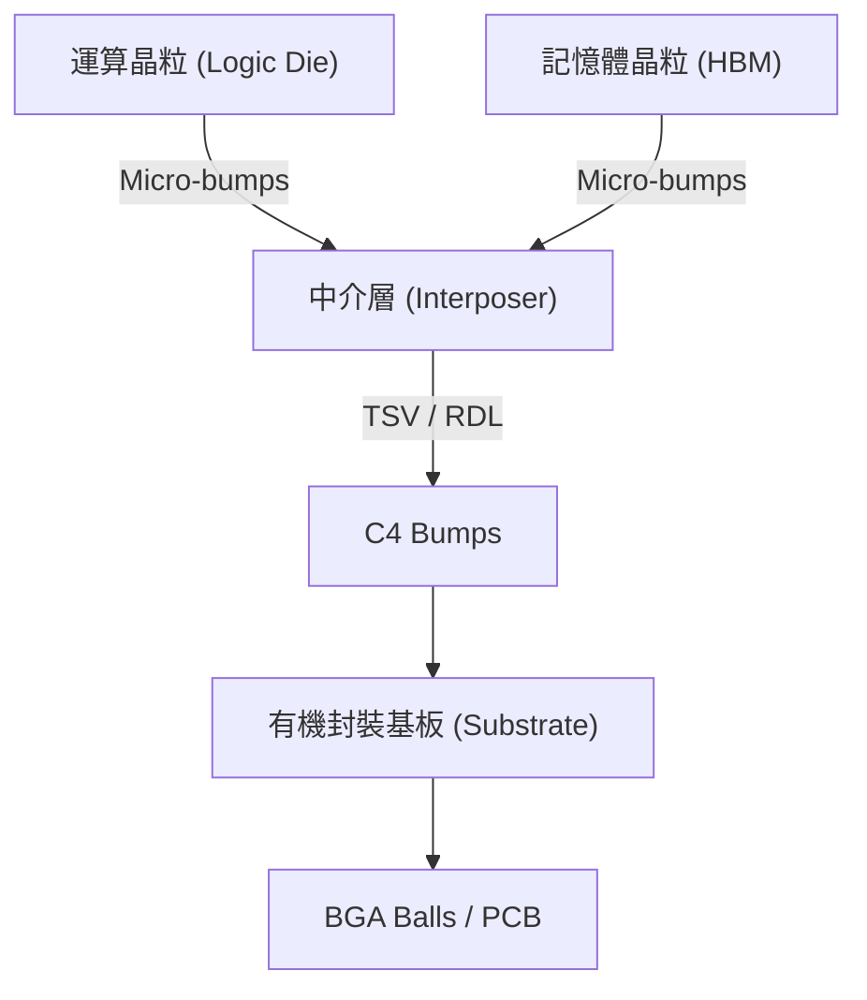

#### 38.1.4 AI 加速器的封裝需求趨勢

截至撰寫時，2.5D 封裝已成為高效能運算（HPC）與 AI 伺服器晶片的標準架構。這主要源於 AI 模型規模（參數數量）的劇烈擴張，對封裝技術提出了以下三點嚴苛要求：

1.  **極致的互連密度**：
    為了支撐 HBM3 或更高標準的傳輸速率，中介層上的線寬/線距（L/S, Line/Space）必須達到 $1 \mu m / 1 \mu m$ 甚至更小。這遠遠超出了傳統有機基板的製程極限（通常為 $10 \mu m / 10 \mu m$ 以上），因此必須借用半導體前段的微影與蝕刻設備來製作中介層。

2.  **熱管理與功率完整性**：
    AI 加速器在滿載運作時，熱功耗設計功率（TDP）往往超過 500W 甚至 1000W。2.5D 封裝結構中，多個發熱源（如多組 GPU 核心）高度集中。中介層的材料選擇（如矽的熱傳導率遠高於有機材料）對於熱擴散至關重要。同時，為了維持電壓穩定，封裝內必須整合大量的矽電容器（Deep Trench Capacitor）以降低電源分配網路（PDN）的阻抗。

3.  **大尺寸封裝（Super-size Packaging）**：
    早期的 2.5D 封裝面積約為 1 倍光罩尺寸（1x Reticle size），但截至撰寫時，為了容納更多組 HBM 堆疊（如 8 組或 12 組 HBM），中介層的面積已演進至 3 倍甚至 4 倍光罩尺寸以上。這要求封裝製程具備高精度的拼接（Stitching）技術，將多個曝光場域精確銜接在一起。

| 參數特性 | 傳統 Flip-Chip 封裝 | 2.5D 先進封裝 (CoWoS 等) |
| :--- | :--- | :--- |
| **互連介質** | 有機基板 (Organic Substrate) | 矽/有機中介層 (Interposer) |
| **典型線寬/線距** | $10\text{--}20 \mu m$ | $0.4\text{--}2 \mu m$ |
| **凸塊間距 (Bump Pitch)** | $130\text{--}150 \mu m$ | $20\text{--}40 \mu m$ |
| **I/O 密度 (每 $mm^2$)** | 典型值 < 100 | 典型值 > 1,000 |
| **主要應用** | 消費級 CPU, 手機 SoC | AI 加速器, 伺服器 GPU, 高階 FPGA |

!!! example "產業實例"
    在 AI 運算領域，NVIDIA 的 Hopper 與 Blackwell 架構、AMD 的 Instinct 系列，以及各雲端服務供應商（CSP）自研的張量處理器（TPU/ASIC），均廣泛採用台積電（TSMC）提供的 CoWoS（Chip-on-Wafer-on-Substrate）技術。這些產品的共同特徵是中心為巨大的邏輯運算晶粒，四周環繞著 6 至 8 顆 HBM 記憶體，全部整合在矽中介層上。

總結而言，2.5D 封裝不僅是物理上的堆疊技術，更是一種系統級的設計範式轉移。它透過引入中介層，在微米等級的尺度上重新定義了晶片間的通訊方式，成為支撐現代大規模 AI 運算不可或缺的基礎設施。在後續小節中，我們將詳細探討中介層的材料特性以及不同類型的 CoWoS 技術架構。

## 38.2 矽中介層與高密度重佈線層 (RDL)

在 2.5D 封裝架構中，矽中介層（Silicon Interposer）扮演了銜接微米級晶片（Die）與毫米級封裝基板（Substrate）之間的關鍵橋樑。傳統的有機基板（Organic Substrate）受限於材料特性與微影解析度，其重佈線層（Redistribution Layer, RDL）的線寬線距（Line/Space, L/S）通常在 10/10 $\mu m$ 以上，難以支撐 AI 加速器中 SoC 與高頻寬記憶體（HBM）之間數以千計的高密度訊號連線。矽中介層的出現，解決了互連密度與熱膨脹係數（CTE）匹配的雙重難題。

### 38.2.1 矽中介層的物理特性與製造原理

矽中介層本質上是一片不含主動元件（如電晶體）或僅含少量被動元件的矽晶圓。其核心價值在於利用成熟的半導體前段製程設備，在矽基板上製作出極高密度的金屬導線。

#### 1. 材料優勢與 CTE 匹配
矽中介層使用單晶矽作為基材，其熱膨脹係數約為 $2.6 \, ppm/^\circ C$。由於封裝上方的邏輯晶片（SoC）與 HBM 同樣是矽材質，兩者之間的 CTE 完全一致。這能有效減少在封裝製程受熱或元件運作升溫時，因材料脹縮差異產生的熱應力（Thermal Stress），進而避免微凸塊（Micro-bump）開裂或脫層（Delamination）。相比之下，有機基板的 CTE 典型值約為 $12 \sim 17 \, ppm/^\circ C$，與矽晶片的差異顯著。

#### 2. 製造製程
矽中介層的製造通常採用成熟製程節點（如 65nm、40nm 或 28nm 節點的後段製程）。其主要結構包含：
*   **矽穿孔（Through Silicon Via, TSV）：** 提供垂直導通路徑，將訊號從中介層頂部引導至底部。
*   **重佈線層（RDL）：** 在中介層表面進行水平佈線，實現晶片間的高密度互連。
*   **鈍化層（Passivation）：** 通常使用氮化矽（$Si_3N_4$）或氧化矽（$SiO_2$）保護導線。

### 38.2.2 高密度重佈線層 (RDL) 技術

RDL 是矽中介層實現高頻寬通訊的核心。在 CoWoS-S 架構中，RDL 位於矽中介層的頂部，負責將 SoC 的 I/O 點位與 HBM 的 I/O 點位精確對接。

#### 1. 線寬線距 (L/S) 的演進
隨着 AI 運算對記憶體頻寬的需求激增，單位面積內需要容納更多的導線。
*   **早期階段：** RDL 的 L/S 典型值約為 $2/2 \, \mu m$。
*   **成熟階段：** 隨着製程精進，L/S 縮減至 $0.8/0.8 \, \mu m$。
*   **先進階段：** 截至撰寫時，為了支援更高密度的 HBM3e 或未來標準，RDL 的 L/S 已演進至 $0.4/0.4 \, \mu m$ 甚至更低。

縮小 L/S 的物理限制主要在於微影設備的解析度（見第 12 章）以及銅鑲嵌製程（Damascene Process）的良率控制。

#### 2. 導線電學特性與 RC 延遲
在極細的線寬下，導線的電阻（Resistance, $R$）與電容（Capacitance, $C$）效應變得不可忽視。導線電阻可由下式表示：

$$R = \rho \frac{l}{w \cdot t}$$

其中 $\rho$ 為電阻率，$l$ 為導線長度，$w$ 為線寬，$t$ 為厚度。當 $w$ 縮減時，$R$ 會急劇增加。

同時，相鄰導線間的寄生電容 $C$ 會導致訊號延遲（RC Delay）與串擾（Crosstalk）。為了降低延遲，RDL 之間的絕緣層需採用低介電常數（Low-k）材料（見第 30 章），但在封裝製程中，必須兼顧材料的機械強度以承受後續的鍵合壓力。

#### 3. 鑲嵌製程 (Damascene) 應用
矽中介層的 RDL 製造通常沿用銅雙鑲嵌製程（Dual Damascene，詳見第 29 章）。
1.  **沉積介電層：** 使用 CVD 沉積氧化矽或低介電材料。
2.  **溝槽蝕刻：** 利用乾式蝕刻（RIE）開出導線溝槽。
3.  **阻障層與種子層沉積：** 使用 PVD 沉積 Ta/TaN 與 Cu Seed。
4.  **銅電鍍：** 填滿溝槽。
5.  **化學機械研磨 (CMP)：** 去除多餘的銅，實現平坦化。

### 38.2.3 微凸塊 (Micro-bump) 接合技術

在 2.5D 封裝中，晶片與中介層之間的連接並非使用傳統的 C4 凸塊（Controlled Collapse Chip Connection），而是尺寸更小的微凸塊（Micro-bump, $\mu bump$）。

#### 1. 尺寸縮減與密度提升
傳統 C4 凸塊的間距（Pitch）典型值約為 $130 \sim 150 \, \mu m$，而微凸塊的間距在截至撰寫時已微縮至 $40 \sim 25 \, \mu m$。
*   **結構：** 微凸塊通常由銅柱（Cu Pillar）、鎳阻障層（Ni Barrier）與錫銀焊料帽（Sn-Ag Solder Cap）組成。
*   **優勢：** 較小的凸塊尺寸能顯著降低寄生電感與寄生電容，提升訊號完整性，並縮短訊號傳輸路徑。

#### 2. 接合製程
微凸塊的接合主要採用熱壓鍵合（Thermal Compression Bonding, TCB）或大規模回焊（Mass Reflow）。由於微凸塊間距極小，製程中必須嚴格控制焊料的溢出（Solder Squeeze-out），以防止相鄰凸塊短路。

!!! note "物理挑戰：金屬間化合物 (IMC)"
    在微凸塊中，由於焊料體積極小，銅與錫反應生成的金屬間化合物（Intermetallic Compounds, 如 $Cu_6Sn_5$）佔比會迅速增加。IMC 雖然提供機械強度，但脆性較大且電阻較高，過度的 IMC 生長會影響接合處的可靠性。

### 38.2.4 矽穿孔 (TSV) 的垂直導通功能

矽中介層不僅負責水平佈線，還需透過 TSV 將訊號與電力傳導至下方的封裝基板。

*   **垂直互連：** TSV 穿透整個矽基板（厚度典型值約 $50 \sim 100 \, \mu m$），其直徑通常在 $5 \sim 10 \, \mu m$ 之間。
*   **製程順序：** 矽中介層通常採用「TSV Middle」流程，即在完成 RDL 之前先製作 TSV 溝槽並填充銅，待正面製程完成後，再從背面進行晶圓薄化（Wafer Thinning）露出 TSV。
*   **詳細原理：** 關於 TSV 的蝕刻、絕緣層沉積與電鍍填充技術，請參閱第 39 章「3D 堆疊、TSV 與混合鍵合」。

### 38.2.5 矽中介層製造流程概覽

矽中介層的製造結合了前段（FEOL）的精密與後段（BEOL）的佈線邏輯。以下為典型製造流程：

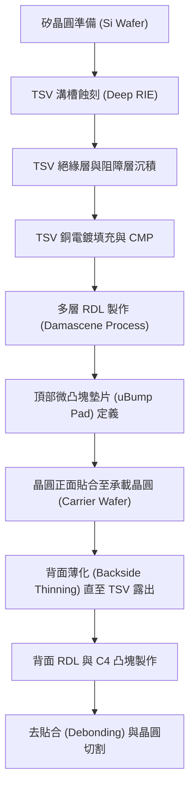

### 38.2.6 產業實例與技術極限

!!! example "產業實例：台積電 CoWoS-S"
    在台積電（TSMC）的 CoWoS-S 技術中，矽中介層的面積是不斷突破的重點。截至撰寫時，單一中介層的面積已可達到 3 倍甚至 4 倍的光罩極限（Reticle Limit，約 $26 \, mm \times 33 \, mm$）。為了實現超大面積的中介層，必須採用光罩拼接（Reticle Stitching）技術，這對微影機台的對準精度（Overlay）提出了極高要求。

!!! warning "常見誤解：矽中介層是否包含電晶體？"
    雖然矽中介層使用半導體製程製造，但在大多數 2.5D 封裝應用中，它是「被動」（Passive）的，不包含主動電晶體。其主要目的是提供互連。雖然技術上可以製作包含主動電路的「主動中介層」（Active Interposer），但由於成本極高且良率挑戰大，目前主流 AI 晶片仍以被動中介層為主。

透過矽中介層與高密度 RDL，2.5D 封裝成功解決了晶片間通訊的瓶頸。然而，矽中介層的成本較高，且在大面積下的翹曲（Warpage）控制極為困難，這也促使了後續 CoWoS-R（使用有機材料 RDL）與 CoWoS-L（使用局部矽橋）等變體技術的發展（見 38.3 節）。

<!-- fig:1 -->
<figure markdown>
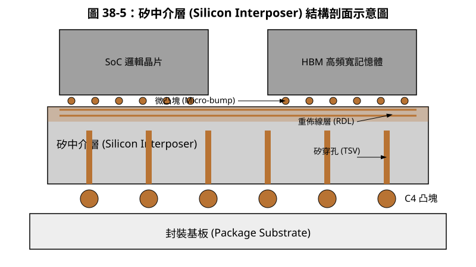
<figcaption>圖 38-1　矽中介層結構剖面圖（AI 繪製的示意圖）</figcaption>
</figure>

## 38.3 CoWoS 技術架構：S、R 與 L 系列

CoWoS（Chip-on-Wafer-on-Substrate）技術自開發以來，已演進出多種針對不同應用場景的架構。根據中介層（Interposer）材質與加工工藝的不同，主要分為 CoWoS-S、CoWoS-R 與 CoWoS-L 三大分支。這些架構的核心差異在於如何在互連密度（Interconnect Density）、封裝尺寸（Package Size）、訊號完整性（Signal Integrity, SI）以及成本（Cost）之間取得平衡。

### 38.3.1 CoWoS-S (Silicon Interposer)

CoWoS-S 是最早商用化且技術最成熟的架構，其中的「S」代表矽（Silicon）。其結構特徵是使用一片完整的高密度矽中介層作為基礎，將計算晶粒（如 GPU、ASIC）與高頻寬記憶體（HBM）並排封裝於其上。

#### 1. 結構與物理特性
CoWoS-S 的矽中介層本質上是一片不含主動元件（如電晶體）的「被動」矽晶圓，但其上佈滿了多層金屬導線（RDL）與矽穿孔（Through-Silicon Via, TSV）。
*   **高密度互連：** 由於矽中介層採用成熟的後段製程（BEOL）設備進行加工（見第 29 章），其線寬與線距（Line/Space, L/S）可輕易達到 $0.4/0.4 \, \mu\text{m}$ 甚至更小。這對於 HBM 與 SoC 之間數千個訊號接腳的並行傳輸至關重要。
*   **熱膨脹係數（CTE）匹配：** 晶粒（Die）與中介層皆為單晶矽，其熱膨脹係數 $\alpha_{\text{Si}} \approx 2.6 \, \text{ppm/}^\circ\text{C}$。在封裝過程的熱循環中，兩者間的應力極小，能有效確保微凸塊（Micro-bump）的可靠性。

#### 2. 光罩尺寸限制與縫合技術
矽中介層的製造受限於微影機台的光罩曝光區極限（Reticle Limit），典型值約為 $26 \, \text{mm} \times 33 \, \text{mm}$（約 $858 \, \text{mm}^2$）。
隨著 AI 加速器對 HBM 數量的需求增加（如從 6 顆增加至 8 顆或更多），單一光罩尺寸已不足以容納所有晶粒。截至撰寫時，業界普遍採用「光罩縫合」（Reticle Stitching）技術，將多個曝光區拼接在一起，使中介層面積達到 $3.3$ 倍甚至更高倍率的光罩尺寸。

### 38.3.2 CoWoS-R (RDL Interposer)

CoWoS-R 中的「R」代表重佈線層（Redistribution Layer）。與 CoWoS-S 不同，它捨棄了昂貴的矽中介層，轉而採用有機材料（Organic Material）作為中介層的介電層。

#### 1. 材料與製程特點
CoWoS-R 結合了扇出型封裝（Fan-out Packaging）的技術，利用感光性聚醯亞胺（Photosensitive Polyimide, PI）等聚合物作為絕緣層，並透過電鍍銅製程形成 RDL。
*   **柔性緩衝：** 有機材料具有較低的彈性模數（Young's Modulus），在封裝冷卻過程中可以吸收因封裝基板（Substrate）與晶粒之間 CTE 差異所產生的應力。
*   **成本優勢：** 無需進行昂貴的 TSV 蝕刻與填孔製程，且有機中介層的層數增加相對容易。

#### 2. 訊號完整性挑戰
儘管 CoWoS-R 在成本與應力管理上有優勢，但其電氣特性面臨挑戰：
*   **介電損耗：** 有機介電質的介電常數（$\epsilon_r$）與損耗角正切（$\tan \delta$）通常高於矽製程中的二氧化矽（$\text{SiO}_2$），這在高頻訊號傳輸時會導致較大的插入損耗（Insertion Loss）。
*   **佈線密度限制：** 有機 RDL 的最小線寬線距目前仍難以達到與矽中介層相同的亞微米（Sub-micron）等級，典型值在 $2/2 \, \mu\text{m}$ 左右，這限制了其在極高密度互連場景的應用。

### 38.3.3 CoWoS-L (Local Silicon Interconnect)

CoWoS-L 中的「L」代表區域（Local），這是為了解決 CoWoS-S 的成本與尺寸限制，同時保留其高密度互連優點而開發的折衷方案。

#### 1. 矽橋（Silicon Bridge）技術
CoWoS-L 的核心在於「矽橋」（LSI, Local Silicon Interconnect）。在一個大尺寸的有機 RDL 中介層中，僅在需要極高頻寬的區域（例如 SoC 與 HBM 的交界處）嵌入一塊微小的矽晶粒（Bridge）。
*   **混合結構：** 大部分的長距離佈線與供電由有機 RDL 負擔，而關鍵的高速數據傳輸則通過矽橋完成。
*   **尺寸突破：** 由於主體不再是單一巨大的矽片，CoWoS-L 較容易實現超大尺寸封裝（如 $4$ 倍光罩尺寸以上），且不會受到矽中介層良率下降與成本劇增的直接影響。

#### 2. 封裝整合複雜度
CoWoS-L 的製造難度在於如何將微小的矽橋精確地嵌入有機層中，並確保矽橋上的微凸塊與上方晶粒精準對位。這對模封（Molding）製程與平坦化技術（CMP）提出了極高的要求（見第 24 章）。

### 38.3.4 技術架構的物理權衡與比較

在選擇 CoWoS 架構時，工程師必須針對熱、電、力學三個物理維度進行權衡。

#### 1. 熱膨脹係數（CTE）匹配與應力
封裝結構的變形與失效通常源於材料間的 $\Delta \text{CTE}$。其熱應變（Thermal Strain）可簡化表示為：

$$\epsilon_{thermal} = (\alpha_1 - \alpha_2) \cdot \Delta T$$

其中 $\alpha_1, \alpha_2$ 分別為相鄰材料的 CTE，$\Delta T$ 為溫度變化量。
*   **CoWoS-S：** 晶粒與中介層匹配極佳，但中介層與下方 ABF 基板（$\alpha \approx 12\text{--}17 \, \text{ppm/}^\circ\text{C}$）存在巨大差異，易導致基板翹曲（Warpage）。
*   **CoWoS-R：** 有機中介層作為中間層，其 CTE 介於矽與基板之間，起到了應力緩衝的作用。

#### 2. 訊號完整性（SI）與電源完整性（PI）
對於 AI 加速器，數據傳輸速率已進入 $112 \, \text{Gbps}$ 甚至更高的領域。
*   **電感與電阻：** 矽中介層的 TSV 雖然提供了垂直路徑，但 TSV 本身具有寄生電容與電感。
*   **傳輸線模型：** 在 RDL 佈線中，必須考慮微帶線（Microstrip）或帶狀線（Stripline）的特性阻抗 $Z_0$：

    $$Z_0 \approx \sqrt{\frac{L}{C}}$$

    有機材料（CoWoS-R/L）的低 $\epsilon_r$ 有助於降低寄生電容，但在精細線寬下，導線電阻（Resistance）的增加會成為訊號衰減的主因。

#### 3. 綜合比較表

| 特性 | CoWoS-S | CoWoS-R | CoWoS-L |
| :--- | :--- | :--- | :--- |
| **中介層材質** | 全矽 (Silicon) | 有機 RDL (Polymer) | 有機 RDL + 矽橋 (Bridge) |
| **互連密度** | 極高 (L/S $\le 0.4 \mu\text{m}$) | 中 (L/S $\approx 2 \mu\text{m}$) | 區域極高 (矽橋部分) |
| **封裝尺寸極限** | 受限於光罩縫合良率 | 較大 | 最大 (可多晶粒拼接) |
| **電氣性能 (SI)** | 優 (導線精細) | 中 (介電損耗較高) | 優 (關鍵路徑走矽橋) |
| **應力管理** | 挑戰大 (矽與基板失配) | 較佳 (材料具韌性) | 中 |
| **典型應用** | 高階 GPU、AI 訓練晶片 | 網路通訊、中階加速器 | 超大型 AI 運算系統 |

!!! note "設計選擇的邏輯"
    在設計 AI 加速器時，若系統需要 8 顆以上的 HBM3e 記憶體，CoWoS-S 的光罩縫合良率將面臨嚴峻挑戰，此時 CoWoS-L 成為截至撰寫時最受關注的替代方案，因為它能提供更大的封裝面積，同時維持 SoC 與 HBM 之間的高速通訊。

### 38.3.5 封裝結構示意圖

以下透過 Mermaid 語法展示三種架構在垂直堆疊上的差異：

```mermaid
graph TD
    subgraph "CoWoS-S"
        S_Die["Top Dies (SoC/HBM)"] -- "Micro-bump" --> S_Si["Silicon Interposer (with TSV)"]
        S_Si -- "C4 Bump" --> S_Sub["Package Substrate"]
    end

    subgraph "CoWoS-R"
        R_Die["Top Dies (SoC/HBM)"] -- "Micro-bump" --> R_Org["Organic RDL Interposer"]
        R_Org -- "C4 Bump" --> R_Sub["Package Substrate"]
    end

    subgraph "CoWoS-L"
        L_Die["Top Dies (SoC/HBM)"] -- "Micro-bump" --> L_Bridge["Silicon Bridge (Embedded)"]
        L_Die -- "Micro-bump" --> L_Org["Organic RDL Layer"]
        L_Bridge -. "Local Link" .- L_Org
        L_Org -- "C4 Bump" --> L_Sub["Package Substrate"]
    end
```

!!! warning "常見誤解：CoWoS 僅是封裝技術"
    工程師常誤以為 CoWoS 僅是後段封裝（OSAT）的範疇。事實上，CoWoS-S 的矽中介層製造涉及精密微影、乾式蝕刻（見第 19 章）與 CMP，其製程要求更接近於前段晶圓廠（Foundry）。這也是為何領先的晶圓代工廠在 2.5D 封裝領域擁有較高技術壁壘的原因，因為他們能將前段製程的精度延伸至封裝領域。

截至撰寫時，隨著 AI 模型參數量的指數級成長，單一封裝內整合的晶粒數量持續增加。CoWoS-S 仍維持其性能標竿地位，但 CoWoS-L 憑藉著在大尺寸擴展性上的優勢，正逐漸在高階伺服器處理器市場中佔據重要地位。未來架構的演進將進一步聚焦於如何降低中介層的厚度以減少熱阻，以及開發新型低損耗有機材料以提升 CoWoS-R/L 的頻寬表現。

## 38.4 製程流程與關鍵挑戰

CoWoS（Chip-on-Wafer-on-Substrate）技術的實作流程可分為兩個主要階段：第一階段為「晶片對晶圓」（Chip-on-Wafer, CoW），重點在於將已知合格晶粒（Known Good Die, KGD）精密地整合於矽中介層（Interposer）上；第二階段為「晶圓對基板」（Wafer-on-Substrate, oS），重點在於將完成封裝的 CoW 模組安裝至封裝基板（Substrate）上。此製程涉及極高密度的微凸塊（Micro-bump）接合、超薄晶圓處理以及複雜的應力管理。

### 38.4.1 晶片對晶圓 (CoW) 製程流程

CoW 階段是 2.5D 封裝的核心，其目標是在矽中介層晶圓上，將邏輯晶粒（如 GPU、ASIC）與高頻寬記憶體（HBM）進行高密度互連。

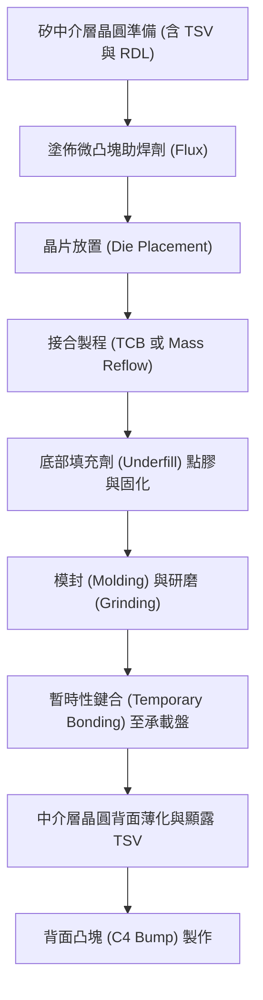

在 CoW 流程中，首先在矽中介層晶圓上製作微凸塊。截至撰寫時，典型的微凸塊間距（Pitch）已縮減至 20 $\mu m$ 到 40 $\mu m$ 之間。接著，透過高精度拾放系統（Pick-and-Place）將邏輯晶粒與 HBM 放置於正確位置。為了確保電性連接的可靠性，必須選擇適當的接合技術。

### 38.4.2 接合技術：熱壓接合 (TCB) 與質量回焊 (Mass Reflow)

在 2.5D 封裝中，接合技術的選擇取決於凸塊間距、晶片厚度與熱預算。

1.  **質量回焊 (Mass Reflow, MR)**：
    將放置好晶片的整片晶圓送入回焊爐，利用加熱使錫膏熔化，透過液態錫的表面張力進行「自動校準」（Self-alignment）。
    *   **優點**：產出率（Throughput）高，適合大批量生產。
    *   **缺點**：對於極細間距（< 30 $\mu m$），液態錫容易產生橋接（Bridging）導致短路；且在加熱過程中，薄晶片容易因熱應力產生位移。

2.  **熱壓接合 (Thermal Compression Bonding, TCB)**：
    利用接合頭（Bonding Head）對單個晶片施加壓力與熱量，使微凸塊與中介層焊墊（Pad）產生共晶接合或固相擴散。
    *   **原理**：透過精確控制壓力 ($F$) 與溫度曲線 ($T(t)$)，在極短時間內完成接合。
    *   **優點**：能有效控制錫鬚（Solder Squeeze-out），防止細間距短路，並能補償晶片的微小翹曲。
    *   **缺點**：屬於單晶片處理（Single Die Processing），產速遠低於 MR。

!!! note "製程趨勢"
    隨著 HBM 堆疊層數增加（如 HBM3e、HBM4），晶片厚度變薄且凸塊密度提升，TCB 已成為確保高良率的主流選擇，特別是在處理非均勻高度的凸塊時具有明顯優勢。

### 38.4.3 暫時性鍵合與解鍵合 (TBDB) 製程

由於矽中介層在製程後期需要薄化至 50 $\mu m$ 至 100 $\mu m$ 左右，以縮短穿矽通孔（TSV）的長度並降低電阻，如此薄的晶圓無法獨立承受後續的機械應力。因此，必須使用暫時性鍵合與解鍵合（Temporary Bonding and Debonding, TBDB）技術。

1.  **暫時性鍵合 (Temporary Bonding)**：
    使用化學膠材（Adhesive）將 CoW 晶圓的正面鍵合至一個堅固的承載盤（Carrier，通常為玻璃或矽材質）。該膠材必須具備高熱穩定性，以承受後續背面製程（如 PVD、CVD）的高溫。

2.  **背面薄化與加工**：
    鍵合後，對中介層晶圓背面進行機械研磨（Grinding）與化學機械研磨（CMP），直到顯露出 TSV。隨後製作背面 RDL 與較大的 C4 凸塊（間距約 130 $\mu m$ 至 200 $\mu m$）。

3.  **雷射解鍵合 (Laser Debonding)**：
    這是最關鍵的步驟。使用特定波長（通常為 308 nm 或 355 nm）的紫外雷射穿透玻璃承載盤，照射在光敏轉換層（Laser Release Layer, LRL）上。
    *   **物理機制**：雷射能量被 LRL 吸收後產生光化學分解或光熱消融（Ablation），使膠材失去黏性。
    *   **關鍵參數**：雷射能量密度（Fluence）必須精確控制。若能量過高，產生的衝擊波可能損傷超薄晶圓上的微細線路；若能量不足，則無法完全脫離。

### 38.4.4 晶圓對基板 (oS) 與最終整合

完成解鍵合後的 CoW 模組會進行晶圓切割（Dicing），分割成單個封裝單元。接著進入 oS 階段：

1.  **CoW 放置於基板**：將分割後的 CoW 模組放置於大型有機封裝基板（Package Substrate）上。
2.  **C4 回焊**：利用質量回焊技術，將 CoW 背面的 C4 凸塊與基板連接。
3.  **底填與蓋板 (Lid) 組裝**：在 CoW 與基板之間填充底部填充劑以增強結構強度，最後安裝金屬蓋板以利散熱並保護晶片。

### 38.4.5 關鍵挑戰：翹曲 (Warpage) 控制與應力管理

2.5D 封裝面臨的最大物理挑戰是熱機械應力導致的翹曲。這是由於多種材料之間熱膨脹係數（Coefficient of Thermal Expansion, CTE）的不匹配所致。

下表為典型材料的 CTE 比較：

| 材料 | CTE (ppm/°C) | 備註 |
| :--- | :--- | :--- |
| 矽 (Silicon) | 2.6 | 晶片與中介層 |
| 模封樹脂 (EMC) | 7 ~ 15 | 隨填料比例變化 |
| 有機基板 (Substrate) | 12 ~ 17 | 核心材質為 FR4/BT 類 |
| 錫球 (Solder) | 20 ~ 25 | SAC305 等合金 |

當封裝體從回焊高溫（約 250°C）冷卻至室溫時，各層材料收縮程度不同。根據雙材料梁模型（Bimetallic Strip Model），產生的曲率 $\kappa$ 可簡化表示為：

$$\kappa = \frac{6(\alpha_2 - \alpha_1)\Delta T (1 + m)^2}{h \left[ 3(1 + m)^2 + (1 + mn)\left(m^2 + \frac{1}{mn}\right) \right]}$$

其中 $\alpha$ 為 CTE，$\Delta T$ 為溫度變化，$h = h_1 + h_2$ 為總厚度，$m = h_1/h_2$ 為厚度比，$n = E_1/E_2$ 為彈性模數比。

**翹曲帶來的影響包括：**
*   **接合失效**：翹曲導致 C4 凸塊在回焊時發生空焊（Non-Wet）或橋接。
*   **晶圓破裂**：超薄中介層在解鍵合過程中若應力釋放不均，極易產生裂紋（Cracking）。
*   **光學對準困難**：翹曲會改變晶圓表面的焦深（DOF）平面，影響後續微影或拾放精度。

**應力管理對策：**
*   **低應力模封材料**：開發低收縮率、CTE 接近矽的 EMC。
*   **對稱結構設計**：在基板背面增加補強層，平衡上下表面的應力分佈。
*   **預補償技術**：在設計階段模擬翹曲方向，預先調整接合頭的壓力分佈或基板的預熱曲線。

### 38.4.6 良率管理與已知合格晶粒 (KGD)

在 CoW 製程中，若其中一顆 HBM 損壞，則整顆昂貴的邏輯晶粒（如 H100/B200）都必須報廢。這使得「已知合格晶粒」（Known Good Die, KGD）的篩選變得至關重要。

!!! warning "常見誤解"
    讀者常認為封裝只是後段組裝，良率損失較低。但在 2.5D 封裝中，由於涉及多晶片堆疊，最終良率 $Y_{final}$ 遵循乘法法則：

    $$Y_{final} = Y_{interposer} \times Y_{logic} \times (Y_{HBM})^n \times Y_{assembly}$$

    若 $n=8$（即 8 顆 HBM），即使每顆 HBM 的良率高達 98%，僅 HBM 部分造成的良率損失就接近 15%。因此，封裝前的晶圓級測試（Wafer-level Test）與製程中的光學檢測（AOI）是維持量產可行性的關鍵。

截至撰寫時，為了應對 AI 加速器不斷增大的封裝尺寸（超過 2 倍光罩極限，見第 12 章），製程中對於中介層拼接（Stitching）的精度要求已達到次微米等級，這進一步增加了製程整合的複雜度。

## 38.5 產能瓶頸與基板技術限制

在 2.5D 封裝技術（如 CoWoS）邁向大規模量產的過程中，產能與良率的限制往往不在於單一電晶體的微縮，而是在於物理尺寸擴張所帶來的製造瓶頸。隨著人工智慧（AI）運算需求對記憶體頻寬與邏輯算力的渴求，封裝尺寸已從單倍光罩尺寸（Reticle Size）演進至數倍光罩尺寸，這對微影、材料應力控制與載板製造提出了嚴峻挑戰。

### 38.5.1 光罩拼接技術 (Photomask Stitching)

在傳統的前段製程中，單次曝光的最大區域受限於步進式掃描機（Scanner）的光學場域（Field Size），典型值約為 $26 \text{ mm} \times 33 \text{ mm} = 858 \text{ mm}^2$。然而，高性能 AI 加速器為了整合更多的運算核心（Compute Die）與高頻寬記憶體（HBM），其中介層（Interposer）的面積往往需要遠大於此限制。

為了製造出大於單倍光罩尺寸的中介層，必須採用「光罩拼接」（Stitching）技術。其原理是在矽中介層曝光過程中，將多個光罩圖案精確地排列並重疊邊界，使導線能在不同曝光場域之間連續導通。

1. **拼接原理與重疊區設計**：
   在拼接處，兩次曝光的圖案必須達成極高精度的對準（Overlay）。假設單次曝光場域寬度為 $W$，若要實現 $2 \times$ 光罩尺寸的中介層，則需進行兩次相鄰曝光，並在交界處保留一個寬度為 $\delta$ 的重疊區（Overlap Region）。

   $$L_{total} = (L_1 + L_2) - \delta$$

   其中 $L_{total}$ 為拼接後的總長度，$\delta$ 為確保導線連續性而設計的冗餘區。

2. **拼接挑戰**：
   - **對準精度（Overlay Accuracy）**：若拼接處出現位移，會導致重佈線層（RDL）的導線斷路或電阻值異常。
   - **曝光均勻性**：重疊區域接受了兩次曝光能量，光阻的反應程度需透過特殊的灰階光罩（Gray-tone Mask）或曝光劑量控制來補償，以避免關鍵尺寸（CD）在接縫處發生突變。
   - **產率下降**：由於大尺寸中介層佔據了晶圓的大部分面積，單片 12 吋晶圓能切出的中介層數量大幅減少。截至撰寫時，主流技術已能實現 $3.3 \times$ 甚至更高倍率的光罩尺寸拼接，支撐起搭載 8 顆或更多 HBM 堆疊的系統。

### 38.5.2 味之素堆積膜 (ABF) 基板的技術瓶頸

CoWoS 結構的最底層是封裝基板（Package Substrate），目前高性能運算晶片主要採用「味之素堆積膜」（Ajinomoto Build-up Film, ABF）作為絕緣介電材料。隨著封裝尺寸從 $50 \text{ mm} \times 50 \text{ mm}$ 擴張至 $100 \text{ mm} \times 100 \text{ mm}$ 以上，基板製造面臨了前所未有的物理限制。

1. **翹曲（Warpage）控制**：
   基板由多層有機材料與銅箔堆疊而成，矽晶圓（CTE $\approx 2.6 \text{ ppm/}^\circ\text{C}$）、中介層與 ABF 基板（CTE $\approx 15\text{-}20 \text{ ppm/}^\circ\text{C}$）之間的熱膨脹係數（CTE）失配極為嚴重。在回焊（Reflow）或熱壓合過程中，巨大的熱應力會導致基板產生非線性變形。
   翹曲位移量 $D$ 可簡化表示為：

   $$D \propto \frac{\Delta \alpha \cdot \Delta T \cdot L^2}{h}$$

   其中 $\Delta \alpha$ 為 CTE 差異，$\Delta T$ 為溫度變化，$L$ 為基板長度，$h$ 為厚度。當長度 $L$ 增加一倍，翹曲風險將以平方倍數增加，這會導致覆晶接合（Flip-chip Bonding）時的銲球接觸不良。

2. **層數與佈線密度**：
   為了支撐數萬個訊號引腳（I/O），ABF 基板的層數已從傳統的 10-12 層增加至 20 層以上。層數越多，製造週期（Cycle Time）越長，且每一層的對準誤差會累積，導致最終良率隨層數增加而呈指數型下降。

3. **產能供應鏈限制**：
   截至撰寫時，高階 ABF 基板的產能主要集中於少數領導廠商（如欣興電子、景碩、南電、Ibiden、Shinko）。由於大面積基板對壓合設備與電測設備的特殊要求，擴產週期長達 12 至 18 個月，成為 AI 加速器出貨的主要瓶頸之一。

### 38.5.3 產能瓶頸分析

先進封裝的產能受限於多個維度，不僅是機台數量，更在於製程的複雜度與時間成本。

| 瓶頸環節 | 關鍵因素 | 影響說明 |
| :--- | :--- | :--- |
| **矽中介層 (Interposer)** | TSV 蝕刻與填孔 | 矽穿孔（TSV）的高深寬比電鍍極為耗時，且大面積中介層易受缺陷影響良率。 |
| **光罩拼接 (Stitching)** | 曝光次數與精度 | 每一片中介層需多次曝光，大幅降低微影機台的產出（Throughput）。 |
| **ABF 基板** | 面積利用率與良率 | 一張大尺寸基板板材（Panel）若出現局部缺陷，會損失大面積的高價值區域。 |
| **測試與檢測** | 探針卡與測試時間 | 數萬個微凸塊（Micro-bump）的檢測與系統級測試（SLT）極其複雜。 |

!!! note "產能瓶頸的動態演進"
    在 CoWoS 發展初期，瓶頸主要在於矽中介層的 TSV 製程；然而截至撰寫時，隨著晶片尺寸持續擴大，超大面積 ABF 基板的良率與供應量已成為限制總產出的關鍵因素。

### 38.5.4 未來發展方向：面板級封裝 (PLP)

為了突破 12 吋晶圓（圓形）在面積利用率上的限制，產業正朝向「面板級封裝」（Panel-Level Packaging, PLP）發展。

1. **面積利用率提升**：
   12 吋晶圓的面積約為 $70,685 \text{ mm}^2$，而一個典型的 $600 \text{ mm} \times 600 \text{ mm}$ 方形面板面積為 $360,000 \text{ mm}^2$，約為晶圓的 5 倍。在處理方形晶片時，圓形晶圓邊緣會產生大量無法使用的空隙（Edge Loss），而方形面板的面積利用率可提升至 95% 以上。

2. **玻璃基板（Glass Substrate）的引入**：
   針對大尺寸封裝的翹曲問題，玻璃基板被視為下一代核心材料。玻璃具有與矽接近的 CTE（約 $3\text{-}4 \text{ ppm/}^\circ\text{C}$），且具備極佳的平整度與機械強度。
   - **優點**：減少熱應力引發的變形，支持更高密度的 TGV（Through Glass Via，玻璃穿孔）。
   - **挑戰**：玻璃的脆性導致搬運困難，且需重新開發專用的金屬化與切割製程。

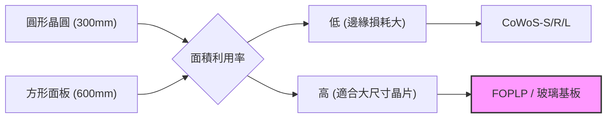

### 38.5.5 產業實例與現況

截至撰寫時，AI 晶片龍頭如 **NVIDIA** 與 **AMD** 的旗艦級 GPU 均高度依賴台積電（TSMC）的 CoWoS 產能。為了緩解供應緊張，封裝委外代工廠（OSAT）如 **日月光 (ASE)**、**安靠 (Amkor)** 亦積極投入 2.5D 封裝領域，開發類似的技術平台（如 FOCoS）。

在基板方面，**Ibiden** 與 **欣興電子 (Unimicron)** 正在研發能承載超過 $100 \text{ mm} \times 100 \text{ mm}$ 封裝體的高階基板，並嘗試導入玻璃核心層以解決有機材料的剛性不足問題。

!!! warning "常見誤解：增加機台即可解決產能瓶頸"
    先進封裝的產能提升並非單純增加機台數量。由於大尺寸封裝涉及極高的系統價值，一旦在最後的封裝階段出現良率損失（如拼接錯誤或基板翹曲），將導致數顆昂貴的邏輯晶粒與 HBM 同時報廢。因此，良率管理（Yield Management）與製程穩定性（Process Stability）的提升，其重要性不亞於產線規模的擴張。

## 38.6 設備與廠商技術

在 2.5D 封裝技術中，由於需要在矽中介層（Silicon Interposer）上實現極高密度的互連，其製程要求已由傳統的後段封裝（OSAT）等級提升至接近前段晶圓製造（Front-end）的精度。這不僅帶動了微影、蝕刻與薄膜設備的升級，更催生了針對高深寬比矽穿孔（TSV）與微凸塊（Micro-bump）接合的專用設備需求。

### 38.6.1 關鍵設備類型與技術特點

2.5D 封裝製程可分為中介層製造（Interposer Fabrication）與晶片堆疊（Chip Stacking）兩大階段，每一階段對設備的子系統皆有特殊要求。

#### 1. 高精度微影與重佈線層 (RDL) 設備
在 2.5D 封裝中，RDL 的線寬與線距（L/S）通常需達到 $1.5\,\mu\text{m} / 1.5\,\mu\text{m}$ 甚至更小，以支撐 HBM（High Bandwidth Memory）與 SoC 之間龐大的數據傳輸需求。
*   **關鍵子系統：** 投影物鏡系統需具備大曝光場（Large Field Size），以應對日益增大的封裝尺寸（超過 2 倍光罩尺寸，即 $> 26\,\text{mm} \times 33\,\text{mm}$）。
*   **設備需求：** 採用 ArF 浸潤式微影系統（ArF Immersion）或高精度 i-line 步進式曝光機，以確保多層 RDL 之間的疊對（Overlay）精度。

#### 2. 化學機械研磨 (CMP) 設備
CMP 在 2.5D 封裝中扮演雙重角色：一是中介層正面的多層金屬化平坦化；二是背面研磨以顯露 TSV（TSV Reveal）。
*   **技術挑戰：** 在 TSV 顯露製程中，必須精確控制矽襯底的移除量，避免對銅柱造成過大的應力。
*   **物理原理：** 研磨速率（Removal Rate, $R$）遵循普萊斯頓方程式（Preston's Equation）：

    $$R = k \cdot P \cdot V$$

    其中 $k$ 為比例常數（與漿料、墊片特性有關），$P$ 為施加壓力，$V$ 為相對速度。在封裝製程中，設備需具備極佳的壓力均勻性補償功能。

#### 3. 高精度覆晶接合機 (Flip-chip Bonder)
2.5D 封裝的核心在於將多顆晶粒精準地放置於中介層上。
*   **關鍵指標：** 放置精度（Placement Accuracy）需達到 $\pm 1\,\mu\text{m}$ 甚至更低。
*   **子系統：** 具備高解析度視覺對位系統與動態壓力控制，以確保數萬個微凸塊在熱壓接合（TCB, Thermal Compression Bonding）過程中均勻受力。

#### 4. 檢測與量測設備
由於 2.5D 封裝結構複雜，傳統的光學檢測已不足夠，需結合多種物理原理。
*   **自動光學檢測 (AOI)：** 用於 RDL 圖案缺陷與微凸塊高度量測。
*   **X-Ray 檢測：** 利用 X 光穿透特性，檢查封裝內部的微凸塊是否存在橋接（Bridging）或空洞（Void）。
*   **疊對量測：** 監控多層 RDL 與 TSV 之間的對準狀況。

---

### 38.6.2 主要設備廠商與技術路線比較

下表列出截至撰寫時，在 2.5D 與先進封裝領域具代表性的設備供應商及其技術定位：

| 廠商 | 代表產品系列 | 技術路線與特點 | 主要應用 |
| :--- | :--- | :--- | :--- |
| **ASML** | TWINSCAN NXT 系列 | ArF 浸潤式微影，具備極高產出與疊對精度 | 高密度 RDL 與中介層圖案化 |
| **Applied Materials** | Endura 平台系列 | PVD 金屬化，提供優異的阻障層與種子層覆蓋率 | TSV 與 RDL 金屬化製程 |
| **Applied Materials** | Reflexion LK Prime | 多研磨頭 CMP 系統，具備即時終點偵測技術 | 中介層平坦化與 TSV 顯露 |
| **Lam Research** | SABRE 系列 | 電化學沉積（ECD），針對高深寬比孔洞優化 | TSV 銅填充與微凸塊電鍍 |
| **Lam Research** | Syndion 系列 | 深矽蝕刻（Deep Reactive Ion Etching, DRIE） | 高深寬比 TSV 孔洞成型 |
| **Tokyo Electron** | CLEAN TRACK LITHIUS Pro Z | 高均勻性塗佈與顯影，支援厚膜光阻 | 先進封裝微影前/後處理 |
| **KLA** | 29xx / 39xx 系列 | 寬頻電漿光學檢測，捕捉微細圖案缺陷 | RDL 與晶圓級封裝缺陷檢測 |
| **KLA** | Archer 系列 | 影像式疊對量測，支援多層堆疊對準監控 | 2.5D/3D 堆疊對準控制 |
| **Besi** | Datacon 8800 CHAMEO 系列 | 高精度接合技術，支援熱壓接合與混合鍵合 | AI 晶片與 HBM 堆疊接合 |
| **DISCO** | DFG 系列研磨機 | 超薄晶圓研磨與應力消除技術 | 減薄晶圓處理與 TSV 顯露前處理 |

---

### 38.6.3 產業實例：主流 2.5D 技術路徑

各家半導體領導廠商根據其產品需求與成本考量，發展出不同的 2.5D 封裝路徑。

#### 1. 台積電 (TSMC)：CoWoS 平台
台積電的 CoWoS（Chip on Wafer on Substrate）是目前 AI 加速器最廣泛採用的平台。
*   **CoWoS-S (Silicon Interposer)：** 採用矽中介層，提供最高的佈線密度。截至撰寫時，其技術已能支持超過 3 倍光罩尺寸的中介層，容納多顆 SoC 與 8 顆以上的 HBM。
*   **CoWoS-R (Organic RDL)：** 以有機材料取代矽中介層，利用多層重佈線層實現互連，旨在降低成本並改善電性表現（降低寄生電容）。
*   **CoWoS-L (Local Silicon Bridge)：** 結合了有機基板與微小的矽橋（Silicon Bridge），僅在需要高密度互連的區域（如 SoC 與 HBM 之間）埋入矽橋，兼顧成本與效能。

#### 2. Intel：EMIB 技術
Intel 的 EMIB（Embedded Multi-die Interconnect Bridge）採取了與 CoWoS-S 截然不同的路徑。
*   **技術原理：** 不使用大面積的矽中介層，而是將微小的矽橋直接嵌入在有機封裝基板（Package Substrate）中。
*   **優勢：** 避免了大面積矽中介層的良率損失與成本，且無需製作穿透整個矽層的 TSV，減少了訊號傳輸路徑。

#### 3. 日月光 (ASE)：FOCoS 與 FOPoP
作為全球領先的 OSAT 廠商，日月光開發了 FOCoS（Fan-out Chip on Substrate）技術。
*   **技術特點：** 利用扇出型（Fan-out）技術建立重新分佈層，將多個晶粒整合。FOCoS-S 採用矽中介層，而 FOCoS-R 則採用扇出型 RDL 結構，不需矽中介層即可達成類似 2.5D 的互連密度。

#### 4. Amkor：2.5D 技術路徑
Amkor 提供的 2.5D 解決方案主要集中於利用矽中介層（Silicon Interposer）將高效能運算晶片與 HBM 整合，並與晶圓廠緊密合作，承接晶圓級封裝後的組裝與測試業務。

---

### 38.6.4 製程選擇與設備考量

晶圓廠或封裝廠在選擇 2.5D 設備時，主要考量以下三點：

1.  **翹曲控制（Warpage Control）：** 2.5D 封裝涉及多種材料（矽、聚醯亞胺、環氧樹脂、銅、陶瓷基板），其熱膨脹係數（CTE）差異極大。設備（如熱壓接合機、加熱爐）必須具備精確的溫度曲線控制，以防止晶圓在製程中因翹曲導致開裂或對準失效。
2.  **薄晶圓處理（Thin Wafer Handling）：** 中介層在背面研磨後厚度通常僅剩 $50\,\mu\text{m}$ 至 $100\,\mu\text{m}$，設備需支援暫時性鍵合（Temporary Bonding）與解鍵合（Debonding）技術，利用承載晶圓（Carrier Wafer）支撐薄晶圓。
3.  **產出率與成本（CoO, Cost of Ownership）：** 2.5D 封裝步驟繁瑣，微影與電鍍時間長。提升設備的產出率（Throughput）並降低耗材成本（如 CMP 漿料、電鍍液）是量產化的關鍵。

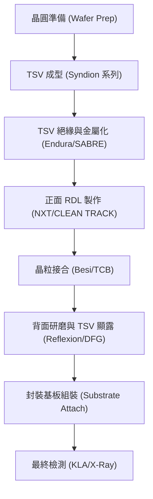

!!! note "技術趨勢"
    隨著 AI 晶片效能需求持續攀升，中介層的尺寸已接近封裝基板的極限。截至撰寫時，業界正積極研發將光學互連（Optical Interconnect）整合至 2.5D 平台中，這將對現有的微影與接合設備提出更高的對準精度要求。

!!! warning "常見誤解"
    讀者常認為 2.5D 封裝僅是將晶片排在一起。事實上，其核心難度在於矽中介層內的 TSV 製造與多層高密度 RDL 的良率控制。任何一個微小的顆粒污染或微凸塊接合不良，都會導致整顆高價值的 AI 加速器報廢，這也是為何檢測設備（如 KLA 39xx 系列）在先進封裝線中重要性不亞於前段製程的原因。

## 本章重點

*   **異質整合與超越摩爾定律**：2.5D 封裝透過將不同功能的晶粒（如運算核心與記憶體）整合在單一封裝體內，突破了單一晶片的光罩極限（Reticle Limit）並解決了良率隨面積增加而劇降的問題。
*   **克服記憶體牆**：藉由高頻寬記憶體（HBM）與矽中介層的超短距離互連，2.5D 封裝顯著提升了數據傳輸頻寬並降低功耗，有效解決處理器與記憶體間的效能瓶頸。
*   **矽中介層與高密度 RDL**：矽中介層利用半導體前段製程技術，實現了亞微米級（典型值 $0.4\,\mu m$）的線寬線距（L/S），並透過矽穿孔（TSV）提供垂直導通，是實現高密度互連的核心。
*   **CoWoS 技術架構演進**：CoWoS-S（矽中介層）提供最高佈線密度；CoWoS-R（有機 RDL）具備成本與應力緩衝優勢；CoWoS-L（區域矽橋）則結合兩者優點，支援超大尺寸封裝。
*   **熱機械應力管理**：由於矽晶粒、中介層與有機基板間的熱膨脹係數（CTE）不匹配，翹曲（Warpage）控制成為製程中的最大物理挑戰，需透過低應力材料與對稱設計優化。
*   **關鍵製程技術**：包含晶片對晶圓（CoW）的熱壓接合（TCB）、暫時性鍵合與解鍵合（TBDB）、以及確保薄晶圓完整性的 TSV 顯露製程（TSV Reveal）。
*   **產能與基板瓶頸**：光罩拼接技術（Stitching）與大面積 ABF 基板的良率是目前高效能運算晶片量產的主要限制，未來正朝向面板級封裝（PLP）與玻璃基板發展。

## 重點圖卡

複習時看這幾張就能抓住本章重點；[圖卡庫](../cards.md)可以下載成圖片。

<figure markdown>
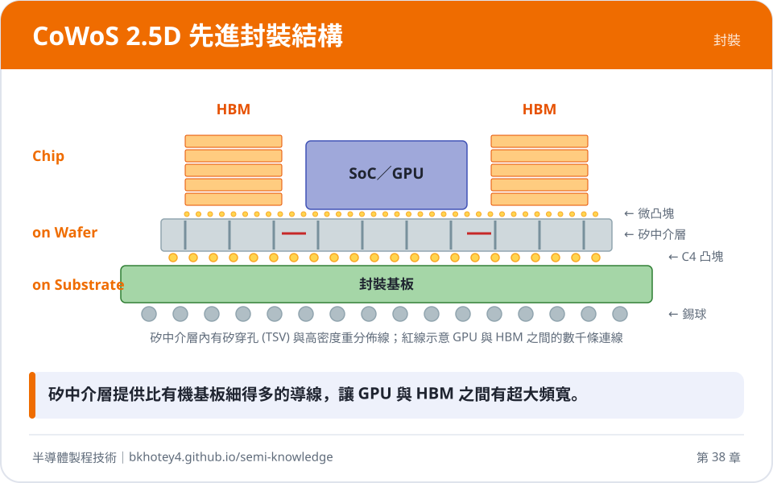
<figcaption>核心概念圖卡：CoWoS 2.5D 先進封裝結構</figcaption>
</figure>

<figure markdown>
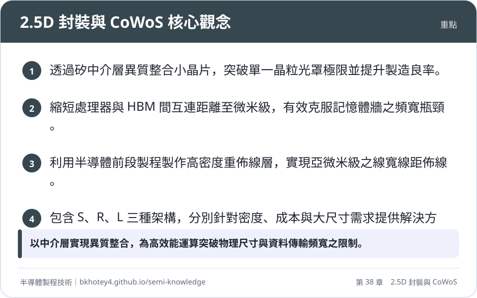
<figcaption>重點圖卡：2.5D 封裝與 CoWoS 核心觀念</figcaption>
</figure>

<figure markdown>
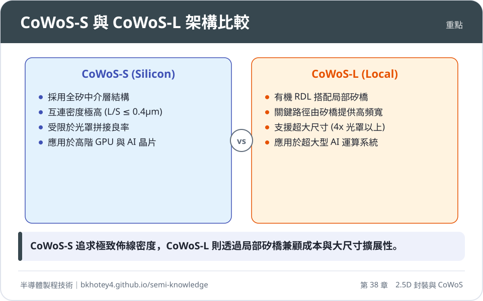
<figcaption>重點圖卡：CoWoS-S 與 CoWoS-L 架構比較</figcaption>
</figure>

<figure markdown>
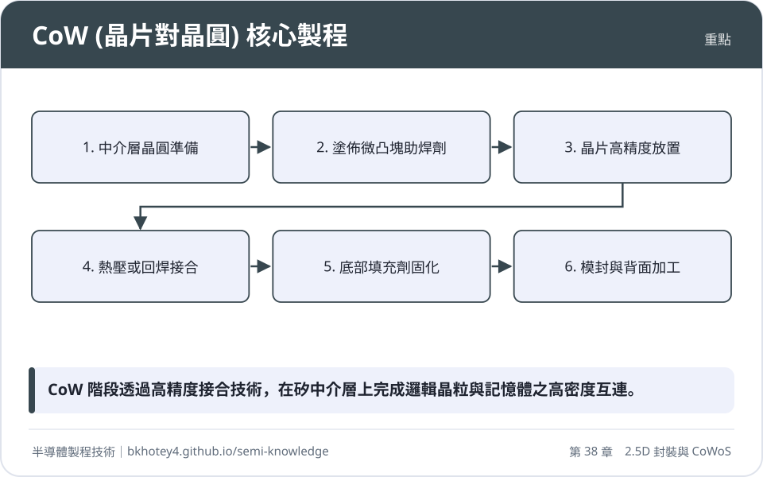
<figcaption>重點圖卡：CoW (晶片對晶圓) 核心製程</figcaption>
</figure>

<figure markdown>
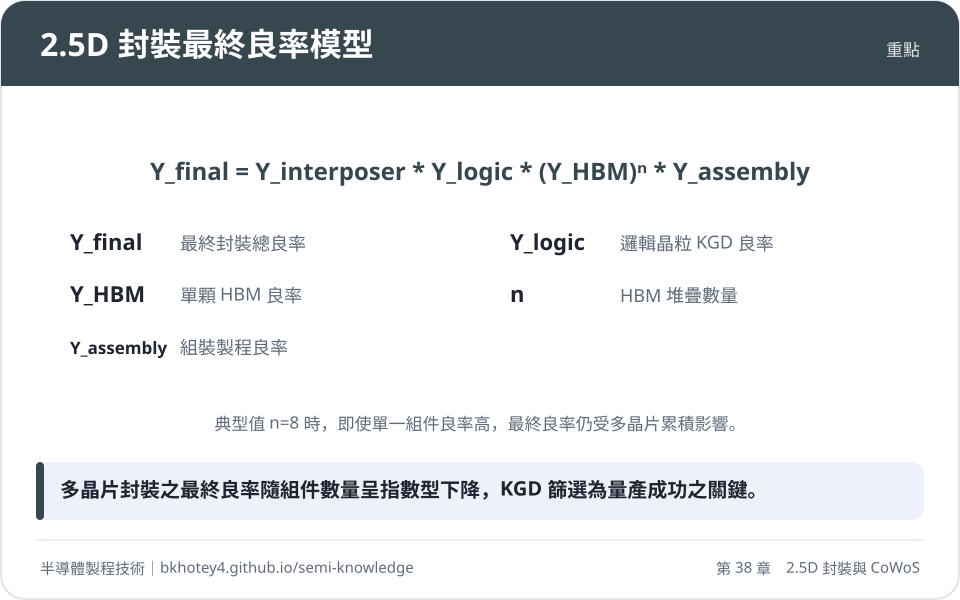
<figcaption>重點圖卡：2.5D 封裝最終良率模型</figcaption>
</figure>

## 習題

**1.** 試說明為何 AI 加速器需要採用 2.5D 封裝而非傳統的 Flip-Chip 封裝？請由光罩極限（Reticle Limit）與記憶體頻寬兩方面論述。

??? success "參考解答"
    1. **突破光罩極限**：主流曝光機的單次曝光場域約為 $26 \text{ mm} \times 33 \text{ mm}$。頂級 AI 晶片所需的電晶體數量對應面積常超出此限制，透過 2.5D 封裝可將多個小晶片（Chiplet）拼接，實現超大面積系統。
    2. **解決記憶體牆**：傳統封裝中處理器與 DRAM 透過 PCB 連接，距離長且 I/O 密度低。2.5D 封裝利用中介層的高密度 RDL 連接 HBM，將傳輸距離縮短至公釐級，頻寬可提升數十倍並降低傳輸功耗。

**2.** 假設一項 AI 晶片設計包含 1 顆邏輯晶粒與 8 顆 HBM 記憶體。若邏輯晶粒的已知合格晶粒（KGD）良率為 95%，每顆 HBM 的 KGD 良率為 98%，封裝組裝製程良率為 99%。試計算該 2.5D 封裝產品的最終總良率（假設各組件良率相互獨立）。

??? success "參考解答"
    最終總良率 $Y_{final}$ 遵循乘法法則：
    $Y_{final} = Y_{logic} \times (Y_{HBM})^n \times Y_{assembly}$
    $Y_{final} = 0.95 \times (0.98)^8 \times 0.99$
    $Y_{final} \approx 0.95 \times 0.8507 \times 0.99 \approx 0.8001$
    最終總良率約為 80.01%。此結果說明了在多晶片封裝中，提升單一組件 KGD 良率的重要性。

**3.** 比較 CoWoS-S 與 CoWoS-L 在技術結構上的差異，並說明為何 CoWoS-L 較容易實現超大尺寸（如 4 倍光罩面積）的封裝？

??? success "參考解答"
    1. **結構差異**：CoWoS-S 使用一整片連續的矽中介層；CoWoS-L 則是在有機 RDL 中介層中，僅在晶粒交界處嵌入微小的局部矽橋（Silicon Bridge）。
    2. **大尺寸優勢**：CoWoS-S 受限於整片矽中介層的良率與光罩拼接的複雜度，面積越大良率越低。CoWoS-L 的主體是有機材料，僅關鍵互連處使用矽橋，能有效避開大面積矽中介層的成本與應力問題，且有機基板較易擴展至大尺寸。

**4.** 一個封裝結構由矽晶粒（$\alpha_1 = 2.6 \, ppm/^\circ C$）與有機基板（$\alpha_2 = 17 \, ppm/^\circ C$）組成。若製程溫度從 $250^\circ C$（回焊峰值）冷卻至 $25^\circ C$（室溫），試計算兩者間的熱應變差（Thermal Strain Difference）。

??? success "參考解答"
    熱應變差 $\Delta \epsilon = (\alpha_2 - \alpha_1) \times \Delta T$
    其中 $\Delta T = 250 - 25 = 225^\circ C$
    $\Delta \epsilon = (17 - 2.6) \times 10^{-6} \times 225$
    $\Delta \epsilon = 14.4 \times 10^{-6} \times 225 = 3240 \times 10^{-6} = 0.324\%$
    此應變差是導致封裝翹曲與微凸塊應力集中的主要物理來源。

## 本章術語

- **2.5D Packaging**（2.5D 封裝）：在基板與晶粒間插入中介層，實現高密度異質整合的封裝技術。
- **CoWoS**（Chip-on-Wafer-on-Substrate）：台積電開發的先進封裝平台，將晶粒整合於晶圓級中介層後再封裝於基板上。
- **Silicon Interposer**（矽中介層）：利用矽製程製作，具備高密度佈線與 TSV 的被動或主動接合層。
- **RDL**（Redistribution Layer，重佈線層）：用於重新排列晶片 I/O 點位，實現晶片間互連的金屬導線層。
- **TSV**（Through-Silicon Via，矽穿孔）：穿透矽基板的垂直導通孔，提供中介層正面與背面的電性連接。
- **HBM**（High Bandwidth Memory，高頻寬記憶體）：透過 3D 堆疊與 2.5D 封裝實現的超高頻寬 DRAM 結構。
- **Reticle Limit**（光罩極限）：微影設備單次曝光的最大場域面積，典型值約為 $858 \text{ mm}^2$。
- **Micro-bump**（微凸塊）：用於晶粒與中介層連接的微細焊球，間距典型值為 $20\text{--}40 \mu m$。
- **CTE**（Coefficient of Thermal Expansion，熱膨脹係數）：材料隨溫度變化而伸縮的比例常數。
- **TCB**（Thermal Compression Bonding，熱壓接合）：利用熱與壓力同時作用，實現細間距凸塊接合的製程。
- **ABF**（Ajinomoto Build-up Film，味之素堆積膜）：高效能運算晶片封裝基板中常用的絕緣介電材料。
- **Stitching**（拼接）：在微影製程中將多個曝光場域精確銜接，以製造大於光罩極限之圖案的技術。

## 互動學習

## 產業最新進展

本節由每日產業新聞自動補充，說明本章技術在產業上的最新發展。

<!-- updates -->
- **2026-11-23**　伺服器處理器逐漸轉向類CoWoS等先進封裝技術，這與2.5D封裝中的中介層與晶片互連架構高度相關，能有效提升高階運算晶片的整合密度與傳輸效率。（來源：[伺服器CPU轉向類CoWoS 日月光與矽品產能2027首超Amkor - DIGITIMES](https://news.google.com/rss/articles/CBMia0FVX3lxTE94SVhFVGtUaHI4S3FZclBoOXZhaXY4QVpYWUpnX3Z4RnZYcEFLSEliYXdtdVdGVHVKNUJYRnZ1SHJ5ZHg3TTBCRzhBOFZQVkRmNndXRTFSZW5jUjRhTEhSU2xrLWY4MmMtbTJV?oc=5)）
- **2026-11-21**　微軟 Azure 自研晶片導入英特爾 EMIB 先進封裝技術。這體現了 2.5D 封裝中利用矽橋（silicon bridge）達成高密度晶粒間互連的實務應用。（來源：[微軟Azure自研晶片首度導入Intel EMIB先進封裝！雙方簽署多年期協議 - Mashdigi](https://news.google.com/rss/articles/CBMiekFVX3lxTE1ELXBic3JlVm1pQzdsTHNqb3VxYk1YU3ZOOGdsQy12MXFOWjhiNms4dTFoMDhkRFhoSVM1QlVZa1FBY2g4RWdRa2ljUm1NUjd4ZmhwMlZYVmExdF9DTjQ2NDMtbHZQY1B3LWdZNl95eThXU2t1U0I4Vy13?oc=5)）
- **2026-11-14**　精材董事會通過產能外包協議以切入 CoWoS 供應鏈。此一製程進展對應至先進封裝領域中的 2.5D 封裝與中介層技術，透過異質整合擴大高階運算晶片的頻寬與效能。（來源：[台積擴大委外 精材搶進CoWoS - 工商時報](https://news.google.com/rss/articles/CBMiX0FVX3lxTE1ZRFdxUXh0QmxDZEtzb01naThfTEoxdFhzaGVlU09ZRnVwQ2lTNFZwSTh2VERKX1gwRXdBOTA0dDJ2Y2Y1b0hTLVVyMG1WR200Zmp5NEtya2tLaE5kZDlZ?oc=5)）
- **2026-10-30**　人工智慧運算晶片對算力的極致追求使得晶片尺寸超越單一曝光視場限制，必須依賴 2.5D 封裝與中介層技術來整合多個小晶片。本則新聞探討先進封裝技術在解決晶片互連與封裝體積受限問題上的核心地位，對應多晶片系統整合與 CoWoS 製程原理。（來源：[一塊基板決定算力生死：先進封裝悄悄綁架AI產業 晶片做得出卻「裝不下」怎麼辦？ - 鉅亨網](https://news.google.com/rss/articles/CBMiS0FVX3lxTE1WeFUxZk9JNVBJampBRjFzQU9YUFlmRGNwNWpuWjJ0NG4yc0xPSHAtMEppMTN1cWtRVjMtbndydjV5MnE3b3AySVFSMA?oc=5)）
- **2026-10-27**　隨著人工智慧晶片對高效能運算的需求增加，先進封裝中的高精度銲線與晶片鍵合設備需求顯著成長。這與多晶片模組及2.5D封裝製程中的高密度互連與設備產能分配息息相關。（來源：[Besi先進封裝接單年增96%，部分交貨排至2027上半年 - 優分析UAnalyze](https://news.google.com/rss/articles/CBMiVkFVX3lxTE1hWTQ3MWVzM3lrR3kwYkt4Mlo2TnR5VGdadlRqbEREd3p0UHVpRHl3S2pmVmVhMDFodEJuYWRpaXVOSmx5T1M2NDR3Z3owTmNGSnFNZXNR?oc=5)）
