# 第 39 章　3D 堆疊、TSV 與混合鍵合

!!! abstract "學習目標"
    - 理解從 2.5D 封裝演進至 3D 垂直整合的物理驅動力與互連密度需求
    - 掌握矽穿孔 (TSV) 的關鍵製程步驟，包含深蝕刻、絕緣層沉積與銅填孔技術
    - 分析微凸塊與熱壓鍵合的物理限制，以及混合鍵合 (Hybrid Bonding) 如何突破間距縮減瓶頸
    - 探討晶圓對晶圓 (W2W) 與晶粒對晶圓 (C2W) 鍵合的技術差異與應用場景

## 39.1 3D 整合的演進與系統整合晶片 (SoIC) 概念

#### 39.1.1 摩爾定律的物理極限與互連線瓶頸

在半導體發展的前四十年中，微縮定律（Scaling Law，見第 5 章）主要聚焦於電晶體特徵尺寸的縮小。然而，隨著製程節點進入深次微米（Deep Sub-micron）乃至個位數奈米等級，單純依賴二維平面上的幾何微縮已面臨嚴峻的物理與經濟挑戰。

首先是互連線延遲（RC Delay）問題。在積體電路中，訊號傳輸速度受到互連線電阻（Resistance, $R$）與寄生電容（Capacitance, $C$）乘積的限制。互連線延遲 $\tau$ 可簡化表示為：

$$\tau \approx R \cdot C = \left( \rho \frac{L}{W \cdot H} \right) \cdot \left( \epsilon \frac{L \cdot H}{S} \right) = \rho \epsilon \frac{L^2}{W \cdot S}$$

其中：
- $\rho$ 為導體電阻率（Resistivity）。
- $\epsilon$ 為層間絕緣介電質的介電常數（Permittivity）。
- $L$ 為導線長度。
- $W$ 與 $H$ 分別為導線的寬度與高度。
- $S$ 為導線間的間距（Spacing）。

隨著製程微縮，$W$ 與 $S$ 持續減小，導致單位長度的電阻與電容急劇上升。儘管導入了銅雙鑲嵌製程（第 29 章）與低介電常數材料（Low-k，第 30 章），但在二維平面架構下，為了連接晶片內數十億個電晶體，導線的總長度 $L$ 仍不斷增加。這使得訊號在晶片內長距離傳輸時，延遲時間與功耗（$P \propto f C V^2$）成為系統效能的主要瓶頸。

其次是「記憶體牆」（Memory Wall）現象。在高效能運算（HPC）架構中，處理器（CPU/GPU）的運算速度提升遠快於外部動態隨機存取記憶體（DRAM）的頻寬增長。傳統封裝技術中，處理器與記憶體之間透過印刷電路板（PCB）或封裝基板連接，其互連密度受限於銲球間距（Ball Pitch），導致資料傳輸的延遲高且能效比（Energy per Bit）低下。

#### 39.1.2 從橫向整合 (2.5D) 邁向縱向整合 (3D)

為了克服上述瓶頸，產業發展出從二維（2D）轉向三維（3D）的整合技術。其演進路徑可分為以下階段：

1.  **2.5D 整合（中介層架構）**：
    如第 38 章所述，2.5D 技術（如 CoWoS）利用矽中介層（Silicon Interposer）作為通訊橋樑，將多個晶粒（Die）並排排列。雖然縮短了晶粒間的距離並提升了互連密度，但訊號本質上仍是在水平方向傳輸，且受限於中介層的面積成本與光罩尺寸限制（Reticle Limit）。

2.  **3.5D 與 3D 堆疊**：
    為了進一步縮短訊號路徑，將晶粒在垂直方向（Z軸）直接堆疊成為必然趨勢。透過垂直互連，訊號傳輸距離從毫米（mm）級縮短至微米（$\mu m$）級，大幅降低了 $L$ 值，進而減少 RC 延遲與驅動功耗。

以下為 2D、2.5D 與 3D 整合在物理特性的對比：

| 特性 | 2D (PCB/基板) | 2.5D (矽中介層) | 3D (垂直堆疊) |
| :--- | :--- | :--- | :--- |
| 互連長度 (典型值) | 10 mm - 100 mm | 1 mm - 10 mm | 0.01 mm - 0.1 mm |
| 互連密度 (I/O 數量) | 低 | 中 | 極高 |
| 訊號延遲 | 高 | 中 | 極低 |
| 單位位元功耗 | 高 (10-20 pJ/bit) | 中 (1-5 pJ/bit) | 低 (< 0.5 pJ/bit) |

#### 39.1.3 系統整合晶片 (SoIC) 的定義與架構

系統整合晶片（System on Integrated Chips, SoIC）代表了 3D 整合技術從「後段封裝」向「前段製程」融合的關鍵轉折。截至撰寫時，SoIC 被定義為一種基於前段製程設備所實現的「無凸塊」（Bumpless）鍵合技術。

傳統的 3D 堆疊（如 HBM，見第 40 章）多採用微凸塊（Micro-bump）進行連接。然而，微凸塊存在以下物理限制：
- **尺寸縮放受限**：受限於銲錫（Solder）在回流焊過程中的橋接（Bridging）風險，微凸塊間距（Pitch）難以縮減至 10 $\mu m$ 以下。
- **寄生效應**：凸塊本身具有一定的電感與電容，會影響高頻訊號完整性。
- **熱阻抗**：凸塊間的填充膠（Underfill）導熱性差，不利於高功耗晶片的散熱。

SoIC 技術的核心在於採用**混合鍵合（Hybrid Bonding）**。這種技術不使用任何銲錫凸塊，而是直接將兩片晶圓（Wafer-to-Wafer）或晶粒與晶圓（Chip-to-Wafer）的銅金屬接觸面與介電質表面進行原子級的結合。

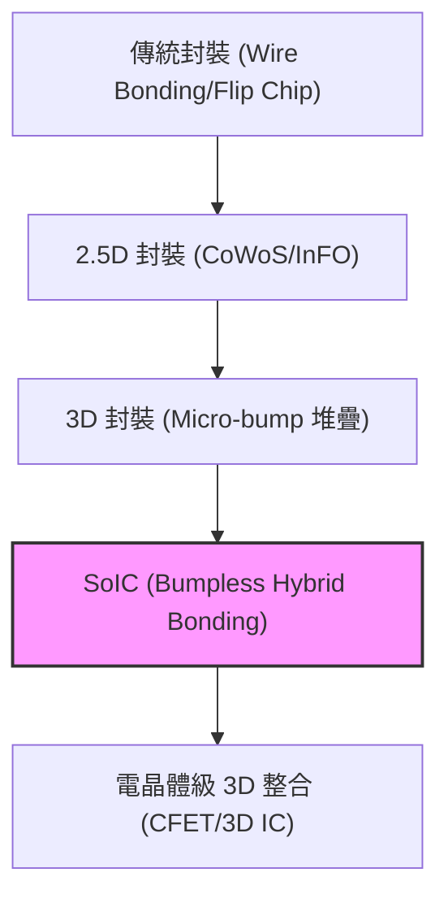

!!! note "SoIC 與 SoC 的區別"
    傳統系統單晶片（System on Chip, SoC）是在單一矽晶粒上整合所有功能模組（如 CPU、GPU、I/O）。然而，隨著製程微縮，類比電路與 I/O 電路在先進節點下的縮放效益極低。SoIC 允許將系統拆分為多個「小晶片」（Chiplets），例如將運算核心採用 2nm 製程，而將快取記憶體或 I/O 採用 5nm 或 7nm 製程，再透過 SoIC 技術垂直整合。這在物理意義上實現了接近 SoC 的電路特性，卻擁有更高的良率與設計靈活性。

#### 39.1.4 3D 整合中的電晶體級互連

SoIC 技術將互連密度提升到了「電晶體級」（Transistor-level Interconnect）。在傳統翻轉晶片（Flip Chip）中，每平方毫米（$mm^2$）的連接點數量約為數百個；在 2.5D 封裝中約為數千個；而 SoIC 透過混合鍵合，其連接密度可達到每平方毫米數萬甚至數百萬個。

這種極高密度的互連能力，使得設計者可以將電路分割得更細。例如：
- **邏輯對邏輯（Logic on Logic）**：將處理器的不同流水線階段（Pipeline Stages）堆疊在不同層，極大化運算密度。
- **記憶體對邏輯（Memory on Logic）**：將 SRAM 快取記憶體直接堆疊在運算核心上方，實現極低延遲的資料存取。

!!! example "產業實例"
    截至撰寫時，高效能運算處理器已廣泛採用 3D 堆疊技術來擴充 L3 快取記憶體（L3 Cache）。透過將一片 7nm 或 5nm 的 SRAM 晶粒以無凸塊鍵合方式堆疊在邏輯運算晶粒之上，可在不增加晶片平面面積的前提下，將快取容量提升數倍，這對於人工智慧（AI）的大語言模型推理任務至關重要。

#### 39.1.5 截至撰寫時的產業現況與關鍵地位

截至 2026 年底，3D 堆疊與 SoIC 技術已成為高效能運算（HPC）與人工智慧加速器不可或缺的基石。隨著微縮節點進入 2 奈米以下，單一晶片的面積已接近光罩極限（約 $858 mm^2$），且先進製程的晶圓成本呈指數級成長。

SoIC 技術的關鍵地位體現在以下三個維度：

1.  **異質整合（Heterogeneous Integration）**：
    不同功能的電路對製程要求不同。邏輯電路需要極速開關，記憶體需要低漏電，而電源管理與類比電路則需要高電壓耐受性。3D 堆疊允許這些採用不同最佳化製程的晶粒，在垂直維度上實現緊密整合。

2.  **散熱與電源傳輸挑戰**：
    雖然 3D 堆疊縮短了路徑，但也帶來了熱密度（Heat Density）倍增的問題。這促使了「晶背供電網路」（Backside PDN，見第 32 章）與 3D 整合的結合。透過矽穿孔（TSV）從背面供電，正面則專注於訊號傳輸與晶粒間的混合鍵合。

3.  **封裝與前段製程的模糊化**：
    SoIC 製程要求在無塵室等級（Class 1）的環境下進行，其對平坦度（CMP，見第 24 章）與對準精度（Alignment）的要求已達到微影設備的等級。這使得傳統封裝廠與晶圓代工廠的界線日益模糊，形成所謂的「前段封裝」（Front-end Packaging）領域。

在後續小節中，我們將詳細探討實現這些 3D 結構的核心製程技術，包括如何鑽出垂直通道的矽穿孔（TSV）、如何處理極細微的微凸塊，以及如何達成原子級接觸的混合鍵合。

## 39.2 矽穿孔 (TSV) 製程與物理挑戰

矽穿孔（Through-Silicon Via, TSV）是實現三維積體電路（3D IC）的核心技術，其物理本質是在矽晶圓上蝕刻出垂直孔洞，並填充導電金屬（通常為銅），使訊號或電力能直接穿透矽基板，達成最短的垂直互連。相較於傳統的打線接合（Wire Bonding）或覆晶封裝（Flip-Chip）的凸塊（Bump），TSV 能顯著降低寄生電感與電阻，提供更高的頻寬與更低的功耗。

### 39.2.1 TSV 製程時序分類：TSV-middle 與 TSV-last

根據 TSV 在整體半導體製造流程中出現的先後順序，主要分為 TSV-first、TSV-middle 與 TSV-last 三種路徑。截至撰寫時，TSV-middle 為高效能運算（HPC）與高頻寬記憶體（HBM）的主流選擇。

1.  **TSV-first**：在電晶體等前段製程（FEOL）完成前即製作 TSV。由於後續 FEOL 需經歷高溫退火（> 1000°C），填充材料無法使用銅，僅能使用多晶矽，這限制了其導電性能，目前應用較少。
2.  **TSV-middle**：在電晶體製作完成（FEOL）、但金屬內連線（BEOL）開始前進行。此流程避開了 FEOL 的極高溫環境，允許使用銅作為填充材料，且能獲得較高的佈線密度。這是目前 AI 晶片與 HBM 堆疊最廣泛採用的技術。
3.  **TSV-last**：在 BEOL 完成後，從晶圓正面或背面進行蝕刻。若從正面蝕刻，需穿過多層層間絕緣膜（ILD），製程複雜度高；若從背面蝕刻，則常用於影像感測器（CIS）或微機電系統（MEMS）。

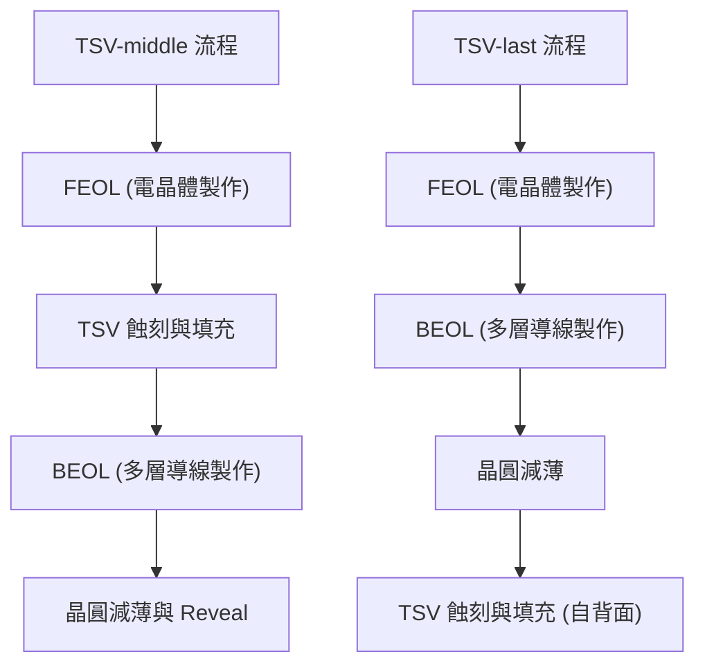

### 39.2.2 深反應離子蝕刻 (DRIE) 與 Bosch 製程

TSV 的孔徑通常在 $1 \mu m$ 至 $10 \mu m$ 之間，深度則視應用而定（典型值為 $50 \mu m$ 至 $100 \mu m$），這意味著必須具備極高的深寬比（Aspect Ratio, AR）。為了在矽基板上蝕刻出垂直度高且深厚的孔洞，工業界普遍採用深反應離子蝕刻（Deep Reactive Ion Etching, DRIE），其中最著名的為 Bosch 製程。

Bosch 製程是一種循環式的蝕刻技術，由以下兩個步驟不斷交替組成：

1.  **蝕刻步驟（Etching Step）**：使用 $SF_6$ 電漿。$SF_6$ 分解產生的氟自由基（F*）與矽反應生成 $SiF_4$ 氣體，達成等向性蝕刻。
2.  **鈍化步驟（Passivation Step）**：使用 $C_4F_8$ 電漿。$C_4F_8$ 會在孔洞表面沉積一層類似聚四氟乙烯（Teflon-like）的氟碳聚合物薄膜，保護側壁不被進一步蝕刻。

在下一次蝕刻循環開始時，由於離子轟擊（Ion Bombardment）具有方向性，孔洞底部的鈍化層會先被擊穿，使蝕刻繼續向深處進行，而側壁因受保護而維持垂直。

!!! warning "常見誤解：扇貝紋（Scalloping）"
    Bosch 製程的循環特性會導致 TSV 側壁出現微小的起伏，稱為「扇貝紋」。若扇貝紋過於劇烈（典型值 > 100 nm），會導致後續絕緣襯墊與阻障層的覆蓋率不佳，進而引發漏電或電鍍空洞。現代製程透過縮短循環時間與精確控制電漿功率，已能將扇貝紋控制在數十奈米以內。

### 39.2.3 絕緣襯墊、阻障層與種子層的沉積

TSV 蝕刻完成後，必須在孔洞內壁依序沉積三層關鍵材料，以確保電氣隔離與可靠性：

1.  **絕緣襯墊（Insulation Liner）**：通常為 $SiO_2$ 或 $SiN_x$。其物理功能是防止 TSV 內的電流洩漏至矽基板。由於 TSV 深寬比極高，傳統的 PECVD 難以達成良好的側壁覆蓋率（Step Coverage），因此高階製程常採用次大氣壓化學氣相沉積（SACVD）或原子層沉積（ALD，見第 23 章）以確保保形性（Conformality）。
2.  **阻障層（Barrier Layer）**：通常使用 $Ta/TaN$ 或 $Ti$。其主要物理作用是防止銅原子擴散進入矽基板（銅在矽中是深能階雜質，會嚴重破壞電晶體性能）。
3.  **種子層（Seed Layer）**：沉積一層薄銅，作為後續電鍍製程的導電電極。

對於高深寬比 TSV，阻障層與種子層通常採用物理氣相沉積（PVD）中的離子化金屬電漿（Ionized Metal Plasma, IMP）技術，透過增加離子的方向性來提升孔底沉積率。

### 39.2.4 電鍍銅填孔（Copper Filling）與物理挑戰

TSV 的金屬化主要透過電鍍（Electroplating）完成。與標準雙鑲嵌製程（見第 29 章）不同，TSV 的體積巨大，若採用一般的電鍍方式，孔口會因離子濃度高而先封閉，導致內部形成巨大的空洞（Void）。

為了達成「由下而上」（Bottom-up）的超填充（Superfilling），電鍍液中需加入精密的化學添加劑：
*   **抑制劑（Suppressor）**：大分子聚合物，擴散較慢，主要吸附在孔口，抑制該處的鍍層生長。
*   **加速劑（Accelerator）**：小分子，能快速進入孔底，促進銅離子還原。
*   **平坦劑（Leveler）**：控制表面平整度，防止過度生長。

#### 應力管理與銅凸起（Copper Protrusion）
銅與矽的熱膨脹係數（CTE）差異巨大（$CTE_{Cu} \approx 17 \, ppm/^\circ C$, $CTE_{Si} \approx 2.3 \, ppm/^\circ C$）。當製程溫度變動時，TSV 內的銅會產生巨大的熱應力。

$$ \sigma = E \cdot (\alpha_{Cu} - \alpha_{Si}) \cdot \Delta T $$

其中 $\sigma$ 為熱應力，$E$ 為楊氏模數，$\alpha$ 為熱膨脹係數。

在後續的熱製程中，銅會因受熱膨脹而從孔口向上凸起，稱為「銅凸起」。這可能會擠壓並破壞上方的層間絕緣膜（ILD）或金屬線。工業界通常在電鍍後進行高溫退火（Annealing），讓銅在 CMP 之前先完成晶粒成長與應力釋放，以減少後續變形。

### 39.2.5 晶圓減薄與 TSV 顯露（TSV Reveal）

由於 TSV 是從晶圓正面製作，但最終需與背面或其他晶粒連接，因此必須進行晶圓減薄。

1.  **暫時鍵合（Temporary Bonding）**：將完成正面製程的晶圓，透過膠材鍵合至支撐承載板（Carrier Wafer）上。
2.  **背面研磨（Backside Grinding）**：使用機械研磨將矽晶圓減薄至剩餘約 $5 \mu m$ 至 $10 \mu m$ 的矽覆蓋在 TSV 底部。
3.  **TSV 顯露蝕刻（Reveal Etch）**：利用乾式蝕刻（通常為 $SF_6$ 基電漿）有選擇性地移除剩餘的矽，使 TSV 的尖端（Tip）顯露出來。由於矽與 $SiO_2$（襯墊）的蝕刻選擇比很高，此步驟能精確停止在絕緣襯墊上。
4.  **鈍化與平坦化**：在背面沉積鈍化層，並透過 CMP 磨去 TSV 尖端的絕緣層，露出銅導體，準備進行後續的微凸塊製作或混合鍵合。

!!! note "技術指標：TSV 顯露高度"
    顯露高度的均勻性對後續封裝良率至關重要。若顯露高度不一，會導致微凸塊接合不穩定。截至撰寫時，先進製程要求全晶圓範圍內的顯露高度變異需控制在 $0.5 \mu m$ 以內。

### 39.2.6 產業實例：HBM 與邏輯晶片的 TSV 差異

在產業應用中，不同產品對 TSV 的需求各異：
*   **HBM（如 HBM3e/HBM4）**：為了在有限的高度內堆疊 12 或 16 層 DRAM，其 TSV 必須極細且佈線密集，對 DRIE 的側壁控制與電鍍填孔的無空洞要求極高。
*   **邏輯晶片（如 3D SoC）**：TSV 主要用於穿透基板供電（見第 32 章晶背供電網路）或訊號傳遞，其孔徑可能較大，但對應力管理的要求更為嚴苛，以避免影響鄰近的高效能電晶體特性（Keep-out Zone, KOZ）。

!!! example "產業實例：TSMC SoIC 技術中的 TSV"
    在台積電的系統整合晶片（SoIC）技術中，TSV 的縮放（Scaling）是提升整合密度的關鍵。截至撰寫時，透過優化 Bosch 製程與 ALD 襯墊技術，TSV 的間距（Pitch）已能微縮至 $10 \mu m$ 以下，這使得 3D 堆疊晶片間的互連密度較傳統封裝提升了數個數量級。

<!-- fig:1 -->
<figure markdown>
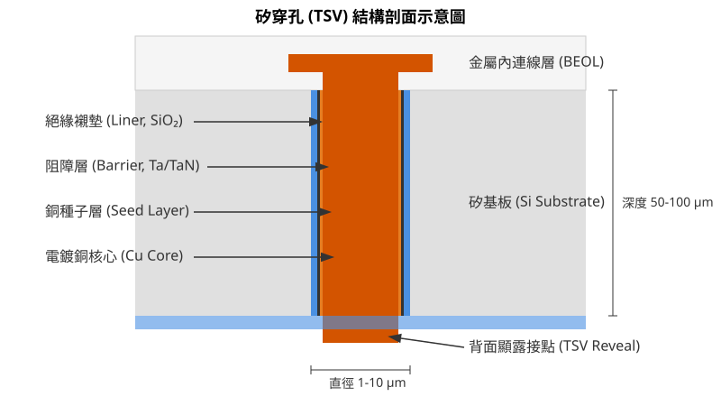
<figcaption>圖 39-1　矽穿孔結構剖面圖（AI 繪製的示意圖）</figcaption>
</figure>

## 39.3 微凸塊與熱壓鍵合 (TCB) 技術

在 3D 整合技術中，微凸塊（Micro-bumps）是實現晶粒垂直互連的核心物理結構，其扮演了電訊號傳輸、機械支撐與散熱路徑的三重角色。隨著封裝密度從 2.5D 演進至 3D 堆疊，傳統的覆晶封裝（Flip Chip）技術因接點間距（Pitch）限制，逐漸由微凸塊技術所取代。

### 微凸塊結構與間距演進

微凸塊是傳統 C4 凸塊（Controlled Collapse Chip Connection）的縮小版，但其結構設計為了因應高密度互連而有所調整。典型的微凸塊結構由下至上包含：底層金屬層（Under Bump Metallurgy, UBM）、銅柱（Copper Pillar）以及銲料蓋（Solder Cap）。

1.  **底層金屬層 (UBM)**：通常由 Ti/Cu 或 TiW/Cu 組成，透過物理氣相沉積（PVD，見第 22 章）形成。其功能是作為電鍍銅的種子層，並防止銲料中的錫（Sn）向矽基板擴散，同時提供良好的機械黏著力。
2.  **銅柱 (Copper Pillar)**：作為微凸塊的主體，提供穩定的導電路徑與結構高度。相較於全銲料凸塊，銅柱在回銲過程中不會熔化，能有效控制鍵合後的間隙高度（Stand-off height），避免相鄰接點橋接（Bridging）。
3.  **銲料蓋 (Solder Cap)**：典型材質為無鉛銲料（如 Sn-Ag 合金）。在鍵合過程中，銲料熔化並與對應的焊墊（Landing Pad）形成金屬鍵結。

在間距演進方面，傳統 C4 凸塊的間距約在 $100\ \mu\text{m}$ 至 $150\ \mu\text{m}$ 之間。進入 3D 堆疊時代，微凸塊的典型間距已縮減至 $20\ \mu\text{m}$ 至 $40\ \mu\text{m}$。截至撰寫時，先進製程節點下的 3D 堆疊技術正朝向 $10\ \mu\text{m}$ 以下的間距邁進，這也促使製程從傳統的微凸塊轉向無凸塊的混合鍵合（見第 39.4 節）。

| 參數項目 | 傳統 C4 凸塊 | 微凸塊 (Micro-bump) | 先進微凸塊 (Fine-pitch) |
| :--- | :--- | :--- | :--- |
| **典型間距 (Pitch)** | $100 - 150\ \mu\text{m}$ | $25 - 50\ \mu\text{m}$ | $10 - 20\ \text{nm}$ |
| **凸塊直徑** | $50 - 80\ \mu\text{m}$ | $15 - 25\ \mu\text{m}$ | $5 - 10\ \mu\text{m}$ |
| **主要材料** | Sn-Ag / Sn-Pb | Cu Pillar + Sn-Ag | Cu Pillar + Thin Solder |
| **鍵合技術** | 大量回銲 (Mass Reflow) | 熱壓鍵合 (TCB) | 熱壓鍵合 (TCB) |

### 熱壓鍵合 (TCB) 原理：壓力與溫度的協同作用

當接點間距縮小至 $40\ \mu\text{m}$ 以下時，傳統的大量回銲（Mass Reflow, MR）製程面臨嚴峻挑戰。MR 依賴表面張力進行自我對準（Self-alignment），但在薄晶粒堆疊中，受熱不均引起的晶圓翹曲（Warpage）會導致接點開路（Non-wet）或短路。

熱壓鍵合（Thermal Compression Bonding, TCB）透過精確控制壓力（Force）與溫度曲線（Temperature Profile），實現高精度的垂直互連。其物理過程可分為以下階段：

1.  **取放與對準 (Pick and Place)**：鍵合頭（Bond Head）吸取晶粒，透過光學系統與下層晶圓或晶粒進行對準。
2.  **接觸與預壓 (Contact and Pre-force)**：鍵合頭下降，使微凸塊與焊墊接觸。此時施加較小的初始壓力，確保所有接點物理接觸。
3.  **快速升溫與熔融 (Ramp-up and Solder Melting)**：鍵合頭在極短時間內（通常小於 5 秒）將溫度提升至銲料熔點（如 Sn-Ag 約 $217^\circ\text{C}$）以上。
4.  **受控受壓 (Controlled Compression)**：在銲料處於液態時，施加精確壓力以控制擠壓變形量，確保金屬間化合物（IMC）的形成並補償晶粒翹曲。
5.  **快速冷卻 (Quenching)**：停止加熱並通入冷卻氣體，使銲料凝固形成堅固的機械與電氣連接。

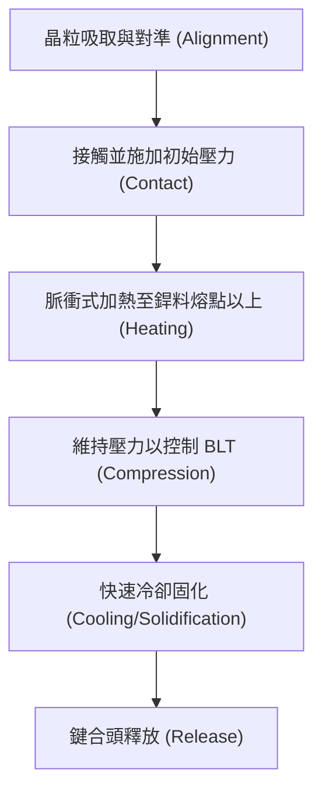

TCB 的關鍵優勢在於「鍵合線厚度」（Bond Line Thickness, BLT）的控制。透過位移感測器，設備可以即時補償熱膨脹，確保 3D 堆疊中每一層的高度一致性，這對於 HBM 等多層堆疊結構至關重要。

### 金屬間化合物 (IMC) 的生長動力學

在微凸塊鍵合介面，銅柱（Cu）與錫基銲料（Sn）會發生擴散反應，形成金屬間化合物（Intermetallic Compounds, IMC）。最常見的相態為 $\text{Cu}_6\text{Sn}_5$（$\eta$-phase）與 $\text{Cu}_3\text{Sn}$（$\epsilon$-phase）。

IMC 的形成是化學鍵合成功的標誌，但過厚的 IMC 層會因其脆性（Brittleness）與高電阻率而損害接點可靠性。其生長厚度 $x$ 通常遵循擴散控制的動力學方程：

$$x(t) = \sqrt{D \cdot t}$$

其中：
- $x$ 為 IMC 層厚度。
- $t$ 為反應時間。
- $D$ 為擴散係數，遵循阿瑞尼斯定律（Arrhenius Law）：

  $$D = D_0 \exp\left( -\frac{Q}{RT} \right)$$

  - $D_0$ 為擴散常數。
  - $Q$ 為擴散活化能。
  - $R$ 為氣體常數。
  - $T$ 為絕對溫度。

!!! warning "常見誤解"
    工程師常認為 IMC 越多越牢固。實際上，隨著熱處理時間增加（如多次重工或後續封裝熱製程），$\text{Cu}_3\text{Sn}$ 層會持續增厚，並可能在介面處產生柯肯多爾孔洞（Kirkendall Voids）。這些微小孔洞會成為應力集中點，導致 3D 晶片在受熱循環（Thermal Cycling）時發生介面斷裂。

### 底部填充膠 (Underfill) 與應力緩衝

在 3D 堆疊結構中，由於矽晶片與有機載板或不同材質間的熱膨脹係數（CTE）失配，微凸塊會承受巨大的剪切應力。底部填充膠（Underfill）的功能即是填充晶粒間隙，將局部應力分散至整個封裝結構。

#### 毛細作用與填充原理
傳統的底部填充製程採用毛細底部填充膠（Capillary Underfill, CUF）。其流動行為遵循 Washburn 方程：

$$L^2 = \frac{\gamma \cdot \cos \theta \cdot h}{3\eta} \cdot t$$

其中：
- $L$ 為流動距離。
- $\gamma$ 為液體表面張力。
- $\theta$ 為接觸角。
- $h$ 為間隙高度（Stand-off height）。
- $\eta$ 為流體黏度。
- $t$ 為填充時間。

隨著間隙 $h$ 縮小至 $10\ \mu\text{m}$ 以下，CUF 的填充效率大幅下降，且容易產生氣泡（Voids）。

#### 非導電膠膜 (NCF) 技術
為了克服窄間隙填充難題，3D 堆疊（如 8 層或 12 層 HBM）普遍採用非導電膠膜（Non-Conductive Film, NCF）。NCF 在晶粒切割前便貼合於晶圓表面。在 TCB 鍵合過程中，鍵合頭的壓力會使微凸塊穿透 NCF，完成金屬接合，同時 NCF 受熱流動並填充間隙。

!!! note "說明"
    NCF 不僅解決了填充問題，還能在鍵合前提供物理保護，防止微凸塊氧化。在 3D 堆疊中，NCF 的厚度精確度直接影響到最終封裝的總厚度（Total Stack Height）。

### 產業實例

截至撰寫時，熱壓鍵合技術已成為高頻寬記憶體（HBM）量產的標準製程。例如，**SK 海力士 (SK hynix)** 與 **三星電子 (Samsung Electronics)** 在其 HBM3e 與 HBM4 產品線中，大量使用 TCB 技術結合 NCF 材料，以實現 12 層甚至 16 層的 DRAM 堆疊。

另一方面，**台積電 (TSMC)** 的 **CoWoS-S** 製程中，系統單晶片（SoC）與 HBM 之間的連接亦依賴微凸塊與 TCB 技術。然而，針對更極致的效能需求，如 **AMD** 的 3D V-Cache 技術，則捨棄了微凸塊與 TCB，轉向採用無銲料的混合鍵合技術（SoIC），這將在後續章節詳細討論。

!!! example "設備廠商技術"
    在 TCB 設備市場中，**ASM Pacific Technology (ASMPT)** 與 **K&S (Kulicke & Soffa)** 是主要的供應商。其機台研發重點在於如何提升鍵合頭的升溫速率（Heating Rate）至每秒 $100^\circ\text{C}$ 以上，並維持微米級的放置精度（Placement Accuracy），以應對日益縮小的微凸塊間距。

## 39.4 混合鍵合 (Hybrid Bonding) 物理原理與介面整合

混合鍵合（Hybrid Bonding）技術是當前 3D 積體電路（3D IC）實現極高密度互連的核心技術。與傳統使用微凸塊（Micro-bump）的倒裝晶片（Flip-chip）封裝不同，混合鍵合在單一介面上同時實現了電介質（Dielectric）對電介質、以及金屬（Metal）對金屬的直接接合，且中間不需任何焊料（Solder）。這種技術將互連間距（Pitch）從微米級推向次微米級，大幅提升了晶片間的頻寬密度與電源效率。

### 39.4.1 混合鍵合的物理機制與結構

混合鍵合的結構通常由銅（Cu）電極與周圍的電介質（如二氧化矽 $SiO_2$ 或碳氮化矽 $SiCN$）組成。其鍵合過程分為兩個主要階段：常溫下的電介質親水性鍵合，以及隨後在高溫退火下的金屬擴散鍵合。

在物理層面上，混合鍵合必須克服兩種性質截然不同的材料介面問題。電介質層提供機械支撐與絕緣隔離，而銅電極則負責電訊號傳輸。為了達成可靠的接合，介面必須極度平整，且銅電極在研磨後需呈現微小的凹陷（Dishing），以補償後續熱處理時的熱膨脹。

### 39.4.2 表面活化與親水性鍵合原理

混合鍵合的第一步是在常溫環境（Room Temperature）下將兩片晶圓或晶粒對準並接觸。此階段的結合力主要來自於電介質表面的氫鍵（Hydrogen Bonding）。

#### 表面活化（Surface Activation）
在鍵合前，電介質表面需經過電漿活化（Plasma Activation）。通常使用氧氣（$O_2$）或氮氣（$N_2$）電漿處理表面，其目的有二：
1. **移除污染物**：清除表面的有機殘留物。
2. **增加矽醇基（Silanol groups, Si-OH）濃度**：電漿處理會破壞表面的化學鍵，使其在後續的去離子水清洗中容易形成高密度的 $-OH$ 基團。

#### 親水性鍵合反應
當兩個活化後的表面接觸時，表面的水分子與矽醇基會形成氫鍵，產生初步的黏附力。隨著溫度略微升高（或在常溫下靜置），會發生脫水縮合反應，將氫鍵轉化為強固的共價鍵：

$$Si-OH + HO-Si \rightarrow Si-O-Si + H_2O$$

產生的水分子會擴散至介面邊緣或被電介質吸收。此階段形成的 $Si-O-Si$ 鍵提供了足夠的機械強度，確保在移動或傳輸過程中晶片不會位移，並為後續的金屬鍵合奠定基礎。

### 39.4.3 退火製程驅動的金屬擴散與熱膨脹

在電介質完成初步鍵合後，必須透過退火（Annealing）製程來實現銅電極的電性連接。典型的退火溫度範圍在 $200^\circ C$ 至 $400^\circ C$ 之間。

#### 熱膨脹補償機制
金屬銅與電介質（如 $SiO_2$）的熱膨脹係數（CTE）存在顯著差異。銅的 CTE 典型值約為 $17 \times 10^{-6} / K$，而 $SiO_2$ 僅約 $0.5 \times 10^{-6} / K$。
當溫度升高時，銅的膨脹程度遠大於電介質。若在常溫下銅表面呈現微小的凹陷（見下文 CMP 節點），受熱膨脹後的銅會向上凸起並填滿間隙，最終與對向的銅電極產生物理接觸。

#### 原子擴散與晶粒成長
一旦銅電極接觸，熱能會驅動銅原子跨越介面進行擴散。根據阿瑞尼斯方程式（Arrhenius Equation），擴散係數 $D$ 隨溫度 $T$ 升高而呈指數增加：

$$D = D_0 \exp\left(-\frac{Q}{kT}\right)$$

其中 $D_0$ 為頻率因子，$Q$ 為擴散活化能，$k$ 為波茲曼常數。在退火過程中，銅原子會發生再結晶，晶界（Grain boundary）會跨越原始的鍵合介面移動，最終使兩個電極融合為一體，消除介面電阻。

!!! note "介面屏障層的重要性"
    為了防止銅原子擴散進入電介質層導致漏電或元件失效（見第 29 章），在混合鍵合的銅電極周圍仍需沉積薄層的擴散屏障（Barrier layer），如氮化鈦（TiN）或鉭/氮化鉭（Ta/TaN）。

### 39.4.4 化學機械研磨（CMP）的極限要求

混合鍵合對表面形貌（Surface Topography）的要求極其嚴苛，是所有半導體製程中最依賴 CMP 技術的環節之一。

#### 表面粗糙度（Roughness）
為了確保原子級的接觸，電介質表面的均方根粗糙度（RMS Roughness, $R_q$）必須控制在 $0.5 \, nm$ 以下。過高的粗糙度會導致介面產生微小氣孔（Voids），進而降低鍵合強度並影響可靠性。

#### 凹陷（Dishing）與凸起（Protrusion）控制
在 CMP 過程中，由於銅與電介質的硬度及研磨率不同，容易在銅電極處產生凹陷（Dishing）。在混合鍵合中，適度的凹陷是必要的，但必須精確控制。
* **過度凹陷**：若 $d_{dish}$ 過大，退火時的熱膨脹不足以讓兩側銅電極接觸，導致開路（Open circuit）。
* **無凹陷或凸起**：若銅電極高於電介質，則在常溫鍵合階段，銅的凸起會阻礙電介質表面的接觸，導致電介質無法形成共價鍵，產生大面積的剝離（Peeling）。

截至撰寫時，工業界對於混合鍵合的 CMP 規範通常要求銅凹陷深度控制在 $2 \, nm$ 至 $5 \, nm$ 的典型範圍內，這對研磨液（Slurry）的選擇比與壓力控制提出了極大挑戰。

### 39.4.5 混合鍵合的優勢：次微米級互連間距

相較於傳統封裝技術，混合鍵合具有以下物理優勢：

1. **極小化間距**：傳統微凸塊受限於焊料橋接（Solder bridging）風險，間距通常限制在 $10 \, \mu m$ 以上。混合鍵合無焊料，截至撰寫時，量產技術已可達成 $1 \, \mu m$ 以下的間距，研發階段甚至朝向 $100 \, nm$ 邁進。
2. **優異的散熱與電性**：由於省去了高電阻的焊料層與金屬間化合物（IMC），且銅電極直接對接，互連電阻與寄生電感大幅降低。
3. **結構高度縮減**：混合鍵合介面幾乎不增加額外高度，有利於多層晶粒（如 16 層或更高層數之 HBM）的垂直堆疊，且不增加封裝總厚度。

### 39.4.6 混合鍵合製程流程圖

下圖展示了從晶圓準備到完成混合鍵合的典型流程：

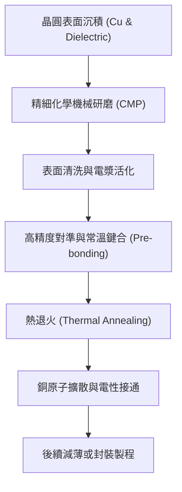

### 39.4.7 介面整合挑戰：SiCN 的引入

隨著互連密度的提升，傳統的 $SiO_2$ 電介質面臨挑戰。截至撰寫時，碳氮化矽（SiCN）已成為混合鍵合中熱門的電介質材料選擇。

* **更高的阻擋性能**：SiCN 對銅原子的阻擋能力優於 $SiO_2$，可進一步縮減屏障層厚度。
* **表面能調控**：SiCN 表面經過活化後能產生更穩定的化學鍵結，提升鍵合能量（Bonding Energy）。
* **熱穩定性**：SiCN 在多次熱循環中展現出更佳的尺寸穩定性，有助於維持次微米級的對準精度。

!!! example "產業實例：SoIC 技術"
    截至撰寫時，台積電（TSMC）推出的 SoIC（System on Integrated Chips）技術即是混合鍵合的代表性應用。該技術區分為晶圓對晶圓（W2W）與晶粒對晶圓（C2W）兩種模式。透過無凸塊（Bumpless）的混合鍵合，SoIC 能夠在極小的面積內整合 SRAM 晶粒與邏輯運算晶粒，其互連密度較傳統 CoWoS（見第 38 章）提升了數倍，且大幅降低了訊號傳輸延遲。

### 39.4.8 混合鍵合的可靠性議題

混合鍵合的可靠性主要取決於介面空洞（Interfacial Voids）的控制。空洞的產生通常源於：
1. **顆粒污染**：即使是數十奈米的微粒，在混合鍵合介面也會造成數百微米直徑的未鍵合區域（Non-bond area）。
2. **排氣（Outgassing）**：電介質層若含有過多有機雜質，在退火時產生的氣體若無法擴散逸出，會聚集在介面形成氣泡。
3. **應力集中**：銅與電介質的 CTE 失配若未能在設計階段妥善模擬，反覆的熱循環可能導致介面微裂紋（Micro-crack）的產生。

因此，混合鍵合製程對環境潔淨度（見第 55 章）與量測技術（見第 33 章）的要求已等同於前段（FEOL）製程。

<!-- fig:2 -->
<figure markdown>
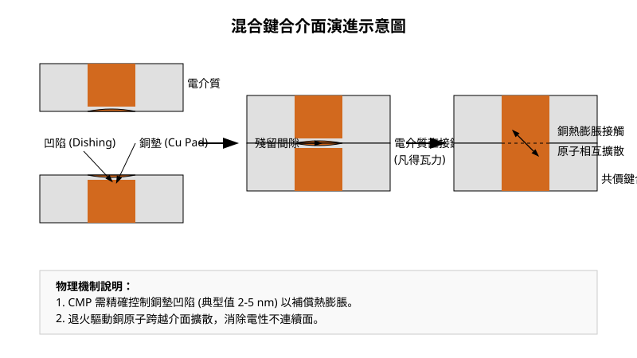
<figcaption>圖 39-2　混合鍵合介面演進圖（AI 繪製的示意圖）</figcaption>
</figure>

## 39.5 晶圓對晶圓 (W2W) 與晶粒對晶圓 (C2W) 鍵合整合

在 3D 整合技術中，將不同的電路層進行物理與電氣連接的策略主要分為「晶圓對晶圓」（Wafer-to-Wafer, W2W）與「晶粒對晶圓」（Die-to-Wafer, C2W）兩大路徑。選擇何種整合方式，取決於產品的良率控制、異質整合需求、互連密度以及生產成本。

### 39.5.1 晶圓對晶圓 (W2W) 鍵合技術

晶圓對晶圓鍵合是指將兩片直徑相同的完整晶圓（通常為 12 吋晶圓）進行對準後直接接合。這種方式在 CMOS 影像感測器（CIS）與 NAND Flash 堆疊中已廣泛應用。

#### 1. 高產出與對準精度
W2W 鍵合的最大優勢在於極高的生產效率（Throughput）。由於成千上萬個互連點是在一次壓合過程中同時完成，其單位時間內的接合數量遠高於單顆晶粒處理。

在對準精度方面，W2W 採用全域對準系統，透過光學對準標記（Alignment Mark）與精密位移台，截至撰寫時，先進設備已能達到小於 50 nm 的對準誤差。這種高精度是實現超高密度混合鍵合（Hybrid Bonding）的關鍵，能支撐間距（Pitch）縮減至 1 $\mu m$ 以下。

#### 2. 晶圓變形與畸變 (Distortion)
儘管 W2W 具有高精度潛力，但其面臨物理上的挑戰是「晶圓畸變」。在鍵合過程中，兩片晶圓可能因應力分佈不均、熱膨脹係數（CTE）不匹配或吸附力不均，產生局部性的位移（Run-out error）。
若設 $A(x, y)$ 為理論對準座標，$A'(x, y)$ 為實際接合座標，其向量差 $\vec{E} = A' - A$ 必須在全晶圓範圍內保持極小值。若畸變過大，邊緣處的晶粒將因互連點偏移而失效。

#### 3. 良率複合效應 (Yield Compounding)
W2W 的主要限制在於「良率損失」。假設底層晶圓良率為 $Y_1$，頂層晶圓良率為 $Y_2$，則鍵合後的總良率 $Y_{total}$ 為：

$$Y_{total} = Y_1 \times Y_2 \times Y_{bonding}$$

其中 $Y_{bonding}$ 為鍵合製程本身的成功率。由於 W2W 無法篩選掉壞掉的晶粒（Bad Die），若其中一片晶圓存在缺陷，對應位置的良品晶粒也會因與不良品接合而報廢。因此，W2W 僅適用於單層良率極高（如 >95%）的成熟製程產品。

### 39.5.2 晶粒對晶圓 (C2W) 鍵合技術

為了克服 W2W 的良率限制並實現異質整合，晶粒對晶圓（C2W）技術成為先進封裝的主流。其流程是先將晶圓切割成獨立晶粒，經過測試篩選出「已知良率晶粒」（Known Good Die, KGD），再將其精確放置於目標晶圓上。

#### 1. 異質整合與 KGD 靈活性
C2W 允許將不同尺寸、不同製程節點（如 3nm 邏輯晶粒與 28nm I/O 晶粒）的元件堆疊在一起。這在系統整合晶片（SoIC）的建構中至關重要。透過僅使用 KGD 進行鍵合，可以顯著提升最終產品的良率，避免浪費昂貴的先進節點晶粒。

#### 2. 拾取與放置 (Pick-and-Place) 的物理挑戰
C2W 的主要瓶頸在於產出速度與精度的權衡。傳統的拾取放置設備依賴機械手臂，對準精度通常在 $\pm 1.0 \mu m$ 左右，這對於微米級的混合鍵合而言緩慢且精確度不足。

為了提升效率，產業發展出「集體鍵合」（Collective Bonding）技術：
1. 將多顆 KGD 先排列在一片暫時性的承載板（Carrier）上。
2. 進行表面活化與清潔。
3. 將整片承載板與目標晶圓進行一次性鍵合。

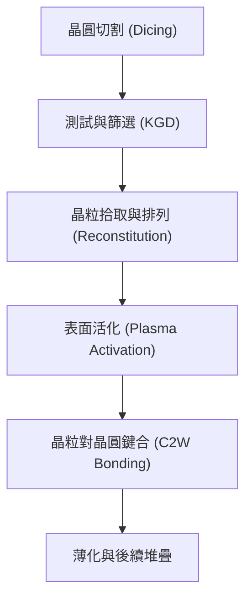

#### 3. 表面污染控制
C2W 在切割後會產生微塵（Particles），且晶粒邊緣的平整度（Chipping）會影響混合鍵合的親水性吸附。因此，C2W 製程對環境潔淨度與清洗程序（見第 20 章）的要求遠高於傳統封裝。

### 39.5.3 晶背供電網路 (BSPDN) 與 3D 堆疊的協同設計

隨著電晶體密度增加，傳統從晶片正面供電的方式面臨嚴重的電壓降（IR Drop）問題。如第 32 章所述，晶背供電技術（Backside Power Delivery Network, BSPDN）將電源分配網路移至晶圓背面。在 3D 堆疊結構中，BSPDN 與 TSV 的協同設計能釋放更多正面空間用於訊號互連。

#### 1. 空間解耦 (Decoupling)
在傳統 3D 堆疊中，訊號線與電源線競爭有限的正面金屬層空間。導入 BSPDN 後：
- **正面 (Frontside)**：專注於高密度的混合鍵合互連，提升邏輯閘密度。
- **背面 (Backside)**：透過微米級 TSV（或稱 Nano-TSV）直接將電流導向電晶體源極/汲極。

#### 2. 效能提升
截至撰寫時，結合 3D 堆疊與 BSPDN 的設計（如某些先進邏輯架構）可減少 10% 以上的面積浪費。由於電源路徑縮短，電阻 $R$ 降低，進而減少了 $V_{drop} = I \times R$，使電晶體能在更穩定的電壓下運作，提升約 8% 至 10% 的時脈頻率。

!!! example "產業實例"
    台積電的 SoIC 技術結合了混合鍵合與晶背供電。在 A16 節點中導入的 Super Power Rail (SPR) 技術，即是利用晶圓薄化與高深寬比 TSV，從背面提供純淨電源，這使得正面能容納更多用於 3D 堆疊的混合鍵合觸點。

### 39.5.4 散熱管理：3D 堆疊中的熱阻挑戰

3D 堆疊雖然縮短了互連路徑，但也造成了嚴重的「熱陷阱」（Heat Trap）效應。當多層主動元件垂直堆疊時，單位面積的功耗（Power Density）成倍增加，而熱量散失的路徑卻變得更加複雜。

#### 1. 熱阻 (Thermal Resistance) 物理模型
熱量傳導遵循傅立葉定律（Fourier's Law）。對於一個多層堆疊結構，總熱阻 $R_{th, total}$ 可表示為：

$$R_{th, total} = \sum_{i=1}^{n} \frac{d_i}{k_i A} + \sum R_{interface}$$

其中：
- $d_i$：第 $i$ 層材料的厚度。
- $k_i$：該材料的熱傳導率（Thermal Conductivity）。
- $A$：傳熱面積。
- $R_{interface}$：層與層之間的介面熱阻。

#### 2. 混合鍵合對散熱的貢獻
相較於傳統使用微凸塊（Microbump）與底填膠（Underfill）的堆疊方式，混合鍵合（Hybrid Bonding）具有顯著的熱優勢。
- **微凸塊結構**：底填膠通常是高分子聚合物，熱傳導率極低（典型值 < 1 W/m·K），形成熱絕緣層。
- **混合鍵合結構**：介面由大面積的氧化矽（$SiO_2$）與銅（$Cu$）組成。銅的熱傳導率極高（典型值 ~400 W/m·K），能有效充當垂直熱導管。

#### 3. 散熱設計策略
為了因應 3D 堆疊的高溫問題，製程與設計端採取以下措施：
- **熱矽穿孔 (Thermal TSV)**：在晶片中設計不具備電氣功能、僅用於傳導熱量的 TSV，將內層熱量引導至散熱片。
- **晶圓薄化**：將頂層晶圓減薄至 10 $\mu m$ 以下，降低熱傳導路徑的物理長度 $d$。
- **動態頻率調整 (DVFS)**：在電路設計中加入更多溫度感測器，針對過熱區域進行降頻。

!!! warning "常見誤解"
    工程師常誤以為增加 TSV 數量就能完美解決散熱問題。事實上，TSV 雖然導熱快，但過多的 TSV 會佔用寶貴的矽面積並引入額外的寄生電容。因此，3D 整合必須在「互連密度」、「供電效率」與「散熱能力」三者之間取得平衡。

### 39.5.5 W2W 與 C2W 的技術選擇準則

下表總結了兩種整合路徑的關鍵差異：

| 特性 | 晶圓對晶圓 (W2W) | 晶粒對晶圓 (C2W) |
| :--- | :--- | :--- |
| **對準精度** | 極高 (< 50 nm) | 中至高 (0.2 - 1.0 $\mu m$) |
| **生產產出** | 極高 (平行處理) | 較低 (序列處理) |
| **良率要求** | 極高 (需避免良率複合損失) | 具靈活性 (僅使用 KGD) |
| **異質整合** | 受限 (需相同晶粒尺寸) | 極佳 (可混合不同來源晶粒) |
| **典型應用** | NAND 堆疊、CIS、HBM (部分) | SoC + SRAM 堆疊、邏輯 + I/O |
| **主要挑戰** | 晶圓畸變 (Distortion) | 顆粒污染、拾取速度 |

截至撰寫時，隨著混合鍵合技術的成熟，C2W 正朝向更高的自動化與集體鍵合發展，以縮小與 W2W 在產出上的差距；而 W2W 則透過更精準的補償演算法，試圖克服晶圓畸變帶來的對準限制。

## 39.6 設備與廠商技術

在 3D 整合技術中，製程設備的性能直接決定了垂直互連的密度與可靠性。從矽穿孔（Through-Silicon Via, TSV）的深蝕刻、薄化製程到最終的混合鍵合（Hybrid Bonding），每一站皆需高度精密的機台配合。本節將探討 3D 封裝核心設備的技術特點、主要廠商的技術路線，以及產業中的實作路徑。

### 39.6.1 核心設備類別與子系統要求

3D 堆疊製程主要依賴四大類設備：深蝕刻設備、金屬化與平坦化設備、薄化設備以及鍵合設備。

1.  **深蝕刻設備（DRIE）**：用於形成 TSV 孔洞。關鍵子系統為電漿產生器與氣體切換系統。為了達成高深寬比（High Aspect Ratio, HAR），機台必須具備極高頻率的氣體切換能力，以執行波希製程（Bosch Process），交替進行蝕刻與側壁保護膜沉積。
2.  **金屬化與平坦化設備**：包含化學氣相沉積（CVD）用於沉積絕緣層、物理氣相沉積（PVD）用於阻障層與種子層，以及電鍍（ECP）填充銅。隨後使用化學機械研磨（CMP）移除多餘金屬並控制表面粗糙度，這是混合鍵合能否成功的關鍵。
3.  **鍵合設備（Bonder）**：分為晶圓對晶圓（W2W）與晶粒對晶圓（C2W）兩大類。關鍵子系統為光學對準系統（Optical Alignment System）與壓力/溫度控制單元。混合鍵合要求對準精度達到次微米（Sub-micron）等級。
4.  **薄化設備（Grinder/Polisher）**：用於將晶圓背面研磨至數十微米的厚度，以顯露 TSV。關鍵在於厚度均勻性（Total Thickness Variation, TTV）的控制。

### 39.6.2 主要供應商與技術路線比較

下表列出截至撰寫時，在 3D 整合製程領域中具代表性的設備廠商及其技術特點：

| 廠商 | 代表產品系列 | 技術路線與特點 | 主要應用 |
| :--- | :--- | :--- | :--- |
| Lam Research | Syndion 系列 | 採高密度電漿源與快速氣體切換技術，優化 HAR 蝕刻速率與側壁粗糙度。 | TSV 深矽蝕刻 |
| Lam Research | SABRE 系列 | 具備多腔體電鍍系統，針對高深寬比孔洞提供無縫隙（Void-free）銅填充。 | TSV 銅電鍍 |
| Applied Materials | Producer 平台系列 | 透過 PECVD 沉積低溫介電層，保護已完成的前段元件。 | TSV 絕緣層（Liner）沉積 |
| Applied Materials | Reflexion LK Prime | 整合多研磨頭與即時量測技術，控制混合鍵合所需的極低表面粗糙度。 | 混合鍵合前之銅/介電質 CMP |
| EV Group (EVG) | GEMINI | 整合清洗、活化與對準模組，專精於 W2W 混合鍵合，對準精度極高。 | 影像感測器、SoIC 晶圓鍵合 |
| Tokyo Electron (TEL) | — | 提供高度整合的鍵合與解鍵合（Debonding）解決方案，強調產出率。 | 晶圓鍵合與暫時性承載製程 |
| Besi | Datacon 8800 CHAMEO 系列 | 專為 C2W 混合鍵合設計，具備超高精度拾放（Pick-and-place）系統。 | 高階邏輯晶片、HBM 堆疊 |
| DISCO | DFG 系列研磨機 | 採用精精密主軸與研磨輪，能將晶圓穩定薄化至極限厚度。 | 晶圓背面研磨與 TSV 顯露 |
| K&S | — | 專注於熱壓鍵合（TCB）技術，提供高精度壓力與溫度補償。 | 微凸塊（Micro-bump）鍵合 |

#### 技術路線差異分析

在深蝕刻領域，Lam Research 的 Syndion 系列與 Applied Materials 的 Sym3 系列代表了兩條不同的設計思路。Lam Research 傾向於透過極快速的氣體切換脈衝來維持側壁形狀的垂直度；而 Applied Materials 則強調腔體內的電漿均勻性，以確保大尺寸晶圓邊緣與中心的蝕刻深度一致。

在鍵合技術方面，EV Group 的 GEMINI 平台採用整合式架構，將晶圓表面的電漿活化（Plasma Activation）與對準真空腔體緊密結合，減少晶圓暴露於環境的時間，這對於防止混合鍵合介面氧化至關重要。相較之下，Besi 的混合鍵合機台則針對 C2W 流程，優化了機械手臂的減震與光學回饋補償，以在高速移動下維持次微米的拾放精度。

### 39.6.3 產業實例：SoIC 與 Foveros 技術路徑比較

截至撰寫時，業界領先的 3D 整合技術以台積電（TSMC）的 SoIC 與 Intel 的 Foveros 為代表，兩者在製程路徑上存在顯著差異：

!!! example "產業實例：SoIC 與 Foveros"
    **1. 台積電 SoIC (System on Integrated Chips)：**
    SoIC 屬於「前段」導向的 3D 整合技術。其核心在於無凸塊（Bumpless）混合鍵合。製程路徑通常採 **W2W** 或 **C2W** 混合鍵合，利用 CMP 將銅墊與介電質（如 $SiO_2$ 或 $SiN$）磨至極平整狀態，隨後在室溫下進行親水性鍵合，再透過退火使銅原子擴散形成金屬鍵結。其互連間距（Pitch）可微縮至 10 $\mu m$ 以下，顯著提升訊號傳輸密度。

    **2. Intel Foveros：**
    Foveros 技術則較多應用於邏輯晶片堆疊。早期版本主要依賴**微凸塊（Micro-bump）**與**熱壓鍵合（TCB）**技術。其製程路徑是在主動底層晶圓（Active Base Wafer）上製作微小焊球，再將頂層晶粒壓合。雖然 Foveros 亦在後續演進中導入混合鍵合（如 Foveros Direct），但其初期發展更強調主動中介層（Active Interposer）的整合，允許在底層晶圓中整合電源管理或 I/O 電路。

### 39.6.4 3D 結構之量測與檢測技術

3D 堆疊結構的封閉性使得傳統的光學顯微鏡無法檢測內部缺陷，因此必須採用穿透性強或基於物理特性的檢測手段。

#### 1. 超音波掃描顯微鏡 (Scanning Acoustic Microscopy, SAM/SAT)
利用超音波在不同介質介面（如矽與銅、或固體與空洞）的反射特性來偵測缺陷。當超音波遇到空隙（Void）時，由於聲阻抗（Acoustic Impedance）的巨大差異，反射訊號會極強。
- **應用**：檢測混合鍵合介面的未鍵合區域（Non-bond area）或 TSV 填充中的大孔洞。

#### 2. X-Ray 斷層掃描 (X-Ray Computed Tomography, X-Ray CT)
透過高能 X 射線穿透多層堆疊結構，並從多個角度拍攝投影影像，再經由演算法重建 3D 影像。
- **應用**：精確量測 TSV 的關鍵尺寸（CD）、側壁角度以及微凸塊在壓合後的變形情況。

#### 3. 晶圓幾何量測 (Wafer Geometry Metrology)
使用 KLA 的 WaferSight 等設備量測晶圓在薄化或鍵合後的翹曲（Warpage）與平坦度。在 3D 整合中，晶圓的應力管理至關重要，過大的翹曲會導致後續微影對準失敗或鍵合介面剝離。

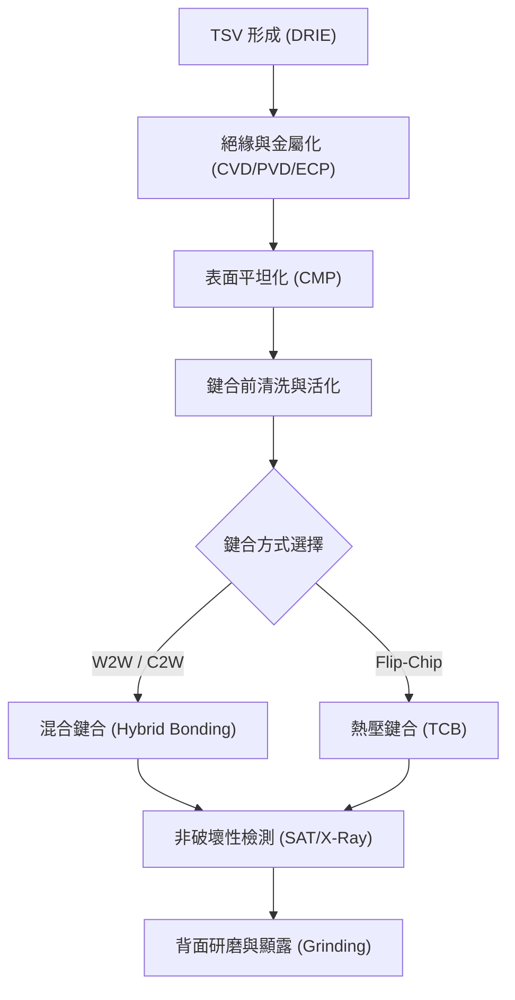

### 39.6.5 設備選機考量與製程挑戰

晶圓廠在選擇 3D 整合設備時，首要考量是**對準精度（Alignment Accuracy）**與**顆粒控制（Particle Control）**。在混合鍵合中，任何直徑大於 0.1 $\mu m$ 的顆粒都可能導致數百微米範圍內的未鍵合區域。因此，鍵合機台通常需要整合極高等級的局部淨化系統（EFEM）。

此外，隨著 HBM（High Bandwidth Memory）堆疊層數從 8 層、12 層向 16 層以上演進，機台的**熱預算管理（Thermal Budget Management）**變得極為關鍵。多次的退火與壓合製程不能損害底層已完成的電晶體特性（見第 28 章關於前段製程熱預算的討論）。截至撰寫時，開發低溫鍵合技術與高產出率的 C2W 混合鍵合設備，仍是各大設備供應商競爭的核心領域。

## 本章重點

*   **3D 整合的驅動力**：為克服微縮製程中的互連線延遲（RC Delay）與記憶體牆（Memory Wall）瓶頸，產業從橫向 2.5D 整合轉向縱向 3D 堆疊，以大幅縮短訊號傳輸路徑。
*   **矽穿孔 (TSV) 技術**：TSV 是 3D IC 的核心，透過深反應離子蝕刻（DRIE）的 Bosch 製程達成高深寬比孔洞，並以電鍍銅填孔實現垂直導通。
*   **熱壓鍵合 (TCB) 與微凸塊**：當接點間距縮減至 $40\ \mu m$ 以下，傳統回銲易受晶圓翹曲影響，需透過 TCB 精確控制壓力與溫度曲線，並輔以非導電膠膜（NCF）進行填充。
*   **混合鍵合 (Hybrid Bonding) 原理**：一種無凸塊（Bumpless）技術，結合了電介質間的親水性共價鍵合與銅電極間的原子擴散鍵合，能實現次微米級的互連間距。
*   **CMP 的關鍵性**：混合鍵合對表面形貌極其敏感，必須精確控制銅電極的凹陷（Dishing）深度在典型值 $2\ nm$ 至 $5\ nm$ 之間，以確保熱膨脹後能完美接觸。
*   **W2W 與 C2W 策略**：晶圓對晶圓（W2W）具備高產出與高精度，但受限於良率複合效應；晶粒對晶圓（C2W）則具備異質整合靈活性，可確保僅使用已知良率晶粒（KGD）。
*   **系統整合挑戰**：3D 堆疊面臨嚴峻的熱管理挑戰，需透過熱矽穿孔（Thermal TSV）與晶背供電網路（BSPDN）協同設計，以維持系統效能與穩定性。

## 重點圖卡

複習時看這幾張就能抓住本章重點；[圖卡庫](../cards.md)可以下載成圖片。

<figure markdown>
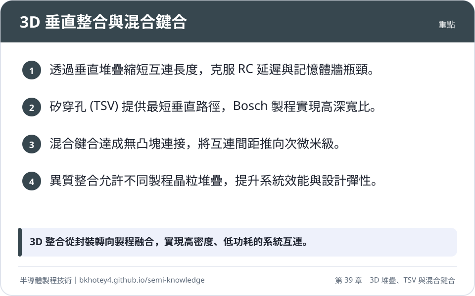
<figcaption>重點圖卡：3D 垂直整合與混合鍵合</figcaption>
</figure>

<figure markdown>
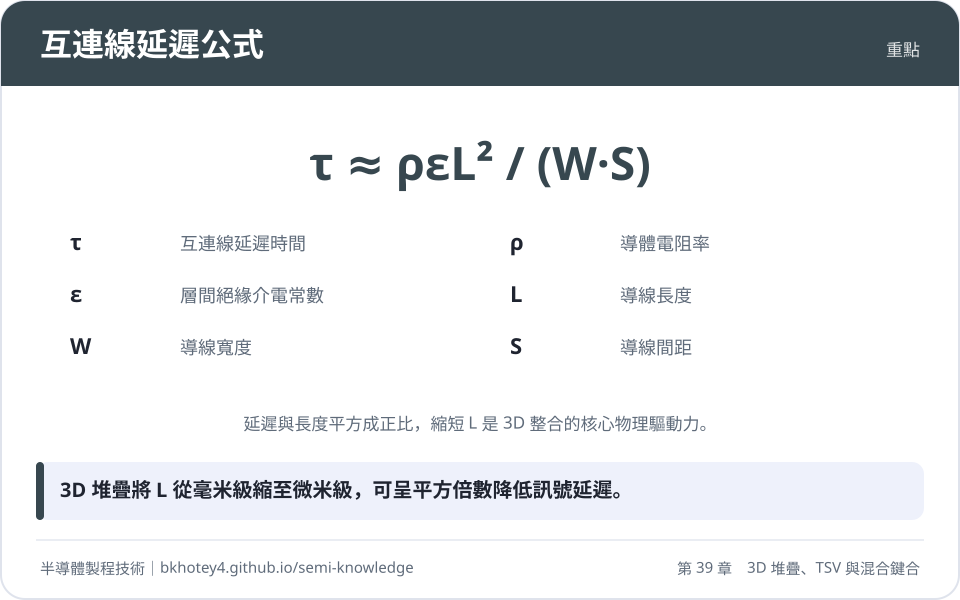
<figcaption>重點圖卡：互連線延遲公式</figcaption>
</figure>

<figure markdown>
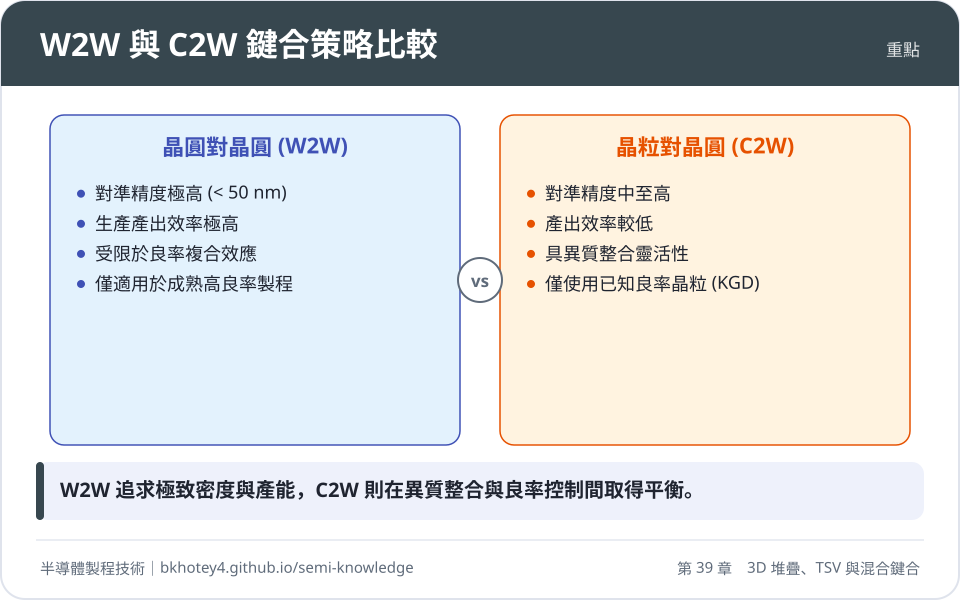
<figcaption>重點圖卡：W2W 與 C2W 鍵合策略比較</figcaption>
</figure>

<figure markdown>
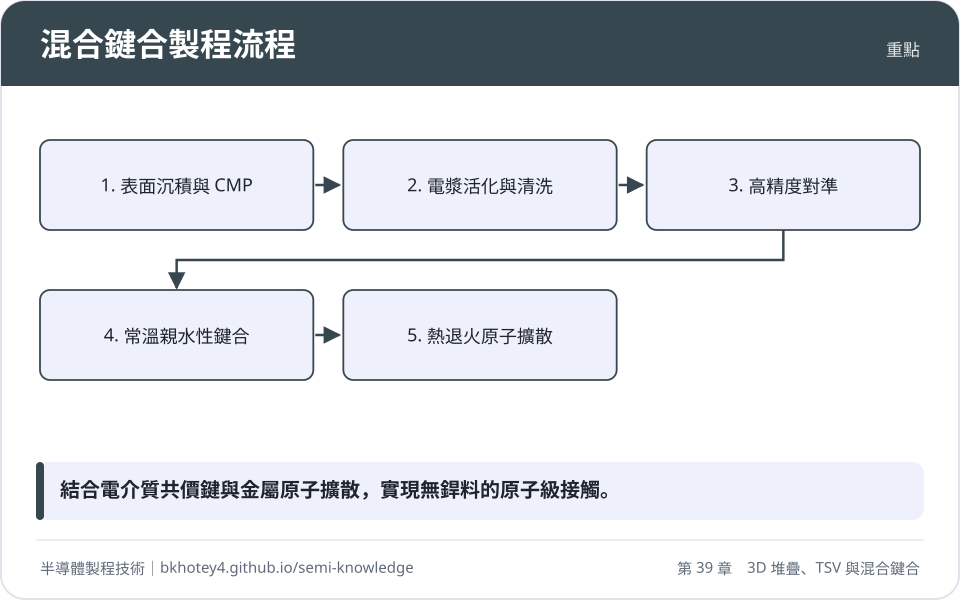
<figcaption>重點圖卡：混合鍵合製程流程</figcaption>
</figure>

## 習題

**1.** 試說明為何在高效能運算（HPC）晶片中，TSV-middle 製程較 TSV-first 更具優勢？

??? success "參考解答"
    TSV-first 在電晶體製作（FEOL）前完成，必須承受後續高溫退火（> 1000°C），因此只能使用導電性較差的多晶矽填充。TSV-middle 在 FEOL 完成後、BEOL 開始前製作，避開了極高溫環境，允許使用電阻率較低的銅作為填充材料，能顯著降低訊號延遲並提升導電效能。

**2.** 假設一互連線長度 $L$ 從 2D 封裝的 $10\ mm$ 縮短至 3D 堆疊的 $0.1\ mm$，在導體電阻率 $\rho$、介電常數 $\epsilon$、寬度 $W$ 與間距 $S$ 保持不變的前提下，其 RC 延遲 $\tau$ 將變為原來的多少倍？

??? success "參考解答"
    根據公式 $\tau \approx \rho \epsilon \frac{L^2}{W \cdot S}$，延遲 $\tau$ 與長度平方 $L^2$ 成正比。
    計算比例：$(0.1 / 10)^2 = (0.01)^2 = 0.0001$。
    因此，RC 延遲將縮減為原來的 $10^{-4}$ 倍（即萬分之一）。

**3.** 在混合鍵合製程中，若 CMP 階段產生的銅凹陷（Dishing）過深（例如大於 $10\ nm$），對最終接合結果有何影響？請從物理機制說明。

??? success "參考解答"
    混合鍵合依賴退火時銅的熱膨脹來填補初始間隙。若凹陷過深，即使在退火溫度下，銅的熱膨脹量仍不足以跨越間隙與對向電極接觸，將導致金屬介面無法產生原子擴散，形成電路開路（Open circuit）或極高的接觸電阻。

**4.** 某 3D 堆疊產品由兩片晶圓進行 W2W 鍵合，若底層晶圓良率為 90%，頂層晶圓良率為 80%，鍵合製程良率為 98%，試計算最終成品的全域良率。若改用 C2W 且僅挑選 KGD 進行鍵合，良率將如何變化？

??? success "參考解答"
    W2W 總良率 = $0.90 \times 0.80 \times 0.98 = 70.56\%$。
    若改用 C2W 且僅使用 KGD，則晶粒本身的良率損失在鍵合前已被排除，最終良率僅受鍵合製程影響，即 $Y_{total} \approx Y_{bonding} = 98\%$（假設 KGD 篩選完全準確）。

**5.** 試計算銅（Cu）在 $300^\circ C$ 退火 1 小時後的金屬間化合物（IMC）生長厚度。已知該溫度下之擴散係數 $D = 1 \times 10^{-14}\ cm^2/s$。（提示：使用 $x = \sqrt{D \cdot t}$）

??? success "參考解答"
    1. 將時間換算為秒：$t = 1 \times 60 \times 60 = 3600\ s$。
    2. 代入公式：$x = \sqrt{10^{-14} \times 3600} = \sqrt{3.6 \times 10^{-11}} \approx 6 \times 10^{-6}\ cm$。
    3. 換算單位：$6 \times 10^{-6}\ cm = 0.06\ \mu m = 60\ nm$。

## 本章術語

- **TSV**（矽穿孔）：穿透矽基板的垂直電氣互連通道。
- **Bosch Process**（波希製程）：一種交替蝕刻與鈍化的循環製程，用於製造高深寬比的矽孔洞。
- **Hybrid Bonding**（混合鍵合）：不使用銲料，直接結合電介質與金屬電極的原子級鍵合技術。
- **TCB**（熱壓鍵合）：透過同時施加精確壓力與脈衝式高溫實現微凸塊接合的技術。
- **IMC**（金屬間化合物）：兩種金屬（如銅與錫）在介面處擴散反應形成的化學物質。
- **KGD**（已知良率晶粒）：經過完整測試並確認功能正常的獨立晶粒。
- **W2W / C2W**（晶圓對晶圓 / 晶粒對晶圓）：3D 整合中兩種主要的物理堆疊策略。
- **BSPDN**（晶背供電網路）：將電源分配網路移至晶圓背面以優化正面佈線空間的架構。
- **Dishing**（凹陷）：CMP 製程中因材料磨耗率差異導致金屬表面低於電介質表面的現象。

## 互動學習

!!! tip "動手試試看"
    - [設備機台圖鑑：鍵合機](../equipment.md)

## 產業最新進展

本節由每日產業新聞自動補充，說明本章技術在產業上的最新發展。

<!-- updates -->
- **2026-11-28**　透過擴大高頻寬記憶體（HBM）的通道寬度以繞過微影製程極限，並採用晶圓級混合鍵合（hybrid bonding）技術來實現高密度垂直互連，該製程面臨嚴格的介面平坦化與對準良率挑戰。（來源：[分析：華為或透過擴大HBM通道寬度繞開EUV瓶頸，但晶圓級混合鍵合面臨良率挑戰 - 鉅亨網](https://news.google.com/rss/articles/CBMiT0FVX3lxTFBiMGVNSExPcUF3QVc5NGVZaEU3MFpDVEh5c0lfY0kweEszTlBfQjg3TGxFTkF3M3VZU3R4aVZheExrNG03TVlvZ2VxbEVYY0k?oc=5)）
- **2026-11-25**　本則新聞探討 3D IC 中的混合鍵合技術及其無凸塊選項。這與章節中介紹的介電質與金屬直接接合原理直接相關，有助於讀者理解先進封裝如何突破微縮與訊號傳輸瓶頸。（來源：[混合鍵合為何是 3D IC 關鍵？高成本下還有哪些無凸塊選項 - TechNews 科技新報](https://news.google.com/rss/articles/CBMiY0FVX3lxTFBzMTBWN1BzN2RNVGpNN0JwVEt1cjQ4TWJzMkZXZGQySENpdTZiQ0w1SUhBdGp1WmRiWEtydG5Fb1I2b3NvTzBvb19mdkFNU3VNUUhMTnNnMnhCT0hKYW1DakJnaw?oc=5)）
- **2026-11-23**　SK海力士的高頻寬記憶體（HBM）製程計畫採用混合鍵合設備，此技術屬於3D堆疊與混合鍵合的範疇，透過無凸塊的直接金屬接合來降低互連電阻並增加垂直堆疊的I/O密度。（來源：[不是韓美也不是韓華 SK海力士HBM混合鍵合設備擬敲定Besi - DIGITIMES](https://news.google.com/rss/articles/CBMia0FVX3lxTFAydHUwTl81NW9wQ2JMRUhjM2hueWhzN1pkOTI3WFlva2NwMmZ1clBQMGdZdVd5Q3pjaDJfSEJReGY2THFYOWh4SERjVmhNTDFxeDhSby1WYVBNRGZoREducVNocFpRdE9QQWFn?oc=5)）
- **2026-11-21**　報導指出蘋果 M5 Ultra 採用混合鍵合（hybrid bonding）串接兩顆晶粒，使互連密度顯著提升。此技術與教科書中探討的 3D 堆疊、晶圓級互連與無凸塊銅-銅直接接合原理緊密相連。（來源：[蘋果M5 Ultra採台積電混合鍵合串接兩顆晶粒，互連密度提升逾6倍 - BigGo 財經](https://news.google.com/rss/articles/CBMiX0FVX3lxTE9KZEZxUnBxTFBLbDFNVFdKS01jZTBuYUVRb1RvRzFmdGRueGl2ZnJ5V3RiZk5TRW1sX0ZlcFhkcWp3eXdLTDNnV1Fhc0twMm4xaVh5MlJScWFYVzlDekpj?oc=5)）
- **2026-11-20**　報導深入探討了混合鍵合技術在 3D IC 中的關鍵地位與無凸塊選項。這與教科書中探討的 3D 堆疊、矽通孔與混合鍵合原理緊密相連，解析了微縮架構下的晶片互連技術。（來源：[混合鍵合為何是 3D IC 關鍵？高成本下還有哪些無凸塊選項 - TrendForce](https://news.google.com/rss/articles/CBMifEFVX3lxTE1oQVBEeXB4ZXFTeW1RbFplWGd5ZE83bUlQd0s2dHcxUk9DY19CY1prdGlNbGJqM3J2N0kzRXpxN04zb3cwa3VxMkxYU0dIdlBBMWR0Z0dCcFo5eXJiNFQyRWdBTkhoMVpQS0duWGZwX2p2ZklwcVVfQUk1Y2I?oc=5)）
- **2026-11-15**　先進封裝迎來混合鍵合（hybrid bonding）市場規模的增長，這與 3D 堆疊及晶圓級銅-銅直接接合的先進封裝原理高度相關，能進一步降低互連電阻並提高I/O密度。（來源：[先進封裝迎爆發潮 混合鍵合市場規模2033年上看24.5億美元 - 商傳媒](https://news.google.com/rss/articles/CBMihwNBVV95cUxQVk5fVE52Q2dtejh4UWxOX2dWZ2hFQUlLWmIyaEZfY2JRWVI5emtpZ0NNd2tpQlhROTlRVHNXektSV0RNWnNQZ1c1R0tXRWw1LWZENzhIY2JubWJvWVZEdXd1NnVFSzRoMnQ5MEs2MXBVNkdDODYwLXdYYVRPaG1hMnh4dElPbEJHRjBfNjUtMlNDM05Ybndad2hRLWdabjNLWHBGek92dGxORWlhSWZKd3FXc2NnZ0hKYUN6bEJPS3pRaUZKTkljVk9pNkZwODJreXotZDItNTVKcFAwcVVVcjc0dVl6dlJFNGVDb3ZQNGk1RXF1RnYzcnVnZVdwd0g2MzRkNWZXNVFsdHdxdkQ1YWpDM0Npd21LcC1xYjBsdWJiVkdNcXhLMXJrSHFhbXI5QXJRS2pKMWhLTnNHRndtU3dWVW5vbDF5YS1VOC1EOTJiWEF1Z2ZwcGJjZ3phUGZwTWRVWjZEejVsbmM4U0hvS08tZTNfSDlsVE10UVZhbTFLdmF4OXpJ?oc=5)）
- **2026-11-11**　三星電子確立 2027 年初完成先進封裝 3D Cube-H 技術開發。此技術涉及晶片垂直堆疊與高密度互連，與 3D 堆疊、TSV 與混合鍵合章節探討的先進封裝架構緊密相關。（來源：[三星電子確立研發計畫，預計 2027 年初完成先進封裝 3D Cube-H 技術開發 - TechNews 科技新報](https://news.google.com/rss/articles/CBMi0gFBVV95cUxOMGRCNGctaEpoZXdrckVWUmVMM3E0Rmh5cmxpcW1WRktLblBjZkh0dE5ySENKX2ZlSkhaczR4MWI4MkFMUUt1VklTOTkwRG4yUFlTbXQ0RXExYTdjZ1pCLUlFd0d5eGJ3cGw2ZUF5RkxaLUpTVHZ1YWcta0E4cy1rVU8zOHh6NzBNcUU0S1dBRnZFZjRGaUEwNms1YnZ2RnpDcnhNSTNDQlJuOXgxWnk4LUJTRTJreTdoeDBuRUx1R2xpNTFsaVZ4QzFVNGdJT2xYU2c?oc=5)）
- **2026-10-31**　友達跨足玻璃核心基板進行精密製程研發，此技術應用於先進封裝領域。這與 3D 堆疊與高階封裝基板的載板技術發展息息相關。（來源：[友達跨足玻璃核心基板 精密製程開拓先進封裝應用 - CTIMES](https://news.google.com/rss/articles/CBMibEFVX3lxTE9BRVh3QnNXNmdXeGVYUEV1OUpadkhzbDV0SWdtMkJpS1pNMWFHdW4ySTdRUGJ5T0t2OE1YZHliNlY2b2t6ZWN3Tk4yMmJVeW8zSktpc1ZGUVBuME4zVHo3MUFtWkJvc0c1eUVIcA?oc=5)）
- **2026-10-22**　長鑫存儲結合 12 吋晶圓與混合鍵合技術加速高階記憶體與 3D DRAM 布局。此技術應用屬於 3D 堆疊與混合鍵合章節的核心範疇，透過無凸塊的直接金屬接合提升垂直互連密度。（來源：[結合12吋混合鍵合技術 長鑫存儲加速高階記憶體與3D DRAM布局 - 鉅亨網](https://news.google.com/rss/articles/CBMiT0FVX3lxTE1xajJwZE45SkNEbEE1b0x5VzdDSnlqcS1DelRBc2p6M3ZKQWFZZV9kTFlxN3VPWFZWbUd1WWFlbC1faWZpVzRyTXJ0NjR3ZFE?oc=5)）
