# 第 40 章　高頻寬記憶體 (HBM)

!!! abstract "學習目標"
    - 理解高頻寬記憶體 (HBM) 的物理架構及其解決馮·諾伊曼瓶頸 (Von Neumann Bottleneck) 的原理
    - 掌握 HBM 從 HBM3E 演進至 HBM4 的技術關鍵，包含位元寬度、堆疊層數與傳輸速率的變化
    - 分析基礎晶粒 (Base Die) 在 HBM 結構中的功能及其由記憶體製程轉向先進邏輯製程的趨勢
    - 辨析 HBM 製造過程中的散熱管理、晶圓翹曲與良率控制等關鍵挑戰

## 40.1 HBM 物理原理與架構基礎

### 40.1.1 記憶體牆（Memory Wall）限制與頻寬需求分析

在高效能運算（HPC）與人工智慧（AI）運算架構中，處理單元（如 GPU、TPU 或客製化 ASIC）的邏輯運算能力遵循摩爾定律（Moore's Law）快速增長。然而，傳統動態隨機存取記憶體（DRAM）的資料傳輸速率增長速度遠落後於處理器。這種處理器運算速度與記憶體存取速度之間的巨大鴻溝，在計算機科學中被稱為「記憶體牆」（Memory Wall）。

記憶體牆的物理本質源於資料傳輸頻寬（Bandwidth）與延遲（Latency）的限制。頻寬的定義如下：

$$BW = f \times n \times k$$

其中：
- $BW$ 為總頻寬（單位：bits/s）。
- $f$ 為時脈頻率（Clock Frequency）。
- $n$ 為資料匯流排寬度（Bus Width，即位元數）。
- $k$ 為每個時脈週期的傳輸次數（如 DDR 技術中 $k=2$）。

在傳統的 DDR（Double Data Rate）或 GDDR（Graphics DDR）架構中，受限於封裝技術與印刷電路板（PCB）的佈線密度，位元寬度 $n$ 通常受到嚴格限制（例如單顆 GDDR 晶粒通常為 32-bit）。為了提升頻寬，開發者必須不斷提高時脈頻率 $f$。然而，高頻率會導致顯著的訊號完整性（Signal Integrity, SI）問題、電磁干擾（EMI）以及劇增的功耗。功耗與頻率的關係可簡化表示為：

$$P \propto C \cdot V^2 \cdot f$$

其中 $C$ 為負載電容，$V$ 為工作電壓。當頻率 $f$ 進入數 GHz 等級時，I/O 功耗將佔據晶片總功耗的極大比例。高頻寬記憶體（High Bandwidth Memory, HBM）的出現，旨在透過改變封裝架構，從根本上解決此物理限制。

### 40.1.2 3D 堆疊架構：矽穿孔（TSV）與微凸塊（Micro-bump）

HBM 的核心概念是將多層 DRAM 晶粒（Die）進行垂直堆疊，並透過矽穿孔（Through-Silicon Via, TSV）技術實現垂直互連。這種 3D 堆疊架構將原本在 PCB 上的平面佈線轉化為垂直方向的微觀互連。

#### 1. 矽穿孔（TSV）的作用
在 HBM 架構中，除了最頂層的晶粒外，每一層 DRAM 晶粒都佈滿了數千個 TSV（詳見第 39 章）。TSV 穿透矽襯底，直接連接上下相鄰的晶粒。相較於傳統的打線封裝（Wire Bonding），TSV 具有以下物理優勢：
- **路徑極短**：訊號傳輸距離從公釐（mm）等級縮短至微米（$\mu m$）等級，顯著降低電阻與寄生電感。
- **高密度**：可在極小面積內配置數千條訊號通道，支撐極寬的位元介面。

#### 2. 微凸塊（Micro-bump）互連
相鄰晶粒之間透過微凸塊進行鍵合（Bonding）。截至撰寫時，HBM 的微凸塊間距（Pitch）典型值約在 $25 \sim 40 \mu m$ 之間。隨著技術演進至 HBM4，業界正朝向更小的間距甚至無凸塊的混合鍵合（Hybrid Bonding）技術發展，以進一步提升互連密度並降低熱阻。

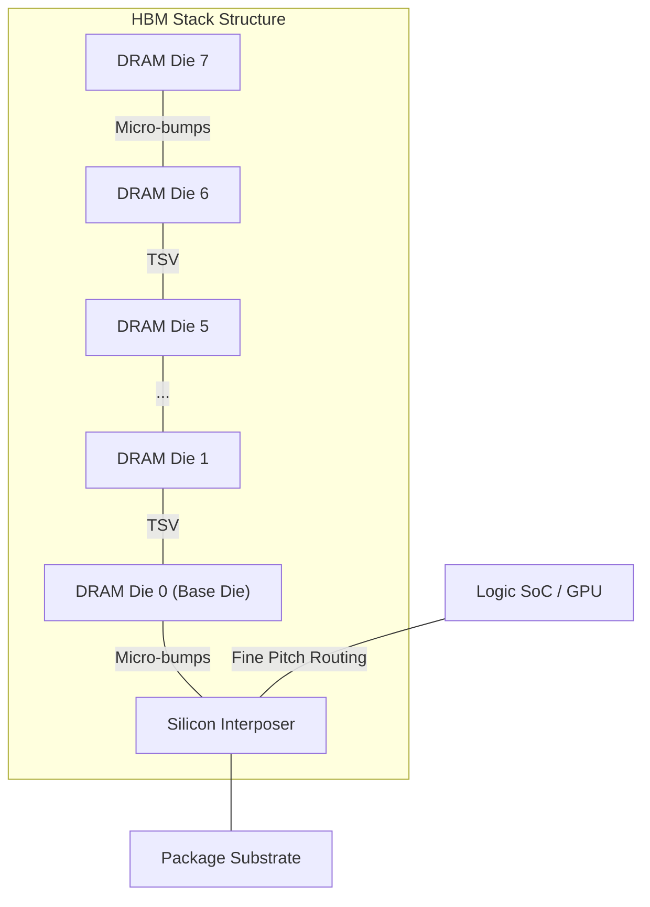

### 40.1.3 寬位元介面（Wide I/O）與設計權衡

HBM 與傳統記憶體最大的設計差異在於「以寬度換取頻率」。傳統 DDR5 的單通道位元寬度僅為 32-bit 或 64-bit，而單個 HBM 堆疊（Stack）的標準介面寬度高達 1024-bit。

#### 1. 寬位元介面的物理意義
由於頻寬 $BW = f \times n \times k$，當位元寬度 $n$ 從 64 增加到 1024（增加 16 倍）時，即使時脈頻率 $f$ 保持在較低水準，總頻寬依然能實現數量級的提升。

#### 2. 低時脈頻率的優勢
- **功耗效率（Power Efficiency）**：較低的時脈頻率意味著較低的動態功耗。HBM 的每位元傳輸能耗（$pJ/bit$）通常僅為 GDDR 的 1/3 至 1/4。
- **訊號完整性**：低頻訊號對電磁干擾與反射不敏感，降低了電路設計的複雜度。

#### 3. 設計權衡
雖然寬位元介面解決了頻寬問題，但其代價是極高的互連密度。這要求處理器（SoC）與 HBM 必須封裝在同一個中介層（Interposer）上，形成 2.5D 封裝結構（見第 38 章）。這種高度整合增加了製程複雜度與成本，且一旦其中一顆晶粒失效，整個封裝體即報廢，對良率管理提出嚴峻挑戰。

### 40.1.4 HBM 與傳統 DDR、GDDR 之對比

下表對比了 HBM 與當前主流記憶體技術在物理特性與性能指標上的差異（數值為截至撰寫時之典型範圍）：

| 特性參數 | DDR5 | GDDR6/7 | HBM3E |
| :--- | :--- | :--- | :--- |
| **封裝形式** | DIMM / 表面黏著 | 表面黏著 (BGA) | 3D 堆疊 (2.5D 整合) |
| **位元寬度 (per Die/Stack)** | 16 / 32 bits | 32 bits | 1024 bits |
| **典型時脈頻率** | $2.4 \sim 4.2$ GHz | $8 \sim 20$ GHz | $0.5 \sim 1.2$ GHz |
| **總頻寬 (per Unit)** | $30 \sim 60$ GB/s | $64 \sim 160$ GB/s | $800 \sim 1200$ GB/s |
| **傳輸能耗 (Typical)** | $20 \sim 30$ pJ/bit | $7 \sim 10$ pJ/bit | $2 \sim 4$ pJ/bit |
| **物理腳位數量** | 數百個 | 數百個 | 數千個 (TSV) |

!!! note "說明"
    DDR 專注於容量擴充與低成本，適用於通用伺服器；GDDR 專注於高時脈頻率，適用於消費級顯卡；HBM 則專注於極致頻寬與能源效率，是當前 AI 訓練與推理運算的首選。

### 40.1.5 結構組成：Base Die 與 DRAM Core Die

一個完整的 HBM 堆疊由底部的「基礎晶粒」（Base Die，亦稱 Logic Die）與上方的多層「記憶體核心晶粒」（DRAM Core Die）組成。

1.  **DRAM Core Die**：主要負責資料儲存。為了適應 TSV 製程，這些晶粒必須經過極度減薄（Thinning），典型厚度僅約 $30 \sim 50 \mu m$。
2.  **Base Die**：位於堆疊最底部，負責與處理器進行通訊。它包含了實體層介面（PHY）、測試電路（DFT）以及電源管理邏輯。Base Die 的存在使得上層的 DRAM 晶粒可以專注於儲存密度，而將複雜的邏輯控制與高速介面電路下放至 Base Die 處理。在 HBM4 規格中，Base Die 預計將採用更先進的邏輯製程（如 5nm 或更先進節點），這標誌著記憶體與邏輯製程深度融合的開始。

!!! warning "常見誤解"
    讀者常誤認為 HBM 是一種新型態的儲存單元。事實上，HBM 內部的儲存單元（Bit-cell）物理原理與傳統 DRAM 完全相同（見第 4 章與第 39 章），其效能提升主要來自於「封裝架構」與「介面設計」的革命，而非電容器（Capacitor）材料或結構的根本改變。

<!-- fig:1 -->
<figure markdown>
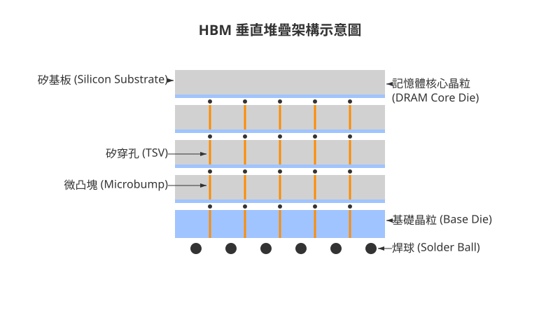
<figcaption>圖 40-1　HBM 垂直堆疊架構圖（AI 繪製的示意圖）</figcaption>
</figure>

## 40.2 HBM 規格演進：從 HBM3E 到 HBM4

在高頻寬記憶體（High Bandwidth Memory, HBM）的發展歷程中，每一代的演進皆是為了突破「記憶體牆」（Memory Wall）的限制，即處理器的運算能力增長速度遠超記憶體頻寬的增長速度。截至撰寫時（2026-11-28），HBM 技術已從追求單一接腳（Pin）速率的提升，轉向架構性的變革，特別是從 HBM3E 跨入 HBM4 的過程中，介面寬度的倍增成為了技術發展的核心。

### HBM3E 的技術特徵與 12 層堆疊技術

HBM3E 作為 HBM3 的擴展版本（Extended version），其主要改進在於透過製程優化與電路設計，進一步提升了資料傳輸速率。在物理層面，HBM3E 延續了 HBM3 的 1024 位元（bit）介面寬度，但將單一接腳的傳輸速率從 HBM3 的典型值 6.4 Gbps 提升至 8.0 Gbps 到 9.6 Gbps 之間。

#### 頻寬計算物理模型
HBM 的總頻寬（Total Bandwidth）由以下公式決定：

$$BW = \frac{f_{pin} \times W_{bus}}{8}$$

其中：
- $BW$ 為總頻寬，單位為 GB/s。
- $f_{pin}$ 為單一接腳的資料傳輸速率（Data Rate），單位為 Gbps。
- $W_{bus}$ 為介面位元寬度（Interface Bus Width），HBM3E 為 1024 bit。
- 分母 8 用於將 bit 轉換為 Byte。

以 HBM3E 達到 9.6 Gbps 的典型速率計算，單顆堆疊（Stack）可提供約 1.2 TB/s 的頻寬。

#### 12 層堆疊（12-high）挑戰
在 HBM3E 世代，12 層（12H）晶粒堆疊成為量產的主流規格。為了在受限的封裝高度內（通常遵循 JEDEC 規範的 720 $\mu$m 典型值）塞入更多層數，晶圓減薄（Wafer Thinning，見第 8 章）技術必須將單層 DRAM 晶粒厚度控制在極低範圍。這導致了結構穩定性的挑戰，特別是在熱壓合非導電膠膜（Thermal Compression Non-Conductive Film, TC-NCF）與批量回焊模製底部填充劑（Mass Reflow Molded Underfill, MR-MUF）兩種封裝路徑的競爭中，如何控制晶粒翹曲（Warpage）並確保矽穿孔（TSV，見第 39 章）的連接可靠性，是提升良率的關鍵。

### HBM4 的架構變革：2048 位元介面的物理意義

隨著傳輸速率接近 10 Gbps 的物理瓶頸，單純靠提高頻率會帶來劇烈的功耗增加與信號衰減。因此，HBM4 引入了架構上的重大變革：將介面位元寬度從 1024-bit 倍增至 2048-bit。

#### 介面倍增的物理影響
將總線寬度增加一倍，意味著在相同的時脈頻率下，頻寬可以翻倍。然而，這在物理實作上面臨極大挑戰：
1. **TSV 密度增加**：為了支援 2048-bit，穿透矽晶粒的 TSV 數量必須大幅增加。這要求更小的 TSV 間距（Pitch）以及更精準的對準技術。
2. **凸塊（Bump）微縮**：基礎晶粒（Base Die）與 DRAM 晶粒之間的微凸塊（Micro-bump）間距必須進一步縮減（例如從 30-40 $\mu$m 縮減至 20 $\mu$m 以下），以容納倍增的 I/O 接點。
3. **混合鍵合（Hybrid Bonding）的導入**：當凸塊間距縮減至物理極限時，傳統的焊球連接將被無凸塊的銅對銅混合鍵合（見第 39 章）取代，這能顯著降低寄生電感與電阻，提升信號品質。

!!! note "規格演進對比"
    | 規格參數 | HBM3E (典型值) | HBM4 (目標值) |
    | :--- | :--- | :--- |
    | 介面寬度 (Bus Width) | 1024 bit | 2048 bit |
    | 單接腳速率 (Pin Speed) | 8.0 - 9.6 Gbps | 6.0 - 9.0 Gbps (初期) |
    | 堆疊層數 (Layers) | 8H / 12H | 12H / 16H |
    | 單堆疊最大頻寬 | ~1.2 TB/s | > 1.5 - 2.0 TB/s |

### 16 層堆疊的結構穩定性與高度限制

截至撰寫時，16 層（16H）堆疊被視為 HBM4 實現超高容量（如 48GB 或 64GB 單堆疊）的關鍵。然而，物理極限的挑戰主要來自於 JEDEC 定義的封裝總高度限制（Height Limit）。

#### 高度限制與減薄極限
若維持與 HBM3 相同的 720 $\mu$m 高度限制，16 層堆疊要求單層晶粒厚度必須減薄至極致，這會引發以下問題：
- **物理強度下降**：極薄的矽晶圓在搬運與封裝過程中極易破裂。
- **應力誘導缺陷**：薄片化後的矽晶格對封裝應力極為敏感，可能導致載子遷移率改變（見第 2 章），進而影響 DRAM 電容的電荷保持時間（Retention Time）。

為了解決此問題，截至撰寫時，產業標準組織 JEDEC 傾向於放寬 HBM4 的封裝高度限制至 775 $\mu$m。即便如此，16 層堆疊仍需採用先進的減薄製程與高剛性的封裝材料，以抑制熱循環過程中的結構變形。

### 超高頻寬下的信號完整性與電源完整性挑戰

隨著 I/O 數量倍增與頻寬需求提升，HBM4 在電學設計上面臨嚴峻的信號完整性（Signal Integrity, SI）與電源完整性（Power Integrity, PI）挑戰。

#### 信號完整性 (SI)
1. **串音干擾（Crosstalk）**：當 2048 條信號線在極小的空間內並行傳輸時，相鄰線路間的電磁耦合會產生嚴重的串音。必須透過精密的電磁模擬優化 TSV 的排列方式（如增加接地遮蔽 TSV）。
2. **符號間干擾（ISI）**：高頻信號在穿透多層 TSV 時會產生反射與衰減。HBM4 的 Base Die 必須整合更強大的等化器（Equalizer）電路來補償通道損耗。

#### 電源完整性 (PI)
1. **瞬態電流（di/dt Noise）**：數千個 I/O 同時切換會產生巨大的瞬態電流需求，導致電源軌（Power Rail）產生電壓降（IR Drop）與振盪。
2. **PDN 優化**：電源分配網路（Power Delivery Network, PDN）必須具備極低的阻抗。在 HBM4 中，Base Die 採用更先進的邏輯製程（見第 40.3 節），其目的之一便是利用先進製程的金屬層（見第 29、31 章）來降低電源阻抗，並整合更多的去耦電容（Decoupling Capacitor）。

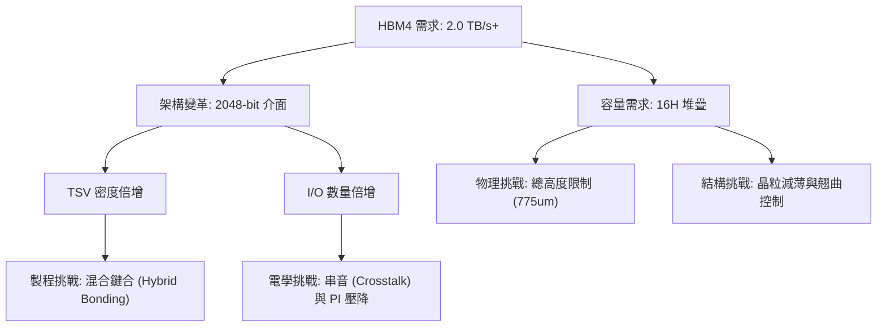

!!! example "產業實例"
    截至撰寫時，全球主要的記憶體供應商如 **SK 海力士 (SK Hynix)**、**三星電子 (Samsung Electronics)** 與 **美光 (Micron)** 均已投入 HBM4 的研發。其中，為了因應 2048-bit 帶來的複雜邏輯控制需求，記憶體廠商開始與晶圓代工廠（如 **台積電 (TSMC)**）深度合作，利用 12 奈米甚至 5 奈米邏輯製程來打造 HBM4 的 Base Die，這標誌著記憶體與邏輯製程整合進入了全新的階段。

## 40.3 基礎晶粒與邏輯製程整合

在高速運算（HPC）與人工智慧（AI）加速器的架構中，高頻寬記憶體（HBM）並非單純的動態隨機存取記憶體（DRAM）堆疊，而是一個高度整合的系統化封裝。其中，位於堆疊最底層、直接與中介層（Interposer）接觸的「基礎晶粒」（Base Die，亦常稱為 Logic Die 或 Controller Die），扮演了決定性的角色。

### 基礎晶粒的功能與架構

基礎晶粒是 HBM 堆疊中的「神經中樞」，其主要功能可分為以下三個維度：

1.  **控制邏輯與指令轉譯**：
    基礎晶粒負責接收來自系統單晶片（SoC）或圖形處理器（GPU）的指令。由於 HBM 採用寬介面（Wide I/O）架構，每一代 HBM 的通道（Channel）數量持續增加，基礎晶粒必須高效地將複雜的存取指令轉譯為各層 DRAM 晶粒（Core Die）可執行的信號，並管理刷新（Refresh）、預充電（Precharge）等底層操作。

2.  **實體層（PHY）與高速介面**：
    實體層是基礎晶粒中最佔面積且功耗最集中的部分。它負責處理高頻信號的驅動與接收，確保數據在數千個微凸塊（Micro-bump）與中介層導線間傳輸時，仍能維持極低的位元錯誤率（BER）。隨著數據速率（Data Rate）提升，PHY 必須具備更強的等化（Equalization）能力與時鐘恢復（Clock Recovery）機制。

3.  **測試與修復機制（DFT/DFM）**：
    由於 HBM 是由多層晶粒堆疊而成，任何一層失效都會導致整顆 HBM 報廢。基礎晶粒整合了內建自測（BIST）與軟硬體修復邏輯，能在封裝後偵測出失效的矽穿孔（TSV）或記憶體單元，並透過冗餘（Redundancy）路徑進行切換，這對於提升最終良率至關重要。

### 基礎晶粒製程的演進：從成熟到先進邏輯

在 HBM2E 與 HBM3 世代，基礎晶粒多採用 28nm 或 12nm/16nm 等成熟或過渡性邏輯製程。然而，隨著 HBM3E 邁向 HBM4，基礎晶粒的製程節點出現了顯著的微縮需求。

#### 製程微縮的必要性

截至撰寫時，HBM4 的開發已明確導向 5nm 甚至更先進的邏輯製程，其驅動因素如下：

*   **功耗效率（Power Efficiency）**：
    HBM 的總功耗中，很大一部分來自於基礎晶粒的 PHY 與數據傳輸。根據動態功耗公式：

    $$P_{dynamic} = \alpha \cdot C \cdot V_{DD}^2 \cdot f$$

    其中 $\alpha$ 為開關活動率，$C$ 為負載電容，$V_{DD}$ 為供應電壓，$f$ 為頻率。透過先進製程（如 FinFET 或 GAAFET，見第 6 章），可以顯著降低工作電壓與寄生電容，從而提升每瓦頻寬（Bandwidth per Watt）。

*   **邏輯密度與功能整合**：
    HBM4 的通道數預計將從 HBM3 的 1024-bit 翻倍至 2048-bit。為了在有限的晶粒面積內容納兩倍數量的 PHY 電路與 TSV 陣列，必須採用更高密度的邏輯製程。

*   **信號完整性（Signal Integrity）**：
    先進製程能提供更精確的時脈控制電路，減少抖晃（Jitter），這對於 HBM3E 達到 9.2 Gbps 以上或 HBM4 更高數據速率的穩定性至關重要。

!!! note "製程跨界整合"
    傳統上，DRAM 廠商（如 SK Hynix、Samsung、Micron）自行生產基礎晶粒。但隨著製程微縮至 7nm 以下，DRAM 廠商開始與專業邏輯代工廠（如 TSMC）深度合作，利用代工廠的先進邏輯製程來製造基礎晶粒，再運回記憶體廠進行堆疊封裝。

### 客製化 HBM (Custom HBM) 趨勢

隨著 AI 運算對「記憶體牆」（Memory Wall）挑戰的加劇，HBM 不再僅是標準化的通用組件，而是朝向「客製化」發展。

客製化 HBM 的核心在於將特定的運算邏輯直接整合進基礎晶粒中。這種做法被稱為「近記憶體運算」（Near-Memory Computing）。

1.  **特定運算加速**：在基礎晶粒中加入簡單的算術邏輯單元（ALU）或向量處理單元，處理如數據壓縮、解密或基本的張量運算，減少數據在 SoC 與 HBM 之間往返的次數。
2.  **效能最佳化**：針對特定客戶的 SoC 介面進行 PHY 的參數優化，甚至調整 TSV 的排列方式以符合特定的散熱或電性需求。

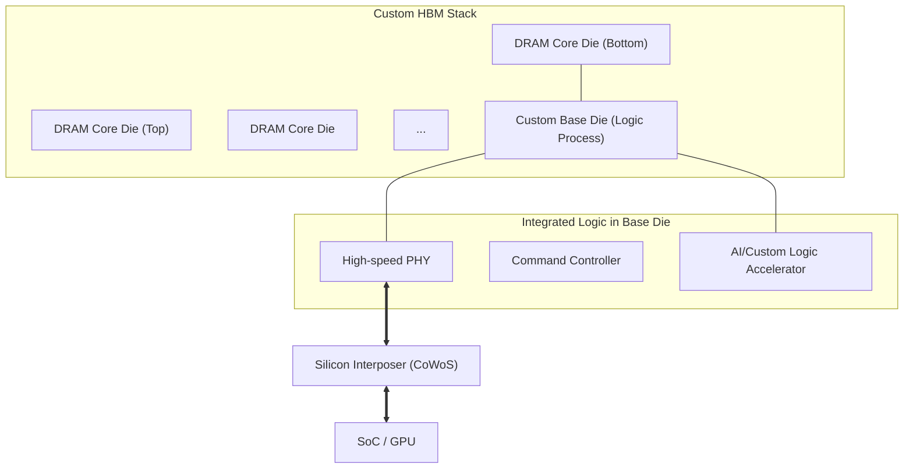

### 基礎晶粒與 SoC 的電性連接

基礎晶粒位於 HBM 堆疊與中介層的交介面，其物理連接技術直接影響系統的電性表現。

#### 1. 矽穿孔 (TSV) 的佈局
基礎晶粒必須容納數以千計的 TSV，這些 TSV 垂直穿透晶粒，將上層 DRAM 的信號引導至底部的微凸塊。TSV 的直徑與間距（Pitch）受限於邏輯製程的設計規則（Design Rules），在先進製程下，必須精確計算 TSV 對周邊電晶體產生的應力影響（见第 39 章）。

#### 2. 微凸塊 (Micro-bump) 連接
基礎晶粒底部透過微凸塊與中介層連接。
*   **典型值**：HBM3 世代的微凸塊間距約在 30 $\mu m$ 至 40 $\mu m$ 之間。
*   **演進**：為了因應 HBM4 翻倍的位元寬度，微凸塊間距預計將進一步縮減，或採用混合鍵合（Hybrid Bonding，見第 39 章）技術，取消凸塊以達成更高的連接密度與更低的電阻。

#### 3. 中介層的傳輸挑戰
基礎晶粒與 SoC 之間的信號傳輸路徑如下：

$$SoC \leftrightarrow Micro-bump \leftrightarrow Interposer\ Trace \leftrightarrow Micro-bump \leftrightarrow Base\ Die$$

由於中介層通常採用矽基材料（Silicon Interposer），其金屬線寬與線距（L/S）極細（典型值為 0.5/0.5 $\mu m$），這會產生顯著的電阻-電容（RC）延遲。基礎晶粒的 PHY 必須補償這些損耗，以維持信號的眼圖（Eye Diagram）張開度。

!!! warning "熱膨脹係數 (CTE) 匹配"
    基礎晶粒採用邏輯製程，其熱膨脹係數與上層的 DRAM 晶粒（DRAM 製程）以及下層的矽中介層雖然接近，但在極端工作溫度下，不同製程產生的材料應力仍可能導致微凸塊龜裂。這是製程整合中必須透過底填膠（Underfill）與封裝材料優化來解決的課題。

### 產業實例：HBM4 的合作模式

截至撰寫時，產業內已出現明確的合作分工模式。例如，台積電（TSMC）與 SK 海力士（SK Hynix）宣布在 HBM4 領域展開合作，由台積電利用其 5nm 或 12nm 先進邏輯製程生產基礎晶粒，再由 SK 海力士進行 HBM 堆疊與封裝。這種跨公司的製程整合，象徵著 HBM 已從單純的記憶體產品轉型為複雜的邏輯-記憶體異質整合系統。這也意味著未來的 HBM 工程師不僅需精通 DRAM 原理，更需具備先進邏輯製程與系統級封裝（SiP）的知識背景。

<!-- fig:2 -->
<figure markdown>
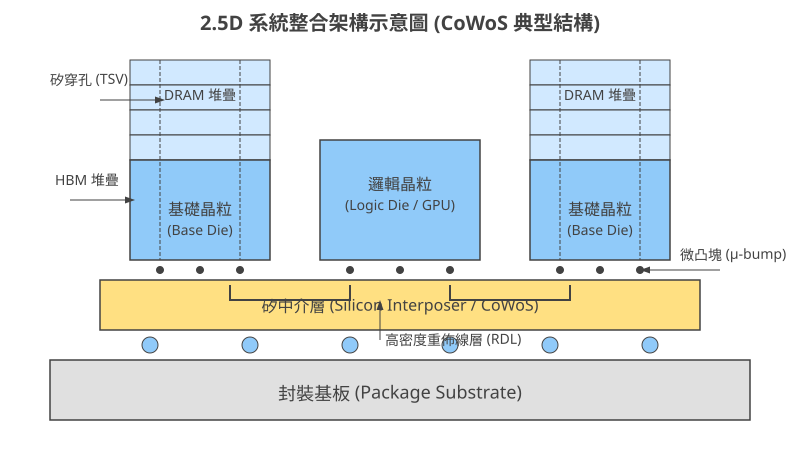
<figcaption>圖 40-2　2.5D 系統整合架構圖（AI 繪製的示意圖）</figcaption>
</figure>

## 40.4 散熱管理與良率挑戰

在高頻寬記憶體（HBM）的垂直堆疊架構中，隨著堆疊層數從 HBM3 的 8 層、12 層增加至 HBM4 的 16 層甚至更高，散熱管理（Thermal Management）與良率控制（Yield Control）成為決定產品能否量產的關鍵瓶頸。本節將從熱阻物理模型、材料化學特性、統計良率模型以及機械應力控制四個維度進行深入探討。

#### 40.4.1 垂直堆疊結構的熱阻模型與熱點分佈

HBM 的結構本質上是一個多層異質結構的熱傳導問題。熱量主要由底部的基礎晶粒（Base Die）以及各層動態隨機存取記憶體（DRAM）晶粒在高速切換時產生。由於 HBM 封裝於系統單晶片（SoC）旁，且上方通常覆蓋散熱片，熱傳導路徑主要為垂直向上傳導。

**1. 一維熱阻模型**
根據傅立葉導熱定律（Fourier's Law），在一維簡化模型中，總熱阻 $R_{th, total}$ 可表示為各層材料熱阻的線性加總：

$$R_{th, total} = \sum_{i=1}^{n} R_{i} = \sum_{i=1}^{n} \frac{d_i}{k_i \cdot A}$$

其中：
*   $d_i$ 為第 $i$ 層材料的厚度。
*   $k_i$ 為該層材料的導熱係數（Thermal Conductivity）。
*   $A$ 為受熱面積。

在 HBM 堆疊中，熱阻來源包含矽晶圓本體、矽穿孔（TSV）、微凸塊（Microbumps）以及填充於晶粒間隙的底部填充劑（Underfill）。由於矽的導熱係數（典型值約 $149 \, W/m \cdot K$）遠高於高分子類的底部填充劑（典型值 $< 2 \, W/m \cdot K$），因此 TSV 的密度與分佈直接決定了垂直熱傳導的效率。

**2. 熱點（Hotspot）分佈**
截至撰寫時，HBM 的熱點主要集中在兩個區域：
*   **Base Die 區域**：由於 Base Die 整合了高速邏輯電路與實體層（PHY），其功耗密度通常高於上方的 DRAM 晶粒。若 Base Die 採用更先進的製程節點（如 5nm 或更先進節點），電晶體密度增加會導致局部熱點更加顯著。
*   **堆疊中下層 DRAM**：由於熱量需經過多層界面才能傳導至頂部的散熱介面材料（TIM），中下層晶粒往往累積較高溫度，這會導致漏電流增加，進而縮短資料保持時間（Retention Time），增加刷新（Refresh）頻率，形成正回饋的熱失控風險。

#### 40.4.2 散熱材料的演進：高導熱底部填充劑

為了降低晶粒間的熱阻，封裝材料的化學組成與物理性質至關重要。目前主要採用非導電膠膜（NCF, Non-Conductive Film）與模製底部填充劑（MUF, Molded Underfill）兩種技術路徑。

**1. 材料化學特性**
底部填充劑主要由環氧樹脂（Epoxy Resin）、硬化劑（Curing Agent）以及無機填充顆粒（Fillers）組成。為了提升導熱係數，研發方向在於提高填充顆粒的比例與優化其材質。
*   **填充顆粒**：傳統使用二氧化矽（$SiO_2$）以匹配熱膨脹係數（CTE），但其導熱性有限。先進材料開始引入氧化鋁（$Al_2O_3$）或氮化鋁（$AlN$）顆粒，這些材料具備較高的聲子傳導效率。
*   **黏度與流動性**：增加填充顆粒會導致材料黏度上升，這在極窄間隙（Gap < $20 \, \mu m$）的 HBM 堆疊中會造成填充不全（Void）的缺陷。因此，必須透過表面改質技術（Surface Modification）改善顆粒與樹脂間的潤濕性。

**2. 製程演進：從 TC-NCF 到 Advanced MUF**
*   **TC-NCF (Thermal Compression NCF)**：在 HBM3E 中廣泛應用。將 NCF 貼合於晶圓背面，在熱壓合（Thermal Compression Bonding）過程中，NCF 被擠壓並填充於微凸塊間隙。其優點是能精確控制層間厚度，但熱傳導性能受限於 NCF 本身的低導熱係數。
*   **Advanced MUF**：利用模封壓力將含高導熱填料的樹脂注入多層堆疊間隙。截至撰寫時，部分廠商透過優化樹脂的觸變性（Thixotropy），在維持高填料比例的同時確保流動性，顯著提升了整體散熱效能。

#### 40.4.3 已知合格晶粒 (KGD) 對最終良率的統計影響

HBM 的製造屬於典型的「多晶片封裝」（Multi-Chip Package, MCP），其最終良率對單一晶粒的良率極為敏感。

**1. 良率乘法效應**
假設一個 HBM 堆疊包含 1 片 Base Die 與 $N$ 片 DRAM 晶粒。若 Base Die 的良率為 $Y_{base}$，DRAM 晶粒的良率為 $Y_{DRAM}$，且封裝堆疊製程的良率（Assembly Yield）為 $Y_{asm}$，則最終產品良率 $Y_{HBM}$ 可表示為：

$$Y_{HBM} = Y_{base} \cdot (Y_{DRAM})^{N} \cdot Y_{asm}$$

!!! example "良率計算實例"
    假設 $N=12$（12 層堆疊），若單片 DRAM 晶粒的良率為 $98\%$，且假設 $Y_{base}$ 與 $Y_{asm}$ 皆為 $100\%$，則最終良率 $Y_{HBM} = (0.98)^{12} \approx 78.5\%$。
    若堆疊層數增加至 $N=16$（HBM4 規格），同樣 $98\%$ 的晶粒良率會導致最終良率下降至約 $72.4\%$。

這說明了為何「已知合格晶粒」（Known Good Die, KGD）在 HBM 製程中至關重要。為了提升良率，必須在封裝前進行極為嚴苛的晶圓級測試（Wafer-level Test），包括高溫、低溫以及速度篩選，以確保進入堆疊製程的每一片晶粒都符合規格（詳見第 35 章良率模型與第 42 章成品測試）。

**2. 冗餘設計（Redundancy）**
為了補償因 TSV 或微凸塊連接失效導致的良率損失，HBM 在架構上引入了冗餘通道與備用單元。當測試發現特定位址失效時，可透過電子熔絲（e-Fuse）進行重新映射（Remapping），這在一定程度上緩解了統計良率的壓力。

#### 40.4.4 薄化晶圓處理與翹曲控制

為了限制 HBM 堆疊的總高度（以符合標準封裝規範），DRAM 晶粒必須進行極度薄化。

**1. 薄化製程與應力**
HBM 中的 DRAM 晶粒厚度通常需研磨至 $30 \, \mu m$ 到 $50 \, \mu m$ 之間（典型值）。如此薄的矽片在力學上極為脆弱，且內部殘留應力會導致晶圓出現嚴重的翹曲（Warpage）。
*   **晶圓薄化（Thinning）**：採用化學機械研磨（CMP，見第 24 章）與乾式拋光。
*   **載具晶圓鍵合（Carrier Wafer Bonding）**：在薄化前，需將元件晶圓鍵合至支撐載具（Carrier）上，待完成背面 TSV 露頭（TSV Reveal）與微凸塊製作後，再進行解鍵合（Debonding）。

**2. 翹曲（Warpage）物理機制**
翹曲主要源於不同材料間熱膨脹係數（CTE）的不匹配。當環境溫度從鍵合溫度（Bonding Temperature）降至室溫時，矽（$CTE \approx 2.6 \, ppm/^\circ C$）、銅（$CTE \approx 16.7 \, ppm/^\circ C$）與封裝樹脂（$CTE \approx 10\text{-}30 \, ppm/^\circ C$）的收縮程度不同，產生內應力。

$$ \epsilon = (\alpha_{A} - \alpha_{B}) \cdot \Delta T $$

其中 $\epsilon$ 為熱應變，$\alpha$ 為熱膨脹係數。

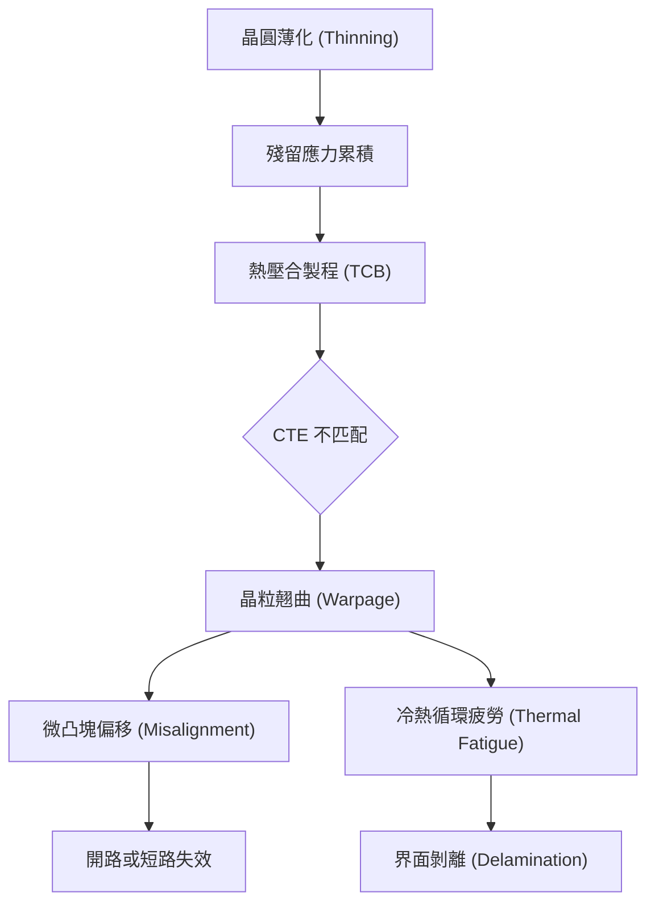

**3. 翹曲控制策略**
*   **對稱性設計**：在封裝結構設計時，盡可能保持材料分佈的上下對稱，以抵消彎矩。
*   **低溫鍵合技術**：開發低溫固化的底部填充劑或採用混合鍵合（Hybrid Bonding，見第 39 章），減少 $\Delta T$，從源頭降低應力。
*   **暫時性鍵合材料優化**：使用具備特定模數（Modulus）的膠材，在加工過程中吸收應力，並在解鍵合後不留殘膠。

!!! note "技術趨勢：從微凸塊到混合鍵合"
    截至撰寫時，HBM4 的研發重點之一是導入無凸塊（Bumpless）的混合鍵合技術。由於省去了微凸塊與底部填充劑層，不僅能進一步縮減堆疊高度，更能顯著降低層間熱阻，並消除因凸塊間距（Pitch）微縮帶來的橋接短路風險，這被視為解決 HBM 散熱與良率瓶頸的終極方案之一。

## 40.5 設備與廠商技術

高頻寬記憶體（HBM）的製造不僅涉及前段（FEOL）的 DRAM 晶粒加工，更核心的挑戰在於後段（BEOL）與中段（MEOL）的垂直堆疊製程。本節將探討實現 HBM 堆疊所需的關鍵設備、封裝技術路線的物理差異，以及主要廠商的技術取捨。

### 40.5.1 關鍵設備類型與子系統

HBM 的製造流程中，最關鍵的站點在於將多層 DRAM 晶粒精準地堆疊於基礎晶粒（Base Die）之上。這需要極高精度的鍵合（Bonding）設備、薄化（Thinning）設備以及針對矽穿孔（TSV）的高深寬比蝕刻與填孔設備。

1.  **鍵合機（Bonder）**：
    *   **關鍵子系統**：對準系統（Alignment System）須具備次微米級（Sub-micron）的精度，通常採用雙向視覺對準技術；加熱與壓力控制系統（Thermal & Pressure Control）則需精確控制升溫曲線（Ramp rate）與施力均勻度，以避免晶粒壓裂或焊點橋接。
2.  **晶圓減薄與研磨設備（Grinding & Polishing）**：
    *   **關鍵子系統**：承載盤（Chuck）的平坦度與厚度量測系統。由於 HBM 晶粒需減薄至 30 $\mu$m 至 50 $\mu$m 之間（典型值），設備必須具備極高的應力控制能力，防止晶圓破裂。
3.  **深矽蝕刻設備（Deep Silicon Etch）**：
    *   **關鍵子系統**：電漿源（Plasma Source）與氣體循環切換系統。用於製造 TSV 的博世製程（Bosch Process），需快速切換蝕刻氣體（如 $SF_6$）與鈍化氣體（如 $C_4F_8$），以達成高深寬比與垂直壁面。

### 40.5.2 TCB 與 MR-MUF 製程比較

截至撰寫時，HBM 的堆疊主要存在兩條技術路線：熱壓鍵合（Thermal Compression Bonding, TCB）與質量回流封裝（Mass Reflow Molded Underfill, MR-MUF）。

#### 1. 熱壓鍵合 (TCB)
TCB 是一種「逐片鍵合」技術。其物理原理是利用加熱頭直接對單顆晶粒施加壓力和熱量，使錫球（Solder Bump）熔融並與下層墊片（Pad）結合。
*   **優點**：能精確控制晶粒位移與高度，對於薄晶圓產生的翹曲（Warpage）有較好的抑制能力，適合極細間距（Fine Pitch）製程。
*   **缺點**：生產效率（Throughput）較低，因為每一層晶粒都需要單獨的加熱與冷卻循環。

#### 2. 質量回流封裝 (MR-MUF)
MR-MUF 則是將多層晶粒先進行初步放置，再整體送入回流爐（Reflow Oven）進行集體焊接，隨後注入模製底部填充劑（Molded Underfill）。
*   **優點**：生產效率極高。此外，MUF 材料的熱傳導率通常優於傳統的非導電膠膜（NCF），有助於散熱。
*   **缺點**：在多層堆疊時，熱膨脹係數（CTE）失配導致的翹曲控制難度較大。

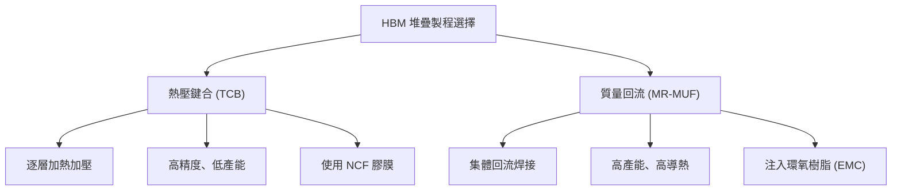

### 40.5.3 混合鍵合 (Hybrid Bonding) 的導入前景

隨著 HBM4 及其後續規格對頻寬與堆疊層數（16層以上）的要求提升，傳統錫球焊接的間距已接近物理極限（約 10-20 $\mu$m）。混合鍵合（Hybrid Bonding）技術（見第 39 章）被視為下一代核心技術。

混合鍵合不使用錫球，而是透過銅對銅（Cu-to-Cu）的直接接觸與分子鍵合。其物理優勢在於：
1.  **極小間距**：可縮減至 10 $\mu$m 以下，大幅提升訊號傳輸密度。
2.  **熱阻降低**：銅的熱傳導率遠高於錫膏與底填膠，公式如下：

    $$R_{th} = \frac{L}{k \cdot A}$$

    其中 $R_{th}$ 為熱阻，$L$ 為長度，$k$ 為熱傳導率，$A$ 為接觸面積。銅鍵合大幅增加了 $k$ 並縮短了 $L$，能顯著改善 HBM 的散熱瓶頸。

### 40.5.4 主要設備供應商技術比較

下表列出 HBM 製程中具代表性的設備供應商及其技術特點：

| 廠商 | 代表產品系列 | 技術路線與特點 | 主要應用 |
| :--- | :--- | :--- | :--- |
| **Applied Materials** | Endura 平台系列 | 高可靠度 PVD 鍍膜，確保 TSV 孔壁種子層（Seed Layer）連續性 | TSV 金屬化與導線架構 |
| **Lam Research** | Syndion 系列 | 專為高深寬比設計的深矽蝕刻技術，具備優異的側壁粗糙度控制 | TSV 孔洞成型 |
| **Tokyo Electron** | Tactras 系列 | 整合式蝕刻系統，針對新型介電材料具備高選擇比 | 介電質蝕刻與圖案化 |
| **BESI** | Datacon 8800 CHAMEO 系列 | 高精度混合鍵合設備，支援次微米級對準精度 | HBM4 實驗線與先進堆疊 |
| **DISCO** | DFG 系列研磨機 | 超薄晶圓研磨技術，具備應力消除與厚度均勻性控制 | 晶粒減薄製程 |
| **Advantest** | T5833 | 針對 HBM 高速 I/O 測試設計，支援大量並行測試 | 記憶體成品測試 |
| **KLA** | 39xx 系列 | 寬頻電漿光學檢測，用於捕捉 TSV 內部與重佈線層（RDL）缺陷 | 良率監控與缺陷檢測 |

### 40.5.5 產業實例與技術取捨

在 HBM 的量產實作中，不同廠商根據其製程積累選擇了不同的路徑：

*   **SK Hynix**：截至撰寫時，該公司在 HBM3 與 HBM3E 世代主要採用 **MR-MUF** 技術。其核心競爭力在於開發了高導熱的模製填充材料，並配合集體回流製程，解決了散熱與生產效率的平衡問題。
*   **Samsung**：傳統上傾向於使用 **TCB** 搭配非導電膠膜（NCF）。為了應對 HBM4 的高度限制，其技術演進方向在於進一步減薄 NCF 厚度，並優化熱壓頭的壓力分佈，以確保 16 層堆疊的結構穩定性。
*   **Micron**：同樣採用 **TCB** 方案，並強調在基礎晶粒（Base Die）與 DRAM 晶粒間的熱膨脹匹配，利用高精度的鍵合設備來提升良率。
*   **台積電 (TSMC)**：作為先進封裝的整合者，其 **CoWoS** 平台（見第 38 章）提供了 HBM 與邏輯晶片（如 GPU、ASIC）整合的物理基礎。台積電並不直接生產 HBM，但其矽中介層（Silicon Interposer）製程與 HBM 的微凸塊（Micro-bump）間距規範息息相關。截至撰寫時，台積電正積極與記憶體供應商合作，定義 HBM4 的混合鍵合標準，以確保其在 CoWoS 平台上的電性表現。

### 40.5.6 選機考量與製程挑戰

晶圓廠在選擇 HBM 設備時，核心考量在於「良率與產能的折衷」。例如，雖然混合鍵合具備最佳電性，但其對環境潔淨度（Cleanliness）的要求極高，微小的微粒（Particle）即會導致鍵合失敗。因此，在 HBM4 轉型期，設備是否具備高度自動化的原位檢測（In-situ Inspection）功能，以及是否能與現有的製造執行系統（MES，見第 45 章）深度整合以進行統計製程控制（SPC，見第 36 章），將是提升量產競爭力的關鍵。

## 本章重點

*   **記憶體牆的物理限制**：傳統 DDR 與 GDDR 記憶體受限於封裝佈線密度，必須透過提高時脈頻率提升頻寬，卻導致功耗劇增與訊號完整性問題。HBM 透過「以寬度換取頻率」的策略，從架構上解決此物理限制。
*   **3D 堆疊與垂直互連**：HBM 核心技術在於利用矽穿孔（TSV）與微凸塊（Micro-bump）實現多層 DRAM 晶粒的垂直堆疊，將傳輸路徑從公釐等級縮短至微米等級，顯著降低寄生電感與電阻。
*   **HBM4 的架構變革**：為突破單接腳速率的物理瓶頸，HBM4 將介面位元寬度從 1024-bit 倍增至 2048-bit，這要求更高的 TSV 密度與更先進的封裝對準精度。
*   **基礎晶粒（Base Die）的邏輯整合**：基礎晶粒負責 PHY、指令轉譯與測試修復。隨技術演進，其製程由成熟節點轉向 5nm 等先進邏輯製程，並出現客製化「近記憶體運算」的趨勢。
*   **熱阻管理與散熱瓶頸**：HBM 堆疊層數增加會導致熱阻累積。透過高導熱填料的底部填充劑（Underfill）與優化 TSV 分佈，是緩解中下層晶粒熱點問題的關鍵。
*   **良率的乘法效應**：HBM 的最終良率取決於單片晶粒良率（KGD）的 $N$ 次方。隨著堆疊層數增加，對已知合格晶粒的篩選要求與封裝過程中的翹曲控制變得極為嚴苛。
*   **封裝製程技術路線**：現行量產以熱壓鍵合（TCB）與質量回流封裝（MR-MUF）為主，未來朝向無凸塊的混合鍵合（Hybrid Bonding）發展，以進一步提升互連密度並降低熱阻。

## 重點圖卡

複習時看這幾張就能抓住本章重點；[圖卡庫](../cards.md)可以下載成圖片。

<figure markdown>
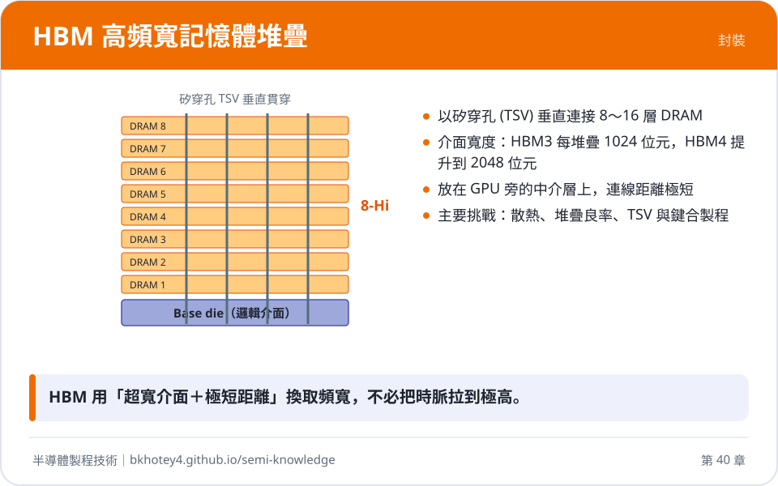
<figcaption>核心概念圖卡：HBM 高頻寬記憶體堆疊</figcaption>
</figure>

<figure markdown>
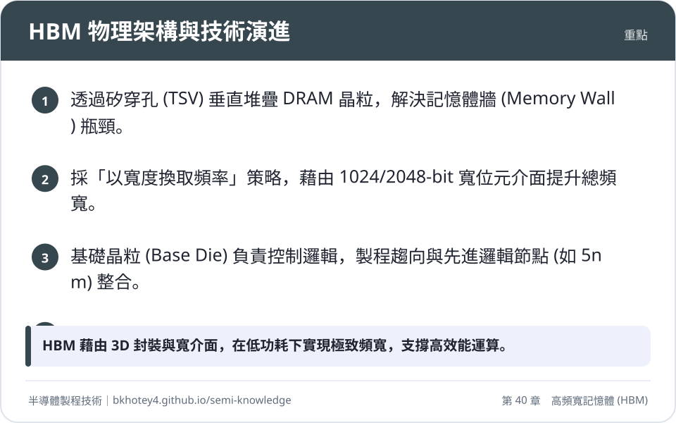
<figcaption>重點圖卡：HBM 物理架構與技術演進</figcaption>
</figure>

<figure markdown>
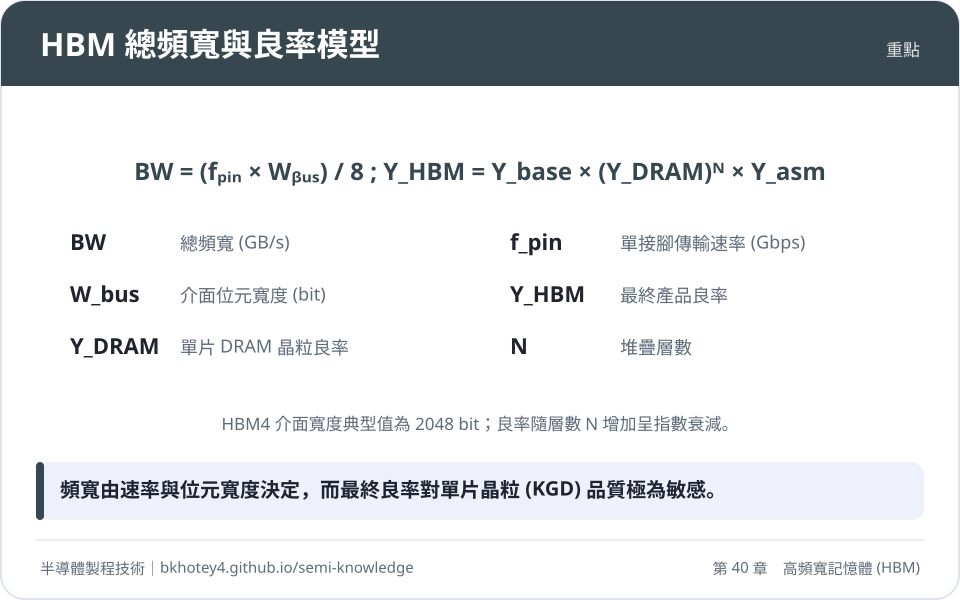
<figcaption>重點圖卡：HBM 總頻寬與良率模型</figcaption>
</figure>

<figure markdown>
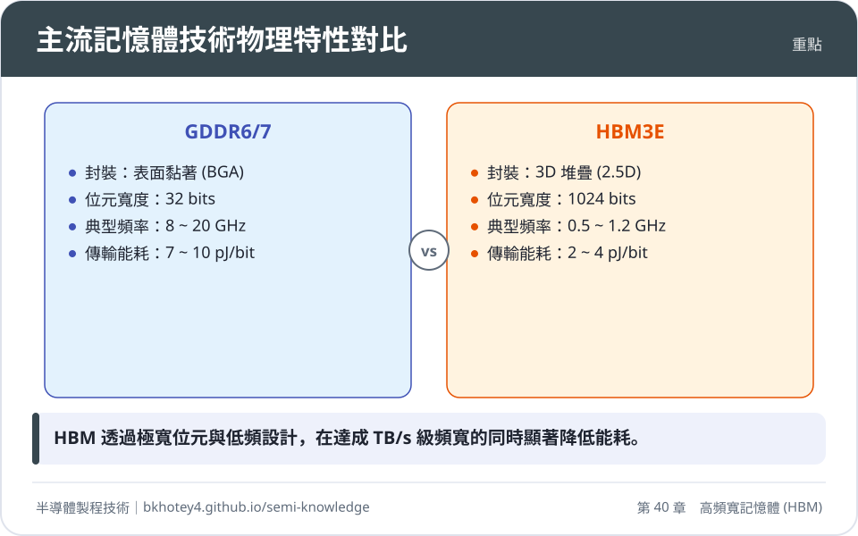
<figcaption>重點圖卡：主流記憶體技術物理特性對比</figcaption>
</figure>

<figure markdown>
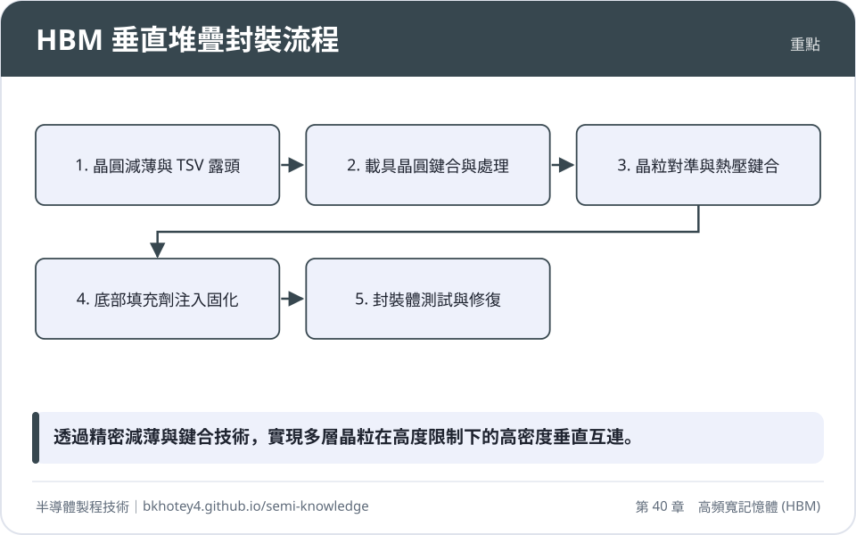
<figcaption>重點圖卡：HBM 垂直堆疊封裝流程</figcaption>
</figure>

## 習題

**1. 頻寬計算題：若某一 HBM3E 堆疊的單一接腳（Pin）傳輸速率為 9.6 Gbps，且其介面位元寬度為 1024-bit，請計算該 HBM 堆疊的總頻寬（以 GB/s 為單位）。**

??? success "參考解答"
    根據頻寬公式：$BW = (f_{pin} \times W_{bus}) / 8$
    $BW = (9.6 \, \text{Gbps} \times 1024) / 8$
    $BW = 9830.4 / 8 = 1228.8 \, \text{GB/s}$
    因此，該 HBM3E 堆疊的總頻寬約為 1.23 TB/s。

**2. 功耗物理分析：為何 HBM 在提供極高頻寬的同時，其傳輸能耗（pJ/bit）卻能遠低於 GDDR？請從頻率與電壓的角度說明。**

??? success "參考解答"
    根據動態功耗公式 $P \propto C \cdot V^2 \cdot f$，功耗與頻率成正比。GDDR 為了達到高頻寬，必須將時脈頻率提升至數 GHz（如 16-20 GHz），導致 I/O 功耗劇增。而 HBM 透過 1024-bit 的寬介面，在較低的時脈頻率（約 1 GHz 左右）下即可達成更高頻寬。較低的頻率不僅直接減少動態功耗，還能允許使用較低的工作電壓並簡化訊號驅動電路，進而大幅提升能源效率。

**3. 良率統計題：假設某 12 層（12H）HBM 堆疊製程中，Base Die 的良率為 99%，封裝堆疊製程良率為 95%，若要求最終產品良率必須達到 80% 以上，則單片 DRAM 晶粒（KGD）的良率至少需達到多少？**

??? success "參考解答"
    設單片 DRAM 良率為 $Y_{DRAM}$，根據良率模型：$Y_{HBM} = Y_{base} \cdot (Y_{DRAM})^{12} \cdot Y_{asm}$
    $0.80 = 0.99 \cdot (Y_{DRAM})^{12} \cdot 0.95$
    $0.80 = 0.9405 \cdot (Y_{DRAM})^{12}$
    $(Y_{DRAM})^{12} = 0.80 / 0.9405 \approx 0.8506$
    $Y_{DRAM} = (0.8506)^{1/12} \approx 0.9866$
    因此，單片 DRAM 晶粒的良率至少需達到 98.66%。

**4. 觀念題：在 HBM4 規格中，為何 JEDEC 考慮將封裝高度限制從 720 $\mu m$ 放寬至 775 $\mu m$？若不放寬高度限制，對製程會產生哪些物理挑戰？**

??? success "參考解答"
    放寬高度限制是為了容納更多的堆疊層數（如 16 層）。若維持原高度，單層 DRAM 晶粒必須進一步減薄至極限（可能低於 30 $\mu m$），這會帶來以下挑戰：(1) 矽晶圓物理強度下降，極易在搬運中破裂；(2) 嚴重的晶圓翹曲（Warpage）問題，導致微凸塊對準困難；(3) 薄化產生的晶格應力可能影響 DRAM 電容的電荷保持時間（Retention Time）。

**5. 比較題：請簡述熱壓鍵合（TCB）與質量回流封裝（MR-MUF）在 HBM 製造中的優缺點。**

??? success "參考解答"
    (1) TCB：優點是能精確控制單片晶粒的位移與高度，對翹曲控制力強，適合極細間距；缺點是逐片加熱壓力，生產效率（Throughput）較低。(2) MR-MUF：優點是集體回流焊接，生產效率高，且模製填充材料（MUF）通常具備較佳的導熱性；缺點是多層堆疊時的翹曲控制難度較大，且對模封壓力下的位移控制要求極高。

## 本章術語

- **Memory Wall**（記憶體牆）：處理器運算速度增長率與記憶體存取速度增長率之間的巨大鴻溝。
- **TSV**（矽穿孔）：穿透矽襯底的垂直導通孔，用於 3D 封裝中的電性互連。
- **Micro-bump**（微凸塊）：用於堆疊晶粒間電性連接的微型焊點，間距通常在數十微米等級。
- **Base Die**（基礎晶粒）：位於 HBM 堆疊底部，負責邏輯控制、訊號驅動與測試的邏輯晶粒。
- **KGD**（已知合格晶粒）：在封裝前經過完整測試並確認符合規格的裸晶。
- **TCB**（熱壓鍵合）：透過同時施加壓力與熱量使焊點熔合的封裝技術。
- **MR-MUF**（質量回流模製底部填充）：結合集體回流焊接與模封技術的封裝製程。
- **Hybrid Bonding**（混合鍵合）：不使用凸塊，直接透過銅對銅分子鍵合實現高密度互連的技術。
- **Warpage**（翹曲）：因不同材料間熱膨脹係數（CTE）不匹配導致的晶圓或封裝體彎曲變形。
- **Wide I/O**（寬位元介面）：透過增加資料匯流排寬度（如 1024-bit）來提升總頻寬的設計架構。

## 互動學習

!!! tip "動手試試看"
    - [設備機台圖鑑：鍵合機](../equipment.md)

## 產業最新進展

本節由每日產業新聞自動補充，說明本章技術在產業上的最新發展。

<!-- updates -->
- **2026-11-13**　三星宣布砸下46兆韓元重推進階記憶體並動工新廠，聚焦高頻寬記憶體（HBM）的產能擴充。此舉與先進封裝技術中的記憶體堆疊、資料傳輸頻寬提升高度相關，呼應高頻寬記憶體（HBM）在人工智慧運算架構中的關鍵地位。（來源：[【科技早餐】北京拚年產 20 萬台機器人！三星 HBM 新廠動工、規劃投資 46 兆韓元 - TechOrange 科技報橘](https://news.google.com/rss/articles/CBMiiAFBVV95cUxPVm1lSGxjOWJhZjU4Q3FVSWdoWEtkTG1XR2t6bWNGQ3QwZk9MWGNWOWlIRDRSdTZPUjhFYmN3XzIzZW1pOFlXSHktRThzbWY4Z3JTRTN2a2Y3d250aExjeld0bGxkMGlmeWdsdDdGYm9uTmNtRk95UlZjaW1zSFZ1UG45M2ZpaUNi?oc=5)）
- **2026-10-27**　高頻寬記憶體（HBM）作為人工智慧處理器旁側的高效能儲存解決方案，其內部採用矽穿孔（TSV）與多層晶片垂直堆疊技術。晶片基板與先進封裝的搭配組合，是決定整體系統頻寬與傳輸瓶頸的關鍵因素。（來源：[SemiAnalysis創始人：輝達HBM、先進封裝用量佔比已下降，2027年或繼續下滑！半導體供應鏈2028年或仍緊張，AI最大瓶頸是晶片基板 - 鉅亨號](https://news.google.com/rss/articles/CBMiSEFVX3lxTE9TeHhZT2dKMTJQQ1RzWi1Nb29WMjI4WVdnbGlnNjZGenJZNDVWdElnQnhDR0Q4YS0yemZZOXktQjljTjlyN1VYbw?oc=5)）
- **2026-10-25**　AI 晶片大廠推動高頻寬記憶體（HBM）之應用，使記憶體頻寬顯著提升。此技術進展對應高頻寬記憶體原理與架構演進，涉及多晶片堆疊與高資料傳輸率之系統整合設計。（來源：[AI晶片大洗牌！Google、亞馬遜搶攻2奈米＋HBM4 記憶體頻寬暴增2.5倍、台廠散熱PCB迎大單 - FTNN 新聞網](https://news.google.com/rss/articles/CBMiS0FVX3lxTE1TbXBRR0ZNUElVQ1psU0dLR1dmbTZvOWJQU2lPZjlJd1lVZFRCYnNJM3hjSVRoR3p4OC1xVnVfT1hsYzBKWnpsdDdoZw?oc=5)）
- **2026-10-23**　SK海力士開發高頻寬記憶體（HBM）的新散熱技術，透過材料與結構改良降低熱阻逾30%。這對高頻寬記憶體（HBM）的熱管理與多晶片堆疊的散熱效能具備直接的工程助益。（來源：[HBM也要拚散熱！SK海力士新技術讓熱阻降逾30% - 鉅亨網](https://news.google.com/rss/articles/CBMiT0FVX3lxTE15UjJoT3pOY0RORGg5UnI1aHhFVUlZdlRmYm96RFVTM2kxYXRXcjluaHBCMVJrQmthQkY2cDZwLS1vUFV3LXdiLVZ4WnJjZEU?oc=5)）
- **2026-10-22**　高頻寬記憶體（HBM）的架構持續演進，新一代產品之基礎晶粒採用先進邏輯製程製作。這與高頻寬記憶體章節中探討的邏輯晶片與記憶體異質整合及先進封裝互連技術高度相關。（來源：[韓媒：三星應輝達要求 下一代HBM基礎晶粒採台積電3奈米 - 經濟日報](https://news.google.com/rss/articles/CBMiWkFVX3lxTE1yNHFGTGw0VW1uNDVuMFp3NUZhMVplbGZTakVvalRkWU5sT3F3Ml9admxvTkRhREdnVzV6c2tWT0QyNm1jNWhRN3hxUTVqZnNXaURZUExVeFZlZ9IBX0FVX3lxTFBObm5rTlp5RGRLRnByYlM1dE5Cb1lOWFZlU0dqeWE5d1ROUTFfTElsN3FqbjRvUnNLUVU2Wkk1RS1TLV9ycVVmM2J4SXl5VGdiSDJqMUtTQTZpZGc4Q0Fr?oc=5)）
- **2026-10-21**　報導探討了突破人工智慧晶片記憶體牆的關鍵技術。這與高頻寬記憶體（HBM）、光互連與三維堆疊技術高度相關，能幫助讀者理解先進封裝在解決資料傳輸瓶頸上的物理與架構原理。（來源：[突破AI晶片「記憶體牆」 黃漢森：HBM、光互連、3D堆疊成關鍵 - DIGITIMES](https://news.google.com/rss/articles/CBMijgFBVV95cUxQWGdaTUFxRzFnWHFGOEI4cTRmTWlEQ1JjbUx5WTdqcUp1UUh2X2RLRExzNjlXUUdsd1VfeThwMlV2ZDZPWVVGZ0xNRWlTRjI5V1k2bUVWUEl0ZjF2QUhOV0o0dUpuejVSVnhIOUl4Q2M0TGF3dWNvS3paeHNCcmtGYzlyTG9Mbld4S0NMZnFR?oc=5)）
- **2026-10-20**　高頻寬記憶體（HBM）的底座晶片與邏輯控制器逐漸轉向採用先進的 3 奈米製程製造。此技術趨勢與高頻寬記憶體架構、邏輯晶片與記憶體晶片的異質整合原理高度相關。（來源：[三星首度用台積電3奈米造HBM！輝達為何要求三大記憶體廠統一製程？ - 數位時代](https://news.google.com/rss/articles/CBMidEFVX3lxTE5zTkg4cTg2ZVo3X2NnNnpwVkFBQmQ5aVJfTFhla3l0UmI1Q291Q1JabHZRLUkteTJsdlkzbUNWaGkzWGNVQW8wM3dIZ2dtbnVnV2dEa0RaOVN2blk2M1p6YzBYUkxXQk5TWG9kci05SjBka3pU?oc=5)）
- **2026-10-16**　此進展涉及高頻寬記憶體（HBM）之先進封裝與測試產能擴建。HBM 利用矽穿孔（TSV）與微凸塊技術將多層 DRAM 晶粒進行垂直三維堆疊，能顯著縮短連線長度並大幅提升頻寬密度，本章探討其堆疊架構、散熱管理與晶圓級測試之製程挑戰。（來源：[台灣美光先進封裝與測試二廠啟用，深化 AI 時代高頻寬記憶體布局 - TechNews 科技新報](https://news.google.com/rss/articles/CBMiswFBVV95cUxOc0VCOEhkS3FuNU00U2NTV2RUYmR5OG00LTdlYkgwTVo2b3RWTWwxaXE3WnVoNjN6Vi1pdWZKeUdidUNkU1luLUZySUNRR3N6aFJITjh2TWNYMUhmTXJXUE11dy1pVmhnODI1b0t3R093U1BmUXhOUVBsNi1YcEZXb0p6dWdpb3A4bE1EMGlURm03R0FWQmo1TXJ6eHJIUjhTd3hqczllc2Fnd3ZJTGNYbkhibw?oc=5)）
