# 第 41 章　矽光子與共同封裝光學 (CPO)

!!! abstract "學習目標"
    - 理解電互連在高頻傳輸下的物理限制、RC 延遲與功耗瓶頸。
    - 掌握矽光子基礎元件如波導、調變器與光偵測器的物理原理與製程技術。
    - 辨析可插拔光模組與共同封裝光學 (CPO) 在架構、訊號完整性及能效比的差異。
    - 探討異質整合技術如 COUPE 在實現高密度光電整合中的關鍵作用。

## 41.1 電互連的物理限制與光互連之必要性

隨著積體電路技術進入埃米（Angstrom）時代，單一晶片內部的電晶體密度已達到數千億個。然而，系統效能的提升不再僅僅取決於邏輯運算單元的切換速度，更受限於晶片與晶片之間（Chip-to-Chip）、晶片與模組之間（Chip-to-Module）的資料傳輸能力。傳統的電互連（Electrical Interconnect）技術，在面對日益增長的頻寬需求時，正遭遇嚴峻的物理極限挑戰。

### 1. 銅導線的高頻物理限制

在傳統的封裝與電路板層次，訊號傳輸主要依賴銅導線。當訊號頻率提升至數十 GHz（如 PCIe 6.0 或 224G SerDes 標準）時，銅導線的物理特性會導致嚴重的訊號衰減，主要源於集膚效應與介電損耗。

#### 集膚效應 (Skin Effect)

集膚效應是指高頻交流電在導體中流動時，電流會趨向於集中在導體表面薄層的現象。這是由於隨時間變化的電流會產生交變磁場，進而在導體內部感應出渦電流（Eddy Current），抵消了導體中心的電流。

導體中電流密度隨深度增加而呈指數衰減，其集膚深度（Skin Depth, $\delta$）定義為電流密度下降至表面值 $1/e$（約 37%）處的距離：

$$\delta = \sqrt{\frac{2\rho}{\omega\mu}} = \sqrt{\frac{\rho}{\pi f \mu_0 \mu_r}}$$

其中：
- $\rho$ 為導體的電阻率（Resistivity，銅在室溫下約為 $1.68 \times 10^{-8} \, \Omega \cdot m$）。
- $\omega = 2\pi f$ 為角頻率（Angular Frequency）。
- $\mu = \mu_0 \mu_r$ 為導體的磁導率（Permeability）。

當頻率 $f$ 升高時，集膚深度 $\delta$ 會隨之減小。例如，在 10 GHz 時，銅的集膚深度僅約 0.66 $\mu m$。由於有效導電截面積縮減，交流電阻 $R_{AC}$ 會顯著高於直流電阻 $R_{DC}$，導致導線的歐姆損耗（Ohmic Loss）隨頻率的平方根成正比增加。這使得在高頻下，訊號在傳輸路徑上的熱能耗散變得極為嚴重。

#### 介電損耗 (Dielectric Loss)

除了導體本身的損耗，圍繞在導線周圍的絕緣介電材料（如 PCB 中的 FR4 或先進封裝中的重佈線層介電質）也會在高頻下吸收能量。介電損耗源於材料中偶極子（Dipole）在高頻電場下的快速翻轉與摩擦。

介電損耗導致的衰減常數 $\alpha_d$ 可表示為：

$$\alpha_d = \frac{\pi f \sqrt{\epsilon_r}}{c} \tan \delta$$

其中：
- $\epsilon_r$ 為材料的相對介電常數（Relative Permittivity）。
- $c$ 為光速。
- $\tan \delta$ 為損耗角正切（Loss Tangent），代表材料將電能轉化為熱能的效率。

由公式可知，介電損耗與頻率 $f$ 成線性正比關係。在極高頻（> 50 GHz）下，介電損耗往往會超過集膚效應導致的損耗，成為訊號衰減的主導因素。這迫使產業必須採用低介電常數（Low-k）與低損耗材料（見第 30 章），但即便如此，銅導線的有效傳輸距離仍被限制在數公分之內。

### 2. 電訊號傳輸的頻寬密度與 RC 延遲極限

在先進封裝中，為了提升頻寬密度，導線的寬度與間距不斷縮減。然而，這種微縮化帶來了嚴重的 RC 延遲問題。

#### RC 延遲與頻寬權衡

如第 30 章所述，互連線的延遲時間 $\tau$ 與電阻 $R$ 和電容 $C$ 的乘積成正比。當線寬縮減時，$R$ 增加；當線距縮減時，線間耦合電容 $C$ 增加。在電互連架構中，為了補償訊號在傳輸過程中的衰減與失真，必須在接收端與發送端加入複雜的等化器（Equalizer）與時脈資料回復電路（Clock and Data Recovery, CDR）。這些電路統稱為串列器/解串列器（SerDes）。

隨著資料速率（Data Rate）的提升，SerDes 的設計變得異常困難：
1. **訊號完整性（Signal Integrity, SI）惡化**：符號間干擾（Inter-Symbol Interference, ISI）與抖動（Jitter）使得誤碼率（BER）上升。
2. **功耗牆（Power Wall）**：為了處理高頻訊號的補償，SerDes 的功耗隨頻率呈非線性增長。截至撰寫時，電互連的能效比通常在 5-10 pJ/bit 左右。當系統總頻寬需求達到 51.2 Tbps 甚至更高時，僅用於 I/O 傳輸的功耗就可能佔據整個晶片功耗的 30% 以上，嚴重限制了運算單元的熱預算。

#### 頻寬密度極限

電互連受限於物理引腳（Pin）的數量與間距。即便使用微凸塊（Micro-bump）技術（見第 39 章），晶片邊緣的逃逸頻寬（Escape Bandwidth）也已接近物理極限。若要進一步提升頻寬，必須增加導線層數或縮小導線間距，這不僅增加製程複雜度，更會因為嚴重的串擾（Crosstalk）而降低訊號品質。

### 3. 光互連的物理優勢

相較於電子，光子（Photon）作為資訊載體具有獨特的物理特性，能從根本上解決電互連的瓶頸。

| 物理特性 | 電互連 (Copper) | 光互連 (Optical) |
| :--- | :--- | :--- |
| **傳輸損耗** | 隨頻率增加（集膚效應、介電損耗） | 極低且與頻率基本無關 |
| **傳輸距離** | 公分級（高頻下） | 公里級（光纖傳輸） |
| **電磁干擾** | 易受串擾與 EMI 影響 | 免疫電磁干擾 |
| **頻寬密度** | 受限於引腳間距與 RC 延遲 | 可透過波分複用 (WDM) 提升 |
| **能效比** | 較高 (5-10 pJ/bit) | 潛力極低 (< 1 pJ/bit) |

#### 低損耗與長距離傳輸

光子在二氧化矽（$SiO_2$）波導或光纖中傳輸時，不具備電荷，因此不會產生集膚效應或歐姆損耗。光訊號的衰減主要源於散射與吸收，在通訊波段（如 1310 nm 或 1550 nm），光纖的損耗極低（典型值為 0.2 dB/km）。在晶片級別的矽光子波導中，損耗雖然較高（典型值為 0.5-2.0 dB/cm），但仍遠低於同頻率下的銅導線。

#### 波分複用 (Wavelength Division Multiplexing, WDM)

光互連最強大的優勢之一是可以在同一條光學通道（波導或光纖）中同時傳輸多個不同波長的光訊號，且彼此不相干擾。這意味著在不增加物理線路數量的前提下，頻寬可以成倍增長。這與電互連必須增加物理導線數量以提升頻寬的邏輯完全不同。

#### 低能耗比 (Energy-per-bit)

光互連的發送端與接收端不需要複雜的等化電路來補償高頻損耗。雖然光電轉換（E-O conversion）本身需要能量，但隨著矽光子技術的成熟，調變器與偵測器的效率不斷提升。在長距離或高頻寬需求下，光互連的總能耗（包含轉換損耗與傳輸損耗）將低於電互連，實現更低的每位元能耗（Energy-per-bit）。

### 4. 產業現況與頻寬需求趨勢

截至撰寫時（2026-11-28），人工智慧（AI）與大型語言模型（LLM）的爆發式增長，推動了資料中心內部資料交換量的指數級上升。

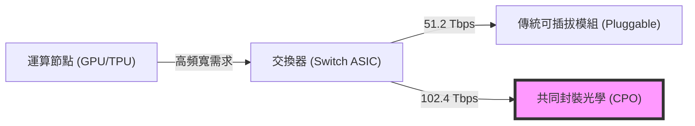

#### 交換器晶片的頻寬演進

資料中心的核心交換器晶片（Switch ASIC）頻寬每兩年翻倍一次。
- **25.6 Tbps 世代**：主要採用可插拔光收發模組（Pluggable Optics），透過電路板上的長距離電跡線（Trace）連接 ASIC 與光模組。
- **51.2 Tbps 世代**：電路板上的訊號損耗已接近臨界點，需要使用超低損耗 PCB 材料與重定時器（Retimer）晶片，這大幅增加了系統成本與功耗。
- **102.4 Tbps 世代（研發中）**：在該頻寬下，傳統的可插拔架構因電訊號損耗過大，幾乎無法在合理的功耗範圍內實現。

!!! note "物理極限的轉折點"
    當單一通道速率達到 224 Gbps 時，電訊號在 PCB 上的傳輸距離可能縮短至 2 英吋以內。這意味著「光電轉換」的位置必須從交換器機箱的面板（可插拔模組處）移向交換器晶片的封裝內部。這正是共同封裝光學（Co-Packaged Optics, CPO）技術的核心驅動力。

截至撰寫時，產業正處於從傳統可插拔光學轉向 CPO 結構的過渡期。這種轉變不僅是封裝形式的改變，更是半導體製程與光學元件深度整合的結果，將在後續小節中詳細探討矽光子元件的製程與整合架構。

## 41.2 矽光子基礎元件：波導與耦合技術

矽光子（Silicon Photonics）技術的核心在於利用成熟的互補式金屬氧化物半導體（CMOS）製程設施，在矽晶圓上製造光學元件。相較於傳統以磷化銦（InP）或鈮酸鋰（$\text{LiNbO}_3$）為基底的光學元件，矽光子具備高整合度與低成本的優勢。在本節中，我們將探討矽光子最基礎的物理結構：波導（Waveguide）及其與外界光纖連接的耦合技術。

### 絕緣層上矽 (SOI) 平台與導波原理

矽光子元件主要建構於絕緣層上矽（Silicon-on-Insulator, SOI）基板之頂層矽（Top Silicon）中（見第 9 章）。選用 SOI 作為導波平台的主要物理動機在於其極高的折射率對比（High Refractive Index Contrast）。

在通訊波段（典型值如 $\lambda = 1310\text{ nm}$ 或 $1550\text{ nm}$），矽（Si）的折射率 $n_{\text{Si}} \approx 3.45$，而作為包覆層（Cladding）的二氧化矽（$\text{SiO}_2$）折射率 $n_{\text{SiO}_2} \approx 1.45$。根據全內反射（Total Internal Reflection, TIR）原理，當光在折射率較高的介質（芯層，Core）中傳播並以大於臨界角的角度入射至折射率較低的介質（包覆層）界面時，光會被侷限在芯層內。

折射率對比 $\Delta$ 定義為：

$$\Delta = \frac{n_{\text{core}}^2 - n_{\text{cladding}}^2}{2n_{\text{core}}^2}$$

由於 $\Delta$ 極大，SOI 波導能將光場極度侷限在次微米（Sub-micron）等級的截面內。截至撰寫時，工業界最常見的 SOI 平台採用 $220\text{ nm}$ 厚度的頂層矽，這使得波導尺寸能縮小至 $400\text{ nm}$ 至 $500\text{ nm}$ 寬度，進而實現極小的彎曲半徑（Bending Radius，典型值 $< 5\text{ \mu m}$），這對於高密度光電整合電路至關重要。

### 波導結構設計：條型與脊型

根據製程中蝕刻深度的不同，矽光子波導主要分為條型波導（Strip Waveguide）與脊型波導（Ridge Waveguide）兩種基本形式。

#### 1. 條型波導 (Strip Waveguide)
條型波導是將頂層矽完全蝕刻至底部氧化層（BOX），形成一個矩形截面。
*   **物理特性**：光場侷限能力最強，模場體積（Mode Volume）最小。
*   **優點**：允許極小的彎曲半徑，適合用於建構微環諧振器（Microring Resonator）或高密度佈線。
*   **缺點**：由於光場與波導側壁（Sidewall）的接觸面積較大，側壁粗糙度引起散射損耗（Scattering Loss）較為嚴重。

#### 2. 脊型波導 (Ridge Waveguide)
脊型波導僅對頂層矽進行部分蝕刻（Partial Etch），保留一層薄矽（稱為 Slab 層）。
*   **物理特性**：光場主要集中在中央脊部，但會部分滲透至兩側的 Slab 層。
*   **優點**：側壁散射損耗較低。更重要的是，Slab 層提供了電學連接的通道，允許在波導兩側進行離子佈植（見第 26 章）以形成 PN 接面，這是實現電光調變器（Modulator）的物理基礎。
*   **缺點**：光場侷限較弱，彎曲半徑需求較大（典型值 $> 20\text{ \mu m}$），以避免光洩漏至 Slab 層。

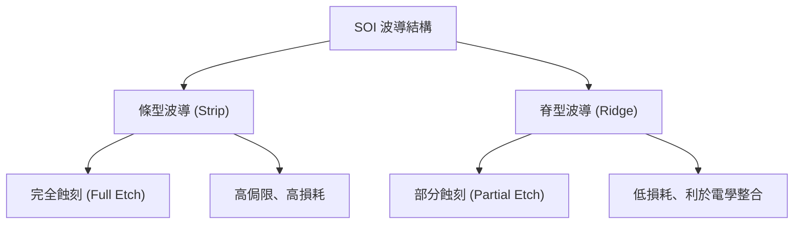

### 光耦合技術：光柵與邊緣耦合器

矽波導的尺寸（約 $0.5\text{ \mu m} \times 0.22\text{ \mu m}$）與單模光纖（Single-mode Fiber, SMF）的模場直徑（Mode Field Diameter, MFD，典型值約 $9\text{ \mu m}$）存在巨大的尺寸失配（Mode Mismatch）。若直接對接，耦合效率極低。因此需要特定的耦合元件進行模場轉換。

#### 1. 光柵耦合器 (Grating Coupler, GC)
光柵耦合器利用布拉格繞射（Bragg Diffraction）原理，使光線從晶圓表面垂直或近垂直地耦合進出波導。其物理機制遵循光柵方程：

$$\sin \theta = \frac{n_{\text{eff}} - m(\lambda / \Lambda)}{n_{\text{cladding}}}$$

其中 $\theta$ 為出射角，$\Lambda$ 為光柵週期，$n_{\text{eff}}$ 為波導有效折射率，$m$ 為繞射階數。

*   **優點**：
    1.  **晶圓級測試**：可在封裝前於晶圓上任何位置進行光學量測，大幅提升良率控管效率。
    2.  **對準容差大**：對準精度要求約在 $\pm 1\text{ \mu m}$ 範圍，適合自動化封裝。
*   **缺點**：
    1.  **頻寬限制**：繞射原理具有強烈的波長選擇性，工作頻寬較窄（典型值 $30\text{ nm}$ 至 $50\text{ nm}$）。
    2.  **偏振敏感**：對輸入光的偏振態極為敏感。

#### 2. 邊緣耦合器 (Edge Coupler / Spot Size Converter, SSC)
邊緣耦合器（又稱點尺寸轉換器）是在晶圓邊緣透過逐漸改變波導寬度（Tapering）的方式，將模場緩慢擴大至與光纖匹配。

*   **物理機制**：透過反向錐形（Inverse Taper）設計，使矽波導寬度縮小至極細（如 $< 100\text{ nm}$），此時光場不再被侷限在矽芯中，而是擴散至周圍的低折射率包覆層（如氮氧化矽或聚合物），形成較大的模場。
*   **優點**：
    1.  **寬頻與低損耗**：基於折射原理而非繞射，具備超寬頻特性，耦合損耗可低於 $1\text{ dB}$。
    2.  **偏振無關性**：較易達成對不同偏振態的穩定耦合。
*   **缺點**：
    1.  **製程複雜**：必須經過晶圓切割（Dicing）與端面拋光（Polishing）後才能進行耦合測試。
    2.  **封裝難度高**：對準容差極小（典型值 $< 0.5\text{ \mu m}$），需使用主動對準（Active Alignment）技術。

!!! note "說明"
    在共同封裝光學（CPO）的應用中，由於對總體功耗與頻寬有極高要求，邊緣耦合器因其低損耗與寬頻特性，逐漸成為高效能運算（HPC）晶片的首選方案。

### 側壁粗糙度與製程優化

在矽光子製程中，波導的傳輸損耗主要來自於側壁粗糙度引起的散射。根據 Payne-Lacey 模型，散射損耗 $\alpha$ 與側壁粗糙度的均方根值（RMS roughness, $\sigma$）的平方成正比：

$$\alpha \propto \sigma^2 \cdot \Delta n^2$$

由於 SOI 的 $\Delta n$ 極大，微小的製程瑕疵都會被放大。

#### 1. 微影製程的挑戰
傳統 248nm 或 193nm 微影技術（見第 12、13 章）在定義波導邊緣時，光阻的分子隨機分佈會導致線邊緣粗糙度（Line Edge Roughness, LER）。截至撰寫時，最先進的矽光子製程已導入 193nm 浸潤式微影（193i）甚至極紫外光（EUV）微影，以減少 LER 並提高圖案保真度。

#### 2. 蝕刻製程的優化
乾式蝕刻（見第 19 章）過程中的離子轟擊會造成波導側壁的物理損傷。
*   **電漿參數調控**：透過調整偏壓（Bias Power）與氣體比例（如 $\text{HBr}/\text{Cl}_2/\text{O}_2$），在側壁形成穩定的鈍化層，以獲得平滑且垂直的輪廓。
*   **後處理技術**：
    *   **高溫氫氣退火（$\text{H}_2$ Annealing）**：在氫氣環境下加熱，利用矽原子的表面遷移（Surface Migration）來填補微小坑洞，使側壁原子級平滑。
    *   **犧牲氧化法（Sacrificial Oxidation）**：在波導表面生長一層薄熱氧化層（見第 25 章）後再以濕式蝕刻除去，可有效降低表面粗糙度。

| 參數 | 條型波導 (Strip) | 脊型波導 (Ridge) |
| :--- | :--- | :--- |
| 典型尺寸 ($W \times H$) | $450\text{ nm} \times 220\text{ nm}$ | $500\text{ nm} \times 220\text{ nm}$ (Slab $\approx 90\text{ nm}$) |
| 傳輸損耗 (典型值) | $2.0 - 3.0\text{ dB/cm}$ | $0.5 - 1.5\text{ dB/cm}$ |
| 最小彎曲半徑 | $< 5\text{ \mu m}$ | $> 20\text{ \mu m}$ |
| 主要用途 | 佈線、延遲線、微環 | 調變器、偵測器、低損耗傳輸 |

!!! warning "常見誤解"
    初學者常認為波導越寬損耗越低。物理上，增加寬度確實能減少光場與側壁的重疊，進而降低散射損耗；然而，波導過寬會引發高階模態（Higher-order Modes），導致模態色散（Modal Dispersion）與訊號干擾。因此，單模傳輸（Single-mode condition）是設計時必須遵守的物理限制。

### 產業實例：300mm 矽光子平台

截至撰寫時，全球主要晶圓代工廠如台積電（TSMC）、格羅方德（GlobalFoundries）與英特爾（Intel）均已建立基於 300mm（12 吋）晶圓的矽光子生產線。

*   **製程整合**：這些平台將光學元件與 CMOS 邏輯電路整合。一種常見做法是「先光後電」（Photonics First），即先在 SOI 層製作波導與光柵，再進行金屬層佈線（見第 29 章）。
*   **材料導入**：為了進一步降低損耗或增加功能，部分先進製程在矽波導上方額外整合氮化矽（$\text{Si}_3\text{N}_4$）層。氮化矽具有更低的折射率（$n \approx 2.0$），對製程粗糙度較不敏感，且具備極低的熱光係數（Thermo-optic Coefficient），適合製作高穩定性的波導元件。

透過精確控制 SOI 厚度、微影解析度與蝕刻平滑度，矽光子基礎元件已能達到量產級的性能指標，為後續複雜的光電調變與封裝架構奠定了物理基礎。

<!-- fig:1 -->
<figure markdown>
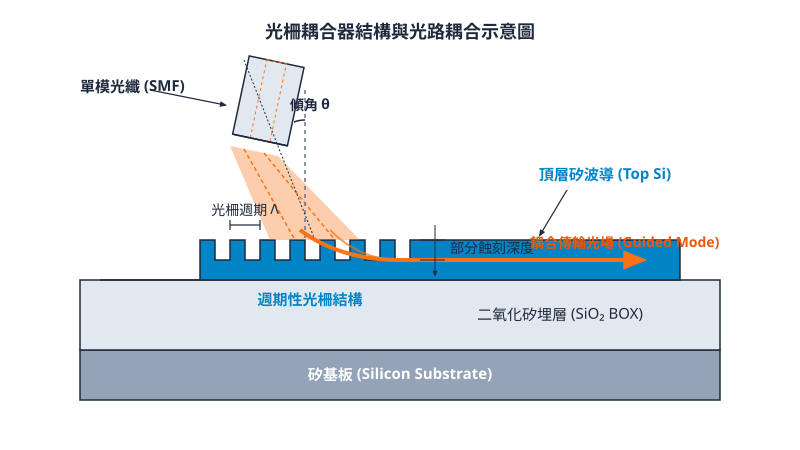
<figcaption>圖 41-1　光柵耦合器結構示意圖（AI 繪製的示意圖）</figcaption>
</figure>

## 41.3 光電調變器與偵測器的原理與製程

在矽光子（Silicon Photonics）技術中，實現光電轉換的核心在於主動元件（Active Components）的設計與製造。由於單晶矽（Si）屬於間接能隙（Indirect Bandgap）材料，且在通訊波段（如 1310 nm 與 1550 nm）具有透明特性，因此無法直接利用矽來發光或偵測長波長光訊號。為了克服這些物理限制，製程上必須導入電漿色散效應、異質磊晶以及三五族材料整合技術。

### 電漿色散效應與矽基調變器

矽缺乏顯著的線性電光效應（Pockels Effect，即折射率隨外加電場線性變化的現象），這使得矽無法像鈮酸鋰（$\text{LiNbO}_3$）那樣直接透過電場改變折射率。在矽光子中，調變光訊號的主要物理機制是「電漿色散效應」（Plasma Dispersion Effect）。

#### 物理原理
電漿色散效應是指透過改變半導體內自由載子（電子與電洞）的濃度，進而改變材料的折射率實部（$n$）與虛部（即吸收係數 $\alpha$）。根據 Soref 與 Bennett 的經驗公式，在 1550 nm 波長下，矽的折射率變化 $\Delta n$ 與吸收係數變化 $\Delta \alpha$（單位為 $\text{cm}^{-1}$）可表示為：

$$\Delta n = -[8.8 \times 10^{-22} \cdot \Delta N_e + 8.5 \times 10^{-18} \cdot (\Delta N_h)^{0.8}]$$

$$\Delta \alpha = 8.5 \times 10^{-18} \cdot \Delta N_e + 6.0 \times 10^{-18} \cdot \Delta N_h$$

其中，$\Delta N_e$ 與 $\Delta N_h$ 分別為電子與電洞濃度的變化量（單位為 $\text{cm}^{-3}$）。由公式可知，增加載子濃度會導致折射率下降並增加光損耗。

#### 元件結構：PN 接面整合
為了在波導中快速改變載子濃度，製程上會在矽波導（見第 41.2 節）中整合 PN 接面。目前主流採用「耗盡型」（Depletion Mode）結構，其操作原理是施加反向偏壓來改變空間電荷區（Space Charge Region）的寬度，進而調變重疊區域內的載子總數。

1. **製程實作**：利用離子佈植（見第 26 章）在矽波導中心形成 P 型與 N 型摻雜區。為了降低接觸電阻，會在遠離波導核心的兩側進行高濃度摻雜（$\text{P}^+, \text{N}^+$）。
2. **頻寬特性**：耗盡型調變器的速度受限於 RC 延遲與載子漂移時間，典型頻寬可達 50 GHz 以上，足以支援單通道 100 Gbps 的傳輸速率。

### 馬赫-曾德爾調變器與微環調變器

根據上述物理效應，矽光子調變器主要分為馬赫-曾德爾調變器（Mach-Zehnder Modulator, MZM）與微環調變器（Micro-ring Modulator, MRM）兩種主流架構。

#### 馬赫-曾德爾調變器 (MZM)
MZM 利用干涉原理將「相位調變」轉換為「振幅調變」。其結構包含一個輸入分光器、兩條相移臂（Phase Shifter Arms）及一個輸出合光器。
*   **工作原理**：當兩臂的光程差（由電漿色散效應引起）達到 $\pi$ 相位差時，輸出端會產生破壞性干涉，訊號為「0」；若相位相同則為「1」。
*   **優缺點**：MZM 對溫度變化不敏感（消光比穩定），且工作波段寬；但缺點是元件尺寸極大（通常為數公釐長度），導致功耗較高且不利於高密度整合。

#### 微環調變器 (MRM)
MRM 由一條直波導與一個圓環形波導耦合而成。
*   **工作原理**：當光波長符合共振條件 $m\lambda = n_{eff} \cdot L$（$L$ 為環周長，$m$ 為整數）時，光會耦合進環內。透過 PN 接面改變環內的折射率 $n_{eff}$，可使共振峰產生偏移，從而調變輸出端的光強度。
*   **優缺點**：MRM 尺寸極小（直徑通常小於 20 $\mu\text{m}$），功耗極低且適合波分複用（WDM）。然而，MRM 對溫度極其敏感，製程上必須配置微加熱器（Micro-heater）進行熱調諧（Thermal Tuning）以維持波長鎖定。

| 特性 | 馬赫-曾德爾調變器 (MZM) | 微環調變器 (MRM) |
| :--- | :--- | :--- |
| **尺寸** | 較大 (mm 級) | 極小 ($\mu\text{m}$ 級) |
| **功耗** | 較高 | 極低 |
| **頻寬** | 寬頻 (Broadband) | 窄頻 (Resonant) |
| **溫度敏感度** | 低 | 高 (需主動補償) |
| **製程難度** | 中 | 高 (需精確控制耦合間隙) |

### 矽鍺 (SiGe) 磊晶與光偵測器

由於矽在通訊波段（1.31/1.55 $\mu\text{m}$）的吸收率趨近於零，必須導入能隙較窄的鍺（Ge，能隙約 0.66 eV）作為吸收層。

#### 矽鍺異質磊晶製程
在 CMOS 相容製程中，通常採用選擇性磊晶成長（Selective Epitaxial Growth, SEG）技術在矽波導末端成長純鍺層。
1. **晶格失配問題**：矽與鍺之間存在約 4.2% 的晶格常數失配。直接成長會導致大量的位錯（Dislocation），增加暗電流（Dark Current）並降低偵測效率。
2. **緩衝層技術**：製程上常採用低溫鍺緩衝層（Low-temperature Ge Buffer）或分級矽鍺層（Graded SiGe Layer）來緩解應力。
3. **結構設計**：主流採用垂直型或側向型 P-I-N 結構。光訊號從矽波導經由漸變耦合器進入鍺吸收層，激發出電子-電洞對，並在電場驅動下形成光電流。

#### 關鍵指標
*   **響應度 (Responsivity)**：典型值約為 0.8 至 1.0 A/W。
*   **暗電流**：受限於位錯密度，製程優化目標是將其控制在 nA 等級。
*   **頻寬**：透過縮小本徵層（Intrinsic layer）厚度以減少載子渡越時間，頻寬可輕易超過 50 GHz。

### 三五族化合物半導體雷射之整合

矽光子最大的挑戰在於光源。截至撰寫時，矽基雷射（Silicon-based Laser）仍處於實驗室階段，尚未達到大規模量產的可靠性。因此，產業現況主要依賴三五族材料（如 InP, GaAs）製成的雷射二極體。

#### 整合技術路徑
將三五族雷射整合至矽光平台主要有三種方式：
1. **混合封裝 (Hybrid Packaging)**：將獨立的雷射晶片透過打線或覆晶封裝（Flip-chip）貼合在矽光晶圓上。此法技術最成熟，但耦合損耗較大且組裝成本高。
2. **異質鍵合 (Heterogeneous Bonding)**：將三五族材料薄膜透過晶圓鍵合（Wafer Bonding，見第 39 章）轉移至矽晶圓上，再進行後續的微影與蝕刻。這能實現高效的光學耦合，是目前高階矽光子製程的核心方向。
3. **直接磊晶 (Monolithic Epitaxy)**：直接在矽上成長三五族材料。由於晶格常數與熱膨脹係數差異巨大，目前仍面臨高缺陷密度的挑戰。

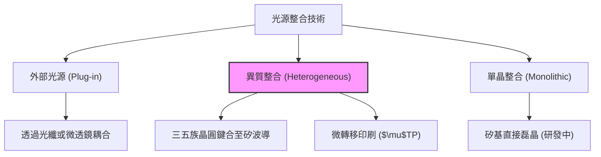

!!! note "製程挑戰：熱預算與金屬化"
    在矽光子後段製程（BEOL）中整合三五族材料時，必須嚴格控制熱預算（Thermal Budget）。三五族元件對溫度極為敏感，且其歐姆接觸（Ohmic Contact）所使用的金屬（如 Au, Ge, Ni）可能與標準 CMOS 製程中的銅導線製程（見第 29 章）產生交叉污染，因此通常需要在專門的後段生產線進行整合。

### 產業實例：台積電 COUPE 技術
截至撰寫時，台積電（TSMC）推動的 COUPE（Compact Universal Photonic Engine）技術代表了光電整合的最新趨勢。該技術不採用傳統的封裝基板，而是利用低損耗的矽光子介質層（SoIC 結構，見第 39 章），將電子電路晶片（EIC）與光學電路晶片（PIC）透過混合鍵合（Hybrid Bonding）進行垂直堆疊。這種架構能極大化縮短電互連路徑，將介面處的寄生電容降至最低，從而實現極高的能源效率（能量/位元比）與訊號完整性。

## 41.4 共同封裝光學 (CPO) 架構與優勢

在高速運算（HPC）與人工智慧（AI）需求的推動下，資料中心內部的資料傳輸量呈指數級成長。傳統的可插拔光模組（Pluggable Optics）架構，由於電訊號在印刷電路板（PCB）上的傳輸損耗隨頻率急劇增加，已逐漸難以滿足未來超大規模交換機（Switch）與加速器叢集的功耗與頻寬密度需求。共同封裝光學（Co-Packaged Optics, CPO）技術的出現，旨在透過縮短電互連路徑，將光電轉換功能從系統邊緣移至晶片封裝內部，從而突破電學互連的物理瓶頸。

### 41.4.1 從可插拔光模組到 CPO 的演進

光互連技術的演進可視為光學組件與運算核心（如 ASIC、GPU）物理距離不斷縮短的過程。這種演進主要分為三個階段：

1.  **可插拔光模組 (Pluggable Optics)**：
    光收發器（Transceiver）位於系統的前面板（Front Panel）。電訊號需經過長達 10 至 25 公分的 PCB 佈線，從運算晶片傳輸至面板。為了補償高頻電訊號在 PCB 上的嚴重衰減，必須在路徑中加入重定時器（Retimer）或強大的串行器/解串器（SerDes）均衡技術。截至撰寫時，雖然 800G 與 1.6T 的可插拔模組仍是市場主流，但其功耗與散熱壓力已接近極限。
2.  **近封裝光學 (Near-Packaged Optics, NPO)**：
    作為過渡方案，NPO 將光學引擎（Optical Engine, OE）從前面板移至與運算晶片相同的封裝基板（Substrate）邊緣，或放置在緊鄰封裝的 PCB 上。此舉縮短了電路徑長度至數公分，降低了插入損耗（Insertion Loss），但仍保留了光學模組與 ASIC 之間的離散組裝特性。
3.  **共同封裝光學 (Co-Packaged Optics, CPO)**：
    CPO 將光學引擎與運算晶片（如交換機晶片、AI 加速器）共同整合在同一個先進封裝基板或中介層（Interposer）上。電訊號傳輸距離縮短至 1 公分以內，甚至達到微米（$\mu m$）等級。

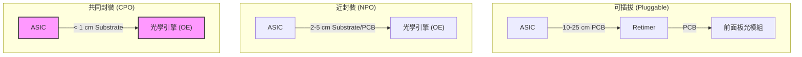

### 41.4.2 電路徑縮短與重定時器之取消

CPO 最核心的優勢在於大幅降低電訊號傳輸的能量損耗。在傳統架構中，電訊號在傳輸線上的損耗 $L$（以 dB 為單位）與頻率 $f$ 的平方根成正比：

$$L \approx \alpha \cdot \sqrt{f} \cdot d$$

其中 $\alpha$ 為介電材料損耗因子，$d$ 為傳輸距離。當單通道速率提升至 112 Gbps 或 224 Gbps 時，頻率 $f$ 極高，導致 $d$ 的微小增加都會造成巨大的訊號衰減。

為了克服衰減，可插拔架構必須使用重定時器（Retimer）來重新產生訊號。一個典型的 800G 光模組，其 Retimer 與相關電路功耗約佔整個模組的 20% 至 30%。在 CPO 架構中，由於 ASIC 與光學引擎之間的距離極短，電訊號損耗可控制在極低範圍（典型值 < 3 dB），這使得系統可以採用「無重定時器」（Retimer-less）設計，或使用超短距離（XSR/USR）SerDes 介面。

根據產業實測數據，截至撰寫時，CPO 方案相較於傳統可插拔模組，在系統層級可降低約 30% 以上的功耗，並提升 2 倍以上的頻寬密度（Gbps/mm²）。

### 41.4.3 CPO 封裝架構與佈局設計

CPO 的實現依賴於先進封裝技術（見第 38、39 章）。其常見的佈局設計包含以下關鍵組件：

1.  **主運算晶片 (Host ASIC/GPU)**：
    位於封裝中心，通常採用最先進的邏輯製程節點（如 3nm 或更先進節點）。
2.  **光學引擎 (Optical Engine, OE)**：
    圍繞在主晶片四周。OE 內部整合了矽光子積體電路（PIC）與電子積體電路（EIC，如 TIA 與 Driver）。PIC 與 EIC 可透過打線接合（Wire Bonding）、覆晶封裝（Flip-Chip）或 3D 堆疊（如 TSV 與 Hybrid Bonding）進行整合。
3.  **外部雷射源 (External Laser Source, ELS)**：
    !!! warning "散熱與可靠性考量"
        雖然將雷射整合在 CPO 封裝內（In-package Laser）在光學耦合上最為直接，但雷射二極體（LD）對溫度極為敏感，且壽命（MTBF）通常低於矽邏輯晶片。因此，截至撰寫時，主流 CPO 架構傾向於將雷射源置於外部（前面板），透過光纖將光功率引入 CPO 封裝，稱為遠端雷射源（Remote Laser Source, RLS）。

4.  **封裝基板與中介層**：
    為了支撐高密度佈線，CPO 常採用有機基板搭配矽中介層（Silicon Interposer）或嵌入式多晶片互連橋接（EMIB）技術。

### 41.4.4 散熱管理與熱隔離技術

CPO 面臨嚴峻的熱管理挑戰。主晶片（ASIC）在滿載運作時會產生數百瓦（W）的熱量，導致封裝內溫度升高。然而，矽光子元件中的調變器（Modulator）與微環諧振器（Microring Resonator）對溫度極其敏感。

微環諧振器的共振波長 $\lambda_r$ 會隨溫度 $T$ 漂移，其關係式為：

$$\frac{d\lambda_r}{dT} = \frac{\lambda_r}{n_g} \left( \frac{\partial n_{eff}}{\partial T} \right)$$

其中 $n_g$ 為群折射率，$n_{eff}$ 為有效折射率。矽的熱光係數（Thermo-optic coefficient）約為 $1.8 \times 10^{-4} / K$，這意味著即使是幾度的溫差也會導致通訊失效。

**解決方案包括：**
*   **熱隔離槽 (Thermal Trench)**：在矽基板上蝕刻深槽，阻斷 ASIC 傳導至 PIC 的熱流。
*   **主動溫度補償**：在 PIC 上整合微型加熱器（Micro-heater），將光學元件維持在恆定的工作溫度，但這會額外增加功耗。
*   **先進散熱介面材料 (TIM)**：在 ASIC 與 OE 上方覆蓋整合式散熱蓋（IHS），並針對不同元件施加不同的壓力與熱導材料。

### 41.4.5 光纖陣列 (Fiber Array) 連接技術

CPO 必須解決如何將數百條光纖高效、低損耗地連接到封裝內部的問題。傳統的單纖對準已不適用，目前主要採用光纖陣列（Fiber Array, FA）技術：

*   **V 型槽 (V-groove) 耦合**：在矽基板上利用濕式蝕刻（見第 20 章）精確加工出 V 型槽，將光纖嵌入其中，實現與波導的邊緣耦合（Edge Coupling）。其優點是頻寬廣、偏振敏感度低。
*   **光柵耦合器 (Grating Coupler)**：利用表面衍射原理將光訊號垂直或斜向耦合進出晶片。雖然對準公差較大（約 $\pm 2 \mu m$），但耦合效率受波長限制較大。
*   **自動化對準 (Active Alignment)**：在封裝過程中，需使用高精度的自動化設備，偵測光功率並即時微調光纖位置，最後以紫外光（UV）固化膠固定。

!!! example "產業實例"
    截至 2026 年，多家領先的網路設備與半導體廠商已展示基於 CPO 技術的 51.2 Tbps 與 102.4 Tbps 交換機原型。這些系統將原本分散在 PCB 上的 32 個或 64 個光模組功能，濃縮至單一封裝內，顯著縮減了資料中心的機架空間與電力需求。

### 41.4.6 CPO 的優勢總結

| 特性 | 可插拔光模組 (Pluggable) | 共同封裝光學 (CPO) |
| :--- | :--- | :--- |
| **電路徑長度** | 長 (10 - 25 cm) | 極短 (< 1 cm) |
| **能量效率** | 典型值 20 - 30 pJ/bit | 典型值 < 10 pJ/bit |
| **頻寬密度** | 低 (受限於前面板面積) | 高 (受限於封裝周長) |
| **散熱難度** | 較低 (模組獨立散熱) | 極高 (熱源集中) |
| **維護性** | 易於單獨更換 | 難 (需更換整個封裝) |
| **主要成本** | 光模組封裝與測試 | 先進封裝與精準對準 |

CPO 的導入不僅是封裝形式的改變，更是半導體製程（CMOS）與光電元件（Silicon Photonics）深度融合的里程碑。隨著 224G SerDes 技術的普及，CPO 被視為維持摩爾定律在系統層級持續演進的關鍵路徑。

<!-- fig:2 -->
<figure markdown>
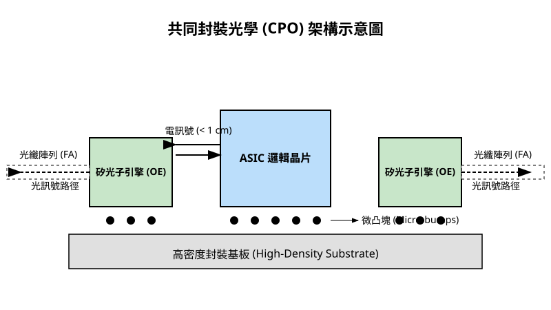
<figcaption>圖 41-2　CPO 共同封裝架構圖（AI 繪製的示意圖）</figcaption>
</figure>

## 41.5 COUPE 與先進光電整合技術

在共同封裝光學（Co-Packaged Optics, CPO）的演進過程中，如何降低光電轉換過程中的訊號損耗與功耗，是製程整合的核心挑戰。緊湊型通用光電引擎（Compact Universal Photonic Engine, COUPE）技術代表了從傳統的平面側向整合，轉向三維垂直堆疊（3D Vertical Stacking）的重大範式轉移。本節將深入探討 COUPE 的異質整合架構、混合鍵合製程的應用，以及在提升光電轉換效率方面的關鍵技術。

### 41.5.1 COUPE 異質整合架構分析

傳統的光電整合方式多採用打線接合（Wire Bonding）或覆晶封裝（Flip-Chip Packaging）將電子積體電路（EIC）與光電積體電路（PIC）並排排列於基板上。然而，隨著資料傳輸速率邁向 1.6 Tbps 甚至 3.2 Tbps 以上，傳統電互連產生的寄生電感與電容會導致嚴重的訊號衰減與阻抗失配。

COUPE 架構的核心思想是將 EIC 與 PIC 進行垂直堆疊，使兩者之間的互連路徑極小化。在典型架構中，EIC（包含調變器驅動器 Driver、跨阻抗放大器 TIA 及邏輯控制電路）位於上方，而 PIC（包含波導、調變器、光偵測器）位於下方。

這種垂直堆疊架構具有以下物理優勢：
1. **路徑極小化**：互連長度從毫米（mm）級降至微米（$\mu m$）級，顯著降低了電阻 $R$ 與寄生電感 $L$。
2. **寄生電容降低**：透過先進的接合技術，互連點的電容 $C_{pad}$ 獲得控制，提升了系統的頻寬。
3. **面積效率**：垂直堆疊節省了封裝基板上的水平空間，有利於在交換機晶片（Switch ASIC）周圍配置更多光學引擎。

### 41.5.2 混合鍵合 (Hybrid Bonding) 於光電整合之應用

為了實現 COUPE 架構中的極低延遲與高頻寬，業界捨棄了傳統的微凸塊（Micro-bump），轉而採用混合鍵合（Hybrid Bonding, HB）技術（製程原理詳見第 39 章）。

在 COUPE 製程中，PIC 晶圓與 EIC 晶圓的表面均佈滿了銅（Cu）接合墊與介電層（通常為二氧化矽 $SiO_2$）。透過精密化學機械研磨（CMP）控制表面平整度，並在高度真空或受控環境下進行親水性鍵合。

#### 混合鍵合的關鍵製程參數
*   **接合間距（Pitch）**：截至撰寫時，COUPE 架構中的混合鍵合間距典型值已可達到 $10\,\mu m$ 以下，相較於微凸塊的 $40\,\mu m$ 左右，互連密度提升了 16 倍以上。
*   **寄生電容與頻寬**：
    系統的截止頻率 $f_{3dB}$ 受限於 RC 時間常數：

    $$f_{3dB} \approx \frac{1}{2\pi R_{total} C_{total}}$$

    其中 $C_{total}$ 包含調變器電容、接合點電容及驅動電路輸入電容。混合鍵合由於去除了凸塊的體積，其接合點電容 $C_{HB}$ 僅約為幾個毫微微法拉（fF），遠小於微凸塊的數十 fF，這使得光電介面能支援更高的調變速率（如 112 Gbaud 或 224 Gbaud）。

!!! note "製程挑戰：熱膨脹係數 (CTE) 匹配"
    由於 EIC 通常採用先進邏輯節點（如 5nm 或 3nm），而 PIC 則採用較成熟的 SOI 製程（如 45nm 或 90nm），兩者的基板厚度與材料特性差異可能導致在混合鍵合的高溫退火過程中產生熱應力，進而影響光學元件（如環形諧振器）的波長對準。因此，精確的熱應力模擬與低溫鍵合技術是 COUPE 成功的關鍵。

### 41.5.3 低損耗介電材料與光電介面整合

在 COUPE 架構中，PIC 層除了需要處理電訊號，更核心的任務是低損耗的光訊號傳輸。這涉及到介電材料的選擇與光學介面的設計。

#### 1. 低損耗波導材料
為了在 PIC 中實現高效能布拉格光柵（Bragg Grating）或邊緣耦合器（Edge Coupler），製程中常引入氮化矽（$Si_3N_4$）作為第二層波導材料。
*   **優點**：$Si_3N_4$ 的折射率對溫度變化較不敏感（熱光係數低），且在 C-Band（1550 nm）與 O-Band（1310 nm）具有極低的傳播損耗（典型值 $< 0.1\,dB/cm$）。
*   **整合方式**：在 SOI 晶圓的後段製程（BEOL）中，透過電漿加強型化學氣相沈積（PECVD）或低壓化學氣相沈積（LPCVD）沈積氮化矽，並與底層的矽波導形成雙層波導架構。

#### 2. 光學耦合介面
COUPE 必須解決光纖如何高效進入封裝的問題。
*   **光纖對準**：利用 U 型槽（V-groove）蝕刻技術或自動化主動對準（Active Alignment）將光纖陣列固定於 PIC 邊緣。
*   **模場轉換器（SSC）**：由於單模光纖的模場直徑（約 $9\,\mu m$）與矽波導（約 $0.5\,\mu m$）差異巨大，必須在介面處設計錐形波導（Taper），以減少耦合損耗。

### 41.5.4 提升光電轉換效率與降低寄生電容的研發方向

截至撰寫時，業界針對 COUPE 與先進光電整合的研發重點集中於以下三個維度：

#### 1. 降低能量消耗（Energy per Bit）
目前的目標是將光電鏈路的能效降低至 $1\,pJ/bit$ 以下。這需要透過以下手段達成：
*   **無驅動器調變（Driver-less Modulation）**：藉由混合鍵合極低的寄生電容，嘗試讓邏輯電路直接驅動微環調變器（Micro-ring Modulator, MRM），省去高功耗的調變驅動晶片。
*   **低電壓設計**：開發新型電光材料（如薄膜鈮酸鋰 TFLN 或有機聚合物）以降低半波電壓 $V_{\pi}$。

#### 2. 熱管理與雷射整合
光電引擎在高負載下會產生大量熱能，尤其是雷射二極體（Laser Diode）對溫度極其敏感。
*   **外部光源（ELS）**：目前主流趨勢是將雷射置於封裝外部，透過光纖導入，以避免 EIC 的熱量影響雷射波長穩定性。
*   **矽基雷射整合**：研發方向包括透過 III-V 族材料與矽晶圓的直接鍵合（Direct Bonding），在 PIC 上直接生長雷射源，但這對 COUPE 的散熱設計提出了極高要求。

#### 3. 製程流程優化
下圖展示了 COUPE 典型的異質整合流程：

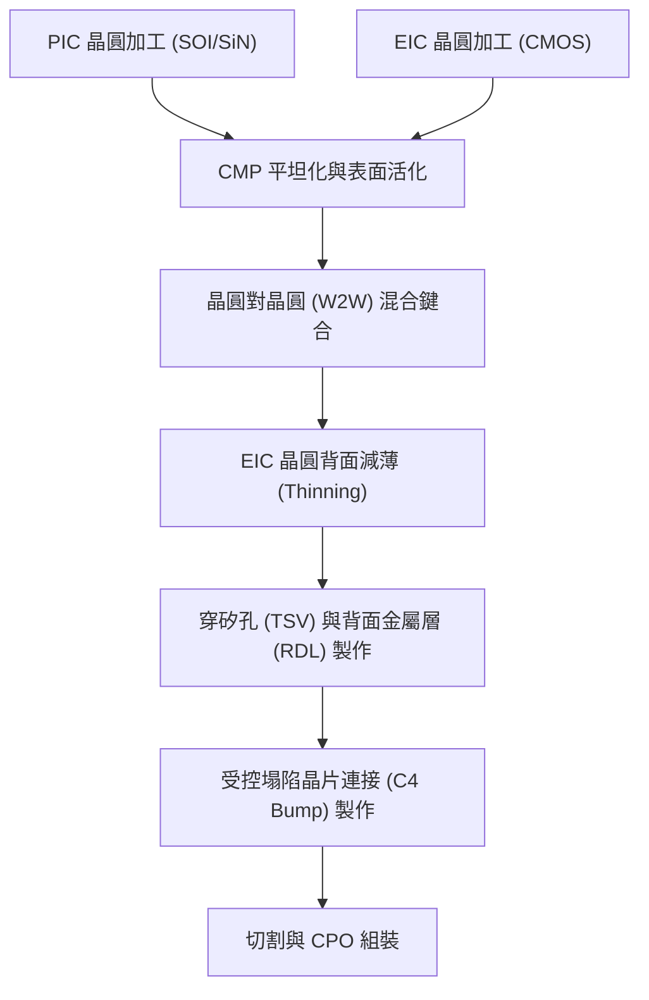

### 41.5.5 產業實例與技術現況

在先進封裝領域，COUPE 技術已被視為解決 AI 運算中心頻寬瓶頸的關鍵。

!!! example "產業實例：台積電 (TSMC) 的 COUPE 解決方案"
    截至撰寫時，台積電已公開其 COUPE 技術藍圖，利用其在 SoIC（System on Integrated Chips）混合鍵合技術的領先地位，將 PIC 與 EIC 整合。該方案宣稱能將電學互連損耗降低 90% 以上。此外，該技術結合了 CoWoS（見第 38 章）封裝，將光電引擎與大面積的交換機 ASIC 整合在同一個矽中介層（Interposer）上，實現了極高的 I/O 密度。

### 41.5.6 物理極限與未來挑戰

儘管 COUPE 提供了優異的電學特性，但仍面臨以下物理挑戰：
*   **光損耗預算（Optical Power Budget）**：混合鍵合雖然解決了電的問題，但光學介面的耦合損耗（Coupling Loss）若無法控制在 $1-2\,dB$ 以內，將迫使雷射功率增加，抵消了節能優勢。
*   **測試難度**：垂直堆疊後，底層的 PIC 無法直接進行光學探針測試。如何在封裝前確保「已知合格晶圓」（Known Good Die, KGD）與「已知合格光學晶圓」（Known Good Photonic Die, KGPD）是良率管理的重難點（見第 42 章）。

截至撰寫時，COUPE 技術正從實驗室小規模試產轉向大規模量產準備階段。隨著生成式 AI 對資料中心頻寬的需求呈指數級增長，這種基於混合鍵合的 3D 光電整合技術，將成為後摩爾時代延續系統效能提升的核心支柱。

## 41.6 設備與廠商技術

在矽光子（Silicon Photonics, SiPh）與共同封裝光學（Co-Packaged Optics, CPO）的製造過程中，製程設備的精確度與整合能力是決定光電轉換效率與訊號完整性的關鍵。本節將探討針對矽光子特殊需求所開發的微影、封裝、測試設備，以及目前產業領先廠商的技術方案。

### 41.6.1 矽光子專用微影與蝕刻技術

矽光子元件的核心在於光波導（Optical Waveguide），其傳輸損耗（Propagation Loss）高度依賴於波導側壁的平滑度。在傳統 CMOS 製程中，線邊緣粗糙度（Line Edge Roughness, LER）對電晶體性能的影響主要在於臨界尺寸（CD）的變異；但在矽光子中，波導側壁的微小粗糙度會引起嚴重的光散射，散射損耗 $\alpha_{scat}$ 與粗糙度均方根值 $\sigma$ 的平方成正比：

$$\alpha_{scat} \propto \frac{\sigma^2}{\lambda^4 \cdot w^3}$$

其中 $\lambda$ 為光波長，$w$ 為波導寬度。為了降低損耗，微影設備需具備特殊的曝光補償技術。

1.  **曲線微影（Curvilinear Lithography）與 OPC 補償**：
    矽光子設計中包含大量彎曲波導與環狀諧振器（Ring Resonator），傳統微影採用的曼哈頓幾何（Manhattan geometry，即水平與垂直線條）在處理曲線時會產生階梯狀邊緣。截至撰寫時，先進微影機台如 ASML 的 TWINSCAN NXT 系列，配合計算微影（見第 16 章）中的全曲線光學鄰近效應修正（Curvilinear OPC），能有效平滑化光罩圖形在晶圓上的成像，減少階梯效應帶來的散射損耗。
2.  **平滑蝕刻製程**：
    蝕刻設備如 Lam Research 的 Kiyo 或 Syndion 系列，針對矽光子開發了專用的循環式蝕刻與鈍化製程。透過精確控制電漿能量與化學氣體比例，在定義波導形狀的同時，對側壁進行原子級的修整（Smoothing），使側壁粗糙度降至數奈米以下。

### 41.6.2 自動化光學對準（Active Alignment）設備

在 CPO 封裝中，光纖或外部雷射源必須與矽光子晶片（PIC）精確耦合。由於光波導的模場直徑（Mode Field Diameter）通常僅為數百奈米至數微米，傳統的機械對準（Passive Alignment）往往無法達到要求的耦合效率。

**自動化光學對準（Active Alignment, AA）**技術是目前 CPO 封裝機台的核心。其運作流程如下：
1.  **粗對準**：利用視覺系統進行機械定位。
2.  **光學反饋**：開啟光源，由偵測器即時量測耦合的光強度。
3.  **微米級補償**：利用六軸位移台（Hexapod）進行奈米級的空間掃描，尋找光強度最強的座標點。
4.  **固化**：在最佳位置進行紫外光（UV）膠固化或雷射焊接。

在混合鍵合（Hybrid Bonding）應用中，如 BESI 的 Datacon 8800 CHAMEO 系列，則強調在極高精度下實現電學接點與光學路徑的同時對準，這對於將電子驅動晶片（EIC）堆疊於 PIC 之上的 3D 整合至關重要。

### 41.6.3 矽光子專用晶圓級測試設備

與傳統電學測試（見第 42 章）不同，矽光子晶圓測試（Wafer-level Optical Testing, WLOT）需在晶圓狀態下饋入並收集光訊號。這帶來了三大技術挑戰：

*   **光纖探針耦合**：測試機台需配備高精度的光纖探針座，確保光纖與晶圓表面的光柵耦合器（Grating Coupler）保持最佳角度（典型值為 8° 至 12°）。
*   **極化控制**：光學元件對偏振態敏感，測試系統需具備自動極化控制器（Polarization Controller）。
*   **多通道平行測試**：為了提升產出量（Throughput），測試設備如 Advantest V93000 平台需整合多通道光功率計與波長可調變雷射源。

### 41.6.4 產業設備廠商技術比較

下表列出矽光子與 CPO 製程中的關鍵設備供應商及其技術特點：

| 廠商 | 代表產品系列 | 技術路線與特點 | 主要應用 |
| :--- | :--- | :--- | :--- |
| ASML | TWINSCAN NXT | ArF 浸潤式微影，配合高解析度 OPC 技術，優化波導邊緣平滑度。 | 波導、調變器圖案定義 |
| Lam Research | Syndion 系列 | 專為深矽蝕刻（DSI）與光學側壁平滑化設計的電漿蝕刻技術。 | 高深寬比波導與溝槽蝕刻 |
| Applied Materials | Endura 平台系列 | 高品質 PVD 沉積，用於光學元件的金屬接觸層與反射層。 | 電極製作與金屬化 |
| EV Group | GEMINI | 支援低溫晶圓鍵合與高精度對準，適用於 SOI 與化合物半導體整合。 | 異質整合與晶圓級封裝 |
| BESI | Datacon 8800 CHAMEO | 具備高精度拾取與放置（Pick-and-Place）能力，支援光電元件混合鍵合。 | CPO 晶片堆疊與組裝 |
| Advantest | V93000 平台 | 整合電學與光學測試模組，支援晶圓級光電參數自動化量測。 | 矽光子成品與半成品測試 |
| KLA | SpectraShape 系列 | 利用光學關鍵尺寸（OCD）量測波導的截面輪廓與厚度。 | 製程監控與良率分析 |

### 41.6.5 產業實例：TSMC 與 Intel 的技術路徑

在矽光子領域，代工龍頭與整合元件製造商（IDM）採取了不同的整合策略，反映在設備選擇與製程流程上。

!!! example "產業實例：TSMC 的 COUPE 平台技術"
    截至撰寫時，台積電（TSMC）推動的 **COUPE (Compact Universal Photonic Engine)** 技術，核心在於利用其先進封裝技術將 EIC 與 PIC 進行 3D 堆疊。
    1.  **整合方式**：利用 SoIC（System on Integrated Chips）技術，將採用先進節點（如 5nm 或 7nm）製造的 EIC，透過混合鍵合（Hybrid Bonding）垂直堆疊在 PIC 上。
    2.  **優勢**：這種架構能極大化減少電學互連路徑，降低寄生電容與電阻，從而提升調變速率並降低功耗。其製程高度依賴於 BESI 與 EV Group 的高精度鍵合設備。

!!! example "產業實例：Intel 的矽基雷射整合方案"
    Intel 在矽光子領域的特色在於其**混合矽基雷射（Hybrid Silicon Laser）**技術。
    1.  **整合方式**：由於矽本身為間接能隙材料（見第 1 章），無法高效發光。Intel 採用晶圓鍵合技術，將磷化銦（InP）等 III-V 族化合物半導體材料轉移至矽晶圓上，再透過蝕刻定義出雷射腔。
    2.  **設備應用**：此製程大量使用 Applied Materials 的 Centura Epi 進行磊晶成長，以及特定的晶圓鍵合設備，實現了光源與矽光子電路的單晶片整合（Monolithic-like integration），減少了外部光源耦合的複雜度。

### 41.6.6 晶圓廠選機考量與製程整合

在矽光子產線的設備選型中，晶圓廠通常面臨以下取捨：

1.  **波導損耗 vs. 產出量**：
    雖然電子束微影（E-beam Lithography）能提供極高的解析度與平滑度，但產出量過低，僅適用於研發。量產線必須選擇 ASML 的 ArF 浸潤式微影（DUV），並透過計算微影技術來逼近 E-beam 的平滑效果。
2.  **異質整合的熱預算**：
    在 CPO 封裝中，將雷射二極體或光纖貼合至 PIC 時，必須考慮熱膨脹係數（CTE）失配問題。選用低溫鍵合設備（如 EV Group 的低溫方案）能有效減少冷卻後的殘餘應力，避免光學對準偏移。
3.  **測試覆蓋率**：
    矽光子元件的良率受微影疊對（Overlay）與蝕刻深度影響極大。晶圓廠傾向於增加 KLA 的 SpectraShape 等量測站點，在製程中段即篩選出光學特性偏移的晶圓，以避免後續昂貴的 CPO 封裝成本。

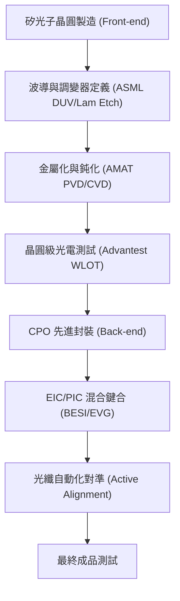

矽光子製程正從早期的科研階段轉向大規模量產，其設備需求也從通用 CMOS 機台演進為具備光學特性優化能力的專用系統。隨著 CPO 架構在資料中心伺服器中的普及，光電整合的精度要求將持續推動設備供應商開發更高解析度的微影補償與更快速的自動化對準技術。

## 本章重點

*   **電互連的物理瓶頸**：隨著訊號頻率提升至數十 GHz，銅導線因集膚效應與介電損耗導致嚴重的訊號衰減，且高密度佈線帶來的 RC 延遲與功耗牆限制了系統頻寬的持續增長。
*   **矽光子平台優勢**：利用絕緣層上矽（SOI）的高折射率對比特性，可將光場侷限在次微米等級的波導中。光互連具備低損耗、高頻寬密度（透過 WDM）及免疫電磁干擾等物理優勢。
*   **光電調變機制**：由於矽缺乏顯著的線性電光效應，主要利用電漿色散效應，透過改變 PN 接面內的載子濃度來調變折射率，進而實現馬赫-曾德爾（MZM）或微環（MRM）調變器。
*   **異質材料整合**：矽為間接能隙材料，不適合發光與偵測長波長光。製程上需導入鍺（Ge）磊晶製作偵測器，並透過晶圓鍵合或混合封裝技術整合三五族（III-V）化合物半導體雷射。
*   **共同封裝光學 (CPO)**：為了解決可插拔光模組在高速傳輸下的損耗問題，CPO 將光學引擎與運算晶片整合在同一封裝基板上，大幅縮短電路徑，實現無重定時器（Retimer-less）設計以降低功耗。
*   **先進整合技術 (COUPE)**：透過 3D 垂直堆疊與混合鍵合（Hybrid Bonding）技術，將電子電路晶片（EIC）與光學電路晶片（PIC）直接互連，極小化寄生電容，提升光電轉換效率。
*   **製程挑戰與設備**：矽光子元件對波導側壁粗糙度極為敏感，需採用先進微影（OPC 補償）與平滑蝕刻技術；封裝階段則需自動化主動對準（Active Alignment）設備以確保光纖耦合效率。

## 重點圖卡

複習時看這幾張就能抓住本章重點；[圖卡庫](../cards.md)可以下載成圖片。

<figure markdown>
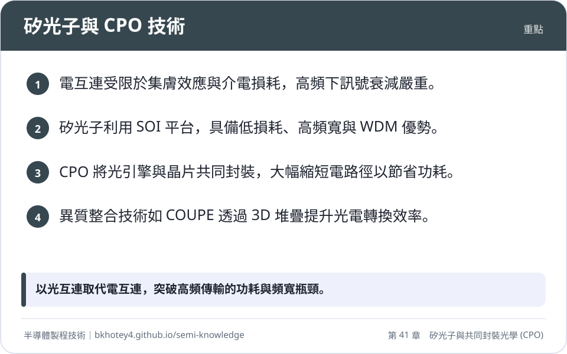
<figcaption>重點圖卡：矽光子與 CPO 技術</figcaption>
</figure>

<figure markdown>
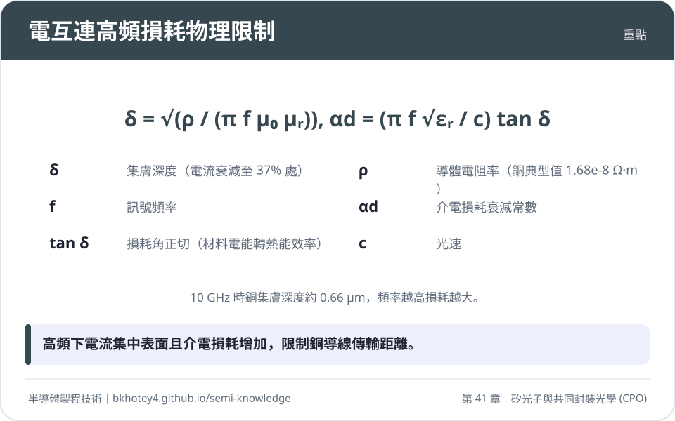
<figcaption>重點圖卡：電互連高頻損耗物理限制</figcaption>
</figure>

<figure markdown>
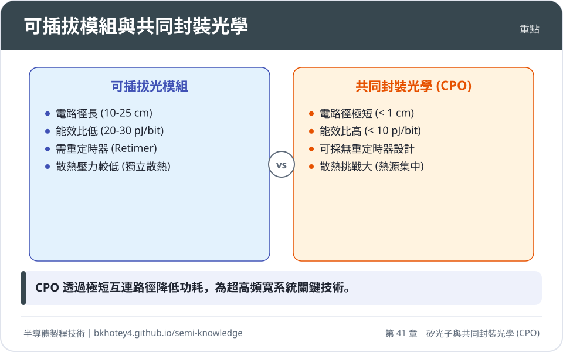
<figcaption>重點圖卡：可插拔模組與共同封裝光學</figcaption>
</figure>

<figure markdown>
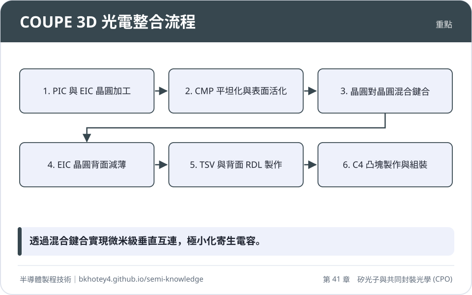
<figcaption>重點圖卡：COUPE 3D 光電整合流程</figcaption>
</figure>

## 習題

**1.** 試說明在高頻（> 50 GHz）傳輸時，為何介電損耗（Dielectric Loss）通常會取代集膚效應（Skin Effect）成為訊號衰減的主導因素？

??? success "參考解答"
    根據物理公式，集膚效應導致的歐姆損耗與頻率的平方根（$\sqrt{f}$）成正比，而介電損耗與頻率（$f$）呈線性正比關係。隨著頻率持續升高，線性增長的介電損耗其斜率較大，最終會超過隨平方根增長的歐姆損耗，成為高頻下能量耗散的主要來源。

**2.** 計算題：已知銅的電阻率 $\rho = 1.68 \times 10^{-8} \, \Omega \cdot m$，磁導率 $\mu \approx \mu_0 = 4\pi \times 10^{-7} \, H/m$。當訊號頻率為 28 GHz 時，求銅導線的集膚深度（Skin Depth, $\delta$）。

??? success "參考解答"
    根據公式 $\delta = \sqrt{\frac{\rho}{\pi f \mu}}$：
    1. $f = 28 \times 10^9 \, Hz$
    2. $\delta = \sqrt{\frac{1.68 \times 10^{-8}}{\pi \cdot 28 \times 10^9 \cdot 4\pi \times 10^{-7}}}$
    3. $\delta = \sqrt{\frac{1.68 \times 10^{-8}}{1.106 \times 10^5}} \approx \sqrt{1.519 \times 10^{-13}}$
    4. $\delta \approx 3.9 \times 10^{-7} \, m = 0.39 \, \mu m$。
    典型值說明：在 28 GHz 高頻下，電流僅在銅導線表面約 0.39 微米的薄層內流動。

**3.** 比較馬赫-曾德爾調變器（MZM）與微環調變器（MRM）在 CPO 應用中的優缺點。

??? success "參考解答"
    MZM 優點在於工作波段寬、對溫度敏感度低，性能穩定；缺點是尺寸大（mm 級）、功耗高，不利於高密度封裝。MRM 優點是尺寸極小（$\mu m$ 級）、功耗極低且易於實現波分複用（WDM）；缺點是對溫度極其敏感，共振波長易漂移，製程上需額外配置微加熱器進行熱調諧。

**4.** 在 COUPE 架構中，為何採用混合鍵合（Hybrid Bonding）而非傳統微凸塊（Micro-bump）來連接 EIC 與 PIC？

??? success "參考解答"
    混合鍵合能提供更高的互連密度（間距可達 $10 \, \mu m$ 以下）與極低的寄生電容（典型值為數個 fF）。由於光電介面的頻寬受限於 RC 時間常數，極小的寄生電容能顯著提升截止頻率，支援單通道 224 Gbps 以上的超高速調變，同時降低驅動電路的功耗。

**5.** 為什麼在矽光子製程中，側壁粗糙度（Sidewall Roughness）的控制比傳統 CMOS 邏輯製程更為關鍵？

??? success "參考解答"
    在邏輯製程中，側壁粗糙度主要影響電晶體的臨界尺寸（CD）一致性；但在矽光子中，波導側壁的微小粗糙度會造成光散射。由於 SOI 平台具有極高的折射率對比，散射損耗與粗糙度均方根值的平方成正比，微小的製程瑕疵（如 LER）會導致嚴重光損耗，直接影響光訊號的傳輸距離與系統的功率預算。

## 本章術語

- **Silicon Photonics**（矽光子）：利用 CMOS 相容製程在矽晶圓上製造光學元件的技術。
- **SOI (Silicon-on-Insulator)**（絕緣層上矽）：由頂層矽、埋入氧化層與底層矽組成的基板，為矽光子主流平台。
- **WDM (Wavelength Division Multiplexing)**（波分複用）：在同一光學通道中同時傳輸多個不同波長訊號以提升頻寬的技術。
- **Plasma Dispersion Effect**（電漿色散效應）：透過改變半導體內自由載子濃度來調變材料折射率的物理現象。
- **CPO (Co-Packaged Optics)**（共同封裝光學）：將光學引擎與運算晶片共同整合在單一封裝內以縮短電互連距離的架構。
- **Hybrid Bonding**（混合鍵合）：同時實現金屬接點（如銅）與介電質表面（如二氧化矽）鍵合的先進封裝技術。
- **Active Alignment**（主動對準）：在封裝過程中透過即時偵測光功率輸出，以自動化機械微調光纖至最佳耦合位置的技術。
- **LER (Line Edge Roughness)**（線邊緣粗糙度）：微影與蝕刻製程後，圖案邊緣偏離理想直線的微觀不規則程度。

## 互動學習

## 產業最新進展

本節由每日產業新聞自動補充，說明本章技術在產業上的最新發展。

<!-- updates -->
- **2026-11-28**　矽光子與共同封裝光學（CPO）技術逐漸走向量產落地，透過光電整合與光互連架構來突破傳統電子晶片的頻寬瓶頸與訊號衰減問題，直接對應矽光子與共同封裝光學章節的核心原理。（來源：[矽光子、CPO 聚焦量產落地！台灣首屆矽光子應用展明年四月登場 - TechNews 科技新報](https://news.google.com/rss/articles/CBMiWkFVX3lxTE9LUjdqUzJjZU9NWmF5VUw3QzR5SEtBS040T042QTE5M2hJY1VQVVVfT3hmNHJ3Y0pTSnNqMHlrVkNGU0ZDSXdMM3EyYmZOSWJWTHFDTkRFN05BUQ?oc=5)）
- **2026-11-24**　蘋果積極招募人才並將光學封裝技術導入自研晶片，此發展呼應矽光子與共同封裝光學（CPO）技術在次世代資料中心晶片中的重要應用，透過光通訊取代傳統銅線以降低傳輸損耗。（來源：[矽光子戰場蘋果不缺席！從職缺密碼看 Apple 次世代 AI 資料中心晶片藍圖 - Mashdigi](https://news.google.com/rss/articles/CBMibEFVX3lxTE13MnBJNTU5V0wxY0JYNTlGWUdZNEE5WWt0dElSUU9ZNVZBN21LbTluNVNXeVIyRWhhSUwxMGJSc2tTbG11N1kydVp3OExVQkt4SlExMjh3WDVLNE5TcmNVcVhiVENxcGxFeGhfcQ?oc=5)）
- **2026-11-22**　閎康針對矽光子元件展開檢測分析並接獲送樣，此技術涵蓋光引擎與整合晶片，對應矽光子與共同封裝光學（CPO）的光電轉換及元件介面量測原理。（來源：[閎康矽光子檢測已接獲送樣，明年擴至光引擎與整合晶片 - 優分析 UAnalyze](https://news.google.com/rss/articles/CBMiVkFVX3lxTE5zY1FMbmJTMUFDeVRzSklIQ0ktZHcxUl9zczl4VHZaLVNRZEt4UkNkZGxqa2lpZmhCQmlERUxjNEpPa01NTjd2d01XQV9VNUtJYXl0SlFn?oc=5)）
- **2026-11-17**　封裝廠與測試廠積極布局共同封裝光學（CPO）與矽光子晶圓測試，此技術將光學元件與電子晶片整合在同一封裝內，透過光通訊解決高頻寬傳輸的訊號衰減與延遲問題，對應第08-05章矽光子與共同封裝光學（CPO）原理。（來源：[旺矽搶CPO商機 漢測擴大矽光子布局 - 自由財經](https://news.google.com/rss/articles/CBMiW0FVX3lxTFBjQV84N2ItaVRMMlo5aE8zR0NxSko1WGxrUGM2cE11WkVQbGJheVh4RDR6LTZZbGFRbmlEVy02ZGlaQlhkSV9RQlQ0V2h5MFlnQkRFSV9HSDNtT1HSAVtBVV95cUxQY0FfODdiLWlUTDJaOWhPM0dDcUpKNVhsa1BjNnBNdVpFUGxiYXlYeEQ0ei02WWxhUW5pRFctNmRpWkJYZElfUUJUNFdoeTBZZ0JERUlfR0gzbU9R?oc=5)）
- **2026-11-16**　相關企業在矽光子與晶圓再生領域同步推進布局。矽光子技術透過光學互連取代傳統銅導線，能有效解決高頻寬傳輸下的訊號衰減與 RC 延遲問題。（來源：[不只搶攻AI機器人與先進封裝 羅昇晶圓再生、矽光子布局同步推進 - DIGITIMES](https://news.google.com/rss/articles/CBMia0FVX3lxTFB5RW9KR0FFemdiLXBwX1ZoRVZZTnA5Sm9PTEItNl8wZWZlN0VBSXhjSlJ6aUx4SC1sbkxfeVdqZXd1U3pFM2dzdEtvQktOaDlFd1ZPdmlXRERDbkcyQkhSTDVPY3IwRGVEZFd3?oc=5)）
- **2026-11-15**　封裝技術從傳統 CoWoS 邁向共同封裝光學（CPO）的新藍海，此技術將光通訊元件與積體電路共同整合於同一封裝內，對應矽光子與 CPO 的高速資料傳輸原理。（來源：[輝達助攻矽品登峰！從 CoWoS 代工邁向 CPO 新藍海，研發老將揭密十年技術布局 - TechNews 科技新報](https://news.google.com/rss/articles/CBMiyAFBVV95cUxNYU80OWdTTGVpaEkyMjlFZXRsdEI4TFo5Nm9QZVBGNnA3ZzFYTU9ycUdrMmpuMXEwNVpBMjBsWTQ5S3B0bGR5eXN5WUVadUxSNzU3YVUxdDNtUm1iVGhwa2U2bTlkd19rTWFKdjdMaGgyd3I4RGxmYkhaa21MbWI5LUxnLWh2N1NGTUhORzUyUDRwWTZSNjFsUkF1THFQbVdkT00yQnJLdS0tRjNlUmk4cmN3T1ZaY19PN05yU3RPVDF4cWZEVXowag?oc=5)）
- **2026-11-14**　明泰預計推出 1.6T 交換器並積極搶進矽光子與光通訊應用。此技術發展對應至矽光子與共同封裝光學領域，利用光學互連來突破傳統電氣傳輸在高速與高頻寬上的物理限制。（來源：[【即時新聞】最新消息！明泰1.6T交換器年底有望出貨，搶進矽光子與WiFi 8商機 - CMoney投資網誌](https://news.google.com/rss/articles/CBMikAFBVV95cUxOaXZmc2tnYjZhaTJnMHVJTmcwV0oxd1BTcnlGLXNSWXRMamtSNDhYZmJHekdHSXVaemFzQ0pGQnFSUUxtVE1pWmtpbEstWmZOVWVxTjM2el9IZFItQm96LWl5LUJhVjRRaC1yZTE0OEozUG8welU1UC1EN3RaZkVxcnB1MVBtSElGV0JiNDhKN2Y?oc=5)）
- **2026-10-26**　英特爾針對 AI 互連瓶頸推動 300mm 磷化銦（InP）基板與矽光子整合技術，發展共同封裝光學（CPO）與近封裝光學（NPO）架構。此技術利用化合物半導體的光電轉換特性與矽晶圓製程平台，突破傳統電訊號傳輸的頻寬與距離限制。（來源：[英特爾押注矽光子！稱300mm磷化銦量產能力領先、NPO與CPO瞄準AI互連瓶頸 - 科技島](https://news.google.com/rss/articles/CBMiX0FVX3lxTE1mQW11U3k3Q1cxQ0JmSWxSVlZyemo0MFA5ZmdYajN1MXJtVjFiNnQ0WUdBVGdVVjdoT09qQ2N6SUxDVXMtWklHRXVDRmlaUDFvYVZxYzBla255LVJmTEhr?oc=5)）
- **2026-10-26**　聯電完成 12 吋矽光子量產晶圓交付，結合半導體微影與蝕刻製程技術，在矽基板上整合光學元件與電性電路。此製程能解決傳統銅導線在高速傳輸下的 RC 延遲與頻寬極限，是實現共同封裝光學（CPO）的重要基礎。（來源：[聯電 12 吋矽光子量產晶圓交付，你現在是加碼還是觀望? - CMoney](https://news.google.com/rss/articles/CBMie0FVX3lxTFAwRktMeG1qTllHeW02bXA1SHljRC05WXJLMXg2NVZoUVdVNF9sSXVLUUVLTHROMXhpeU9CNmNXVUZVdy1GcEtwZk1iOER6YkFpTzBJR0huVHdLUkREOVZoajZaMVExZkxKQml2WVE5QzFObnYzenhXWGZxYw?oc=5)）
- **2026-10-20**　半導體廠積極擴展 300 毫米磷化銦（InP）產線以推進矽光子技術量產。此發展與矽光子與共同封裝光學（CPO）中的光通訊材料及異質整合製程原理相輔相成。（來源：[Intel 押注矽光子！OCP 2026 稱握有唯一量產 300 mm 磷化銦產線 - UNIKO's Hardware](https://news.google.com/rss/articles/CBMicEFVX3lxTE9lNllWSWtNOTFLT1FVbUNDbjJvUmppQlNTSFlJOEpfcGtZV3VmaVlET3Q4clNGQ0Nhb0RjSHFjaGp2VlNDbEhrYW16M1VqQUlpVFV0RW1qSFdKblJOR0gtZVpBRFFpaFQ3c3h3RUs1MlQ?oc=5)）
- **2026-10-19**　Intel 發表採用 300mm 矽光子製程打造的下一代 AI 系統架構，將傳統銅線傳輸轉換為光互連技術。這與矽光子與共同封裝光學章節中，利用半導體製程實現光學訊號傳輸以突破金屬導線 RC 延遲與頻寬限制的原理高度相關。（來源：[從銅線走向光互連：Intel以300mm矽光子製程打造下一代AI系統架構 - XFastest News](https://news.google.com/rss/articles/CBMiygJBVV95cUxNSmxvangzSWFuNkRWb3NWbFNzU1NWMW1KNGZEYW5FaXp5U3h0QVdXdWd6YVhwZzRrNnR3VFNTNHBkVUQxRnZQYXFFMS04ei1ETHV5RThSODBrNXo4Y2pVQVVJS1dwM2s3UU1oTXQ4SmJkbUlfX09NbkRiRUJOOWVGQm12YkpsVG1OQmlOajNUeHJROWJ2c2tzVjlvYlV4WUtNY3d2akZJakV5UFZ1cEV1aFNpR3k5ZnA1SUlMdHI2MVY0TjF5QWxYUzk2a213dnhsbmNmNmVGOFgzSmZ1RTBlTUhxcVlGZVZZZHVmbVJCYUYxbndfVGp2VGE4cVY2TTVLMjRzaGI5Nkc3MTA3ZlJ1bUFlMlhtSkQ2NElYT3dPdl9RNVpRejVZbEhYUGNLR0xNNXJYVHF4ZVU2X2piY0IwRTAzcFJMSi02Znc?oc=5)）
- **2026-10-18**　Lightmatter 揭露共同封裝光學（CPO）的放量時程，並由日月光與創意電子等台廠參與布局。這顯示光通訊技術正與先進封裝結合，以解決傳統電性互連的頻寬瓶頸與訊號衰減問題。（來源：[Lightmatter 揭 CPO 放量時程 日月光、創意參與矽光子布局 - 經濟日報](https://news.google.com/rss/articles/CBMiWkFVX3lxTFBYNER0OUx4cVpCODRyWUx2QkhpR240UThVMWRqZ3VIR2hGOW5vN0dxeFNZZHVGZ09tdmFvelJ6R0xtd3Nycmo4dTBXVEp1YldsSDM3TS1KYWdiQdIBX0FVX3lxTE00OVpwSGhtOHhYNGtsOUFLdkpDb0dTbWhiUzJyVGNvTTRBUlBBcGktdGplRHMzaE5FVzhGaDNjWFNWTTZlSVNwd2N4aDNPTXdsYkxvLUtjQzNrSXlGb2VN?oc=5)）
- **2026-10-17**　矽光子技術成為人工智慧硬體架構的重要突破方向。此技術利用半導體製程將光學元件與電路整合於同一晶片上，透過光通訊解決高頻寬傳輸時的訊號衰減與延遲問題。（來源：[創新技術克服挑戰 矽光子成AI產業最大突破 - 電子工程專輯](https://news.google.com/rss/articles/CBMioAFBVV95cUxPZ1NWbHVNU1BHR0g4SjF1NF8ycDlCbUlUNUV3aFRWcmFfQW5vQ2h0U3lnejJoM3FVSE5JdnhZbFdWOXh0Nk5nUFB0NmNSZzBCT0VFLUY3R09feXRGVU9hc29hX0dfQ0ZQNDVfWUxJbV9Kc045QU9qRG9pZmNiTlpEeVgzMWkzNnZ6RnlBUkJGQ0xOb2VWZTNSaEgzU01Pa3JF?oc=5)）
