# 第 54 章　從機台到工程師：資料流全貌

<figure markdown>

<figcaption>示意插畫：由 AI 生成，用來幫助記憶本章主題，細節請以內文與結構圖為準。</figcaption>
</figure>

!!! abstract "學習目標"
    - 理解半導體機台內部控制電腦與運算伺服器間的資料分工與通訊架構
    - 掌握量測與檢測原始訊號轉換為製程參數的運算路徑與演算法邏輯
    - 分析 SECS/GEM 與 Interface A 通訊協定在自動化生產與大數據採集中的應用差異
    - 學習製程工程師如何利用 FDC、SPC 與 APC 系統進行異常判定、追蹤與製程優化

## 54.1 機台控制架構與邊緣運算處理

### 機台控制階層與硬體架構

現代半導體製程機台（如乾蝕刻機、化學氣相沉積機、化學機械研磨機）本質上是由多個高精度物理模組構成的複雜自動化系統。為了維持製程的再現性與安全性，機台控制核心採用嚴格的分層架構。最底層為負責直接與致動器（Actuator）與感測器（Sensor）互動的機台控制電腦（Industrial PC, IPC）或可程式化邏輯控制器（Programmable Logic Controller, PLC）。

IPC 的核心任務是確保關鍵製程參數以微秒（$\mu\text{s}$）至毫秒（$\text{ms}$）等級的週期完成閉迴路控制（Closed-loop Control）。此類任務包含：
1. **質量流量控制器（MFC）的氣體流量調節**：透過比例積分微分（PID）演算法即時調整壓電閥或電磁閥開度。
2. **射頻（RF）匹配網路之阻抗調諧**：透過步進馬達或可變電容調整電路阻抗，使電漿腔體之反射功率降至最低。
3. **腔體壓力控制**：驅動節流閥（Throttle Valve）動態調整排氣導通度（Conductance）。
4. **安全互鎖機制（Safety Interlock）**：硬體等級的即時監控（如真空腔體破裂、毒性氣體外洩、冷卻水斷流等），能在作業系統癱瘓時以毫秒級反應強制切斷致動電源並關閉隔離閥。

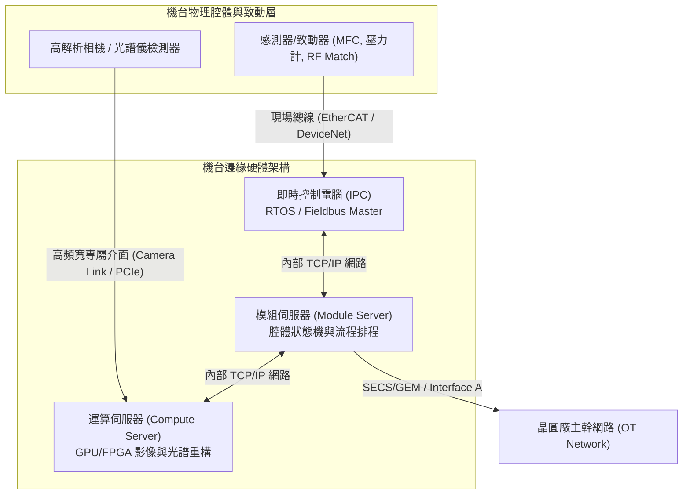

在硬體通訊介面方面，傳統的類比訊號（$0\text{--}10\text{ V}$ 或 $4\text{--}20\text{ mA}$）與低速序列匯流排（RS-232/485）已逐步退居輔助地位。現代先進製程機台全面導入確定性工業乙太網路（Deterministic Industrial Ethernet），其中以 EtherCAT 最為普遍，部分歐美設備則沿用基於 CAN 的 DeviceNet。

EtherCAT 採用「飛越處理」（Processing on the fly）技術，主控制器（Master）發出的乙太網路訊框穿過各個從站節點（Slave），各節點在硬體層級直接讀取或寫入資料，傳輸抖動（Jitter）小於 $1\ \mu\text{s}$，能保證數十軸精密伺服馬達（如大氣與真空機械手臂）的同步運動。

IPC 通常搭載即時作業系統（Real-Time Operating System, RTOS，如 VxWorks、QNX 或經過 RT-Preempt 修補之 Linux），以隔離非確定性的作業系統中斷，確保控制迴路執行時間的絕對嚴格性。

---

### 控制與運算解耦：Module Server 與 Compute Server

早期設備將人機介面（GUI）、硬體排程控制與演算法運算集中於單一 IPC 內執行，但隨著量測解析度提升與先進製程控制（Advanced Process Control, APC）的演進，單一節點架構面臨嚴重的資源競爭瓶頸。現代高階設備（特別是曝光機、光學量測儀、電子顯微鏡檢測儀）全面採取運算與控制解耦的叢集架構。

在此架構中，功能劃分為兩個關鍵運算單元：

1. **模組伺服器（Module Server）**：
   主要負責離散事件與狀態機（State Machine）管理。它不執行高負載的浮點數矩陣運算，而是監管各製程模組（Process Module, PM）、傳輸腔體（Transfer Module, TM）與前端裝載模組（Equipment Front End Module, EFEM）的作業序列。Module Server 彙整各腔體的健康狀態與警報，並作為機台面對晶圓廠主幹通訊協定（如 SECS/GEM、EDA/Interface A）的單一代理節點（Broker）。

2. **運算伺服器（Compute Server）**：
   主要針對密集資料進行平行加速運算，通常配置高效能多核心處理器、巨量記憶體，以及圖形處理器（GPU）或現場可程式化邏輯閘陣列（FPGA）。Compute Server 透過專屬的高速匯流排（如 PCIe 介面卡）或高速光纖網路（如 40GbE/100GbE RDMA）直接介接感測器擷取卡（Frame Grabber、高速 ADC）。

此種解耦設計確保了即使 Compute Server 因執行龐大的影像重建演算法而導致處理器滿載，負責晶圓搬送與真空維持的 Module Server 和 IPC 依然能維持穩定的輪詢週期，避免機械手臂碰撞或製程氣體供應中斷的災難性硬體損壞。

---

### 量測與檢測資料之邊緣轉換路徑

在光學量測（Metrology）與缺陷檢測（Inspection）機台中，感測器輸出的原始訊號無法被上層良率管理系統直接利用。必須在機台邊緣端透過物理模型的逆向反演或訊號處理演算法，將連續波形或矩陣灰階值轉換為具幾何意義的特徵標量（Scalar）。

#### 1. 光譜至膜厚轉換（Spectroscopic Ellipsometry）
光譜型橢偏儀透過量測偏振光經樣品反射前後的偏振態變化，獲得波長 $\lambda$ 的振幅比率值 $\Psi(\lambda)$ 與相位差值 $\Delta(\lambda)$：

$$\rho = \tan(\Psi) e^{i\Delta} = \frac{r_p}{r_s}$$

其中 $r_p$ 與 $r_s$ 分別為平行（p偏振）與垂直（s偏振）入射平面的複數反射係數（Complex Reflection Coefficients）。光電倍增管或 CCD 陣列擷取到的原始電壓光譜值，在邊緣運算端需透過轉移矩陣法（Transfer Matrix Method, TMM）進行物理建模。運算伺服器透過非線性最小平方法（如 Levenberg-Marquardt 演算法），最小化理論模型與實測光譜之間的均方根誤差（Mean Squared Error, MSE）：

$$\text{MSE} = \frac{1}{2N-M} \sum_{i=1}^N \left[ \left(\frac{\Psi_{\text{meas}, i} - \Psi_{\text{calc}, i}(d, \tilde{n}, \tilde{k})}{\sigma_{\Psi, i}}\right)^2 + \left(\frac{\Delta_{\text{meas}, i} - \Delta_{\text{calc}, i}(d, \tilde{n}, \tilde{k})}{\sigma_{\Delta, i}}\right)^2 \right]$$

式中 $N$ 為取樣波長點數，$M$ 為擬合未知參數數量，$d$ 為薄膜物理厚度，$\tilde{n}$ 與 $\tilde{k}$ 為複數折射率的實部與虛部，$\sigma$ 為各波長點的量測標準差。Compute Server 在數百毫秒內完成收斂迭代，最終輸出單一厚度純量值 $d$（單位為 $\text{nm}$ 或 $\text{\AA}$），傳送至 Module Server。

#### 2. 原始掃描波形至關鍵尺寸轉換（CD-SEM）
關鍵尺寸掃描電子顯微鏡（CD-SEM）使用二次電子偵測器（Secondary Electron Detector）獲取電子束掃描過光阻或金屬線邊緣時產生的二次電子訊號波形（SE Profile）。由於邊緣效應（Edge Effect），線條邊緣會出現高對比度的白邊（White Band）。

邊緣運算單元利用閾值法（Threshold Method）或最大斜率法（Maximum Slope Method）決定物理幾何邊界：
1. **背景噪訊濾除**：透過高斯濾波（Gaussian Filter）消除射訊雜訊。
2. **邊緣導數判定**：對波形強度 $I(x)$ 求空間一階與二階導數，找出反曲點（Inflection Point）：
   $$\frac{d^2 I(x)}{dx^2} = 0$$
3. **距離差運算**：依據機台校準常數 $K_{\text{cal}}$，計算左邊界 $x_L$ 與右邊界 $x_R$ 之實體間距：
   $$\text{CD} = K_{\text{cal}} \cdot |x_R - x_L|$$

數百萬像素的原始 SEM 點陣影像，經此演算法收斂為線寬純量（CD）、線邊緣粗糙度（Line Edge Roughness, LER）及線寬粗糙度（Line Width Roughness, LWR）。

```
強度 I(x)
  ^
  |        /\              /\
  |       /  \  頂部平坦  /  \
  |      /    \__________/    \
  |     /                      \
  +----+--------+------+--------+----> 空間位置 x
      x_L                      x_R
      |<-------- CD ---------->|
```

#### 3. 檢測影像至晶圓座標之幾何映射（Defect Inspection）
光學明暗場缺陷檢測機台透過高速時間延遲積分（Time Delay Integration, TDI）相機持續掃描晶圓表面，產生高達數 GB/s 的影像串流。運算伺服器利用「晶粒對晶粒」（Die-to-Die）影像相減演算法找出亮度差異超過預設閾值的異常像素群（Defect Cluster）。

每個缺陷相對於晶粒原點的像素座標 $(x_{\text{pixel}}, y_{\text{pixel}})$，必須結合雷射干涉儀與光學尺即時回授的晶圓載台（Stage）絕對座標 $(X_{\text{stage}}, Y_{\text{stage}})$，經由仿射變換（Affine Transformation）與旋轉矩陣 $\mathbf{R}(\theta)$，轉換為整片晶圓的物理座標 $(X_{\text{wafer}}, Y_{\text{wafer}})$：

$$\begin{bmatrix} X_{\text{wafer}} \\ Y_{\text{wafer}} \end{bmatrix} = \begin{bmatrix} X_{\text{die}} \\ Y_{\text{die}} \end{bmatrix} + \mathbf{R}(\theta) \begin{bmatrix} s_x \cdot x_{\text{pixel}} \\ s_y \cdot y_{\text{pixel}} \end{bmatrix} + \begin{bmatrix} \delta_x \\ \delta_y \end{bmatrix}$$

其中 $s_x, s_y$ 為光學放大倍率縮放因子，$\delta_x, \delta_y$ 為光學軸中心偏移量。最後輸出的 Klarf（KLA Results File）格式檔案僅記錄缺陷之座標、面積與灰階特徵，不再保存百萬張無缺陷的背景影像。

---

### 邊緣端特徵萃取與主幹網路負載平衡

先進晶圓廠導入自動化與先進製程控制時，機台端與廠務端資訊網路之間的頻寬配比是系統架構設計的關鍵限制條件。現代檢測與製程機台產生的原始資料量十分龐大，若未經邊緣前處理即行上傳，將迅速癱瘓廠區網路。

| 資料類型 | 機台內部產生速率（典型值） | 邊緣端處理方式 | 上傳廠級網路資料量（典型值） |
| :--- | :--- | :--- | :--- |
| **光學缺陷檢測 (Inspection)** | $10\text{--}50\text{ Gbps}$（TDI 相機多通道原始影像） | 邊緣即時差分、特徵提取、篩除虛警（Nuisance Filter） | 數百 $\text{kB}\text{--}\text{數十 }\text{MB}$（缺陷座標 Klarf 檔） |
| **關鍵尺寸量測 (CD-SEM)** | $100\text{--}500\text{ MB/frame}$（原始高解析影像） | 影像平滑、邊緣輪廓提取、線寬幾何換算 | 數十 $\text{kB}$（CD/SVID 數值及抽樣微縮圖） |
| **薄膜量測 (Ellipsometry)** | $10\text{--}50\text{ MB/site}$（全波段偏振光譜） | 光學模型逆向擬合、收斂判定 | 數百 $\text{Bytes}$（膜厚值、擬合品質 GOF 指標） |
| **製程機台感測資料 (FDC)** | $100\text{--}1000\text{ Hz}$ 取樣（RF 功率、壓力、MFC） | 統計降採樣、特徵值計算（均值、斜率、積分） | $1\text{--}10\text{ Hz}$ 週期回報或僅傳送統計特徵點 |

!!! note "邊緣特徵萃取與主幹網路吞吐量"
    以一個擁有 300 台先進檢測與量測設備的晶圓廠為例，若所有檢測機台皆將 Raw Image 即時傳輸至中央機房，廠內主幹網路需承載數個 $\text{Tbps}$ 的持續傳輸頻寬，且中央儲存系統在數小時內即告耗盡。因此，「邊緣計算、雲端管理」（Edge Computing, Cloud Aggregation）成為半導體製造 OT 網路不可逾越的架構準則：
    
    1. **即時性（Latency）**：機台內部 Closed-loop 控制（如晶圓位置校正）必須在 sub-millisecond 內完成，無法承受雲端往返網路延遲。
    2. **資訊密度（Information Density）**：上層 SPC（統計製程管制）與 MES（製造執行系統）僅需要具備決策意義的工程數值（如膜厚 $100.2\ \text{\AA}$，警報旗標 `0x00`），原始干涉光譜對於即時派工而言屬於冗餘資料。
    3. **異常驅動上傳（Event-driven Upload）**：多數機台採用雙重資料流機制：一般製程週期下僅回傳數值標量；當且僅當邊緣端演算法判定製程異常（Out of Control, OOC）或觸發光譜擬合失敗時，才以非同步（Asynchronous）方式將當次事件的 High-density Trace Data 或 Raw Image 打包，回傳至後端診斷系統以供深度追查。

透過此種架構，機台內部 IPC、Module Server 與 Compute Server 共同構築起強韌的邊緣運算防線，將雜亂的高速實體感測訊號轉化為高結構化、高語意密度的工程參數，方能進一步對接後續章節所述之 SECS/GEM、Interface A 及各項廠級自動化控制系統。

## 54.2 廠級通訊協定與資料上報機制

### SECS/GEM 協定架構與狀態模型

半導體晶圓廠的製造環境由高度異質的製程與量測設備構成。為達成集中監控與自動化生產，國際半導體產業協會（SEMI）制定了一系列標準通訊協定，統稱為 SECS/GEM 標準群。

SECS/GEM 架構採分層設計，主要包含底層傳輸協定與上層應用層訊息標準：
1. **傳輸層**：早期採用基於 RS-232 串列通訊的 SEMI E4（SECS-I）。現代 300 mm 與先進製程廠房已全面導入基於 TCP/IP 網路協定的 SEMI E37（High-Speed SECS Message Services, HSMS），在乙太網路環境下提供高輸送量且穩定的二進位串流傳輸。
2. **訊息傳輸層**：SEMI E5（SECS-II）定義了資料結構與標準訊息格式。訊息依業務功能劃分為不同的「串流」（Stream, 簡記為 $S$）與「功能」（Function, 簡記為 $F$），以 $S_x F_y$ 格式表示。其中 $x$ 代表功能群組（如 $S1$ 代表機台狀態、$S2$ 代表機台診斷與配置、$S7$ 代表製程配方管理），$y$ 代表特定的互動指令或回應。
3. **設備模型層**：SEMI E30（Generic Equipment Model, GEM）在 SECS-II 的基礎上，定義了機台應具備的標準行為模型與狀態機（State Machines）。

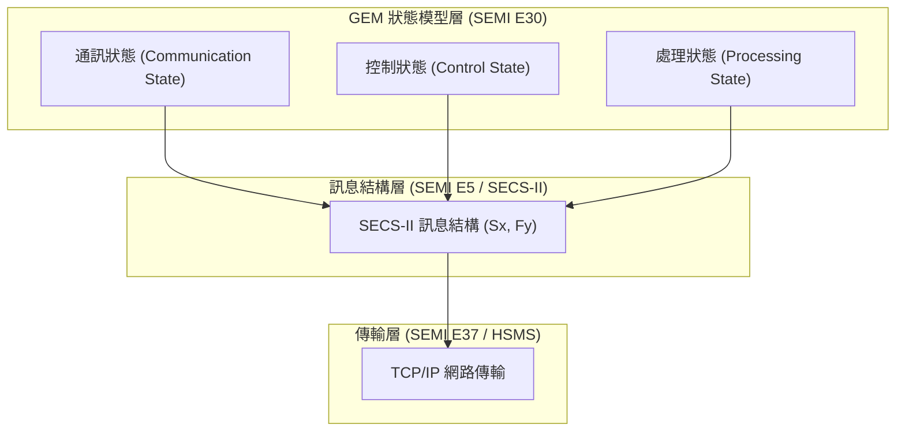

SECS-II 訊息在工程環境中常以 SECS 訊息語言（SECS Message Language, SML）進行文字化描述。SML 採用巢狀清單（List, 標註為 `<L ...>`）與具體型態元素（如 ASCII 字串 `<A ...>`、無號整數 `<U4 ...>`、布林值 `<B ...>` 等）建構資料樹狀結構。

以下為一個典型的配方驗證請求（$S7F19$）與回應（$S7F20$）的 SML 片段：

```text
S7F19 W
<L [2]
  <A [6] "REC001">    /* 製程配方名稱 (PPID) */
  <U4 1024>           /* 配方長度或檢查碼 */
>.

S7F20
<B 0x00>.             /* 0x00 表示機台確認接受 (ACK) */
```

GEM 標準規範了嚴密的狀態機，確保晶圓廠主機系統能精確掌握機台狀態：
* **通訊狀態模型（Communication State Model）**：定義機台與主機間 HSMS 連線的建立、交握（Handshake）及心跳檢測（`Ping/Echo`），確保傳輸鏈路未中斷。
* **控制狀態模型（Control State Model）**：定義設備的控制權歸屬，分為離線（Offline）與在線（Online）。在線模式進一步細分為「本地控制」（Online Local，人員在機台操作面板具優先權）與「遠端控制」（Online Remote，廠級主機系統擁有機台啟動、停止、配方選擇等全權指令下達權限）。
* **處理狀態模型（Processing State Model）**：定義機台內部的物理加工生命週期，包括待機（Idle）、準備（Setuping）、執行中（Executing）、暫停（Paused）及完成（Completed）。當狀態轉換發生時，機台透過事件收集報告（Collection Event, CE）主動向主機發布訊息。

---

### 設備自動化程式（EAP）與控制流程

在晶圓製造執行系統（Manufacturing Execution System, MES）與實體機台之間，直接對話會引發巨大的通訊負荷與邏輯耦合。因此，現代自動化架構導入「設備自動化程式」（Equipment Automation Program, EAP）作為中介協調軟體。

EAP 扮演機台控制中樞的角色，主要功能包括：
1. **協定轉換與封裝**：將高層 MES 的業務指令（例如「派工至第 3 號反應室」）轉換為標準 SECS/GEM $S_x F_y$ 指令序列，並解析機台回報的事件。
2. **防呆驗證（Interlocking）**：在批次加工前，核對晶圓載具（Front Opening Unified Pod, FOUP）ID、晶圓條碼、量測配方與機台內部的常數設定，若條件不符則強制鎖定（Interlock），阻斷製程啟動。
3. **搬送系統協同**：與自動化晶圓搬送系統（Automated Material Handling System, AMHS）通訊，協調天車（Overhead Hoist Transport, OHT）於機台裝載埠（Load Port）的置放與取件作業。

下圖說明在 EAP 協調下，一個標準生產批次（Lot）啟動時的交易流程（Transaction Flow）：

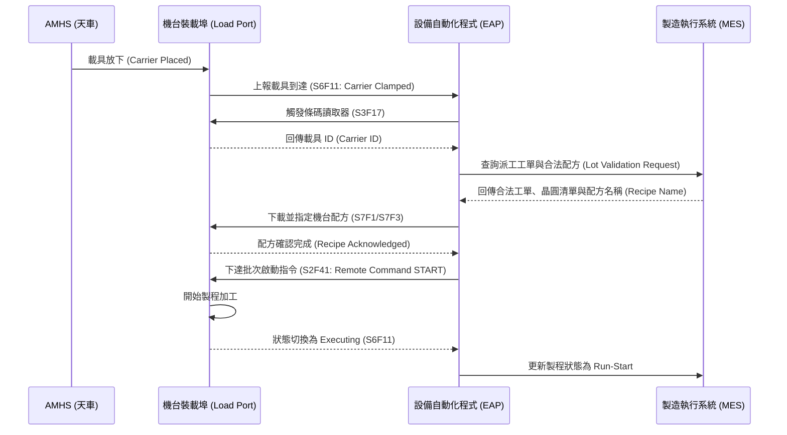

---

### Interface A（EDA）與高頻感測器資料擷取

傳統 SECS/GEM 協定主要針對事件驅動（Event-driven）的製造控制而設計。然而，先進製程控制（APC）與故障偵測與分類（Fault Detection and Classification, FDC）需要以高採樣頻率（典型值 $10\text{ Hz}\sim 100\text{ Hz}$）持續收集反應室壓力、射頻前向與反射功率（RF Forward/Reflected Power）、靜電夾頭（ESC）氦氣背壓與氣體質量流量控制器（MFC）讀數。

若強行將高頻感測器資料注入傳統 SECS/GEM 鏈路，將引發下列問題：
* **頻寬瓶頸**：HSMS 鏈路共用指令與數據傳輸，巨量感測數據易造成控制指令排隊延遲（Queueing Delay），甚至導致逾時中斷。
* **單一連線限制**：GEM 預設為一對一連線架構（機台對單一主機），多個分析系統（如 FDC、機台狀態健康監測、研發分析）無法同時獨立訂閱資料。

為解決此問題，SEMI 制定了設備資料擷取標準（Equipment Data Acquisition, EDA），統稱為 **Interface A**（主要包含 SEMI E120、E125、E132 與 E134）：

| 特性比較指標 | SECS/GEM（傳統控制路徑） | Interface A / EDA（高頻分析路徑） |
| :--- | :--- | :--- |
| **主要定位** | 生產控制、狀態追蹤、配方管理 | 深度感測器數據採集、先進 FDC、大數據分析 |
| **底層技術堆疊** | HSMS / TCP/IP，自訂二進位編碼 | SOAP/XML 或 REST/JSON over HTTP/HTTPS |
| **連線架構** | 一對一（機台至 EAP） | 一對多（Multi-Client，支援多個獨立訂閱者） |
| **典型採樣頻率** |  события觸發，或 $\le 1\text{ Hz}$ 週期性報告 | $10\text{ Hz}\sim 100\text{ Hz}$ 高頻週期採集與追蹤（Trace） |
| **對機台控制的影響** | 具備機台控制權（可執行 Start/Stop） | **唯讀架構**（Read-only），不允許下達控制指令 |
| **資料模型配置** | 變數 ID（VID）固定，需由工程師手動映射 | 基於通用設備模型（CEM, SEMI E120）之凍結中繼資料（Metadata） |

Interface A 的關鍵技術特徵在於**中繼資料架構（Metadata Framework）**。機台製造商在出廠時，依據 E125 標準將機台內部所有實體與邏輯元件（如腔體、真空泵、加熱器、感測器節點）組織為樹狀的硬體與資料階層模型。

資料採集客戶端（如 FDC 伺服器）連線後，首先讀取該機台的「凍結中繼資料」（Frozen Metadata），藉此識別特定參數的邏輯節點路徑，隨後透過 SEMI E134 定義「資料收集計畫」（Data Collection Plan, DCP）。DCP 可精確定義：
* 採集節點清單（例如反應室內 8 組不同位置的熱電偶溫度）。
* 取樣頻率（例如每 $20\text{ ms}$ 取樣一次）。
* 緩衝區填滿策略與網路傳輸觸發條件（例如累積 50 筆取樣或特定事件觸發後一次性打包壓縮發送）。

!!! note "中繼資料凍結（Metadata Freeze）的必要性"
    在先進晶圓廠中，機台軟體或硬體配置變更可能導致內部感測器記憶體位址變動。Interface A 強制要求在機台版本變更時建立具唯一版本識別碼（Metadata ID）的凍結結構。分析系統若檢測到 Metadata ID 變更，會自動重新比對資料欄位，避免舊有分析模型因欄位錯位而誤判。

---

### 資料上報路徑的分流：控制指令流與高頻感測器數據流

先進半導體製造廠採用嚴格的「雙軌分流架構」，將資料傳輸劃分為**控制指令流（Operational/Control Stream）**與**高頻分析資料流（Analytical/Sensor Data Stream）**。此架構確保了控制鏈路的即時性與確定性，同時滿足大數據平台對高維度時間序列資料的吞吐需求。

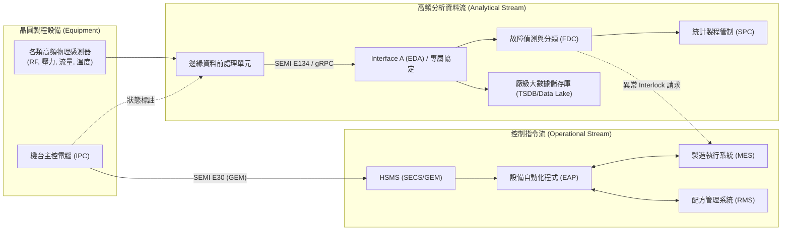

#### 控制指令流（Operational/Control Stream）
該路徑核心要求為**高可靠度、低延遲、狀態一致性**。
* **路徑**：機台 IPC $\rightarrow$ HSMS (SECS/GEM) $\rightarrow$ EAP $\rightarrow$ MES。
* **特性**：資料量小（單一訊息通常小於數千位元組），但必須具備交易性（ACID 特性）。例如批次加工完成（Lot Complete）訊息若遺失，將導致整條產線物料排程停擺。EAP 於此路徑中實施狀態同步，並在確認收到 MES 的應用層確認（Acknowledgement）後，方釋放機台裝載埠。

#### 高頻分析資料流（Analytical/Sensor Data Stream）
該路徑核心要求為**高頻寬、低排程干擾、時間同步性**。
* **路徑**：物理感測器 $\rightarrow$ 邊緣前處理單元 $\rightarrow$ Interface A (EDA) 或現代高效能串流協定（如 gRPC/Apache Kafka） $\rightarrow$ FDC 系統 $\rightarrow$ 時間序列資料庫（Time-Series Database, TSDB）。
* **特性**：單一反應室每秒可能產生數萬個感測點資料（若包含 RF 電壓/電流諧波波形分析，取樣率可達 $\text{kHz}$ 以上）。此資料流若發生短暫封包遺失，僅造成局部分析特徵平滑度微降，不致使機台當機；因此多採用非同步、具備大容量緩衝區（Buffer）的傳輸架構。
* **關聯化（Contextualization）機制**：高頻感測資料若缺乏製程上下文（Context），將毫無工程意義。邊緣節點或 FDC 接收端必須透過時間戳記（Timestamp，通常依據 IEEE 1588 精確時間協定，同步至微秒等級），將高頻物理感測曲線與控制指令流中的關鍵中繼資料進行精確綁定：
  $$S_{\text{context}}(t) = \{V_{\text{sensor}}(t), \text{LotID}, \text{WaferID}, \text{StepNumber}, \text{RecipeID}\}$$
  其中 $V_{\text{sensor}}(t)$ 為感測器在時間 $t$ 的讀數。藉由此關聯化矩陣，FDC 演算法方能精確切分出各製程步驟（Step）的動態暫態曲線，進行即時特徵抽取與異常界限比對。

!!! example "先進蝕刻機台的分流實作"
    在先進介電質電漿蝕刻機（Plasma Etcher）中，機台 IPC 透過 SECS/GEM 通訊埠處理配方選擇、晶圓傳入與傳出；與此同時，電漿阻抗監控器與光學發射光譜儀（OES）以 $100\text{ Hz}$ 頻率擷取電漿強度與 RF 阻抗相位角。感測數據完全繞過 SECS/GEM 引擎，透過獨立的專用千兆乙太網路介面（Gigabit Ethernet Port）經由 Interface A 或高效能二進位串流即時外送至 FDC 伺服器，達成控制與分析完全解耦。

<!-- fig:1 -->
<figure markdown>
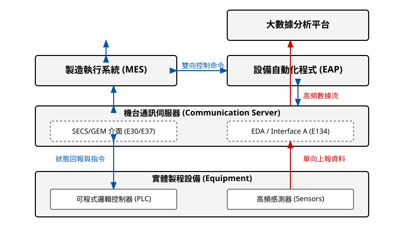
<figcaption>圖 54-1　廠級資料通訊階層圖（AI 繪製的示意圖）</figcaption>
</figure>

## 54.3 製程監控與回饋控制系統

### 故障偵測與分類（FDC）

在先進半導體製程中，單批晶圓的價值極高，若等到晶圓完成加工並送往量測機台（Metrology Tool）才發現異常，往往已造成數十至數百片晶圓報廢。故障偵測與分類（Fault Detection and Classification, FDC）的核心精神，是在晶圓加工過程中以高抽樣頻率監控機台內部感測器（Sensors），在腔體狀態出現漂移或突波的瞬間進行攔截。

#### 感測器波形擷取與特徵提取

電漿蝕刻（Etch）、化學氣相沉積（CVD）與物理氣相沉積（PVD）等製程機台內部配置了大量即時感測器，監控項目包含：
* 射頻系統：順向功率（Forward Power）、反射功率（Reflected Power）、偏壓（Vdc）、阻抗匹配電容位置（Tune/Load Capacitor Position）。
* 真空與氣體系統：腔體壓力（Chamber Pressure）、節流閥開度（Throttle Valve Position）、質量流量控制器（MFC）流量反饋。
* 熱力學與機械系統：靜電吸盤（ESC）溫度、氦氣背壓（He Backside Leak Rate）、冷卻水流量。

這些感測器通常以 $10\text{ Hz}$ 至 $100\text{ Hz}$（甚至高頻電漿發射光譜達 kHz 等級）持續採樣，產生高維度的時間序列波形（Time-series Trace Data）。由於單一製程步驟（Step）的時間長度與穩態建立時間固定，直接對連續波形進行比對運算成本過高。工程實作上會進行步驟切割（Step Slicing），並針對關鍵區段進行特徵值提取（Feature Extraction）：

$$f_{\text{mean}} = \frac{1}{N} \sum_{i=1}^{N} x_i$$

$$f_{\text{std}} = \sqrt{\frac{1}{N-1} \sum_{i=1}^{N} (x_i - f_{\text{mean}})^2}$$

除了一階統計量（平均值、標準差、極大值、極小值）外，特徵值還包含斜率（Slope，代表升壓或氣體注入速率）、積分面積（Area Under Curve, AUC，代表氣體或能量注入總量）以及達到穩態的暫態響應時間（Rise Time）。

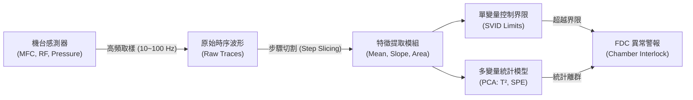

#### 多變量統計製程監控（MSPC）

當感測器參數超過數百個時，單變量臨界值監控（SVID Limits）難以捕捉參數間的耦合效應（例如：節流閥些微受阻導致微小角度變化，同時伴隨氣體流量極輕微下降，單項指標皆在規格內，但兩者聯合分布已呈現異常）。晶圓廠普遍導入基於主成分分析（Principal Component Analysis, PCA）的多變量統計製程監控。

將標準化後的感測器特徵矩陣 $\mathbf{X} \in \mathbb{R}^{m \times p}$（$m$ 次加工批次，$p$ 個特徵變數）降維投影至低維主成分空間：

$$\mathbf{X} = \mathbf{T} \mathbf{P}^T + \mathbf{E}$$

其中 $\mathbf{P} \in \mathbb{R}^{p \times k}$ 為負載矩陣（Loading Matrix，包含前 $k$ 個主成分），$\mathbf{T} \in \mathbb{R}^{m \times k}$ 為主成分得分矩陣（Score Matrix），$\mathbf{E}$ 為殘差矩陣（Residual Matrix）。

FDC 系統藉由計算兩大統計量即時判定機台健康度：

1. **霍特林 $T^2$ 統計量（Hotelling's $T^2$）**：監控主成分空間內的變異幅度，反映機台作業點是否在主模型所涵蓋的常態範圍內。
   $$T^2 = \mathbf{t}_i \mathbf{S}^{-1} \mathbf{t}_i^T$$
   其中 $\mathbf{t}_i$ 為第 $i$ 筆樣本在主成分空間的投影向量，$\mathbf{S}$ 為主成分得分的共變異數矩陣。

2. **平方預測誤差（Squared Prediction Error, SPE / $Q$ 統計量）**：監控殘差空間的變異，反映感測器之間的關聯結構是否被打破（如感測器漂移、腔壁生成沉積物改變表面吸附行為）。
   $$Q = \mathbf{e}_i \mathbf{e}_i^T = (\mathbf{x}_i - \hat{\mathbf{x}}_i)(\mathbf{x}_i - \hat{\mathbf{x}}_i)^T$$
   其中 $\mathbf{e}_i$ 為第 $i$ 筆樣本的殘差向量，$\hat{\mathbf{x}}_i = \mathbf{t}_i \mathbf{P}^T$ 為重構向量。

當 $T^2$ 或 $Q$ 超過基於顯著水準 $\alpha$（典型值為 $0.01$ 或 $0.001$）推導出的統計上限時，FDC 即發布異常警報，並由負載貢獻圖（Contribution Plot）指出權重最高的可疑感測器，協助腔體工程師排除硬體障礙。

---

### 統計製程管制（SPC）

不同於 FDC 監控「機台物理參數」，統計製程管制（Statistical Process Control, SPC）專注於監控「產品實體品質參數」，其資料來源多為離線量測設備（如光學量測膜厚儀、CD-SEM 臨界尺寸掃描顯微鏡、晶圓平坦度量測儀）。

#### 管制圖數學原理

設製程品質特性值 $X \sim N(\mu, \sigma^2)$。針對抽樣樣本數為 $n$ 的子群，樣本平均值 $\bar{X}$ 的分布為 $N(\mu, \sigma^2/n)$。建立休哈特管制圖（Shewhart Control Chart）之管制界限：

$$\text{UCL} = \mu + 3 \frac{\sigma}{\sqrt{n}}$$

$$\text{CL} = \mu$$

$$\text{LCL} = \mu - 3 \frac{\sigma}{\sqrt{n}}$$

其中 $\text{UCL}$ 為管制上限（Upper Control Limit），$\text{CL}$ 為中心線（Center Line），$\text{LCL}$ 為管制下限（Lower Control Limit）。

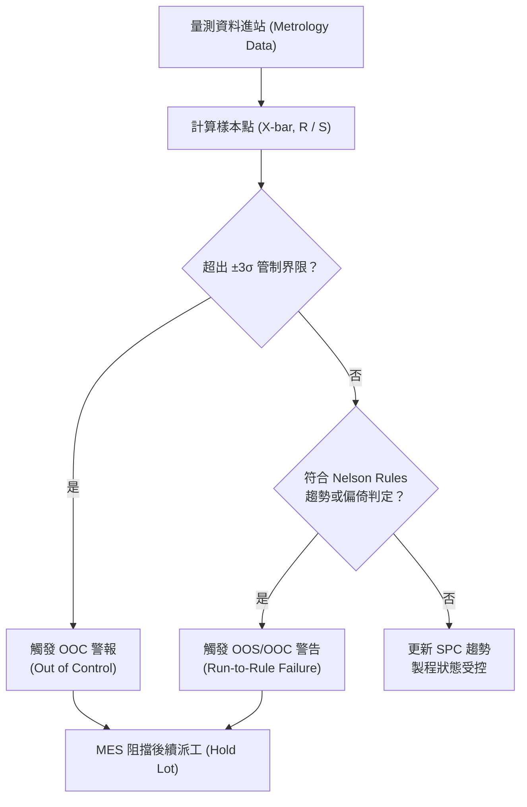

#### 判異準則（Nelson Rules）

為在製程發生系統性漂移但尚未跨越 $3\sigma$ 界限前即早偵測，晶圓廠廣泛應用判異準則（以 Nelson Rules 為代表），常見判定包括：
* **Rule 1**：任意 1 點落在 $\pm 3\sigma$ 管制界限外（定義為出界，Out of Control, OOC）。
* **Rule 2**：連續 9 點落在中心線同一側（代表平均值發生漂移）。
* **Rule 3**：連續 6 點持續遞增或持續遞減（代表刀具磨損、研磨液老化或沉積速率持續退化）。
* **Rule 4**：連續 14 點交互上下起伏（代表抽樣系統存在兩種交替發生的系統誤差，如雙腔體交替供料）。
* **Rule 5**：連續 3 點中有 2 點落在同一側的 $+2\sigma$ 與 $+3\sigma$ 區間內。

#### 製程能力評估

SPC 定期計算製程能力指標（Process Capability Index），以確認當前製程品質散布與工程規格界限（USL / LSL）的相對關係：

$$C_p = \frac{\text{USL} - \text{LSL}}{6\sigma}$$

$$C_{pk} = \min \left( \frac{\text{USL} - \mu}{3\sigma}, \frac{\mu - \text{LSL}}{3\sigma} \right)$$

在先進製程要求下，關鍵尺寸與關鍵層對準（Overlay）的 $C_{pk}$ 典型要求必須維持在 $1.33$ 至 $1.67$ 以上，以確保百萬分率（PPM）等級的極低缺陷率。

---

### 進階製程控制（APC）

SPC 僅提供事後被動攔截與品質監控，無法主動改變生產參數。進階製程控制（Advanced Process Control, APC）則是透過數學模型，在批次與批次之間（Run-to-Run, R2R）自動動態調整製程配方（Recipe），補償上游累積變異與當站機台漂移。

#### 前饋控制與回饋控制機制

APC 系統依據控制迴路的資訊流向，分為前饋（Feed-forward）與回饋（Feedback）兩種機制：

| 項目 | 前饋控制（Feed-forward） | 回饋控制（Feedback） |
| :--- | :--- | :--- |
| **輸入資料來源** | 當前晶圓的上游製程量測值（如 CMP 前膜厚、微影後光阻線寬） | 前一加工批次的當站量測值（如蝕刻後終點 CD） |
| **目標** | 補償「本批晶圓的入料誤差」（Incoming Variation） | 補償「本機台隨時間累積的物理特性漂移」（Chamber Drift） |
| **典型應用實例** | 根據沉積層的實測膜厚，精確計算化學機械研磨（CMP）所需的研磨時間 | 根據過去數批的微影對準殘差，修正微影曝光機的晶圓台平移與旋轉補償量 |

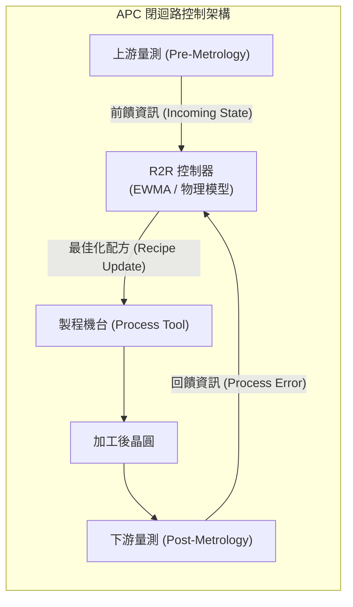

#### 指數加權移動平均（EWMA）控制器

在回饋控制演算法中，最常採用的線性補償基礎為指數加權移動平均（Exponentially Weighted Moving Average, EWMA）。假設製程機台的模型簡化為一階線性響應：

$$y_k = \alpha + \beta u_k + \epsilon_k$$

其中 $y_k$ 為第 $k$ 批加工之輸出品質（例如蝕刻量），$u_k$ 為機台輸入控制量（例如蝕刻時間），$\alpha$ 為機台截距（反映腔體基礎加工能力），$\beta$ 為製程增益（Gain，通常藉由實驗設計 DOE 事先校正），$\epsilon_k$ 為隨機雜訊。

機台隨時間老化的過程（如腔壁沉積物增厚導致蝕刻速率衰減）可視為截距 $\alpha$ 的時變漂移。EWMA 控制器在第 $k$ 批完成量測後，利用預測誤差對下一批的截距估計值 $\hat{\alpha}_{k+1}$ 進行平滑更新：

$$\hat{\alpha}_{k+1} = \lambda (y_k - \beta u_k) + (1 - \lambda) \hat{\alpha}_k$$

其中 $\lambda \in (0, 1]$ 為權重折減參數（Discount Factor，典型值設定在 $0.2$ 至 $0.6$ 之間）。

為使第 $k+1$ 批晶圓達到目標規格值 $T$（Target），控制器將反推並下發控制配方：

$$u_{k+1} = \frac{T - \hat{\alpha}_{k+1}}{\beta}$$

!!! note "EWMA 參數 $\lambda$ 的工程取捨"
    $\lambda$ 愈大，控制器對最新批次的誤差反應愈靈敏，適合捕捉突發性的階躍變化（Step Drift）；但若製程本身的高頻隨機雜訊（White Noise）過大，過高的 $\lambda$ 將導致控制器過度反應，產生數值震盪（Over-controlling）。反之，較小的 $\lambda$ 能有效抑制雜訊，但對真實漂移的修正反應遲緩。

---

### 資料整合：FDC 警報與 SPC 異常的關聯分析

在高度自動化的晶圓廠中，FDC、SPC 與 APC 並非孤立運作，而是形成多層次的製程監控閉環。當 SPC 攔截到底層實體量測超出管制上限（OOC）時，該批晶圓將由 MES 系統標記為保留（Hold Lot）狀態並停止派工。製程工程師（PE）隨即面臨根因追查（Root Cause Analysis, RCA）挑戰。

#### 根因追查資料關聯路徑

關聯分析平台透過共用鍵值（Lot ID、Wafer ID、Process Recipe、Chamber ID、Timestamp）進行跨系統追溯：

1. **時間戳記對齊與腔體定位**：將 SPC 量測異常晶圓的進出站時間，與機台設備自動化程式（EAP）紀錄的傳輸日誌匹配，鎖定實際加工該片晶圓的特定反應腔（Chamber）。
2. **多晶圓特徵疊合分析**：提取該批次所有晶圓在該反應腔加工時的 FDC 特徵指標，檢視特定特徵（如 ESC Helium Leak Rate 或 RF Reflected Power Peak）與 SPC 量測偏差之間是否具有高度統計相關性（Pearson's $r$ 或互資訊量 Mutual Information）。
3. **APC 補償量反查**：檢驗 APC 模型在該批次下發的控制參數，確認是否因上游入料異常（前饋誤差）導致配方已被推擠至飽和界限（Actuator Saturation），或者因回饋演算法估計失準而發散。

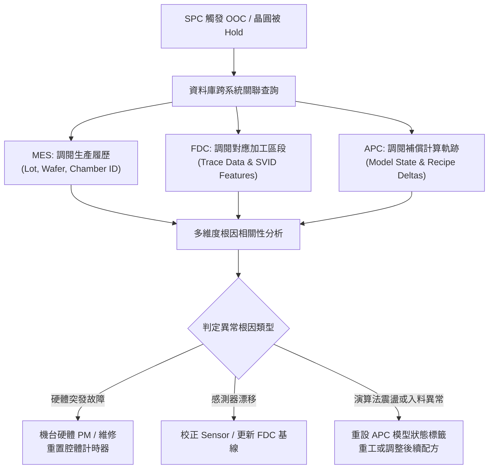

!!! example "產業實例：電漿蝕刻機匹配網路電容失效追查"
    某 12 吋廠在金屬閘極蝕刻製程中，SPC 監控系統偵測到多批晶圓之臨界尺寸（CD）呈現漸進式偏大，觸發 Nelson Rule 3（連續 6 點遞增）。
    
    工程系統啟動多變量 FDC 關聯回溯，比對正常批次與異常批次的 PCA 負載貢獻圖。分析顯示，主成分 $Q$ 統計量在特定步驟持續升高，其主要貢獻來自於「RF Match Tune Capacitor Position」的標準差劇烈放大。
    
    深入調閱原始波形（Trace）發現，射頻自動匹配網路中的步進馬達驅動模組機械齒輪磨損，導致阻抗匹配達到穩態的時間（Tune Time）由原本的 $0.8\text{ 秒}$ 拖長至 $4.5\text{ 秒}$。在此延遲區段內，反射功率過高導致有效電漿密度不足，使多晶矽蝕刻速率下降，最終造成 CD 偏大。工程師藉由此關聯分析在 30 分鐘內定位機構故障，避免了進一步的批次性線路短路不良。

<!-- fig:2 -->
<figure markdown>
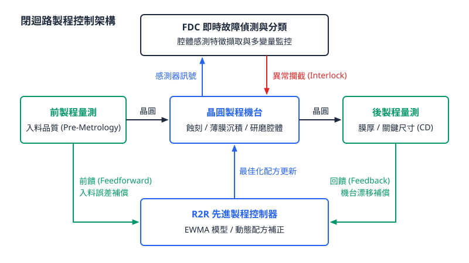
<figcaption>圖 54-2　閉迴路製程控制架構（AI 繪製的示意圖）</figcaption>
</figure>

## 54.4 工程師作業介面與異常處置流程

在先進半導體製造中，製程工程師（Process Engineer, PE）的主要任務是維持製程穩定性並極大化良率。隨著自動化程度提升，工程師不再需要親自巡視機台，而是透過高度整合的數位儀表板進行即時監控與決策。本節將詳細探討工程師日常作業的數位介面、異常處置的標準流程，以及虛擬量測技術的應用。

### 54.4.1 製程工程師的數位儀表板

數位儀表板（Digital Dashboard）是整合了製造執行系統（MES）、統計製程管制（SPC）與故障偵測與分類（FDC）資訊的綜合平台。其核心組件包括：

#### 1. 統計製程管制圖 (SPC Control Charts)
SPC 圖是監控製程穩定性的首要工具。最常見的是 $\bar{X}-R$ 圖（平均值與全距圖）或 $\bar{X}-S$ 圖（平均值與標準差圖）。
*   **管制界限 (Control Limits)**：通常設定在 $\pm 3\sigma$（標準差），即：
    $$UCL = \mu + 3\sigma$$
    $$LCL = \mu - 3\sigma$$
    其中 $\mu$ 為製程平均值。若數據點超出管制界限，即觸發「管制外」（Out of Control, OOC）警報。
*   **趨勢分析**：工程師需觀察數據是否符合「西電規則」（Western Electric Rules），例如連續 9 點落在平均值同一側，這暗示製程發生了偏移（Shift）而非隨機波動。

#### 2. FDC 波形分析 (FDC Trace Analysis)
當 SPC 出現異常，工程師會調閱 FDC 系統擷取的機台感測器波形（Traces）。
*   **黃金曲線 (Golden Trace)**：將當前批次的參數（如射頻功率、反應室壓力、氣體流量）與歷史良率最佳的基準曲線進行重疊比對。
*   **特徵值提取**：系統會計算波形的積分值、峰值或斜率。例如，在蝕刻製程中，終點偵測（Endpoint Detection, EPD）的光譜強度波形若發生延遲，可能代表薄膜厚度異常或蝕刻速率下降。

#### 3. 晶圓圖 (Wafer Map)
量測與檢測資料會以視覺化晶圓圖呈現。
*   **空間模式辨識 (Spatial Pattern Recognition)**：特定的缺陷分布通常指向特定的機台組件故障。
    *   **環狀分布 (Ring Pattern)**：可能與化學氣相沉積（CVD）的噴頭（Showerhead）溫度不均或蝕刻製程的邊緣氣流控制有關。
    *   **刮痕 (Scratch)**：通常由機械手臂（Robot Arm）傳送不當或化學機械平坦化（CMP）的研磨墊碎片引起。
    *   **點狀聚集 (Cluster)**：多為微粒（Particle）污染。

### 54.4.2 異常處置標準作業程序 (SOP)

當系統偵測到異常時，會啟動自動化的處置流程，以防止損害擴大。

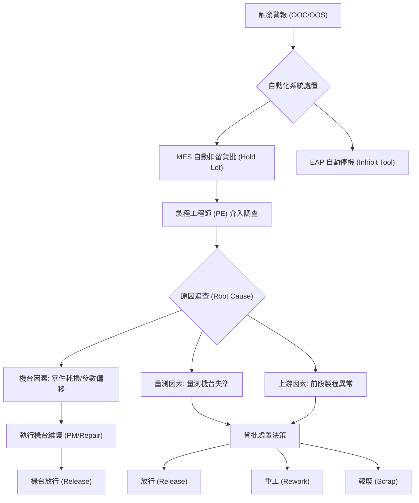

#### 1. 警報觸發與貨批扣留 (Hold Lot)
警報分為「管制外」（OOC）與「規格外」（Out of Specification, OOS）。
*   **OOC**：數據超出統計管制界限，但仍在產品設計規格內。此時 MES 會自動扣留該批次（Hold lot），防止其進入下一道製程。
*   **OOS**：數據超出客戶要求的物理極限，通常意味著產品失效。

#### 2. 原因追查與機台診斷
工程師接獲通知後，需判斷異常來源：
*   **機台端檢查**：確認 FDC 是否有硬體警報（如真空洩漏、冷卻水流不足）。
*   **量測端確認**：有時異常源於量測機台（Metrology Tool）的偏差，需重新量測標準片（Standard Wafer）進行校正。
*   **上下文關聯 (Contextual Analysis)**：檢查該批次是否使用了特定的反應室（Chamber）或特定的光罩。

!!! note "說明"
    在先進製程中，PE 常使用「變異數分析」（ANOVA）或多變量分析（PCA/PLS）來快速定位是哪一個機台參數導致了最終的電性差異。

### 54.4.3 處置決策邏輯：放行、重工與報廢

工程師必須在產出壓力與品質風險之間取得平衡，其決策邏輯如下：

1.  **放行 (Release)**：
    *   若確認為量測誤判，或異常程度極輕微且不影響後續電性（如非關鍵區域的微小粒子），則解除 Hold 狀態。
    *   若製程發生微幅偏移，可透過調整「進階製程控制」（APC）的補償值（Bias）來修正後續批次。

2.  **重工 (Rework)**：
    *   **定義**：將晶圓表面的材料移除並重新執行該道製程。
    *   **適用情境**：黃光微影製程（Lithography）最常執行重工。若關鍵尺寸（CD）或疊對誤差（Overlay）不合格，可將光阻洗去（Photoresist Strip）重新塗佈曝光。
    *   **限制**：並非所有製程皆可重工。例如蝕刻（Etch）或離子佈植（Ion Implantation）屬於不可逆反應，一旦過度加工即無法挽回。

3.  **報廢 (Scrap)**：
    *   當晶圓結構損壞、關鍵層厚度嚴重不足或發生嚴重的金屬污染時，必須果斷報廢，以避免後續昂貴的封裝測試成本。

!!! warning "常見誤解"
    初學者常認為只要數據在規格（Spec）內就應放行。事實上，若數據雖在規格內但呈現明顯的 OOC 趨勢，工程師仍會扣留貨批，因為這代表製程已失去受控狀態（Out of Control），後續可能產生不可預測的可靠度問題。

### 54.4.4 虛擬量測 (Virtual Metrology, VM) 的應用

由於實體量測（如 TEM, SEM, Ellipsometry）耗時且昂貴，晶圓廠通常採行「抽樣檢查」。然而，抽樣會導致異常偵測的延遲（Metrology Lag）。虛擬量測技術旨在解決此問題。

#### 1. 物理與數學原理
虛擬量測利用機台端擷取的 FDC 感測器數據 $X = \{x_1, x_2, ..., x_n\}$（如壓力、電流、流量），透過數學模型預測該片晶圓的量測結果 $Y$（如膜厚、線寬）：
$$Y_{pred} = f(X) + \epsilon$$
其中 $f(X)$ 為預測模型（常使用多元線性回歸、支持向量機或深度學習網路），$\epsilon$ 為殘差。

#### 2. 應用優勢
*   **全檢（100% Inspection）**：將原本每批抽測 1 片，提升至每片晶圓（Wafer-to-Wafer）皆有預測數值。
*   **即時回饋**：在晶圓離開加工機台的瞬間即可得知預測結果，若預測值異常，可立即停止機台，無需等待數小時後的實體量測結果。
*   **減少量測成本**：當 VM 模型的準確度（R-square）與可靠度指標（Reliance Index, RI）達到一定門檻時，可以進一步降低實體量測的抽樣頻率。

!!! example "產業實例"
    在化學機械平坦化（CMP）製程中，透過監控研磨頭（Polishing Head）的馬達電流與壓力，虛擬量測可以精準預測移除速率（Removal Rate）。當模型預測移除量不足時，系統可即時通知 APC 增加下一片晶圓的研磨時間，實現閉環控制（Closed-loop Control）。

### 54.4.5 異常處置的效能指標

為了評估 PE 與自動化系統的效率，廠端通常監控以下指標：
*   **平均處置時間 (Mean Time to Detect/Repair, MTTD/MTTR)**：從警報觸發到工程師完成決策的時間。
*   **誤報率 (False Alarm Rate)**：過高的誤報會導致「警報疲勞」，降低工程師對真正異常的敏感度。
*   **漏報率 (Miss Rate)**：最嚴重的指標，代表異常產品流向客戶端。

透過這些數位工具與標準化流程，半導體廠得以在數萬片晶圓同時在製品（WIP）的高複雜環境下，維持極高的良率與生產穩定性。虛擬量測與人工智慧診斷的結合，則是目前智慧工廠（Smart Manufacturing）持續演進的方向。

## 54.5 自動化系統的效能指標與可靠度設計

在現代化 12 吋晶圓廠（Fab）中，自動化系統已從單純的輔助工具演變為生產的核心。隨著製程節點微縮至 5 奈米甚至 3 奈米以下，製程視窗（Process Window）極度收窄，這要求自動化系統必須具備極高的資料處理能力、極低的通訊延遲以及近乎零停機的可靠度。本節將深入探討自動化系統在面對資料爆炸、即時控制需求與資訊安全挑戰時的設計原則。

### 54.5.1 資料量爆炸與分層儲存架構

隨著感測器（Sensor）技術的普及與採樣頻率的提升，晶圓廠產生的資料量呈現指數級成長。傳統基於 SECS/GEM 協定的資料上報方式，因受限於頻寬與訊息格式，已難以滿足先進製程的需求。

#### 資料量的來源與規模
在先進製程機台（如 EUV 曝光機或多腔體電漿蝕刻機）中，單一機台可能配置數百個感測器，記錄包含射頻功率（RF Power）、氣體流量、真空度、溫度與電壓等參數。若採樣頻率由 1 Hz 提升至 100 Hz，且改採 Interface A (EDA) 協定上報，單台設備每日產生的原始資料量可達數百 GB。若計入光學關鍵尺寸量測（Optical CD）的光譜資料或缺陷檢測（Defect Inspection）的高解析度影像，全廠每日產生的資料量通常以 TB 甚至 PB 等級計算。

#### 分層儲存架構設計
為了平衡存取效能與成本，自動化系統採用分層儲存（Tiered Storage）架構：

1.  **熱儲存（Hot Storage）：** 採用全快閃記憶體陣列（All-Flash Array），存放即時生產資料與 FDC 監控所需的特徵值。此層級強調極高的輸入/輸出操作（IOPS）與低延遲。
2.  **溫儲存（Warm Storage）：** 採用高效能硬碟陣列，存放過去數週至數月的歷史資料，用於製程工程師進行統計分析（SPC）或良率回溯。
3.  **冷儲存（Cold Storage）：** 採用物件儲存（Object Storage）或磁帶庫，存放需長期保存以符合法規或客戶要求的原始資料。

!!! note "資料壓縮與降採樣"
    為了降低儲存負擔，系統通常會在邊緣端（Edge）進行資料預處理。例如，當感測器數值處於穩定狀態時，僅記錄變化量；或是在非關鍵製程步驟降低採樣頻率，僅在關鍵步驟（Critical Steps）開啟高頻採樣。

### 54.5.2 通訊延遲對即時攔截的影響

在自動化系統中，延遲（Latency）定義為從感測器觸發訊號到系統做出反應（如停機指令）所需的時間。對於故障偵測與分類（FDC）系統而言，延遲的高低直接決定了異常發生時受影響晶圓（Wafers at Risk）的數量。

#### 延遲時間組成
總延遲 $T_{total}$ 可表示為：
$$T_{total} = T_{sampling} + T_{transmission} + T_{processing} + T_{decision}$$
其中：
- $T_{sampling}$：感測器採樣與類比/數位轉換時間。
- $T_{transmission}$：資料經由機台網路傳輸至 EAP 或 FDC 伺服器的時間。
- $T_{processing}$：FDC 演算法進行特徵提取與統計計算的時間。
- $T_{decision}$：邏輯判斷與發送 Interlock 指令回機台的時間。

#### 即時攔截（Real-time Intercept）機制
若 $T_{total}$ 超過製程步驟的剩餘時間，系統將無法在該片晶圓受損前停止機台。例如，在原子層沉積（ALD）製程中，單一循環的時間極短，若延遲過高，異常可能導致整批晶圓（Lot）報廢。

為了實現「Stop-on-Fault」，先進系統採用邊緣計算（Edge Computing）架構，將部分 FDC 邏輯下放到機台端的控制電腦（IPC），使決策路徑縮短，將 $T_{total}$ 控制在毫秒（ms）等級。

### 54.5.3 高可用性與災難復原機制

晶圓廠為 24 小時連續運作，任何自動化系統的停機都會導致生產線停擺（Line Down），其損失以每小時數十萬美金計。因此，系統設計必須追求「五個九」（99.999%）的可用性。

#### 高可用性（High Availability, HA）設計
可用性 $A$ 的計算公式為：
$$A = \frac{MTBF}{MTBF + MTTR}$$
其中 $MTBF$ 為平均失效間隔時間（Mean Time Between Failures），$MTTR$ 為平均修復時間（Mean Time To Repair）。

為提高可用性，系統架構通常包含：
- **冗餘設計（Redundancy）：** 關鍵伺服器採用 Active-Active 或 Active-Passive 配置。當主伺服器故障時，備援伺服器可在數秒內接管業務。
- **負載平衡（Load Balancing）：** 透過負載平衡器將大量機台的連線請求分散至多個應用伺服器，避免單點過載。
- **資料庫叢集（Database Cluster）：** 確保資料在多個節點間同步寫入，防止硬碟損壞導致資料遺失。

#### 災難復原（Disaster Recovery, DR）
災難復原關注的是在極端情況（如火災、地震或大規模電力故障）下，系統恢復運作的能力。其核心指標包括：
- **復原時間目標（RTO, Recovery Time Objective）：** 災難發生後，系統恢復正常運作所需的最長時間。
- **復原點目標（RPO, Recovery Point Objective）：** 系統恢復後，允許遺失的資料量（以時間衡量）。在晶圓廠中，MES 系統的 RPO 通常要求接近於零。

### 54.5.4 資訊安全與 OT 網路隔離策略

隨著機台聯網比例達到 100%，晶圓廠面臨嚴峻的網路安全威脅。營運技術（OT）環境與傳統資訊技術（IT）環境不同，其首要目標是「可用性」而非「機密性」。

#### 網路分層架構（Purdue Model）
根據 ISA-95 標準，晶圓廠網路通常分為多個層級以實現安全隔離：

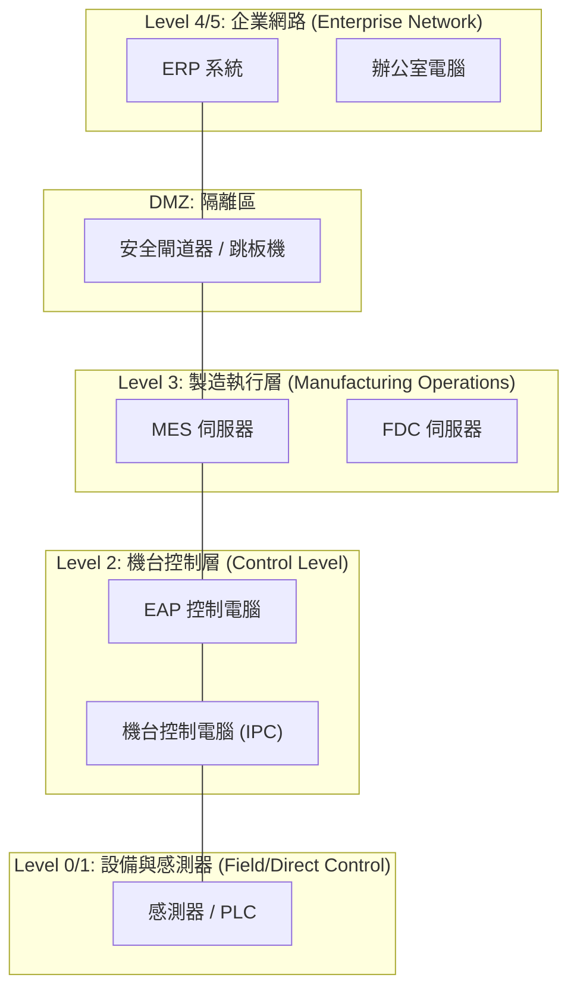

#### OT 安全策略
1.  **實體與邏輯隔離（Air-gap & VLAN）：** 生產線網路與辦公室網路必須完全隔離，僅透過受控的閘道器進行必要之資料交換。
2.  **白名單機制（Whitelisting）：** 由於機台控制電腦（IPC）常使用舊版作業系統（如 Windows XP/7），難以安裝頻繁更新的防毒軟體。因此改採「白名單」策略，僅允許預先定義的程式執行，阻斷所有未經授權的可執行檔。
3.  **USB 存取管制：** 嚴禁任何未經掃描的行動儲存裝置接入機台。工程師更新軟體需透過專用的安全傳輸站。
4.  **修補程式管理（Patch Management）：** 針對機台端的漏洞修補，必須在離線環境經過相容性測試，確認不影響製程穩定性後，方可在歲修（Shutdown）期間進行更新。

!!! warning "常見誤解"
    許多人認為安裝了防火牆就代表 OT 網路安全。實際上，晶圓廠內部的威脅往往來自於供應商維修筆電的接入或內部人員操作不當。因此，「零信任（Zero Trust）」架構與嚴格的存取行為監控，在現代晶圓廠中變得日益重要。

### 54.5.5 自動化系統效能評估指標

除了可用性外，晶圓廠還會透過以下關鍵效能指標（KPI）來評估自動化系統的體質：

- **訊息處理吞吐量（Throughput）：** 系統每秒能處理的 SECS 訊息或 EDA 封包數量。
- **系統反應時間（Response Time）：** 工程師在查詢管制圖（SPC Chart）或晶圓圖（Wafer Map）時，從發出請求到畫面呈現的時間。典型值應小於 2 秒。
- **資料完整性（Data Integrity）：** 檢驗上報至資料庫的參數值是否與機台感測器原始值一致，防止因通訊錯誤導致的數據失真。

!!! example "產業實例"
    在台積電（TSMC）或英特爾（Intel）等先進晶圓廠中，自動化系統已導入人工智慧（AI）診斷功能。當系統偵測到資料流量異常增加時，會自動觸發流量清洗機制，確保關鍵的 MES 指令優先通過，避免因網路擁塞導致的生產中斷。這類設計體現了從「被動防護」轉向「主動韌性」的技術趨勢。

透過上述在資料量、延遲、可用性與安全性方面的嚴謹設計，自動化系統得以支撐起現代晶圓廠極高精密度的生產需求，並在確保良率的同時，極大化生產效率。

## 54.6 主要系統與解決方案廠商

### 晶圓廠自動化與資訊系統架構

半導體晶圓廠的自動化與數據架構是一座高防禦性、多層級的資訊技術 (IT) 與營運技術 (OT) 整合系統。從底層機台運算單元至頂層決策系統，整體架構可分為四個主要階層：機台介面層、自動化控制層、製造執行層以及進階分析層。

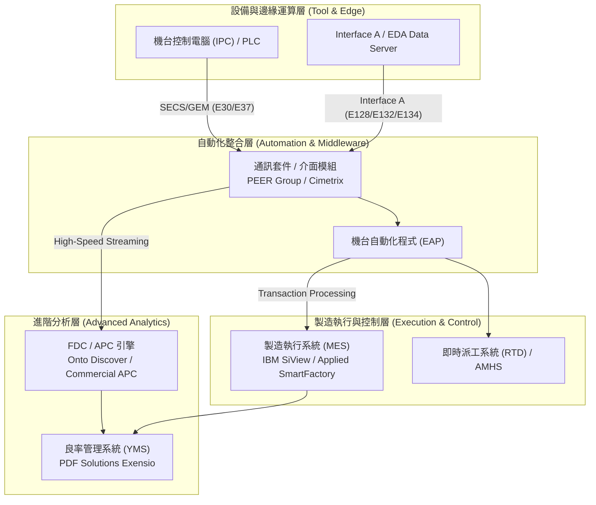

1. **設備與邊緣運算層 (Tool & Edge Level)**：機台內部的控制電腦 (IPC) 或模組伺服器負責直接控制馬達、氣體閥門與射頻電源。同時，專用的邊緣資料伺服器負責將高頻感測器訊號（如壓力、電壓、光譜）進行初步校正與壓縮。
2. **自動化整合層 (Automation & Middleware Level)**：包含機台自動化程式 (Equipment Automation Program, EAP) 與底層通訊驅動軟體。此層級負責將不同機台製造商的私有資料轉譯為半導體設備材料協會 (SEMI) 標準通訊協定，並管理派工指令的下達。
3. **製造執行層 (Execution & Control Level)**：以製造執行系統 (Manufacturing Execution System, MES) 為核心，追蹤晶圓批次 (Lot) 的位置、狀態、製程歷史與派工順序（配合即時派工系統 RTD 與自動物料搬運系統 AMHS）。
4. **進階分析層 (Advanced Analytics Level)**：接收來自 EAP 與機台的即時波形與量測資料，進行故障偵測與分類 (FDC)、統計製程管制 (SPC)、進階製程控制 (APC) 以及全廠良率分析 (YMS)。

---

### 主要系統與解決方案供應商比較

半導體晶圓廠自動化軟體市場由少數具備高可靠度實績的專業廠商所佔據。下表列出自動化與資料流領域的主要廠商及其核心技術特性：

| 廠商名稱 | 代表產品系列 | 技術路線與特點 | 主要應用領域 |
| :--- | :--- | :--- | :--- |
| **IBM** | SiView | 採高效能分散式交易處理架構，極強調資料一致性與高併發處理能力；支援嚴格的 300mm 晶圓廠 GEM300 標準模型。 | 12 吋先進製程晶圓廠核心製造執行系統 (MES)。 |
| **Applied Materials** | AppliedSmartFactory | 提供一站式電腦整合製造 (CIM) 解決方案，整合 MES、RTD、APC 與機台維護模組，強調模組間的原生相容性與一體化部署。 | 晶圓廠整體 CIM 架構、即時派工、進階製程控制 (APC)。 |
| **PEER Group** | PEER FACTORY, EStyle | 專精於半導體通訊協定棧 (Protocol Stack) 與機台端／廠端自動化測試；軟體架構具備極高的訊息吞吐量與低延遲特性。 | 設備製造商 (OEM) 控制軟體開發、晶圓廠 EAP 通訊介面整合。 |
| **Cimetrix**<br/>*(已被 PDF Solutions 收購)* | CIMConnect, CIMPortal | 業界標準 SECS/GEM 與 Interface A (EDA) SDK 之標竿；提供極高穩定度的通訊驅動程式，廣為各國機台大廠採用。 | 設備端 SEMI 標準通訊介面開發、Interface A 高速資料擷取。 |
| **PDF Solutions** | Exensio | 具備大數據巨量資料庫與機器學習分析引擎，可跨系統整合測試 (WAT/CP)、線下檢測、線上量測與 FDC 追蹤資料。 | 全廠級良率管理系統 (YMS)、大數據進階診斷與關聯性分析。 |
| **Onto Innovation** | Discover | 聚焦於光學量測、影像檢測與缺陷 (Defect) 資料分析；能將高解析度缺陷座標及影像與機台感測器波形進行同步比對。 | 缺陷管理系統 (DMS)、線上量測資料整合與機台狀態比對。 |

---

### 技術路線差異與晶圓廠導入考量

晶圓廠在規劃自動化與 IT/OT 資料流系統時，面臨多種技術路線的選擇與權衡：

#### 1. 系統架構：單體化微服務與分散式串流

傳統晶圓廠 MES（如舊版 SiView）多採用基於大型主機或通用 CORBA/C++ 介面的單體架構（Monolithic Architecture），其優點在於邏輯嚴密、晶圓狀態更新的單一真理源（Single Source of Truth）絕不衝突。然而，隨著 12 吋廠資料量爆發，當代系統逐漸轉向微服務（Microservices）與事件驅動架構（Event-Driven Architecture, EDA）。

例如，進階分析系統多採用 Apache Kafka 或 MQTT 等分散式訊息佇列，將高頻感測器資料與 MES 的交易控制資料分流（Data Decoupling）。若將每秒 $100\text{ Hz}$ 的感測器數據直接注入 MES 資料庫，將導致交易阻塞；因此，將「控制串流」與「數據串流」分離是現代晶圓廠架構的必然選擇。

#### 2. 通訊標準的選擇：SECS/GEM vs. Interface A (EDA)

*   **SECS/GEM (SEMI E30/E37)**：基於事件驅動或請求-回應模式。資料傳輸延遲較低，但頻寬受限，且資料定義（VID/SVID）隨機台設定而異，缺乏標準語意模型。
*   **Interface A / EDA (SEMI E128/E132/E134)**：基於 XML/HTTP/SOAP 或 gRPC 之 web service 協定。具備自建元資料模型（Metadata Model），支援高採樣率（可達 $100\text{ Hz} \sim 1\text{ kHz}$）之多通道波形傳送，且不會干擾機台原本的 SECS/GEM 控制邏輯。

晶圓廠在導入時，通常需要考量硬體與網路成本：Interface A 需額外配置高規格的機台端 Data Server 與高速 10GbE 網域網路，因此多用於關鍵蝕刻、薄膜與顯影機台，一般輔助機台則維持使用 SECS/GEM。

#### 3. 整合策略：「最佳組合 (Best-of-Breed)」與「套裝解決方案 (All-in-One)」

*   **套裝解決方案 (如 AppliedSmartFactory)**：系統模組間介面標準化，系統建置與維護成本較低，適合新建廠或快速擴產需求。
*   **最佳組合策略**：核心採用 IBM SiView 作為 MES，設備介面使用 PEER Group/Cimetrix 套件開發，分析層則引進 PDF Solutions 與 Onto Innovation。此路線技術自主度高，可發揮各領域軟體的極限效能，但需要龐大的廠內 IT/CIM 工程團隊進行系統維護與介面膠合（Glue Code）。

!!! warning "常見誤解"
    業界常誤以為導入 Interface A (EDA) 即可全面取代 SECS/GEM。事實上，Interface A 僅具備「唯讀（Read-Only）」的資料擷取功能，並不具備機台控制（如下達 Run/Stop 指令、載入 Recipe 或 Carrier 傳送控制）能力。機台的自動化控制命令至今仍必須透過 SECS/GEM (GEM300) 標準運作。

---

!!! example "產業實例"
    **台積電 (TSMC) 與聯電 (UMC) 自動化整合發展趨勢**

    *   **台積電 (TSMC)**：
        在先進製程（5nm、3nm 及更先進節點）中，台積電建構了高度自主的超大型晶圓廠（Gigafab）自動化生態系。其核心 MES 早期雖奠基於 IBM SiView，但歷經多年深度客製化，已轉化為具備高度並行處理能力的自研巨型架構。
        針對資料流，台積電全面推動 Interface A (EDA) 標準，結合邊緣運算（Edge Computing）節點，在機台端即時進行 FFT（快速傅立葉轉換）等特徵值提取，將原始高頻數據轉換為特徵指標後再上傳至雲端大數據平台。同時，台積電深度整合 AI/ML 演算法於 APC 與 FDC 系統中，實現自適應控制（Adaptive Control）與機台零異常停機（Zero Unplanned Downtime）目標。

    *   **聯電 (UMC)**：
        聯電在成熟製程與特殊製程（Specialty Nodes，如 28nm、40nm、55nm 及 8 吋廠）領域，採取高度標準化與成本效益導向的自動化策略。
        聯電強調系統的模組化與跨廠區可複製性，透過標準化的 SECS/GEM/GEM300 介面與 EAP 模組，快速整合多元化的中古與新進機台。其 FDC 與 APC 系統注重實用性與靈敏度調節，透過精準的統計管制規則與快速的回應機制，在不大幅增加硬體 IT 投資的前提下，維持極高產能利用率與穩定的良率表現。

## 本章重點

* **機台控制解耦與邊緣運算**：現代半導體設備採用即時作業系統（RTOS）IPC 進行毫秒級閉迴路控制，並將離散狀態排程（Module Server）與高負載演算法運算（Compute Server）解耦，確保控制穩定性與即時性。
* **邊緣特徵前處理與數據降維**：光學橢偏儀、CD-SEM 與缺陷檢測機台在邊緣端透過轉移矩陣擬合、導數判定與仿射座標變換，將龐大的原始光譜與影像串流即時收斂為純量工程參數（如膜厚、線寬與 Klarf 缺陷座標），大幅減輕廠級主幹網路負載。
* **控制流與分析流之雙軌架構**：晶圓廠內部資料流採雙軌分流；控制指令流透過 HSMS (TCP/IP) 之 SECS/GEM (SEMI E30/E5) 與 EAP/MES 進行高可靠度的交易性控制，而高頻感測器分析資料流則透過 Interface A (EDA, SEMI E120/E125/E132/E134) 以唯讀多客戶端模式上報至 FDC 與大數據平台。
* **故障偵測與多變量監控（FDC）**：利用高頻波形步驟切割與特徵提取，結合主成分分析（PCA）計算霍特林 $T^2$ 與平方預測誤差 $Q$ 統計量，精確捕捉多感測器間的耦合異常並執行即時機台攔截（Interlock）。
* **統計製程管制（SPC）與進階製程控制（APC）**：SPC 以產品實體品質參數為對象，透過 Shewhart 管制圖與 Nelson Rules 進行異常趨勢判定；APC 則運用 EWMA 控制演算法實現 Run-to-Run (R2R) 之前饋與回饋閉迴路配方動態修正。
* **智慧診斷與資安隔離防護**：整合數位儀表板、黃金曲線與虛擬量測（VM）技術以加速根因追查（RCA），並搭配 Purdue Model 網路分層隔離、白名單機制與高可用性（HA/DR）架構，確保 24 小時連續生產之穩定性與資訊安全。

---


## 重點圖卡

複習時看這幾張就能抓住本章重點；[圖卡庫](../cards.md)可以下載成圖片。

<div class="ix-cards" markdown>

<figure markdown>
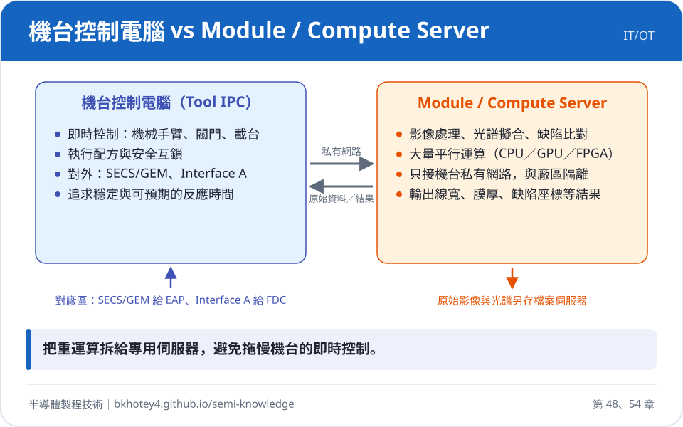
<figcaption>核心概念圖卡：機台控制電腦 vs Module / Compute Server</figcaption>
</figure>

<figure markdown>
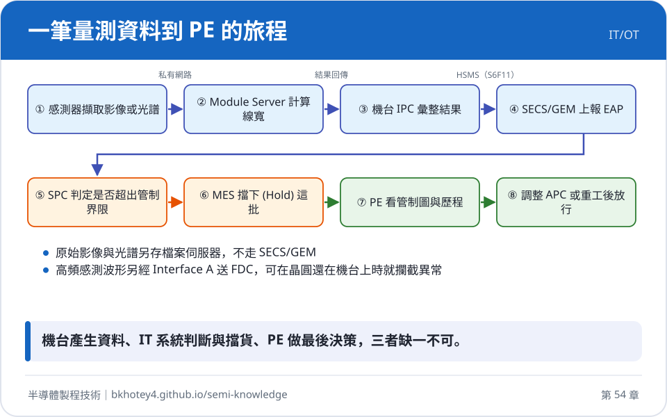
<figcaption>核心概念圖卡：一筆量測資料到 PE 的旅程</figcaption>
</figure>

<figure markdown>
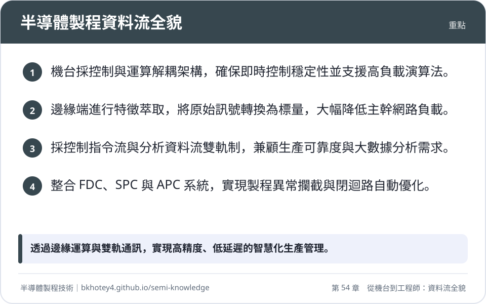
<figcaption>重點圖卡：半導體製程資料流全貌</figcaption>
</figure>

<figure markdown>
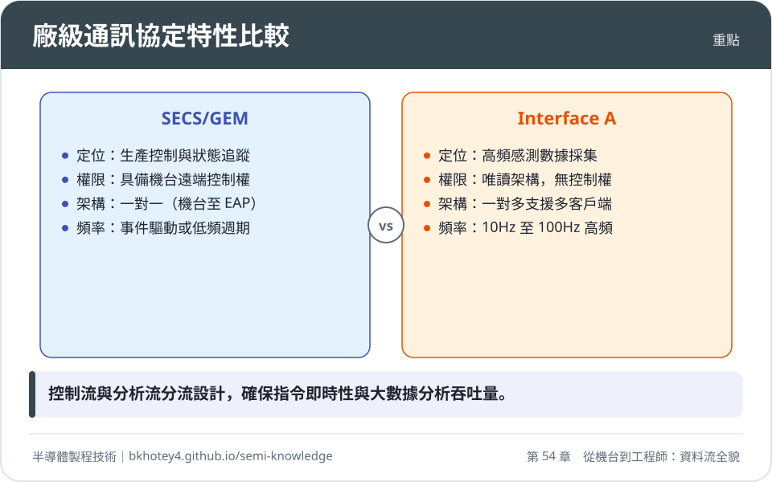
<figcaption>重點圖卡：廠級通訊協定特性比較</figcaption>
</figure>

<figure markdown>
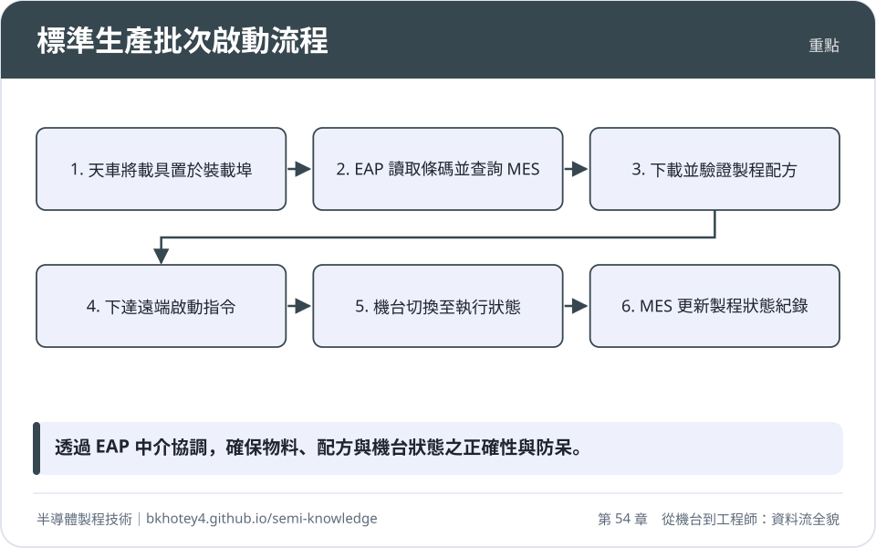
<figcaption>重點圖卡：標準生產批次啟動流程</figcaption>
</figure>

<figure markdown>
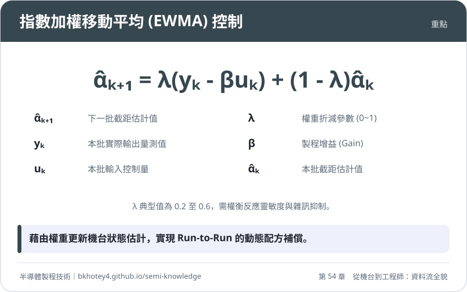
<figcaption>重點圖卡：指數加權移動平均 (EWMA) 控制</figcaption>
</figure>

</div>

## 習題

**1.** 在 R2R 進階製程控制（APC）中，假設化學機械研磨（CMP）機台採用一階線性 EWMA 控制器來調控研磨時間。目標去除厚度 $T = 100\text{ nm}$，事先校正之製程增益 $\beta = 2.0\text{ nm/s}$，平滑權重因子 $\lambda = 0.4$。已知上一批估計之機台截距 $\hat{\alpha}_k = 10\text{ nm}$。第 $k$ 批實際下達之研磨時間 $u_k = 45\text{ s}$，加工完畢經量測獲得之實際去除厚度 $y_k = 96\text{ nm}$。
(1) 請計算第 $k$ 批量測後更新之截距估計值 $\hat{\alpha}_{k+1}$。
(2) 請計算 APC 控制器下發予第 $k+1$ 批晶圓的最佳化研磨時間配方 $u_{k+1}$。

??? success "參考解答"
    (1) 計算第 $k$ 批之實際截距觀察值與更新後估計值 $\hat{\alpha}_{k+1}$：
    $$y_k - \beta u_k = 96 - (2.0 \times 45) = 96 - 90 = 6\text{ nm}$$
    依據 EWMA 更新公式：
    $$\hat{\alpha}_{k+1} = \lambda (y_k - \beta u_k) + (1 - \lambda) \hat{\alpha}_k = 0.4 \times 6 + (1 - 0.4) \times 10 = 2.4 + 6.0 = 8.4\text{ nm}$$

    (2) 計算第 $k+1$ 批下發之最佳化研磨時間 $u_{k+1}$：
    $$u_{k+1} = \frac{T - \hat{\alpha}_{k+1}}{\beta} = \frac{100 - 8.4}{2.0} = \frac{91.6}{2.0} = 45.8\text{ s}$$

**2.** 試比較半導體廠兩大通訊協定 SECS/GEM 與 Interface A (EDA) 在以下維度之差異：(1) 控制權限（Control Capability）、(2) 連線架構（Connection Architecture）、(3) 底層傳輸技術堆疊（Protocol Stack）、(4) 主要應用場景。

??? success "參考解答"
    (1) **控制權限**：SECS/GEM 具備完整之控制權限，可下達 Start/Stop、選擇配方及 Carrier 搬送命令；Interface A 則為純唯讀（Read-only）架構，絕不允許下達控制指令以保障機台安全。
    (2) **連線架構**：SECS/GEM 為一對一（Single-client）架構，僅能介接至單一 EAP；Interface A 支援一對多（Multi-client）架構，多個分析系統（如 FDC、YMS、研發資料庫）可同時獨立訂閱資料。
    (3) **底層傳輸技術堆疊**：SECS/GEM 採用 HSMS (SEMI E37) 與自訂二進位 SECS-II (SEMI E5) 訊息編碼；Interface A 採用現代 Web Services 技術堆疊（HTTP/HTTPS、SOAP/XML 或 REST/JSON/gRPC）。
    (4) **主要應用場景**：SECS/GEM 用於生產製造執行與派工控制（MES/EAP）；Interface A 用於高頻感測器數據採集（$10\text{--}100\text{ Hz}$）、先進 FDC 故障診斷與大數據深度分析。

**3.** 某 FDC 系統對反應室壓力與 RF 功率進行主成分分析（PCA）。經標準化後之雙參數感測向量為 $\mathbf{x} = [2.0, -1.0]^T$。已知降維至單一主成分（$k=1$）之負載向量（Loading Vector）為 $\mathbf{P} = [0.8, 0.6]^T$。
(1) 請計算該樣本在主成分空間之得分 $t$。
(2) 請計算重構向量 $\hat{\mathbf{x}}$ 與殘差向量 $\mathbf{e}$。
(3) 請計算該樣本之平方預測誤差 $Q$ 統計量（SPE），並說明其工程意義。

??? success "參考解答"
    (1) 計算主成分得分 $t$：
    $$t = \mathbf{x}^T \mathbf{P} = [2.0, -1.0] \begin{bmatrix} 0.8 \\ 0.6 \end{bmatrix} = 2.0 \times 0.8 + (-1.0) \times 0.6 = 1.6 - 0.6 = 1.0$$

    (2) 計算重構向量 $\hat{\mathbf{x}}$ 與殘差向量 $\mathbf{e}$：
    $$\hat{\mathbf{x}} = t \mathbf{P}^T = 1.0 \times [0.8, 0.6] = [0.8, 0.6]$$
    $$\mathbf{e} = \mathbf{x} - \hat{\mathbf{x}} = [2.0, -1.0] - [0.8, 0.6] = [1.2, -1.6]$$

    (3) 計算 $Q$ 統計量：
    $$Q = \mathbf{e} \mathbf{e}^T = (1.2)^2 + (-1.6)^2 = 1.44 + 2.56 = 4.0$$
    **工程意義**：$Q$ 統計量衡量實測數據無法被主成分模型解釋之殘差強度。當 $Q$ 顯著升高時，代表感測器之間的常態變異結構已被破壞（如某感測器單獨發生漂移或硬體組件失效），能有效補足傳統單變量監控之盲點。

**4.** 何謂判異準則（Nelson Rules）？為何在晶圓廠的 SPC 監控中，即便數據點未超越 $\pm 3\sigma$ 之管制上限與下限（UCL/LCL），仍必須透過 Nelson Rules 觸發警報並自動扣留貨批（Hold Lot）？

??? success "參考解答"
    判異準則（Nelson Rules）是一套基於機率與統計學原理的常態分布圖形模式判定法則（例如連續 9 點落在中心線同一側、連續 6 點持續遞增或遞減等）。
    在半導體製造中，若僅依賴 $\pm 3\sigma$ 出界判定（Rule 1），通常只能捕捉到幅度極大的突發性異常。當機台發生微小漂移（如加熱器緩慢老化、研磨液濃度逐漸稀釋）時，品質數據在數個批次內仍會維持在 $\pm 3\sigma$ 規格內；若等到突破管制界限才處置，往往已造成數十至數百片晶圓品質劣化。Nelson Rules 能在數據呈現系統性非隨機分布（Non-random Trend）的早期階段即時攔截，使工程師得以提前進行機台保養或 APC 模型校正，避免擴大報廢風險。

**5.** 試說明虛擬量測（Virtual Metrology, VM）的運作原理，並分析其如何解決半導體製造中的「量測延遲（Metrology Lag）」問題。

??? success "參考解答"
    虛擬量測（VM）利用機台在加工過程中擷取之高頻 FDC 物理感測數據（如壓力、RF 功率、溫度波形特徵），透過機器學習或多元統計模型，在晶圓離腔的瞬間即時預測該片晶圓的實體品質特徵（如薄膜厚度、蝕刻深度或線寬）。
    傳統半導體生產採用抽樣實體量測（如每批 25 片中抽測 1 片），晶圓必須搬送至量測設備等待排隊，產生長達數小時的「量測延遲（Metrology Lag）」。若機台發生漂移，在等待實體量測結果期間連續加工的晶圓均面臨報廢風險。VM 技術可提供 100% 每片晶圓（Wafer-to-Wafer）的即時預測，一旦預測值異常可立即觸發 Stop-on-Fault 停機，並將預測數據即時回授給 APC 控制器進行閉迴路修正，大幅縮短控制迴路的響應時間。

---

## 本章術語

- **IPC**（工業電腦）：搭載即時作業系統（RTOS）的機台底層硬體，負責微秒級閉迴路控制與安全互鎖。
- **EtherCAT**（乙太網控制自動化技術）：具備飛越處理與極低時間抖動特性的確定性工業乙太網路協定。
- **SECS/GEM**（半導體設備通訊標準/通用設備模型）：SEMI 制定之半導體機台與廠級主機間的標準通訊與狀態機規範。
- **HSMS**（高速 SECS 訊息服務）：SEMI E37 標準，定義於 TCP/IP 網路上傳輸 SECS-II 訊息之二進位傳輸協定。
- **EAP**（設備自動化程式）：介於 MES 與實體機台間的中介軟體，負責指令轉譯、配方下載與自動化邏輯交握。
- **Interface A / EDA**（設備資料擷取）：SEMI 制定之高頻、唯讀、基於 Web Services 與中繼資料模型之資料擷取架構。
- **FDC**（故障偵測與分類）：透過高頻感測器波形特徵分析，即時監控機台健康狀態並攔截異常之系統。
- **MSPC**（多變量統計製程監控）：運用 PCA 等降維技術，結合 $T^2$ 與 $Q$ 統計量同時監控數百個感測器耦合關係之方法。
- **SPC**（統計製程管制）：運用 Shewhart 管制圖與 Nelson Rules 對產品實體品質參數進行統計監控之技術。
- **APC**（進階製程控制）：利用 EWMA 等數學模型，在批次間（R2R）動態調整機台配方以補償變異之控制系統。
- **VM**（虛擬量測）：利用機台加工感測數據，透過演算法即時預測晶圓實體物理品質之技術。
- **Purdue Model**（普渡模型）：將工業自動化與 OT/IT 網路劃分為不同安全層級之標準防護架構。


## 互動學習

!!! tip "動手試試看"
    - [互動圖：從機台到工程師的資料流](../dataflow.md)

<div class="quiz" data-quiz="09-12"></div>


## 產業最新進展

本節由每日產業新聞自動補充，說明本章技術在產業上的最新發展。

<!-- updates -->
（目前尚無補充。）
