# 第 55 章　廠務系統總覽與無塵室

<figure markdown>
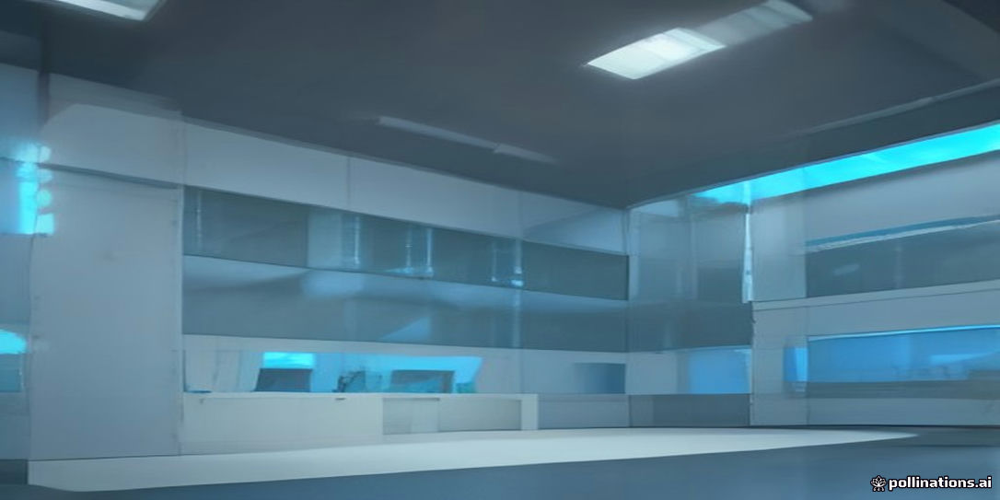
<figcaption>示意插畫：由 AI 生成，用來幫助記憶本章主題，細節請以內文與結構圖為準。</figcaption>
</figure>

!!! abstract "學習目標"
    - 理解廠務公用系統在半導體製造中所扮演的支援角色，以及維持 24 小時連續運轉的關鍵可靠度要求。
    - 掌握晶圓廠主要建築架構（主無塵室 Fab、下層設施 Sub-Fab 與中央動力廠房 CUB）的垂直與水平空間配置邏輯。
    - 熟悉無塵室潔淨度分級標準（ISO 14644-1 與 FED-STD-209E）之定義、微粒粒徑統計與空氣微粒控制原理。
    - 釐清晶圓微環境隔離觀念，以及天車空中自動化搬運系統（OHT）與空間配置之整合關係。
    - 建立廠務水、電、氣、化學品、排氣及監控系統之全廠拓撲圖，理解各子系統間的交互依存性。

## 55.1 廠務工程之角色與晶圓製造之生命線

### 廠務系統之定義與機能定位

半導體晶圓廠之運作架構可劃分為兩大核心體系：負責執行物理與化學反應的「製程機台」（Process Tools），以及維持機台穩定運行所需的「廠務系統」（Facility Systems）。廠務工程本質上是一門高度整合的跨領域基礎工程，涵蓋電力、超純水、氣體、化學品、空調、廢水與廢氣處理，以及結構防微振等公用設施（Utilities）。

若將現代晶圓廠比擬為高度複雜的生物有機體，製程機台即為執行精密代謝活動的器官，而廠務系統則是循環系統、呼吸系統與神經中樞。先進製程機台內部包含真空腔體、射頻加熱系統、超精密雷射對準與光學鏡組，這些精密組件無法獨立運作，必須依賴廠務管線以百萬分之一定量精度，持續不間斷地注入反應物、排出副產物，並精確帶走多餘熱量。因此，廠務工程的定位並非單純的後勤支援，而是晶圓製造良率與設備壽命的直接決定因素。

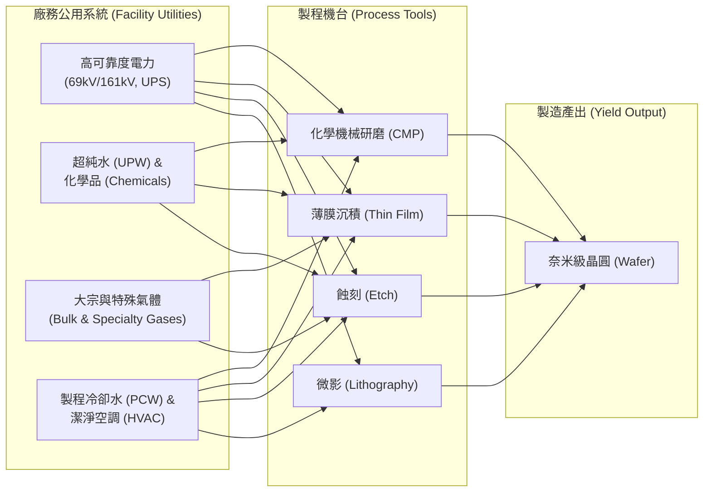

### 連續運轉與高可用性之極致要求

半導體製程具備高資本密集、長生產週期與不可逆製程三大特性。一片高階晶圓由裸晶圓（Bare Wafer）至完成全部金屬層導線製作，需歷經數百甚至上千道製程步驟（沉積、微影、蝕刻、離子植入、平坦化等），在無塵室內耗時常達 2 至 3 個月。任何製程步驟的中斷，往往意味著整批晶圓（每批通常為 25 片）的物化特性受損，甚至面臨全數報廢的風險。

因此，廠務系統的運作必須遵循全年無休（24 小時/7 天/365 天）連續運轉之準則，其系統可用度（Availability, $A$）通常要求達到「五個九」（99.999%）乃至「六個九」（99.9999%）的工業極限：

$$A = \frac{\text{MTBF}}{\text{MTBF} + \text{MTTR}}$$

其中 $\text{MTBF}$ 為平均故障間隔時間（Mean Time Between Failures），$\text{MTTR}$ 為平均修復時間（Mean Time To Repair）。若以 99.9999% 的可用度計算，廠務全系統每年容許的非計畫性停機時間總和僅約 31.5 秒。

為了實現此一極致目標，廠務設計採取多重架構策略：
1. **$N+1$ 或 $2N$ 容錯備援**：關鍵動力單元（如冷凍機組、排氣風機、加壓泵浦）皆建置額外備援容量。當運轉中的主機出現異常，備援系統可在無縫或毫秒級延遲下自動承接負載。
2. **多迴路共構環網（Loop Distribution）**：氣體與液體管線採取閉環網狀設計，個別區段的閥門檢修或管壁維護不會阻斷整廠的流體供應平衡。

### 設施異常對製程機台與晶圓之衝擊機制

公用設施的微小波動，在微觀物理尺度下均會放大為破壞性的製程缺陷。廠務系統異常對機台與晶圓的影響機制主要表現在以下四個層面：

| 廠務異常型態 | 物理／化學破壞機制 | 機台設備衝擊 | 晶圓良率受損後果 |
| :--- | :--- | :--- | :--- |
| **電壓驟降 (Voltage Sag)** | 射頻電源（RF Generator）輸出中斷、渦輪分子泵（TMP）轉速驟降 | 真空腔體連鎖保護跳脫、電漿熄滅、泵浦軸承磨損 | 薄膜沉積厚度斷差、過度蝕刻、整批晶圓表面受損報廢 |
| **製程冷卻水 (PCW) 斷流** | 散熱通量歸零，腔體壁面與靜電吸盤（ESC）迅速積熱 | 磁控管（Magnetron）過熱燒毀、密封圈高溫硬化失效 | 熱應力引發晶圓翹曲，導致微影焦距偏移或腔體破片 |
| **高壓氣體壓力突波** | 質流控制器（MFC）超出調節範圍，進氣莫耳比率失衡 | 氣動閥門機械疲勞、逆向爆燃風險 | 氣相化學反應偏離化學計量比，化學氣相沉積（CVD）成分異常 |
| **微量化學污染 (AMC)** | 空氣中百億分之一（ppb）級別之酸鹼氣體沉積於晶圓表面 | 曝光機光學鏡組透光率退化（光濁化現象） | 化學增幅型光阻劑（CAR）發生酸性中毒，圖形關鍵尺寸（CD）崩解 |

以電壓驟降為例，當市電電壓跌落至額定值之 80% 以下且持續超過 100 毫秒（ms），乾式真空泵（Dry Pump）與真空計將立即感應低電壓而觸發保護鎖定（Interlock）。此時若蝕刻腔體正處於電漿反應狀態，電漿中斷將導致反應氣體在未游離狀態下冷凝於晶圓表面，形成難以清除的聚合物殘留；同時，背壓系統失去平衡可能導致微粒倒灌，嚴重破壞無塵腔室的潔淨度。

!!! warning "常見誤解"
    常有人誤認為「無塵室只要保持空氣沒有灰塵，製程就能順利進行」。事實上，懸浮微粒僅是環境控制的最基本門檻。若廠務供應的超純水電阻率下降 0.1 $\text{M}\Omega\cdot\text{cm}$、冷卻水溫飄移 0.5$^\circ\text{C}$，或氣體中含有 1 ppb 的金屬雜質，對 7 奈米以下先進製程造成的良率毀滅性打擊，往往遠高於空氣中偶發單顆微粒的落塵損害。

### 先進節點對環境擾動之物理敏感性

隨著半導體製程微縮至埃米（Ångström）世代，特徵尺寸（Critical Dimension, CD）與套準誤差（Overlay Error）的容許公差已被壓縮至數個原子直徑以內。在如此極端的物理尺度下，晶圓製造環境對溫度、濕度、微振動與電磁干擾展現出極高的敏感度。

#### 1. 溫度的極限穩定控制
在極紫外光（EUV）微影設備與高數值孔徑（High-NA）微影製程中，幾何結構的微小熱膨脹均會直接破壞光學成像的焦深（DOF）與圖形邊緣配置誤差（Edge Placement Error, EPE）。固體線膨脹方程式為：

$$\Delta L = \alpha \cdot L_0 \cdot \Delta T$$

其中 $\alpha$ 為熱膨脹係數（Thermal Expansion Coefficient），$L_0$ 為原始長度，$\Delta T$ 為溫差。若以直徑 $L_0 = 300\text{ mm}$ 的單晶矽晶圓為例，其熱膨脹係數在室溫下約為 $\alpha_{\text{Si}} \approx 2.6 \times 10^{-6} \text{ K}^{-1}$。若無塵室環境溫度產生 $\Delta T = 0.1^\circ\text{C}$ 的擾動，晶圓徑向位移將達到：

$$\Delta L = (2.6 \times 10^{-6} \text{ K}^{-1}) \times (0.3 \text{ m}) \times (0.1 \text{ K}) = 7.8 \times 10^{-8} \text{ m} = 78 \text{ nm}$$

對於 3 奈米節點所要求小於 1.5 奈米的套準誤差而言，78 奈米的熱膨脹位移已徹底摧毀製程容許度。因此，先進微影機台內部微環境（Mini-environment）的溫度控制規格，必須達到 $\pm 0.01^\circ\text{C}$ 甚至 $\pm 0.005^\circ\text{C}$ 的超高精度。

#### 2. 微振動（Micro-vibration）隔離
微影機台採用精密光學透鏡組與高速移動的工件台（Wafer Stage），工件台加速度可達數個重力加速度（$g$）。外部傳遞至機台底座的環境微振動，會導致晶圓與光罩之間的動態位移失真。廠房基地若受到周邊鐵路、重型車輛或廠務大型冰水主機之旋轉振動影響，振動波透過地基傳遞至無塵室樓板，將引發高頻共振。高階無塵室建築結構必須嚴格遵循振動準則（Generic Vibration Criteria, VC），先進節點通常要求達到 VC-D（振動速度均方根值 $\le 6 \ \mu\text{m/s}$）或更嚴格的 VC-E（$\le 3 \ \mu\text{m/s}$）標準（見第 65 章）。

#### 3. 相對濕度與靜電效應
環境相對濕度（Relative Humidity, RH）若過高（$> 50\%$），空氣中的水分將加速光罩表面保護膜的劣化，並影響深紫外光（DUV）化學增幅型光阻劑的擴散動力學；反之，若濕度過低（$< 30\%$），空氣介電擊穿強度改變，晶圓與自動化搬運設備（FOUP/OHT）摩擦產生的靜電電荷無法有效逸散，靜電電壓可累積至數千伏特。此靜電場將誘發靜電放電（Electrostatic Discharge, ESD）擊穿超薄閘極氧化層（見第 1 章與第 2 章），或產生靜電微粒吸附（Electrostatic Particle Attract, EPA），導致嚴重的圖形缺陷。

綜上所述，廠務工程必須將宏觀尺度的土木、機械、電機與化學系統，精準收斂至奈米尺度與毫秒級別的極致穩定性，構築起晶圓製造工藝中不可動搖的物理基石。

## 55.2 晶圓廠立體空間架構：Fab、Sub-Fab 與 CUB

### 晶圓廠建築垂直分層原則

現代先進晶圓廠（Wafer Fab）並非單一開闊空間，而是一座高度垂直整合、具備複合功能的立體工業建築。此垂直架構的成因，本質上源自四項相互制約的物理與工程需求：氣流循環動力學、管線幾何拓撲、動靜態結構承載，以及污染與維修作業的物理隔離。

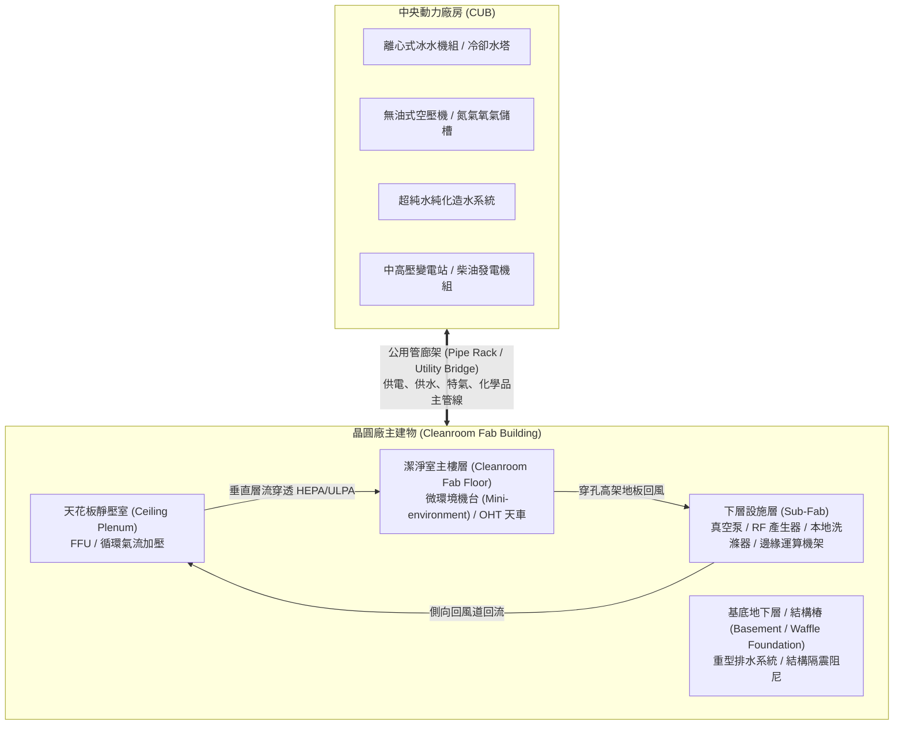

1. **氣流動壓與流場封閉性**：為達成嚴苛的懸浮微粒潔淨度，潔淨室需維持自天花板向下吹拂的單向層流（Laminar Flow），再自地板回風。建築垂直斷面必須構成低阻抗的封閉回風環路（Loop）。
2. **三維管網拓撲解耦**：先進製程設備需要數十種高純度公用介質（超純水、製程化學品、惰性氣體、毒性特殊氣體、特種電力），同時排放數類酸鹼與有機廢氣廢水。若所有管線全數交織於製程生產同層，將造成維修干涉與安全災難。垂直分層讓進給管線自下往上接入，排氣排水管線依重力及特定壓降往下引導，大幅簡化管網複雜度。
3. **動態載重與剛性隔離**：先進微影曝光機（Lithography Scanners）等精密設備對奈米級的微振動（Micro-vibration）極度敏感（見第 65 章）。然而，伴隨製程運作的真空泵（Vacuum Pumps）、馬達與變壓器等旋轉機械則是強烈的振動源。垂直分層配合獨立基樁或厚重華夫格板（Waffle Slab），能將這些動態擾動源機械隔離於下層結構。
4. **維修隔離與稼動率維持**：半導體晶圓廠每小時停機損失極高。將附屬支援設備配置於下層，使廠務與設備工程師在更換真空泵油、校正射頻產生器或檢修管線時，完全不需著無塵衣進入昂貴且空間受限的主無塵室內，實現「生產區零干擾」的維護架構。

---

### 潔淨室主樓層（Cleanroom Fab Floor）

潔淨室主樓層是晶圓執行光阻塗布、微影曝光、蝕刻、薄膜沉積、離子植入與化學機械研磨（CMP）等製程的物理核心空間。為在極高設備密度下維持無塵環境，該層由上而下劃分為三項核心構造：

#### 1. 天花板靜壓室（Ceiling Plenum）
位於潔淨室吊頂上方，高度通常在 $3\text{ m}$ 至 $5\text{ m}$ 之間。該空間形成正壓或負壓空腔，整面密集嵌合風機濾網機組（Fan Filter Unit, FFU）或配置超低穿透率空氣濾網（Ultra-Low Penetration Air Filter, ULPA）。循環空氣在此混合新風（Make-up Air）並均勻加壓，經由濾網基座垂直下壓進入製程區。天花板系統亦預埋高階消防撒水頭（早期抑制快速反應型，ESFR）與高靈敏度極早期煙霧偵測警報系統（Very Early Smoke Detection Apparatus, VESDA）採樣管路。

#### 2. 空中天車自動化搬運軌道（OHT Track）
在濾網出風口下方、機台頂部上方之懸空高度，架設全自動天車空中搬運系統（Overhead Hoist Transport, OHT）的連續單軌路網。OHT 車體以數 $\text{m/s}$ 之水平速度，將乘載 25 片晶圓的前開式晶圓傳送盒（Front Opening Unified Pod, FOUP）精準投遞至機台的加載埠（Load Port）。此架構最大化主樓層的地坪利用率，並阻絕了人為搬運引入的人員落塵與震動。

#### 3. 設備作業面與高架地板（Raised Floor）結構
潔淨室工作地板鋪設高度可調式穿孔高架地板（Perforated Raised Floor Panels）。地板面板通常採用抗靜電、高強度的壓鑄鋁合金材質，其開孔率（Perforation Rate）需依流體動力學嚴格配置（典型開孔率為 $20\%$ 至 $40\%$），以確保下行氣流具備足夠流速且不產生微渦流（Vortex）。

高架地板直接安裝於具備極高剛性的厚重鋼筋混凝土「華夫格板」（Waffle Slab）之上。華夫格板由週期性排列的方孔組成，其厚度可達數十公分至一米以上，結構自重可抑制環境擾動。重型製程機台（如重量達數十噸的極紫外光 EUV 微影機）並非直接架設於活動高架地板上，而是透過獨立的基座基架（Equipment Pedestal）穿透穿孔區，牢固鎖固在厚實的華夫格梁柱結構點，以符合製程要求的振動準則（如 VC-D 至 VC-G 等級，見第 65 章）。

---

### 下層設施（Sub-Fab）與空間整合

位於華夫格板正下方的樓層統稱為下層設施（Sub-Fab 或 Basement）。在先進製程廠房中，Sub-Fab 常進一步垂直拆解為兩層（Clean Sub-Fab 與 Facility Sub-Fab），承載製程設備不可或缺的龐大二級輔助單元（Secondary Support Units）。

#### 輔助設備的機能分類與空間配置
- **真空產生源**：乾式真空泵（Dry Vacuum Pumps）與機械增壓泵（Roots Booster Pumps）是電漿蝕刻機與化學氣相沉積機（CVD）的必備配件。其散熱量巨大且伴隨固定轉動頻率的震動，故安置於 Sub-Fab 設有防震基座的專屬區域，並透過隔音罩抑制噪音傳播。
- **排氣與廢氣預處理系統**：製程產生的有害反應副產物無法直接排放。安裝於真空泵後端的本地洗滌器（Point-of-Use Scrubber, POU Scrubber，如熱裂解式 Burn-Wet 或電漿式 Scrubber），在 Sub-Fab 即時將毒性氣體（如 $\text{SiH}_4$、$\text{NF}_3$、鹵素化合物）進行熱分解或水洗反應，降低主管線結垢與爆燃風險（見第 63 章）。
- **射頻與微波功率產生器**：RF 產生器（RF Generators）與微波源體積龐大且需高功率冷卻水，配置於 Sub-Fab 可大幅降低無塵室熱負載，並藉由低損耗同軸電纜穿板向上供電予製程腔體。
- **熱交換器與冷卻水單元**：製程機台精準溫控單元（Chiller / Heat Exchanger, PCW-HEX）安裝於下層，減少無塵室水路管線爆裂洩漏破壞晶圓的風險。

#### 新興架構：Sub-Fab 邊緣運算機架（Sub-Fab Compute Rack）
隨著半導體邁入先進節點，先進製程控制（Advanced Process Control, APC）、虛擬計量（Virtual Metrology）與即時設備健康監測產生海量高頻感測資料（見第 54 章）。

!!! example "技術演進：Sub-Fab Compute Rack"
    傳統架構將製程機台資料全數透過廠區乙太網路回傳至遠端中央資料中心，通訊延遲高達數十至數百毫秒（$\text{ms}$），無法支援毫秒級的腔體放電自適應修正或高頻光譜分析。若直接將高效能運算伺服器（HPC）置於潔淨室主樓層，機櫃的風扇排熱將嚴重擾動垂直單向氣流，且高功耗密度佔用昂貴的無塵室潔淨空間。
    
    現代晶圓廠將客製化的高密度邊緣運算機架（Sub-Fab Compute Rack）直接部署於機台正下方的 Sub-Fab 空間：
    1. **超短距光纖互連**：感測器訊號透過垂直貫穿高架地板之耐火光纖管路直連機架，將網路延遲壓低至次毫秒（$< 1\text{ ms}$）級別。
    2. **密閉水冷散熱整合**：運算機架採用直接液冷（Direct-to-Chip Liquid Cooling, DLC）或後門熱交換器（Rear Door Heat Exchanger），冷卻介面直接介接 Sub-Fab 的廠務冰水或製程冷卻水（PCW）系統，不對 Sub-Fab 環境排熱。

---

### 中央動力廠房（Central Utility Building, CUB）與管廊對接

晶圓廠若以主無塵室（Fab）為大腦與心臟，中央動力廠房（CUB）則是全天候輸出能量與代謝廢棄物的能量中樞。

#### 水平隔離配置考量
晶圓廠建築規劃中，CUB 幾乎一律採取與主無塵室「實體脫開、水平相鄰」的獨立建物配置。這項隔離原則取決於下列關鍵工程因素：

| 隔離維度 | 物理機制與風險防範 | 工程設計手法 |
| :--- | :--- | :--- |
| **振動源隔離** | 巨型離心式冰水機組（Chillers）、冷卻水泵、大型空氣壓縮機具備高階動能不平衡量，產生強烈低頻機械波。 | CUB 建築基樁完全與 Fab 主體結構縫（Expansion/Isolation Joint）分開，截斷固體結構傳導音（Structure-borne Noise）。 |
| **火災與防爆安全** | 大宗化學品庫、高壓配電站與天然氣加熱鍋爐具備潛在化學與燃爆風險。 | 依據國際法規（如 NFPA）建立防火防爆實體外牆與洩爆面，並保持規範要求的防火間距。 |
| **微氣候與熱羽流** | 設於 CUB 頂樓的冷卻水塔排斥大量高溫高濕熱羽流（Thermal Plume），其排氣若捲入無塵室外氣進氣口（MAU Intake），將導致新風降溫除濕能耗失控。 | 依廠區全年風向玫瑰圖（Wind Rose），將 CUB 佈署於 Fab 外氣進氣口的下風處。 |

#### 公用管廊架（Pipe Rack / Utility Bridge）之立體對接
CUB 與 Fab/Sub-Fab 之間，必須仰賴高容量的立體管廊架（Pipe Rack，架空桁架或地下共同管溝）進行管線對接。管廊架內部遵循 엄격한 空間分區分層拓撲：

$$H_{\text{elevation}} \propto \text{流體危險度與物理相態}$$

一般由上而下依序配置：
1. **最高層（電力與控制層）**：中高壓匯流排排管（Busway）、儀控光纖電纜盤（Cable Tray），避免水管洩漏引發短路。
2. **中高層（氣體主管線）**：大宗氣體管線（高純度氮氣、氧氣、氬氣、氫氣、氦氣）與無油壓縮空氣（CDA）。
3. **中低層（冷卻與熱水系統）**：超純水（UPW）供回水管、製程冷卻水（PCW）、低溫冰水（Chilled Water）大口徑碳鋼或不銹鋼主管。
4. **最底層（化學品與液態排污）**：化學品管路雙套保護管（Secondary Containment Pipes）與酸鹼廢水重力流回收管，底部鋪設耐酸鹼集液槽與洩漏感測光纖。

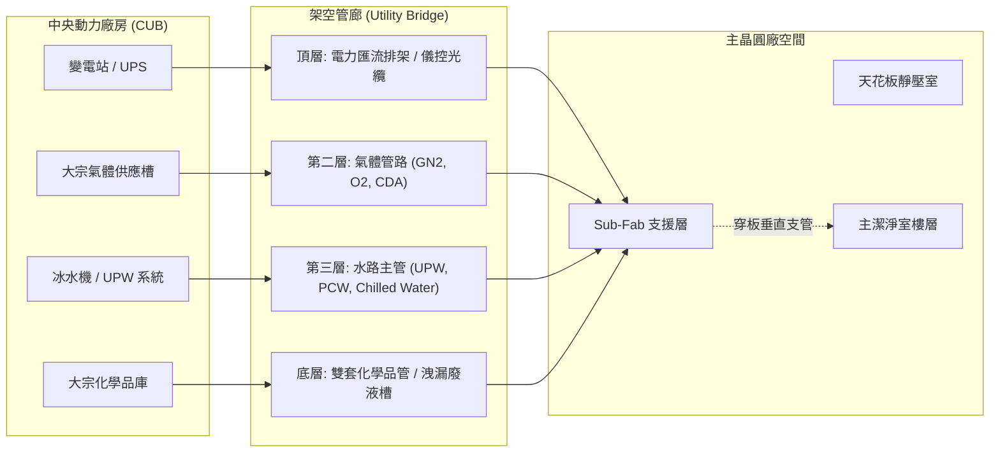

!!! warning "高溫差熱應力與防震伸縮縫控制"
    橫跨 CUB 與 Fab 的公用管線長度動輒數百米，且流體溫差顯著（例如 $4^\circ\text{C}$ 的冰水管至 $60^\circ\text{C}$ 的除氣熱純水管）。管廊在對接兩座不同沈陷量與抗震週期的建物交界處時，必須全數導入金屬膨脹接頭（Bellows Expansion Joints）與高靈活性「U 型膨脹環」（Expansion Loops），以吸收極限地震變位差與管壁熱脹冷縮應力，防範管網應力破壞導致的介質供應中斷。

<!-- fig:1 -->
<figure markdown>
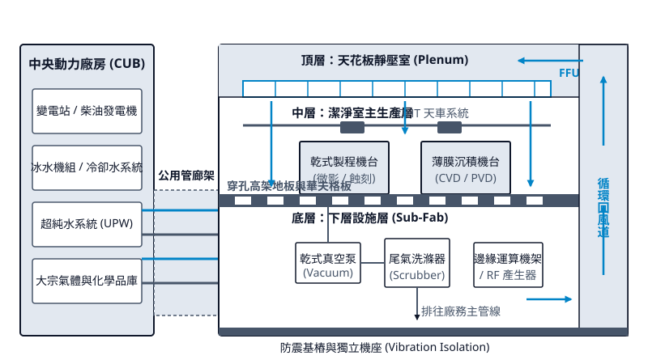
<figcaption>圖 55-1　晶圓廠立體空間架構圖（AI 繪製的示意圖）</figcaption>
</figure>

## 55.3 無塵室潔淨度等級與微粒物理學基礎

### 懸浮微粒與晶圓缺陷生成機制

在先進半導體製程中，懸浮微粒（Airborne Particles）是造成晶片良率損失最主要的實體污染源。當特徵尺寸（Critical Dimension, CD）縮減至數十奈米甚至個位數奈米時，即使是微小的次微米（Sub-micron）或奈米級微粒，一旦附著於晶圓表面，均可能破壞電路結構。文獻與業界公認的經驗準則指出，造成電路永久失效的「殺手缺陷」（Killer Defect）臨界粒徑，約為該製程節點最小金屬線寬或閘極長度的三分之一至二分之一：

$$d_{\text{crit}} \approx \left(\frac{1}{3} \sim \frac{1}{2}\right) \times \text{CD}$$

其中 $d_{\text{crit}}$ 為引發電氣失效的最小微粒直徑。微粒在不同製程單元中的致缺陷物理與化學機制如下：

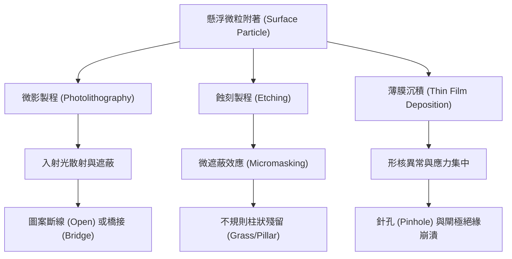

1. **微影製程之光學散射與陰影效應**：若微粒落在光阻（Photoresist）表面或光罩（Photomask/Reticle）上，在曝光過程中會造成光的繞射、散射與阻擋。對於正光阻系統，微粒遮蔽會導致該區域光阻未受充分感光，顯影後殘留阻劑，在後續蝕刻中引發線路橋接（Bridging / Short）；對於負光阻或特定微影曝光製程，則可能引發斷線（Pattern Open）。在極紫外光（EUV）微影中，微粒甚至會吸收極具能量衰減特性的 $13.5\text{ nm}$ 光子，產生難以修復的晶圓圖形畸變。
2. **乾式蝕刻之微遮蔽效應（Micromasking）**：非揮發性或難以被電漿化學蝕刻反應去除的微粒（如氧化物微粒、金屬碎片）掉落於待蝕刻表面時，會扮演局部微型硬光罩的角色。在非等向性反應離子蝕刻（Reactive Ion Etching, RIE）過程中，微粒下方材料無法被離子轟擊與自由基去除，最終在微粒周圍形成垂直突起的針狀或柱狀殘留物，稱為草狀缺陷（Grass Defect）或柱狀缺陷（Pillar Defect），直接破壞層間平坦化與後續金屬層互連。
3. **薄膜沉積之結構破壞與絕緣崩潰**：在化學氣相沉積（CVD）或物理氣相沉積（PVD）過程中，微粒會改變局部表面的晶體生長方向與形核速率，導致薄膜在此處產生非均質孔隙、針孔（Pinhole）或微裂紋（Micro-crack）。當此類微粒出現在閘極介電層（如 High-$\kappa$ 材料）時，微粒形貌誘發的局部強電場效應將大幅降低時變介電質崩潰（Time-Dependent Dielectric Breakdown, TDDB）壽命，引發漏電流激增與元件崩潰。

---

### 空氣動力學等效直徑與微粒物理學基礎

環境中的懸浮微粒通常形狀不規則且密度各異。為了建立定量的物理分析基準，流體力學與氣膠力學（Aerosol Mechanics）引入了**空氣動力學等效直徑**（Aerodynamic Equivalent Diameter, $d_{ae}$）之概念。

空氣動力學等效直徑定義為：在重力場的靜止空氣中，最終沉降速度（Terminal Settling Velocity, $v_{ts}$）與該不規則微粒完全相同，且密度為標準密度 $\rho_0 = 1\text{ g/cm}^3$（即水的密度，亦即 $1000\text{ kg/m}^3$）的標準球體直徑。

依據斯托克斯定律（Stokes' Law），在低雷諾數（$\text{Re} \ll 1$）層流流場中，球形微粒所受之黏滯阻力（Drag Force）與重力平衡時，其終端沉降速度為：

$$v_{ts} = \frac{\rho_p \, d_p^2 \, g \, C_c}{18 \, \mu}$$

其中：
- $\rho_p$ 為微粒實際密度（$\text{kg/m}^3$）。
- $d_p$ 為微粒幾何直徑（Geometric Diameter, $\text{m}$）。
- $g$ 為重力加速度（典型值 $9.81\text{ m/s}^2$）。
- $\mu$ 為空氣動態黏度（Air Dynamic Viscosity，在 $20^\circ\text{C}$ 下典型值約為 $1.81 \times 10^{-5}\text{ Pa}\cdot\text{s}$）。
- $C_c$ 為肯寧漢滑移修正係數（Cunningham Slip Correction Factor）。

!!! note "次微米微粒之氣體滑移修正"
    當微粒直徑 $d_p$ 接近或小於空氣分子的平均自由徑（Mean Free Path, $\lambda$，常溫常壓下典型值約為 $65\sim 68\text{ nm}$）時，空氣分子無法再視為連續介質，流體分子會在微粒表面產生滑移（Slip），導致介質對微粒的阻力小於斯托克斯定律之預測值。$C_c$ 修正公式表示為：
    $$C_c = 1 + \frac{2\lambda}{d_p} \left[ A_1 + A_2 \exp\left( -A_3 \frac{d_p}{2\lambda} \right) \right]$$
    其中 $A_1, A_2, A_3$ 為經驗無因次常數（對於空氣，$A_1 \approx 1.257, A_2 \approx 0.400, A_3 \approx 1.10$）。當微粒粒徑小於 $0.1\ \mu\text{m}$ 時，$C_c$ 明顯大於 1，微粒受到的布朗運動（Brownian Motion）擴散能力急遽增強，使得沉降不再是其主要沉積機制，取而代之的是由分子熱運動碰撞所主導的擴散附著。

懸浮微粒在空間中的濃度分佈通常以累積微粒濃度（Cumulative Particle Concentration）表示。自然大氣與一般受控環境中的粒徑分佈大多呈現冪律（Power-law）或對數常態（Log-normal）分佈特徵：小粒徑微粒的數量遠高於大粒徑微粒，呈現幾何級數的遞增趨勢。

---

### 無塵室標準之演進：FED-STD-209E 至 ISO 14644-1

半導體產業發展初期廣泛使用美國聯邦標準 **FED-STD-209**。該標準歷經 A 至 E 版，於 1992 年發布 FED-STD-209E 後達到成熟，其核心定義係以**每立方英呎（$\text{ft}^3$）空氣中，粒徑大於或等於 $0.5\ \mu\text{m}$ 的懸浮微粒數量**作為分級基準：
- 若 $\ge 0.5\ \mu\text{m}$ 的微粒數不超過 1 顆/$\text{ft}^3$，即稱為 **Class 1**。
- 若 $\ge 0.5\ \mu\text{m}$ 的微粒數不超過 100 顆/$\text{ft}^3$，即稱為 **Class 100**。

然而，FED-STD-209E 使用英制單位，難以與國際公制體系接軌，且對於奈米級極細微粒未訂定嚴謹的外推規範。美國總務署（GSA）於 2001 年 11 月正式廢止 FED-STD-209E，轉由國際標準化組織之 **ISO 14644-1** 全面取代。

ISO 14644-1 改採公制體系，以**每立方公尺（$\text{m}^3$）**為基準體積，並以連續數學公式定義各潔淨度等級之微粒上限濃度：

$$C_n = 10^N \times \left( \frac{0.1}{D} \right)^{2.2}$$

其中：
- $C_n$ 為體積基準上，所容許大於或等於考量粒徑 $D$ 之最大累積微粒濃度（單位為 $\text{particles/m}^3$），計算結果無條件捨去至整數。
- $N$ 為 ISO 潔淨度等級數值（ISO Class Number），規範介於 1 至 9 之間，允許以 0.1 為步進增量進行中間等級標示。
- $D$ 為考量之微粒粒徑臨界值（單位為 $\mu\text{m}$）。
- $0.1$ 為參考基準粒徑（單位為 $\mu\text{m}$）。
- 指數 $2.2$ 反映了微粒濃度隨粒徑增大的衰減冪次特性。

| ISO 14644-1 等級 | FED-STD-209E 等級（舊制對照） | $\ge 0.1\ \mu\text{m}$ 微粒上限 ($\text{pcs/m}^3$) | $\ge 0.2\ \mu\text{m}$ 微粒上限 ($\text{pcs/m}^3$) | $\ge 0.3\ \mu\text{m}$ 微粒上限 ($\text{pcs/m}^3$) | $\ge 0.5\ \mu\text{m}$ 微粒上限 ($\text{pcs/m}^3$) | $\ge 5.0\ \mu\text{m}$ 微粒上限 ($\text{pcs/m}^3$) |
| :--- | :--- | :--- | :--- | :--- | :--- | :--- |
| **ISO 1** | — | 10 | 2 | — | — | — |
| **ISO 2** | — | 100 | 24 | 10 | 4 | — |
| **ISO 3** | **Class 1** | 1,000 | 237 | 102 | 35 | — |
| **ISO 4** | **Class 10** | 10,000 | 2,370 | 1,020 | 352 | — |
| **ISO 5** | **Class 100** | 100,000 | 23,700 | 10,200 | 3,520 | 29 |
| **ISO 6** | **Class 1,000** | 1,000,000 | 237,000 | 102,000 | 35,200 | 293 |
| **ISO 7** | **Class 10,000** | — | — | — | 352,000 | 2,930 |
| **ISO 8** | **Class 100,000**| — | — | — | 3,520,000 | 29,300 |

*註：由於 $1\text{ ft}^3 \approx 0.028317\text{ m}^3$，因此 FED-STD-209E Class 1（$1\text{顆/ft}^3$ 於 $0.5\ \mu\text{m}$）換算為公制為約 $35.3\text{ 顆/m}^3$，正好對應 ISO Class 3 在 $0.5\ \mu\text{m}$ 之上限值（$35\text{ 顆/m}^3$）。*

!!! warning "換算與測試粒徑極限"
    ISO 14644-1 公式適用於粒徑 $0.1\ \mu\text{m} \le D \le 5.0\ \mu\text{m}$ 之範圍。當微粒直徑小於 $0.1\ \mu\text{m}$（超細微粒，Ultrafine Particles）時，該公式不再適用，必須參照 ISO 14644-12 規範；針對大於 $5.0\ \mu\text{m}$ 的巨觀微粒（Macroparticles），則須參照 ISO 14644-4 附錄中針對沉降微粒的特別評估方式。

---

### 無塵室之三種運作狀態與驗證規範

無塵室之微粒計數驗證並非單一靜止數據，必須伴隨建築與運轉階段的明確界定。ISO 14644-1 嚴格區分了三種佔用狀態（Occupancy States），每種狀態代表無塵室在生命週期中不同的物理控制層次：

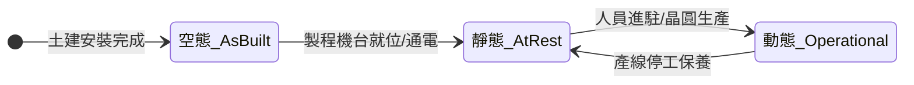

1. **空態（As-built）**：
   - **定義**：無塵室之建築結構、空調風機濾網機組（Fan Filter Unit, FFU）、高架地板與基礎照明皆已施工完畢並通電正常運轉，但現場**無任何生產機台、輔助設備及生產人員**。
   - **驗證目的**：檢驗廠務建築結構之氣密性、濾網安裝密封度（無旁通洩漏）以及空調送風系統的初始潔淨流場性能。

2. **靜態（At-rest）**：
   - **定義**：生產製程機台（如微影機、乾蝕刻機、薄膜沉積設備）及相關輔助管路皆已安裝就位，廠務管線對機台之水、電、氣已連線並依規格運作，但**無操作人員在場，且機台未進行晶圓加工**。
   - **驗證目的**：確認設備安裝工程未破壞無塵室潔淨屏障，並評估設備本身的外觀釋塵與靜態微氣候擾動。

3. **動態（Operational）**：
   - **定義**：無塵室設施已在規定的生產模式下運轉，機台全力執行晶圓製程，規定的**作業人員編制在場**並依照標準作業程序（SOP）走動與操作。
   - **驗證目的**：驗證真實生產環境下，空氣對流系統帶走人員散逸微粒（人體為無塵室中最大的脫屑與微粒散佈源）及機台機械傳動摩擦微粒之能力。動態狀態是評定晶圓良率保障水平的最終依據。

在進行驗證量測時，光學粒子計數器（Optical Particle Counter, OPC）的取樣點數量 $N_L$ 依據 ISO 14644-1 規範之無塵室面積決定，各取樣點之單次最小取樣空氣體積 $V_s$ 必須滿足下式：

$$V_s = \frac{20}{C_{n,m}} \times 1000$$

其中 $C_{n,m}$ 為該潔淨等級所規定之最大允許微粒濃度（$\text{pcs/m}^3$），$V_s$ 之單位為公升（$\text{L}$）。此公式確保在達到等級上限濃度的情境下，單次取樣期間至少能偵測到 20 顆微粒，以滿足卜瓦松分佈（Poisson Distribution）下量測數據的統計顯著性要求。

## 55.4 微環境理念與晶圓廠自動化搬運整合

### 55.4.1 從全室高潔淨度到局部微環境之典範轉移

在早期的半導體製造（如 100 mm 至 150 mm 晶圓世代）中，製程環境普遍採用「全室高潔淨度舞廳式無塵室」（Ballroom Cleanroom）。在該架構下，整座晶圓製造廠房的作業空間皆必須維持在極高的潔淨標準（如美軍標準 FED-STD-209E 規定的 Class 1 至 Class 10 等級，相當於現行 ISO 14644-1 Class 3 至 Class 4）。然而，隨著晶圓尺寸擴大至 200 mm 及 300 mm，且電晶體關鍵尺寸（Critical Dimension, CD）持續縮減至奈米尺度，這種全面維持極高潔淨度的作法面臨了物理與工程經濟學的雙重極限：

1. **動力能耗瓶頸**：維持全室垂直層流（Laminar Flow）所需的風量 $Q$ 為無塵室截面積 $A$ 與氣流速度 $v$ 的乘積（$Q = A \cdot v$）。若整座數萬平方公尺的廠房均維持 $0.3\text{--}0.45\text{ m/s}$ 的下吹風速，風機動力與循環冷卻系統的耗電量將呈現非線性劇烈增長（詳見第 56 章與第 67 章）。
2. **人為污染源不可控性**：人體是無塵室中最主要的微粒與化學氣體發散源。即便穿戴高等級無塵衣，人員的走動與操作仍會產生局部微粒擾流，難以在開放環境下達成 ISO Class 1 的穩定要求。

為突破上述限制，半導體產業於 1990 年代引進了「微環境」（Micro-environment）之設計理念。該架構的核心概念為**環境潔淨度解耦（Decoupling of Cleanliness Levels）**：將高潔淨度的邊界從「整座無塵室空間」縮減至「包覆晶圓的極小空間」以及「設備內部的傳輸模組」。

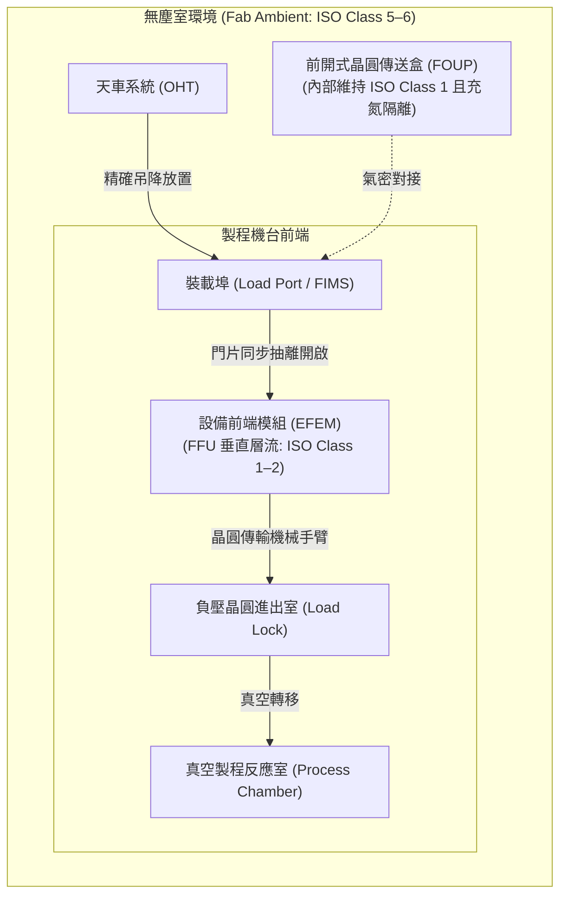

在此架構下，晶圓廠大環境僅需維持在 ISO Class 5 至 Class 6（Class 100 至 1,000）的水準，而晶圓本身在廠內的移動與靜置，皆被嚴格限制於超潔淨的密閉容器中；僅在進入設備內部特定處理空間時，始透過密封介面將其開啟。

---

### 55.4.2 隔離載具演進與物理密封原理：從 SMIF 到 FOUP

微環境載具隨晶圓尺寸與自動化要求而演進，先後出現了標準機械介面與前開式晶圓傳送盒兩種主要型態。

#### 1. 標準機械介面（SMIF）
在 150 mm 與 200 mm 晶圓世代，業界制定了標準機械介面（Standard Mechanical Interface, SMIF, SEMI E19）。SMIF 晶圓盒採用下開式底盤結構。晶圓盒置於機台裝載端後，底盤與晶圓盒外殼分離並連同承載晶圓的晶舟（Cassette）一同垂直下移進入微環境艙內。此設計利用重力將外部可能沉降的微粒阻絕在外，但對於重力負載較大的大尺寸晶圓，垂直吊升機構的機械剛性與穩定度受到物理限制。

#### 2. 前開式晶圓傳送盒（Front Opening Unified Pod, FOUP）
300 mm 製程全面導入符合 SEMI E47.1 規範的前開式晶圓傳送盒（FOUP）。標準 FOUP 可容納 25 片 300 mm 晶圓，滿載重量約為 8 至 9 公斤。其工程技術關鍵包含材料物理、密封機械結構與氣體充填：

* **材料與靜電防護**：FOUP 外殼通常採用高機械剛性、低出氣量（Outgassing）的熱塑性塑料，例如聚碳酸酯（Polycarbonate, PC）或聚醚醚酮（PEEK）。為防止靜電放電（Electrostatic Discharge, ESD）擊穿晶圓表面微細結構，材料內部會摻雜碳纖維或奈米碳管等導電介質，使其表面電阻率維持在靜電消散範圍（$10^6\text{--}10^9\ \Omega/\text{sq}$）。
* **氣密密封（Gasket Sealing）**：FOUP 前門周邊設有精密成型的氟橡膠（Fluoroelastomer）或彈性密封圈，透過門鎖機構（Door Latch Mechanism）均勻壓緊外框，確保在常壓條件下微粒侵入率降至零。
* **氣體置換清洗技術（FOUP Purge Technology）**：在先進邏輯與高密度記憶體製程中，晶圓在空氣中暴露所引起的自然氧化層生成與氣狀分子污染物（Airborne Molecular Contamination, AMC，如有機揮發物、酸性氣體、水氣）吸附，會嚴重破壞元件特性。現代 FOUP 底盤配置進排氣擴散閥門（Diffuser Valves），可對接裝載埠進行超高純度氮氣（$\text{N}_2$）或極度乾燥空氣（XCDA）的微環境置換。

微環境置換的暫態濃度衰減服從一階稀釋方程式：

$$
C(t) = C_{\text{in}} + \left( C_0 - C_{\text{in}} \right) \exp\left( - \frac{Q_p}{V_F} t \right)
$$

其中 $C(t)$ 為時間 $t$ 時盒內的污染物濃度，$C_0$ 為初始濃度，$C_{\text{in}}$ 為充填氣體的背景濃度，$Q_p$ 為置換氣體體積流量，$V_F$ 為 FOUP 內部自由容積（約 $35\text{--}40\text{ L}$）。透過大流量快速置換，FOUP 內部的水氣相對濕度可在數十秒內降至 $1\%$ RH 以下，大幅抑制常溫氧化反應速率。

---

### 55.4.3 物料搬運與設備前端模組（EFEM）之潔淨度介面控制

晶圓由微環境進入製程設備的實體銜接處稱為「設備前端模組」（Equipment Front End Module, EFEM）。EFEM 是一個將廠內輸送環境與機台高真空/製程環境物理隔絕的微環境腔體。

#### 1. 前開式介面機械標準（FIMS）之運作順序
EFEM 外部直接安裝裝載埠（Load Port）。裝載埠依循前開式介面機械標準（Front-Opening Interface Mechanical Standard, FIMS, SEMI E62），執行極高精度的物理開門程序：

1. **停靠與對位（Docking）**：自動化搬運設備將 FOUP 放置於裝載埠的三個動態定位銷（Kinematic Pins）上，定位銷保證次毫米等級的空間重複定位精度。
2. **吸附與鎖定**：裝載埠外門板靠近 FOUP 前門，其上的真空吸盤或機械銷牢牢鎖定 FOUP 門栓旋鈕。
3. **周邊密封壓緊**：機構推動 FOUP，使其門框邊緣緊密壓迫裝載埠開口周邊的氣密墊圈，將「FOUP 外門表面」與「裝載埠外表面」夾持於一個封閉的微隙區間內，該間隙體積微小，防止外部無塵室微粒混入。
4. **抽離與內藏**：裝載埠機械機構轉動門栓解鎖 FOUP，並將其前門垂直向下或水平推入 EFEM 內部，完成對接。此時，晶圓完全暴露於 EFEM 內部空間中。

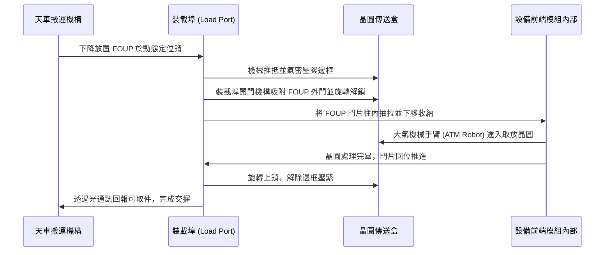

#### 2. 流場與正壓梯度控制
為防止人員維護或裝載埠微隙滲漏造成外部未受控空氣侵入，EFEM 頂部通常整合有專屬風機濾網機組（Fan Filter Unit, FFU，配備極低穿透率之 ULPA 濾網），在腔體內部建立穩定的單向垂直向下氣流（速度通常維持在 $0.4\text{--}0.5\text{ m/s}$）。

氣流流經晶圓表面後，經由底部的多孔格柵板排出。為確保絕對的流體屏障，EFEM 內部必須對外部廠務環境維持正壓差：

$$
\Delta P = P_{\text{EFEM}} - P_{\text{Fab}} \ge 1.0\text{--}3.0\text{ Pa}
$$

當開口瞬間產生時，壓差所驅動的流場速度（根據白努利原理，空氣射流速度 $v_j \approx \sqrt{2\Delta P / \rho}$，其中 $\rho$ 為空氣密度）可確保氣流一律由微環境向外逸出，嚴格阻斷微粒溯流逆向滲透。

---

### 55.4.4 天車空中自動化搬運系統（OHT）之空間布局與動態整合

由於 300 mm 晶圓片直徑大且 25 片裝 FOUP 具備相當重量，人手搬運極易因疲勞失誤引發震動或墜落破損；加上現代晶圓廠月產能動輒數萬片，廠內日傳輸量高達數十萬趟次，300 mm 及後續先進製程已完全淘汰人工搬送，全面導入空中走行天車搬運系統（Overhead Hoist Transport, OHT）。

#### 1. 空間拓撲與桁架軌道配置
OHT 系統巧妙利用了無塵室生產層上方、FFU 下方的**天花板桁架死區空間（Ceiling Truss Space）**。該處位於操作人員與設備機台上方，避開了昂貴的地面無塵室樓地板面積：

* **軌道網絡架構**：天花板裝設鋁合金封閉型或工字型導軌，形成龐大且複雜的高架閉環網絡，包含主幹線（Main Highway Loop）、區域循環線（Inter-bay / Intra-bay Loops）與裝載埠專用側線分支（Bypass/Spur Tracks）。
* **動力傳輸與微粒防禦**：為杜絕傳統碳刷或導電輪滑動接觸產生的機械磨耗微粒，現代 OHT 天車全面採用**非接觸式感應電力傳輸（Inductive Power Transfer, IPT）**。高頻交變電流（例如 $20\text{--}40\text{ kHz}$）通入沿軌道佈設的利茲線圈，天車上的拾電線圈透過高頻電磁感應耦合取得直流動力，機械運作完全消除電氣摩擦微粒。此外，走行輪採用低磨耗、高韌性的特殊聚氨酯（Polyurethane）配方。

#### 2. 懸吊定位運動學與防擺控制
OHT 車體直接安裝起重滑車模組（Hoist Mechanism），包含多組高強度聚酯纖維編織帶或金屬鋼帶、步進馬達與抓手機構（Gripper）。當天車巡弋至目標機台上方時，其垂直取放（Loading/Unloading）具備極高的物理精度要求：

1. **三維空間尋標**：透過車載雷射測距傳感器（Laser Displacement Sensors）與裝載埠頂部的反射標籤校準，定位精確度需小於 $\pm 0.5\text{ mm}$。
2. **動態主動防擺（Anti-Sway Control）**：吊帶懸吊 FOUP 在物理模型上可簡化為單擺系統，其固有自然擺動角頻率為 $\omega_n = \sqrt{g / L_s}$（$g$ 為重力加速度，$L_s$ 為吊帶懸垂長度）。在高速降下與上升過程中（吊升速度通常可達 $0.5\text{--}1.0\text{ m/s}$），運動控制器必須引入輸入成形（Input Shaping）或加速度曲線平滑算法，完全抵消加減速引起的慣性擺動，確保 FOUP 底部的動態定位孔能精準無衝擊地插合至裝載埠定位銷上。

!!! note "光通訊交握協定：SEMI E84"
    在 OHT 與機台裝載埠（Load Port）進行實體接觸交接前，兩者必須透過指向性紅外線光通訊（Infrared Optical Communication）進行狀態握手，該標準定義於 **SEMI E84**。
    
    交握流程包含傳送端（OHT）發出「請求裝載（TR_REQ）」、機台確認裝載埠內部潔淨與準備就緒後回應「允許放置（BUSY/READY）」、抓手釋放並升回天花板軌道後確認「放置完畢（COMPT）」。E84 協議在硬體層級建立了互鎖（Interlock）安全機制，徹底避免了因主控排程系統（MES/MCS，見第 54 章）網路封包延遲導致天車在機台開門中途誤砸晶圓盒的災難性事故。

微環境技術與 OHT 自動化系統的緊密結合，使現代半導體廠成功將高危險性的人員操作完全排除在微觀製造介面之外。這種系統化隔離，是當前半導體良率在製程微縮至數奈米節點時，仍能維持高度穩定與極低缺陷密度的工程基石。

<!-- fig:2 -->
<figure markdown>
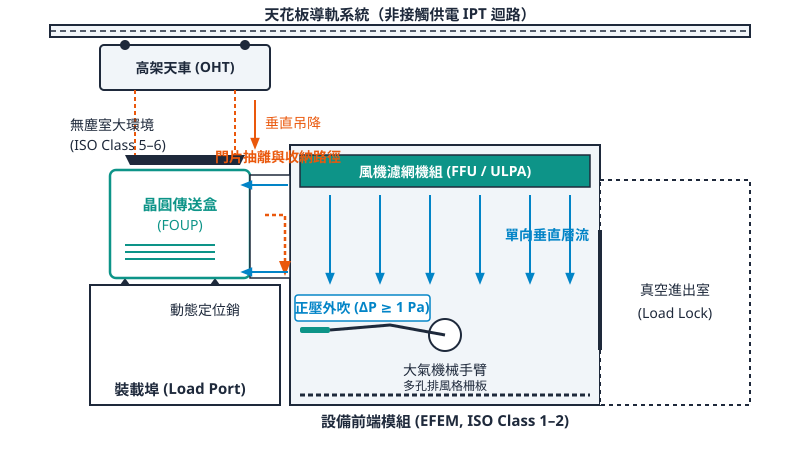
<figcaption>圖 55-2　微環境與自動搬運系統（AI 繪製的示意圖）</figcaption>
</figure>

## 55.5 廠務公用系統總覽地圖與交互依存矩陣

### 全廠公用系統之流體與能量流向地圖

半導體晶圓廠本質上是一座高度整合的熱力學與化學轉換巨型系統。晶圓製程（如蝕刻、薄膜沉積、化學機械研磨等）對環境擾動極度敏感，因此廠務公用系統（Facility Utility Systems）必須提供零中斷、極端穩定的質量流（Mass Flow）與能量流（Energy Flow）。

全廠能量與流體的生命週期可分為四個主要階段：**輸入與轉化**（CUB 端）、**二次分配與精密調控**（Sub-Fab 端）、**製程消耗與反應**（Fab 機台端），以及**廢棄物收集、轉化與再循環**（處理設施端）。

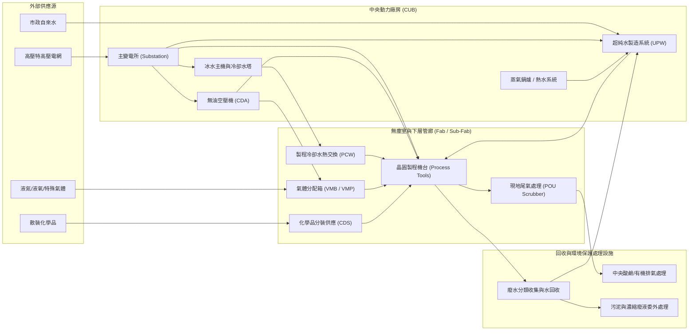

1. **電能流（Power Flow）**：電網輸入高壓電（如 $161\text{ kV}$），經主變電所降壓分配至中壓配電盤（如 $22.8\text{ kV}$ 或 $11.4\text{ kV}$），再降壓至 $480\text{ V} / 380\text{ V} / 220\text{ V}$ 供應動力馬達、冰水主機與無塵室機台。
2. **水資源流（Water Flow）**：市政原水進入 CUB 超純水（Ultra-Pure Water, UPW）系統，經多道純化後送往機台進行清洗；機台排出的製程廢水依化學性質分類（酸鹼廢水、氫氟酸廢水、含銅廢水等），經分流回收處理後，高比例回質作為系統補給水（Makeup Water）。
3. **氣體流（Gas Flow）**：空氣由無油空壓機壓縮除濕製成無油乾燥空氣（Clean Dry Air, CDA）；高純大宗氣體（液氮、液氬、液氧、液氫）經低溫儲槽汽化後輸送；劇毒與特種氣體則由獨立氣瓶櫃（Gas Cabinet）配送至次無塵室（Sub-Fab）的閥箱分配系統（Valve Manifold Box, VMB）。
4. **熱交換流（Thermal Flow）**：機台運轉產生的巨大熱負荷透過密閉迴路的製程冷卻水（Process Cooling Water, PCW）帶走，PCW 經熱交換器將熱量轉移至中央冷卻冰水系統（Chilled Water System, CHW），最終透過冷卻水塔（Cooling Tower）藉由水蒸發顯熱排向大氣。

---

### 公用系統間之介面交互依存矩陣

廠務公用系統絕非各自獨立運作，其物理化學程序高度交織。單一系統的輸出，往往是另一系統穩定運行的先決條件。

| 子系統 | 對輸入系統之依賴（Inputs Required） | 對輸出系統之支援（Outputs Provided） | 介面關鍵參數 |
| :--- | :--- | :--- | :--- |
| **超純水系統 (UPW)** | 電力、自來水、蒸氣（熱水）、冷卻水、CDA | 製程清洗用水、濕式洗滌塔補水、稀釋化學品 | 電阻率 $\ge 18.2\text{ M}\Omega\cdot\text{cm}$、水溫控制 ($\pm 0.5\text{ }^\circ\text{C}$) |
| **製程冷卻水 (PCW)** | 電力、中央冰水（CHW）、UPW（迴路補水） | 機台射頻電源、真空泵、雷射源冷卻 | 供水溫度 ($\pm 1.0\text{ }^\circ\text{C}$)、循環壓差、水質導電率 |
| **無油乾燥空氣 (CDA)** | 電力、冷卻水（散熱） | 氣動閥驅動、傳輸腔吹驅、儀表作動 | 壓力露點 (PDP) $\le -40\text{ }^\circ\text{C}$ 至 $-70\text{ }^\circ\text{C}$、懸浮油分 $\approx 0$ |
| **現地尾氣處理 (POU)** | 電力、CDA、燃料氣、水（PCW/工業水）、氮氣 | 破壞有毒/易燃製程廢氣，送至中央洗滌塔 | 燃燒室溫度、燃氣/助燃氣化學計量比、水洗壓降 |
| **中央排氣洗滌系統** | 電力、工業水/回收水、酸/鹼中和藥劑 | 維持機台負壓排氣、廢氣達標排放 | 排氣靜壓差值、洗滌液 pH 值、水泵循環流量 |
| **冰水與空調系統** | 電力、冷卻塔補充水、防蝕防垢化學品 | 無塵室溫濕度維持、PCW 熱交換 | 供回水溫差（典型 $5\text{ }^\circ\text{C} \to 12\text{ }^\circ\text{C}$）、空氣露點 |

由上表可知，系統間具有強耦合特徵。以超純水（UPW）系統為例，其逆滲透（Reverse Osmosis, RO）膜組在進水溫度發生變動時，透水通量會顯著漂移（溫度每變動 $1\text{ }^\circ\text{C}$，產水量約漂移 $2.5\% \sim 3\%$）。因此，UPW 系統需仰賴蒸氣或高溫熱水系統即時恆溫調控；而熱水鍋爐的鼓風機、燃氣閥門與水泵又全面依賴穩定電力。

!!! note "熱-水-氣耦合效應"
    製程機台內真空乾式泵浦（Dry Pump）的運作即同時體現了多重耦合：泵浦馬達需要**電力**；內部氮氣封（Nitrogen Purge）防止腐蝕性氣體冷凝與軸封漏氣，依賴**高純氮氣**；定子與轉子的摩擦熱及排氣壓縮熱，必須由 **PCW** 即時帶走；泵浦排出的未反應蝕刻氣體則仰賴 **POU 洗滌器** 與**抽氣負壓**連續抽除。四者缺一，泵浦將在數分鐘內因過熱或沉積物卡死而停機。

---

### 骨牌連鎖效應與可靠度備援設計原則

在強耦合的物理網路中，局部的初始擾動極易引發「骨牌連鎖效應（Cascading Failure）」，造成晶圓廠整體製程線的大規模癱瘓。

#### 1. 骨牌連鎖失效機制分析
最典型的連鎖失效起因於**電壓驟降（Voltage Sag）**：

$$V_{\text{sag}} < V_{\text{critical}} \quad (t > t_{\text{ride-through}})$$

當輸電網因雷擊或外力引發數百毫秒的電壓驟降，若特定冰水主機（Chiller）控制回路缺乏穿越能力（Ride-through Capability），將導致冰水機瞬間保護性跳脫：
1. 冰水主機停機 $\implies$ PCW 熱交換器失去冷源，PCW 供水溫度迅速上升。
2. PCW 溫度超限 $\implies$ 乾式真空泵、擴散爐管、微影雷射源触發高溫互鎖（Thermal Interlock）保護停機。
3. 機台非預期停機 $\implies$ 真空腔破裂、晶圓表面薄膜沉積中斷、或蝕刻電漿熄火造成數千片在製品（Wafer in Process, WIP）報廢。
4. 與此同時，無塵室風機濾網機組（FFU）降速，導致室內正壓喪失，外界微粒倒灌，使整體潔淨室環境受損。

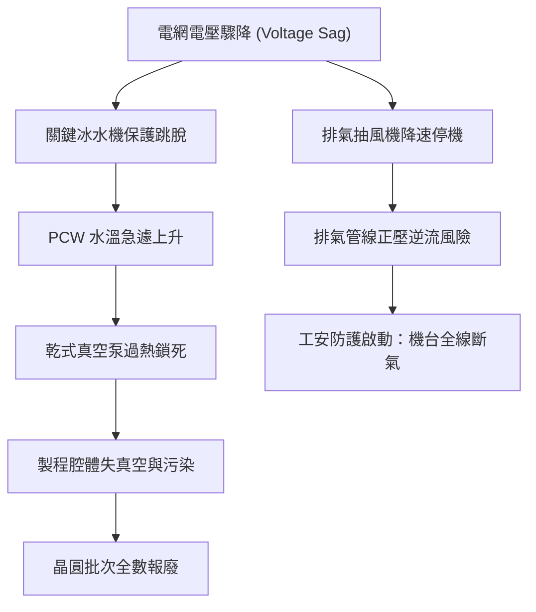

#### 2. 備援架構設計（Redundancy Design）
為了阻斷連鎖效應，廠務工程依據系統關鍵程度（Criticality）導入多重層級的冗餘架構：

*   **$N+1$ 備援**：配置 $N$ 部運轉機組與 $1$ 部常備待命（Standby）機組。任一單元故障或排程保養時，備援單元自動投入。適用於維護窗口彈性較高、短暫壓差波動可容忍之系統（如冷卻水塔、部分排氣風機）。
*   **$N+2$ 或 $2N$ 備援**：關鍵負載採用完全獨立的雙路架構（Dual-path）。$2N$ 意味著兩套 $100\%$ 容量的管網與設備並聯運作，任一主幹線中斷均不影響終端負載。適用於特高壓配電系統（雙迴路供電）、不斷電系統（UPS）以及特殊氣體供應。
*   **熱備援（Hot Standby）與無擾動切換**：備用設備保持全預熱或降載運轉狀態（如 UPW 雙管環網輸送、旋轉式不斷電系統柴油引擎預熱），當主系統失能時，可於毫秒（ms）等級接管負載，避免物理量中斷。

#### 3. 系統可用度數學模型
系統可靠度工程中，整體公用系統的穩態可用度（Operational Availability, $A_o$）取決於平均故障間隔時間（MTBF）與平均修復時間（MTTR）：

$$A_o = \frac{\text{MTBF}}{\text{MTBF} + \text{MTTR}}$$

對於由 $m$ 個獨立子系統組成的純串聯無冗餘生命線系統，整體可用度 $A_{\text{total}}$ 為各子系統可用度之乘積：

$$A_{\text{total}} = \prod_{i=1}^{m} A_i$$

若單一子系統可用度為 $99.9\%$（一年停機約 $8.76$ 小時），當串聯 $15$ 個公用子系統時，整體全廠可用度將驟降至：

$$A_{\text{total}} = (0.999)^{15} \approx 98.51\%$$

此等同於全廠一年非預期停機超過 $130$ 小時，這在資本密集且連續生產的半導體晶圓廠是絕對無法接受的。因此，公用設施內部必須透過並聯冗餘提升個別項目的等效可用度：

$$A_{\text{parallel}} = 1 - \prod_{j=1}^{k} (1 - A_j)$$

透過 $N+1$ 或 $2N$ 的拓撲設計，個別節點可用度可提升至 $99.9999\%$（「六個九」），進而確保全廠公用系統得以支撐連續 8,760 小時的不間斷運轉。

---

### 後續章節架構導引：從個別管線動力到全廠監控之技術地圖

公用系統的運算與控制本質上是一個多物理量耦合的複雜巨系統。為使讀者系統化掌握各項核心技術，本篇（第十篇：廠務與廠區設施）自本章（第 55 章）建立整體空間與系統地圖後，將依序由局部動力系統向外展開，直至全域整合監控與永續策略：

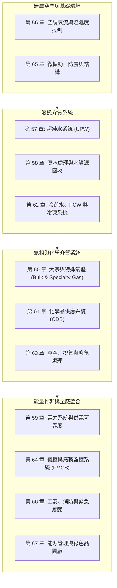

*   **無塵空間控制層**：第 56 章將深入流體力學之渦流抑制、層流控制及化學微污染（AMC）防制；第 65 章探討廠房基礎結構如何抵抗由極紫外光微影（EUV）與穿透式電子顯微鏡（TEM）引發之奈米級微振動要求。
*   **流體動力與物質循環層**：第 57 章與第 58 章剖析自「超純水純化」至「製程廢水分流處理與回用」的閉環化學程序；第 62 章論述跨越百萬級冷噸（Refrigeration Ton）之熱能轉移物理學。
*   **氣相與特化分子遞送層**：第 60、61 及 63 章探討自超高真空（UHV）、自燃性/劇毒性特殊氣體、超高純度電子化學品之輸送管閥材料、軌道焊接（Orbital Welding）技術，直到終端排氣洗滌之分解破壞動力學。
*   **控制、安全與永續大腦層**：第 59 章聚焦於毫秒級電壓驟降補償與不斷電系統配置；第 64 章闡述全廠數萬點感測器如何透過廠務監控系統（Facility Monitoring and Control System, FMCS）進行即時分散式控制；第 66 與 67 章則探討極端化學/火災防護標準，以及現代先進製程廠房如何平衡極端能耗與淨零碳排指標。

讀者在閱讀各專題章節時，應隨時參照本節之「交互依存矩陣」與「流向地圖」，從晶圓廠全局系統工程（Systems Engineering）的高度，理解個別物理設備在全廠生命線中所處之關鍵坐標。

## 本章重點

1. **廠務工程之機能定位與可用度極限**：廠務系統為晶圓製造之生命線，負責提供高度穩定之電力、超純水、氣體、冷卻水與潔淨環境。因先進半導體製程具備長生產週期與不可逆特性，系統可用度（Availability）需達到 99.999% 至 99.9999% 的工業極限，仰賴 $N+1$ 或 $2N$ 容錯備援與閉環網狀架構阻斷非計畫性停機。
2. **埃米世代對環境擾動之物理敏感性**：奈米與埃米級關鍵尺寸使晶圓製造對微觀環境變化展現極高敏感度。晶圓徑向熱膨脹在微小溫差下即超出套準誤差（Overlay Error）預算；外部微振動將破壞曝光光學成像穩定性，需符合 VC-D/VC-E 規範；相對濕度偏離則會引發光阻反應失常、薄膜腐蝕或靜電放電（ESD）破壞。
3. **晶圓廠立體分層與三維拓撲解耦**：現代晶圓廠建築垂直劃分為天花板靜壓室（Plenum）、主製程層（Fab Floor）、下層設施（Sub-Fab）與基底結構。此架構實現了單向層流閉環循環、三維管網重力分流、震動源與熱源之物理隔離，並使輔助支援設備能在不干擾無塵室生產的前提下進行離線維護。
4. **懸浮微粒破壞機制與 ISO 14644-1 規範**：懸浮微粒會引發微影圖形遮蔽、反應離子蝕刻之微遮蔽（Micromasking）與閘極介電層崩潰。無塵室潔淨度遵循 ISO 14644-1 公式 $C_n = 10^N (0.1/D)^{2.2}$，且微粒驗證必須嚴格界定空態（As-built）、靜態（At-rest）與動態（Operational）三種佔用狀態。
5. **微環境理念與自動化搬運整合**：半導體製造已由高耗能的「全室舞廳式」潔淨室，轉變為大環境（ISO Class 5～6）與局部「微環境」（ISO Class 1）解耦之架構。透過前開式晶圓傳送盒（FOUP）氣密充氮、設備前端模組（EFEM）正壓梯級防護、FIMS 精密機械對接，以及天車空中自動化搬運系統（OHT）之非接觸供電與防擺控制，全面阻斷人員微粒與化學污染。
6. **公用系統強耦合特性與防骨牌連鎖失效**：電力、水資源、特殊氣體與熱交換系統高度互鎖，單一局部失效（如電壓驟降）極易透過熱-水-氣交互鏈引發骨牌連鎖效應（Cascading Failure）。廠務工程必須藉由多層級冗餘設計與動態熱備援，將串聯系統之失效率降至最低。

---

## 重點圖卡

複習時看這幾張就能抓住本章重點；[圖卡庫](../cards.md)可以下載成圖片。

<figure markdown>
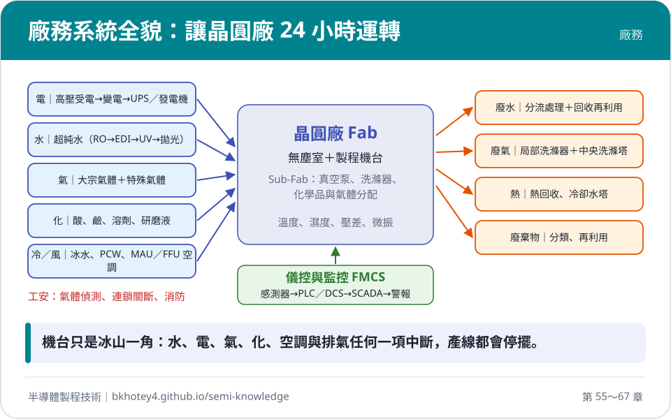
<figcaption>核心概念圖卡：廠務系統全貌：讓晶圓廠 24 小時運轉</figcaption>
</figure>

<figure markdown>
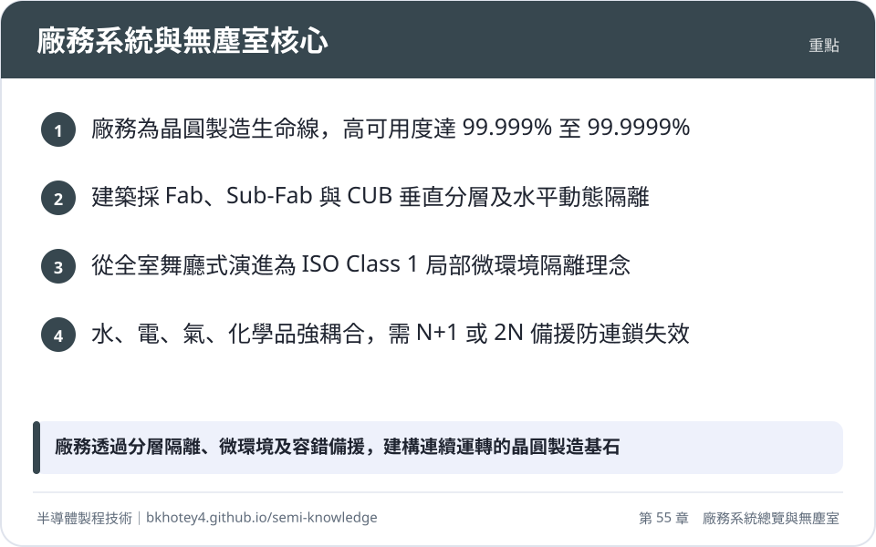
<figcaption>重點圖卡：廠務系統與無塵室核心</figcaption>
</figure>

<figure markdown>
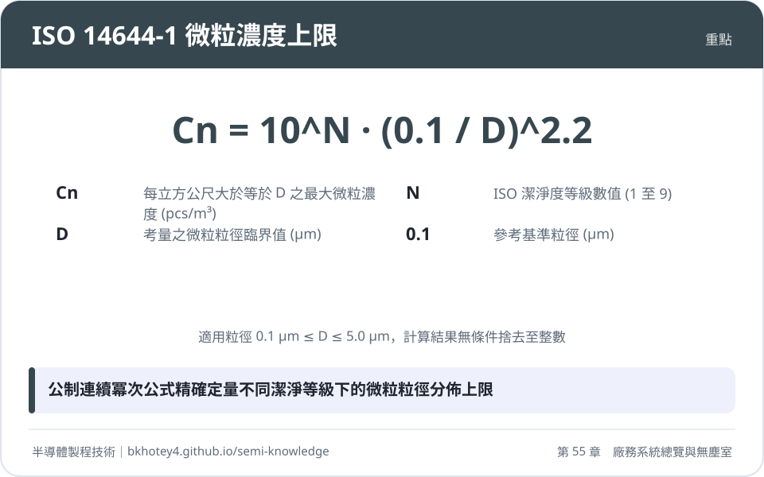
<figcaption>重點圖卡：ISO 14644-1 微粒濃度上限</figcaption>
</figure>

<figure markdown>
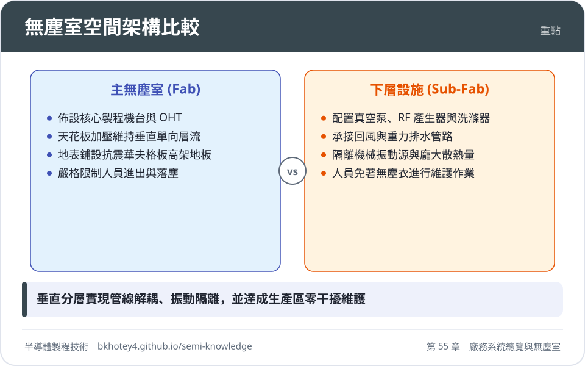
<figcaption>重點圖卡：無塵室空間架構比較</figcaption>
</figure>

<figure markdown>
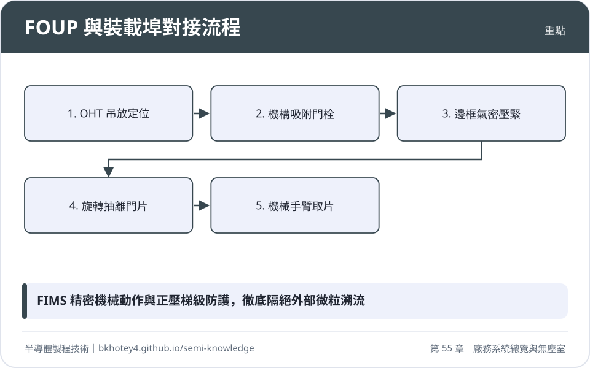
<figcaption>重點圖卡：FOUP 與裝載埠對接流程</figcaption>
</figure>

## 習題

**1.** 在 3 奈米邏輯製程中，光學微影的套準誤差（Overlay Error）容許預算為 $1.5\text{ nm}$。直徑 $300\text{ mm}$ 的單晶矽晶圓在室溫下的熱膨脹係數約為 $\alpha_{\text{Si}} = 2.6 \times 10^{-6}\text{ K}^{-1}$。若將單晶矽晶圓視為等向性線膨脹，且製程規範分配給晶圓熱膨脹的容許變形量上限為套準誤差預算的 $20\%$，試計算微影機台內部曝光微環境所允許的最大溫度波動範圍 $\Delta T$（以 $\pm \text{mK}$ 表示）。

??? success "參考解答"
    依據固體線膨脹方程式：
    $$\Delta L = \alpha_{\text{Si}} \cdot L_0 \cdot \Delta T$$
    其中：
    *   原始尺寸 $L_0 = 300\text{ mm} = 0.3\text{ m}$
    *   熱膨脹係數 $\alpha_{\text{Si}} = 2.6 \times 10^{-6}\text{ K}^{-1}$
    *   容許徑向變形量上限 $\Delta L_{\text{max}} = 1.5\text{ nm} \times 20\% = 0.3\text{ nm} = 3.0 \times 10^{-10}\text{ m}$
    
    將數值代入公式求解容許溫差 $\Delta T$：
    $$\Delta T = \frac{\Delta L_{\text{max}}}{\alpha_{\text{Si}} \cdot L_0} = \frac{3.0 \times 10^{-10}\text{ m}}{(2.6 \times 10^{-6}\text{ K}^{-1}) \times (0.3\text{ m})} \approx 3.846 \times 10^{-4}\text{ K} = 0.385\text{ mK}$$
    
    因此，微環境允許的最大溫度波動範圍為約 $\pm 0.385\text{ mK}$（若以全域溫差計則約為 $0.385\text{ mK}$ 峰對峰值）。此結果印證了先進微影機台內部必須導入毫克耳文（mK）等級的高精度主動恆溫控制。

**2.** 試從流體動力學、機械振動隔離、管線幾何拓撲與運轉維護四個面向，論述現代 12 吋先進晶圓廠為何必須採取「Fab 主樓層」與「Sub-Fab 下層設施」的垂直分層結構，而非配置於同一平面。

??? success "參考解答"
    1.  **流體動力學與流場封閉性**：主無塵室需要維持自天花板靜壓室垂直向下流動的單向層流，氣流穿透多孔高架地板後，必須藉由 Sub-Fab 或專用回風道低阻抗回流至天花板。垂直分層構成封閉垂直循環，避免側向回風引發大規模微粒紊流。
    2.  **機械振動與結構隔離**：乾式真空泵、馬達與大功率射頻（RF）產生器等旋轉及振動設備配置於 Sub-Fab 地板，並安裝防震基座，可將機械振動透過地基吸收；主樓層的精密光學微影機台與量測設備則直接支承於厚重剛性華夫格板（Waffle Slab），有效截斷低頻微振動干擾。
    3.  **管線幾何拓撲解耦**：先進機台需介接數十種超純水、化學品、惰性氣體、特種毒性氣體與排氣排水管線。將管網置於 Sub-Fab，介質可由下往上引入機台，廢棄物則順應重力向下排放，避免了同層佈線造成的管線干涉與洩漏污染晶圓的風險。
    4.  **運轉維護與稼動率維持**：輔助附屬單元（如真空泵換油、本地洗滌器維護、RF 電源校正）皆可在 Sub-Fab 進行，廠務與設備工程師無須穿著無塵衣進入昂貴且受限的主無塵室，達到「晶圓生產區零干擾」，顯著降低人員發塵並維持產線高稼動率。

**3.** 某半導體廠新擴建之一座黃光微影無塵室，其潔淨度設計目標為 ISO 14644-1 Class 4 等級：
(1) 依據 ISO 14644-1 分級公式，計算該無塵室在粒徑 $\ge 0.2\ \mu\text{m}$ 與 $\ge 0.5\ \mu\text{m}$ 時，每立方公尺空氣中所容許的最大累積微粒濃度 $C_n$（計算結果請依規範無條件捨去至整數）。
(2) 若使用每分鐘取樣量為 $1\text{ CFM}$（立方英呎/分鐘，已知 $1\text{ CFM} \approx 28.3\text{ L/min}$）之光學粒子計數器（OPC）進行 $\ge 0.5\ \mu\text{m}$ 微粒之潔淨度驗證，依規範要求在達到等級上限濃度時單次取樣需至少能偵測到 20 顆微粒，求每個測試取樣點之最小取樣空氣體積 $V_s$（公升）及對應之最短取樣時間（分鐘，四捨五入取至小數點後兩位）。

??? success "參考解答"
    (1) ISO 14644-1 微粒濃度上限計算公式為：
    $$C_n = 10^N \times \left( \frac{0.1}{D} \right)^{2.2}$$
    已知 $N = 4$：
    *   當 $D = 0.2\ \mu\text{m}$ 時：
        $$C_{n, 0.2} = 10^4 \times \left( \frac{0.1}{0.2} \right)^{2.2} = 10,000 \times (0.5)^{2.2} \approx 10,000 \times 0.2176376 = 2,176.376\text{ pcs/m}^3$$
        依規範無條件捨去至整數，得 **$2,176\text{ pcs/m}^3$**。
    *   當 $D = 0.5\ \mu\text{m}$ 時：
        $$C_{n, 0.5} = 10^4 \times \left( \frac{0.1}{0.5} \right)^{2.2} = 10,000 \times (0.2)^{2.2} \approx 10,000 \times 0.028991 = 289.91\text{ pcs/m}^3$$
        依規範無條件捨去至整數，得 **$289\text{ pcs/m}^3$**（標準表格典型採用未修約外推值 $352\text{ pcs/m}^3$，此處依公式計算值嚴格代入）。

    (2) 依規範計算單次最小取樣空氣體積 $V_s$：
    $$V_s = \frac{20}{C_{n,m}} \times 1000\text{ (L)}$$
    將 $C_{n,m} = C_{n, 0.5} = 289.91\text{ pcs/m}^3$ 代入：
    $$V_s = \frac{20}{289.91} \times 1000 \approx 68.99\text{ L}$$
    
    計數器採樣流量 $Q_s = 28.3\text{ L/min}$，所需最短取樣時間 $t_{\text{min}}$ 為：
    $$t_{\text{min}} = \frac{V_s}{Q_s} = \frac{68.99\text{ L}}{28.3\text{ L/min}} \approx 2.44\text{ 分鐘}$$

**4.** 晶圓置於前開式晶圓傳送盒（FOUP）中，為防止化學微污染與自然氧化層生成，需於裝載埠對其進行超純氮氣清洗（Purge）。假設 FOUP 內部自由容積為 $V_F = 35\text{ L}$，初始水氣濃度為環境濕度對應之 $C_0 = 10,000\text{ ppm}$。清洗用高純氮氣之水氣濃度可視為 $C_{\text{in}} = 0\text{ ppm}$。若裝載埠提供之充氮流量為 $Q_p = 70\text{ L/min}$，且內部混合過程符合一階完全混合稀釋模型：
(1) 寫出盒內污染物濃度隨時間變化的暫態方程式。
(2) 計算盒內水氣濃度降至 $10\text{ ppm}$ 以下所需的最短清洗時間（秒）。

??? success "參考解答"
    (1) FOUP 內部一階稀釋濃度暫態方程式為：
    $$C(t) = C_{\text{in}} + (C_0 - C_{\text{in}}) \exp\left( -\frac{Q_p}{V_F} t \right)$$
    代入已知條件 $C_{\text{in}} = 0\text{ ppm}$ 與 $C_0 = 10,000\text{ ppm}$，得：
    $$C(t) = 10000 \exp\left( -\frac{Q_p}{V_F} t \right)\text{ (ppm)}$$

    (2) 代入參數計算系統時間常數 $\tau$：
    $$\tau = \frac{V_F}{Q_p} = \frac{35\text{ L}}{70\text{ L/min}} = 0.5\text{ min} = 30\text{ s}$$
    將目標濃度 $C(t) = 10\text{ ppm}$ 代入求解 $t$：
    $$10 = 10000 \exp\left( -\frac{t}{30} \right)$$
    $$\exp\left( -\frac{t}{30} \right) = \frac{10}{10000} = 10^{-3}$$
    $$-\frac{t}{30} = \ln(10^{-3}) = -3 \ln(10) \approx -3 \times 2.302585 = -6.9078$$
    $$t = 30 \times 6.9078 \approx 207.2\text{ 秒}$$
    
    因此，盒內水氣濃度降至 $10\text{ ppm}$ 所需的最短清洗時間約為 $207.2$ 秒（約 3.45 分鐘）。

**5.** 某先進晶圓廠製程冷卻水（PCW）系統由 4 台額定規格相同的大型水泵並聯供應，正常全負載運轉時需要 3 台水泵同時啟動方能滿足總循環流量需求。若單一水泵的平均故障間隔時間 $\text{MTBF} = 10,000\text{ 小時}$，平均修復時間 $\text{MTTR} = 10\text{ 小時}$：
(1) 計算單一水泵單元的運轉可用度 $A$。
(2) 該系統配置屬於「$N+1$」備援設計（$N=3$），試推導並計算 PCW 泵浦系統整體之可用度（假設各泵浦故障彼此獨立）。
(3) 若取消備援，僅維持 3 台水泵且無待命機組（純串聯需求），全系統每年非計畫性停機時間約為多少小時？與具備 $N+1$ 備援之架構相比相差多少倍？（一年以 8,760 小時計算）。

??? success "參考解答"
    (1) 單一水泵單元之可用度 $A$ 為：
    $$A = \frac{\text{MTBF}}{\text{MTBF} + \text{MTTR}} = \frac{10000}{10000 + 10} = \frac{10000}{10010} \approx 0.999001$$
    其不可用度（Unavailability）為 $U = 1 - A = \frac{10}{10010} \approx 9.99 \times 10^{-4}$。

    (2) 系統共有 4 台水泵，需至少 3 台正常運轉系統才不致失效。系統失效的條件為「有 2 台或更多台水泵同時發生故障」。
    利用二項式分佈，4 台水泵中恰好發生 $k$ 台故障的機率為 $P_k = \binom{4}{k} U^k A^{4-k}$。
    系統整體的不可用度 $U_{\text{sys}}$ 等於 2 台故障、3 台故障與 4 台全故障之機率和：
    $$U_{\text{sys}} = \binom{4}{2} U^2 A^2 + \binom{4}{3} U^3 A + \binom{4}{4} U^4$$
    由於 $U \ll 1$，高次方項可忽略，以首項進行精確近似：
    $$U_{\text{sys}} \approx 6 \times U^2 \times A^2 \approx 6 \times (9.99 \times 10^{-4})^2 \times (0.999)^2 \approx 5.976 \times 10^{-6}$$
    因此，$N+1$ 備援系統整體可用度為：
    $$A_{\text{sys}} = 1 - U_{\text{sys}} \approx 1 - 5.976 \times 10^{-6} = 0.999994024\text{ （約 99.9994%）}$$

    (3) 若取消備援，僅有 3 台水泵串聯（任何一台故障則系統中斷），無備援系統的可用度為：
    $$A_{\text{no\_redundancy}} = A^3 \approx (0.999001)^3 \approx 0.997006$$
    其不可用度為 $U_{\text{no\_redundancy}} = 1 - 0.997006 = 2.994 \times 10^{-3}$。
    
    每年非計畫性停機時間比較：
    *   無備援系統年停機時間：
        $$T_{\text{down, no\_redundancy}} = 8760\text{ 小時} \times (2.994 \times 10^{-3}) \approx 26.23\text{ 小時}$$
    *   $N+1$ 備援系統年停機時間：
        $$T_{\text{down, N+1}} = 8760\text{ 小時} \times (5.976 \times 10^{-6}) \approx 0.05235\text{ 小時} \approx 3.14\text{ 分鐘}$$
    
    停機時間相差倍數：
    $$\frac{T_{\text{down, no\_redundancy}}}{T_{\text{down, N+1}}} = \frac{26.23}{0.05235} \approx 501\text{ 倍}$$
    結果顯示，$N+1$ 備援設計將公用系統的年停機風險降低了約 500 倍，大幅保障了連續運轉之可靠度。

---

## 本章術語

- **Availability**（系統可用度）：系統在特定時間內維持正常運轉狀態的機率，數學上以平均故障間隔時間與平均修復時間之比值表示。
- **Voltage Sag**（電壓驟降）：供電系統電壓均方根值短暫跌落至額定值之 10% 至 90% 且持續數十毫秒至數秒之電力擾動現象。
- **Airborne Molecular Contamination**（氣狀分子污染物，AMC）：以氣態分子形式存在於環境空氣中，能沉積於晶圓或光學鏡面並引發物理或化學缺陷的微量污染物質。
- **Ceiling Plenum**（天花板靜壓室）：無塵室吊頂上方維持加壓狀態之密閉空腔，用於均勻分配新風並加壓送入濾網單元。
- **Waffle Slab**（華夫格板）：具備週期性開孔結構與極高面內剛性的鋼筋混凝土厚板，用於承載精密機台並進行環境隔振。
- **Sub-Fab**（下層設施）：位於主潔淨室正下方的管線與二次支援單元配置空間，用於安裝泵浦、電源、洗滌塔及熱交換器。
- **Central Utility Building**（中央動力廠房，CUB）：獨立於主廠房之外的集中式能源供應建物，負責生產冷卻水、蒸氣、壓縮空氣與變電配送。
- **Aerodynamic Equivalent Diameter**（空氣動力學等效直徑）：在重力場靜止空氣中終端沉降速度與不規則微粒相同，且密度為標準水密度之標準球體直徑。
- **Cunningham Slip Correction Factor**（肯寧漢滑移修正係數）：當微粒粒徑接近空氣分子平均自由徑時，用以修正微粒表面流體滑移效應對斯托克斯阻力減小之經驗係數。
- **ISO 14644-1**（國際潔淨室標準）：以每立方公尺各粒徑臨界微粒數量連續數學曲線為基準的國際無塵室分級規範。
- **Front Opening Unified Pod**（前開式晶圓傳送盒，FOUP）：符合標準機械規格、具備氣密與充氣功能，用於承載並傳輸 25 片 300 mm 晶圓的密閉微環境容器。
- **Equipment Front End Module**（設備前端模組，EFEM）：安裝於製程機台前端，提供單向潔淨層流與晶圓裝卸大氣機械手臂的受控微環境傳輸模組。
- **Front-Opening Interface Mechanical Standard**（前開式介面機械標準，FIMS）：定義裝載埠與晶圓傳送盒物理對接、門片解鎖與抽離機械動作的自動化界面標準。
- **Overhead Hoist Transport**（空中走行天車搬運系統，OHT）：利用天花板桁架軌道行走，以懸吊鋼帶垂直取放 FOUP 的全自動晶圓搬運天車系統。
- **SEMI E84**（E84 光通訊交握協定）：規範自動化物料搬運設備與生產機台裝載埠之間，透過紅外線指向訊號執行安全互鎖的實體通訊協議。
- **Process Cooling Water**（製程冷卻水，PCW）：閉環循環之高純度低導電率冷卻水，專門用於帶走真空腔體、射頻電源與馬達所散發之廢熱。

## 互動學習

!!! tip "動手試試看"
    - [設備機台圖鑑：風機過濾機組](../equipment.md)

## 產業最新進展

本節由每日產業新聞自動補充，說明本章技術在產業上的最新發展。

<!-- updates -->
（目前尚無補充。）
